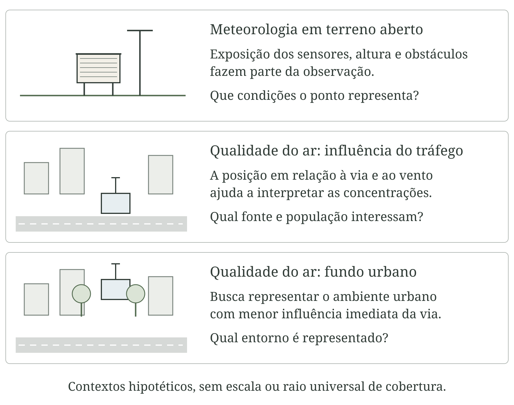
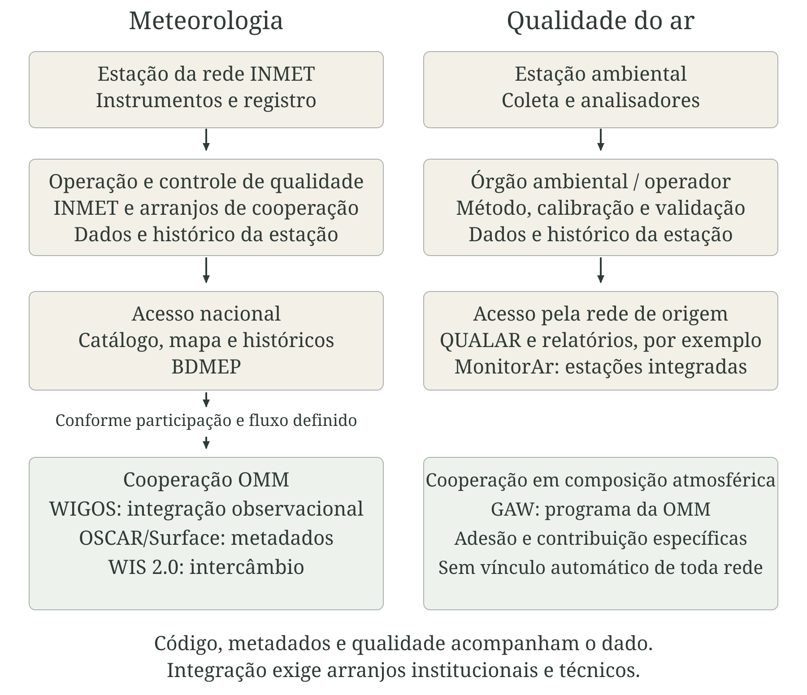
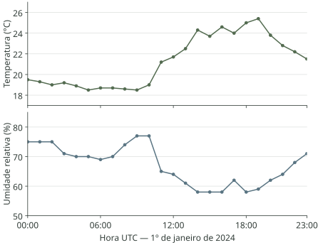
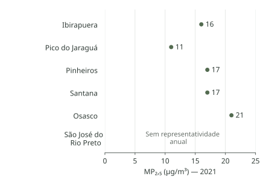

# Estações meteorológicas e de qualidade do ar {#sec-apendice-estacoes}

Uma planilha meteorológica começa muito antes do download. O valor depende de um instrumento, de sua instalação, do momento da leitura e das operações realizadas até a publicação. Este apêndice acompanha esse percurso para ajudar profissionais de saúde a reconhecer equipamentos, localizar fontes oficiais e avaliar se uma série serve à pergunta de interesse.

O Instituto Nacional de Meteorologia (INMET) mantém uma rede meteorológica e participa da cooperação coordenada pela Organização Meteorológica Mundial (OMM). Já o monitoramento da qualidade do ar envolve órgãos ambientais e outras instituições, com integração nacional pelo Sistema Nacional de Gestão da Qualidade do Ar (MonitorAr). As redes podem compartilhar variáveis meteorológicas, mas possuem objetivos, instrumentos e responsabilidades próprios [@inmet2026observacao; @mma2026monitorar].

## O que uma estação observa

Uma estação meteorológica reúne instrumentos para observar condições da atmosfera e, conforme seu programa, do solo. Temperatura, umidade, pressão, precipitação, vento e radiação descrevem componentes distintos do tempo. Nem toda estação possui todos os sensores; um pluviômetro isolado não produz uma série de temperatura.

Uma estação de qualidade do ar mede concentrações de partículas ou gases no ar ambiente. Pode conter diferentes analisadores e também sensores meteorológicos. Vento ajuda a interpretar transporte e dispersão; chuva pode remover partículas; temperatura e radiação participam de processos fotoquímicos; umidade interfere tanto no ambiente quanto em alguns métodos de medição. Nenhuma dessas relações permite atribuir uma concentração a determinada fonte apenas pela coincidência temporal.

A localização é um ponto, mas a representatividade depende da variável e da pergunta. Uma estação próxima de uma avenida pode caracterizar o impacto do tráfego; outra, em um parque, pode atender a objetivo diferente. Não existe um raio único dentro do qual toda pessoa experimenta o valor medido. O capítulo sobre compatibilização de dados desenvolve essa distinção entre localização, suporte e unidade de análise (@sec-espaco-tempo).

## Convencional, automática, analógica ou digital?

Na estação convencional, o observador realiza leituras e registros em horários definidos, verifica os instrumentos e observa fenômenos como nuvens e tempo presente. A caderneta pode ser posteriormente digitada. Registradores mecânicos produzem traçados em papel, que também exigem identificação de horário, leitura e conservação.

Na estação automática, sensores enviam sinais a um registrador eletrônico, ou *datalogger*. Ele aplica configurações de amostragem e processamento, associa horários, armazena registros e pode transmiti-los por rede celular, rádio, satélite ou internet. Alimentação elétrica, bateria, proteção e comunicação integram a instalação. A ausência de um observador a cada leitura não elimina a necessidade de equipe técnica [@wmo2024instrumentos].

::: {.callout-note icon=false title="Conceito-chave: duas classificações diferentes"}

Convencional e automática descrevem a operação da estação. Analógico e digital descrevem instrumentos, sinais ou formas de registro. Uma estação convencional pode usar um termômetro digital lido por uma pessoa; uma automática pode receber um sinal elétrico analógico e convertê-lo em números. No monitoramento do ar, coleta manual também pode ser seguida por análise instrumental em laboratório.

:::

| Aspecto | Convencional | Automática |
|---|---|---|
| Aquisição | Leituras e observações humanas programadas | Sensores e registrador configurado |
| Registro | Caderneta, formulário ou traçado, com possível digitalização | Memória eletrônica e arquivos |
| Frequência | Depende do programa de observação | Amostragem e publicação podem ter frequências diferentes |
| Dependências | Observador, acesso e rotina de leitura | Energia, relógio, sensores, memória e comunicação |
| Cuidados | Leitura, transcrição e interpretação dos traçados | Configuração, deriva, cabos, energia e transmissão |

: Diferenças operacionais entre estações meteorológicas {#tbl-estacoes-operacao}

As duas modalidades podem produzir observações úteis. Automatizar aumenta a frequência possível e facilita a transmissão, mas não garante exatidão. Na transição entre métodos, convém manter medições simultâneas por período planejado, documentar diferenças e avaliar a continuidade da série; concatenar arquivos não resolve uma mudança instrumental.

## Reconhecendo os equipamentos meteorológicos

A @fig-estacoes-convencional apresenta instrumentos associados à observação convencional. São desenhos de reconhecimento, sem escala de instalação; os instrumentos representados não esgotam o programa de uma estação.

::: {.figure-with-source}

{#fig-estacoes-convencional .lightbox width="100%" print-src="estacoes-convencional-print.png" print-width="117mm" fig-alt="Prancha em quatro partes: abrigo ventilado aberto com termômetros, pluviômetro com proveta, heliógrafo de esfera de vidro e registrador mecânico com tambor de papel. Rótulos identificam funções, sem valores observados."}

[Fontes conceituais: INMET; OMM. Elaboração para esta obra, com aquarela gerada por IA (image_gen) e rótulos editáveis. Esquemas sem escala; formas internas simplificadas. Arquivos autorais: GPL-3.0.]{.figure-source}

:::

### Abrigo, temperatura e umidade

O abrigo meteorológico e o protetor de radiação reduzem a incidência de radiação sobre os sensores, permitindo ventilação. Não são sensores de temperatura. Medir um termômetro aquecido pelo sol não equivale a medir adequadamente a temperatura do ar. Sujidade, ventilação deficiente e proximidade de superfícies aquecidas alteram o resultado.

Termômetros de líquido em vidro usam a expansão do líquido. Modelos de máxima e mínima conservam indicações dos extremos entre operações de leitura e reposição. Sensores eletrônicos podem utilizar a variação da resistência elétrica, como nas termorresistências de platina. A temperatura é expressa em graus Celsius (°C); o intervalo representado deve acompanhar o valor.

O psicrômetro reúne termômetros de bulbo seco e úmido. A evaporação resfria o bulbo envolvido por uma mecha molhada; a diferença entre leituras permite estimar umidade mediante relações apropriadas, considerando ventilação e pressão. Mecha suja, água insuficiente ou ventilação inadequada prejudicam o resultado. Sensores capacitivos respondem à interação de um material sensível com o vapor de água. A umidade relativa, em porcentagem, depende também da temperatura: não é uma medida absoluta da quantidade de vapor [@wmo2024instrumentos; @inmet2026observacao].

Temperatura e umidade do ar de superfície são usualmente observadas em abrigo entre 1,25 e 2 m sobre o solo, conforme o programa e as orientações da OMM. A altura efetiva deve constar nos metadados. Temperatura de superfície medida por infravermelho e temperatura do ar em abrigo representam grandezas distintas.

### Pressão e vento

Barômetros medem pressão. A deformação de um elemento sensível pode ser convertida em sinal elétrico; instrumentos históricos também usaram colunas de mercúrio. A unidade habitual é o hectopascal (hPa), numericamente equivalente ao milibar (mbar). Pressão ao nível da estação e pressão reduzida ao nível do mar não são intercambiáveis: a redução é um cálculo que incorpora hipóteses.

Anemômetros de conchas ou hélice relacionam rotação e velocidade; modelos ultrassônicos usam o tempo de propagação do som. A direção pode ser medida por uma veleta ou pelo sistema ultrassônico. Em meteorologia, indica de onde o vento vem, normalmente em graus a partir do norte. Calma, valor ausente e vento do norte precisam ser distinguidos segundo o código do arquivo.

A referência usual de vento de superfície é 10 m de altura em terreno aberto. Prédios, árvores e o próprio mastro podem modificar o escoamento; registrar altura, orientação e obstáculos é parte da medição. Velocidade média e rajada máxima resultam de janelas diferentes. Não se deve calcular a direção média com uma média aritmética comum de ângulos: direções próximas de 0° e 360° exigem tratamento circular [@wmo2024instrumentos].

### Chuva, radiação e insolação

O pluviômetro recolhe água por uma abertura de área conhecida. A lâmina de precipitação é expressa em milímetros: 1 mm corresponde a 1 litro por metro quadrado. No modelo manual, o observador mede a água coletada. No de báscula, pequenos recipientes alternam seu movimento ao atingir determinado volume; pulsos são convertidos em precipitação por uma constante de calibração. Modelos de pesagem acompanham a massa acumulada. O pluviógrafo registra a evolução temporal da precipitação.

A borda coletora deve estar nivelada, com exposição adequada. Folhas, insetos, respingos, vento e perdas por evaporação introduzem erros. A intensidade da chuva pode afetar a resposta de uma báscula. Altura e afastamentos dependem do instrumento e da norma aplicável; a figura não substitui o projeto de instalação.

O piranômetro mede irradiância solar sobre uma superfície, geralmente em watts por metro quadrado (W/m²). A integral no tempo é energia por área, que pode ser publicada em quilojoules por metro quadrado (kJ/m²). Um valor horário em kJ/m² não é diretamente um valor em W/m². Nivelamento, limpeza da cúpula, sombreamento e resposta do sensor precisam ser verificados.

O heliógrafo registra duração do brilho solar. No modelo Campbell–Stokes, uma esfera de vidro concentra a luz sobre um cartão; a marca permite avaliar a duração da insolação, em horas. Sensores eletrônicos também podem medir duração de brilho solar segundo critérios definidos. Insolação não é sinônimo de energia solar recebida [@inmet2026observacao; @wmo2024instrumentos].

### Solo, evaporação e infraestrutura

Termômetros de solo precisam ter profundidade documentada. Sensores de umidade do solo podem estimar conteúdo de água a partir de propriedades elétricas, com resposta dependente da calibração e das características do solo. O tanque Classe A e o evaporímetro de Piche medem evaporação em condições instrumentais próprias; suas leituras não são diretamente a evapotranspiração da vegetação.

A @fig-estacoes-automatica destaca os componentes de uma estação automática. Bateria, painel solar, caixa de proteção, aterramento e comunicação sustentam a observação. Uma falha de transmissão pode ocorrer enquanto o registrador continua medindo; uma série ausente no portal não revela, por si, qual componente falhou.

::: {.figure-with-source}

{#fig-estacoes-automatica .lightbox width="100%" print-src="estacoes-automatica-print.png" print-width="117mm" fig-alt="Estação em terreno aberto: anemômetro e veleta no alto do mastro, protetor de temperatura e umidade mais abaixo, pluviômetro e piranômetro separados, caixa de registro e painel solar. Chamadas identificam cada componente; as proporções são esquemáticas."}

[Fontes conceituais: OMM; INMET. Elaboração para esta obra, com aquarela gerada por IA (image_gen) e chamadas editáveis. Sem escala de instalação. Arquivos autorais: GPL-3.0.]{.figure-source}

:::

## Como se mede a qualidade do ar

A estação de ar ambiente busca amostrar uma parcela de ar representativa de seu objetivo. Entradas, tubulações, vazão e condições internas são tão importantes quanto o analisador. Vazamentos, contaminação, deposição nas linhas e tempo de transporte podem alterar a amostra. A tomada de ar não deve ser confundida com uma medição dentro de chaminé, destinada a caracterizar emissão.

### Partículas: do filtro ao sinal eletrônico

Material particulado inalável (MP₁₀) e fino (MP₂,₅) são frações definidas por seleção aerodinâmica, com diâmetros de corte nominais de 10 e 2,5 micrômetros (µm). O separador não funciona como uma peneira de exclusão perfeita: possui uma curva de eficiência que depende, entre outros fatores, da vazão.

Na gravimetria, o ar atravessa um filtro previamente condicionado e pesado. Depois da coleta, o filtro é novamente condicionado e pesado em laboratório. A diferença de massa, com os controles previstos no método, é dividida pelo volume de ar amostrado. Assim, a concentração depende de massa e volume, não apenas da leitura da balança.

A atenuação beta estima a massa depositada pela alteração na transmissão de radiação através do material coletado. Equipamentos ópticos detectam luz espalhada por partículas e usam uma relação para estimar concentração. A resposta óptica depende de tamanho, composição, propriedades ópticas e umidade; a estimativa de massa não corresponde à pesagem direta de cada partícula [@mma2020monitoramento; @cetesb2022ar].

### Gases: métodos específicos

Um analisador não mede igualmente todos os gases. A @tbl-estacoes-analisadores resume princípios usuais, sem estabelecer equivalência regulatória entre qualquer equipamento que os utilize. A configuração, o desempenho demonstrado e os métodos aceitos pelo órgão competente precisam ser verificados.

| Poluente | Princípio usual | Ponto de atenção |
|---|---|---|
| O₃ — ozônio | Absorção de radiação ultravioleta | Perdas na linha, interferências e referência de calibração |
| NO₂ — dióxido de nitrogênio | Quimiluminescência, com canais para NO e conversão de NO₂ | Eficiência e seletividade do conversor; NO₂ pode ser obtido por diferença |
| SO₂ — dióxido de enxofre | Fluorescência ultravioleta | Interferentes, umidade e estabilidade da resposta |
| CO — monóxido de carbono | Absorção no infravermelho não dispersivo | Interferências e controle de zero e resposta |
| MP₂,₅ e MP₁₀ | Gravimetria, atenuação beta ou métodos ópticos | Seleção de tamanho, vazão, umidade e validade da conversão |

: Princípios de medição de poluentes em estações de ar ambiente {#tbl-estacoes-analisadores}

Fonte: síntese de MMA (2020) e CETESB (2022). A rede automática descrita no relatório CETESB de 2021 utiliza atenuação beta para material particulado; o quadro inclui também princípios empregados em outros instrumentos [@mma2020monitoramento; @cetesb2022ar].

### Coleta manual, automática e passiva

Na coleta manual, a amostra é recolhida e encaminhada à análise. Uma coleta integrada de 24 horas produz informação sobre aquele intervalo, sem localizar o horário de um pico. O calendário pode ser descontínuo; dias sem coleta não correspondem a dias sem poluição.

A estação automática realiza medições frequentes e publica agregações, frequentemente horárias. A resolução exibida no portal pode diferir da amostragem interna. Zero, gás de referência, verificações de vazão, limpeza e substituição de componentes integram a rotina; períodos de manutenção devem ser identificados.

Amostradores passivos recolhem determinadas substâncias por difusão, sem bombeamento ativo. Exigem tempo de exposição, taxa de amostragem e método analítico definidos. São úteis em campanhas espaciais, mas uma amostra integrada durante semanas não descreve variações horárias.

::: {.figure-with-source}

{#fig-estacoes-ar .lightbox width="100%" print-src="estacoes-ar-print.png" print-width="117mm" fig-alt="Três vinhetas mostram abrigo com entrada de ar e analisadores, balança em laboratório para filtros e sensor compacto de partículas. Abaixo, um fluxo distingue coleta com controle de vazão, acondicionamento e análise, e cálculo da concentração."}

[Fontes conceituais: MMA; CETESB. Elaboração para esta obra, com aquarela gerada por IA (image_gen), revisão da separação campo–laboratório e diagrama editável. Instrumentos esquemáticos, sem escala. Arquivos autorais: GPL-3.0.]{.figure-source}

:::

### Sensores de baixo custo

Sensores compactos podem ampliar cobertura em pesquisa, educação e acompanhamento local. Preço e tamanho não determinam qualidade: é necessário conhecer o desempenho para o poluente, a concentração e as condições ambientais de interesse. Sensores de gases podem apresentar sensibilidade cruzada; os ópticos de partículas podem responder de modo diferente a aerossóis úmidos e secos.

A Agência de Proteção Ambiental dos Estados Unidos (EPA) disponibiliza protocolos de avaliação desses sensores. A colocalização coloca o sensor próximo de um equipamento de referência, em condições comparáveis, para avaliar seu comportamento. Uma correção ajustada em determinado local e estação do ano não está automaticamente validada em outro ambiente. Mudanças de firmware, envelhecimento e deriva precisam ser acompanhados. Documentar erro, completude e estabilidade é mais informativo do que apresentar apenas uma correlação elevada [@epa2026sensores].

## Localização, calibração e continuidade

O objetivo orienta a implantação. Na meteorologia, uma observação de referência em terreno aberto e uma campanha de microclima dentro de uma rua respondem a perguntas diferentes. No monitoramento do ar, fundo urbano, tráfego e influência industrial descrevem situações que precisam acompanhar a interpretação. A @fig-estacoes-localizacao apresenta contextos hipotéticos, sem impor distâncias universais.

::: {.figure-with-source}

{#fig-estacoes-localizacao .lightbox width="100%" print-src="estacoes-localizacao-print.png" print-width="117mm" fig-alt="Três esquemas mostram uma estação meteorológica em terreno aberto, uma estação de ar próxima a uma via e outra em área urbana afastada da via. Cada painel liga o local a uma pergunta distinta, sem círculos de cobertura nem valores simulados."}

[Fonte: elaboração conceitual baseada em OMM e CETESB. Desenho vetorial autoral; contextos hipotéticos, sem escala. Licença: GPL-3.0.]{.figure-source}

:::

Calibração estabelece a relação entre indicação e referência, com incerteza; ajuste altera o instrumento para modificar sua resposta. Verificação avalia se o comportamento atende a requisitos. Os termos não são sinônimos. Limpeza ou troca de bateria não substitui calibração, e a validade de uma calibração não corrige uma instalação inadequada.

O histórico da estação deve conservar coordenadas, altitude, fotografias do entorno, alturas, instrumentos, números de série, métodos, calibrações, manutenção e alterações de processamento. Crescimento de árvores, novas edificações e deslocamentos podem criar descontinuidades. Uma mudança no nível da série pode ser ambiental ou operacional; a investigação exige metadados e comparação tecnicamente justificada [@wmo2024instrumentos; @wmo2023climatological].

## Da estação às redes nacionais e internacionais

O operador responde por instalação, funcionamento, documentação e controles. O INMET administra sua rede e oferece produtos para diferentes usos. Dados publicados por uma instituição parceira não passam a integrar o acervo do INMET apenas porque utilizam sensores semelhantes ou seguem recomendações internacionais.

A OMM coordena normas e cooperação entre seus membros. O Sistema Integrado de Observação Global da OMM, conhecido pela sigla inglesa WIGOS, organiza a integração dos sistemas observacionais. O OSCAR/Surface é uma ferramenta de metadados: informa características, localização, variáveis e histórico das plataformas cadastradas. Não substitui o banco de séries de cada provedor [@wmo2026wigos].

O identificador de estação WIGOS possui quatro blocos. Códigos locais do operador, antigos números sinóticos da OMM e identificadores WIGOS devem ser relacionados por metadados oficiais. Não se deve construir essa correspondência apenas pela aparência do código. No arquivo INMET usado adiante, o campo original se chama `CODIGO (WMO)` e contém `A701`; conservar esse cabeçalho não autoriza tratar `A701` como um identificador WIGOS completo.

O Sistema de Informação da OMM 2.0 (WIS 2.0) entrou em operação em janeiro de 2025, iniciando a transição do Sistema Global de Telecomunicações (GTS) e do WIS anterior. Ele apoia descoberta e intercâmbio de dados e metadados. A participação efetiva de uma estação depende da organização responsável, do cadastro e dos fluxos implementados; não decorre automaticamente da compra de um equipamento [@wmo2026wis2].

Para composição atmosférica, o programa de Vigilância da Atmosfera Global, GAW (*Global Atmosphere Watch*), coordena observações e atividades científicas internacionais. As redes brasileiras de qualidade do ar e o MonitorAr possuem seus próprios arranjos de operação e divulgação. Não é correto apresentar toda estação ambiental como subordinada ao INMET ou vinculada ao GAW [@wmo2026gaw; @mma2026monitorar].

::: {.figure-with-source}

{#fig-estacoes-redes .lightbox width="100%" print-src="estacoes-redes-print.png" print-width="117mm" fig-alt="Dois caminhos paralelos: observações meteorológicas chegam ao operador e ao INMET, com acesso nacional e intercâmbio internacional conforme participação; medições do ar chegam aos órgãos ambientais, suas bases e MonitorAr. WIGOS, OSCAR e WIS têm funções distintas; GAW aparece como programa de cooperação, sem vínculo automático."}

[Fonte: elaboração a partir da documentação institucional do INMET, MMA e OMM. Setas indicam fluxos condicionados aos arranjos de cada rede; não representam a adesão de todas as estações. Licença do desenho: GPL-3.0.]{.figure-source}

:::

## Onde obter dados e metadados

Comece identificando a estação, o produto e o período. Um mapa com uma leitura recente não garante acesso à série completa, e uma estação visível no catálogo pode ter intervalos sem operação. Os caminhos abaixo foram consultados em 5 de outubro de 2026; interfaces e exigências podem mudar.

| Recurso oficial | Finalidade e cobertura | Formato, cadastro e cuidado |
|---|---|---|
| [Catálogos do INMET](https://portal.inmet.gov.br/paginas/catalogoaut) e [mapa de estações](https://mapas.inmet.gov.br/) | Localizar estações da rede INMET, códigos e metadados | Catálogo em CSV e mapa visual, sem cadastro; situação atual não descreve todo o histórico |
| [Históricos anuais do INMET](https://portal.inmet.gov.br/dadoshistoricos) | Obter séries das automáticas do INMET | ZIP anuais com CSV, sem cadastro; verificar início e falhas de cada estação |
| [BDMEP](https://bdmep.inmet.gov.br/) | Solicitar séries históricas da rede INMET, inclusive convencionais | Portal de pedidos; conferir cadastro e formato oferecido, variáveis e período da consulta |
| [MonitorAr](https://monitorar.mma.gov.br/) | Consultar estações das redes de ar integradas ao sistema | Painel visual público; cobertura parcial; preservar poluente, janela e atualização |
| [Dados abertos do MonitorAr](https://dados.mma.gov.br/dataset/ar-puro-monitorar) | Obter séries das redes integradas, de 2022 a 2025 no catálogo consultado | ZIP com CSV e dicionário PDF, sem cadastro; cobertura depende das redes participantes |
| [CETESB/QUALAR](https://qualar.cetesb.sp.gov.br/qualar/home.do) | Consultar estações das redes de São Paulo | Consultas e relatórios no portal; cadastro para acesso autenticado; conferir opção de exportação e distinguir concentração de índice |
| [Repositório CETESB](https://repositorio.cetesb.sp.gov.br/) | Obter relatórios de São Paulo, por edição e ano | PDF público, sem cadastro; tabelas agregadas não substituem séries horárias |

: Caminhos para acessar observações e documentação {#tbl-estacoes-acesso}

BDMEP é a sigla oficial, historicamente associada ao Banco de Dados Meteorológicos para Ensino e Pesquisa; o portal também apresenta o serviço como Banco de Dados Meteorológicos. A descrição institucional do serviço destaca séries diárias convencionais. A oferta efetiva deve ser conferida na interface, enquanto os históricos anuais constituem uma via pública específica para dados automáticos [@inmet2026bdmep; @inmet2026historicos].

No INMET, selecione a estação pelo código e confira nome, coordenadas e altitude; escolha o produto histórico; obtenha o arquivo; leia as linhas de metadados antes do cabeçalho. Para séries convencionais, registre horários e definições dos resumos: uma média compensada não deve ser substituída pela média simples de leituras disponíveis.

Na qualidade do ar, selecione órgão, estação, poluente, unidade e tempo de média. Confira a validade dos registros e a possibilidade de exportação. O Índice de Qualidade do Ar (IQAr) é uma transformação para comunicação, não uma concentração. Seus critérios e os padrões aplicáveis são discutidos no capítulo de qualidade do ar (@sec-qualidade-ar).

Guarde o arquivo recebido, a data de acesso, os filtros e a documentação. Não pressuponha uma interface de programação pública estável por ter encontrado um endereço utilizado internamente por um painel. Uma biblioteca de terceiros pode facilitar a leitura, mas a autoria e a versão do dado continuam pertencendo ao provedor.

## Dois exemplos reais comentados

### INMET: uma linha horária tem várias referências de tempo

O primeiro exemplo usa o arquivo anual de 2024 da estação automática São Paulo–Mirante, código A701. O cabeçalho informa latitude −23,49638888°, longitude −46,61999999° e altitude 785,64 m. O recorte contém as 24 linhas datadas de 1º de janeiro de 2024 em Tempo Universal Coordenado (UTC). São observações históricas da estação; não representam uma média de toda a cidade [@inmet2026historicos].

O CSV original usa ponto e vírgula como separador, vírgula decimal e oito linhas iniciais de metadados. As colunas distinguem temperatura horária, máxima e mínima na hora anterior, chuva horária e radiação acumulada. A @tbl-estacoes-inmet reproduz cinco das 24 linhas, com títulos abreviados e unidades preservadas.

| Hora UTC | Temperatura (°C) | Umidade (%) | Chuva (mm) | Radiação (kJ/m²) |
|---|---:|---:|---:|---:|
| 00:00 | 19,5 | 75 | 0 | — |
| 06:00 | 18,7 | 69 | 0 | — |
| 12:00 | 21,7 | 64 | 0 | 1.282,7 |
| 18:00 | 25,0 | 58 | 0 | 2.086,3 |
| 23:00 | 21,5 | 71 | 0 | — |

: Recorte observado em São Paulo–Mirante, 1º de janeiro de 2024, em UTC {#tbl-estacoes-inmet}

Fonte: INMET, arquivo anual de 2024, extraído em 5 de outubro de 2026. Travessão indica célula vazia na origem, não zero. O conjunto completo do exemplo mantém as 24 linhas.

::: {.figure-with-source}

{#fig-estacoes-inmet-dados .lightbox width="100%" print-src="estacoes-inmet-dados-print.png" print-width="117mm" fig-alt="Dois painéis com as 24 observações de 1º de janeiro de 2024 em UTC: temperatura entre 18,5 e 25,4 graus Celsius e umidade relativa entre 58 e 77 por cento. Pontos são observações; segmentos apenas ligam registros consecutivos."}

[Fonte: INMET, estação A701, arquivo anual de 2024. Seleção e desenho reproduzíveis nos arquivos do apêndice; sem imputação. Linhas são guias visuais. Dados mantêm as condições de uso da fonte.]{.figure-source}

:::

Às 00:00 UTC de 1º de janeiro, o horário em São Paulo era 21:00 de 31 de dezembro de 2023. Portanto, esse recorte não é um dia civil local. Para produzir indicadores diários locais, é necessário obter também as horas que completam a janela e verificar a convenção de início ou fim dos intervalos de acumulação.

A média simples das 24 temperaturas horárias é 21,275 °C, ou 21,3 °C após arredondamento. O maior valor dessa coluna é 25,4 °C. Já o maior valor da coluna de máximas na hora anterior é 26,5 °C. A diferença mostra por que o máximo entre leituras horárias não substitui o extremo medido dentro dos intervalos. Esses cálculos descrevem as colunas e a janela selecionadas; não são uma média compensada nem um extremo diário local.

A chuva possui zero nas 24 linhas; a radiação tem dez células vazias. Mesmo que ocorram em horas noturnas, a ausência de radiação no arquivo não será preenchida por zero sem regra documentada. O cabeçalho expressa energia em kJ/m²: se a integração corresponde a uma hora completa, dividir o valor por 3,6 fornece a irradiância média equivalente em W/m². Essa conversão exige confirmar a duração do intervalo, e não apenas trocar o rótulo.

### CETESB: média publicada e representatividade anual

O segundo exemplo utiliza a Tabela D do Apêndice 4 do relatório *Qualidade do ar no estado de São Paulo 2021*, publicado em 2022. É uma tabela consolidada de MP₂,₅ da rede automática, cujo método é a atenuação beta. Os registros abaixo foram extraídos da página 183 e conferidos com o PDF original. Não são dados horários nem leituras atuais [@cetesb2022ar].

| Estação | Dias válidos | Repres. anual | Média publicada (µg/m³) |
|---|---:|:---:|---:|
| Ibirapuera | 232 | S | 16 |
| Pico do Jaraguá | 345 | S | 11 |
| Pinheiros | 250 | S | 17 |
| Santana | 322 | S | 17 |
| Osasco | 361 | S | 21 |
| São José do Rio Preto | 234 | N | 16 |

: Recorte de médias de MP₂,₅ e representatividade temporal, CETESB, 2021 {#tbl-estacoes-cetesb}

Fonte: CETESB (2022), Apêndice 4, Tabela D, p. 183. S: atende ao critério anual; N: não atende. A média publicada para uma estação com N é preservada na transcrição, mas não é tratada como indicador anual representativo.

::: {.figure-with-source}

{#fig-estacoes-cetesb-dados .lightbox width="100%" print-src="estacoes-cetesb-dados-print.png" print-width="117mm" fig-alt="Gráfico de pontos com médias anuais de cinco estações: Ibirapuera 16, Pico do Jaraguá 11, Pinheiros 17, Santana 17 e Osasco 21 microgramas por metro cúbico. São José do Rio Preto aparece sem ponto, identificado como sem representatividade anual."}

[Fonte: CETESB (2022), Apêndice 4, Tabela D, p. 183. Seleção didática de seis estações; nenhuma média municipal ou populacional foi calculada. O registro sem representatividade anual é identificado e não recebe ponto na escala.]{.figure-source}

:::

Para essa edição, a CETESB exige pelo menos metade das médias diárias válidas em cada quadrimestre para representar o ano. A distribuição das observações, portanto, importa. Ibirapuera tem 232 dias válidos e atende ao critério; São José do Rio Preto tem 234 e não atende. O total anual, sozinho, não permite reproduzir a classificação. Trata-se do método documentado para aquele relatório, não de um limiar universal a aplicar a qualquer fonte [@cetesb2022ar, p. 61].

A média publicada de 16 µg/m³ aparece nas duas estações, mas sua interpretação anual é diferente. Da mesma forma, uma média anual não informa todos os episódios: a maior média de 24 horas publicada para Osasco é 101 µg/m³, enquanto sua média anual é 21 µg/m³. São janelas distintas; não se deve comparar ambas com um mesmo limite temporal.

O recorte ilustra a leitura da tabela, não um ranking de cidades. Estações representam entornos e objetivos próprios. Os exemplos INMET e CETESB possuem anos e locais diferentes e não constituem uma análise conjunta de meteorologia e poluição. Os arquivos originais, os recortes e os registros de proveniência estão disponíveis para download na versão web deste apêndice.

::: {.content-visible when-format="html"}

Arquivos dos exemplos: [CSV do INMET](../data-raw/estacoes/inmet-a701-2024-01-01.csv), [CSV da CETESB](../data-raw/estacoes/cetesb-mp25-2021.csv), [proveniência INMET](../data-raw/estacoes/inmet-proveniencia.json) e [proveniência CETESB](../data-raw/estacoes/cetesb-proveniencia.json).

Arquivos originais preservados: [CSV anual do INMET](../data-raw/estacoes/inmet-a701-2024-original.csv), [relatório CETESB](../data-raw/estacoes/cetesb-2021-relatorio-original.pdf) e [Apêndice 4 da CETESB](../data-raw/estacoes/cetesb-2021-apendice4-original.pdf).

:::

## Roteiro para escolher e avaliar uma estação

1. Definir o fenômeno, a população, o território e a janela de interesse.
2. Identificar a variável, o instrumento e o método; conferir se são observação ou valor derivado.
3. Examinar localização, altitude, altura de medição, entorno e objetivo da estação.
4. Conferir código e histórico, evitando unir estações diferentes apenas pelo nome do município.
5. Verificar unidade, fuso, calendário e se o horário marca leitura, início ou fim do intervalo.
6. Avaliar cobertura, distribuição das falhas e bandeiras de qualidade; separar zero, ausência e resultado abaixo do limite de detecção.
7. Consultar calibração, manutenção, mudanças de equipamento e deslocamentos relevantes.
8. Aplicar a regra de agregação e completude correspondente ao produto e à finalidade.
9. Registrar limitações da aproximação de exposição, comparando fontes quando isso ajudar a avaliar representatividade.
10. Preservar arquivos, documentação e decisões para revisão e reprodução.

::: {.callout-important icon=false title="Atenção: disponibilidade não equivale a adequação"}

Uma série recebida em tempo quase real pode conter dados preliminares. Uma série consolidada pode chegar tarde para um alerta. Ausência de monitoramento não significa ausência de perigo; proximidade da estação não garante representatividade. A escolha deve explicitar o que foi medido, quais controles foram aplicados e que inferência os dados permitem.

:::
