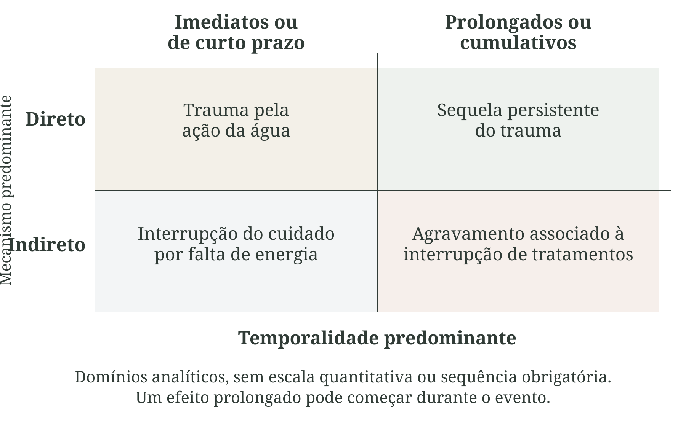
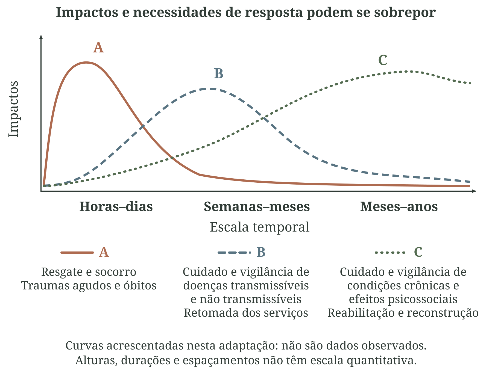
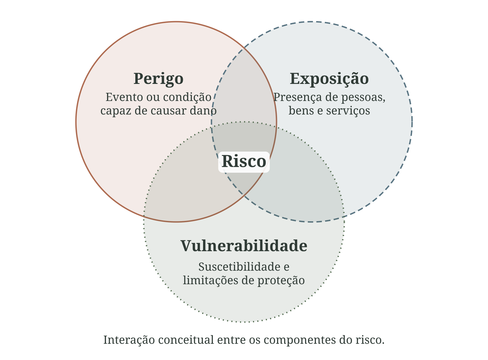

# Clima, ambiente e saúde pública {#sec-clima-ambiente-saude}

<!--
DIREÇÃO DE ARTE — CAPÍTULO 1

O capítulo reúne doze figuras: nove composições com aquarelas e três diagramas vetoriais. Os códigos ARTE CAP1 identificam arquivos de produção e não correspondem à numeração editorial, calculada pela ordem das figuras. Preservar os identificadores publicados.

Padrão das aquarelas: aquarela tradicional translúcida, traços finos de grafite e nanquim, contornos abertos, hachuras leves e pigmentação irregular. Paleta de verdes naturais, azuis acinzentados, ocres e terracota, com branco de papel. Direção permanente: docs/guia-editorial.md. Referência visual: assets/references/aquarela-grafite-nanquim.png. Compor rótulos e conexões como elementos editáveis.

Artes preservadas: CAP1-01 cadeia entre ambiente e saúde; CAP1-02 trajetórias de uma inundação; CAP1-03 exposição ao calor; CAP1-04 medida ambiental e dose; CAP1-05 territórios e proteção; CAP1-06 justiça ambiental e climática.
Novas artes: CAP1-07 tempo, clima e ambiente; CAP1-08 quadrantes; CAP1-09 curvas de impacto; CAP1-10 Venn do risco; CAP1-11 caracterização do perigo; CAP1-12 desigualdades.
Produção das novas artes: scripts/build_cap1_revision.py; prompts e manifestos preservados em assets/figures. A composição CAP1-12 usa 90% da largura na impressão para manter a resolução efetiva do original acima de 300 ppi.
-->

A saúde se produz nas condições concretas em que as pessoas vivem. As possibilidades de adoecer, recuperar-se e viver com saúde dependem da alimentação, da moradia, do trabalho, da renda, das relações sociais, das condições ambientais e do acesso ao cuidado. A abordagem dos determinantes da saúde procura compreender como essas condições se combinam e por que seus efeitos se distribuem de maneira desigual entre pessoas e territórios [@who2010sdhframework].

Os determinantes ambientais fazem parte dessa produção social da saúde. Abrangem componentes físicos, químicos, biológicos e construídos: qualidade do ar e da água, saneamento, vegetação, uso da terra, contaminantes, condições térmicas e infraestrutura. A distribuição desses componentes resulta tanto de processos naturais quanto de decisões sobre produção, ocupação do território, habitação e serviços públicos [@brasilsaudeambiental]. Uma mesma condição ambiental pode representar possibilidades muito diferentes de exposição e proteção conforme o contexto em que ocorre.

O clima participa desse conjunto por diversos caminhos. O calor pode impor uma carga térmica ao organismo; alterações de chuva podem modificar a disponibilidade de água; secas podem comprometer a produção de alimentos; inundações podem interromper transportes e serviços. A mudança climática modifica esses caminhos ao alterar padrões de ocorrência dos perigos e as condições que sustentam a vida cotidiana [@ipcc2022saude; @who2023climatehealth]. Por isso, interpretar seus efeitos exige articular fenômenos físicos, processos sociais e organização territorial.

A análise dos efeitos do clima precisa considerar as transformações ambientais, as condições de vida e a capacidade de atuação do poder público. A relação entre esses processos situa os riscos em um contexto social mais amplo:

> [...] os riscos associados às mudanças climáticas globais não podem ser avaliados em separado do contexto globalização, mudanças ambientais e precarização de sistemas de governo.
>
> [@barcellos2009clima, p. 285]

Para a vigilância e a gestão do Sistema Único de Saúde (SUS), essa perspectiva exige perguntar qual é o perigo, quem está exposto, durante quanto tempo e com que possibilidades de proteção. Uma concentração de material particulado com diâmetro aerodinâmico igual ou inferior a 2,5 micrômetros (PM2,5), por exemplo, descreve uma condição do ar. Seu significado sanitário depende também da presença de pessoas, de suas atividades e das condições de suscetibilidade e cuidado.

Este capítulo distingue tempo, clima e ambiente, acompanha os caminhos e as temporalidades dos impactos e discute perigo, exposição, vulnerabilidade, risco e justiça. O capítulo seguinte examina como essas relações orientam o planejamento e a resposta do SUS. Cada indicador será interpretado pelo que consegue representar desses processos e pelas decisões que pode apoiar.

## Tempo, clima e ambiente: três maneiras de olhar o território

No uso cotidiano, tempo e clima costumam aparecer como sinônimos. Para trabalhar com dados, porém, a diferença é importante.

Tempo meteorológico descreve o estado da atmosfera em determinado lugar e momento. A chuva prevista para a tarde, a temperatura observada às 15 horas, a baixa umidade de uma sequência de dias e uma rajada de vento são informações sobre o tempo. São especialmente úteis para decisões de curto prazo: emitir um alerta, reorganizar uma equipe, preparar uma unidade ou orientar a população.

Clima descreve como essas condições se comportam ao longo de períodos mais extensos. Não se resume a uma média. Inclui sazonalidade, distribuição dos valores, variabilidade, frequência de extremos e persistência dos eventos. Quando perguntamos se os dias muito quentes se tornaram mais frequentes nas últimas décadas, ou em que meses a chuva intensa costuma ocorrer, estamos fazendo uma pergunta climática [@wmo2023climatological; @wmo2017normals].

O ambiente reúne as condições naturais e construídas nas quais as exposições ocorrem. Para a saúde pública, interessa compreender como essas condições são produzidas e transformadas por decisões sobre ocupação do solo, habitação, transporte, energia e saneamento.

Entre uma temperatura registrada e a condição experimentada pelas pessoas existem os microclimas de moradias, ruas, locais de trabalho e transporte. Sombra, ventilação, materiais e fontes locais de calor contribuem para essas diferenças. A seção sobre exposição examinará suas consequências para a interpretação dos dados.

A @fig-tempo-clima-ambiente retoma essas três perguntas em um território hipotético. As vistas repetidas sugerem a observação ao longo do tempo, mas não bastam para caracterizar o clima: isso exige séries históricas que permitam reconhecer padrões, variabilidade e extremos.

{#fig-tempo-clima-ambiente width="100%" print-src="arte-cap1-07-tempo-clima-ambiente-print.png" fig-alt="Três painéis em aquarela mostram um bairro hipotético. À esquerda, chuva em um momento; no centro, vistas repetidas da mesma rua sob chuva, sol e vento; à direita, rio, vegetação, moradias, prédios e serviços. Os rótulos distinguem condições do momento, padrões em séries históricas e condições naturais e construídas. As três vistas centrais não constituem uma série climática."}

[Fonte e composição: elaboração própria, com aquarela gerada pela ferramenta image_gen. Licença: a mesma dos textos autorais da obra.]{.figure-source}

<!--
ARTE CAP1-07 — Revisão conceitual do capítulo.
Composição: scripts/build_cap1_revision.py.
Metadados, descrição acessível e proveniência: assets/figures/arte-cap1-revisao-manifest.json.
SVG: assets/figures/arte-cap1-07-tempo-clima-ambiente.svg.
Impressão: assets/figures/arte-cap1-07-tempo-clima-ambiente-print.png.
Original: assets/figures/arte-cap1-07-v1.png.
Prompt completo efetivamente utilizado: assets/figures/arte-cap1-07-v1.prompt.txt.
Referência de estilo: assets/references/aquarela-grafite-nanquim.png.
Produção: image_gen; versão não informada. Rótulos editáveis acrescentados na montagem.
-->

::: {#qua-tempo-clima-ambiente}
| Conceito | Pergunta prática | Escala frequente | Exemplo para a saúde |
|------------------|------------------|------------------|------------------|
| Tempo meteorológico | O que está ocorrendo ou poderá ocorrer nas próximas horas e dias? | Minutos a dias | Haverá chuva intensa amanhã? É necessário preparar equipes ou serviços? |
| Clima | Como as condições variam, se repetem e mudam ao longo do tempo? | Meses a décadas | Os episódios de calor intenso estão mais frequentes? Em que época do ano ocorrem? |
| Ambiente | Que condições do território favorecem exposição, proteção ou dano? | Do local ao global; do instante a décadas | Onde há maior concentração de PM2,5, menor cobertura de água segura ou menos áreas verdes? |

Distinções operacionais entre tempo, clima e ambiente
:::

A informação ambiental se torna operacional quando responde a uma pergunta de saúde, chega no momento adequado e encontra capacidade de ação [@wmoWho2015heat; @who2023framework].

## Dos determinantes aos caminhos entre ambiente e saúde

Reconhecer clima e ambiente como determinantes da saúde é apenas o ponto de partida. Para trabalhar com dados, é necessário transformar essa ideia ampla em caminhos que possam ser descritos, observados e, quando possível, monitorados. Entre uma condição ambiental e um desfecho de saúde geralmente existem etapas intermediárias: o fenômeno precisa ocorrer em determinado território, pessoas precisam estar expostas, essa exposição precisa produzir uma alteração relevante e diferentes condições podem ampliar ou reduzir suas consequências.

No SUS, a vigilância em saúde ambiental procura justamente identificar e acompanhar fatores ambientais capazes de interferir na saúde humana para orientar prevenção, promoção e resposta [@brasilsaudeambiental]. Para quem trabalha com dados, a consequência prática é importante: não basta encontrar uma correlação entre uma variável ambiental e um desfecho; é preciso reconstruir, tanto quanto os dados permitirem, o caminho que liga os dois.

Uma chuva intensa, por exemplo, interage com relevo, impermeabilização, drenagem e ocupação das margens de rios. Uma eventual inundação pode provocar contato com água contaminada, deslocar famílias e comprometer transporte, energia e serviços. Os efeitos sanitários dependem dessas interações e podem persistir depois do evento.

Cada etapa requer dados e ações diferentes: informação meteorológica para antecipação; população e território para localizar exposição; registros de saúde para acompanhar agravos; infraestrutura e redes de abastecimento para avaliar a continuidade dos serviços.

O marco de forças motrizes, pressões, estado, exposição, efeitos e ação, conhecido pela sigla inglesa DPSEEA (*Driving Forces, Pressures, State, Exposure, Effects and Action*), organiza relações entre desenvolvimento, ambiente e saúde. Esse marco ajuda a localizar intervenções tanto nas condições de exposição e nos efeitos quanto nas políticas que produzem pressões ambientais [@corvalan1999links].

Em uma área sujeita a inundações, por exemplo, decisões de ocupação do solo podem pressionar a drenagem e modificar o estado do ambiente. A presença de moradores e serviços nessa área configura exposição; os danos dependem também das condições de proteção. A ação pode envolver ordenamento territorial, saneamento, alerta, continuidade assistencial e cuidado. Assim, o marco ajuda a escolher o que acompanhar e onde intervir, sem pressupor uma sequência rígida ou uma causa única para cada agravo [@who2003environmentalindicators].

::: {#qua-determinantes-cadeias}
| Situação | O que acontece entre o ambiente e a saúde | Possíveis efeitos | Exemplos de resposta pública |
|------------------|------------------|------------------|------------------|
| Calor persistente | Maior carga térmica; menor possibilidade de dissipar calor; aumento da demanda elétrica | Doença relacionada ao calor; agravamento cardiovascular e renal; acidentes de trabalho | Alertas; proteção no trabalho; busca ativa; preparação dos serviços |
| Chuva intensa | Alagamento, inundação, deslizamento, contaminação e interrupção da mobilidade | Lesões, óbitos, doenças relacionadas à água e sofrimento mental | Alerta; evacuação; água segura; vigilância pós-evento |
| Seca e queimadas | Escassez de água, perda de produção, aumento de poeira e fumaça | Insegurança alimentar; doenças respiratórias; agravos relacionados à água | Segurança hídrica; vigilância da qualidade do ar; assistência social e sanitária |
| Poluição atmosférica | Inalação de partículas e gases em concentrações e períodos variados | Agravos respiratórios e cardiovasculares; mortalidade prematura | Monitoramento; redução de emissões; comunicação e proteção de grupos mais expostos |
| Saneamento inadequado | Maior probabilidade de contato com água, alimentos ou solo contaminados | Doenças diarreicas, parasitoses e outros agravos | Abastecimento seguro; esgotamento; vigilância e controle |

Exemplos de cadeias entre condições ambientais, efeitos sanitários e ação pública
:::

A @fig-cadeia-risco reúne cinco componentes: perigo ou condição ambiental; exposição; efeitos; vigilância e resposta; e vulnerabilidades e capacidades de proteção. Uma inundação hipotética ilustra suas relações no território. O esquema ajuda a identificar as informações necessárias para compreender o risco e os pontos em que a ação pública pode modificá-lo.

A leitura principal desce do perigo à resposta. O bloco da base e as setas de retorno destacam a influência da proteção e das intervenções, sem estabelecer uma sequência obrigatória de acontecimentos.

{#fig-cadeia-risco width="100%" print-src="arte-cap1-01-diagrama-print.png" fig-alt="Cinco cenas hipotéticas em aquarela ilustram perigo, exposição, efeitos, resposta e proteção. As setas ligam perigo e proteção à exposição, exposição a efeitos e efeitos à resposta. Duas setas pontilhadas indicam a ação sobre exposição e proteção. As cenas se passam em bairro urbano com prédios residenciais, casas, comércio, calçadas e arborização."}

[Fonte e composição: elaboração própria, com ilustração gerada por inteligência artificial. Licença: a mesma dos textos autorais da obra. Revisão urbana da aquarela: image_gen, com o original e a referência visual da série.]{.figure-source}

<!--
ARTE CAP1-01 — Revisão urbana v3
Finalidade e descrição acessível: Cinco cenas hipotéticas em aquarela ilustram perigo, exposição, efeitos, resposta e proteção. As setas ligam perigo e proteção à exposição, exposição a efeitos e efeitos à resposta. Duas setas pontilhadas indicam a ação sobre exposição e proteção. As cenas se passam em bairro urbano com prédios residenciais, casas, comércio, calçadas e arborização.
Arte incorporada: assets/figures/arte-cap1-01-diagrama.svg.
Impressão: assets/figures/arte-cap1-01-diagrama-print.png.
Original da edição: assets/figures/arte-cap1-01-v2.png; preservado junto das versões anteriores.
Aquarela revisada: assets/figures/arte-cap1-01-v3.png.
Prompt completo utilizado: assets/figures/arte-cap1-01-v3.prompt.txt.
Referência de estilo: assets/references/aquarela-grafite-nanquim.png.
Produção: ferramenta integrada image_gen; original e referência de estilo inspecionados e fornecidos por referenced_image_paths.
Montagem: scripts/build_cap1_art.py; rótulos, setas e identificadores editáveis preservados.
Exportação: Chromium com fontes e raster incorporados; ImageMagick para PNG de 8 bits em cinza.
Revisão: presença urbana, continuidade da aquarela, anatomia, recortes e relações conceituais. Cenários hipotéticos, sem novos dados observados.
Licença dos arquivos autorais: GPL-3.0; fontes citadas mantêm suas condições de uso.

Use case: precise-object-edit. Arte didática em aquarela para livro brasileiro sobre clima, ambiente e saúde.
Entradas: imagem 1 é o ORIGINAL a editar, referência obrigatória de composição; imagem 2 é APENAS referência do estilo da série.
Pedido: aumentar a presença urbana, preservando a aquarela naturalista, paleta suave de azuis, verdes, ocres e terracota, textura de papel, contornos delicados de grafite/nanquim e contraste adequado também em cinza. A cidade é brasileira e hipotética, sem marcos reconhecíveis.
Revisão específica: Conserve as CINCO vinhetas e sua posição escalonada na página vertical. Na inundação superior, substitua parte das casas por prédios de 4–8 andares próximos, térreos comerciais e calçadas urbanas, preservando chuva, carro e água. Na cena de exposição à direita, situe a mesma família e unidade de saúde em bairro urbano com edifícios residenciais. Na cena de curativo à esquerda, acrescente edifícios na vista externa. Na resposta comunitária, mantenha tenda, pessoas e suprimentos, acrescentando fachadas urbanas ao fundo. Na proteção inferior, misture casas, edifícios próximos, arborização e calçadas acessíveis; conserve a família e o serviço de saúde. Não preencha os corredores brancos entre as cenas.
Invariantes: conserve enquadramento, proporção, escala das figuras humanas, anatomia natural, quantidade e posição das vinhetas, objetos conceituais e espaços brancos. Alterar cenários e arquitetura somente conforme o pedido. Não adicionar texto, títulos, legendas, setas, números, marcas ou molduras; serão aplicados como vetores editáveis. Não fundir cenas e não recortar personagens. Manter boa nitidez na impressão.
Formato: mesma proporção do original 1122 × 1402; resolução igual ou superior. Uma única imagem final editada.
-->

No alto, a cena da água avançando sobre a rua caracteriza o perigo. Sua descrição requer informações sobre intensidade, extensão, duração e momento de ocorrência. A pergunta seguinte, “quem e o que está exposto?”, acrescenta moradores, trajetos e estabelecimentos ao território atingido. Para uma inundação, isso significa relacionar a área alcançada pela água à localização e ao funcionamento desses elementos. Dados de chuva, sozinhos, não informam quem entrou em contato com a água nem quais serviços ficaram inacessíveis.

O bloco de efeitos inclui tanto os agravos às pessoas quanto as consequências para o território e os serviços. A lesão ilustrada é uma possibilidade; a interrupção do atendimento ou do acesso ao cuidado também precisa ser acompanhada. Registros de atendimentos, informações sobre interrupções e observações de campo ajudam a distinguir o perigo observado das consequências efetivamente verificadas. A seta da exposição para os efeitos indica uma relação a investigar, sem afirmar que toda pessoa exposta sofrerá dano.

Na base, moradia, água segura, apoio social e acesso à unidade de saúde ilustram condições que podem modificar a exposição e a gravidade dos efeitos. Embora a seta desse bloco chegue à exposição, vulnerabilidades e capacidades de proteção atravessam toda a análise: influenciam quem consegue evitar o contato, obter cuidado e recuperar-se. Sua posição na figura não significa que surjam apenas depois do evento.

O bloco de vigilância, prevenção, cuidado e resposta reúne possibilidades de ação. As setas pontilhadas mostram dois retornos: reduzir a exposição e fortalecer a proteção. Alertas acompanhados de meios para agir, reorganização do atendimento e continuidade do abastecimento exemplificam intervenções nesses pontos. O acompanhamento de seus resultados produz aprendizado para a preparação seguinte. A figura organiza componentes do risco, sem estimar probabilidades ou detalhar a evolução temporal dos efeitos; essa última questão será desenvolvida a seguir.

### Efeitos diretos, indiretos e trajetórias no tempo {#sec-trajetorias-impacto}

Para compreender um efeito em saúde, precisamos distinguir duas perguntas: por qual caminho ele foi produzido e como se manifesta ao longo do tempo? Um trauma causado pela ação física de uma inundação pode deixar uma sequela prolongada. Uma interrupção de energia que comprometa um cuidado dependente de equipamento pode gerar uma consequência imediata, embora mediada pela infraestrutura. Portanto, “direto” não significa necessariamente “imediato”, e “indireto” não equivale a “tardio”. A @fig-quadrantes-impacto organiza essas duas perguntas.

{#fig-quadrantes-impacto width="100%" print-src="arte-cap1-08-quadrantes-print.png" fig-alt="Gráfico de quatro quadrantes sem escala numérica. Na horizontal, efeitos imediatos ou de curto prazo à esquerda e prolongados ou cumulativos à direita; na vertical, mecanismo direto acima e indireto abaixo. Os exemplos são trauma pela água, sequela do trauma, interrupção do cuidado por falta de energia e agravamento associado à interrupção de tratamentos. Não há sequência obrigatória entre quadrantes."}

[Fonte e autoria: elaboração própria. Licença: a mesma dos textos autorais da obra.]{.figure-source}

<!--
ARTE CAP1-08 — Revisão conceitual do capítulo.
Composição: scripts/build_cap1_revision.py.
Metadados, descrição acessível e proveniência: assets/figures/arte-cap1-revisao-manifest.json.
SVG: assets/figures/arte-cap1-08-quadrantes.svg.
Impressão: assets/figures/arte-cap1-08-quadrantes-print.png.
-->

O @qua-trajetorias-impacto apresenta uma proposta conceitual em desenvolvimento, organizada a partir dessas duas dimensões. Os quatro domínios servem como posições de análise em uma trajetória; não constituem uma classificação validada de pessoas, doenças ou eventos. Sua aplicação exige explicitar o perigo de referência e sustentar cada ligação com evidências.

::: {#qua-trajetorias-impacto}
| Mecanismo predominante | Efeitos imediatos ou de curto prazo | Efeitos prolongados ou cumulativos |
|------------------|------------------|------------------|
| Direto | Trauma pela ação física da água; adoecimento agudo pela carga térmica | Sequela física do trauma; consequências persistentes de uma lesão relacionada à exposição |
| Indireto | Descontinuidade de cuidado por falha de energia, transporte ou abastecimento | Agravamento associado à interrupção persistente de tratamentos; consequências da perda de moradia e renda |

Domínios analíticos de caminhos e temporalidades dos impactos
:::

Os exemplos do quadro são didáticos e não estabelecem frequência, probabilidade ou atribuição causal. Diferentes domínios podem coexistir, e uma pessoa pode enfrentar mais de um deles. A contribuição dessa leitura está em acompanhar trajetórias de impacto: processos nos quais se encadeiam ou se combinam efeitos, mediações e condições de recuperação. Uma mesma lesão não muda retroativamente de causa quando deixa uma sequela; a trajetória passa a incluir novas consequências e necessidades de cuidado.

O mecanismo predominante é o primeiro eixo. Efeitos diretos decorrem principalmente da ação do perigo sobre a pessoa, como a carga térmica do calor ou a força da água. Efeitos indiretos envolvem mudanças em sistemas ambientais, sociais, econômicos ou institucionais: abastecimento, alimentos, vetores, renda, mobilidade e serviços de saúde. Essa distinção depende de explicitar o ponto de partida. A inalação de fumaça é uma exposição direta ao poluente; quando a pergunta parte da seca, a queimada e a emissão de partículas são mediações do caminho até o agravo. As condições sociais atravessam ambos os mecanismos [@barcellos2009clima; @ipcc2022saude].

O segundo eixo descreve a temporalidade predominante. É preciso distinguir o início do efeito, sua duração e a acumulação produzida por exposições repetidas. Um efeito pode começar durante o evento e persistir depois dele; outro pode aparecer após um intervalo. “Prolongado”, portanto, não é sinônimo de início tardio. Também é necessário separar a duração do fenômeno físico da duração de suas consequências sanitárias. Não se adotam aqui cortes universais em dias ou meses: a janela de observação deve corresponder ao mecanismo e ao desfecho estudados.

Freitas e colaboradores, entre eles Carlos Machado de Freitas, Diego Ricardo Xavier Silva e Christovam Barcellos, organizaram impactos e respostas em três horizontes: horas–dias, semanas–meses e meses–anos. Sua Figura 1 adapta uma proposta de Redmond e relaciona resgate e traumas agudos, vigilância e retomada dos serviços, cuidado prolongado e reconstrução [@freitas2014desastres; @redmond2005natural].

A @fig-curvas-impacto-desastres retoma essa organização. O original apresenta blocos temporais; as curvas foram acrescentadas nesta adaptação para ilustrar a sobreposição dos impactos. Não expressam números de casos, probabilidades ou intensidades comparáveis, e as distâncias no eixo do tempo não representam intervalos proporcionais.

{#fig-curvas-impacto-desastres width="100%" print-src="arte-cap1-09-curvas-impacto-print.png" fig-alt="Esquema com eixo vertical Impactos e horizontal Escala temporal, sem valores numéricos. Três curvas editoriais se sobrepõem: A, contínua, destaca resgate, trauma e óbitos; B, tracejada, cuidado e vigilância de doenças transmissíveis e não transmissíveis e retomada dos serviços; C, pontilhada, condições crônicas, efeitos psicossociais, reabilitação e reconstrução. Os horizontes são horas a dias, semanas a meses e meses a anos. As curvas foram acrescentadas ao esquema temporal de Freitas et al. (2014), não são dados observados e não definem limites universais."}

[Fonte conceitual: Freitas et al. (2014), Figura 1, adaptada pelos autores de Redmond (2005). Redesenho e curvas didáticas: elaboração própria; não reproduzem dados observados. Licença da composição autoral: a mesma dos textos da obra.]{.figure-source}

<!--
ARTE CAP1-09 — Revisão conceitual do capítulo.
Composição: scripts/build_cap1_revision.py.
Metadados, descrição acessível e proveniência: assets/figures/arte-cap1-revisao-manifest.json.
SVG: assets/figures/arte-cap1-09-curvas-impacto.svg.
Impressão: assets/figures/arte-cap1-09-curvas-impacto-print.png.
A figura original apresenta blocos temporais, não curvas. As curvas foram acrescentadas nesta composição como recurso didático, sem escala quantitativa.
-->

Os horizontes orientam o acompanhamento, sem delimitar fases rígidas. Uma necessidade de reabilitação ou de cuidado em saúde mental pode começar durante o evento e persistir por muito tempo. Reduzir os atendimentos de urgência não significa que todas as necessidades tenham cessado. A vigilância precisa acompanhar a continuidade do cuidado e a recuperação das condições de vida, com janelas adequadas a cada desfecho.

Considere uma inundação. Durante o evento, a água pode causar trauma e dificultar o acesso a uma unidade. Ao mesmo tempo, uma falha de energia ou a perda de medicamentos pode comprometer um tratamento. São caminhos distintos, com consequências que podem surgir no mesmo período. Posteriormente, a necessidade de reabilitação de uma lesão pode coexistir com dificuldades de moradia, renda e acompanhamento clínico. A trajetória não exige que todos atravessem essas etapas nem que elas ocorram nessa ordem. A análise das inundações de 2024 no Rio Grande do Sul ilustra a importância de examinar conjuntamente população, infraestrutura e vulnerabilidades [@xavier2025inundacoes].

Trajetórias podem se ramificar quando um mesmo perigo produz consequências diferentes conforme a exposição e a proteção. Podem convergir quando fenômenos distintos comprometem o mesmo serviço ou necessidade de saúde. Podem ainda ser recorrentes: um novo evento alcança famílias ou serviços antes da recuperação do anterior. Essa possibilidade exige acompanhar perdas acumuladas, continuidade do cuidado e capacidade de recuperação, sem presumir que todo evento produzirá agravamento progressivo.

A perspectiva também se aplica a processos graduais. Uma alteração persistente no regime de chuvas pode modificar a disponibilidade de água e as condições de produção de alimentos, sem um desastre que marque claramente seu início. A observação precisa combinar sinais ambientais, condições de vida e desfechos ao longo do tempo. A matriz ajuda a formular perguntas e identificar momentos de intervenção; os dados e os métodos determinarão quais relações podem ser demonstradas. No capítulo seguinte, essa leitura fundamentará a discussão da vigilância e da adaptação contínua.

A @fig-trajetorias-inundacao reúne esses caminhos em um exemplo didático. A inundação se ramifica em consequências distintas; a interrupção do cuidado e a perda de moradia podem convergir em dificuldades de acompanhamento. A seta pontilhada representa um novo evento durante a recuperação. As possibilidades de apoio não são desfechos garantidos, e a disposição das cenas não define etapas obrigatórias nem intervalos fixos de tempo.

{#fig-trajetorias-inundacao width="100%" print-src="arte-cap1-02-trajetorias-print.png" fig-alt="Vinhetas em aquarela mostram uma inundação com três ramificações: lesão, falha de energia e acesso e perda de moradia. A lesão pode exigir reabilitação. A falha de serviços pode interromper o cuidado e, junto da perda de moradia, dificultar o acompanhamento. Retomada do tratamento e recuperação da moradia aparecem como possibilidades de apoio. Uma seta pontilhada liga um novo episódio de chuva à família ainda em recuperação. Os caminhos podem coexistir e não têm escala temporal fixa; processos graduais também podem iniciar trajetórias. Prédios, comércio, casas e calçadas situam as trajetórias em um bairro urbano hipotético."}

[Fonte e composição: elaboração própria, com ilustração gerada por inteligência artificial. Licença: a mesma dos textos autorais da obra. Revisão urbana da aquarela: image_gen, com o original e a referência visual da série.]{.figure-source}

<!--
ARTE CAP1-02 — Revisão urbana v2
Finalidade e descrição acessível: Vinhetas em aquarela mostram uma inundação com três ramificações: lesão, falha de energia e acesso e perda de moradia. A lesão pode exigir reabilitação. A falha de serviços pode interromper o cuidado e, junto da perda de moradia, dificultar o acompanhamento. Retomada do tratamento e recuperação da moradia aparecem como possibilidades de apoio. Uma seta pontilhada liga um novo episódio de chuva à família ainda em recuperação. Os caminhos podem coexistir e não têm escala temporal fixa; processos graduais também podem iniciar trajetórias. Prédios, comércio, casas e calçadas situam as trajetórias em um bairro urbano hipotético.
Arte incorporada: assets/figures/arte-cap1-02-trajetorias.svg.
Impressão: assets/figures/arte-cap1-02-trajetorias-print.png.
Original da edição: assets/figures/arte-cap1-02-v1.png; preservado junto das versões anteriores.
Aquarela revisada: assets/figures/arte-cap1-02-v2.png.
Prompt completo utilizado: assets/figures/arte-cap1-02-v2.prompt.txt.
Referência de estilo: assets/references/aquarela-grafite-nanquim.png.
Produção: ferramenta integrada image_gen; original e referência de estilo inspecionados e fornecidos por referenced_image_paths.
Montagem: scripts/build_cap1_trajectories.py; rótulos, setas e identificadores editáveis preservados.
Exportação: Chromium com fontes e raster incorporados; ImageMagick para PNG de 8 bits em cinza.
Revisão: presença urbana, continuidade da aquarela, anatomia, recortes e relações conceituais. Cenários hipotéticos, sem novos dados observados.
Licença dos arquivos autorais: GPL-3.0; fontes citadas mantêm suas condições de uso.

Use case: precise-object-edit. Arte didática em aquarela para livro brasileiro sobre clima, ambiente e saúde.
Entradas: imagem 1 é o ORIGINAL a editar, referência obrigatória de composição; imagem 2 é APENAS referência do estilo da série.
Pedido: aumentar a presença urbana, preservando a aquarela naturalista, paleta suave de azuis, verdes, ocres e terracota, textura de papel, contornos delicados de grafite/nanquim e contraste adequado também em cinza. A cidade é brasileira e hipotética, sem marcos reconhecíveis.
Revisão específica: Conserve as OITO vinhetas exatamente nos recortes atuais: coluna esquerda com topo branco, inundação no meio e nova chuva embaixo; coluna central com lesão, serviço interrompido e família desalojada; direita com reabilitação, retomada do cuidado e reparo de moradia. Troque parte das casas das cenas de inundação e interrupção por prédios residenciais próximos com térreos comerciais e calçadas. Preserve água, barreiras e postes. Nas janelas das cenas clínicas, mostre prédios e árvores. No reparo inferior direito, mantenha os trabalhadores reparando uma moradia térrea em rua urbana com edifícios vizinhos. Na nova chuva, faça o panorama combinar com esse bairro misto. Preserve todas as pessoas, poses, objetos de cuidado e corredores brancos; não mude a quantidade nem a posição das cenas.
Invariantes: conserve enquadramento, proporção, escala das figuras humanas, anatomia natural, quantidade e posição das vinhetas, objetos conceituais e espaços brancos. Alterar cenários e arquitetura somente conforme o pedido. Não adicionar texto, títulos, legendas, setas, números, marcas ou molduras; serão aplicados como vetores editáveis. Não fundir cenas e não recortar personagens. Manter boa nitidez na impressão.
Formato: mesma proporção do original 1536 × 1024; resolução igual ou superior. Uma única imagem final editada.
-->

## Perigo, exposição, vulnerabilidade e risco: por que as palavras importam

Distinguir os componentes do risco evita erros de interpretação. Ausência de desastre registrado não comprova ausência de perigo; concentração ambiental não equivale a dose individual; uma característica da pessoa não explica sozinha sua vulnerabilidade. Essas distinções orientam a escolha dos indicadores e das intervenções.

::: {.callout-note icon="false" title="Conceito-chave: perigo, exposição, vulnerabilidade e risco"}
Perigo é a possível ocorrência de um evento, processo ou condição capaz de causar dano. Uma onda de calor, uma inundação, concentração elevada de um poluente ou escassez de água podem ser descritas como perigos em contextos específicos.

Exposição diz respeito à presença de pessoas, atividades, ecossistemas, infraestrutura ou serviços em situações nas quais o perigo pode alcançá-los. Estar no mesmo município não significa necessariamente estar igualmente exposto.

Vulnerabilidade corresponde à propensão a sofrer efeitos adversos e envolve suscetibilidade e limitações de proteção. Ela depende do perigo considerado e das condições concretas de vida.

Risco resulta da interação entre esses componentes e das consequências que se pretende evitar. Ele muda quando mudam o perigo, a exposição, a vulnerabilidade ou a capacidade de resposta [@ipcc2022glossario; @undrr2017terminology].
:::

A @fig-venn-risco representa a interação entre os três componentes. O risco não é uma característica isolada do evento ou da pessoa: depende de como perigo, exposição e vulnerabilidade se encontram. O Venn é uma síntese conceitual; o tamanho dos círculos e das interseções não mede probabilidades nem permite calcular o risco.

{#fig-venn-risco width="100%" print-src="arte-cap1-10-venn-risco-print.png" fig-alt="Três círculos parcialmente sobrepostos representam perigo, exposição e vulnerabilidade. Risco ocupa a interseção dos três. Rótulos, posições e diferentes tracejados permitem distinguir os componentes sem depender de cor. Áreas e interseções não representam probabilidades ou quantidades."}

[Fonte conceitual: IPCC (2022) e UNDRR (2017). Composição: elaboração própria. Licença: a mesma dos textos autorais da obra.]{.figure-source}

<!--
ARTE CAP1-10 — Revisão conceitual do capítulo.
Composição: scripts/build_cap1_revision.py.
Metadados, descrição acessível e proveniência: assets/figures/arte-cap1-revisao-manifest.json.
SVG: assets/figures/arte-cap1-10-venn-risco.svg.
Impressão: assets/figures/arte-cap1-10-venn-risco-print.png.
-->

### Perigo não é desastre

Perigo designa um processo, fenômeno, evento ou condição com potencial para causar dano à saúde, aos bens, aos serviços ou ao ambiente. Pode estar associado a processos naturais, a atividades humanas ou à combinação entre ambos. Uma inundação, por exemplo, envolve a dinâmica da água, mas sua intensidade e extensão também podem ser modificadas pela impermeabilização, pela drenagem e pelas intervenções nos cursos d’água [@undrr2017hazard; @ipcc2022glossario].

Caracterizar um perigo exige mais do que nomeá-lo. É preciso descrever onde pode ocorrer, sua intensidade ou magnitude, a área alcançada, a duração e a frequência ou probabilidade de ocorrência. As medidas dependem do fenômeno: a chuva acumulada e a profundidade da água respondem a perguntas diferentes; no calor, a persistência e as condições noturnas complementam a temperatura máxima; para um poluente, importam a concentração e o período de referência da medição.

Há perigos de início súbito, como uma enxurrada, e processos que se desenvolvem gradualmente, como uma seca. Eles também podem ocorrer em conjunto ou em sequência. A seca pode favorecer condições para queimadas, cuja fumaça introduz um perigo adicional para a qualidade do ar. Essa cadeia precisa ser explicitada: observar pouca chuva não equivale a medir a concentração de partículas que chega a uma população [@undrr2017hazard].

A @fig-caracterizacao-perigo reúne perguntas para descrever três situações. Os limiares e as janelas de observação devem ser justificados para a finalidade do indicador e o contexto considerado. Uma classificação meteorológica, um nível de alerta e um critério sanitário podem responder a finalidades distintas; nenhum deles demonstra, sozinho, que ocorreu dano.

{#fig-caracterizacao-perigo width="100%" print-src="arte-cap1-11-perigos-print.png" fig-alt="Três aquarelas hipotéticas mostram chuva e inundação de um bairro, calor sobre uma rua e poluição do ar em área urbana. Perguntas distinguem chuva, profundidade e extensão da água; intensidade e duração do calor e alívio noturno; concentração e permanência de poluentes. Localização, frequência e probabilidade completam a caracterização. Não se representam medidas observadas."}

[Fonte e composição: elaboração própria, com aquarela gerada pela ferramenta image_gen. Licença: a mesma dos textos autorais da obra.]{.figure-source}

<!--
ARTE CAP1-11 — Revisão conceitual do capítulo.
Composição: scripts/build_cap1_revision.py.
Metadados, descrição acessível e proveniência: assets/figures/arte-cap1-revisao-manifest.json.
SVG: assets/figures/arte-cap1-11-perigos.svg.
Impressão: assets/figures/arte-cap1-11-perigos-print.png.
Original: assets/figures/arte-cap1-11-v1.png.
Prompt completo efetivamente utilizado: assets/figures/arte-cap1-11-v1.prompt.txt.
Referência de estilo: assets/references/aquarela-grafite-nanquim.png.
Produção: image_gen; versão não informada. Rótulos editáveis acrescentados na montagem.
-->

Risco acrescenta a possibilidade de consequências adversas à análise do perigo, considerando quem ou o que está exposto e suas condições de vulnerabilidade. Desastre corresponde à grave perturbação do funcionamento de uma comunidade ou sociedade produzida pela interação de eventos perigosos com essas condições. Um perigo pode existir sem que se registre um desastre, e efeitos sobre a saúde podem ocorrer sem alcançar essa dimensão de perturbação [@ipcc2022glossario; @undrr2017terminology].

Por isso, uma base de desastres não substitui uma série meteorológica ou ambiental. A primeira registra consequências segundo critérios e capacidades de registro; a segunda descreve condições medidas ou estimadas. Ausência de desastre registrado não comprova ausência de perigo. Para avaliar o risco, a informação ambiental precisa ser articulada à presença de pessoas, às possibilidades de proteção e aos desfechos que se pretende evitar.

### Exposição é contato situado

A exposição depende do encontro entre uma pessoa e uma condição ambiental em determinado lugar e período. Para descrevê-la, precisamos perguntar onde a pessoa esteve, por quanto tempo, realizando qual atividade e com quais possibilidades de proteção. A existência de um perigo no município não demonstra, por si só, que todos os moradores tiveram contato com ele.

No caso do calor, a temperatura de uma estação caracteriza o ar naquele ponto de medição. A condição térmica experimentada por uma pessoa depende também da radiação solar, da umidade, da ventilação e dos ambientes que ela frequenta. Uma residência que retém calor durante a noite, um local de trabalho sombreado e um deslocamento sob sol intenso compõem situações diferentes ao longo do dia.

Durante o esforço físico, o corpo produz mais calor. As roupas também alteram a troca de calor com o ambiente e a evaporação do suor. Assim, duas pessoas sob a mesma temperatura externa podem enfrentar condições térmicas diferentes, conforme suas atividades, roupas e acesso à sombra e à ventilação. O endereço residencial indica onde alguém mora, mas não informa todos os ambientes que frequenta. Por isso, nem o endereço nem a temperatura externa, isoladamente, descrevem o calor que essa pessoa experimenta ao longo do dia [@wmoWho2015heat].

A @fig-exposicao-calor-dia acompanha esse percurso em um exemplo didático. As cenas destacam mudanças de ambiente, atividade e possibilidades de proteção; não representam temperaturas ou intervalos medidos.

{#fig-exposicao-calor-dia width="100%" print-src="arte-cap1-03-exposicao-print.png" fig-alt="Quatro vinhetas em aquarela acompanham a mesma mulher em um bairro urbano misto, com casas, edifícios residenciais e comerciais, calçadas e praça: ela sai de casa pela manhã, com uma estação meteorológica em área aberta; caminha sob sol intenso; trabalha na jardinagem de uma área pública e faz uma pausa à sombra com água; e repousa em casa à noite, sob calor retido nas paredes e na cobertura. A estação mede as condições em um ponto. Local, horário, duração, atividade e condições ambientais modificam a exposição ao longo do percurso. As cenas não representam durações medidas."}

[Fonte e composição: elaboração própria, com ilustração gerada por inteligência artificial. Licença: a mesma dos textos autorais da obra.]{.figure-source}

<!--
ARTE CAP1-03 — Revisão urbana v2
Finalidade e leitura: Quatro vinhetas em aquarela acompanham a mesma mulher em um bairro urbano misto, com casas, edifícios residenciais e comerciais, calçadas e praça: ela sai de casa pela manhã, com uma estação meteorológica em área aberta; caminha sob sol intenso; trabalha na jardinagem de uma área pública e faz uma pausa à sombra com água; e repousa em casa à noite, sob calor retido nas paredes e na cobertura. A estação mede as condições em um ponto. Local, horário, duração, atividade e condições ambientais modificam a exposição ao longo do percurso. As cenas não representam durações medidas.
Identificador preservado: fig-exposicao-calor-dia.
Arte incorporada: assets/figures/arte-cap1-03-exposicao.svg.
Versão de impressão: assets/figures/arte-cap1-03-exposicao-print.png, em escala de cinza.
Aquarela utilizada: assets/figures/arte-cap1-03-v2.png.
Original anterior preservado: assets/figures/arte-cap1-03-v1.png.
Prompt anterior preservado: assets/figures/arte-cap1-03-v1.prompt.txt.
Prompt efetivamente utilizado: assets/figures/arte-cap1-03-v2.prompt.txt.
Referência visual: assets/references/aquarela-grafite-nanquim.png; original v1 como referência de composição.
Produção: edição com a ferramenta integrada image_gen; versão da ferramenta não informada.
Composição reproduzível: scripts/build_cap1_heat_exposure.py; exportação por scripts/render_figure.py.
Rótulos e relações conceituais editáveis; fontes e aquarela incorporadas verificadas antes da exportação.
Montagem e revisão: Acrescentar os rótulos “Manhã”, “Deslocamento”, “Trabalho e pausas” e “Noite”. Incluir, junto da estação, “Medição em um ponto” e, abaixo da sequência, “A exposição depende de local, horário, duração, atividade e condições ambientais”. As quatro vinhetas têm função narrativa; a largura de cada uma não representa duração medida.
Prompt completo:
Use case: precise-object-edit.
Asset type: ilustração científica editorial para livro brasileiro sobre clima, ambiente e saúde.
Input images: Imagem 1 é o original a EDITAR, referência obrigatória de composição, personagens e função; Imagem 2 é SOMENTE referência de ESTILO (aquarela-grafite-nanquim.png), não copiar sua cena.
Style/medium: Ilustração editorial em aquarela tradicional translúcida, combinada com traços finos e espontâneos de lápis grafite e nanquim. Contornos parcialmente abertos, hachuras leves e marcas discretas de rascunho. Textura sutil de papel aquarela, pigmentação irregular e transições suaves. Paleta de verdes naturais, azuis acinzentados, ocres e terracota, com saturação moderada. Preservar áreas de papel branco e bordas irregulares que se dissolvem no fundo. Pessoas com proporções naturais e diversidade de tons de pele. Linguagem visual madura, acolhedora e adequada à divulgação científica para adultos.
Primary request: Revisar esta imagem para trazer uma cidade brasileira contemporânea, inteiramente hipotética, para o plano principal. Prédios e infraestrutura urbana precisam ser claramente reconhecíveis, não apenas uma silhueta distante no horizonte. Preservar a linguagem de aquarela e a ideia científica do original.
Constraints: Manter ordem, quantidade e separação das vinhetas; preservar identidade, roupas e gestos dos personagens existentes, perspectiva e margens de papel branco, salvo as mudanças explicitamente solicitadas abaixo. Pessoas e mãos anatomicamente coerentes. Densidade urbana legível, sem excesso de detalhes. Mostrar diferentes condições de proteção em ambientes urbanos sem caricaturas ou equivalência automática entre cidade e dano. Não desenhar palavras, letras, números, logotipos, marcas d'água, setas, grades analíticas, legendas ou novos gráficos. Textos e conexões serão acrescentados como vetores. Contraste deve funcionar em escala de cinza. Não inventar dados quantitativos nem representar uma cidade real.

Composition/framing: Manter a proporção horizontal 2:1, com exatamente QUATRO vinhetas em uma única linha e corredores de papel branco. Produzir 2048 × 1024 pixels ou maior na mesma proporção.
Scene/backdrop: Preservar a mesma mulher de pele castanha, coque escuro, camisa terracota e calça azul em todas as cenas. Vinheta 1: saindo pela manhã de moradia térrea em bairro misto, junto de edifícios residenciais de 4 a 8 andares bem visíveis; manter a estação meteorológica à esquerda em um terreno aberto com recuo apropriado dos edifícios. Vinheta 2: caminhando por calçada exposta ao sol entre fachadas próximas de prédios residenciais e comerciais, rua asfaltada e meio-fio; conservar o calor e a pose de proteger o rosto. Vinheta 3: preservar trabalho de jardinagem e pausa com água à sombra, situados numa praça ou canteiro público entre edifícios; manter as duas representações temporais da mesma mulher dentro dessa vinheta como no original. Vinheta 4: repouso à noite na mesma moradia, com janela voltada para fachadas urbanas próximas e paredes que sugerem calor retido. A sequência é hipotética e não representa durações ou temperaturas medidas.
-->

Para a poluição do ar, a concentração ambiental estima quanto poluente existe em determinado volume de ar. A exposição depende da presença e permanência da pessoa nesse ambiente; a quantidade inalada depende também da ventilação pulmonar, entre outros fatores. Uma estimativa para o endereço residencial pode representar exposição potencial, mas não observa todos os deslocamentos ou a dose individual. Uma aplicação de previsões de PM2,5 à antecipação de problemas respiratórios no Brasil ilustra a utilidade da informação ambiental para a vigilância, respeitada a escala em que foi avaliada [@roux2020alerta].

Para água e contaminantes, a presença de uma substância no ambiente, o contato, a ingestão e a dose absorvida correspondem a etapas diferentes. Detectar um contaminante em uma fonte de abastecimento não informa automaticamente quem consumiu aquela água, em que quantidade ou com qual tratamento prévio. A rota de exposição precisa ser identificada antes de interpretar o resultado sanitário.

A @fig-medida-exposicao-dose separa essas perguntas usando o abastecimento de água como exemplo. A coleta informa sobre uma amostra; a conexão à rede, o consumo e a absorção de um contaminante exigem informações distintas.

{#fig-medida-exposicao-dose width="100%" print-src="arte-cap1-04-dose-print.png" print-width="90%" fig-alt="Quatro vinhetas em aquarela separam perguntas sobre água: uma profissional coleta uma amostra; casas e prédios estão conectados à rede; uma pessoa segura um copo junto à torneira; uma silhueta mostra um percurso digestivo simplificado. As perguntas distinguem o que foi medido na água, quem pode acessá-la, se houve consumo e quanto do contaminante atravessou as barreiras do organismo. Não há setas entre as cenas: uma etapa não comprova a seguinte, e a absorção requer informação própria. A rede abastece casas e prédios de apartamentos, e a janela da cozinha mostra o bairro urbano."}

[Fonte e composição: elaboração própria, com ilustração gerada por inteligência artificial. Licença: a mesma dos textos autorais da obra. Revisão urbana da aquarela: image_gen, com o original e a referência visual da série.]{.figure-source}

<!--
ARTE CAP1-04 — Revisão urbana v2
Finalidade e descrição acessível: Quatro vinhetas em aquarela separam perguntas sobre água: uma profissional coleta uma amostra; casas e prédios estão conectados à rede; uma pessoa segura um copo junto à torneira; uma silhueta mostra um percurso digestivo simplificado. As perguntas distinguem o que foi medido na água, quem pode acessá-la, se houve consumo e quanto do contaminante atravessou as barreiras do organismo. Não há setas entre as cenas: uma etapa não comprova a seguinte, e a absorção requer informação própria. A rede abastece casas e prédios de apartamentos, e a janela da cozinha mostra o bairro urbano.
Arte incorporada: assets/figures/arte-cap1-04-dose.svg.
Impressão: assets/figures/arte-cap1-04-dose-print.png.
Original da edição: assets/figures/arte-cap1-04-v1.png; preservado junto das versões anteriores.
Aquarela revisada: assets/figures/arte-cap1-04-v2.png.
Prompt completo utilizado: assets/figures/arte-cap1-04-v2.prompt.txt.
Referência de estilo: assets/references/aquarela-grafite-nanquim.png.
Produção: ferramenta integrada image_gen; original e referência de estilo inspecionados e fornecidos por referenced_image_paths.
Montagem: scripts/build_cap1_remaining_art.py 04; rótulos, setas e identificadores editáveis preservados.
Exportação: Chromium com fontes e raster incorporados; ImageMagick para PNG de 8 bits em cinza.
Revisão: presença urbana, continuidade da aquarela, anatomia, recortes e relações conceituais. Cenários hipotéticos, sem novos dados observados.
Licença dos arquivos autorais: GPL-3.0; fontes citadas mantêm suas condições de uso.

Use case: precise-object-edit. Arte didática em aquarela para livro brasileiro sobre clima, ambiente e saúde.
Entradas: imagem 1 é o ORIGINAL a editar, referência obrigatória de composição; imagem 2 é APENAS referência do estilo da série.
Pedido: aumentar a presença urbana, preservando a aquarela naturalista, paleta suave de azuis, verdes, ocres e terracota, textura de papel, contornos delicados de grafite/nanquim e contraste adequado também em cinza. A cidade é brasileira e hipotética, sem marcos reconhecíveis.
Revisão específica: Conserve quatro vinhetas 2×2. Na coleta superior esquerda, preserve profissional, mãos, frasco, torneira e reservatório; inclua prédios residenciais próximos ao fundo. Na rede superior direita, mantenha o corte do solo e todas as conexões azuis, substituindo DUAS das três casas por edifícios de apartamentos de 4 e 6 pavimentos, mantendo a terceira casa e calçada. Cada edificação continua ligada à mesma rede. No consumo inferior esquerdo, preserve homem, copo, torneira e cozinha, mostrando prédios e árvores pela janela de apartamento. Mantenha a silhueta e o trajeto digestivo inferior direito integralmente inalterados. Não adicione pessoas na rede, quantidades, setas ou afirmações de absorção.
Invariantes: conserve enquadramento, proporção, escala das figuras humanas, anatomia natural, quantidade e posição das vinhetas, objetos conceituais e espaços brancos. Alterar cenários e arquitetura somente conforme o pedido. Não adicionar texto, títulos, legendas, setas, números, marcas ou molduras; serão aplicados como vetores editáveis. Não fundir cenas e não recortar personagens. Manter boa nitidez na impressão.
Formato: mesma proporção do original 1536 × 1024; resolução igual ou superior. Uma única imagem final editada.
-->

As análises territoriais são necessárias quando não dispomos de trajetórias individuais. Seu uso exige nomear a aproximação adotada: “exposição residencial potencial”, por exemplo, indica o que foi estimado e evita atribuir aos dados um contato individual que não foi observado. Também orienta a busca de informações complementares sobre trabalho, mobilidade, qualidade da moradia e interrupções do abastecimento.

### Vulnerabilidade não é um rótulo

Identificar grupos que necessitam de proteção pode orientar a vigilância, mas a identificação precisa explicar quais condições produzem essa necessidade. Vulnerabilidade é uma relação entre o perigo considerado, a suscetibilidade aos seus efeitos e as possibilidades concretas de prevenção, cuidado e recuperação. Idade, deficiência e condições clínicas podem ser relevantes, mas seu significado muda conforme a exposição, a organização do território e o funcionamento dos serviços. O rótulo isolado esconde essas relações e pode fazer parecer inevitável um risco que políticas públicas poderiam reduzir [@who2021vulnerability].

Falar em processos de vulnerabilização permite examinar como renda, racismo, condições de trabalho, infraestrutura e acesso desigual a direitos limitam a proteção. Uma recomendação para evitar o sol, por exemplo, tem alcance diferente para quem pode mudar seu horário e para quem depende de trabalho externo sem pausas. Cabe à análise reconhecer essas barreiras e as capacidades já existentes, como redes de vizinhança, organização comunitária e conhecimento do território. Essa leitura aproxima a avaliação de vulnerabilidade da identificação de ações possíveis [@lacerdaFreitas2024justica].

Uma pessoa idosa que vive em uma residência termicamente adequada, conta com apoio familiar e tem acesso a uma unidade de saúde próxima pode estar mais protegida durante uma onda de calor do que uma pessoa jovem submetida a trabalho físico intenso ao ar livre, sem pausas e sem acesso regular à água. O exemplo não diminui a importância da idade; mostra que suscetibilidade e exposição precisam ser observadas juntas.

Capacidade também não é simplesmente o oposto da vulnerabilidade. Um município pode possuir hospital, ambulâncias e plano de contingência e ainda assim perder capacidade durante um evento se ruas ficarem bloqueadas, faltar energia, trabalhadores não conseguirem chegar ou a comunicação falhar. Avaliar capacidade exige observar funcionamento, acesso, redundância e desempenho, e não apenas a existência formal de recursos [@who2021vulnerability; @who2024resilienceindicators].

A @fig-territorios-contraste ilustra essas diferenças em dois territórios hipotéticos. O contraste é didático: características favoráveis e desfavoráveis também podem coexistir em um mesmo bairro, exigindo investigação local.

{#fig-territorios-contraste width="100%" print-src="arte-cap1-05-territorios-print.png" fig-alt="Dois bairros urbanos hipotéticos, ambos com casas e prédios, durante o mesmo episódio de calor. No território A, uma pessoa idosa está à sombra, com água, apoio familiar, moradia ventilada e unidade de saúde próxima. No território B, uma pessoa jovem realiza trabalho físico ao sol, em rua com pouca sombra, moradias quentes e uma construção; vizinhos se ajudam a transportar água. Sombra, ventilação, água regular, apoio e serviços preparados favorecem a proteção. Trabalho externo intenso, água distante e serviços frágeis ampliam barreiras, sem eliminar as capacidades locais de apoio."}

[Fonte e composição: elaboração própria, com ilustração gerada por inteligência artificial. Licença: a mesma dos textos autorais da obra.]{.figure-source}

<!--
ARTE CAP1-05 — Revisão urbana v2
Finalidade e leitura: Dois bairros urbanos hipotéticos, ambos com casas e prédios, durante o mesmo episódio de calor. No território A, uma pessoa idosa está à sombra, com água, apoio familiar, moradia ventilada e unidade de saúde próxima. No território B, uma pessoa jovem realiza trabalho físico ao sol, em rua com pouca sombra, moradias quentes e uma construção; vizinhos se ajudam a transportar água. Sombra, ventilação, água regular, apoio e serviços preparados favorecem a proteção. Trabalho externo intenso, água distante e serviços frágeis ampliam barreiras, sem eliminar as capacidades locais de apoio.
Identificador preservado: fig-territorios-contraste.
Arte incorporada: assets/figures/arte-cap1-05-territorios.svg.
Versão de impressão: assets/figures/arte-cap1-05-territorios-print.png, em escala de cinza.
Aquarela utilizada: assets/figures/arte-cap1-05-v2.png.
Original anterior preservado: assets/figures/arte-cap1-05-v1.png.
Prompt anterior preservado: assets/figures/arte-cap1-05-v1.prompt.txt.
Prompt efetivamente utilizado: assets/figures/arte-cap1-05-v2.prompt.txt.
Referência visual: assets/references/aquarela-grafite-nanquim.png; original v1 como referência de composição.
Produção: edição com a ferramenta integrada image_gen; versão da ferramenta não informada.
Composição reproduzível: scripts/build_cap1_remaining_art.py 05; exportação por scripts/render_figure.py.
Rótulos e relações conceituais editáveis; fontes e aquarela incorporadas verificadas antes da exportação.
Montagem e revisão: Usar os rótulos “Território A” e “Território B” e conservar as condições de exposição e proteção descritas no diagrama atual. Colocar “Mesmo episódio de calor” acima de ambos. A legenda deve declarar que os territórios são hipotéticos e que condições favoráveis e desfavoráveis podem coexistir. Manter nesta composição o estilo da referência visual fornecida pelo autor.
Prompt completo:
Use case: precise-object-edit.
Asset type: ilustração científica editorial para livro brasileiro sobre clima, ambiente e saúde.
Input images: Imagem 1 é o original a EDITAR, referência obrigatória de composição, personagens e função; Imagem 2 é SOMENTE referência de ESTILO (aquarela-grafite-nanquim.png), não copiar sua cena.
Style/medium: Ilustração editorial em aquarela tradicional translúcida, combinada com traços finos e espontâneos de lápis grafite e nanquim. Contornos parcialmente abertos, hachuras leves e marcas discretas de rascunho. Textura sutil de papel aquarela, pigmentação irregular e transições suaves. Paleta de verdes naturais, azuis acinzentados, ocres e terracota, com saturação moderada. Preservar áreas de papel branco e bordas irregulares que se dissolvem no fundo. Pessoas com proporções naturais e diversidade de tons de pele. Linguagem visual madura, acolhedora e adequada à divulgação científica para adultos.
Primary request: Revisar esta imagem para trazer uma cidade brasileira contemporânea, inteiramente hipotética, para o plano principal. Prédios e infraestrutura urbana precisam ser claramente reconhecíveis, não apenas uma silhueta distante no horizonte. Preservar a linguagem de aquarela e a ideia científica do original.
Constraints: Manter ordem, quantidade e separação das vinhetas; preservar identidade, roupas e gestos dos personagens existentes, perspectiva e margens de papel branco, salvo as mudanças explicitamente solicitadas abaixo. Pessoas e mãos anatomicamente coerentes. Densidade urbana legível, sem excesso de detalhes. Mostrar diferentes condições de proteção em ambientes urbanos sem caricaturas ou equivalência automática entre cidade e dano. Não desenhar palavras, letras, números, logotipos, marcas d'água, setas, grades analíticas, legendas ou novos gráficos. Textos e conexões serão acrescentados como vetores. Contraste deve funcionar em escala de cinza. Não inventar dados quantitativos nem representar uma cidade real.

Composition/framing: Díptico horizontal 3:2, dois painéis de igual tamanho, faixa branca central, mesma escala e mesmo episódio de calor; resolução 1536 × 1024 pixels ou maior.
Scene/backdrop: Transformar ambos os bairros em bairros urbanos mistos com edifícios residenciais de 4 a 8 andares próximos e legíveis, casas térreas, calçadas e serviços. À esquerda preservar a mulher idosa e sua acompanhante, água disponível, sombra generosa, ventilação e unidade de saúde acessível: a varanda fica no térreo de um conjunto de moradias junto a prédios, com árvores nas calçadas. À direita preservar o trabalhador com carrinho de mão, vizinhos carregando água, pouca sombra, trabalho externo e moradias quentes; acrescentar fachadas de edifícios próximos, pequenos comércios sem placas e construção de alvenaria com andaime ao fundo em escala discreta. Manter os dois lados igualmente dignos e arquitetonicamente comparáveis, com o mesmo sol e luminosidade; as diferenças dizem respeito a sombra, ventilação, acesso à água e serviços, não à existência de prédios.
-->

## Desigualdades fazem parte da explicação do risco

Os riscos ambientais e climáticos não se distribuem aleatoriamente. A localização de moradias, a qualidade da infraestrutura, o tipo de ocupação, a disponibilidade de áreas verdes, o acesso à água e a capacidade de se afastar de uma área perigosa refletem processos históricos e decisões políticas. Por isso, compreender clima e saúde exige olhar para desigualdades e para processos de vulnerabilização.

Populações indígenas, comunidades tradicionais, pessoas em situação de rua, moradores de favelas e periferias, trabalhadores expostos, pessoas com deficiência e indivíduos com condições crônicas podem enfrentar barreiras específicas de proteção. Entretanto, mesmo dentro desses grupos há grande diversidade de condições. O objetivo não é transformar categorias sociais em escores automáticos, mas compreender por quais mecanismos uma população fica mais exposta, mais suscetível ou com menor acesso a recursos de proteção.

As desigualdades podem aparecer em diferentes pontos da cadeia: alguns territórios recebem mais perigos; algumas pessoas permanecem expostas por mais tempo; algumas têm maior suscetibilidade; outras enfrentam mais dificuldade para acessar cuidado depois do agravo. Há ainda uma desigualdade menos visível: quem aparece nos dados. Menor acesso a serviços pode produzir menos diagnósticos registrados sem significar menor ocorrência de doença.

Essa é uma razão para desconfiar de médias isoladas. Um indicador municipal pode melhorar enquanto determinados bairros ou grupos permanecem em situação desfavorável. Quando possível, o monitoramento deve combinar medidas gerais com desagregações territorial e socialmente justificadas, sem perder de vista grupos que os próprios sistemas de informação representam mal [@who2024sdhequity].

A @fig-desigualdades-risco situa esses mecanismos no cotidiano. A moradia modifica a proteção disponível; o trabalho condiciona o tempo de exposição e a possibilidade de fazer pausas; a mobilidade e a organização dos serviços influenciam o acesso ao cuidado. Na quarta cena, a escuta e a busca ativa ajudam a reconhecer necessidades que podem não aparecer espontaneamente nos registros. Observar essas condições permite identificar intervenções, sem tratar uma categoria social como destino inevitável.

{#fig-desigualdades-risco width="100%" print-src="arte-cap1-12-desigualdades-print.png" print-width="90%" fig-alt="Quatro aquarelas mostram uma moradora abrindo a janela, trabalhadores urbanos com diferentes momentos de esforço e pausa, uma pessoa em cadeira de rodas chegando ao serviço de saúde e uma agente comunitária ouvindo uma moradora. Os rótulos relacionam moradia, trabalho, acesso ao cuidado e presença nos dados às possibilidades de proteção. São situações hipotéticas, sem escores de vulnerabilidade."}

[Fonte e composição: elaboração própria, com aquarela gerada pela ferramenta image_gen. Licença: a mesma dos textos autorais da obra.]{.figure-source}

<!--
ARTE CAP1-12 — Revisão conceitual do capítulo.
Composição: scripts/build_cap1_revision.py.
Metadados, descrição acessível e proveniência: assets/figures/arte-cap1-revisao-manifest.json.
SVG: assets/figures/arte-cap1-12-desigualdades.svg.
Impressão: assets/figures/arte-cap1-12-desigualdades-print.png.
Original: assets/figures/arte-cap1-12-v1.png.
Prompt completo efetivamente utilizado: assets/figures/arte-cap1-12-v1.prompt.txt.
Referência de estilo: assets/references/aquarela-grafite-nanquim.png.
Produção: image_gen; versão não informada. Rótulos editáveis acrescentados na montagem.
-->

### Justiça ambiental e climática

Justiça ambiental diz respeito à distribuição dos danos e benefícios ambientais e às condições de participação nas decisões que os produzem. Ela permite perguntar por que certos grupos convivem com saneamento precário, poluição ou moradia em áreas perigosas enquanto outros dispõem de maior proteção. O problema envolve a forma como direitos, recursos e poder de decisão se distribuem. Reduzir a exposição exige também compreender as condições que restringem as escolhas das populações.

Na gestão de riscos de desastres, reconhecer vulnerabilidades sobrepostas ajuda a compreender como os danos se formam. A contribuição dos conhecimentos de povos originários e tradicionais também amplia essa leitura do território e dos processos que antecedem o evento:

> Arguimos que os desastres são a manifestação última de um fenômeno complexo e latente, vinculado à consolidação das vulnerabilidades sobrepostas.
>
> [@lacerdaFreitas2024justica, p. 148]

A justiça climática acrescenta a desigualdade de responsabilidades pela mudança do clima e de possibilidades de enfrentar suas consequências. Quem contribuiu menos para as emissões pode dispor de menos recursos para se proteger e se recuperar. A questão envolve diferenças entre países, entre grupos sociais e entre gerações. Avaliar uma política climática requer considerar tanto a redução de danos quanto a distribuição de seus custos e benefícios [@ipcc2022saude].

Para a leitura de dados em saúde pública, três dimensões ajudam a transformar essa discussão em perguntas concretas. A dimensão distributiva examina onde se concentram perigos, danos, investimentos e acesso ao cuidado. A dimensão da participação examina quem consegue influenciar prioridades, critérios de alerta e decisões sobre obras ou reassentamentos. A dimensão do reconhecimento examina quais experiências e conhecimentos são considerados legítimos. Um cadastro incompleto ou uma consulta inacessível pode tornar invisível uma necessidade, mesmo quando existem recursos destinados à proteção.

Essas dimensões precisam aparecer na avaliação das respostas. Ampliar áreas verdes pode reduzir a exposição ao calor, mas a distribuição dos investimentos precisa alcançar bairros com maior necessidade. Um alerta divulgado apenas por aplicativos pode deixar de alcançar pessoas sem conexão ou com barreiras de acessibilidade. Um reassentamento pode reduzir a exposição à água e, ao mesmo tempo, dificultar o acesso ao trabalho, à escola e às redes de apoio. Esses exemplos são possibilidades de análise, não resultados atribuídos a uma intervenção específica. Mostram por que reduzir um perigo não basta para demonstrar que uma medida foi socialmente justa.

A adaptação pode reproduzir desigualdades quando transfere custos às famílias, exige recursos que elas não possuem ou protege prioritariamente áreas com maior capacidade de influência. Por isso, o acompanhamento deve combinar resultados gerais com sua distribuição territorial e social. Além de perguntar quantas pessoas receberam um alerta, é necessário verificar quem pôde agir; além de contar unidades recuperadas, é necessário observar se o cuidado voltou a ser acessível. Os critérios de sucesso devem considerar as necessidades de quem enfrentava maiores barreiras antes do evento.

Participação e conhecimento local ajudam a identificar essas barreiras. Moradores, trabalhadores, agentes comunitários e organizações territoriais podem reconhecer trajetos, locais de abrigo, horários de exposição e redes de apoio ausentes nas bases administrativas. A articulação com informações técnicas exige diálogo e devolução dos resultados, preservando as condições de participação desses grupos. Para o SUS, isso aproxima vigilância, controle social e ação intersetorial: o indicador deve apoiar escolhas discutidas com as populações afetadas e permitir avaliar quem foi efetivamente protegido.

A @fig-justica-ambiental-climatica reúne essas dimensões em quatro perguntas para avaliar uma medida de adaptação.

{#fig-justica-ambiental-climatica width="100%" print-src="arte-cap1-06-justica-print.png" print-width="90%" fig-alt="Quatro cenas em aquarela têm o mesmo destaque: moradores observam diferenças de sombra, água e acesso ao cuidado; moradores, trabalhadores, uma técnica e uma pessoa com deficiência participam de uma reunião; uma moradora idosa compartilha conhecimento do território com profissionais; e pessoas de diferentes gerações discutem proteção diante de fontes de emissão ligadas à produção e ao transporte. As perguntas são: quem recebe danos e proteção; quem participa das decisões; quais conhecimentos são reconhecidos; e quem contribui para o problema e arca com os custos. A representação é conceitual, sem inventário de emissões nem atribuição de quantidades. Casas, edifícios, ruas, equipamentos públicos e vegetação compõem os territórios urbanos das quatro cenas."}

[Fonte e composição: elaboração própria, com ilustração gerada por inteligência artificial. Licença: a mesma dos textos autorais da obra. Revisão urbana da aquarela: image_gen, com o original e a referência visual da série.]{.figure-source}

<!--
ARTE CAP1-06 — Revisão urbana v2
Finalidade e descrição acessível: Quatro cenas em aquarela têm o mesmo destaque: moradores observam diferenças de sombra, água e acesso ao cuidado; moradores, trabalhadores, uma técnica e uma pessoa com deficiência participam de uma reunião; uma moradora idosa compartilha conhecimento do território com profissionais; e pessoas de diferentes gerações discutem proteção diante de fontes de emissão ligadas à produção e ao transporte. As perguntas são: quem recebe danos e proteção; quem participa das decisões; quais conhecimentos são reconhecidos; e quem contribui para o problema e arca com os custos. A representação é conceitual, sem inventário de emissões nem atribuição de quantidades. Casas, edifícios, ruas, equipamentos públicos e vegetação compõem os territórios urbanos das quatro cenas.
Arte incorporada: assets/figures/arte-cap1-06-justica.svg.
Impressão: assets/figures/arte-cap1-06-justica-print.png.
Original da edição: assets/figures/arte-cap1-06-v1.png; preservado junto das versões anteriores.
Aquarela revisada: assets/figures/arte-cap1-06-v2.png.
Prompt completo utilizado: assets/figures/arte-cap1-06-v2.prompt.txt.
Referência de estilo: assets/references/aquarela-grafite-nanquim.png.
Produção: ferramenta integrada image_gen; original e referência de estilo inspecionados e fornecidos por referenced_image_paths.
Montagem: scripts/build_cap1_remaining_art.py 06; rótulos, setas e identificadores editáveis preservados.
Exportação: Chromium com fontes e raster incorporados; ImageMagick para PNG de 8 bits em cinza.
Revisão: presença urbana, continuidade da aquarela, anatomia, recortes e relações conceituais. Cenários hipotéticos, sem novos dados observados.
Licença dos arquivos autorais: GPL-3.0; fontes citadas mantêm suas condições de uso.

Use case: precise-object-edit. Arte didática em aquarela para livro brasileiro sobre clima, ambiente e saúde.
Entradas: imagem 1 é o ORIGINAL a editar, referência obrigatória de composição; imagem 2 é APENAS referência do estilo da série.
Pedido: aumentar a presença urbana, preservando a aquarela naturalista, paleta suave de azuis, verdes, ocres e terracota, textura de papel, contornos delicados de grafite/nanquim e contraste adequado também em cinza. A cidade é brasileira e hipotética, sem marcos reconhecíveis.
Revisão específica: Conserve as quatro cenas 2×2 e todos os personagens. Na cena superior esquerda de observação do território, misture prédios de 4–8 andares com casas nas duas ruas, preservando o contraste entre sombra e insolação, água e acesso à unidade. Na reunião superior direita, mantenha os cinco adultos incluindo a mulher em cadeira de rodas, a mesa e o mapa; acrescente edifícios próximos ao fundo. Na caminhada inferior esquerda, preserve idosa, agente, técnica e canal, situando-os em bairro urbano com escola, casas e prédios. Na discussão inferior direita, preserve as três pessoas, maquete, indústria, caminhão e ônibus; inclua edifícios residenciais e vias urbanas ao fundo. Preserve vegetação e espaços de proteção, sem associar prédios apenas a vulnerabilidade.
Invariantes: conserve enquadramento, proporção, escala das figuras humanas, anatomia natural, quantidade e posição das vinhetas, objetos conceituais e espaços brancos. Alterar cenários e arquitetura somente conforme o pedido. Não adicionar texto, títulos, legendas, setas, números, marcas ou molduras; serão aplicados como vetores editáveis. Não fundir cenas e não recortar personagens. Manter boa nitidez na impressão.
Formato: mesma proporção do original 1536 × 1024; resolução igual ou superior. Uma única imagem final editada.
-->

## Síntese

Clima e ambiente participam da produção da saúde por caminhos que atravessam condições de vida, exposição, proteção e funcionamento dos serviços. Perigo, exposição, vulnerabilidade e risco ajudam a descrever essas relações; justiça ambiental e climática permitem examinar como danos, responsabilidades e possibilidades de decisão se distribuem.

A leitura das trajetórias acompanha os efeitos no tempo: consequências diretas podem persistir e indiretas podem surgir imediatamente. A análise exige explicitar mecanismo, população, território e janela de observação, reconhecendo o que os dados permitem representar. O @sec-mudanca-climatica-resposta-sus desenvolve as implicações para o planejamento, a vigilância e a continuidade do cuidado.
