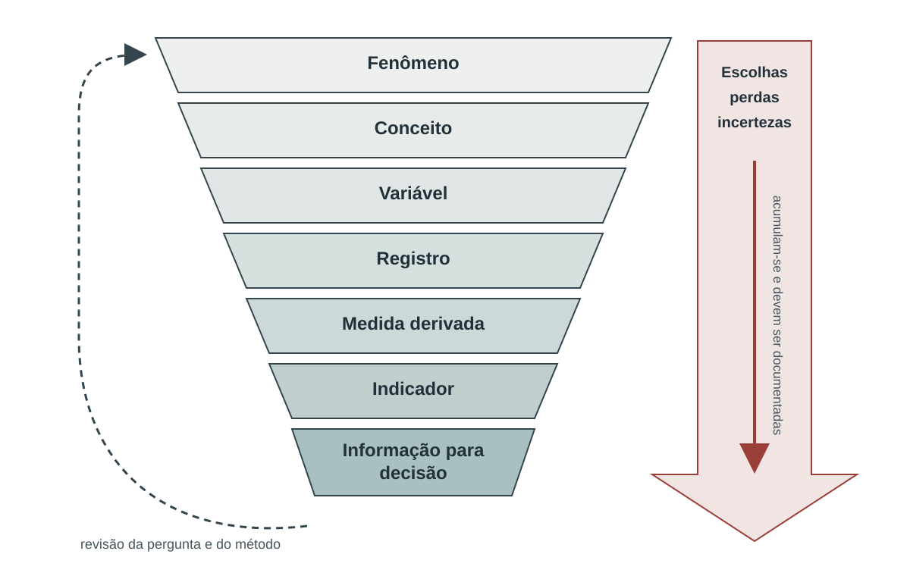

# Dos dados aos indicadores: como representar clima, ambiente e saúde {#sec-dados-indicadores}

No capítulo anterior, clima e ambiente foram apresentados como parte das condições que participam da produção da saúde nos territórios. Para que essas relações possam ser acompanhadas pela vigilância, analisadas pela pesquisa ou incorporadas à gestão, é necessário representá-las por meio de dados e medidas. Essa passagem da realidade para o número, porém, não é automática. Todo dado resulta de escolhas sobre **o que observar, onde, quando e como observar**; todo indicador acrescenta outras escolhas: **o que aquele valor pretende representar, como deve ser interpretado e para qual finalidade será utilizado**.

Essa distinção é importante porque os fenômenos de interesse para a saúde pública são, em geral, mais complexos do que as variáveis disponíveis para descrevê-los. Uma temperatura de 38 °C pode ser um registro meteorológico. Uma sequência de dias muito quentes pode caracterizar um episódio de calor. A distribuição das pessoas no território acrescenta uma dimensão de exposição. Condições de moradia, idade, trabalho e acesso a serviços ajudam a compreender por que uma mesma condição térmica pode produzir consequências diferentes. Em cada etapa, o número muda de significado porque muda a pergunta que ele procura responder.

Este capítulo acompanha essa cadeia de representação, do fenômeno à informação usada na decisão, e oferece critérios práticos para reconhecer **o que um valor representa, como foi produzido, a que espaço, período e população se refere e até onde sua interpretação pode chegar**. Esses critérios serão retomados nas fichas e fontes de dados apresentadas ao longo do livro [@ripsa2026; @who2023dqa].

A @fig-cadeia-representacao resume esse percurso. Entre a realidade e a decisão existem escolhas conceituais, metodológicas e operacionais. Torná-las visíveis é parte da qualidade do indicador.

{#fig-cadeia-representacao fig-alt="Funil conceitual com sete estágios, do fenômeno à informação para decisão. Uma seta lateral mostra que escolhas, perdas e incertezas se acumulam e devem ser documentadas; outra retorna à pergunta e ao método." width="100%"}

[Fonte e autoria: elaboração própria. Licença: a mesma dos textos autorais da obra.]{.figure-source}

## Do fenômeno ao indicador

Antes de definir os termos utilizados neste capítulo, é importante reconhecer que **medida, índice e indicador não possuem fronteiras universais**. Na climatologia, muitas medidas derivadas são tradicionalmente chamadas de *índices climáticos*; em saúde pública, taxas, proporções e contagens podem ser chamadas de indicadores; em outros campos, o termo *índice* é reservado principalmente a medidas compostas [@wmo2023climatological; @ripsa2026; @oecd2008composite].

Neste livro, adotamos uma convenção operacional. **Variável** é uma característica capaz de assumir diferentes valores; **dado** é um registro produzido sobre essa característica em determinado espaço e tempo; **medida** é o resultado de uma operação aplicada a um ou mais dados; **índice** é uma medida derivada cuja construção envolve transformação, síntese ou combinação e que costuma receber uma denominação própria; e **indicador** é uma medida ou índice utilizado deliberadamente para representar uma dimensão relevante e apoiar interpretação, comparação, monitoramento ou decisão. **Informação** surge quando esses elementos são interpretados em contexto. Mais importante do que o rótulo é conseguir reconstruir como o valor foi produzido e o que ele pode representar.

Se uma estação registra **38 °C** em determinado local e horário, a temperatura do ar é a variável e 38 °C é o dado. O registro pode gerar uma máxima diária, uma média ou a identificação de um dia acima de um valor previamente definido. Quando uma dessas medidas é associada a uma definição, uma interpretação e uma finalidade — por exemplo, acompanhar condições térmicas relevantes para a vigilância — ela pode funcionar como indicador [@ripsa2026]. Já a informação surge quando o valor é colocado em contexto: duração esperada do episódio, população exposta, grupos mais suscetíveis e capacidade de resposta dos serviços.

::: {#qua-cadeia-medicao}

| Camada | O que acontece | Exemplo com calor | Pergunta de controle |
|---|---|---|---|
| Fenômeno | delimita-se o processo de interesse | condições térmicas potencialmente danosas | O que se pretende compreender ou acompanhar? |
| Conceito | seleciona-se uma dimensão do fenômeno | perigo térmico | O conceito está claramente definido? |
| Variável | escolhe-se algo que possa ser observado ou estimado | temperatura do ar | Que característica será medida e em qual unidade? |
| Dado | registra-se um valor em determinado espaço e tempo | 38 °C na estação X às 15h do dia Y | Como, onde e quando esse valor foi produzido? |
| Medida derivada | aplica-se uma regra de cálculo | temperatura máxima diária ou contagem de dias acima de um valor definido | Que transformação foi realizada? |
| Indicador | associa-se a medida a um objetivo e a uma interpretação | número anual de dias que atendem a um critério térmico definido | Para que uso essa medida é adequada? |
| Informação para decisão | combina-se o indicador com o contexto | alerta, população exposta, capacidade dos serviços e ações pactuadas | Quem precisa fazer o quê e em que momento? |

Da realidade observada à informação para decisão

:::

A cadeia pode ser simples ou integrar várias bases; o essencial é que seja **reconstruível**. Em sistemas públicos, transparência metodológica e prevenção do uso incorreto fazem parte da qualidade da informação [@un2014statistics]. A Ficha de Qualificação da RIPSA explicita conceituação, interpretação, método, fontes e limitações [@ripsa2026] e, neste livro, deve ser entendida como parte do próprio indicador.

::: {.callout-note icon=false title="Metadados: os dados que explicam os dados"}
**Metadados** são as informações necessárias para compreender, localizar, comparar e utilizar corretamente um conjunto de dados ou indicador. Incluem, por exemplo, definição da variável, unidade, fonte, método de produção, cobertura espacial e temporal, frequência de atualização, códigos de ausência, procedimentos de qualidade e versão. Sem metadados, um arquivo pode conter muitos valores e ainda assim ser difícil — ou perigoso — de interpretar. Documentar metadados é parte da qualidade e da rastreabilidade da informação [@w3c2013prov; @wilkinson2016fair; @who2023dqa].
:::

## O que um dado ambiental realmente representa

O significado de um valor depende de **como ele foi produzido** — uma fonte frequente de equívocos quando bases climáticas, ambientais e de saúde são combinadas.

Considere novamente a temperatura. Uma estação meteorológica mede a temperatura do ar em um ponto específico e sob determinadas condições de instalação. Um produto em grade pode representar a temperatura de pequenas áreas por diferentes métodos. Um sensor em satélite pode, por sua vez, observar radiação e permitir estimar características da superfície. Todos esses produtos podem ser tecnicamente válidos e úteis, mas **não representam necessariamente a mesma grandeza nem respondem à mesma pergunta** [@iso2023geoquality; @wmo2023climatological].

Neste capítulo, interessa reconhecer essa diferença conceitual. As implicações de localização, resolução, agregação espacial e compatibilidade temporal serão tratadas especificamente no @sec-espaco-tempo.

### Forma da variável e unidade

A forma da variável limita as operações que fazem sentido. Temperatura e concentração são grandezas quantitativas; número de atendimentos é uma contagem; cobertura da terra pode ser categórica; classes como “baixo”, “moderado” e “alto” possuem ordem, mas não uma distância numérica conhecida. Codificar categorias como 1, 2 e 3 facilita o armazenamento, mas não as transforma em uma escala contínua.

A **unidade** também faz parte do significado. Graus Celsius, milímetros de chuva, porcentagens e taxas por 100 mil habitantes não são apenas números acompanhados de rótulos: informam como a quantidade foi construída e o que pode ser comparado.

Grande parte das medidas usadas em saúde pública, climatologia e ambiente é construída a partir de um conjunto relativamente pequeno de operações. Reconhecê-las ajuda a entender o que cada número está dizendo.

::: {#qua-gramatica-medidas}

| Forma | Pergunta que responde | Exemplo | Principal cuidado |
|---|---|---|---|
| Contagem | Quantos ocorreram? | 18 dias que atenderam a um critério definido | depende da definição do evento e do período observado |
| Proporção ou percentual | Que parte do conjunto apresenta a condição? | 22% da população em uma área de interesse | numerador e denominador devem representar o mesmo universo |
| Razão | Como duas quantidades se relacionam? | 1 unidade sentinela para cada 20 unidades da rede | numerador e denominador podem representar universos diferentes; a interpretação deve ser explícita |
| Taxa | Com que frequência eventos ocorrem em uma população e período? | 35 atendimentos por 100 mil habitantes no mês | exige população de referência, período e definição consistente do evento |
| Média ou mediana | Qual é o nível típico no período ou território? | temperatura média diária | pode ocultar extremos e heterogeneidade |
| Máximo ou mínimo | Qual foi o extremo observado? | maior temperatura registrada no dia | é sensível à frequência das observações e a valores espúrios |
| Acumulado | Quanto se acumulou ao longo do intervalo? | chuva acumulada em 72 horas | o período e os limites temporais precisam ser claros |
| Percentil | Onde o valor se situa em relação a uma distribuição? | valor correspondente ao percentil 95 de uma série | depende dos dados e do período usados como referência |
| Anomalia | Quanto o valor difere de uma referência? | temperatura 1,8 °C acima de uma média de referência | a referência faz parte da medida |
| Frequência de excedência | Quantas vezes um valor de referência foi ultrapassado? | dias acima de um critério definido | a origem e a finalidade do critério devem ser conhecidas |
| Duração ou persistência | Por quanto tempo a condição se manteve? | cinco dias consecutivos atendendo ao mesmo critério | regras sobre início, fim e interrupção alteram o resultado |

Formas frequentes de transformar dados em medidas e indicadores

:::

Essas operações podem ser encadeadas. Para identificar um **episódio persistente de calor**, por exemplo, pode-se primeiro definir um valor de referência, depois verificar quantos dias consecutivos o ultrapassaram e, por fim, contar quantos episódios ocorreram. O capítulo sobre temperatura apresentará definições padronizadas e suas diferenças; aqui, interessa apenas perceber que cada etapa acrescenta uma regra.

O tempo também faz parte da medida. Uma série horária pode gerar uma máxima diária; valores diários podem ser agrupados em sequências; e essas sequências podem ser resumidas por número e duração. O @sec-espaco-tempo aprofundará as consequências dessas agregações para comparabilidade e qualidade.

```{mermaid}
%%| label: fig-escala-temporal
%%| fig-cap: "Da observação horária a medidas resumidas: cada transformação responde a uma pergunta diferente."
%%| fig-alt: "Fluxograma que parte de observações horárias de temperatura, segue para máxima diária, identifica dias acima de um critério, agrupa dias consecutivos e resume número e duração dos episódios."
flowchart LR
    A["Observações horárias"] --> B["Máxima diária"]
    B --> C["Dias acima de um critério"]
    C --> D["Dias consecutivos"]
    D --> E["Episódios"]
    E --> F["Número e duração no período"]
```

[Fonte e autoria: elaboração própria. Licença: a mesma dos textos autorais da obra.]{.figure-source}

### Quando precisamos de um substituto

Nem tudo que gostaríamos de conhecer está diretamente disponível nos dados. Nesses casos, uma variável pode ser usada como **aproximação**, ou *proxy*, de outra informação.

O endereço de residência, por exemplo, pode ser usado para aproximar onde uma pessoa passa parte do tempo, embora não represente seus deslocamentos. A cobertura de vegetação em um mapa pode aproximar uma característica do ambiente urbano, mas não garante que todas as pessoas tenham acesso a sombra no horário de maior calor. Uma variável de renda pode informar parte das condições materiais de uma população, sem resumir todas as possibilidades de proteção e acesso a serviços.

O problema não é utilizar *proxies*; muitas análises dependem deles. O problema é esquecer que são aproximações. Uma *proxy* é defensável quando existe uma relação conceitual clara com aquilo que se pretende representar e quando suas limitações permanecem explícitas. **Disponibilidade não é sinônimo de validade** [@who2023dqa; @hernan2020causal].

### Como o valor foi produzido e a que tempo ele se refere

Expressões como **observado, estimado, modelado, previsto e projetado** aparecem com frequência em bases climáticas, ambientais e de saúde, mas não formam categorias mutuamente exclusivas. Uma previsão geralmente é produzida por um modelo; uma projeção também. Para interpretar esses produtos, é mais útil separar duas perguntas: **como o valor foi produzido?** e **a que referência temporal ou finalidade ele se destina?**

::: {#qua-producao-valor}

| Como o valor foi produzido? | Significado | Exemplo típico |
|---|---|---|
| Observado diretamente | um instrumento ou registro captou a grandeza ou ocorrência segundo um procedimento definido | temperatura medida por sensor; atendimento registrado em sistema |
| Derivado ou estimado | o valor foi calculado ou inferido a partir de outras informações e de um método | umidade calculada; população entre dois censos estimada |
| Modelado | o valor depende substantivamente de um modelo que representa processos ou relações | condição ambiental estimada para uma grade |
| Híbrido | observações e modelos são combinados de forma estruturada | produto que integra medições e modelagem |

Natureza da produção do valor

:::

::: {#qua-referencia-temporal}

| Referência ou finalidade temporal | O que pretende representar | Exemplo de uso |
|---|---|---|
| Histórico observado ou reconstruído | condições passadas | descrição de eventos e séries históricas |
| Monitoramento atual | condição recente ou presente | acompanhamento diário ou quase em tempo real |
| Previsão | condição futura em horizonte operacional | condição esperada nos próximos dias |
| Projeção | futuros condicionados a cenários, hipóteses e modelos | mudanças possíveis nas próximas décadas |

Referência temporal e finalidade do produto

:::

Os dois eixos se combinam: um valor histórico pode ser observado ou reconstruído; um valor futuro pode ser previsto por um modelo operacional ou projetado sob cenários. Essas categorias também não formam uma escala de “melhor” para “pior”. Uma observação pontual pode representar mal um território, enquanto uma estimativa modelada pode ser mais adequada para outra finalidade.

Produtos específicos — como grades que combinam observações e modelos, observações por satélite, previsões em grade e projeções — aparecerão nos capítulos seguintes quando forem necessários. O @sec-espaco-tempo discutirá como esses produtos representam espaço e tempo, e o @sec-fontes-fichas aprofundará a documentação de suas fontes, versões e métodos.

::: {.callout-warning title="Atenção"}
Uma série visualmente contínua pode reunir valores produzidos de maneiras diferentes. Não substitua silenciosamente observações ausentes por estimativas, previsões ou projeções sem registrar a mudança e avaliar suas consequências para a interpretação.
:::

Incerteza, completude e qualidade também acompanham essas escolhas. Como esse é o tema central do próximo capítulo, aqui basta reter uma regra: **a quantidade de casas decimais de um resultado não informa, por si só, quanto sabemos sobre ele**.

## Quando uma variável não basta: índices

Às vezes, uma única variável ou uma operação simples não é suficiente para representar a pergunta de interesse. Pode ser necessário transformar uma variável segundo uma regra, combinar duas ou mais medidas ou resumir várias dimensões em um único valor. Em muitas áreas, resultados desse tipo recebem o nome de **índice**.

Os índices podem ter construções muito diferentes. Um deles pode apenas transformar uma série para uma escala comum; outro pode combinar um valor de referência com uma regra de duração; outro pode reunir vários componentes em uma medida composta. Os capítulos temáticos mostrarão exemplos concretos para condições térmicas, chuva e seca, qualidade do ar e vulnerabilidade. Neste ponto, o importante é compreender que **o nome “índice” não revela sozinho como o valor foi construído**.

Para índices compostos, a construção deve começar por um **modelo conceitual**, e não pela disponibilidade das colunas em uma base de dados. Primeiro se define o que se pretende representar; depois se escolhem componentes e regras de transformação e combinação [@oecd2008composite].

::: {.callout-note icon=false title="Antes de confiar em um índice composto"}
Verifique pelo menos seis decisões: **direção** dos componentes — se valores altos significam situação favorável ou desfavorável; **normalização** — como escalas diferentes foram tornadas comparáveis; **ponderação** — quanto cada componente contribui; **agregação** — se um resultado favorável pode compensar outro desfavorável; **redundância** — se variáveis muito semelhantes acabam dando peso excessivo à mesma dimensão; e **dados ausentes** — como componentes faltantes foram tratados. Classificações e rankings acrescentam ainda outra escolha e não devem sugerir uma precisão maior do que aquela sustentada pelos dados [@oecd2008composite].
:::

Considere um índice hipotético para resumir condições de funcionamento de serviços durante uma emergência. Se ele combinar disponibilidade de água, energia, acesso e pessoal em uma única média, um serviço com muitos profissionais pode obter uma pontuação final razoável mesmo sem fonte alternativa de energia. Se a eletricidade for indispensável para manter equipamentos críticos, essa compensação pode ser inadequada. O problema não está na matemática em si, mas no significado que ela atribui aos componentes.

Por isso, índices compostos devem ser acompanhados, sempre que possível, de seus componentes e de comparações que mostrem se o resultado muda sob escolhas metodológicas plausíveis — as chamadas **análises de sensibilidade**. Um índice não é automaticamente melhor do que um conjunto de medidas simples; às vezes, manter as dimensões separadas preserva melhor as diferenças que interessam à decisão.

## O que torna uma medida um indicador

Um indicador existe para responder a uma pergunta. Antes de calculá-lo, portanto, é útil explicitar quatro elementos: **o que se pretende representar, como a medida será obtida, como deverá ser interpretada e para que será utilizada** [@ripsa2026].

### A anatomia de um indicador

Uma forma prática de avaliar um indicador é “desmontá-lo” em seus componentes. Para não depender de conceitos que serão apresentados nos capítulos temáticos, o exemplo a seguir é **deliberadamente simples e didático**: número anual de dias em que a temperatura máxima ultrapassa 35 °C. O valor de 35 °C não é apresentado aqui como limiar universal de risco à saúde; serve apenas para mostrar como uma definição operacional é documentada.

::: {#qua-anatomia-indicador}

| Elemento | Exemplo didático: dias acima de 35 °C | Pergunta que o leitor deve fazer |
|---|---|---|
| Nome | número anual de dias com temperatura máxima acima de 35 °C | O nome descreve claramente o que está sendo contado? |
| Conceito | frequência de dias que atendem a um critério térmico absoluto | Que dimensão se pretende representar? |
| Variável de entrada | temperatura máxima diária do ar | Que grandeza foi medida ou estimada? |
| Definição operacional | dia em que a temperatura máxima é maior que 35 °C | Que regra transforma o dado em ocorrência? |
| Cálculo | contagem dos dias que atendem ao critério no ano | Qual operação é realizada? |
| Unidade | dias por ano | Em que unidade o resultado deve ser lido? |
| Fonte | série diária de temperatura máxima | De onde vêm os dados? |
| Unidade espacial | estação ou território, conforme a fonte e o método de agregação | A que espaço o valor final se refere? |
| Interpretação | valores maiores indicam mais dias acima do critério adotado | O que significa aumentar ou diminuir? |
| Limitações | o critério é ilustrativo; a medida não representa sozinha duração dos episódios, exposição individual ou efeitos sobre a saúde | O que o indicador não permite concluir? |
| Qualidade e incerteza | dependem da completude, consistência e representatividade da série | Que limitações da fonte chegam ao resultado? |
| Versão e reprodutibilidade | fonte, regra de cálculo e período precisam ser identificados | Outra equipe conseguiria reproduzir o valor? |
| Uso previsto | descrição e comparação da frequência de dias acima do critério | Para que análise a medida foi concebida? |

Anatomia de um indicador: um exemplo deliberadamente simples

:::

O exemplo mostra que até uma contagem aparentemente trivial depende de uma variável, um critério, um período, uma fonte e uma regra de interpretação. Indicadores térmicos padronizados e definições específicas para episódios persistentes de calor serão apresentados no @sec-temperatura; aqui, o objetivo é apenas aprender a reconhecer os elementos que precisam acompanhar qualquer indicador. A ficha de qualificação organiza exatamente esse tipo de informação [@ripsa2026].

A adequação de um indicador depende de sua finalidade. Para facilitar a avaliação, algumas propriedades podem ser agrupadas em perguntas práticas:

::: {#qua-propriedades-indicadores}

| Propriedade | Pergunta prática |
|---|---|
| Relevância | O indicador representa um problema importante para a pergunta de saúde ou gestão? |
| Validade | A medida corresponde adequadamente ao conceito que se pretende representar? |
| Confiabilidade e reprodutibilidade | O mesmo procedimento aplicado aos mesmos dados produz o mesmo resultado? |
| Comparabilidade | A definição permite comparar períodos, territórios ou grupos sem misturar mudanças metodológicas? |
| Sensibilidade a mudanças | O indicador responde quando o fenômeno relevante se modifica? |
| Oportunidade | A atualização chega a tempo da decisão que pretende apoiar? |
| Interpretabilidade | O significado, a unidade, a referência e as limitações são compreensíveis? |
| Viabilidade | Os dados e procedimentos necessários podem ser mantidos de forma sustentável? |
| Utilidade para ação | O resultado ajuda a definir prioridade, resposta, planejamento ou acompanhamento? |

Propriedades de um indicador em função do uso

:::

Nenhum indicador maximiza todas essas propriedades ao mesmo tempo. Uma medida muito oportuna pode ser preliminar; uma estimativa mais precisa pode chegar tarde para uma resposta imediata; uma definição padronizada facilita comparações, mas pode perder sensibilidade a particularidades locais. Em sistemas públicos de informação, a qualidade deve ser entendida como **adequação ao uso**, com os compromissos metodológicos explicitados [@un2014statistics; @who2023dqa].

### Numerador, denominador e população de referência

Muitos indicadores de saúde parecem simples até que se examina o denominador. Contagens respondem “quantos?”. Proporções respondem “que parte de um conjunto?”. Taxas relacionam eventos a uma população sob risco e, frequentemente, a um intervalo de tempo. O denominador define a população à qual o indicador se refere e, por isso, faz parte de sua própria definição [@ripsa2026; @who2023dqa].

Na proporção de estabelecimentos com plano de contingência, por exemplo, numerador e denominador precisam usar a mesma lista de unidades, território e data de referência. O mesmo vale para indicadores populacionais: residentes, pessoas presentes, trabalhadores expostos, leitos cadastrados e leitos em funcionamento representam universos diferentes. Quando o denominador é estimado, sua versão e limitações acompanham a taxa [@ripsa2026; @who2001standard].

Em populações pequenas, poucos eventos podem produzir grandes oscilações. Passar de um para três óbitos, por exemplo, gera forte variação percentual embora corresponda a apenas dois eventos adicionais. A taxa não está errada, mas **magnitude absoluta, denominador e estabilidade** devem ser interpretados em conjunto.

### Quantidade absoluta e medida relativa contam histórias diferentes

Suponha que o município A tenha 20 mil pessoas em área sujeita a inundação, correspondendo a 40% de sua população. O município B tem 100 mil pessoas nessa condição, mas elas representam 10% da população municipal. Se a pergunta é onde a **proporção** de moradores expostos é maior, A se destaca. Se a pergunta é quantas pessoas podem precisar de abrigo, transporte ou assistência, B exige maior capacidade operacional. Por isso, quando a decisão envolve magnitude e prioridade relativa, é recomendável apresentar valores absolutos e relativos lado a lado.

### Unidade de observação não é necessariamente unidade de análise

::: {.callout-important icon=false title="Conceito-chave: observação, análise e população-alvo"}
**Unidade de observação** é aquilo que gera o registro: uma estação, uma célula de grade, uma amostra de água, um atendimento, um estabelecimento ou uma pessoa.

**Unidade de análise** é aquilo que recebe a medida final: dia, município, região, serviço ou grupo populacional.

**População-alvo** é o conjunto ao qual se pretende aplicar a interpretação. Essas unidades podem coincidir, mas frequentemente não coincidem.
:::

Uma estação produz observações pontuais, mas uma “temperatura média municipal” resulta de uma regra espacial aplicada a um conjunto de observações ou células. Um registro de internação é um evento administrativo, enquanto uma taxa municipal pode pretender descrever a ocorrência desses eventos entre residentes. Uma amostra de água representa um ponto e um momento, enquanto a proporção de conformidade procura resumir o desempenho de um sistema durante um período.

::: {.callout-warning icon=false title="O valor do território não é o valor de cada pessoa"}
Uma concentração média municipal de um poluente não significa que todos os habitantes entraram em contato exatamente com aquele valor. Uma temperatura média do bairro não reproduz a exposição térmica de cada morador. Pessoas trabalham, estudam e se deslocam; os ambientes internos podem ser muito diferentes dos externos; e a distribuição espacial do perigo dentro de um território pode ser heterogênea.

Indicadores territoriais são fundamentais para vigilância e planejamento, mas sua interpretação deve permanecer no nível para o qual foram construídos. Passar diretamente de uma associação entre territórios para uma conclusão sobre indivíduos exige hipóteses e dados adicionais [@hernan2020causal].

Além disso, **a média do território pode esconder desigualdades internas**. Dois municípios com a mesma cobertura vegetal média ou a mesma concentração média de um poluente podem ter distribuições muito diferentes entre bairros e grupos sociais. Sempre que a decisão exigir localizar desigualdades, é necessário avaliar se a desagregação espacial e populacional disponível é suficiente para revelar essas diferenças.
:::

### Comparar não é o mesmo que classificar

Classificar uma medida contínua em faixas como “baixo”, “moderado” e “alto” introduz **pontos de corte**. Eles podem vir de uma norma, de evidência sanitária, da distribuição estatística ou de uma decisão operacional — origens com significados diferentes. Um percentil indica posição relativa; um padrão legal, conformidade; um limiar sanitário, uma referência de risco; e um gatilho operacional, o momento de iniciar uma ação. A origem e a finalidade do corte devem estar explícitas.

## Onde o indicador está na cadeia entre ambiente e saúde

No capítulo anterior, perigo, exposição, vulnerabilidade, efeitos e capacidade de resposta foram apresentados como partes de uma cadeia que ajuda a organizar as relações entre ambiente e saúde. Ao construir um indicador, é útil perguntar **qual parte dessa cadeia está sendo representada**. Essa pergunta impede que uma medida de uma etapa seja interpretada como se descrevesse o problema inteiro.

```{mermaid}
%%| label: fig-indicadores-cadeia-risco
%%| fig-cap: "Indicadores podem representar diferentes partes da cadeia entre ambiente e saúde."
%%| fig-alt: "Diagrama em que perigo, exposição, vulnerabilidade e baixa capacidade de resposta contribuem para o risco; o risco se relaciona a possíveis efeitos sobre a saúde."
flowchart LR
    P["Perigo"] --> R["Risco à saúde"]
    E["Exposição"] --> R
    V["Vulnerabilidade"] --> R
    C["Baixa capacidade<br/>de resposta"] --> R
    R --> S["Possíveis efeitos<br/>sobre a saúde"]
```

[Fonte e autoria: elaboração própria. Licença: a mesma dos textos autorais da obra.]{.figure-source}

Um indicador de perigo pode descrever intensidade, frequência ou duração de uma condição ambiental. Um indicador de exposição acrescenta quem ou o que se encontra no lugar e no tempo do perigo. Indicadores de vulnerabilidade descrevem condições que aumentam suscetibilidade ou reduzem proteção. Indicadores de efeito registram alterações de saúde, e indicadores de capacidade descrevem recursos e funcionamento necessários para responder. Os conceitos de exposição e vulnerabilidade serão aprofundados no @sec-exposicao-vulnerabilidade; os efeitos, no @sec-efeitos-saude; e a capacidade de resposta, no @sec-resposta.

Um indicador pode combinar dimensões, mas isso deve ser explícito. Uma temperatura elevada descreve principalmente uma condição ambiental; cruzada com a distribuição da população, pode aproximar exposição. Acrescentar condições sociais e de infraestrutura muda novamente o significado da medida.

### Indicador ambiental e indicador de saúde ambiental

Um **indicador ambiental** caracteriza uma condição ou mudança no ambiente. Um **indicador de saúde ambiental** aproxima explicitamente ambiente e saúde ao representar, por exemplo, exposição populacional, condições de vulnerabilidade, efeitos sanitários ou capacidade de resposta.

Considere a poluição do ar apenas como exemplo conceitual. Uma concentração média no território descreve uma condição ambiental. Dar maior peso às áreas mais povoadas produz uma medida mais próxima da exposição residencial da população. O número de atendimentos respiratórios descreve um evento de saúde. Colocar essas medidas lado a lado não demonstra, por si só, que uma causou a outra; essa ligação exige uma pergunta analítica e métodos apropriados, assunto do @sec-efeitos-saude [@hernan2020causal].

## Do indicador ao uso

A finalidade influencia a escolha de um indicador, mas o indicador não determina sozinho a decisão. Uma medida simples, atualizada e compreendida pode ser mais útil para uma necessidade imediata do que um índice complexo que chega tarde; para planejamento de longo prazo, outras medidas e períodos podem ser necessários.

Neste capítulo, o ponto essencial é apenas este: **a pergunta de uso deve ser conhecida antes da escolha do indicador**. Ela ajuda a definir que fenômeno representar, que população e período interessam e que nível de detalhe é necessário. Espaço, tempo e qualidade serão aprofundados no @sec-espaco-tempo; fontes e fichas, no @sec-fontes-fichas.

A ligação entre indicadores, linhas de base, critérios de ação, responsabilidades, protocolos e avaliação será desenvolvida de forma própria no @sec-indicador-decisao. Antecipar toda essa arquitetura aqui faria o capítulo introdutório depender de conceitos que ainda serão construídos ao longo do livro.

## Síntese

Entre um fenômeno e sua representação numérica existe uma cadeia: **variáveis definem características; dados registram valores; medidas transformam registros; índices realizam transformações ou sínteses; indicadores associam medidas a conceitos e finalidades; informação surge quando esses elementos são interpretados em contexto**. Os nomes variam entre áreas, mas a necessidade de reconstruir o caminho permanece.

Antes de utilizar um indicador, convém saber **o que ele pretende representar; como os dados foram produzidos; que operações geraram a medida; qual população ou denominador está envolvido; quais limitações permanecem; e para que uso ele foi construído**.

Este capítulo não pretendeu antecipar as definições especializadas dos capítulos temáticos. Seu papel é oferecer uma gramática básica para que, quando aparecerem medidas de temperatura, chuva, poluição, exposição, efeitos ou capacidade de resposta, o leitor consiga perguntar como cada uma foi construída. O próximo passo é compreender como espaço, tempo e qualidade condicionam a possibilidade de combinar essas medidas, tema do @sec-espaco-tempo.
