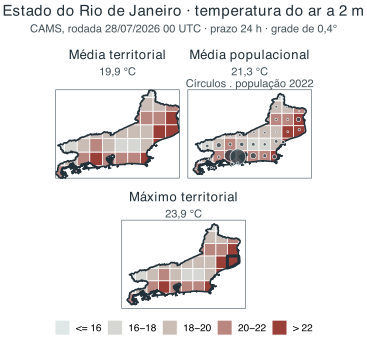

# Compatibilizando dados: espaço, tempo e qualidade {#sec-espaco-tempo}

No capítulo anterior, a pergunta central foi **o que um dado ou indicador representa**. Neste capítulo, o problema muda de escala: **quando duas ou mais fontes podem ser combinadas sem que o significado original seja perdido?** Essa questão aparece continuamente na interface clima, ambiente e saúde, porque as fontes raramente são produzidas para o mesmo lugar, o mesmo período ou a mesma população.

Uma estação meteorológica registra condições em um ponto; uma célula de uma grade representa um valor associado a uma área; uma taxa municipal resume eventos e população segundo um território administrativo. Do mesmo modo, uma concentração horária, uma média diária, um total mensal e uma taxa anual pertencem a janelas temporais diferentes. Unir essas informações exige mais do que encontrar uma coluna de município e outra de data: exige verificar **que espaço, que tempo e que população cada valor efetivamente representa**.

Essa compatibilização modifica o dado. Transformar uma grade em uma média municipal, converter UTC para horário local, agregar horas em dias, escolher um período de referência ou tratar valores ausentes são decisões analíticas. Elas podem ser necessárias e perfeitamente defensáveis, mas precisam ser coerentes com a pergunta e permanecer documentadas.

A qualidade deve ser examinada pela mesma lógica. Um produto pode ser adequado para comparar grandes regiões e insuficiente para orientar uma ação em um bairro; uma base consolidada pode ser excelente para análise retrospectiva e chegar tarde demais para vigilância operacional. A ISO 19157-1 organiza a qualidade de dados geográficos a partir dos requisitos do produto e do uso [@iso2023geoquality]. Aqui, adotaremos uma formulação prática: **não basta perguntar se o dado é bom; é preciso perguntar se ele é adequado para aquilo que se pretende fazer com ele**.

Assim, este capítulo se concentra em três perguntas: **que espaço o dado representa? que tempo ele representa? e sua qualidade é suficiente para a análise ou decisão pretendida?**

## O espaço que um dado representa

Quando um conjunto de dados possui latitude e longitude, pode parecer que sua dimensão espacial está resolvida. Não está. Uma coordenada informa **onde** algo foi registrado ou referenciado, mas não necessariamente **qual porção do espaço** aquele valor representa.

Quatro conceitos ajudam a separar essas ideias:

- **Localização** indica onde a observação, estimativa ou unidade está posicionada.
- **Suporte espacial** é a porção do espaço à qual o valor se refere.
- **Resolução espacial** descreve o nível de detalhe ou o tamanho nominal das unidades do produto.
- **Escala de análise** corresponde ao nível em que o fenômeno será interpretado ou a decisão será tomada.

Uma estação meteorológica, por exemplo, possui uma coordenada, mas sua observação é feita em um ponto e sob condições específicas de instalação. Uma célula de grade de 10 km possui uma localização e uma dimensão, mas o valor pode resultar de um modelo cuja influência espacial ultrapassa o tamanho nominal da célula. Uma taxa municipal, por sua vez, não representa um ponto: ela resume eventos e população dentro de um limite administrativo.

A @fig-suporte-localizacao resume essa distinção. Os elementos podem ocupar a mesma região do mapa e, ainda assim, ter suportes completamente diferentes.

```{mermaid}
%%| label: fig-suporte-localizacao
%%| fig-cap: "Localização, suporte e unidade de análise não são a mesma coisa."
%%| fig-alt: "Diagrama conceitual de um município que contém células de grade, uma estação meteorológica e uma residência. A estação e a residência são pontos; a célula é uma área; e o município é um polígono usado como unidade de análise."
flowchart TB
    subgraph M["Município — polígono / unidade de análise"]
        direction LR
        subgraph G1["Célula de grade — suporte em área"]
            E(("Estação<br/>medição pontual"))
            R(("Residência<br/>localização individual"))
        end
        G2["Outra célula de grade"]
    end
    E -. "coordenada" .-> M
    R -. "coordenada" .-> M
```

[Fontes e autoria: elaboração própria. Licença: a mesma dos textos autorais da obra.]{.figure-source}

::: {.callout-important icon=false title="Resolução maior não significa automaticamente informação melhor"}

Um produto de 1 km não é necessariamente mais exato do que um produto de 10 km. Resolução informa o tamanho das unidades publicadas; **exatidão, representatividade e incerteza dependem de como o produto foi produzido**. Aumentar artificialmente o número de pixels por reamostragem pode tornar um mapa visualmente mais detalhado sem recuperar informação que nunca existiu na fonte.

:::

O processo observado também possui uma escala própria. Chuvas intensas podem variar muito em pequenas distâncias. Temperatura responde a relevo, urbanização, vegetação e materiais da superfície. Algumas condições da qualidade do ar podem variar perto de vias ou fontes de emissão, enquanto fenômenos ambientais de longa duração podem abranger regiões extensas. A escolha do dado deve considerar essa escala do fenômeno, e não apenas a resolução disponível [@iso2023geoquality].


### Estações, grades e satélites respondem a perguntas diferentes

Estações meteorológicas e ambientais oferecem observações diretamente vinculadas a instrumentos, mas sua representatividade depende de localização, altitude, entorno, altura de medição, manutenção e variável observada. A estação mais próxima nem sempre é a que melhor representa o território de interesse. Uma estação em aeroporto, por exemplo, pode registrar condições bastante diferentes das encontradas em áreas densamente construídas da mesma cidade.

Uma rede de estações é também uma **amostra espacial**. Se os pontos se concentram em cidades, aeroportos ou áreas de fácil acesso, possuir muitas estações não significa que todos os ambientes estejam igualmente representados. Coordenadas, histórico de localização, instrumento, frequência de medição e códigos de qualidade fazem parte dos metadados necessários à interpretação [@wmo2023climatological].

Dados em grade oferecem cobertura contínua, mas podem resultar de processos muito diferentes. Uma grade pode ser produzida por interpolação entre pontos, por modelos, por combinação entre modelos e observações ou por sensores em satélites. Uma **reanálise**, por exemplo, combina observações disponíveis com um modelo e um sistema de assimilação para reconstruir condições passadas de forma coerente; ela não corresponde a medições feitas em cada célula [@hersbach2020era5]. No **sensoriamento remoto**, sensores observam a energia proveniente da superfície ou da atmosfera e algoritmos transformam essas observações em produtos como temperatura da superfície ou cobertura vegetal; nuvens, ângulo de observação e mistura de materiais dentro do pixel podem influenciar o resultado [@jin2012uhi; @iso2023geoquality]. O @sec-fontes-fichas retomará esses produtos do ponto de vista de suas fontes e documentação.

::: {.callout-note icon=false title="Graus não são quilômetros"}
Muitas grades globais são publicadas em coordenadas geográficas, com resolução expressa em **graus**, como 0,25° ou 0,4°. Graus representam ângulos, não uma distância fixa na superfície terrestre. Um intervalo de latitude mantém dimensão norte–sul aproximadamente semelhante, enquanto a distância correspondente a um grau de longitude diminui à medida que nos afastamos do Equador. Consequentemente, células com a mesma dimensão angular podem possuir áreas físicas diferentes.

Isso importa sobretudo para operações baseadas em **área**, totais e ponderações. Reprojetar uma grade para um sistema adequado ou calcular explicitamente as áreas das interseções evita tratar todos os pixels como se tivessem a mesma superfície.
:::

::: {.callout-note icon=false title="Para quem processa dados em grade"}
Reprojetar ou reamostrar uma grade exige escolher um método compatível com a variável. **Vizinho mais próximo** costuma ser apropriado para classes, como uso da terra; **interpolação bilinear** é usada em superfícies contínuas, mas suaviza valores; métodos **conservativos** são úteis quando é necessário preservar totais ou fluxos. Aplicar bilinear a categorias pode criar classes inexistentes, e aumentar a resolução não cria detalhe que não existia na fonte.

Ao registrar o processamento, preserve ao menos produto e versão, variável e unidade, sistema de coordenadas, resolução original, referência temporal, método de reamostragem e transformações aplicadas.
:::

::: {.callout-tip icon=false title="Para quem fará análise estatística com grades"}
Células vizinhas frequentemente compartilham informação e apresentam **dependência espacial**. Modelos compartilham dinâmica e assimilação; superfícies interpoladas compartilham estações; sensores possuem resposta espacial que pode ultrapassar o pixel nominal. Portanto, dividir uma região em milhares de células não produz automaticamente milhares de observações estatisticamente independentes. Ignorar essa dependência pode criar uma falsa impressão de tamanho amostral e de precisão.
:::

## Do suporte original ao território de gestão

Grande parte da vigilância e da gestão do SUS trabalha com municípios, regiões de saúde e estados. Os dados ambientais, porém, raramente são produzidos exatamente nesses limites. Transformar uma estação ou uma grade em um indicador territorial exige uma **mudança de suporte espacial**: o valor passa a representar outra unidade.

Essa mudança pode parecer simples — “calcular a média do município” —, mas regras diferentes respondem a perguntas diferentes. Considere uma grade de temperatura. A média pela área municipal descreve a condição térmica média do território. Uma média ponderada pela população dá maior peso aos locais onde vivem mais pessoas e aproxima a condição térmica média nos locais de residência. O máximo territorial procura identificar a maior temperatura estimada. Nenhuma dessas estatísticas é universalmente correta; a escolha depende da pergunta [@openshaw1984].

Para um município \(m\), uma média ponderada pela população pode ser expressa por:

$$
\bar{x}_{pop,m} = \frac{\sum_g x_g\,p_{gm}}{\sum_g p_{gm}},
$$

em que \(x_g\) é o valor ambiental da célula \(g\) e \(p_{gm}\) é a população localizada **na parte da célula \(g\) que pertence ao município \(m\)**. Essa notação deixa explícito que células e limites municipais podem se cruzar e que a população utilizada precisa estar espacialmente associada ao território analisado.

::: {.callout-note icon=false title="Um exemplo com apenas três células"}
Suponha três células de mesma área dentro de um território. A primeira tem 20 °C e 100 habitantes; a segunda, 22 °C e 1.000 habitantes; a terceira, 18 °C e 50 habitantes. A média espacial simples é **20,0 °C**. A média ponderada pela população é aproximadamente **21,7 °C**, porque a maior parte dos residentes está na célula mais quente.

Nenhum dos valores é “o verdadeiro” por definição. A média espacial responde como está o território em média; a ponderada pela população responde em que condição térmica média vive a população residente, segundo essa distribuição populacional.
:::

Ponderar pela população não transforma uma temperatura ambiental em uma medida individual de exposição. Pessoas se deslocam, trabalham e permanecem em ambientes internos; a própria superfície populacional pode ser estimada. Ainda assim, quando a pergunta se refere à condição média nos locais de residência, essa ponderação pode ser mais informativa do que uma média puramente territorial.

### Situação concreta: três temperaturas para o mesmo estado

A @fig-mudanca-suporte mostra um exemplo em que a mesma previsão de temperatura do ar do **Copernicus Atmosphere Monitoring Service (CAMS)** é resumida para o estado do Rio de Janeiro de três maneiras. A média pela área territorial é 19,9 °C; a média ponderada pela distribuição populacional é 21,3 °C; o máximo territorial é 23,9 °C. Não existe contradição entre os três valores. **Eles respondem a perguntas diferentes.**

A média pela área descreve a superfície territorial; a média populacional enfatiza onde as pessoas residem; o máximo localiza a condição mais elevada. A escolha entre eles deve vir antes do cálculo e deve ser registrada como parte da definição do indicador. Os valores pertencem à rodada utilizada no exemplo e não expressam uma diferença universal entre os métodos [@cams2026globalforecast; @ibge2022grade; @ibge2024malhas].

{#fig-mudanca-suporte fig-alt="Três mapas do estado do Rio de Janeiro usam a mesma previsão CAMS de temperatura do ar. A média pela área territorial é 19,9 graus Celsius; a média ponderada pela população do Censo 2022 é 21,3 graus Celsius; e o máximo territorial é 23,9 graus Celsius." width="100%"}

[Fontes: CAMS/ECMWF (temperatura a 2 m; 29 jul. 2026, 00 UTC) e IBGE (Grade Estatística 2022 e Malha 2022), via `geobr`. Elaboração própria; script e proveniência: `data-raw/figures/README.md`. Licenças: termos das fontes e da obra.]{.figure-source}

### Sobreposição espacial, interpolação areal e ponderação populacional

Três operações próximas na aparência devem ser separadas conceitualmente.

**Sobreposição entre grade e território** ocorre quando uma superfície contínua, como temperatura, é resumida para um polígono. Células cortadas pelo limite podem contribuir segundo a fração de área efetivamente contida no território. A estatística final — média, máximo, percentil ou outra — deve ser coerente com a grandeza analisada.

**Interpolação areal** é necessária quando uma quantidade associada a polígonos de origem precisa ser transferida para polígonos de destino diferentes. Em variáveis extensivas, como contagens populacionais, uma ponderação apenas pela área pressupõe distribuição uniforme dentro de cada polígono. **Métodos dasimétricos** procuram melhorar essa redistribuição utilizando informação auxiliar, como áreas construídas ou cobertura da terra, mas acrescentam dados e hipóteses [@openshaw1984; @iso2023geoquality].

**Ponderação populacional da exposição**, por sua vez, combina uma superfície ambiental com uma superfície de população já compatibilizada espacialmente. Seu objetivo não é redistribuir a temperatura ou a concentração, mas atribuir maior peso aos locais onde reside mais gente.

Essas operações preservam propriedades diferentes. O processamento deve declarar **o que se pretende conservar — média, total, proporção, ocorrência ou distribuição —**, como foram tratadas as interseções e que dados auxiliares foram utilizados.

## Territórios administrativos também mudam

Municípios, regiões de saúde e outros territórios de gestão não são unidades naturais e imutáveis. Limites podem ser alterados, municípios podem ser criados e a composição de regiões pode mudar. Por isso, uma série territorial sem referência à malha e à vigência utilizadas pode se tornar ambígua [@ibge2024malhas].

O município é extremamente útil para planejamento e vigilância porque organiza responsabilidades, população, serviços e políticas. Isso não significa que seja ambientalmente homogêneo. Um município extenso pode reunir áreas urbanas, rurais, florestais, serranas e costeiras. Um único valor municipal é uma **síntese**, não uma descrição de todos os locais que existem dentro dele.

O mesmo cuidado vale para regiões de saúde. Uma média regional pode ser apropriada para planejamento assistencial e, ao mesmo tempo, ocultar um município com condição muito mais crítica. Sempre que a heterogeneidade interna for relevante para a ação, uma síntese regional deve ser acompanhada de distribuição, mapa ou desagregação das unidades componentes.

### Quando os resultados dependem de como desenhamos o mapa

Há ainda um problema menos intuitivo: resultados obtidos com dados agregados podem mudar quando o mesmo espaço é dividido de outra forma. Uma associação calculada entre municípios pode ser diferente da associação calculada entre bairros ou regiões. Mesmo unidades de tamanho semelhante podem produzir resultados distintos quando seus limites são redesenhados. Esse fenômeno é conhecido como **problema da unidade de área modificável** (*modifiable areal unit problem*, MAUP) [@openshaw1984].

Isso não é resolvido simplesmente escolhendo a menor unidade disponível. Áreas muito pequenas podem produzir taxas instáveis, aumentar problemas de confidencialidade e se alinhar mal ao processo ambiental. Quando a conclusão depende fortemente da escala ou do zoneamento, é recomendável testar unidades plausíveis e relatar o que permanece estável.

::: {.callout-warning icon=false title="Do território para a pessoa: cuidado com a falácia ecológica"}

Se municípios com maior temperatura também apresentarem maior mortalidade, isso não demonstra que as pessoas mais expostas ao calor foram as que morreram. Uma associação observada entre áreas pertence ao nível agregado. Estudos ecológicos podem ser muito úteis para políticas e contextos territoriais, mas inferências individuais exigem dados e hipóteses adicionais [@piantadosi1988ecological]. As implicações dessa distinção para análises entre ambiente e saúde serão retomadas no @sec-efeitos-saude.

:::

## O tempo que um dado representa

Assim como todo valor possui um suporte espacial, ele também possui uma **referência temporal**. Em clima e saúde, o tempo do fenômeno, da medição, do registro e da disponibilidade da informação frequentemente não coincide.

Uma chuva intensa pode ocorrer hoje; uma inundação, algumas horas depois; sintomas, dias depois; um atendimento pode ser registrado no mesmo dia ou posteriormente; a base consolidada pode ser publicada semanas ou meses depois. Alinhar essas datas apenas porque aparecem na mesma coluna de “data” pode deslocar a relação que se pretende estudar.

```{mermaid}
%%| label: fig-tempos-dado
%%| fig-cap: "Entre o fenômeno ambiental e a disponibilidade do dado podem existir diferentes tempos e atrasos."
%%| fig-alt: "Fluxo temporal com fenômeno ambiental, exposição, possível efeito sobre a saúde, registro no sistema e publicação do dado, ligados por setas que representam atrasos variáveis."
flowchart LR
    A["Fenômeno ambiental"] --> B["Exposição"]
    B --> C["Possível efeito sobre a saúde"]
    C --> D["Registro no sistema"]
    D --> E["Disponibilidade/publicação"]
```

[Fontes e autoria: elaboração própria. Licença: a mesma dos textos autorais da obra.]{.figure-source}

Dependendo da fonte, podem coexistir várias datas: ocorrência do fenômeno, início e fim da exposição, início dos sintomas, atendimento, internação, notificação, competência, processamento e publicação. Em produtos de previsão há ainda a **data da rodada** e o **horário para o qual a previsão é válida**. A data correta para uma análise depende da pergunta.

Em previsões, três referências devem ser preservadas: **inicialização**, **horizonte de previsão** (*lead time*) e **tempo de validade**. A inicialização informa quando a rodada começou; o horizonte informa quantas horas ou dias à frente o modelo avançou; e o tempo de validade é o instante ou período ao qual o valor se refere. Assim, uma previsão inicializada às 00 UTC com horizonte de +72 h é válida três dias depois, e não deve ser confundida com uma observação feita no horário de inicialização.^[A documentação operacional do ECMWF distingue explicitamente tempo de inicialização, passo/horizonte e tempo de validade em produtos de análise e previsão: <https://confluence.ecmwf.int/pages/viewpage.action?pageId=453673187>.]

```{mermaid}
%%| label: fig-tempos-previsao
%%| fig-cap: "Três tempos de uma previsão: inicialização, horizonte e validade."
%%| fig-alt: "Linha temporal em que uma previsão é inicializada no tempo zero, avança por um horizonte de 72 horas e produz um valor válido no tempo zero mais 72 horas."
flowchart LR
    I["Inicialização da rodada<br/>t₀"] -->|"lead time / horizonte<br/>+72 h"| V["Tempo de validade<br/>t₀ + 72 h"]
```

[Fontes: elaboração própria, com terminologia operacional do ECMWF.]{.figure-source}

### Dia, semana e mês precisam ser definidos

“Diário” não é uma propriedade suficiente. Um dia precisa de início, fim e fuso horário. Dados meteorológicos frequentemente usam UTC; sistemas de saúde podem usar horário local. Sem harmonização, eventos próximos à meia-noite podem ser associados ao dia errado. Calendários diferentes também podem aparecer em modelos climáticos.

Uma prática segura é conservar o horário original e seu fuso, realizar conversões explicitamente e somente depois criar janelas diárias, semanais ou mensais para a análise. Quando um deslocamento de algumas horas pode alterar a associação, a sensibilidade à definição temporal deve ser verificada.

::: {.callout-note icon=false title="Para quem trabalhará com projeções climáticas"}
Arquivos de modelos climáticos podem utilizar calendários diferentes do calendário civil. As convenções CF, amplamente usadas em arquivos NetCDF, preveem calendários como `365_day`/`noleap`, `366_day` e `360_day`, no qual todos os meses possuem 30 dias.^[NetCDF Climate and Forecast (CF) Metadata Conventions, seção sobre calendários: <https://cfconventions.org/cf-conventions/cf-conventions.html#calendar>.]

Isso afeta junções com dados de saúde e o cálculo de médias mensais, totais anuais, sequências de dias e datas correspondentes. Antes de converter automaticamente uma coordenada temporal para datas civis, verifique o atributo `calendar` e preserve a lógica original do experimento.
:::

### Agregar também muda o fenômeno

Médias, somas, máximos e contagens não são operações neutras. Precipitação mensal costuma representar um acumulado; temperatura mensal, uma média; um máximo mensal de temperatura corresponde ao maior extremo diário; uma contagem anual de dias quentes preserva frequência, mas perde a ordem em que ocorreram.

::: {#qua-transformacoes-temporais}

| Transformação | Pergunta respondida | Exemplo | O que pode se perder |
|---|---|---|---|
| Média | qual foi o nível típico? | temperatura média diária | picos e heterogeneidade dentro do dia |
| Soma | quanto se acumulou? | chuva acumulada no mês | distribuição dos eventos dentro do mês |
| Máximo | qual foi o maior valor? | maior temperatura do mês | duração e frequência de condições elevadas |
| Contagem | quantos dias atenderam ao critério? | número de dias acima de um valor definido | ordem e agrupamento dos dias |
| Sequência | por quanto tempo a condição persistiu? | maior sequência de dias que atendem a um critério | intensidade dentro do episódio, se não incorporada |

Transformações temporais e seus significados

:::

A completude também faz parte da agregação. Uma média diária calculada a partir de 24 observações e outra calculada com apenas três horários podem não ser comparáveis. Para totais, horas ou dias ausentes podem produzir subestimação. Critérios mínimos de completude devem ser definidos antes do cálculo [@wmo2023climatological].

É igualmente importante reconhecer a natureza temporal da variável. Número de pessoas internadas em determinado instante representa um **estoque**; novas internações durante uma semana representam um **fluxo**; uma interrupção de energia é um **evento**, com início e duração. Somar estoques sucessivos pode contar a mesma pessoa várias vezes. Resumir um evento apenas pela data inicial pode esconder sua persistência.

### Defasagens devem ter significado

Uma condição ambiental e um efeito sobre a saúde nem sempre aparecem no mesmo momento. Alguns efeitos podem ocorrer no mesmo dia; outros surgem depois de horas, dias ou períodos ainda mais longos. A distância temporal plausível depende do processo que está sendo estudado.

Essa distância temporal costuma ser chamada de **defasagem**. Sua escolha deve partir do mecanismo e da pergunta, não da busca pela associação estatisticamente mais forte. Quando houver mais de uma janela plausível, elas podem ser comparadas em análises de sensibilidade. Os métodos epidemiológicos para estimar relações defasadas serão retomados no @sec-efeitos-saude [@hernan2020causal; @gasparrini2010dlnm].

## Períodos de referência e comparações no tempo

Um valor pode adquirir significados diferentes conforme a referência utilizada. A OMM define normais climatológicas em períodos de 30 anos e recomenda janelas padronizadas, como 1991–2020, para caracterizar o clima recente [@wmo2017normals]. Entretanto, análises de mudança climática ou índices de extremos podem precisar de uma base fixa, justamente para que o referencial não se mova junto com o clima.

Não há contradição entre essas escolhas. O período depende da finalidade:

- uma normal atualizada descreve melhor condições climatológicas recentes;
- uma referência fixa permite acompanhar mudança em relação ao mesmo ponto de comparação;
- índices padronizados devem seguir a especificação usada em sua definição;
- critérios operacionais de alerta precisam ser definidos para a finalidade e o território em que serão usados.

Trocar o período de referência pode alterar substancialmente um indicador. Uma série calculada com 1961–1990 e outra com 1991–2020 podem ser válidas para finalidades distintas, mas não devem ser unidas como se a definição tivesse permanecido inalterada.

Percentis exigem cuidado semelhante. O percentil 90 da temperatura máxima **não representa 90% de risco**. Ele indica que, segundo a amostra e o método de referência, aproximadamente 90% dos valores ficaram abaixo daquele limiar. Percentis podem ser calculados para todo o período, por estação, para dias específicos do calendário ou em janelas móveis. Essas escolhas fazem parte do indicador [@wmo2017normals; @climdex2024].

Anomalias também dependem explicitamente da referência:

$$
A_t = x_t - \bar{x}_{ref}.
$$

Uma anomalia positiva de temperatura indica valor acima da média de referência; não significa automaticamente evento extremo nem dano à saúde. Clima e muitos agravos possuem sazonalidade, razão pela qual comparações devem distinguir variação sazonal, tendência e mudança real da série.

## Qualidade: adequado para qual uso?

Depois de compreender onde e quando um valor existe, a pergunta seguinte é se ele possui qualidade suficiente para a finalidade pretendida. **Qualidade é multidimensional.** Uma base pode ser muito completa e pouco representativa; precisa e enviesada; atual e ainda sujeita a revisão; coerente internamente e incompatível com outra fonte.

Para dados de saúde, a OMS destaca dimensões como completude, oportunidade, consistência interna e coerência com outras fontes [@who2023dqa]. Dados geográficos acrescentam aspectos de completude, consistência lógica, qualidade posicional, temporal e temática [@iso2023geoquality]. O importante não é transformar essas dimensões em uma nota única, e sim utilizá-las para responder perguntas concretas.

| Dimensão | Pergunta prática |
|---|---|
| Exatidão e validade | o valor está próximo do fenômeno que se pretende representar? |
| Completude | os registros esperados estão presentes e válidos? |
| Representatividade | os locais, períodos e grupos observados representam o universo de interesse? |
| Oportunidade | o dado chega a tempo da decisão? |
| Consistência | unidades, códigos, intervalos e relações internas são coerentes? |
| Homogeneidade | a série mudou pelo fenômeno ou por mudanças de instrumento, método ou cobertura? |
| Comparabilidade | definições, territórios, períodos, denominadores e versões permitem contraste? |
| Rastreabilidade | é possível saber de onde veio o valor e quais transformações recebeu? |

### Exatidão, precisão e representatividade não são a mesma coisa

**Exatidão** diz respeito à proximidade de um valor em relação à referência apropriada. **Precisão** se relaciona à repetibilidade ou dispersão. Um sensor pode produzir medidas muito semelhantes entre si e, ainda assim, apresentar viés sistemático. Um modelo pode reproduzir bem padrões regionais e ter dificuldade com extremos locais.

Representatividade acrescenta outra questão: mesmo uma medição exata no ponto pode não descrever adequadamente o território. Esse problema é particularmente importante quando uma estação, um estabelecimento ou uma amostra é utilizada como referência para uma população muito maior.

**Cobertura não é sinônimo de representatividade.** Uma rede pode possuir milhares de registros e ainda concentrar observações em capitais, áreas de fácil acesso ou serviços com melhor capacidade de informação. Da mesma forma, um sistema de saúde pode ter alta completude entre unidades notificantes e, ainda assim, deixar de captar populações que acessam pouco os serviços. Avaliar representatividade exige perguntar **quem, onde e em que condições pode aparecer na base — e quem tende a permanecer invisível**.

### Completude: o que está faltando e por quê?

Uma forma simples de expressar completude é:

$$
C = 100 \times \frac{n_{válidos}}{n_{esperados}}.
$$

O denominador, porém, precisa refletir o calendário real de operação. Uma estação instalada em junho não deveria ser tratada como se tivesse obrigação de registrar dados em janeiro. Da mesma forma, completude global elevada pode esconder períodos críticos. Uma série com 95% dos registros presentes pode perder justamente os dias de maior chuva ou calor.

O mecanismo da ausência também importa. Falhas completamente ocasionais tendem a afetar principalmente a precisão. Falhas associadas a tempestades, falta de energia, sobrecarga de serviços ou dificuldade de acesso podem retirar dados exatamente quando o fenômeno é mais intenso, produzindo viés.

::: {.callout-warning title="Ausência não é zero"}

Registro ausente, zero verdadeiro, valor abaixo do limite de detecção, não aplicável e valor suprimido por confidencialidade representam situações diferentes. Tratá-los todos como zero modifica totais, médias, taxas e tendências. O dicionário de dados deve preservar essas distinções.

:::

### Extremos merecem investigação, não exclusão automática

Verificações de consistência procuram valores fisicamente impossíveis, códigos inválidos, duplicidades e relações incoerentes — como temperatura mínima maior que a máxima. Essas regras devem **sinalizar** registros para investigação. Em clima e saúde ambiental, valores extremos verdadeiros são frequentemente os registros de maior interesse. Excluir automaticamente tudo o que parece “fora do normal” pode apagar o próprio evento que se deseja estudar.

A comparação com outra fonte pode ajudar, mas concordância não garante verdade quando as duas bases compartilham o mesmo modelo, instrumento ou procedimento. Por isso, validação interna, comparação externa e conhecimento substantivo são complementares.

### Homogeneidade e quebras de série

Uma série homogênea varia principalmente por mudanças do fenômeno, e não por alterações no processo de observação. Relocação de uma estação, troca de sensor, mudança de formulário, expansão da cobertura assistencial ou alteração de algoritmo podem produzir quebras que se parecem com tendências reais.

Metadados são essenciais para distinguir essas situações. Quando ajustes de homogeneização forem realizados, o dado original deve ser preservado e a versão ajustada precisa ser identificada, com método e data de processamento [@wmo2023climatological].

### Comparabilidade não é apenas ter o mesmo nome

Dois indicadores chamados “temperatura média municipal”, “população exposta” ou “taxa de internação” podem não ser diretamente comparáveis. Antes de colocá-los na mesma série ou tabela, é necessário verificar definição, unidade, suporte, período, população, malha territorial, critérios de completude, versão e método de cálculo.

Mudanças metodológicas podem melhorar a qualidade e, ao mesmo tempo, romper a comparabilidade histórica. Quando isso ocorre, é preferível recalcular o passado, quando possível, ou marcar a quebra claramente em vez de produzir uma continuidade apenas visual.

::: {.callout-important icon=false title="Conceito-chave: adequação ao uso"}

Um dado é adequado quando sua definição, cobertura, escala, oportunidade, incerteza e documentação são suficientes para a consequência prevista. Adequação não significa perfeição. Uma fonte pode ser adequada para descrição agregada e inadequada para um alerta local em tempo real.

:::

## Incerteza: o que permanece desconhecido

Qualidade e incerteza estão relacionadas, mas não são sinônimos. Mesmo após procedimentos adequados de coleta e controle, permanecem limites de conhecimento. Eles podem decorrer de medição, cobertura, modelo, parâmetros, imputação, agregação espacial, período de referência ou cenários futuros [@iso2023geoquality; @who2023dqa].

Também é importante separar **incerteza** de **variabilidade real**. Diferenças entre bairros, estações do ano ou grupos populacionais podem ser parte do fenômeno que se deseja compreender. Suavizar essas diferenças apenas para produzir um mapa mais regular pode eliminar informação relevante.

Parte da incerteza está associada à variabilidade entre observações ou amostras e pode diminuir com informação adicional. Outra parte decorre de limitações de conhecimento ou do próprio modelo: um sensor enviesado, uma população não observada ou uma definição inadequada não são corrigidos simplesmente aumentando o número de registros.

::: {#qua-fontes-incerteza}

| Etapa | Exemplo | Como examinar |
|---|---|---|
| Observação | calibração, falha, representatividade | metadados, códigos de qualidade e comparação |
| Modelo | hipóteses, parâmetros e viés | validação, comparação com observações e comparação entre modelos |
| Integração espacial | ponderador, borda e mudança de suporte | métodos alternativos e análise de sensibilidade |
| Indicador | limiar, período-base e completude | recalcular com especificações plausíveis |
| Saúde | sub-registro, classificação e denominador | estudos de cobertura, revisão e comparação |
| Decisão | relação entre valor e ação | avaliação no uso real e monitoramento de consequências |

Fontes de incerteza ao longo da produção do indicador

:::

**Intervalos de confiança**, quando utilizados, expressam determinados componentes da incerteza sob um modelo estatístico; eles não representam toda a incerteza existente. Por isso, não incorporam automaticamente viés de seleção, erro na representação da exposição, mudança de definição ou incerteza do cenário. Da mesma forma, muitas casas decimais, limites cartográficos nítidos e paletas contínuas podem transmitir uma precisão maior do que a sustentada pelos dados.

### Análise de sensibilidade: a conclusão depende da escolha?

Uma das formas mais úteis de avaliar incerteza metodológica é repetir o cálculo sob alternativas plausíveis. Pode-se comparar média por área e por população, diferentes critérios de completude, períodos de referência ou limiares. Se uma prioridade territorial muda completamente após uma pequena alteração razoável do método, a decisão é instável e essa informação deve acompanhar o resultado.

Em aplicações mais avançadas existem métodos estatísticos e conjuntos de modelos capazes de quantificar componentes adicionais da incerteza. Para a leitura introdutória deste capítulo, porém, a ideia principal é mais simples: **repetir a análise com escolhas plausíveis ajuda a revelar quais decisões metodológicas governam a conclusão**.

## Proveniência, revisões e versionamento

Dados públicos e científicos não são objetos estáticos. Registros tardios entram em sistemas de saúde; duplicidades são removidas; modelos são atualizados; estimativas populacionais são revistas; arquivos podem ser republicados. Reprodutibilidade exige identificar **qual versão foi efetivamente utilizada**.

Dados preliminares não são necessariamente ruins. Em vigilância, podem ser os únicos disponíveis em tempo oportuno. Dados consolidados podem ser mais completos, mas chegar tarde. O problema ocorre quando versões com diferentes graus de maturidade são misturadas sem registro ou quando uma atualização altera retrospectivamente uma série e essa mudança não é identificada.

Uma trilha mínima de proveniência deve permitir reconstruir o caminho do dado: instituição e produto de origem, versão, data de acesso, período extraído e transformações realizadas. A documentação detalhada de fontes, arquivos, identificadores, formas de acesso e princípios de reutilização será tratada no @sec-fontes-fichas. Aqui, o ponto é garantir que uma mudança de versão ou processamento não seja confundida com uma mudança real do fenômeno.

## Dados de saúde, granularidade e proteção

Maior detalhe nem sempre é melhor para divulgação. Dados referentes à saúde são classificados pela Lei Geral de Proteção de Dados Pessoais (LGPD) como **dados pessoais sensíveis**, e a combinação de localização precisa, datas, características demográficas e eventos raros pode aumentar a possibilidade de identificar pessoas, mesmo quando nomes e documentos não estão presentes.^[Lei nº 13.709/2018 (LGPD), especialmente arts. 5º, 11 e 12: <https://www.planalto.gov.br/ccivil_03/_ato2015-2018/2018/lei/l13709compilado.htm>.]

O nível de detalhe necessário à análise deve, portanto, ser separado do nível adequado à publicação ou ao compartilhamento. Supressão de células pequenas, agregação territorial ou temporal, arredondamento, **pseudonimização** — substituição de identificadores diretos por códigos — e controle de acesso podem reduzir riscos, mas também modificam o dado e precisam ser considerados na interpretação. A ANPD orienta que tratamento e compartilhamento para estudos e pesquisas sejam planejados conforme finalidade, base legal, segurança, minimização e, sempre que possível, anonimização ou pseudonimização. Anonimizar significa reduzir a possibilidade de relacionar o dado a uma pessoa identificada ou identificável; pseudonimizar reduz a exposição dos identificadores, mas não equivale necessariamente a anonimização.^[Autoridade Nacional de Proteção de Dados. *Guia orientativo: Tratamento de dados pessoais para fins acadêmicos e para a realização de estudos e pesquisas*: <https://www.gov.br/anpd/pt-br/centrais-de-conteudo/materiais-educativos-e-publicacoes/guia-orientativo-tratamento-de-dados-pessoais-para-fins-academicos-e-para-a-realizacao-de-estudos-e-pesquisas>.]

Proteção não deve ser tratada como uma correção aplicada somente no momento de publicar a tabela. Ela influencia o desenho da base, as chaves de ligação, o nível de agregação, os ambientes de acesso e as saídas permitidas. Valores deliberadamente suprimidos para proteção não devem ser reconstruídos por diferença entre totais.

## Situação concreta: antes de cruzar calor e internações

Considere uma equipe que deseja estudar se o número de internações varia durante períodos de maior temperatura. A temperatura está disponível diariamente em grade; as internações possuem município de residência e data do atendimento; e as taxas usarão uma estimativa populacional anual. Antes de qualquer modelo, a equipe precisa decidir **como representar espaço, tempo e população em cada lado da comparação**.

Algumas escolhas plausíveis levam a análises diferentes, mesmo usando exatamente as mesmas bases:

| Escolha | Alternativa A | Alternativa B | O que muda na interpretação |
|---|---|---|---|
| Resumo espacial da temperatura | média pela área municipal | média ponderada pela população | condição média do território versus condição média nos locais de residência |
| Janela temporal | temperatura do mesmo dia | temperatura resumida em uma janela que inclui dias seguintes | comparação no mesmo dia versus comparação com uma defasagem temporal |
| Localização das internações | município de residência | município do estabelecimento | eventos entre residentes versus demanda sobre a rede assistencial local |
| População de referência | estimativa anual residente | população específica por grupo etário | taxa geral versus taxa para um grupo definido |

Nenhuma alternativa é superior em todos os contextos. A pergunta de pesquisa ou de gestão é que define qual combinação é defensável. O @sec-efeitos-saude mostrará que escolhas adicionais são necessárias para interpretar relações entre exposição e saúde. Neste ponto, o aprendizado é anterior à modelagem: **compatibilizar não significa apenas fazer os arquivos coincidirem; significa construir uma comparação cujo espaço, tempo e população tenham sentido conjunto**.

::: {.callout-warning icon=false title="Cinco erros frequentes"}

- **“Quanto menor o pixel, melhor o dado.”** Resolução não substitui exatidão nem representatividade.
- **“Ausente pode ser tratado como zero.”** Ausência, zero, não aplicável e supressão têm significados diferentes.
- **“O valor do pixel é uma medição naquele ponto.”** Uma célula representa um suporte em área e depende do produto que a gerou.
- **“00 UTC é meia-noite local.”** Fusos e horários de validade precisam ser harmonizados antes da agregação.
- **“Se dois indicadores têm o mesmo nome, são comparáveis.”** Fonte, período, território, denominador, método e versão podem ter mudado.

:::

## Lista de verificação antes do cálculo

O @qua-checklist-dados resume as perguntas que devem estar respondidas antes de combinar fontes ou produzir um indicador.

::: {#qua-checklist-dados}

1. **Conceito:** variável e indicador estão definidos sem ambiguidade?
2. **Proveniência:** instituição, produto, versão e transformações estão registrados?
3. **Espaço:** localização, suporte, resolução e território são compatíveis com a pergunta?
4. **Mudança de suporte:** a regra de agregação ou ponderação está explicitada?
5. **Tempo:** fuso, calendário, janela, período de referência e latência estão claros?
6. **População:** numerador, denominador e localização da população se referem ao mesmo universo e período?
7. **Qualidade:** completude, representatividade, consistência e homogeneidade foram avaliadas?
8. **Incerteza:** as principais fontes de incerteza e a sensibilidade às escolhas foram examinadas?
9. **Comparabilidade:** mudanças de método, território, fonte ou versão foram identificadas?
10. **Proteção:** o nível de detalhamento é compatível com privacidade e uso responsável?
11. **Decisão:** a qualidade do conjunto é suficiente para a consequência prevista?

: Lista de verificação de espaço, tempo e qualidade

:::

## Síntese

Compatibilizar dados de clima, ambiente e saúde não é apenas alinhar colunas de espaço e tempo. Uma estação, uma célula de grade, um endereço e um município possuem suportes diferentes; uma observação horária, uma previsão válida para amanhã e uma taxa anual pertencem a referências temporais diferentes. Transformá-los para uma unidade comum exige escolhas que mudam o significado do resultado.

Por isso, a compatibilidade deve ser construída a partir da pergunta: **qual território interessa, qual população está sendo representada, que período corresponde ao mecanismo estudado e que transformações são necessárias para aproximar essas fontes sem produzir uma precisão artificial?** Mudança de suporte, agregação temporal, períodos de referência, tratamento de ausências e versões fazem parte da definição final do indicador.

Qualidade também é relacional. Uma base pode ser adequada para descrição regional e inadequada para resposta local; representativa em períodos usuais e frágil justamente durante eventos extremos; suficientemente oportuna para vigilância e ainda sujeita a revisão. Avaliar qualidade significa reconhecer essas condições, comunicar incerteza e decidir se elas são aceitáveis para a consequência prevista.

No @sec-fontes-fichas, essas perguntas serão aplicadas à documentação das fontes e fichas. Depois, os capítulos temáticos mostrarão como cada fenômeno exige decisões próprias de escala, período e qualidade. O objetivo não será procurar a base “perfeita”, mas utilizar cada fonte no nível espacial, temporal e analítico que ela consegue sustentar.
