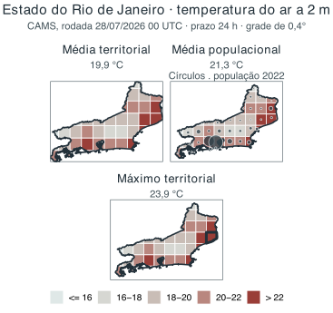
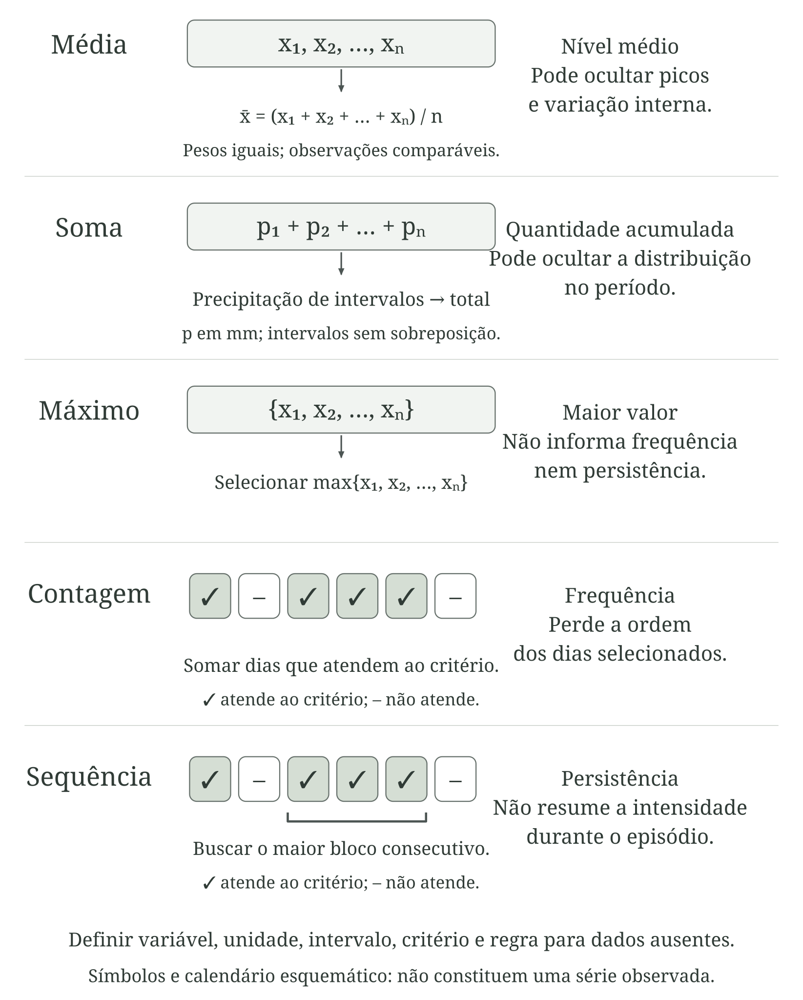
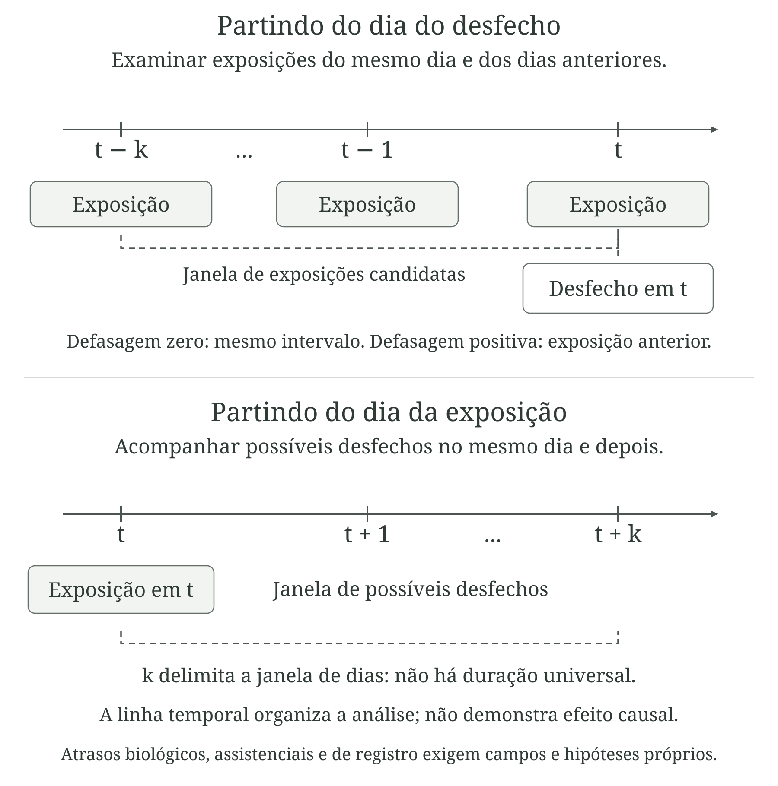

---
aliases:
  - /chapters/part-1/03-espaco-tempo-qualidade.html
format:
  html:
    template-partials:
      - ../../includes/chapter-opening/title-block.html
chapter-opening:
  image: ../../assets/openings/cap4-espaco-tempo-qualidade-web.webp
  alt: "Panorama hipotético sem pessoas de uma bacia com encosta arborizada, área agrícola, rio no vale e bairro denso. Pequenos conjuntos de instrumentos ocupam terrenos abertos em cotas distintas, destacando diferenças de relevo, entorno e representatividade das observações."
---

# Integração de dados: espaço, tempo e qualidade {#sec-espaco-tempo}

O capítulo anterior discutiu o significado dos dados e indicadores. Neste capítulo, a questão central é como integrar fontes sem perder o significado original de cada uma. Em clima, ambiente e saúde, as fontes raramente representam o mesmo território, período ou população.

Uma estação meteorológica registra condições em um ponto; uma célula de grade representa um valor associado a uma área; uma taxa municipal relaciona eventos e população em um território administrativo. Da mesma forma, concentrações horárias, médias diárias, totais mensais e taxas anuais representam intervalos distintos. Integrar essas informações exige verificar o espaço, o tempo e a população representados por cada valor.

A compatibilização transforma os dados. Calcular médias municipais a partir de grades, converter UTC (Tempo Universal Coordenado) em horário local, agregar horas em dias, definir períodos de referência e tratar valores ausentes são decisões analíticas que devem ser coerentes com a pergunta e documentadas.

A qualidade também depende da finalidade. Um produto adequado para comparar regiões pode ser insuficiente para orientar ações em um bairro; uma base consolidada pode servir à análise retrospectiva, mas chegar tarde para a vigilância operacional. A norma 19157-1 da Organização Internacional de Normalização (ISO) organiza a qualidade dos dados geográficos segundo os requisitos do produto e do uso [@iso2023geoquality]. Mais do que avaliar a qualidade em termos gerais, interessa verificar a adequação dos dados à aplicação pretendida.

O capítulo aborda a representação espacial e temporal, a qualidade, a incerteza e os limites da interpretação. Compatibilizar bases permite construir comparações coerentes; estimar efeitos causais ou contribuições atribuíveis exige hipóteses e métodos adicionais.

## O espaço que um dado representa

A presença de coordenadas geográficas não resolve, por si só, a dimensão espacial dos dados. A coordenada indica onde uma observação foi registrada ou referenciada, mas não necessariamente a extensão espacial representada pelo valor.

::: {.callout-note icon=false title="Conceito-chave: localização, suporte, resolução e escala"}

Localização
: Onde a observação, estimativa ou unidade está posicionada.

Suporte espacial
: A porção do espaço à qual o valor se refere.

Resolução espacial
: O nível de detalhe ou o tamanho nominal das unidades do produto.

Escala de análise
: O nível em que o fenômeno será interpretado ou a decisão será tomada.

:::

Uma estação meteorológica registra observações pontuais sob condições específicas de instalação. Em uma grade de 10 km, a localização e o tamanho da célula são conhecidos, mas o modelo pode incorporar informações de uma área maior. Uma taxa municipal, por sua vez, resume eventos e população em um território administrativo. A definição da escala e do objeto de análise antecede a integração das bases e condiciona a interpretação dos resultados [@barcellos1996geoprocessamento]. O módulo 2 do ASISA-Queimadas relaciona essas escolhas às diferentes esferas da vigilância [@gracie2024asisa, p. 79–80].

A @fig-suporte-localizacao ilustra essas diferenças em três mapas do mesmo território. Estação, residência, ruas e rio mantêm suas posições; apenas as camadas de localização, suporte e unidade de análise variam. A coincidência espacial não torna esses suportes equivalentes.

<!--
ARTE CAP4-01 — Vista vertical v3
Originais e prompts v1/v2 preservados. Fonte atual: arte-cap4-01-v3.png.
Primeira geração: arte-cap4-01-v3-preliminar.png; refinamento geométrico antes da montagem.
Referências: original v2 (conteúdo) e aquarela-grafite-nanquim.png (estilo), apresentados em prévias JPEG.
Montagem: mesma cena repetida; pontos na estação e residência, grade e limite em vetor. Rótulos editáveis.
Reprodução: python3 scripts/build_cap4_art.py 01
Prompt completo:
Use case: precise-object-edit.
Asset type: paisagem cartográfica conceitual para livro científico brasileiro, formato horizontal 3:2, resolução 1536 × 1024 pixels ou maior.
Input images: Imagem 1 é o original a reinterpretar em vista vertical, preservando os elementos do território. Imagem 2 é somente referência de ESTILO; não copiar pessoas ou composição dela.
Style/medium: Ilustração editorial em aquarela tradicional translúcida, combinada com traços finos e espontâneos de lápis grafite e nanquim. Contornos parcialmente abertos, hachuras leves e marcas discretas de rascunho. Textura sutil de papel aquarela, pigmentação irregular e transições suaves. Paleta de verdes naturais, azuis acinzentados, ocres e terracota, com saturação moderada. Preservar áreas de papel branco e bordas irregulares que se dissolvem no fundo. Pessoas com proporções naturais e diversidade de tons de pele. Linguagem visual madura, acolhedora e adequada à divulgação científica para adultos.
Primary request: Transformar o território da imagem 1 em uma vista ORTOGONAL VERTICAL, NÁDIR, exatamente de cima, como um mapa ilustrado. O plano do chão deve ser paralelo ao papel: não mostrar horizonte, céu, montanhas vistas de lado, fachadas, lados verticais de prédios ou perspectiva isométrica. Mostrar somente coberturas, plantas, ruas e copas de árvores vistas verticalmente.
Composition/framing: Uma única paisagem urbana e periurbana inteiramente hipotética. Estação meteorológica pequena no terço esquerdo, em terreno gramado amplo e aberto, afastada de árvores e edifícios; vista superior do abrigo e instrumentos, sem ampliá-los desproporcionalmente. Núcleo urbano misto no centro e à direita, com quarteirões, vias, coberturas de edifícios maiores e casas menores. Uma residência de telhado terracota deve ser distinguível na região inferior direita. Rio sinuoso na faixa superior direita, arborização nas margens e ponte vista de cima. Vegetação e campos no lado esquerdo. Preservar a distribuição geral de estação à esquerda, ocupação urbana à direita e água no alto, adaptando toda a geometria à projeção estritamente superior. Não preservar o horizonte oblíquo do original. Bordas orgânicas suaves sobre papel branco e margens pequenas.
Constraints: Sem pessoas; sem palavras, letras, números, setas, pontos marcadores, grades, limites administrativos, legendas, escalas, logotipos ou marcas d'água. Sem mapa de cidade real ou quantidades observacionais. Estação e residência receberão pontos vetoriais depois. A mesma imagem será repetida em diferentes painéis científicos; não gerar painéis nesta aquarela. Contraste legível em escala de cinza. Prédios reconhecíveis por coberturas amplas, sem qualquer fachada aparente. Não desenhar nuvens sobre o território.

Refinamento efetivamente aplicado:
Correção geométrica precisa da imagem recém-gerada: manter posições de ruas, rio, ponte, vegetação, estação, cores e técnica. Mudar APENAS a projeção de TODAS as construções e instrumentos para NÁDIR ORTOGRÁFICO, câmera exatamente 90 graus para baixo, mapa plano visto de cima. Os prédios atuais mostram janelas e paredes verticais em suas faces inferiores; REMOVER COMPLETAMENTE essas fachadas, janelas laterais e paredes aparentes. Cada prédio será somente sua cobertura e planta horizontal: retângulos de laje clara com detalhes de telhado, sem extrusão, sem qualquer face lateral. A estação à esquerda será vista só de cima, abrigo apenas cobertura branca e instrumentos como suas pequenas plantas. Casas apenas telhados. Não inclinar prédios. Esta é uma imagem cartográfica, não uma fotografia aérea oblíqua nem uma cidade isométrica. Preservar contornos e localizações do território e aquarela com grafite e nanquim. Sem qualquer texto, número, grade, setas ou novos elementos. Manter 1536 × 1024 ou maior.

-->

{#fig-suporte-localizacao .lightbox width="100%" print-src="arte-cap4-01-suporte-print.png" print-width="120mm" fig-alt="Três cópias idênticas de um território hipotético visto verticalmente, como mapa, recebem pontos na estação e na residência, células de grade e um limite municipal. Ruas, coberturas, vegetação e rio permanecem na mesma posição."}

::: {.callout-important icon=false title="Atenção: resolução não garante qualidade"}

Um produto de 1 km não é necessariamente mais exato que um de 10 km. A resolução nominal informa o tamanho das unidades publicadas; exatidão, representatividade e incerteza dependem do método de produção. Reamostrar uma grade para pixels menores pode aumentar o detalhe visual sem acrescentar informação à fonte.

:::

A escala do fenômeno também importa. Chuvas intensas podem variar em pequenas distâncias; a temperatura responde ao relevo, à urbanização, à vegetação e aos materiais da superfície. A qualidade do ar pode variar nas proximidades de vias e fontes de emissão, enquanto outros fenômenos abrangem regiões extensas. A escolha dos dados deve considerar a escala do processo, além da resolução disponível [@iso2023geoquality].

### Estações, grades e satélites respondem a perguntas diferentes

A representatividade das observações de estações depende da localização, altitude, entorno, altura de medição, manutenção e variável observada. A estação mais próxima nem sempre representa melhor o território: uma estação em aeroporto pode registrar condições distintas das de áreas densamente construídas da mesma cidade.

Uma rede de estações constitui uma amostra espacial. A concentração de instrumentos em cidades, aeroportos ou áreas de fácil acesso pode limitar a representação de outros ambientes. Coordenadas, histórico de localização, instrumentos, frequência de medição e códigos de qualidade são metadados essenciais à interpretação [@wmo2023climatological].

Dados em grade ampliam a cobertura espacial e podem resultar de interpolação, modelagem, combinação de modelos e observações ou sensoriamento remoto. Uma reanálise combina observações e modelos por assimilação de dados para reconstruir condições passadas; não corresponde a medições em cada célula [@hersbach2020era5]. No sensoriamento remoto, algoritmos convertem a energia detectada pelos sensores em produtos como temperatura da superfície ou cobertura vegetal. Nuvens, ângulo de observação e mistura de materiais no pixel influenciam os resultados [@jin2012uhi; @iso2023geoquality]. O @sec-fontes-fichas aborda a documentação desses produtos. Em saúde, a localização dos registros depende dos endereços disponíveis, da qualidade da geocodificação e da unidade territorial de divulgação, aspectos que devem integrar a análise espacial [@carvalho2005espacial].

::: {.callout-note icon=false title="Conceito-chave: graus não são quilômetros"}
Grades globais frequentemente utilizam coordenadas geográficas, com resolução expressa em graus, como 0,25° ou 0,4°. Graus são unidades angulares, não distâncias fixas. A extensão norte–sul de um intervalo de latitude é aproximadamente constante, enquanto a distância correspondente a um grau de longitude diminui com o afastamento do Equador. Assim, células com dimensões angulares iguais podem ter áreas diferentes.

Essa diferença afeta totais, médias por área e ponderações. Calcular as áreas das interseções ou utilizar uma projeção adequada à operação evita atribuir a mesma área física a todos os pixels.
:::

::: {.callout-note icon=false title="Nota técnica: reamostragem de grades"}
A reprojeção e a reamostragem exigem métodos compatíveis com a variável. O vizinho mais próximo é frequentemente adequado a classes de uso da terra; a interpolação bilinear é usada em superfícies contínuas, mas pode suavizar valores; métodos conservativos são úteis para preservar integrais ou totais, conforme a natureza da variável. A interpolação bilinear de códigos categóricos pode criar classes inexistentes. Reamostrar para uma grade mais fina não aumenta a informação original.

Ao registrar o processamento, preserve ao menos produto e versão, variável e unidade, sistema de coordenadas, resolução original, referência temporal, método de reamostragem e transformações aplicadas.
:::

::: {.callout-warning icon=false title="Atenção: dependência espacial"}
Células vizinhas podem apresentar dependência espacial: modelos compartilham dinâmica e assimilação, superfícies interpoladas compartilham estações e sensores podem ter resposta espacial superior ao pixel nominal. Uma região dividida em milhares de células não contém necessariamente milhares de observações independentes. Ignorar essa dependência pode superestimar o tamanho amostral efetivo e a precisão das estimativas.
:::

## Do suporte original ao território de gestão

A vigilância e a gestão do Sistema Único de Saúde (SUS) utilizam municípios, regiões de saúde e estados. Como dados ambientais raramente seguem esses limites, sua transformação em indicadores territoriais exige uma mudança de suporte espacial.

A média de uma grade de temperatura ponderada pela área municipal descreve a condição térmica média do território. A média ponderada pela população enfatiza os locais de residência, enquanto o máximo territorial identifica a maior temperatura estimada. Cada estatística responde a uma pergunta distinta [@openshaw1984].

Para um município \(m\), uma média ponderada pela população pode ser expressa por:

$$
\bar{x}_{pop,m} = \frac{\sum_g x_g\,p_{gm}}{\sum_g p_{gm}},
$$

em que \(x_g\) é o valor ambiental da célula \(g\) e \(p_{gm}\) é a população na parte dessa célula pertencente ao município \(m\). A notação explicita a necessidade de associar a população às interseções entre células e limites municipais.

O cálculo exige população total positiva e valores ambientais válidos nas células incluídas. A exclusão de células sem dados altera a população representada e deve ser documentada. O exemplo a seguir compara essa abordagem com a ponderação pela área.

A @fig-estatistica-zonal-populacao decompõe o cálculo em três etapas: identificação do valor ambiental de cada célula, localização da população na mesma base espacial e seleção das interseções com o território. A população fora do limite municipal não integra o denominador, mesmo quando ocupa uma célula que o atravessa.

<!--
ARTE CAP4-08
ARTE CAP4-08 — Da grade ambiental à média territorial ponderada pela população
Tipo: raster.
Composição: Reutilizar a vista vertical v3 em três painéis alinhados. Sobrepor grade, símbolos populacionais e limite idêntico. Atenuar o exterior na interseção. Encerrar com a média ponderada e os requisitos de população positiva e cobertura válida. Não adicionar números observacionais.
Estilo: tipografia Libertinus Serif incorporada, paleta editorial e rótulos em vetor.
Reprodução: python3 scripts/build_cap4_art.py 08
Aquarela e prompts: arte-cap4-01-v3.png; arte-cap4-01-v3.prompt.txt; arte-cap4-01-v3-refinamento.prompt.txt.
Texto alternativo: Três vistas idênticas mostram campo ambiental, localização ilustrativa da população e interseção com um território. A fórmula combina os valores ambientais com a população de cada interseção. Os pontos não representam contagens.
Legenda: Da grade ambiental à média territorial ponderada pela população
-->

{#fig-estatistica-zonal-populacao .lightbox width="100%" print-src="arte-cap4-08-ponderacao-populacional-print.png" print-width="120mm" fig-alt="Três vistas idênticas mostram campo ambiental, localização ilustrativa da população e interseção com um território. A fórmula combina os valores ambientais com a população de cada interseção. Os pontos não representam contagens."}

[Fontes conceituais: Barcellos e Bastos (1996); Carvalho e Souza-Santos (2005); fórmula e definições desta seção. Elaboração para esta obra em SVG, com aquarela gerada por IA (image_gen) reutilizada da vista vertical v3 e rótulos editáveis. Licença dos arquivos autorais: GPL-3.0; fontes mantêm suas condições de uso.]{.figure-source}

No painel final, a soma dos produtos dos valores ambientais pelas populações das interseções é dividida pela população incluída. A média por área empregaria áreas como pesos. Os pontos da figura são ilustrativos, não representam contagens de pessoas ou domicílios. Como \(p_{gm}\) já corresponde à população da interseção, multiplicá-la novamente pela fração de área exige justificativa metodológica.

A ponderação populacional aproxima as condições ambientais nos locais de residência, mas não mede exposição individual. Pessoas se deslocam, trabalham e permanecem em ambientes internos, e a própria distribuição populacional pode ser estimada. Ainda assim, essa ponderação pode ser mais informativa que a média territorial para determinadas perguntas de saúde.

### Situação concreta: três temperaturas para o mesmo estado

A @fig-mudanca-suporte apresenta três sínteses da mesma previsão de temperatura do ar do Copernicus Atmosphere Monitoring Service (CAMS) para o estado do Rio de Janeiro: média ponderada pela área de 19,9 °C, média ponderada pela população de 21,3 °C e máximo territorial de 23,9 °C. Os valores respondem a perguntas diferentes, sem contradição entre eles.

A escolha da síntese deve anteceder o cálculo e integrar a definição do indicador. Os valores correspondem à rodada inicializada em 28 de julho de 2026, às 00 UTC, com horizonte de 24 horas e validade em 29 de julho de 2026, às 00 UTC. São resumos de uma previsão, não observações de estações nem diferenças universais entre métodos [@cams2026globalforecast; @ibge2022grade; @ibge2024malhas].

{#fig-mudanca-suporte .lightbox fig-alt="Três mapas do estado do Rio de Janeiro usam a mesma previsão CAMS de temperatura do ar. A média pela área territorial é 19,9 graus Celsius; a média ponderada pela população do Censo 2022 é 21,3 graus Celsius; e o máximo territorial é 23,9 graus Celsius." width="100%"}

[Fontes: CAMS/ECMWF (temperatura a 2 m; 29 jul. 2026, 00 UTC) e IBGE (Grade Estatística 2022 e Malha 2022), via `geobr`. Elaboração própria; script e proveniência: `data-raw/figures/README.md`. Licenças: termos das fontes e da obra.]{.figure-source}

### Sobreposição espacial, interpolação areal e ponderação populacional

Três operações espaciais devem ser distinguidas.

A sobreposição entre grade e território permite resumir uma superfície ambiental, como a temperatura, para um polígono. Na média por área, células cortadas pelo limite contribuem de acordo com a área efetivamente contida no território. A estatística escolhida deve ser coerente com a variável e a pergunta.

A interpolação areal transfere informações entre polígonos de origem e destino. Para variáveis extensivas, como contagens populacionais, a redistribuição proporcional à área pressupõe distribuição uniforme dentro do polígono de origem. Métodos dasimétricos utilizam informações auxiliares, como áreas construídas e cobertura da terra, acrescentando dados e hipóteses à redistribuição [@openshaw1984; @iso2023geoquality].

A ponderação populacional combina superfícies ambientais e populacionais previamente compatibilizadas, atribuindo maior peso aos locais mais populosos, sem redistribuir os valores ambientais.

A @fig-operacoes-espaciais distingue as entradas e saídas das três operações: recorte da grade pelo território, transferência de quantidades entre malhas e síntese ambiental ponderada pela população.

<!--
ARTE CAP4-09
ARTE CAP4-09 — Três operações espaciais e o que cada uma transforma
Tipo: raster.
Composição: Três faixas: sobreposição entre grade e território; malhas de origem e destino cobrindo o mesmo domínio, com totais conservados e hipótese de uniformidade explícita; superfície ambiental e população compatibilizadas. Reutilizar a paisagem vertical v3. Não atribuir números às malhas.
Estilo: tipografia Libertinus Serif incorporada, paleta editorial e rótulos em vetor.
Reprodução: python3 scripts/build_cap4_art.py 09
Aquarela e prompts: arte-cap4-01-v3.png; arte-cap4-01-v3.prompt.txt; arte-cap4-01-v3-refinamento.prompt.txt.
Texto alternativo: Três faixas distinguem o recorte de uma grade pelo território, a transferência de totais entre duas malhas no mesmo domínio e a ponderação de valores ambientais pela população. Os diagramas não contêm totais observados.
Legenda: Três operações espaciais e o que cada uma transforma
-->

{#fig-operacoes-espaciais .lightbox width="100%" print-src="arte-cap4-09-operacoes-espaciais-print.png" print-width="120mm" fig-alt="Três faixas distinguem o recorte de uma grade pelo território, a transferência de totais entre duas malhas no mesmo domínio e a ponderação de valores ambientais pela população. Os diagramas não contêm totais observados."}

[Fontes conceituais: Openshaw (1984); ISO 19157-1 (2023); discussão desta seção. Elaboração para esta obra em SVG, com aquarela gerada por IA (image_gen) reutilizada da vista vertical v3 e rótulos editáveis. Licença dos arquivos autorais: GPL-3.0; fontes mantêm suas condições de uso.]{.figure-source}

Na interpolação areal proporcional à área, a quantidade transferida depende da fração do polígono de origem contida em cada destino. Se as duas malhas cobrem integralmente o mesmo domínio, sem sobreposições duplicadas, o total deve ser conservado; diante de recortes ou lacunas, o balanço deve considerar apenas o domínio comum. Informações auxiliares podem alterar os pesos, mas não dispensam a explicitação das hipóteses.

O processamento deve explicitar quais propriedades pretende conservar — média, total, proporção, ocorrência ou distribuição —, o tratamento das interseções e os dados auxiliares utilizados.

## Territórios administrativos também mudam

Limites municipais e composições de regiões de saúde podem mudar ao longo do tempo. Uma série territorial deve, portanto, identificar a malha e sua vigência [@ibge2024malhas].

Municípios organizam responsabilidades, população, serviços e políticas, sendo úteis ao planejamento e à vigilância. Entretanto, podem reunir ambientes urbanos, rurais, florestais, serranos e costeiros. Um valor municipal sintetiza essa diversidade sem descrevê-la integralmente.

Uma média regional pode apoiar o planejamento assistencial e ocultar municípios em condições mais críticas. Quando a heterogeneidade interna for relevante para a ação, a síntese deve ser acompanhada da distribuição, do mapa ou dos valores das unidades componentes.

### Quando os resultados dependem de como desenhamos o mapa

Resultados de dados agregados podem variar conforme a divisão territorial. Associações calculadas entre municípios podem diferir daquelas obtidas entre bairros ou regiões. Mesmo unidades de tamanho semelhante podem produzir resultados distintos quando seus limites mudam. Esse fenômeno é denominado problema da unidade de área modificável (*modifiable areal unit problem*, MAUP) [@openshaw1984].

Escolher a menor unidade disponível não resolve o problema: áreas pequenas podem gerar taxas instáveis, ameaçar a confidencialidade e representar mal o processo ambiental. Quando a conclusão depender da escala ou do zoneamento, recomenda-se testar unidades plausíveis e identificar os resultados que permanecem estáveis [@carvalho2005espacial].

A @fig-escala-zoneamento mantém a paisagem e modifica apenas as divisões territoriais. O segundo painel agrega as unidades do primeiro, alterando a escala; o terceiro mantém o número de unidades, mas redesenha seus limites, alterando o zoneamento. A figura não quantifica os efeitos dessas operações sobre uma associação.

<!--
ARTE CAP4-02 — Revisão urbana v2
Finalidade e leitura: Três cópias idênticas de uma paisagem hipotética vista de cima, com quadras urbanas, coberturas de edifícios e casas, campos, vegetação e rio, recebem divisões diferentes. O segundo painel agrega unidades do primeiro; o terceiro redesenha unidades em escala semelhante à do primeiro. As construções não representam contagens populacionais.
Identificador preservado: fig-escala-zoneamento.
Arte incorporada: assets/figures/arte-cap4-02-zoneamento.svg.
Versão de impressão: assets/figures/arte-cap4-02-zoneamento-print.png, em escala de cinza.
Aquarela utilizada: assets/figures/arte-cap4-02-v2.png.
Original anterior preservado: assets/figures/arte-cap4-02-v1.png.
Prompt anterior preservado: assets/figures/arte-cap4-02-v1.prompt.txt.
Prompt efetivamente utilizado: assets/figures/arte-cap4-02-v2.prompt.txt.
Referência visual: assets/references/aquarela-grafite-nanquim.png; original v1 como referência de composição.
Produção: edição com a ferramenta integrada image_gen; versão da ferramenta não informada.
Composição reproduzível: scripts/build_cap4_art.py 02; exportação por scripts/render_figure.py.
Rótulos e relações conceituais editáveis; fontes e aquarela incorporadas verificadas antes da exportação.
Montagem: Três painéis usando o mesmo raster, sem mudar recorte. Primeiro: quatro unidades; segundo: duas unidades obtidas agregando pares; terceiro: quatro unidades com limites alternativos. Sem estatísticas. Explicar separadamente efeito de escala e efeito de zoneamento.
Prompt completo:
Use case: precise-object-edit.
Asset type: ilustração científica editorial para livro brasileiro sobre clima, ambiente e saúde.
Input images: Imagem 1 é o original a EDITAR, referência obrigatória de composição, personagens e função; Imagem 2 é SOMENTE referência de ESTILO (aquarela-grafite-nanquim.png), não copiar sua cena.
Style/medium: Ilustração editorial em aquarela tradicional translúcida, combinada com traços finos e espontâneos de lápis grafite e nanquim. Contornos parcialmente abertos, hachuras leves e marcas discretas de rascunho. Textura sutil de papel aquarela, pigmentação irregular e transições suaves. Paleta de verdes naturais, azuis acinzentados, ocres e terracota, com saturação moderada. Preservar áreas de papel branco e bordas irregulares que se dissolvem no fundo. Pessoas com proporções naturais e diversidade de tons de pele. Linguagem visual madura, acolhedora e adequada à divulgação científica para adultos.
Primary request: Revisar esta imagem para trazer uma cidade brasileira contemporânea, inteiramente hipotética, para o plano principal. Prédios e infraestrutura urbana precisam ser claramente reconhecíveis, não apenas uma silhueta distante no horizonte. Preservar a linguagem de aquarela e a ideia científica do original.
Constraints: Manter ordem, quantidade e separação das vinhetas; preservar identidade, roupas e gestos dos personagens existentes, perspectiva e margens de papel branco, salvo as mudanças explicitamente solicitadas abaixo. Pessoas e mãos anatomicamente coerentes. Densidade urbana legível, sem excesso de detalhes. Mostrar diferentes condições de proteção em ambientes urbanos sem caricaturas ou equivalência automática entre cidade e dano. Não desenhar palavras, letras, números, logotipos, marcas d'água, setas, grades analíticas, legendas ou novos gráficos. Textos e conexões serão acrescentados como vetores. Contraste deve funcionar em escala de cinza. Não inventar dados quantitativos nem representar uma cidade real.

Composition/framing: Uma única paisagem cartográfica horizontal 3:2, resolução 1536 × 1024 pixels ou maior, vista estritamente superior, sem horizonte e sem perspectiva oblíqua de fachadas. Preservar a posição e curso geral do rio sinuoso do original, vegetação, margens brancas e dois núcleos ocupados no alto à esquerda e embaixo à direita.
Scene/backdrop: No núcleo superior esquerdo, substituir parte das casas dispersas por quadras urbanas compactas, vias pavimentadas, coberturas de edifícios residenciais maiores, pátios e pequenos comércios; a vista superior deve comunicar construções de maior porte e tecido urbano denso por plantas e coberturas retangulares maiores, sem desenhar fachadas inclinadas. No núcleo inferior direito, combinar edifícios de apartamentos, casas e espaços públicos arborizados, com uma avenida reconhecível. Preservar áreas verdes, campos e transição rural nas demais regiões. Manter detalhes legíveis, sem sobrecarregar. Nenhuma grade ou divisão administrativa, nenhum dado ou símbolo de mapa real: os limites serão sobrepostos depois. A MESMA imagem será reutilizada sem alterações nos três painéis de escala e zoneamento.

Refinamento de perspectiva efetivamente aplicado, arquivado em assets/figures/arte-cap4-02-v2-refinamento.prompt.txt:
Use case: precise-object-edit.
Imagem 1: paisagem de zoneamento a corrigir. Imagem 2: somente referência de estilo de aquarela.
Corrigir SOMENTE a perspectiva da imagem 1. Precisamos de VISTA ORTOGONAL VERTICAL, NÁDIR, exatamente de cima, como olhando um mapa ilustrado aéreo: mostrar as coberturas e plantas das construções, NÃO mostrar fachadas verticais nem lados de prédios. Os edifícios altos devem ser identificáveis por coberturas maiores de concreto, pequenas casas de máquinas no topo e sombras suaves discretas, sem vistas laterais. Manter a localização geral de TODOS os elementos: rio sinuoso, mata, campos, núcleo urbano no canto superior esquerdo e núcleo urbano no inferior direito; manter cores, aquarela, ocupação mista de prédios, casas e quadras, formato horizontal 3:2, resolução 1536×1024, bordas irregulares e papel branco. Não acrescentar outras cenas nem detalhes quantitativos. Não incluir setas, grade, limites, legendas, texto, letras, números, escala ou logotipos. Esta imagem será repetida três vezes, com divisões vetoriais distintas, num esquema de escala e zoneamento.
-->

{#fig-escala-zoneamento .lightbox width="100%" print-src="arte-cap4-02-zoneamento-print.png" print-width="120mm" fig-alt="Três cópias idênticas de uma paisagem hipotética vista de cima, com quadras urbanas, coberturas de edifícios e casas, campos, vegetação e rio, recebem divisões diferentes. O segundo painel agrega unidades do primeiro; o terceiro redesenha unidades em escala semelhante à do primeiro. As construções não representam contagens populacionais."}

[Fontes conceituais: Openshaw (1984); Barcellos e Bastos (1996); Carvalho e Souza-Santos (2005). Elaboração e revisão para esta obra, com aquarela gerada por IA (image_gen) e rótulos editáveis. Licença dos arquivos autorais: GPL-3.0; fontes mantêm suas condições de uso.]{.figure-source}

::: {.callout-warning icon=false title="Atenção: falácia ecológica"}

Uma associação entre maior temperatura e maior mortalidade em municípios não demonstra que as pessoas mais expostas ao calor foram as que morreram. A associação pertence ao nível agregado. Estudos ecológicos são úteis para examinar contextos territoriais e orientar políticas, mas inferências individuais exigem dados e hipóteses adicionais [@piantadosi1988ecological]. O @sec-efeitos-saude retoma essa distinção.

:::

## O tempo que um dado representa

Todo valor possui uma referência temporal, assim como um suporte espacial. Em clima e saúde, os momentos do fenômeno, da medição, do registro e da disponibilização dos dados nem sempre coincidem.

Uma chuva intensa pode provocar uma inundação horas depois; sintomas podem surgir dias mais tarde, e os registros de atendimento podem ser consolidados semanas ou meses depois. Combinar datas sem distinguir seus significados pode distorcer a relação investigada. A @fig-tempos-dado distingue fenômeno, exposição, possível efeito, cuidado e processamento da informação.

<!--
ARTE CAP4-03 — Revisão urbana v2
Finalidade e descrição acessível: Seis vinhetas distinguem condição ambiental, exposição, possível efeito, atendimento, registro e publicação. As conexões não representam durações universais nem causalidade demonstrada. Ruas e praças com prédios próximos e interiores de serviços de saúde compõem os cenários urbanos.
Arte incorporada: assets/figures/arte-cap4-03-tempos.svg.
Impressão: assets/figures/arte-cap4-03-tempos-print.png.
Original da edição: assets/figures/arte-cap4-03-v1.png; preservado junto das versões anteriores.
Aquarela revisada: assets/figures/arte-cap4-03-v2.png.
Prompt completo utilizado: assets/figures/arte-cap4-03-v2.prompt.txt.
Referência de estilo: assets/references/aquarela-grafite-nanquim.png.
Produção: ferramenta integrada image_gen; original e referência de estilo inspecionados e fornecidos por referenced_image_paths.
Montagem: scripts/build_cap4_art.py 03; rótulos, setas e identificadores editáveis preservados.
Exportação: Chromium com fontes e raster incorporados; ImageMagick para PNG de 8 bits em cinza.
Revisão: presença urbana, continuidade da aquarela, anatomia, recortes e relações conceituais. Cenários hipotéticos, sem novos dados observados.
Licença dos arquivos autorais: GPL-3.0; fontes citadas mantêm suas condições de uso.

Use case: precise-object-edit. Arte didática em aquarela para livro brasileiro sobre clima, ambiente e saúde.
Entradas: imagem 1 é o ORIGINAL a editar, referência obrigatória de composição; imagem 2 é APENAS referência do estilo da série.
Pedido: aumentar a presença urbana, preservando a aquarela naturalista, paleta suave de azuis, verdes, ocres e terracota, textura de papel, contornos delicados de grafite/nanquim e contraste adequado também em cinza. A cidade é brasileira e hipotética, sem marcos reconhecíveis.
Revisão específica: Mantenha seis vinhetas em três colunas e duas linhas. Reforce o contexto urbano nas três superiores: prédios de apartamentos próximos e calçadas na rua quente; caminhada em parque urbano com prédios à margem; banco sombreado de praça urbana com edifícios próximos. Preserve cada personagem, idade, gesto, árvore, garrafa e diferença de situação. Nas cenas inferiores de consulta e computador, mostre discretamente fachadas urbanas nas janelas, conservando a profissional com registro no centro, todos os papéis e telas em branco. Preserve exatamente a grade e corredores brancos.
Invariantes: conserve enquadramento, proporção, escala das figuras humanas, anatomia natural, quantidade e posição das vinhetas, objetos conceituais e espaços brancos. Alterar cenários e arquitetura somente conforme o pedido. Não adicionar texto, títulos, legendas, setas, números, marcas ou molduras; serão aplicados como vetores editáveis. Não fundir cenas e não recortar personagens. Manter boa nitidez na impressão.
Formato: mesma proporção do original 1536 × 1024; resolução igual ou superior. Uma única imagem final editada.
-->

{#fig-tempos-dado .lightbox width="100%" print-src="arte-cap4-03-tempos-print.png" print-width="120mm" fig-alt="Seis vinhetas distinguem condição ambiental, exposição, possível efeito, atendimento, registro e publicação. As conexões não representam durações universais nem causalidade demonstrada. Ruas e praças com prédios próximos e interiores de serviços de saúde compõem os cenários urbanos."}

[Fontes conceituais: Bastos et al. (2019); discussão de temporalidade deste capítulo. Elaboração e revisão para esta obra, com aquarela gerada por IA (image_gen) e rótulos editáveis. Licença dos arquivos autorais: GPL-3.0; fontes mantêm suas condições de uso. Revisão urbana da aquarela: image_gen, com o original e a referência visual da série.]{.figure-source}

Na figura, as conexões tracejadas indicam trajetórias possíveis, não inevitáveis. O intervalo até o efeito sanitário, a espera por atendimento e o atraso de registro ou publicação correspondem a processos distintos. O espaçamento das vinhetas não quantifica sua duração. Atrasos de notificação devem ser considerados na interpretação dos dados recentes de vigilância [@bastos2019delays].

Uma fonte pode conter datas de ocorrência, início e fim da exposição, sintomas, atendimento, internação, notificação, competência, processamento e publicação. Previsões acrescentam a data da rodada e o horário de validade. A pergunta determina a referência temporal adequada.

Em previsões, devem ser preservadas a inicialização, o horizonte de previsão (*lead time*) e a validade. A inicialização indica o início da rodada; o horizonte, o intervalo transcorrido a partir dela; e a validade, o instante ou período representado pelo valor. A @fig-tempos-previsao exemplifica essas referências: rodada CAMS de 28 de julho de 2026, às 00 UTC, horizonte de +24 h e validade em 29 de julho de 2026, às 00 UTC. A validade não indica quando o arquivo foi obtido, nem transforma a previsão em observação.^[Para a distinção entre inicialização, passo de previsão e validade, consulte a [documentação operacional do ECMWF](https://confluence.ecmwf.int/pages/viewpage.action?pageId=453673187).]

<!--
ARTE CAP4-04 — Revisão urbana v2
Finalidade e descrição acessível: Uma linha temporal apresenta a rodada CAMS de 28 de julho de 2026 às 00 UTC, horizonte de 24 horas e validade em 29 de julho de 2026 às 00 UTC. A previsão permanece uma estimativa. Uma profissional observa informações diante de uma estação em área aberta; a outra cena mostra uma rua urbana com prédios, casas, sol e nuvens.
Arte incorporada: assets/figures/arte-cap4-04-previsao.svg.
Impressão: assets/figures/arte-cap4-04-previsao-print.png.
Original da edição: assets/figures/arte-cap4-04-v1.png; preservado junto das versões anteriores.
Aquarela revisada: assets/figures/arte-cap4-04-v2.png.
Prompt completo utilizado: assets/figures/arte-cap4-04-v2.prompt.txt.
Referência de estilo: assets/references/aquarela-grafite-nanquim.png.
Produção: ferramenta integrada image_gen; original e referência de estilo inspecionados e fornecidos por referenced_image_paths.
Montagem: scripts/build_cap4_art.py 04; rótulos, setas e identificadores editáveis preservados.
Exportação: Chromium com fontes e raster incorporados; ImageMagick para PNG de 8 bits em cinza.
Revisão: presença urbana, continuidade da aquarela, anatomia, recortes e relações conceituais. Cenários hipotéticos, sem novos dados observados.
Licença dos arquivos autorais: GPL-3.0; fontes citadas mantêm suas condições de uso.

Use case: precise-object-edit. Arte didática em aquarela para livro brasileiro sobre clima, ambiente e saúde.
Entradas: imagem 1 é o ORIGINAL a editar, referência obrigatória de composição; imagem 2 é APENAS referência do estilo da série.
Pedido: aumentar a presença urbana, preservando a aquarela naturalista, paleta suave de azuis, verdes, ocres e terracota, textura de papel, contornos delicados de grafite/nanquim e contraste adequado também em cinza. A cidade é brasileira e hipotética, sem marcos reconhecíveis.
Revisão específica: Preserve dois painéis lado a lado. À esquerda, mantenha a profissional, tela sem dados, janela e estação, mas mostre um bairro com prédios residenciais próximos além do terreno aberto da estação. À direita, substitua parte das casas da rua por edifícios residenciais de 4–8 pavimentos, comércio térreo e calçadas; mantenha algumas casas, árvores, sol e nuvens. Faça os prédios participarem da cena principal, não só do horizonte. As condições meteorológicas são hipotéticas: não acrescente datas, gráficos, probabilidades ou textos.
Invariantes: conserve enquadramento, proporção, escala das figuras humanas, anatomia natural, quantidade e posição das vinhetas, objetos conceituais e espaços brancos. Alterar cenários e arquitetura somente conforme o pedido. Não adicionar texto, títulos, legendas, setas, números, marcas ou molduras; serão aplicados como vetores editáveis. Não fundir cenas e não recortar personagens. Manter boa nitidez na impressão.
Formato: mesma proporção do original 1536 × 1024; resolução igual ou superior. Uma única imagem final editada.
-->

{#fig-tempos-previsao .lightbox width="100%" print-src="arte-cap4-04-previsao-print.png" print-width="120mm" fig-alt="Uma linha temporal apresenta a rodada CAMS de 28 de julho de 2026 às 00 UTC, horizonte de 24 horas e validade em 29 de julho de 2026 às 00 UTC. A previsão permanece uma estimativa. Uma profissional observa informações diante de uma estação em área aberta; a outra cena mostra uma rua urbana com prédios, casas, sol e nuvens."}

[Fontes conceituais: CAMS/ECMWF; datas do metadado do exemplo do Rio de Janeiro. Elaboração e revisão para esta obra, com aquarela gerada por IA (image_gen) e rótulos editáveis. Licença dos arquivos autorais: GPL-3.0; fontes mantêm suas condições de uso. Revisão urbana da aquarela: image_gen, com o original e a referência visual da série.]{.figure-source}

### Dia, semana e mês precisam ser definidos

Uma observação diária exige início, fim e fuso horário definidos. Dados meteorológicos frequentemente utilizam UTC, enquanto sistemas de saúde podem utilizar o horário local. Sem harmonização, eventos próximos à meia-noite podem ser associados ao dia incorreto. Modelos climáticos também podem utilizar calendários distintos do civil.

Recomenda-se preservar o horário e o fuso originais, documentar as conversões e formar as janelas diárias, semanais ou mensais posteriormente. Quando poucas horas puderem alterar a associação investigada, deve-se avaliar a sensibilidade à definição temporal.

```{=typst}
#block(breakable: false)[
```

:::: {.callout-note icon=false title="Conceito-chave: UTC, fuso horário e data local"}

UTC é a referência temporal internacional. O fuso horário reúne regras para expressar a hora civil de uma localidade, cujo deslocamento em relação ao UTC pode variar com a data. A conversão preserva o instante, mas pode alterar a data local.

Some ao UTC o deslocamento indicado na @tbl-conversoes-utc. Cada coluna parte de um único instante; todas as datas são de 2026.

| Referência/localidade | UTC: jan./jul. (h) | 29 jan., 00 UTC | 29 jul., 00 UTC |
|---|---:|---|---|
| UTC | +00 / +00 | 29 jan., 00h00 | 29 jul., 00h00 |
| Brasília | −03 / −03 | 28 jan., 21h00 | 28 jul., 21h00 |
| Manaus | −04 / −04 | 28 jan., 20h00 | 28 jul., 20h00 |
| Rio Branco/Acre | −05 / −05 | 28 jan., 19h00 | 28 jul., 19h00 |
| Fernando de Noronha | −02 / −02 | 28 jan., 22h00 | 28 jul., 22h00 |
| Paris | +01 / +02 | 29 jan., 01h00 | 29 jul., 02h00 |
| Londres | +00 / +01 | 29 jan., 00h00 | 29 jul., 01h00 |
| Nova York | −05 / −04 | 28 jan., 19h00 | 28 jul., 20h00 |

: Conversões de dois instantes UTC para data e hora locais, em 2026 {#tbl-conversoes-utc}

[Fonte: IANA Time Zone Database, versão 2026c; conversões calculadas com `zoneinfo` e conferidas em 5 de outubro de 2026.]{.figure-source}

Em Brasília, 29 de julho às 00 UTC corresponde a 28 de julho às 21h00. Em Paris, o deslocamento difere entre janeiro e julho. Essas diferenças não devem ser aplicadas automaticamente a séries históricas.

Identificadores como `America/Sao_Paulo` e `Europe/Paris` permitem aplicar regras históricas de fuso. Em transições sazonais, horas locais podem se repetir ou não existir, produzindo dias civis de 23 ou 25 horas. Os instantes devem ser convertidos antes da agregação em dias locais.

::::

```{=typst}
]
```

O quadro segue as definições e regras do Bureau Internacional de Pesos e Medidas (BIPM), do Observatório Nacional, da Internet Assigned Numbers Authority (IANA) e do Observatório de Paris [@bipmUTC; @on2026tempo; @ianaTimeZones; @syrte2023heure]. Os identificadores e cálculos estão em `data-raw/figures/conversoes-utc-cap4.json`. A conversão de julho corresponde à validade da previsão CAMS apresentada anteriormente.

::: {.callout-note icon=false title="Nota técnica: calendários dos modelos"}
Arquivos de modelos climáticos podem utilizar calendários distintos do civil. As convenções CF (*Climate and Forecast*), amplamente usadas em arquivos NetCDF, incluem calendários como `365_day`/`noleap`, `366_day` e `360_day`, este último com meses de 30 dias.^[NetCDF Climate and Forecast (CF) Metadata Conventions, seção sobre calendários: <https://cfconventions.org/cf-conventions/cf-conventions.html#calendar>.]

Essas diferenças afetam a integração com dados de saúde e o cálculo de médias, totais e sequências. Antes de converter coordenadas temporais em datas civis, verifique o atributo `calendar` e preserve a lógica do experimento.
:::

### Agregar também muda o fenômeno

Médias, somas, máximos e contagens preservam propriedades distintas das séries. A precipitação mensal costuma representar um acumulado; a temperatura mensal, uma média; a máxima mensal, o maior extremo diário. Uma contagem anual de dias quentes conserva a frequência, mas não a ordem de ocorrência.

::: {#qua-transformacoes-temporais}

| Transformação | Pergunta respondida | Exemplo | O que pode se perder |
|---|---|---|---|
| Média | qual foi o nível típico? | temperatura média diária | picos e heterogeneidade dentro do dia |
| Soma | quanto se acumulou? | chuva acumulada no mês | distribuição dos eventos dentro do mês |
| Máximo | qual foi o maior valor? | maior temperatura do mês | duração e frequência de condições elevadas |
| Contagem | quantos dias atenderam ao critério? | número de dias acima de um valor definido | ordem e agrupamento dos dias |
| Sequência | por quanto tempo a condição persistiu? | maior sequência de dias que atendem a um critério | intensidade dentro do episódio, se não incorporada |

Transformações temporais e seus significados

:::

A @fig-transformacoes-temporais ilustra as operações do @qua-transformacoes-temporais sem representar uma série medida. A média utiliza pesos iguais para observações comparáveis; intervalos de durações distintas podem exigir ponderação temporal.

<!--
ARTE CAP4-10
ARTE CAP4-10 — Média, soma, máximo, contagem e sequência: o que permanece na síntese
Tipo: vector.
Composição: Prancha exclusivamente vetorial com cinco faixas. Média de observações comparáveis e pesos iguais; soma de precipitação em intervalos disjuntos; seleção do máximo; contagem de dias que atendem ao critério; maior sequência de dias consecutivos. Repetir o mesmo calendário ilustrativo nos dois últimos painéis, sem publicar contagens ou valores. Informar as perdas de cada síntese e a necessidade de regra para ausências.
Estilo: tipografia Libertinus Serif incorporada, paleta editorial e rótulos em vetor.
Reprodução: python3 scripts/build_cap4_art.py 10
Não houve geração de aquarela nesta composição.
Texto alternativo: Cinco faixas mostram símbolos de observações, operações e propriedades preservadas ou perdidas. Contagem e sequência usam o mesmo calendário esquemático: contar dias selecionados difere de identificar um bloco consecutivo. Não há série observacional.
Legenda: Média, soma, máximo, contagem e sequência: o que permanece na síntese
-->

{#fig-transformacoes-temporais .lightbox width="100%" print-src="arte-cap4-10-transformacoes-temporais-print.png" print-width="120mm" fig-alt="Cinco faixas mostram símbolos de observações, operações e propriedades preservadas ou perdidas. Contagem e sequência usam o mesmo calendário esquemático: contar dias selecionados difere de identificar um bloco consecutivo. Não há série observacional."}

[Fontes conceituais: Organização Meteorológica Mundial (2023); quadro de transformações temporais desta seção. Elaboração para esta obra em SVG, com rótulos e relações editáveis; sem geração de aquarela. Licença dos arquivos autorais: GPL-3.0; fontes mantêm suas condições de uso.]{.figure-source}

A soma reúne quantidades acumuladas em intervalos sem sobreposição, como precipitação em milímetros. Intensidades em milímetros por hora precisam ser integradas no tempo para obter o acumulado. O máximo identifica um extremo, mas não sua persistência. Contagens reúnem os dias que satisfazem o critério, enquanto a maior sequência identifica o bloco consecutivo mais longo. Ambas exigem regras explícitas para dados ausentes.

A escolha da operação deve considerar a unidade de medida e as propriedades que se pretende preservar, conforme o @qua-transformacoes-temporais.

A completude também condiciona a agregação. Médias diárias obtidas com 24 observações e com apenas três horários podem não ser comparáveis. A ausência de horas ou dias pode subestimar totais. Os critérios mínimos de completude devem anteceder o cálculo [@wmo2023climatological].

É necessário distinguir estoques, fluxos e eventos. O número de pessoas internadas em determinado instante é um estoque; novas internações em uma semana constituem um fluxo; uma interrupção de energia é um evento com início e duração. Somar estoques sucessivos pode contar a mesma pessoa várias vezes, enquanto resumir um evento pela data inicial oculta sua persistência.

### Defasagens devem ter significado

Os efeitos de uma condição ambiental sobre a saúde podem ocorrer no mesmo dia ou surgir após horas, dias ou períodos mais longos, conforme o processo investigado.

O guia de saúde ambiental destaca que a latência e as diferenças entre os locais de residência e exposição podem dificultar a análise das relações entre indicadores ambientais e sanitários [@brasil2011saudeambiental, p. 120].

A escolha da janela de defasagem deve partir do mecanismo e da pergunta, não da associação estatisticamente mais forte. Para investigar um desfecho, consideram-se exposições do mesmo dia e de dias anteriores, conforme a hipótese; para acompanhar uma exposição, examinam-se desfechos no mesmo dia ou posteriormente. Janelas plausíveis podem ser comparadas em análises de sensibilidade. O @sec-efeitos-saude retoma os métodos de estimação de relações defasadas [@hernan2020causal; @gasparrini2010dlnm].

A @fig-janelas-defasagem apresenta as duas formas de organizar a análise, tomando o dia do desfecho ou o da exposição como referência. Nenhuma delas autoriza utilizar exposições futuras para explicar eventos anteriores.

<!--
ARTE CAP4-11
ARTE CAP4-11 — Duas formas de organizar a janela de defasagem
Tipo: vector.
Composição: Dois painéis vetoriais: ancorar no desfecho em t e olhar as exposições em t, t menos um e t menos k; ancorar na exposição em t e acompanhar desfechos até t mais k. Setas apenas no eixo cronológico. Janelas em tracejado, sem curvas de risco, números de casos ou duração universal. Separar defasagem analítica e atrasos dos processos.
Estilo: tipografia Libertinus Serif incorporada, paleta editorial e rótulos em vetor.
Reprodução: python3 scripts/build_cap4_art.py 11
Não houve geração de aquarela nesta composição.
Texto alternativo: No primeiro painel, um desfecho em t é examinado com exposições do mesmo dia e de dias anteriores. No segundo, uma exposição em t é acompanhada por possíveis desfechos no mesmo dia e depois. Linhas tracejadas delimitam janelas analíticas, sem demonstrar causalidade.
Legenda: Duas formas de organizar a janela de defasagem
-->

{#fig-janelas-defasagem .lightbox width="100%" print-src="arte-cap4-11-defasagem-print.png" print-width="120mm" fig-alt="No primeiro painel, um desfecho em t é examinado com exposições do mesmo dia e de dias anteriores. No segundo, uma exposição em t é acompanhada por possíveis desfechos no mesmo dia e depois. Linhas tracejadas delimitam janelas analíticas, sem demonstrar causalidade."}

[Fontes conceituais: Hernán e Robins (2020); Gasparrini, Armstrong e Kenward (2010). Elaboração para esta obra em SVG, com rótulos e relações editáveis; sem geração de aquarela. Licença dos arquivos autorais: GPL-3.0; fontes mantêm suas condições de uso.]{.figure-source}

Na figura, \(t\) indica o dia de referência e \(k\) delimita a janela de análise. A defasagem zero corresponde à exposição e ao desfecho no mesmo intervalo agregado, sem necessariamente estabelecer sua ordem dentro do dia. A defasagem positiva considera a exposição anterior ao desfecho. A duração da janela depende do fenômeno, e a precedência temporal não demonstra causalidade.

A defasagem estimada depende também da data escolhida para o desfecho. Entre exposição e internação, por exemplo, podem ocorrer a resposta biológica e a espera por atendimento; a data do registro acrescenta atraso informacional. A @fig-tempos-dado distingue esses momentos, que precisam ser explicitados na definição da janela. A causalidade é discutida em @sec-correlacao-causalidade-atribuicao, e os métodos de estimação, no @sec-efeitos-saude.

## Períodos de referência e comparações no tempo

A interpretação de um valor depende da referência adotada. A Organização Meteorológica Mundial (OMM) estabelece normais climatológicas padrão de 30 anos, como 1991–2020, para caracterizar o clima recente [@wmo2017normals]. Estudos de mudança climática e índices de extremos podem exigir referências fixas, que não se alterem com o clima.

A escolha do período de referência depende da finalidade:

- Uma normal atualizada descreve melhor condições climatológicas recentes;
- Uma referência fixa permite acompanhar mudança em relação ao mesmo ponto de comparação;
- Índices padronizados devem seguir a especificação usada em sua definição;
- Critérios operacionais de alerta precisam ser definidos para a finalidade e o território em que serão usados.

Alterar o período de referência pode modificar substancialmente o indicador. Séries calculadas com as bases 1961–1990 e 1991–2020 podem ser válidas para finalidades distintas, mas não devem ser unidas como se tivessem a mesma definição.

O percentil 90 da temperatura máxima não representa 90% de risco. Ele delimita aproximadamente os 10% superiores da distribuição de referência, conforme a amostra e o método de estimação. Percentis podem ser calculados para todo o período, por estação, para dias específicos do calendário ou em janelas móveis. Essas escolhas integram a definição do indicador [@wmo2017normals; @climdex2024].

Anomalias também dependem explicitamente da referência:

$$
A_t = x_t - \bar{x}_{ref}.
$$

Uma anomalia positiva de temperatura indica valor acima da média de referência, não necessariamente um evento extremo ou um dano à saúde. Como o clima e muitos agravos apresentam sazonalidade, a comparação deve distinguir variações sazonais, tendências e outras mudanças na série.

## Qualidade: adequado para qual uso?

A qualidade dos dados deve ser avaliada segundo a finalidade da análise. Uma base pode ser completa, mas pouco representativa; precisa, mas enviesada; oportuna, mas sujeita a revisão; internamente coerente, mas incompatível com outra fonte.

Para dados de saúde, a Organização Mundial da Saúde (OMS) destaca completude, oportunidade, consistência interna e coerência com outras fontes [@who2023dqa]. A qualidade dos dados geográficos abrange também consistência lógica e aspectos posicionais, temporais e temáticos [@iso2023geoquality]. Lima, Schramm, Coeli e Silva discutem dimensões e métodos de avaliação dos sistemas de informação em saúde brasileiros [@lima2009qualidade]. O @qua-qualidade-dados sintetiza essas contribuições, sem reproduzir uma classificação única ou estabelecer uma nota geral.

::: {#qua-qualidade-dados}

| Dimensão | Pergunta prática |
|---|---|
| Exatidão e validade | o valor está próximo do fenômeno que se pretende representar? |
| Completude | os registros esperados estão presentes e válidos? |
| Representatividade | os locais, períodos e grupos observados representam o universo de interesse? |
| Oportunidade | o dado chega a tempo da decisão? |
| Consistência | unidades, códigos, intervalos e relações internas são coerentes? |
| Homogeneidade | a série mudou pelo fenômeno ou por mudanças de instrumento, método ou cobertura? |
| Comparabilidade | definições, territórios, períodos, denominadores e versões permitem contraste? |
| Rastreabilidade | é possível saber de onde veio o valor e quais transformações recebeu? |

Dimensões da qualidade e perguntas para avaliar a adequação ao uso

:::

A @fig-qualidade-uso organiza as dimensões da qualidade segundo a finalidade. A representação não estabelece pesos: uma base oportuna pode ser incompleta, enquanto outra, mais completa, pode chegar depois da decisão. A aplicação pretendida determina quais limitações devem ser corrigidas ou explicitadas.

<!--
ARTE CAP4-05 — Revisão urbana v2
Finalidade e descrição acessível: A pergunta adequado para qual uso se desdobra em oito dimensões: exatidão e validade, completude, representatividade, oportunidade, consistência, homogeneidade, comparabilidade e rastreabilidade. Duas profissionais examinam instrumento e documentos diante de uma janela com prédios, casas e árvores.
Arte incorporada: assets/figures/arte-cap4-05-qualidade.svg.
Impressão: assets/figures/arte-cap4-05-qualidade-print.png.
Original da edição: assets/figures/arte-cap4-05-v1.png; preservado junto das versões anteriores.
Aquarela revisada: assets/figures/arte-cap4-05-v2.png.
Prompt completo utilizado: assets/figures/arte-cap4-05-v2.prompt.txt.
Referência de estilo: assets/references/aquarela-grafite-nanquim.png.
Produção: ferramenta integrada image_gen; original e referência de estilo inspecionados e fornecidos por referenced_image_paths.
Montagem: scripts/build_cap4_art.py 05; rótulos, setas e identificadores editáveis preservados.
Exportação: Chromium com fontes e raster incorporados; ImageMagick para PNG de 8 bits em cinza.
Revisão: presença urbana, continuidade da aquarela, anatomia, recortes e relações conceituais. Cenários hipotéticos, sem novos dados observados.
Licença dos arquivos autorais: GPL-3.0; fontes citadas mantêm suas condições de uso.

Use case: precise-object-edit. Arte didática em aquarela para livro brasileiro sobre clima, ambiente e saúde.
Entradas: imagem 1 é o ORIGINAL a editar, referência obrigatória de composição; imagem 2 é APENAS referência do estilo da série.
Pedido: aumentar a presença urbana, preservando a aquarela naturalista, paleta suave de azuis, verdes, ocres e terracota, textura de papel, contornos delicados de grafite/nanquim e contraste adequado também em cinza. A cidade é brasileira e hipotética, sem marcos reconhecíveis.
Revisão específica: Mude SOMENTE a vista da janela central: substitua parte das casas por edifícios residenciais próximos de 4–10 pavimentos, com calçadas, árvores e casas intercaladas, representando um bairro urbano brasileiro hipotético. Preserve as duas profissionais, rostos, mãos, instrumento, lupa, relógio sem números, folhas, equipamentos, mesa, plantas internas e todas as margens da aquarela. Papéis permanecem sem dados legíveis; não acrescente símbolos de avaliação.
Invariantes: conserve enquadramento, proporção, escala das figuras humanas, anatomia natural, quantidade e posição das vinhetas, objetos conceituais e espaços brancos. Alterar cenários e arquitetura somente conforme o pedido. Não adicionar texto, títulos, legendas, setas, números, marcas ou molduras; serão aplicados como vetores editáveis. Não fundir cenas e não recortar personagens. Manter boa nitidez na impressão.
Formato: mesma proporção do original 1536 × 1024; resolução igual ou superior. Uma única imagem final editada.
-->

{#fig-qualidade-uso .lightbox width="100%" print-src="arte-cap4-05-qualidade-print.png" print-width="120mm" fig-alt="A pergunta adequado para qual uso se desdobra em oito dimensões: exatidão e validade, completude, representatividade, oportunidade, consistência, homogeneidade, comparabilidade e rastreabilidade. Duas profissionais examinam instrumento e documentos diante de uma janela com prédios, casas e árvores."}

[Fontes conceituais: Lima et al. (2009); OMS (2023); ISO 19157-1 (2023). Elaboração e revisão para esta obra, com aquarela gerada por IA (image_gen) e rótulos editáveis. Licença dos arquivos autorais: GPL-3.0; fontes mantêm suas condições de uso. Revisão urbana da aquarela: image_gen, com o original e a referência visual da série.]{.figure-source}

### Exatidão, precisão e representatividade não são a mesma coisa

Exatidão refere-se à proximidade de um valor em relação a uma referência apropriada; precisão, à concordância entre medições repetidas. Um sensor pode produzir medidas semelhantes entre si e apresentar viés sistemático. Um modelo pode representar adequadamente padrões regionais e não reproduzir extremos locais.

A representatividade diz respeito à capacidade de descrever o universo de interesse. Uma medição exata em determinado ponto pode não representar o território, especialmente quando uma estação, um estabelecimento ou uma amostra serve de referência para uma população maior.

Cobertura não garante representatividade. Uma rede com milhares de registros pode concentrar observações em capitais, áreas acessíveis ou serviços com maior capacidade de informação. Um sistema de saúde pode apresentar alta completude entre unidades notificantes e deixar de captar grupos com acesso limitado aos serviços. A avaliação deve identificar os locais, períodos e grupos representados, assim como aqueles insuficientemente contemplados.

### Completude: o que está faltando e por quê?

Uma forma simples de expressar completude é:

$$
C = 100 \times \frac{n_{válidos}}{n_{esperados}}.
$$

O denominador deve refletir o calendário de operação. Se nenhum registro era esperado, a razão é indefinida, não igual a 100%. Uma estação instalada em junho, por exemplo, não deveria registrar dados em janeiro. Além disso, uma série com alta completude anual pode apresentar lacunas justamente nos dias de maior chuva ou calor. O percentual deve ser acompanhado da distribuição espacial e temporal das falhas.

O mecanismo da ausência também importa. Falhas inteiramente aleatórias tendem a reduzir a precisão das estimativas. Quando associadas a tempestades, interrupções de energia, sobrecarga dos serviços ou dificuldades de acesso, podem comprometer os registros nos momentos de maior interesse e introduzir viés.

::: {.callout-warning icon=false title="Atenção: ausência não é zero"}

Registro ausente, zero verdadeiro, valor abaixo do limite de detecção, não aplicável e dado suprimido por confidencialidade têm significados distintos. Tratá-los como zero altera totais, médias, taxas e tendências. O dicionário de dados deve preservar essas distinções.

:::

A @fig-ausencia-zero ilustra cinco situações distintas: observação válida igual a zero, ausência de registro, valor abaixo do limite de detecção, não aplicabilidade e supressão por confidencialidade. Os instrumentos e recipientes são ilustrativos, sem medições reais.

<!--
ARTE CAP4-06 — Revisão urbana v2
Finalidade e descrição acessível: Cinco cartões distinguem zero verdadeiro, registro ausente, abaixo do limite de detecção, não aplicável e dado suprimido. Nenhum cartão contém observações quantitativas inventadas. Prédios ao fundo situam os instrumentos em áreas abertas urbanas, sem alterar os cinco estados ilustrados.
Arte incorporada: assets/figures/arte-cap4-06-ausencias.svg.
Impressão: assets/figures/arte-cap4-06-ausencias-print.png.
Original da edição: assets/figures/arte-cap4-06-v1.png; preservado junto das versões anteriores.
Aquarela revisada: assets/figures/arte-cap4-06-v2.png.
Prompt completo utilizado: assets/figures/arte-cap4-06-v2.prompt.txt.
Referência de estilo: assets/references/aquarela-grafite-nanquim.png.
Produção: ferramenta integrada image_gen; original e referência de estilo inspecionados e fornecidos por referenced_image_paths.
Montagem: scripts/build_cap4_art.py 06; rótulos, setas e identificadores editáveis preservados.
Exportação: Chromium com fontes e raster incorporados; ImageMagick para PNG de 8 bits em cinza.
Revisão: presença urbana, continuidade da aquarela, anatomia, recortes e relações conceituais. Cenários hipotéticos, sem novos dados observados.
Licença dos arquivos autorais: GPL-3.0; fontes citadas mantêm suas condições de uso.

Use case: precise-object-edit. Arte didática em aquarela para livro brasileiro sobre clima, ambiente e saúde.
Entradas: imagem 1 é o ORIGINAL a editar, referência obrigatória de composição; imagem 2 é APENAS referência do estilo da série.
Pedido: aumentar a presença urbana, preservando a aquarela naturalista, paleta suave de azuis, verdes, ocres e terracota, textura de papel, contornos delicados de grafite/nanquim e contraste adequado também em cinza. A cidade é brasileira e hipotética, sem marcos reconhecíveis.
Revisão específica: Preserve as CINCO vinhetas em três colunas por duas linhas, mantendo a célula INFERIOR DIREITA totalmente branca. Modifique apenas os fundos das DUAS vinhetas superiores à esquerda e ao centro: inclua edifícios residenciais moderados além da área aberta de observação, misturados com árvores, sem encostar nos instrumentos. Na janela do laboratório superior direito, inclua uma fachada urbana discreta. Preserve intactos o pluviômetro VAZIO sob céu claro, o sensor com cabo DESCONECTADO, amostra transparente e visor sem números, formulário em branco inferior esquerdo e pasta fechada com cadeado inferior central. Nenhuma pessoa, letra, valor, gota adicional ou símbolo. A urbanização nunca deve alterar o significado dos cinco estados de dados.
Invariantes: conserve enquadramento, proporção, escala das figuras humanas, anatomia natural, quantidade e posição das vinhetas, objetos conceituais e espaços brancos. Alterar cenários e arquitetura somente conforme o pedido. Não adicionar texto, títulos, legendas, setas, números, marcas ou molduras; serão aplicados como vetores editáveis. Não fundir cenas e não recortar personagens. Manter boa nitidez na impressão.
Formato: mesma proporção do original 1536 × 1024; resolução igual ou superior. Uma única imagem final editada.
-->

{#fig-ausencia-zero .lightbox width="100%" print-src="arte-cap4-06-ausencias-print.png" print-width="120mm" fig-alt="Cinco cartões distinguem zero verdadeiro, registro ausente, abaixo do limite de detecção, não aplicável e dado suprimido. Nenhum cartão contém observações quantitativas inventadas. Prédios ao fundo situam os instrumentos em áreas abertas urbanas, sem alterar os cinco estados ilustrados."}

[Fontes conceituais: discussão de completude e proteção deste capítulo; Lima et al. (2009); LGPD. Elaboração e revisão para esta obra, com aquarela gerada por IA (image_gen) e rótulos editáveis. Licença dos arquivos autorais: GPL-3.0; fontes mantêm suas condições de uso. Revisão urbana da aquarela: image_gen, com o original e a referência visual da série.]{.figure-source}

O tratamento deve seguir o dicionário da fonte e o método analítico. A imputação exige justificativa e análise de sensibilidade; registros ausentes não devem ser automaticamente preenchidos com zero. Valores suprimidos devem permanecer protegidos.

### Extremos merecem investigação, não exclusão automática

Verificações de consistência identificam valores fisicamente impossíveis, códigos inválidos, duplicidades e relações incoerentes, como temperatura mínima superior à máxima. Essas regras devem sinalizar registros para investigação. Excluir automaticamente valores incomuns pode eliminar extremos reais, justamente os eventos de interesse em estudos de clima e saúde.

A comparação externa pode auxiliar a validação, mas a concordância não constitui confirmação independente quando as fontes compartilham modelos, instrumentos ou procedimentos. Verificações internas, comparações externas e conhecimento substantivo são complementares.

### Homogeneidade e quebras de série

Em uma série homogênea, as variações refletem predominantemente mudanças do fenômeno, e não do processo de observação. Relocação de estações, troca de sensores, mudanças de formulários, expansão da cobertura assistencial e alterações de algoritmos podem produzir quebras semelhantes a tendências reais.

Metadados ajudam a identificar essas mudanças. Ajustes de homogeneização devem preservar os dados originais e identificar a versão ajustada, o método e a data de processamento [@wmo2023climatological].

### Comparabilidade não é apenas ter o mesmo nome

Indicadores com o mesmo nome podem não ser comparáveis. Antes de reuni-los em uma série ou tabela, verifique definição, unidade, suporte, período, população, malha territorial, completude, versão e método de cálculo.

Mudanças metodológicas podem melhorar a qualidade e comprometer a comparabilidade histórica. Nesses casos, recomenda-se recalcular a série anterior, quando possível, ou sinalizar a quebra.

::: {.callout-important icon=false title="Conceito-chave: adequação ao uso"}

A adequação de um dado depende de sua definição, cobertura, escala, oportunidade, incerteza e documentação, consideradas em relação à finalidade. Uma fonte suficiente para descrição regional pode ser inadequada para um alerta local em tempo real.

:::

## Incerteza: o que permanece desconhecido

Qualidade e incerteza são conceitos relacionados, mas distintos. Mesmo com coleta e controle adequados, permanecem incertezas decorrentes de medição, cobertura, modelos, parâmetros, imputação, agregação espacial, referências ou cenários futuros [@iso2023geoquality; @who2023dqa].

A incerteza deve ser distinguida da variabilidade real. Diferenças entre bairros, estações do ano ou grupos populacionais podem constituir características do fenômeno. Suavizá-las apenas para produzir mapas mais regulares pode eliminar informação relevante.

Observações adicionais adequadas podem reduzir a incerteza de uma estimativa, mas não eliminam a variabilidade do fenômeno. Tampouco corrigem, por si só, vieses de medição, ausência de grupos populacionais ou definições inadequadas.

O @qua-fontes-incerteza relaciona etapas de produção, possíveis limitações e formas de avaliação. A incerteza deve ser examinada em toda a cadeia: escolhas espaciais podem alterar a exposição estimada e a interpretação de seus efeitos.

::: {#qua-fontes-incerteza}

| Etapa | Exemplo | Como examinar |
|---|---|---|
| Observação | calibração, falha, representatividade | metadados, códigos de qualidade e comparação |
| Modelo | hipóteses, parâmetros e viés | validação, comparação com observações e comparação entre modelos |
| Integração espacial | ponderador, borda e mudança de suporte | métodos alternativos e análise de sensibilidade |
| Indicador | limiar, período-base e completude | recalcular com especificações plausíveis |
| Saúde | sub-registro, classificação e denominador | estudos de cobertura, revisão e comparação |
| Decisão | relação entre valor e ação | avaliação no uso real e monitoramento de consequências |

Fontes de incerteza ao longo da produção do indicador

:::

Intervalos de confiança representam componentes específicos da incerteza sob determinado modelo estatístico. Não incorporam automaticamente vieses de seleção, erros de representação da exposição, mudanças de definição ou incertezas dos cenários. Muitas casas decimais e representações cartográficas detalhadas também podem sugerir precisão superior à sustentada pelos dados.

### Análise de sensibilidade: a conclusão depende da escolha?

A análise de sensibilidade consiste em repetir o cálculo sob alternativas metodológicas plausíveis, como ponderação por área ou população, critérios de completude, referências ou limiares distintos. Se uma prioridade territorial mudar substancialmente após uma pequena alteração justificável, essa instabilidade deve acompanhar a interpretação.

Métodos estatísticos e conjuntos de modelos podem quantificar componentes adicionais da incerteza. A comparação entre alternativas plausíveis ajuda a identificar quais escolhas metodológicas condicionam as conclusões.

## O que os dados permitem concluir: correlação, causalidade e atribuição {#sec-correlacao-causalidade-atribuicao}

Compatibilizar espaço, tempo e população não determina o alcance da inferência. Descrever associações, estimar efeitos causais e atribuir parte de um resultado a uma exposição são tarefas com requisitos próprios. A organização dos dados e a complexidade do modelo não garantem interpretação causal.

### Correlação é uma medida de associação

Associação é uma relação estatística entre variáveis. Correlação é uma forma de sintetizá-la: o coeficiente de Pearson descreve direção e intensidade da associação linear, enquanto o de Spearman, baseado em postos, descreve associações monotônicas. Uma relação não linear pode apresentar correlação de Pearson próxima de zero, e uma correlação elevada pode decorrer de causas comuns ou da seleção das observações [@hernan2020causal].

Séries de clima e saúde podem compartilhar sazonalidade ou tendências. Áreas vizinhas podem apresentar condições sociais, infraestrutura e exposições semelhantes. Agregação territorial, mudanças de limites e composição etária também podem alterar as associações. Correlações entre médias municipais não descrevem necessariamente relações individuais [@barcellos1996geoprocessamento; @carvalho2005espacial].

A significância estatística não informa a probabilidade de uma hipótese causal ser verdadeira, a relevância sanitária do resultado ou a ausência de viés. Um resultado não significativo tampouco comprova ausência de efeito: pouca informação, erros de mensuração e especificações inadequadas podem dificultar sua detecção. A interpretação deve considerar magnitude, incerteza, desenho e plausibilidade.

### Causalidade exige um contraste definido

Uma pergunta causal define como um desfecho mudaria sob exposições ou intervenções alternativas, em uma população e período determinados. Esse contraste é contrafactual: a mesma unidade não pode ser observada simultaneamente sob todas as condições. Para estudar o calor, devem ser definidos a exposição contrastada, a janela temporal e o desfecho [@hernan2020causal].

A exposição deve anteceder o efeito, mas essa ordem não basta para estabelecer causalidade. Estudos observacionais podem sustentar inferências causais quando o desenho e as hipóteses são defensáveis. Entre os requisitos estão a comparabilidade quanto às causas comuns relevantes, a definição clara das exposições contrastadas e a existência de informação sobre essas condições na população. Seleção, perdas e erros de mensuração também devem ser avaliados.

Cesar Victora, Sharon Huttly, Sandra Fuchs e Maria Teresa Olinto propõem orientar a análise epidemiológica por modelos conceituais que situem os determinantes em suas relações sociais e biológicas, em vez de selecionar variáveis apenas por associações estatísticas [@victora1997frameworks]. Esses modelos ajudam a distinguir os papéis causais das variáveis.

O controle de confundidores busca bloquear caminhos de associação não causal, como aqueles decorrentes de causas comuns da exposição e do desfecho. Um mediador integra o caminho pelo qual a exposição pode produzir o efeito. Fatores de seleção influenciam quem aparece na amostra ou no sistema. Condicionar a análise a um colisor — consequência comum de duas variáveis em um caminho causal — pode induzir associações não causais. Ajustar mediadores pode bloquear parte do efeito total; ajustar colisores pode introduzir viés. Incluir todas as variáveis disponíveis em uma regressão não garante melhor controle [@hernan2020causal].

::: {.callout-note icon=false title="Conceito-chave: diagramas causais representam hipóteses"}

Diagramas causais explicitam hipóteses sobre relações entre variáveis antes da análise. As setas representam relações postuladas, não efeitos demonstrados. Esses diagramas ajudam a identificar caminhos de confundimento, mediação e seleção e a orientar o contraste e os ajustes, sem dispensar a justificativa das hipóteses.

:::

### Atribuir efeitos à exposição requer um contrafactual

Contar internações durante um período quente informa os eventos registrados no intervalo. Estimar o excesso compara o observado com o esperado segundo uma referência. Estimar a carga atribuível à temperatura quantifica a diferença esperada sob uma exposição térmica de referência, com base em uma relação exposição–resposta e hipóteses causais explícitas. Essas medidas não são intercambiáveis [@gasparrini2014attributable; @hernan2020causal].

O excesso pode refletir efeitos do calor, da fumaça, de epidemias e de interrupções assistenciais, sem identificar a contribuição de cada fator. A estimativa do número ou da fração atribuível exige justificar o contrafactual, a relação de risco, as defasagens e sua aplicação à população. Mudanças de referência podem alterar a estimativa sem modificar os registros observados.

Estimativas populacionais de carga atribuível não identificam quais pessoas adoeceram exclusivamente pela exposição, nem correspondem necessariamente à carga evitável por uma política. Uma intervenção pode modificar apenas parte da exposição, ter cobertura limitada ou produzir efeitos gradualmente. Estimar sua contribuição requer um cenário compatível com a ação.

### Atribuição climática e atribuição sanitária respondem a perguntas diferentes

A atribuição climática de eventos investiga como a influência humana alterou a probabilidade ou a intensidade de um evento definido no espaço e no tempo. Uma abordagem compara climas com e sem influência humana; outras condicionam aspectos da circulação ou do evento. A definição do contraste integra a interpretação. O capítulo sobre extremos do Painel Intergovernamental sobre Mudança do Clima (IPCC), de Seneviratne e colaboradores, com participação de Claudine Dereczynski, sistematiza essas abordagens [@ipcc2021extremes].

A atribuição de mortalidade ao calor requer caracterizar a resposta sanitária à exposição térmica. Para estimar a parcela da mortalidade relacionada ao calor atribuível à mudança climática antropogênica, é necessário relacionar mudanças na exposição à resposta sanitária sob cenários coerentes. Vicedo-Cabrera e colaboradores, com participação brasileira de Maria de Sousa Zanotti Stagliorio Coelho e Paulo Saldiva, combinam essas etapas em um estudo de mortalidade relacionada ao calor [@vicedo2021attribution].

A fração do risco de um evento climático atribuível à influência humana não equivale à fração de óbitos atribuível à mudança climática. Não se deve multiplicá-la diretamente pela contagem de mortes, pois a estimativa sanitária depende também da intensidade, duração, relação exposição–resposta, população e vulnerabilidade.

### A pergunta orienta a linguagem do resultado

O @qua-correlacao-causalidade-atribuicao reúne os contrastes e limites de cada pergunta. Não há passagem automática da associação à atribuição. Os métodos de estimação dos efeitos sanitários são aprofundados no @sec-efeitos-saude.

::: {#qua-correlacao-causalidade-atribuicao}

| Pergunta | Comparação necessária | Limite de interpretação |
|---|---|---|
| Associação ou correlação | Variação conjunta das variáveis | Não demonstra efeito causal nem o quantifica automaticamente |
| Efeito causal | Resultado sob exposições ou intervenções alternativas | Depende do desenho, dos ajustes e das hipóteses de identificação |
| Carga atribuível à exposição | Carga sob a exposição estudada e sob uma referência | Não identifica pessoas afetadas nem a carga imediatamente evitável |
| Atribuição climática do evento | Probabilidade ou intensidade sob climas contrastados | Não fornece diretamente uma fração atribuível de efeitos sanitários |
| Carga sanitária atribuível à mudança climática | Exposição e resposta sanitária em cenários climáticos coerentes | Exige conectar as duas etapas e comunicar suas incertezas |

Perguntas de associação, causalidade e atribuição e seus limites

:::

## Proveniência, revisões e versionamento

Dados públicos e científicos são continuamente revisados: registros tardios são incorporados, duplicidades removidas, modelos atualizados e estimativas populacionais revistas. A reprodutibilidade exige identificar a versão utilizada.

Dados preliminares podem ser os únicos disponíveis em tempo oportuno para a vigilância. Dados consolidados tendem a ser mais completos, mas podem chegar tarde. Uma queda recente nos registros pode refletir atraso de notificação, não redução real da ocorrência; corrigir esse atraso exige modelagem e avaliação próprias [@bastos2019delays]. Diferentes graus de maturidade e alterações retrospectivas devem permanecer identificados.

A trilha mínima de proveniência deve identificar instituição, produto, versão, data de acesso, período extraído e transformações. O @sec-fontes-fichas detalha a documentação de fontes, arquivos, identificadores, acesso e reutilização. O objetivo é distinguir mudanças no fenômeno de mudanças na versão ou no processamento dos dados.

## Dados de saúde, granularidade e proteção

Maior granularidade nem sempre é adequada à divulgação. Pela Lei Geral de Proteção de Dados Pessoais (LGPD), informações de saúde vinculadas a pessoas naturais são dados pessoais sensíveis. Localizações precisas, datas e eventos raros podem permitir identificação mesmo sem nomes. Estatísticas agregadas não são automaticamente dados pessoais, mas deve-se avaliar a possibilidade de associação a indivíduos [@brasil2018lgpd].

O detalhamento necessário à análise deve ser distinguido daquele adequado à divulgação. Supressão de pequenas contagens, agregação, arredondamento e controle de acesso podem reduzir riscos e modificar a interpretação. A Agência Nacional de Proteção de Dados (ANPD), denominada Autoridade Nacional de Proteção de Dados quando publicou seu guia de 2023, orienta o tratamento para fins acadêmicos e de pesquisa segundo a finalidade, a hipótese legal e as salvaguardas [@brasil2018lgpd; @anpd2023pesquisa].

A anonimização considera os meios razoáveis e disponíveis de associação a uma pessoa; a retirada de nomes não a garante. Na pseudonimização, a associação depende de informação adicional mantida separadamente e em segurança. A pseudonimização não equivale à anonimização, e o acesso para pesquisa não autoriza divulgação irrestrita [@brasil2018lgpd; @anpd2023pesquisa].

A proteção de dados deve integrar o desenho da base, as chaves de ligação, a agregação, os ambientes de acesso e as saídas permitidas, não apenas a publicação final. Valores suprimidos por confidencialidade não devem ser reconstruídos pela diferença entre totais.

## Situação concreta: antes de cruzar calor e internações

Considere, como exemplo didático sem resultados empíricos, uma equipe que investiga variações no número de internações durante períodos de maior temperatura. A temperatura está disponível em uma grade diária; os registros de internação contêm município de residência e data de admissão; e as taxas utilizam estimativas populacionais anuais. Antes da modelagem, é necessário compatibilizar espaço, tempo e população.

O @qua-escolhas-calor-internacoes apresenta escolhas que alteram a interpretação das mesmas bases. Taxas específicas por idade exigem numerador e denominador referentes ao mesmo grupo. O município do estabelecimento caracteriza demanda assistencial e não deve ser associado indiscriminadamente à população residente para estimar risco.

::: {#qua-escolhas-calor-internacoes}

| Escolha | Alternativa A | Alternativa B | O que muda na interpretação |
|---|---|---|---|
| Resumo espacial da temperatura | média pela área municipal | média ponderada pela população | condição média do território versus condição média nos locais de residência |
| Janela temporal | Temperatura no dia da internação | Exposições do mesmo dia e dos dias anteriores | Possível efeito imediato ou defasado; a janela precisa de justificativa |
| Localização das internações | município de residência | município do estabelecimento | eventos entre residentes versus demanda sobre a rede assistencial local |
| População de referência | Residentes de todas as idades | Residentes do grupo etário definido | Taxa geral ou específica, com numeradores correspondentes |

Escolhas de compatibilização no estudo de calor e internações

:::

A pergunta de pesquisa ou gestão determina a combinação adequada. O @sec-efeitos-saude aborda requisitos adicionais para interpretar relações entre exposição e saúde. A @fig-compatibilizacao-inferencia organiza a preparação dos dados; limitações de qualidade ou cobertura podem exigir outra fonte ou uma pergunta mais restrita. As três saídas correspondem a perguntas distintas, cada qual com seu desenho analítico.

<!--
ARTE CAP4-07 — Revisão urbana v2
Finalidade e descrição acessível: Após preparar e avaliar os dados, três perguntas distintas são apresentadas: associação, efeito causal e atribuição. Cada uma tem requisitos próprios; não há setas de progressão entre elas. Uma equipe de três profissionais examina documentos diante de uma janela voltada para um bairro com prédios, casas e árvores.
Arte incorporada: assets/figures/arte-cap4-07-interpretacao.svg.
Impressão: assets/figures/arte-cap4-07-interpretacao-print.png.
Original da edição: assets/figures/arte-cap4-07-v1.png; preservado junto das versões anteriores.
Aquarela revisada: assets/figures/arte-cap4-07-v2.png.
Prompt completo utilizado: assets/figures/arte-cap4-07-v2.prompt.txt.
Referência de estilo: assets/references/aquarela-grafite-nanquim.png.
Produção: ferramenta integrada image_gen; original e referência de estilo inspecionados e fornecidos por referenced_image_paths.
Montagem: scripts/build_cap4_art.py 07; rótulos, setas e identificadores editáveis preservados.
Exportação: Chromium com fontes e raster incorporados; ImageMagick para PNG de 8 bits em cinza.
Revisão: presença urbana, continuidade da aquarela, anatomia, recortes e relações conceituais. Cenários hipotéticos, sem novos dados observados.
Licença dos arquivos autorais: GPL-3.0; fontes citadas mantêm suas condições de uso.

Use case: precise-object-edit. Arte didática em aquarela para livro brasileiro sobre clima, ambiente e saúde.
Entradas: imagem 1 é o ORIGINAL a editar, referência obrigatória de composição; imagem 2 é APENAS referência do estilo da série.
Pedido: aumentar a presença urbana, preservando a aquarela naturalista, paleta suave de azuis, verdes, ocres e terracota, textura de papel, contornos delicados de grafite/nanquim e contraste adequado também em cinza. A cidade é brasileira e hipotética, sem marcos reconhecíveis.
Revisão específica: Mude somente a vista pela janela: aproxime e diversifique os edifícios existentes, com prédios de 4–12 pavimentos, algumas casas, comércio no térreo, ruas e árvores de um bairro brasileiro hipotético. Preserve a reunião dos três adultos, seus rostos, poses e mãos, as três áreas de papéis brancos sobre a mesa, pasta clínica, sensor, vasos e mapa abstrato. Mantenha a janela e as margens; não adicione texto, gráficos ou ícones de aprovação.
Invariantes: conserve enquadramento, proporção, escala das figuras humanas, anatomia natural, quantidade e posição das vinhetas, objetos conceituais e espaços brancos. Alterar cenários e arquitetura somente conforme o pedido. Não adicionar texto, títulos, legendas, setas, números, marcas ou molduras; serão aplicados como vetores editáveis. Não fundir cenas e não recortar personagens. Manter boa nitidez na impressão.
Formato: mesma proporção do original 1536 × 1024; resolução igual ou superior. Uma única imagem final editada.
-->

{#fig-compatibilizacao-inferencia .lightbox width="100%" print-src="arte-cap4-07-interpretacao-print.png" print-width="120mm" fig-alt="Após preparar e avaliar os dados, três perguntas distintas são apresentadas: associação, efeito causal e atribuição. Cada uma tem requisitos próprios; não há setas de progressão entre elas. Uma equipe de três profissionais examina documentos diante de uma janela voltada para um bairro com prédios, casas e árvores."}

[Fontes conceituais: Victora et al. (1997); Hernán e Robins (2020); discussão deste capítulo. Elaboração e revisão para esta obra, com aquarela gerada por IA (image_gen) e rótulos editáveis. Licença dos arquivos autorais: GPL-3.0; fontes mantêm suas condições de uso. Revisão urbana da aquarela: image_gen, com o original e a referência visual da série.]{.figure-source}

Uma análise de variação conjunta permite descrever a “associação entre temperatura e internações”, explicitando ajustes e limitações. Interpretar o “efeito da exposição térmica sobre as internações” exige definir o contraste causal e justificar o desenho. Estimar “internações atribuíveis à temperatura” requer também uma exposição de referência e o cálculo da carga sob esse contrafactual. Essas formulações exemplificam conclusões possíveis, sem apresentar resultados empíricos.

Internações atribuíveis ao calor não equivalem a internações atribuíveis à mudança climática. A segunda estimativa exige reconstruir a exposição em um clima contrafactual e relacioná-la à resposta sanitária. A capacidade de prever internações também não demonstra que modificar uma variável preditora produziria o efeito esperado de uma intervenção.

::: {.callout-warning icon=false title="Atenção: erros frequentes de compatibilização e interpretação"}

- “Quanto menor o pixel, melhor o dado.” Resolução não substitui exatidão nem representatividade.
- “Ausente pode ser tratado como zero.” Ausência, zero, não aplicável e supressão têm significados diferentes.
- “O valor do pixel é uma medição naquele ponto.” Uma célula representa um suporte em área e depende do produto que a gerou.
- “00 UTC é meia-noite local.” Fusos e horários de validade precisam ser harmonizados antes da agregação.
- “Se dois indicadores têm o mesmo nome, são comparáveis.” Fonte, período, território, denominador, método e versão podem ter mudado.
- “Uma correlação significativa demonstra causalidade.” Desenho e hipóteses precisam sustentar o contraste causal.
- “Todo excesso durante uma onda de calor foi causado pelo calor.” Excesso temporal não identifica a contribuição de uma exposição.
- “Atribuir o evento ao clima atribui também seus efeitos sanitários.” A ligação exige análise própria da exposição e da resposta sanitária.

:::

## Lista de verificação antes do cálculo

O @qua-checklist-dados reúne as questões a responder antes de integrar fontes ou calcular indicadores.

::: {#qua-checklist-dados}

1. Conceito: variável e indicador estão definidos sem ambiguidade?
2. Proveniência: instituição, produto, versão e transformações estão registrados?
3. Espaço: localização, suporte, resolução e território são compatíveis com a pergunta?
4. Mudança de suporte: a regra de agregação ou ponderação está explicitada?
5. Tempo: fuso, calendário, janela, período de referência e latência estão claros?
6. População: numerador, denominador e localização da população se referem ao mesmo universo e período?
7. Qualidade: completude, representatividade, consistência e homogeneidade foram avaliadas?
8. Incerteza: as principais fontes de incerteza e a sensibilidade às escolhas foram examinadas?
9. Comparabilidade: mudanças de método, território, fonte ou versão foram identificadas?
10. Proteção: o nível de detalhamento é compatível com privacidade e uso responsável?
11. Interpretação: o resultado descreve associação, efeito causal ou contribuição atribuível, com hipóteses e referência explícitas?
12. Decisão: a qualidade do conjunto é suficiente para a consequência prevista?

Lista de verificação de espaço, tempo, qualidade e interpretação

:::

## Síntese

A integração de dados de clima, ambiente e saúde exige compatibilizar os suportes espaciais e temporais. Estações, células de grade, endereços e municípios representam espaços distintos, assim como observações horárias, previsões e taxas anuais representam tempos distintos. Transformá-los em unidades comuns modifica o significado do resultado.

A pergunta orienta a escolha do território, da população, do período e das transformações necessárias. Mudança de suporte, agregação temporal, referência, tratamento de ausências e versão das fontes integram a definição final do indicador.

A qualidade depende da finalidade. Uma base adequada à descrição regional pode não servir à resposta local; uma série representativa em condições habituais pode falhar durante extremos; dados oportunos podem estar sujeitos a revisão. Avaliar qualidade implica reconhecer essas limitações e comunicar a incerteza em relação ao uso pretendido.

A conclusão deve respeitar o alcance da pergunta. Correlação descreve associação; efeito causal exige contraste e hipóteses defensáveis; atribuição estima uma contribuição em relação a um contrafactual. Atribuição climática e sanitária exigem análises distintas, que não se deduzem da coincidência temporal ou do excesso de eventos.

O @sec-fontes-fichas aplica essas questões à documentação das fontes e dos indicadores. Os capítulos temáticos detalham as escolhas de escala, período e qualidade de cada fenômeno. O objetivo é utilizar as fontes no nível espacial, temporal e analítico que conseguem sustentar.
