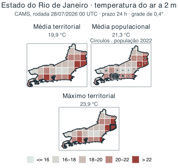
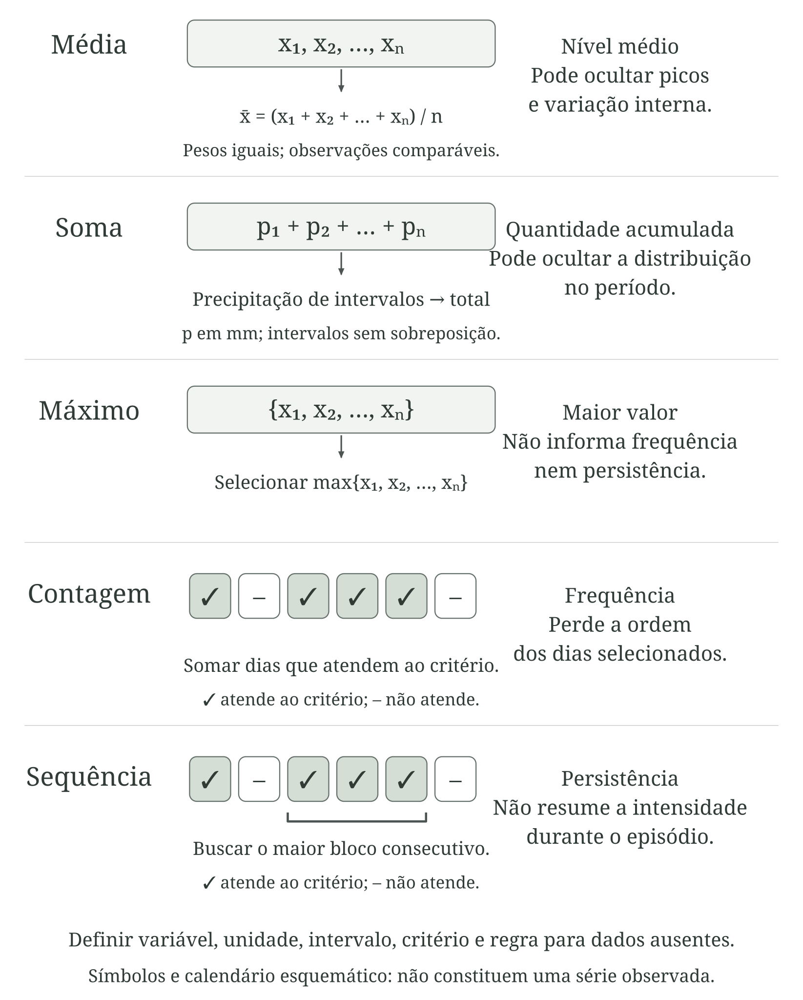
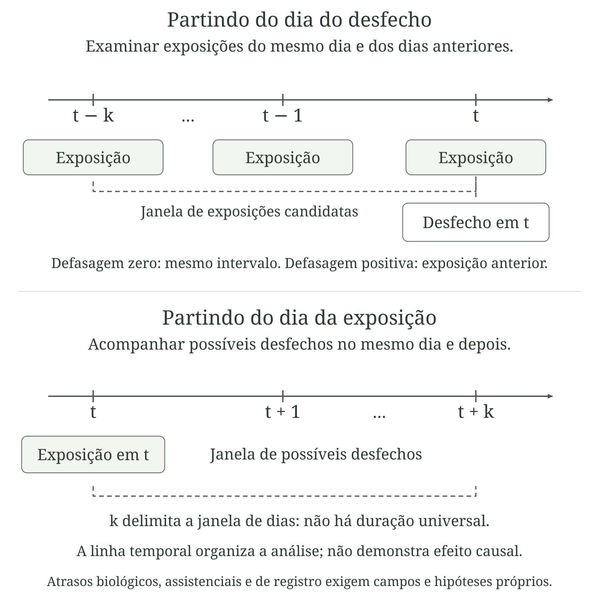

---
aliases:
  - /chapters/part-1/03-espaco-tempo-qualidade.html
format:
  html:
    template-partials:
      - ../../includes/chapter-opening/title-block.html
chapter-opening:
  image: ../../assets/openings/cap4-espaco-tempo-qualidade-web.webp
  alt: "Panorama hipotético sem pessoas de uma bacia com encosta arborizada, área agrícola, rio no vale e bairro denso. Pequenos conjuntos de instrumentos ocupam terrenos abertos em cotas distintas, destacando diferenças de relevo, entorno e representatividade das observações."
---

# Integração de dados: espaço, tempo e qualidade {#sec-espaco-tempo}

No capítulo anterior, a pergunta central foi o que um dado ou indicador representa. Neste capítulo, o problema muda de escala: quando duas ou mais fontes podem ser combinadas sem que o significado original seja perdido? Essa questão aparece continuamente na interface clima, ambiente e saúde, porque as fontes raramente são produzidas para o mesmo lugar, o mesmo período ou a mesma população.

Uma estação meteorológica registra condições em um ponto; uma célula de uma grade representa um valor associado a uma área; uma taxa municipal resume eventos e população segundo um território administrativo. Do mesmo modo, uma concentração horária, uma média diária, um total mensal e uma taxa anual pertencem a janelas temporais diferentes. Unir essas informações exige mais do que encontrar uma coluna de município e outra de data: exige verificar que espaço, que tempo e que população cada valor efetivamente representa.

Essa compatibilização modifica o dado. Transformar uma grade em uma média municipal, converter UTC (Tempo Universal Coordenado) para horário local, agregar horas em dias, escolher um período de referência ou tratar valores ausentes são decisões analíticas. Elas podem ser necessárias e perfeitamente defensáveis, mas precisam ser coerentes com a pergunta e permanecer documentadas.

A qualidade deve ser examinada pela mesma lógica. Um produto pode ser adequado para comparar grandes regiões e insuficiente para orientar uma ação em um bairro; uma base consolidada pode ser excelente para análise retrospectiva e chegar tarde demais para vigilância operacional. A norma 19157-1 da Organização Internacional de Normalização (ISO) organiza a qualidade de dados geográficos a partir dos requisitos do produto e do uso [@iso2023geoquality]. Aqui, adotaremos uma formulação prática: não basta perguntar se o dado é bom; é preciso perguntar se ele é adequado para aquilo que se pretende fazer com ele.

O percurso começa pelo espaço e pelo tempo representados, passa pela avaliação da qualidade e da incerteza e chega aos limites da interpretação. Compatibilizar as bases permite construir uma comparação coerente; demonstrar causalidade ou estimar uma contribuição atribuível exige perguntas e hipóteses adicionais.

## O espaço que um dado representa

Quando um conjunto de dados possui latitude e longitude, pode parecer que sua dimensão espacial está resolvida. Não está. Uma coordenada informa onde algo foi registrado ou referenciado, mas não necessariamente qual porção do espaço aquele valor representa.

::: {.callout-note icon=false title="Conceito-chave: localização, suporte, resolução e escala"}

Localização
: Onde a observação, estimativa ou unidade está posicionada.

Suporte espacial
: A porção do espaço à qual o valor se refere.

Resolução espacial
: O nível de detalhe ou o tamanho nominal das unidades do produto.

Escala de análise
: O nível em que o fenômeno será interpretado ou a decisão será tomada.

:::

Uma estação meteorológica, por exemplo, possui uma coordenada, mas sua observação é feita em um ponto e sob condições específicas de instalação. Uma célula de grade de 10 km possui uma localização e uma dimensão, mas o valor pode resultar de um modelo cuja influência espacial ultrapassa o tamanho nominal da célula. Uma taxa municipal, por sua vez, não representa um ponto: ela resume eventos e população dentro de um limite administrativo. Barcellos e Bastos mostram que escolher escala e objeto de análise antecede a integração das bases e condiciona a interpretação dos resultados ambientais e sanitários [@barcellos1996geoprocessamento]. O módulo 2 do ASISA-Queimadas relaciona a escolha das escalas e unidades de análise às diferentes esferas da vigilância [@gracie2024asisa, p. 79–80].

A @fig-suporte-localizacao resume essa distinção em vista vertical, como um mapa. Estação, residência, ruas e rio ocupam posições idênticas nos três painéis; mudam apenas as camadas que indicam localização, suporte e unidade de análise. Compartilhar uma região do mapa não torna esses suportes equivalentes.

<!--
ARTE CAP4-01 — Vista vertical v3
Originais e prompts v1/v2 preservados. Fonte atual: arte-cap4-01-v3.png.
Primeira geração: arte-cap4-01-v3-preliminar.png; refinamento geométrico antes da montagem.
Referências: original v2 (conteúdo) e aquarela-grafite-nanquim.png (estilo), apresentados em prévias JPEG.
Montagem: mesma cena repetida; pontos na estação e residência, grade e limite em vetor. Rótulos editáveis.
Reprodução: python3 scripts/build_cap4_art.py 01
Prompt completo:
Use case: precise-object-edit.
Asset type: paisagem cartográfica conceitual para livro científico brasileiro, formato horizontal 3:2, resolução 1536 × 1024 pixels ou maior.
Input images: Imagem 1 é o original a reinterpretar em vista vertical, preservando os elementos do território. Imagem 2 é somente referência de ESTILO; não copiar pessoas ou composição dela.
Style/medium: Ilustração editorial em aquarela tradicional translúcida, combinada com traços finos e espontâneos de lápis grafite e nanquim. Contornos parcialmente abertos, hachuras leves e marcas discretas de rascunho. Textura sutil de papel aquarela, pigmentação irregular e transições suaves. Paleta de verdes naturais, azuis acinzentados, ocres e terracota, com saturação moderada. Preservar áreas de papel branco e bordas irregulares que se dissolvem no fundo. Pessoas com proporções naturais e diversidade de tons de pele. Linguagem visual madura, acolhedora e adequada à divulgação científica para adultos.
Primary request: Transformar o território da imagem 1 em uma vista ORTOGONAL VERTICAL, NÁDIR, exatamente de cima, como um mapa ilustrado. O plano do chão deve ser paralelo ao papel: não mostrar horizonte, céu, montanhas vistas de lado, fachadas, lados verticais de prédios ou perspectiva isométrica. Mostrar somente coberturas, plantas, ruas e copas de árvores vistas verticalmente.
Composition/framing: Uma única paisagem urbana e periurbana inteiramente hipotética. Estação meteorológica pequena no terço esquerdo, em terreno gramado amplo e aberto, afastada de árvores e edifícios; vista superior do abrigo e instrumentos, sem ampliá-los desproporcionalmente. Núcleo urbano misto no centro e à direita, com quarteirões, vias, coberturas de edifícios maiores e casas menores. Uma residência de telhado terracota deve ser distinguível na região inferior direita. Rio sinuoso na faixa superior direita, arborização nas margens e ponte vista de cima. Vegetação e campos no lado esquerdo. Preservar a distribuição geral de estação à esquerda, ocupação urbana à direita e água no alto, adaptando toda a geometria à projeção estritamente superior. Não preservar o horizonte oblíquo do original. Bordas orgânicas suaves sobre papel branco e margens pequenas.
Constraints: Sem pessoas; sem palavras, letras, números, setas, pontos marcadores, grades, limites administrativos, legendas, escalas, logotipos ou marcas d'água. Sem mapa de cidade real ou quantidades observacionais. Estação e residência receberão pontos vetoriais depois. A mesma imagem será repetida em diferentes painéis científicos; não gerar painéis nesta aquarela. Contraste legível em escala de cinza. Prédios reconhecíveis por coberturas amplas, sem qualquer fachada aparente. Não desenhar nuvens sobre o território.

Refinamento efetivamente aplicado:
Correção geométrica precisa da imagem recém-gerada: manter posições de ruas, rio, ponte, vegetação, estação, cores e técnica. Mudar APENAS a projeção de TODAS as construções e instrumentos para NÁDIR ORTOGRÁFICO, câmera exatamente 90 graus para baixo, mapa plano visto de cima. Os prédios atuais mostram janelas e paredes verticais em suas faces inferiores; REMOVER COMPLETAMENTE essas fachadas, janelas laterais e paredes aparentes. Cada prédio será somente sua cobertura e planta horizontal: retângulos de laje clara com detalhes de telhado, sem extrusão, sem qualquer face lateral. A estação à esquerda será vista só de cima, abrigo apenas cobertura branca e instrumentos como suas pequenas plantas. Casas apenas telhados. Não inclinar prédios. Esta é uma imagem cartográfica, não uma fotografia aérea oblíqua nem uma cidade isométrica. Preservar contornos e localizações do território e aquarela com grafite e nanquim. Sem qualquer texto, número, grade, setas ou novos elementos. Manter 1536 × 1024 ou maior.

-->

{#fig-suporte-localizacao .lightbox width="100%" print-src="arte-cap4-01-suporte-print.png" print-width="120mm" fig-alt="Três cópias idênticas de um território hipotético visto verticalmente, como mapa, recebem pontos na estação e na residência, células de grade e um limite municipal. Ruas, coberturas, vegetação e rio permanecem na mesma posição."}

::: {.callout-important icon=false title="Atenção: resolução não garante qualidade"}

Um produto de 1 km não é necessariamente mais exato do que um produto de 10 km. Resolução informa o tamanho das unidades publicadas; exatidão, representatividade e incerteza dependem de como o produto foi produzido. Aumentar artificialmente o número de pixels por reamostragem pode tornar um mapa visualmente mais detalhado sem recuperar informação que nunca existiu na fonte.

:::

O processo observado também possui uma escala própria. Chuvas intensas podem variar muito em pequenas distâncias. Temperatura responde a relevo, urbanização, vegetação e materiais da superfície. Algumas condições da qualidade do ar podem variar perto de vias ou fontes de emissão, enquanto fenômenos ambientais de longa duração podem abranger regiões extensas. A escolha do dado deve considerar essa escala do fenômeno, e não apenas a resolução disponível [@iso2023geoquality].

### Estações, grades e satélites respondem a perguntas diferentes

Estações meteorológicas e ambientais oferecem observações diretamente vinculadas a instrumentos, mas sua representatividade depende de localização, altitude, entorno, altura de medição, manutenção e variável observada. A estação mais próxima nem sempre é a que melhor representa o território de interesse. Uma estação em aeroporto, por exemplo, pode registrar condições bastante diferentes das encontradas em áreas densamente construídas da mesma cidade.

Uma rede de estações é também uma amostra espacial. Se os pontos se concentram em cidades, aeroportos ou áreas de fácil acesso, possuir muitas estações não significa que todos os ambientes estejam igualmente representados. Coordenadas, histórico de localização, instrumento, frequência de medição e códigos de qualidade fazem parte dos metadados necessários à interpretação [@wmo2023climatological].

Dados em grade oferecem cobertura contínua, mas podem resultar de processos muito diferentes. Uma grade pode ser produzida por interpolação entre pontos, por modelos, por combinação entre modelos e observações ou por sensores em satélites. Uma reanálise, por exemplo, combina observações disponíveis com um modelo e um sistema de assimilação para reconstruir condições passadas de forma coerente; ela não corresponde a medições feitas em cada célula [@hersbach2020era5]. No sensoriamento remoto, sensores observam a energia proveniente da superfície ou da atmosfera e algoritmos transformam essas observações em produtos como temperatura da superfície ou cobertura vegetal; nuvens, ângulo de observação e mistura de materiais dentro do pixel podem influenciar o resultado [@jin2012uhi; @iso2023geoquality]. O @sec-fontes-fichas retomará esses produtos do ponto de vista de suas fontes e documentação. Em estudos de saúde, a localização de registros também depende do endereço disponível, da qualidade da geocodificação e da unidade territorial de divulgação. Esses limites precisam acompanhar os métodos de análise espacial, como discutem Carvalho e Souza-Santos [@carvalho2005espacial].

::: {.callout-note icon=false title="Conceito-chave: graus não são quilômetros"}
Muitas grades globais são publicadas em coordenadas geográficas, com resolução expressa em graus, como 0,25° ou 0,4°. Graus representam ângulos, não uma distância fixa na superfície terrestre. Um intervalo de latitude mantém dimensão norte–sul aproximadamente semelhante, enquanto a distância correspondente a um grau de longitude diminui à medida que nos afastamos do Equador. Consequentemente, células com a mesma dimensão angular podem possuir áreas físicas diferentes.

Isso importa sobretudo para operações baseadas em área, totais e ponderações. Reprojetar uma grade para um sistema adequado ou calcular explicitamente as áreas das interseções evita tratar todos os pixels como se tivessem a mesma superfície.
:::

::: {.callout-note icon=false title="Nota técnica: reamostragem de grades"}
Reprojetar ou reamostrar uma grade exige escolher um método compatível com a variável. Vizinho mais próximo costuma ser apropriado para classes, como uso da terra; interpolação bilinear é usada em superfícies contínuas, mas suaviza valores; métodos conservativos são úteis quando é necessário preservar totais ou fluxos. Aplicar bilinear a categorias pode criar classes inexistentes, e aumentar a resolução não cria detalhe que não existia na fonte.

Ao registrar o processamento, preserve ao menos produto e versão, variável e unidade, sistema de coordenadas, resolução original, referência temporal, método de reamostragem e transformações aplicadas.
:::

::: {.callout-warning icon=false title="Atenção: dependência espacial"}
Células vizinhas frequentemente compartilham informação e apresentam dependência espacial. Modelos compartilham dinâmica e assimilação; superfícies interpoladas compartilham estações; sensores possuem resposta espacial que pode ultrapassar o pixel nominal. Portanto, dividir uma região em milhares de células não produz automaticamente milhares de observações estatisticamente independentes. Ignorar essa dependência pode criar uma falsa impressão de tamanho amostral e de precisão.
:::

## Do suporte original ao território de gestão

Grande parte da vigilância e da gestão do SUS (Sistema Único de Saúde) trabalha com municípios, regiões de saúde e estados. Os dados ambientais, porém, raramente são produzidos exatamente nesses limites. Transformar uma estação ou uma grade em um indicador territorial exige uma mudança de suporte espacial: o valor passa a representar outra unidade.

Essa mudança pode parecer simples — “calcular a média do município” —, mas regras diferentes respondem a perguntas diferentes. Considere uma grade de temperatura. A média pela área municipal descreve a condição térmica média do território. Uma média ponderada pela população dá maior peso aos locais onde vivem mais pessoas e aproxima a condição térmica média nos locais de residência. O máximo territorial procura identificar a maior temperatura estimada. Nenhuma dessas estatísticas é universalmente correta; a escolha depende da pergunta [@openshaw1984].

Para um município \(m\), uma média ponderada pela população pode ser expressa por:

$$
\bar{x}_{pop,m} = \frac{\sum_g x_g\,p_{gm}}{\sum_g p_{gm}},
$$

em que \(x_g\) é o valor ambiental da célula \(g\) e \(p_{gm}\) é a população localizada na parte da célula \(g\) que pertence ao município \(m\). Essa notação deixa explícito que células e limites municipais podem se cruzar e que a população utilizada precisa estar espacialmente associada ao território analisado.

A expressão exige população total positiva e valores ambientais válidos nas células incluídas. Excluir células por falta de dados altera a população representada e precisa ser documentado. O exemplo real a seguir permite comparar essa escolha com a ponderação por área usando o mesmo produto e o mesmo território.

A @fig-estatistica-zonal-populacao decompõe o cálculo. Primeiro, identifica-se o valor ambiental de cada célula; depois, localiza-se a população sobre a mesma base espacial. O limite territorial seleciona as interseções que participarão da síntese. A população fora desse limite não pertence ao denominador do município, mesmo quando está em uma célula que o atravessa.

<!--
ARTE CAP4-08
ARTE CAP4-08 — Da grade ambiental à média territorial ponderada pela população
Tipo: raster.
Composição: Reutilizar a vista vertical v3 em três painéis alinhados. Sobrepor grade, símbolos populacionais e limite idêntico. Atenuar o exterior na interseção. Encerrar com a média ponderada e os requisitos de população positiva e cobertura válida. Não adicionar números observacionais.
Estilo: tipografia Libertinus Serif incorporada, paleta editorial e rótulos em vetor.
Reprodução: python3 scripts/build_cap4_art.py 08
Aquarela e prompts: arte-cap4-01-v3.png; arte-cap4-01-v3.prompt.txt; arte-cap4-01-v3-refinamento.prompt.txt.
Texto alternativo: Três vistas idênticas mostram campo ambiental, localização ilustrativa da população e interseção com um território. A fórmula combina os valores ambientais com a população de cada interseção. Os pontos não representam contagens.
Legenda: Da grade ambiental à média territorial ponderada pela população
-->

{#fig-estatistica-zonal-populacao .lightbox width="100%" print-src="arte-cap4-08-ponderacao-populacional-print.png" print-width="120mm" fig-alt="Três vistas idênticas mostram campo ambiental, localização ilustrativa da população e interseção com um território. A fórmula combina os valores ambientais com a população de cada interseção. Os pontos não representam contagens."}

[Fontes conceituais: Barcellos e Bastos (1996); Carvalho e Souza-Santos (2005); fórmula e definições desta seção. Elaboração para esta obra em SVG, com aquarela gerada por IA (image_gen) reutilizada da vista vertical v3 e rótulos editáveis. Licença dos arquivos autorais: GPL-3.0; fontes mantêm suas condições de uso.]{.figure-source}

No painel final, cada valor ambiental é multiplicado pela população de sua interseção com o território; a soma desses produtos é dividida pela população incluída. O campo ambiental permanece igual: mudam os pesos atribuídos às suas partes. Uma média pela área usaria áreas como pesos, respondendo a outra pergunta. Os pontos da prancha apenas ilustram localizações e não equivalem a uma pessoa, a um domicílio ou a uma contagem observada. Como \(p_{gm}\) já se refere à população da interseção, não se deve multiplicá-la novamente pela fração de área sem justificativa metodológica.

Ponderar pela população não transforma uma temperatura ambiental em uma medida individual de exposição. Pessoas se deslocam, trabalham e permanecem em ambientes internos; a própria superfície populacional pode ser estimada. Ainda assim, quando a pergunta se refere à condição média nos locais de residência, essa ponderação pode ser mais informativa do que uma média puramente territorial.

### Situação concreta: três temperaturas para o mesmo estado

A @fig-mudanca-suporte mostra um exemplo em que a mesma previsão de temperatura do ar do Copernicus Atmosphere Monitoring Service (CAMS) é resumida para o estado do Rio de Janeiro de três maneiras. A média pela área territorial é 19,9 °C; a média ponderada pela distribuição populacional é 21,3 °C; o máximo territorial é 23,9 °C. Não existe contradição entre os três valores. Eles respondem a perguntas diferentes.

A média pela área descreve a superfície territorial; a média populacional enfatiza onde as pessoas residem; o máximo localiza a condição mais elevada. A escolha entre eles deve vir antes do cálculo e deve ser registrada como parte da definição do indicador. Os valores pertencem à rodada inicializada em 28 de julho de 2026, às 00 UTC, com horizonte de 24 horas e validade em 29 de julho de 2026, às 00 UTC. São resumos de uma previsão, não observações de estações nem uma diferença universal entre os métodos [@cams2026globalforecast; @ibge2022grade; @ibge2024malhas].

{#fig-mudanca-suporte .lightbox fig-alt="Três mapas do estado do Rio de Janeiro usam a mesma previsão CAMS de temperatura do ar. A média pela área territorial é 19,9 graus Celsius; a média ponderada pela população do Censo 2022 é 21,3 graus Celsius; e o máximo territorial é 23,9 graus Celsius." width="100%"}

[Fontes: CAMS/ECMWF (temperatura a 2 m; 29 jul. 2026, 00 UTC) e IBGE (Grade Estatística 2022 e Malha 2022), via `geobr`. Elaboração própria; script e proveniência: `data-raw/figures/README.md`. Licenças: termos das fontes e da obra.]{.figure-source}

### Sobreposição espacial, interpolação areal e ponderação populacional

Três operações próximas na aparência devem ser separadas conceitualmente.

Sobreposição entre grade e território ocorre quando uma superfície contínua, como temperatura, é resumida para um polígono. Células cortadas pelo limite podem contribuir segundo a fração de área efetivamente contida no território. A estatística final — média, máximo, percentil ou outra — deve ser coerente com a grandeza analisada.

Interpolação areal é necessária quando uma quantidade associada a polígonos de origem precisa ser transferida para polígonos de destino diferentes. Em variáveis extensivas, como contagens populacionais, uma ponderação apenas pela área pressupõe distribuição uniforme dentro de cada polígono. Métodos dasimétricos procuram melhorar essa redistribuição utilizando informação auxiliar, como áreas construídas ou cobertura da terra, mas acrescentam dados e hipóteses [@openshaw1984; @iso2023geoquality].

Ponderação populacional da exposição, por sua vez, combina uma superfície ambiental com uma superfície de população já compatibilizada espacialmente. Seu objetivo não é redistribuir a temperatura ou a concentração, mas atribuir maior peso aos locais onde reside mais gente.

A @fig-operacoes-espaciais compara as três operações mantendo explícitos seus objetos de entrada e de saída. No primeiro painel, a interseção delimita a parte da grade associada ao território. No segundo, o mesmo domínio recebe duas malhas, e o objetivo é transferir quantidades extensivas entre elas. No terceiro, as superfícies já compatibilizadas são combinadas para calcular uma síntese ponderada.

<!--
ARTE CAP4-09
ARTE CAP4-09 — Três operações espaciais e o que cada uma transforma
Tipo: raster.
Composição: Três faixas: sobreposição entre grade e território; malhas de origem e destino cobrindo o mesmo domínio, com totais conservados e hipótese de uniformidade explícita; superfície ambiental e população compatibilizadas. Reutilizar a paisagem vertical v3. Não atribuir números às malhas.
Estilo: tipografia Libertinus Serif incorporada, paleta editorial e rótulos em vetor.
Reprodução: python3 scripts/build_cap4_art.py 09
Aquarela e prompts: arte-cap4-01-v3.png; arte-cap4-01-v3.prompt.txt; arte-cap4-01-v3-refinamento.prompt.txt.
Texto alternativo: Três faixas distinguem o recorte de uma grade pelo território, a transferência de totais entre duas malhas no mesmo domínio e a ponderação de valores ambientais pela população. Os diagramas não contêm totais observados.
Legenda: Três operações espaciais e o que cada uma transforma
-->

{#fig-operacoes-espaciais .lightbox width="100%" print-src="arte-cap4-09-operacoes-espaciais-print.png" print-width="120mm" fig-alt="Três faixas distinguem o recorte de uma grade pelo território, a transferência de totais entre duas malhas no mesmo domínio e a ponderação de valores ambientais pela população. Os diagramas não contêm totais observados."}

[Fontes conceituais: Openshaw (1984); ISO 19157-1 (2023); discussão desta seção. Elaboração para esta obra em SVG, com aquarela gerada por IA (image_gen) reutilizada da vista vertical v3 e rótulos editáveis. Licença dos arquivos autorais: GPL-3.0; fontes mantêm suas condições de uso.]{.figure-source}

Na interpolação areal por área, a parcela transferida depende da proporção da área de origem coberta por cada destino. Isso pressupõe distribuição uniforme da quantidade dentro do polígono de origem. Quando origem e destino cobrem integralmente o mesmo domínio, sem sobreposições duplicadas, a redistribuição deve conservar o total; se houver recortes ou lacunas, o balanço deve se referir apenas ao domínio comum. Informação auxiliar pode modificar os pesos, mas não elimina a necessidade de declarar as hipóteses. Já a ponderação populacional não redistribui a temperatura ou a concentração: utiliza a população como peso da síntese.

Essas operações preservam propriedades diferentes. O processamento deve declarar o que se pretende conservar — média, total, proporção, ocorrência ou distribuição —, como foram tratadas as interseções e que dados auxiliares foram utilizados.

## Territórios administrativos também mudam

Municípios, regiões de saúde e outros territórios de gestão não são unidades naturais e imutáveis. Limites podem ser alterados, municípios podem ser criados e a composição de regiões pode mudar. Por isso, uma série territorial sem referência à malha e à vigência utilizadas pode se tornar ambígua [@ibge2024malhas].

O município é extremamente útil para planejamento e vigilância porque organiza responsabilidades, população, serviços e políticas. Isso não significa que seja ambientalmente homogêneo. Um município extenso pode reunir áreas urbanas, rurais, florestais, serranas e costeiras. Um único valor municipal é uma síntese, não uma descrição de todos os locais que existem dentro dele.

O mesmo cuidado vale para regiões de saúde. Uma média regional pode ser apropriada para planejamento assistencial e, ao mesmo tempo, ocultar um município com condição muito mais crítica. Sempre que a heterogeneidade interna for relevante para a ação, uma síntese regional deve ser acompanhada de distribuição, mapa ou desagregação das unidades componentes.

### Quando os resultados dependem de como desenhamos o mapa

Há ainda um problema menos intuitivo: resultados obtidos com dados agregados podem mudar quando o mesmo espaço é dividido de outra forma. Uma associação calculada entre municípios pode ser diferente da associação calculada entre bairros ou regiões. Mesmo unidades de tamanho semelhante podem produzir resultados distintos quando seus limites são redesenhados. Esse fenômeno é conhecido como problema da unidade de área modificável (*modifiable areal unit problem*, MAUP) [@openshaw1984].

Isso não é resolvido simplesmente escolhendo a menor unidade disponível. Áreas muito pequenas podem produzir taxas instáveis, aumentar problemas de confidencialidade e se alinhar mal ao processo ambiental. Quando a conclusão depende fortemente da escala ou do zoneamento, é recomendável testar unidades plausíveis e relatar o que permanece estável [@carvalho2005espacial].

A @fig-escala-zoneamento mantém a mesma paisagem e altera somente as divisões. Do primeiro para o segundo painel, a agregação produz unidades maiores: muda a escala. Do primeiro para o terceiro, permanece o número de unidades, mas os limites mudam: muda o zoneamento. A figura explica as operações, sem estimar quanto uma associação se alteraria.

<!--
ARTE CAP4-02 — Revisão urbana v2
Finalidade e leitura: Três cópias idênticas de uma paisagem hipotética vista de cima, com quadras urbanas, coberturas de edifícios e casas, campos, vegetação e rio, recebem divisões diferentes. O segundo painel agrega unidades do primeiro; o terceiro redesenha unidades em escala semelhante à do primeiro. As construções não representam contagens populacionais.
Identificador preservado: fig-escala-zoneamento.
Arte incorporada: assets/figures/arte-cap4-02-zoneamento.svg.
Versão de impressão: assets/figures/arte-cap4-02-zoneamento-print.png, em escala de cinza.
Aquarela utilizada: assets/figures/arte-cap4-02-v2.png.
Original anterior preservado: assets/figures/arte-cap4-02-v1.png.
Prompt anterior preservado: assets/figures/arte-cap4-02-v1.prompt.txt.
Prompt efetivamente utilizado: assets/figures/arte-cap4-02-v2.prompt.txt.
Referência visual: assets/references/aquarela-grafite-nanquim.png; original v1 como referência de composição.
Produção: edição com a ferramenta integrada image_gen; versão da ferramenta não informada.
Composição reproduzível: scripts/build_cap4_art.py 02; exportação por scripts/render_figure.py.
Rótulos e relações conceituais editáveis; fontes e aquarela incorporadas verificadas antes da exportação.
Montagem: Três painéis usando o mesmo raster, sem mudar recorte. Primeiro: quatro unidades; segundo: duas unidades obtidas agregando pares; terceiro: quatro unidades com limites alternativos. Sem estatísticas. Explicar separadamente efeito de escala e efeito de zoneamento.
Prompt completo:
Use case: precise-object-edit.
Asset type: ilustração científica editorial para livro brasileiro sobre clima, ambiente e saúde.
Input images: Imagem 1 é o original a EDITAR, referência obrigatória de composição, personagens e função; Imagem 2 é SOMENTE referência de ESTILO (aquarela-grafite-nanquim.png), não copiar sua cena.
Style/medium: Ilustração editorial em aquarela tradicional translúcida, combinada com traços finos e espontâneos de lápis grafite e nanquim. Contornos parcialmente abertos, hachuras leves e marcas discretas de rascunho. Textura sutil de papel aquarela, pigmentação irregular e transições suaves. Paleta de verdes naturais, azuis acinzentados, ocres e terracota, com saturação moderada. Preservar áreas de papel branco e bordas irregulares que se dissolvem no fundo. Pessoas com proporções naturais e diversidade de tons de pele. Linguagem visual madura, acolhedora e adequada à divulgação científica para adultos.
Primary request: Revisar esta imagem para trazer uma cidade brasileira contemporânea, inteiramente hipotética, para o plano principal. Prédios e infraestrutura urbana precisam ser claramente reconhecíveis, não apenas uma silhueta distante no horizonte. Preservar a linguagem de aquarela e a ideia científica do original.
Constraints: Manter ordem, quantidade e separação das vinhetas; preservar identidade, roupas e gestos dos personagens existentes, perspectiva e margens de papel branco, salvo as mudanças explicitamente solicitadas abaixo. Pessoas e mãos anatomicamente coerentes. Densidade urbana legível, sem excesso de detalhes. Mostrar diferentes condições de proteção em ambientes urbanos sem caricaturas ou equivalência automática entre cidade e dano. Não desenhar palavras, letras, números, logotipos, marcas d'água, setas, grades analíticas, legendas ou novos gráficos. Textos e conexões serão acrescentados como vetores. Contraste deve funcionar em escala de cinza. Não inventar dados quantitativos nem representar uma cidade real.

Composition/framing: Uma única paisagem cartográfica horizontal 3:2, resolução 1536 × 1024 pixels ou maior, vista estritamente superior, sem horizonte e sem perspectiva oblíqua de fachadas. Preservar a posição e curso geral do rio sinuoso do original, vegetação, margens brancas e dois núcleos ocupados no alto à esquerda e embaixo à direita.
Scene/backdrop: No núcleo superior esquerdo, substituir parte das casas dispersas por quadras urbanas compactas, vias pavimentadas, coberturas de edifícios residenciais maiores, pátios e pequenos comércios; a vista superior deve comunicar construções de maior porte e tecido urbano denso por plantas e coberturas retangulares maiores, sem desenhar fachadas inclinadas. No núcleo inferior direito, combinar edifícios de apartamentos, casas e espaços públicos arborizados, com uma avenida reconhecível. Preservar áreas verdes, campos e transição rural nas demais regiões. Manter detalhes legíveis, sem sobrecarregar. Nenhuma grade ou divisão administrativa, nenhum dado ou símbolo de mapa real: os limites serão sobrepostos depois. A MESMA imagem será reutilizada sem alterações nos três painéis de escala e zoneamento.

Refinamento de perspectiva efetivamente aplicado, arquivado em assets/figures/arte-cap4-02-v2-refinamento.prompt.txt:
Use case: precise-object-edit.
Imagem 1: paisagem de zoneamento a corrigir. Imagem 2: somente referência de estilo de aquarela.
Corrigir SOMENTE a perspectiva da imagem 1. Precisamos de VISTA ORTOGONAL VERTICAL, NÁDIR, exatamente de cima, como olhando um mapa ilustrado aéreo: mostrar as coberturas e plantas das construções, NÃO mostrar fachadas verticais nem lados de prédios. Os edifícios altos devem ser identificáveis por coberturas maiores de concreto, pequenas casas de máquinas no topo e sombras suaves discretas, sem vistas laterais. Manter a localização geral de TODOS os elementos: rio sinuoso, mata, campos, núcleo urbano no canto superior esquerdo e núcleo urbano no inferior direito; manter cores, aquarela, ocupação mista de prédios, casas e quadras, formato horizontal 3:2, resolução 1536×1024, bordas irregulares e papel branco. Não acrescentar outras cenas nem detalhes quantitativos. Não incluir setas, grade, limites, legendas, texto, letras, números, escala ou logotipos. Esta imagem será repetida três vezes, com divisões vetoriais distintas, num esquema de escala e zoneamento.
-->

{#fig-escala-zoneamento .lightbox width="100%" print-src="arte-cap4-02-zoneamento-print.png" print-width="120mm" fig-alt="Três cópias idênticas de uma paisagem hipotética vista de cima, com quadras urbanas, coberturas de edifícios e casas, campos, vegetação e rio, recebem divisões diferentes. O segundo painel agrega unidades do primeiro; o terceiro redesenha unidades em escala semelhante à do primeiro. As construções não representam contagens populacionais."}

[Fontes conceituais: Openshaw (1984); Barcellos e Bastos (1996); Carvalho e Souza-Santos (2005). Elaboração e revisão para esta obra, com aquarela gerada por IA (image_gen) e rótulos editáveis. Licença dos arquivos autorais: GPL-3.0; fontes mantêm suas condições de uso.]{.figure-source}

::: {.callout-warning icon=false title="Atenção: falácia ecológica"}

Se municípios com maior temperatura também apresentarem maior mortalidade, isso não demonstra que as pessoas mais expostas ao calor foram as que morreram. Uma associação observada entre áreas pertence ao nível agregado. Estudos ecológicos podem ser muito úteis para políticas e contextos territoriais, mas inferências individuais exigem dados e hipóteses adicionais [@piantadosi1988ecological]. As implicações dessa distinção para análises entre ambiente e saúde serão retomadas no @sec-efeitos-saude.

:::

## O tempo que um dado representa

Assim como todo valor possui um suporte espacial, ele também possui uma referência temporal. Em clima e saúde, o tempo do fenômeno, da medição, do registro e da disponibilidade da informação frequentemente não coincide.

Uma chuva intensa pode ocorrer hoje; uma inundação, algumas horas depois; sintomas, dias depois; um atendimento pode ser registrado no mesmo dia ou posteriormente; a base consolidada pode ser publicada semanas ou meses depois. Alinhar essas datas apenas porque aparecem na mesma coluna de “data” pode deslocar a relação que se pretende estudar. A @fig-tempos-dado distingue os momentos do fenômeno, da exposição, do possível efeito, do cuidado e do processamento da informação.

<!--
ARTE CAP4-03 — Revisão urbana v2
Finalidade e descrição acessível: Seis vinhetas distinguem condição ambiental, exposição, possível efeito, atendimento, registro e publicação. As conexões não representam durações universais nem causalidade demonstrada. Ruas e praças com prédios próximos e interiores de serviços de saúde compõem os cenários urbanos.
Arte incorporada: assets/figures/arte-cap4-03-tempos.svg.
Impressão: assets/figures/arte-cap4-03-tempos-print.png.
Original da edição: assets/figures/arte-cap4-03-v1.png; preservado junto das versões anteriores.
Aquarela revisada: assets/figures/arte-cap4-03-v2.png.
Prompt completo utilizado: assets/figures/arte-cap4-03-v2.prompt.txt.
Referência de estilo: assets/references/aquarela-grafite-nanquim.png.
Produção: ferramenta integrada image_gen; original e referência de estilo inspecionados e fornecidos por referenced_image_paths.
Montagem: scripts/build_cap4_art.py 03; rótulos, setas e identificadores editáveis preservados.
Exportação: Chromium com fontes e raster incorporados; ImageMagick para PNG de 8 bits em cinza.
Revisão: presença urbana, continuidade da aquarela, anatomia, recortes e relações conceituais. Cenários hipotéticos, sem novos dados observados.
Licença dos arquivos autorais: GPL-3.0; fontes citadas mantêm suas condições de uso.

Use case: precise-object-edit. Arte didática em aquarela para livro brasileiro sobre clima, ambiente e saúde.
Entradas: imagem 1 é o ORIGINAL a editar, referência obrigatória de composição; imagem 2 é APENAS referência do estilo da série.
Pedido: aumentar a presença urbana, preservando a aquarela naturalista, paleta suave de azuis, verdes, ocres e terracota, textura de papel, contornos delicados de grafite/nanquim e contraste adequado também em cinza. A cidade é brasileira e hipotética, sem marcos reconhecíveis.
Revisão específica: Mantenha seis vinhetas em três colunas e duas linhas. Reforce o contexto urbano nas três superiores: prédios de apartamentos próximos e calçadas na rua quente; caminhada em parque urbano com prédios à margem; banco sombreado de praça urbana com edifícios próximos. Preserve cada personagem, idade, gesto, árvore, garrafa e diferença de situação. Nas cenas inferiores de consulta e computador, mostre discretamente fachadas urbanas nas janelas, conservando a profissional com registro no centro, todos os papéis e telas em branco. Preserve exatamente a grade e corredores brancos.
Invariantes: conserve enquadramento, proporção, escala das figuras humanas, anatomia natural, quantidade e posição das vinhetas, objetos conceituais e espaços brancos. Alterar cenários e arquitetura somente conforme o pedido. Não adicionar texto, títulos, legendas, setas, números, marcas ou molduras; serão aplicados como vetores editáveis. Não fundir cenas e não recortar personagens. Manter boa nitidez na impressão.
Formato: mesma proporção do original 1536 × 1024; resolução igual ou superior. Uma única imagem final editada.
-->

{#fig-tempos-dado .lightbox width="100%" print-src="arte-cap4-03-tempos-print.png" print-width="120mm" fig-alt="Seis vinhetas distinguem condição ambiental, exposição, possível efeito, atendimento, registro e publicação. As conexões não representam durações universais nem causalidade demonstrada. Ruas e praças com prédios próximos e interiores de serviços de saúde compõem os cenários urbanos."}

[Fontes conceituais: Bastos et al. (2019); discussão de temporalidade deste capítulo. Elaboração e revisão para esta obra, com aquarela gerada por IA (image_gen) e rótulos editáveis. Licença dos arquivos autorais: GPL-3.0; fontes mantêm suas condições de uso. Revisão urbana da aquarela: image_gen, com o original e a referência visual da série.]{.figure-source}

Na figura, as conexões tracejadas representam caminhos possíveis: exposição não implica adoecimento inevitável. O intervalo até um efeito sanitário pertence ao processo estudado; a espera por atendimento e a demora de registro ou publicação pertencem a outros processos. As vinhetas não representam a trajetória documentada de uma pessoa, e seu espaçamento não quantifica duração. Bastos e colaboradores mostram por que atrasos de notificação precisam ser considerados na leitura de dados recentes de vigilância [@bastos2019delays].

Dependendo da fonte, podem coexistir várias datas: ocorrência do fenômeno, início e fim da exposição, início dos sintomas, atendimento, internação, notificação, competência, processamento e publicação. Em produtos de previsão há ainda a data da rodada e o horário para o qual a previsão é válida. A data correta para uma análise depende da pergunta.

Em previsões, três referências devem ser preservadas: inicialização, horizonte de previsão (*lead time*) e tempo de validade. A inicialização informa quando a rodada começou; o horizonte informa quantas horas ou dias à frente o modelo avançou; e o tempo de validade é o instante ou período ao qual o valor se refere. A @fig-tempos-previsao usa os metadados do exemplo CAMS: a rodada de 28 de julho de 2026, às 00 UTC, com horizonte de +24 h produz uma estimativa válida em 29 de julho de 2026, às 00 UTC. O horário de validade não informa quando o arquivo foi baixado, e a previsão não se torna observação por ter alcançado esse horário.^[Para a distinção entre inicialização, passo de previsão e validade, consulte a [documentação operacional do ECMWF](https://confluence.ecmwf.int/pages/viewpage.action?pageId=453673187).]

<!--
ARTE CAP4-04 — Revisão urbana v2
Finalidade e descrição acessível: Uma linha temporal apresenta a rodada CAMS de 28 de julho de 2026 às 00 UTC, horizonte de 24 horas e validade em 29 de julho de 2026 às 00 UTC. A previsão permanece uma estimativa. Uma profissional observa informações diante de uma estação em área aberta; a outra cena mostra uma rua urbana com prédios, casas, sol e nuvens.
Arte incorporada: assets/figures/arte-cap4-04-previsao.svg.
Impressão: assets/figures/arte-cap4-04-previsao-print.png.
Original da edição: assets/figures/arte-cap4-04-v1.png; preservado junto das versões anteriores.
Aquarela revisada: assets/figures/arte-cap4-04-v2.png.
Prompt completo utilizado: assets/figures/arte-cap4-04-v2.prompt.txt.
Referência de estilo: assets/references/aquarela-grafite-nanquim.png.
Produção: ferramenta integrada image_gen; original e referência de estilo inspecionados e fornecidos por referenced_image_paths.
Montagem: scripts/build_cap4_art.py 04; rótulos, setas e identificadores editáveis preservados.
Exportação: Chromium com fontes e raster incorporados; ImageMagick para PNG de 8 bits em cinza.
Revisão: presença urbana, continuidade da aquarela, anatomia, recortes e relações conceituais. Cenários hipotéticos, sem novos dados observados.
Licença dos arquivos autorais: GPL-3.0; fontes citadas mantêm suas condições de uso.

Use case: precise-object-edit. Arte didática em aquarela para livro brasileiro sobre clima, ambiente e saúde.
Entradas: imagem 1 é o ORIGINAL a editar, referência obrigatória de composição; imagem 2 é APENAS referência do estilo da série.
Pedido: aumentar a presença urbana, preservando a aquarela naturalista, paleta suave de azuis, verdes, ocres e terracota, textura de papel, contornos delicados de grafite/nanquim e contraste adequado também em cinza. A cidade é brasileira e hipotética, sem marcos reconhecíveis.
Revisão específica: Preserve dois painéis lado a lado. À esquerda, mantenha a profissional, tela sem dados, janela e estação, mas mostre um bairro com prédios residenciais próximos além do terreno aberto da estação. À direita, substitua parte das casas da rua por edifícios residenciais de 4–8 pavimentos, comércio térreo e calçadas; mantenha algumas casas, árvores, sol e nuvens. Faça os prédios participarem da cena principal, não só do horizonte. As condições meteorológicas são hipotéticas: não acrescente datas, gráficos, probabilidades ou textos.
Invariantes: conserve enquadramento, proporção, escala das figuras humanas, anatomia natural, quantidade e posição das vinhetas, objetos conceituais e espaços brancos. Alterar cenários e arquitetura somente conforme o pedido. Não adicionar texto, títulos, legendas, setas, números, marcas ou molduras; serão aplicados como vetores editáveis. Não fundir cenas e não recortar personagens. Manter boa nitidez na impressão.
Formato: mesma proporção do original 1536 × 1024; resolução igual ou superior. Uma única imagem final editada.
-->

{#fig-tempos-previsao .lightbox width="100%" print-src="arte-cap4-04-previsao-print.png" print-width="120mm" fig-alt="Uma linha temporal apresenta a rodada CAMS de 28 de julho de 2026 às 00 UTC, horizonte de 24 horas e validade em 29 de julho de 2026 às 00 UTC. A previsão permanece uma estimativa. Uma profissional observa informações diante de uma estação em área aberta; a outra cena mostra uma rua urbana com prédios, casas, sol e nuvens."}

[Fontes conceituais: CAMS/ECMWF; datas do metadado do exemplo do Rio de Janeiro. Elaboração e revisão para esta obra, com aquarela gerada por IA (image_gen) e rótulos editáveis. Licença dos arquivos autorais: GPL-3.0; fontes mantêm suas condições de uso. Revisão urbana da aquarela: image_gen, com o original e a referência visual da série.]{.figure-source}

### Dia, semana e mês precisam ser definidos

“Diário” não é uma propriedade suficiente. Um dia precisa de início, fim e fuso horário. Dados meteorológicos frequentemente usam UTC; sistemas de saúde podem usar horário local. Sem harmonização, eventos próximos à meia-noite podem ser associados ao dia errado. Calendários diferentes também podem aparecer em modelos climáticos.

Uma prática segura é conservar o horário original e seu fuso, realizar conversões explicitamente e somente depois criar janelas diárias, semanais ou mensais para a análise. Quando um deslocamento de algumas horas pode alterar a associação, a sensibilidade à definição temporal deve ser verificada.

```{=typst}
#block(breakable: false)[
```

:::: {.callout-note icon=false title="Conceito-chave: UTC, fuso horário e data local"}

UTC é a referência temporal internacional. Um fuso horário reúne regras para expressar a hora civil de uma localidade; seu deslocamento em relação ao UTC pode variar com a data. Converter preserva o mesmo instante, mas pode mudar o dia.

Some ao UTC o deslocamento indicado na @tbl-conversoes-utc. Cada coluna parte de um único instante; todas as datas são de 2026.

| Referência/localidade | UTC: jan./jul. (h) | 29 jan., 00 UTC | 29 jul., 00 UTC |
|---|---:|---|---|
| UTC | +00 / +00 | 29 jan., 00h00 | 29 jul., 00h00 |
| Brasília | −03 / −03 | 28 jan., 21h00 | 28 jul., 21h00 |
| Manaus | −04 / −04 | 28 jan., 20h00 | 28 jul., 20h00 |
| Rio Branco/Acre | −05 / −05 | 28 jan., 19h00 | 28 jul., 19h00 |
| Fernando de Noronha | −02 / −02 | 28 jan., 22h00 | 28 jul., 22h00 |
| Paris | +01 / +02 | 29 jan., 01h00 | 29 jul., 02h00 |
| Londres | +00 / +01 | 29 jan., 00h00 | 29 jul., 01h00 |
| Nova York | −05 / −04 | 28 jan., 19h00 | 28 jul., 20h00 |

: Conversões de dois instantes UTC para data e hora locais, em 2026 {#tbl-conversoes-utc}

[Fonte: IANA Time Zone Database, versão 2026c; conversões calculadas com `zoneinfo` e conferidas em 5 de outubro de 2026.]{.figure-source}

Em Brasília, 29 de julho às 00 UTC corresponde a 28 de julho às 21h00. Paris tem deslocamentos diferentes em janeiro e julho. Não aplique automaticamente essas diferenças a toda uma série histórica.

Identificadores como `America/Sao_Paulo` e `Europe/Paris` permitem aplicar regras históricas. Nas transições sazonais, horas locais podem se repetir ou não existir; dias civis podem ter 23 ou 25 horas. Preserve data, hora e fuso originais e converta os instantes antes de formar dias locais.

::::

```{=typst}
]
```

O box segue as definições e regras documentadas pelo Bureau Internacional de Pesos e Medidas (BIPM), pelo Observatório Nacional, pela Internet Assigned Numbers Authority (IANA) e pelo Observatório de Paris [@bipmUTC; @on2026tempo; @ianaTimeZones; @syrte2023heure]. Os identificadores e cálculos estão preservados em `data-raw/figures/conversoes-utc-cap4.json`. A conversão de julho usa o mesmo instante de validade da previsão CAMS apresentada no capítulo.

::: {.callout-note icon=false title="Nota técnica: calendários dos modelos"}
Arquivos de modelos climáticos podem utilizar calendários diferentes do calendário civil. As convenções CF (Clima e Previsão (*Climate and Forecast*)), amplamente usadas em arquivos NetCDF, preveem calendários como `365_day`/`noleap`, `366_day` e `360_day`, no qual todos os meses possuem 30 dias.^[NetCDF Climate and Forecast (CF) Metadata Conventions, seção sobre calendários: <https://cfconventions.org/cf-conventions/cf-conventions.html#calendar>.]

Isso afeta junções com dados de saúde e o cálculo de médias mensais, totais anuais, sequências de dias e datas correspondentes. Antes de converter automaticamente uma coordenada temporal para datas civis, verifique o atributo `calendar` e preserve a lógica original do experimento.
:::

### Agregar também muda o fenômeno

Médias, somas, máximos e contagens não são operações neutras. Precipitação mensal costuma representar um acumulado; temperatura mensal, uma média; um máximo mensal de temperatura corresponde ao maior extremo diário; uma contagem anual de dias quentes preserva frequência, mas perde a ordem em que ocorreram.

::: {#qua-transformacoes-temporais}

| Transformação | Pergunta respondida | Exemplo | O que pode se perder |
|---|---|---|---|
| Média | qual foi o nível típico? | temperatura média diária | picos e heterogeneidade dentro do dia |
| Soma | quanto se acumulou? | chuva acumulada no mês | distribuição dos eventos dentro do mês |
| Máximo | qual foi o maior valor? | maior temperatura do mês | duração e frequência de condições elevadas |
| Contagem | quantos dias atenderam ao critério? | número de dias acima de um valor definido | ordem e agrupamento dos dias |
| Sequência | por quanto tempo a condição persistiu? | maior sequência de dias que atendem a um critério | intensidade dentro do episódio, se não incorporada |

Transformações temporais e seus significados

:::

A @fig-transformacoes-temporais representa as operações do @qua-transformacoes-temporais. Os símbolos remetem a observações ou intervalos, sem apresentar uma série medida. A média ilustrada usa pesos iguais e requer observações comparáveis; se os intervalos representados forem diferentes, a ponderação temporal também precisa ser considerada.

<!--
ARTE CAP4-10
ARTE CAP4-10 — Média, soma, máximo, contagem e sequência: o que permanece na síntese
Tipo: vector.
Composição: Prancha exclusivamente vetorial com cinco faixas. Média de observações comparáveis e pesos iguais; soma de precipitação em intervalos disjuntos; seleção do máximo; contagem de dias que atendem ao critério; maior sequência de dias consecutivos. Repetir o mesmo calendário ilustrativo nos dois últimos painéis, sem publicar contagens ou valores. Informar as perdas de cada síntese e a necessidade de regra para ausências.
Estilo: tipografia Libertinus Serif incorporada, paleta editorial e rótulos em vetor.
Reprodução: python3 scripts/build_cap4_art.py 10
Não houve geração de aquarela nesta composição.
Texto alternativo: Cinco faixas mostram símbolos de observações, operações e propriedades preservadas ou perdidas. Contagem e sequência usam o mesmo calendário esquemático: contar dias selecionados difere de identificar um bloco consecutivo. Não há série observacional.
Legenda: Média, soma, máximo, contagem e sequência: o que permanece na síntese
-->

{#fig-transformacoes-temporais .lightbox width="100%" print-src="arte-cap4-10-transformacoes-temporais-print.png" print-width="120mm" fig-alt="Cinco faixas mostram símbolos de observações, operações e propriedades preservadas ou perdidas. Contagem e sequência usam o mesmo calendário esquemático: contar dias selecionados difere de identificar um bloco consecutivo. Não há série observacional."}

[Fontes conceituais: Organização Meteorológica Mundial (2023); quadro de transformações temporais desta seção. Elaboração para esta obra em SVG, com rótulos e relações editáveis; sem geração de aquarela. Licença dos arquivos autorais: GPL-3.0; fontes mantêm suas condições de uso.]{.figure-source}

A soma reúne quantidades acumuladas em intervalos sem sobreposição, como precipitação em milímetros. Uma intensidade em milímetros por hora precisa ser integrada pela duração antes de produzir esse total. O máximo seleciona um extremo, sem informar por quanto tempo ele persistiu. Nos dois últimos painéis, o mesmo calendário esquemático permite distinguir contagem e sequência: a primeira reúne todos os dias que atendem ao critério; a segunda procura o maior bloco consecutivo. O critério e o tratamento de dias ausentes devem ser definidos antes de ambas as operações; ausência não equivale a um dia que não atende ao critério.

O @qua-transformacoes-temporais mostra que cada operação preserva uma propriedade e pode ocultar outras. Agregar com coerência depende da unidade: uma intensidade de chuva, por exemplo, precisa ser integrada no tempo para produzir um acumulado.

A completude também faz parte da agregação. Uma média diária calculada a partir de 24 observações e outra calculada com apenas três horários podem não ser comparáveis. Para totais, horas ou dias ausentes podem produzir subestimação. Critérios mínimos de completude devem ser definidos antes do cálculo [@wmo2023climatological].

É igualmente importante reconhecer a natureza temporal da variável. Número de pessoas internadas em determinado instante representa um estoque; novas internações durante uma semana representam um fluxo; uma interrupção de energia é um evento, com início e duração. Somar estoques sucessivos pode contar a mesma pessoa várias vezes. Resumir um evento apenas pela data inicial pode esconder sua persistência.

### Defasagens devem ter significado

Uma condição ambiental e um efeito sobre a saúde nem sempre aparecem no mesmo momento. Alguns efeitos podem ocorrer no mesmo dia; outros surgem depois de horas, dias ou períodos ainda mais longos. A distância temporal plausível depende do processo que está sendo estudado.

O guia de saúde ambiental também alerta que a latência e as diferenças entre local de residência e de exposição podem dificultar a associação entre indicadores ambientais e de efeitos [@brasil2011saudeambiental, p. 120].

Essa distância temporal costuma ser chamada de defasagem. Sua escolha deve partir do mecanismo e da pergunta, não da busca pela associação estatisticamente mais forte. Para explicar um desfecho no dia analisado, as exposições candidatas pertencem ao mesmo dia e aos dias anteriores, conforme o mecanismo. Se a análise parte do dia da exposição, são os desfechos posteriores que precisam ser acompanhados. Trocar essas referências pode introduzir informação futura indevida. Quando houver mais de uma janela plausível, elas podem ser comparadas em análises de sensibilidade. Os métodos epidemiológicos para estimar relações defasadas serão retomados no @sec-efeitos-saude [@hernan2020causal; @gasparrini2010dlnm].

A @fig-janelas-defasagem apresenta duas formas de organizar a mesma pergunta temporal. Partindo do dia do desfecho, examinam-se exposições do mesmo dia e de dias anteriores. Partindo do dia da exposição, acompanham-se possíveis desfechos naquele dia e depois. A escolha da âncora muda a organização da base, mas não autoriza usar uma exposição futura para explicar um evento anterior.

<!--
ARTE CAP4-11
ARTE CAP4-11 — Duas formas de organizar a janela de defasagem
Tipo: vector.
Composição: Dois painéis vetoriais: ancorar no desfecho em t e olhar as exposições em t, t menos um e t menos k; ancorar na exposição em t e acompanhar desfechos até t mais k. Setas apenas no eixo cronológico. Janelas em tracejado, sem curvas de risco, números de casos ou duração universal. Separar defasagem analítica e atrasos dos processos.
Estilo: tipografia Libertinus Serif incorporada, paleta editorial e rótulos em vetor.
Reprodução: python3 scripts/build_cap4_art.py 11
Não houve geração de aquarela nesta composição.
Texto alternativo: No primeiro painel, um desfecho em t é examinado com exposições do mesmo dia e de dias anteriores. No segundo, uma exposição em t é acompanhada por possíveis desfechos no mesmo dia e depois. Linhas tracejadas delimitam janelas analíticas, sem demonstrar causalidade.
Legenda: Duas formas de organizar a janela de defasagem
-->

{#fig-janelas-defasagem .lightbox width="100%" print-src="arte-cap4-11-defasagem-print.png" print-width="120mm" fig-alt="No primeiro painel, um desfecho em t é examinado com exposições do mesmo dia e de dias anteriores. No segundo, uma exposição em t é acompanhada por possíveis desfechos no mesmo dia e depois. Linhas tracejadas delimitam janelas analíticas, sem demonstrar causalidade."}

[Fontes conceituais: Hernán e Robins (2020); Gasparrini, Armstrong e Kenward (2010). Elaboração para esta obra em SVG, com rótulos e relações editáveis; sem geração de aquarela. Licença dos arquivos autorais: GPL-3.0; fontes mantêm suas condições de uso.]{.figure-source}

Na figura, \(t\) identifica o dia de referência e \(k\) delimita uma janela de dias; os marcadores intermediários são ilustrativos. Defasagem zero significa exposição e desfecho no mesmo intervalo agregado, sem garantir que sua ordem dentro do dia seja conhecida. Defasagem positiva considera a exposição anterior ao desfecho. Não há uma janela universal aplicável a todos os fenômenos, e a ordenação temporal não demonstra, isoladamente, causalidade.

A defasagem medida também depende da data escolhida para o desfecho. Resposta biológica, procura e acesso ao cuidado, admissão, registro e publicação são processos distintos. Se a análise usa a data de internação, a distância desde a exposição pode incluir tanto resposta biológica quanto espera assistencial; a data de registro ainda acrescenta atraso informacional. A @fig-tempos-dado distingue esses momentos; a análise precisa explicitar qual deles a janela pretende representar. A discussão de causalidade aparece em @sec-correlacao-causalidade-atribuicao, e os métodos de estimação serão aprofundados no @sec-efeitos-saude.

## Períodos de referência e comparações no tempo

Um valor pode adquirir significados diferentes conforme a referência utilizada. A OMM (Organização Meteorológica Mundial) define normais climatológicas em períodos de 30 anos e recomenda janelas padronizadas, como 1991–2020, para caracterizar o clima recente [@wmo2017normals]. Entretanto, análises de mudança climática ou índices de extremos podem precisar de uma base fixa, justamente para que o referencial não se mova junto com o clima.

Não há contradição entre essas escolhas. O período depende da finalidade:

- Uma normal atualizada descreve melhor condições climatológicas recentes;
- Uma referência fixa permite acompanhar mudança em relação ao mesmo ponto de comparação;
- Índices padronizados devem seguir a especificação usada em sua definição;
- Critérios operacionais de alerta precisam ser definidos para a finalidade e o território em que serão usados.

Trocar o período de referência pode alterar substancialmente um indicador. Uma série calculada com 1961–1990 e outra com 1991–2020 podem ser válidas para finalidades distintas, mas não devem ser unidas como se a definição tivesse permanecido inalterada.

Percentis exigem cuidado semelhante. O percentil 90 da temperatura máxima não representa 90% de risco. Ele indica que, segundo a amostra e o método de referência, aproximadamente 90% dos valores ficaram abaixo daquele limiar. Percentis podem ser calculados para todo o período, por estação, para dias específicos do calendário ou em janelas móveis. Essas escolhas fazem parte do indicador [@wmo2017normals; @climdex2024].

Anomalias também dependem explicitamente da referência:

$$
A_t = x_t - \bar{x}_{ref}.
$$

Uma anomalia positiva de temperatura indica valor acima da média de referência; não significa automaticamente evento extremo nem dano à saúde. Clima e muitos agravos possuem sazonalidade, razão pela qual comparações devem distinguir variação sazonal, tendência e mudança real da série.

## Qualidade: adequado para qual uso?

Depois de compreender onde e quando um valor existe, a pergunta seguinte é se ele possui qualidade suficiente para a finalidade pretendida. Qualidade é multidimensional. Uma base pode ser muito completa e pouco representativa; precisa e enviesada; atual e ainda sujeita a revisão; coerente internamente e incompatível com outra fonte.

Para dados de saúde, a OMS (Organização Mundial da Saúde) destaca dimensões como completude, oportunidade, consistência interna e coerência com outras fontes [@who2023dqa]. Dados geográficos acrescentam aspectos de completude, consistência lógica, qualidade posicional, temporal e temática [@iso2023geoquality]. Na produção brasileira, Lima, Schramm, Coeli e Silva discutem dimensões e métodos de avaliação dos sistemas de informação em saúde, reforçando a necessidade de examinar a qualidade de maneira explícita [@lima2009qualidade]. A síntese do @qua-qualidade-dados combina esse debate com os requisitos ambientais e geográficos; não reproduz uma classificação única nem calcula uma nota geral.

::: {#qua-qualidade-dados}

| Dimensão | Pergunta prática |
|---|---|
| Exatidão e validade | o valor está próximo do fenômeno que se pretende representar? |
| Completude | os registros esperados estão presentes e válidos? |
| Representatividade | os locais, períodos e grupos observados representam o universo de interesse? |
| Oportunidade | o dado chega a tempo da decisão? |
| Consistência | unidades, códigos, intervalos e relações internas são coerentes? |
| Homogeneidade | a série mudou pelo fenômeno ou por mudanças de instrumento, método ou cobertura? |
| Comparabilidade | definições, territórios, períodos, denominadores e versões permitem contraste? |
| Rastreabilidade | é possível saber de onde veio o valor e quais transformações recebeu? |

Dimensões da qualidade e perguntas para avaliar a adequação ao uso

:::

A @fig-qualidade-uso organiza essas dimensões em torno da finalidade. A disposição dá o mesmo peso visual aos componentes: uma base oportuna pode ser incompleta, e outra muito completa pode chegar depois da decisão. É a consequência do uso que orienta quais limitações precisam ser corrigidas ou explicitadas.

<!--
ARTE CAP4-05 — Revisão urbana v2
Finalidade e descrição acessível: A pergunta adequado para qual uso se desdobra em oito dimensões: exatidão e validade, completude, representatividade, oportunidade, consistência, homogeneidade, comparabilidade e rastreabilidade. Duas profissionais examinam instrumento e documentos diante de uma janela com prédios, casas e árvores.
Arte incorporada: assets/figures/arte-cap4-05-qualidade.svg.
Impressão: assets/figures/arte-cap4-05-qualidade-print.png.
Original da edição: assets/figures/arte-cap4-05-v1.png; preservado junto das versões anteriores.
Aquarela revisada: assets/figures/arte-cap4-05-v2.png.
Prompt completo utilizado: assets/figures/arte-cap4-05-v2.prompt.txt.
Referência de estilo: assets/references/aquarela-grafite-nanquim.png.
Produção: ferramenta integrada image_gen; original e referência de estilo inspecionados e fornecidos por referenced_image_paths.
Montagem: scripts/build_cap4_art.py 05; rótulos, setas e identificadores editáveis preservados.
Exportação: Chromium com fontes e raster incorporados; ImageMagick para PNG de 8 bits em cinza.
Revisão: presença urbana, continuidade da aquarela, anatomia, recortes e relações conceituais. Cenários hipotéticos, sem novos dados observados.
Licença dos arquivos autorais: GPL-3.0; fontes citadas mantêm suas condições de uso.

Use case: precise-object-edit. Arte didática em aquarela para livro brasileiro sobre clima, ambiente e saúde.
Entradas: imagem 1 é o ORIGINAL a editar, referência obrigatória de composição; imagem 2 é APENAS referência do estilo da série.
Pedido: aumentar a presença urbana, preservando a aquarela naturalista, paleta suave de azuis, verdes, ocres e terracota, textura de papel, contornos delicados de grafite/nanquim e contraste adequado também em cinza. A cidade é brasileira e hipotética, sem marcos reconhecíveis.
Revisão específica: Mude SOMENTE a vista da janela central: substitua parte das casas por edifícios residenciais próximos de 4–10 pavimentos, com calçadas, árvores e casas intercaladas, representando um bairro urbano brasileiro hipotético. Preserve as duas profissionais, rostos, mãos, instrumento, lupa, relógio sem números, folhas, equipamentos, mesa, plantas internas e todas as margens da aquarela. Papéis permanecem sem dados legíveis; não acrescente símbolos de avaliação.
Invariantes: conserve enquadramento, proporção, escala das figuras humanas, anatomia natural, quantidade e posição das vinhetas, objetos conceituais e espaços brancos. Alterar cenários e arquitetura somente conforme o pedido. Não adicionar texto, títulos, legendas, setas, números, marcas ou molduras; serão aplicados como vetores editáveis. Não fundir cenas e não recortar personagens. Manter boa nitidez na impressão.
Formato: mesma proporção do original 1536 × 1024; resolução igual ou superior. Uma única imagem final editada.
-->

{#fig-qualidade-uso .lightbox width="100%" print-src="arte-cap4-05-qualidade-print.png" print-width="120mm" fig-alt="A pergunta adequado para qual uso se desdobra em oito dimensões: exatidão e validade, completude, representatividade, oportunidade, consistência, homogeneidade, comparabilidade e rastreabilidade. Duas profissionais examinam instrumento e documentos diante de uma janela com prédios, casas e árvores."}

[Fontes conceituais: Lima et al. (2009); OMS (2023); ISO 19157-1 (2023). Elaboração e revisão para esta obra, com aquarela gerada por IA (image_gen) e rótulos editáveis. Licença dos arquivos autorais: GPL-3.0; fontes mantêm suas condições de uso. Revisão urbana da aquarela: image_gen, com o original e a referência visual da série.]{.figure-source}

### Exatidão, precisão e representatividade não são a mesma coisa

Exatidão diz respeito à proximidade de um valor em relação à referência apropriada. Precisão se relaciona à repetibilidade ou dispersão. Um sensor pode produzir medidas muito semelhantes entre si e, ainda assim, apresentar viés sistemático. Um modelo pode reproduzir bem padrões regionais e ter dificuldade com extremos locais.

Representatividade acrescenta outra questão: mesmo uma medição exata no ponto pode não descrever adequadamente o território. Esse problema é particularmente importante quando uma estação, um estabelecimento ou uma amostra é utilizada como referência para uma população muito maior.

Cobertura não é sinônimo de representatividade. Uma rede pode possuir milhares de registros e ainda concentrar observações em capitais, áreas de fácil acesso ou serviços com melhor capacidade de informação. Da mesma forma, um sistema de saúde pode ter alta completude entre unidades notificantes e, ainda assim, deixar de captar populações que acessam pouco os serviços. Avaliar representatividade exige perguntar quem, onde e em que condições pode aparecer na base — e quem tende a permanecer invisível.

### Completude: o que está faltando e por quê?

Uma forma simples de expressar completude é:

$$
C = 100 \times \frac{n_{válidos}}{n_{esperados}}.
$$

O denominador precisa refletir o calendário real de operação. Se nenhum registro era esperado, a razão fica indefinida; isso não corresponde a completude de 100%. Uma estação instalada em junho não deveria ser tratada como se tivesse obrigação de registrar dados em janeiro. Da mesma forma, completude global elevada pode esconder períodos críticos. Uma série com alta completude no ano pode perder justamente os dias de maior chuva ou calor. O percentual deve ser acompanhado da distribuição das falhas no tempo e no espaço, e não funcionar como garantia isolada de qualidade.

O mecanismo da ausência também importa. Falhas completamente ocasionais tendem a afetar principalmente a precisão. Falhas associadas a tempestades, falta de energia, sobrecarga de serviços ou dificuldade de acesso podem retirar dados exatamente quando o fenômeno é mais intenso, produzindo viés.

::: {.callout-warning icon=false title="Atenção: ausência não é zero"}

Registro ausente, zero verdadeiro, valor abaixo do limite de detecção, não aplicável e valor suprimido por confidencialidade representam situações diferentes. Tratá-los todos como zero modifica totais, médias, taxas e tendências. O dicionário de dados deve preservar essas distinções.

:::

A @fig-ausencia-zero separa cinco estados que podem parecer semelhantes em uma planilha. O pluviômetro simboliza uma observação válida igual a zero; o sensor desconectado, a falta de um registro utilizável; o laboratório, uma limitação de detecção. O formulário e a pasta protegida lembram que não aplicabilidade e supressão têm motivos distintos. A transparência do frasco não indica ausência de substância, e nenhum instrumento da ilustração apresenta uma medição real.

<!--
ARTE CAP4-06 — Revisão urbana v2
Finalidade e descrição acessível: Cinco cartões distinguem zero verdadeiro, registro ausente, abaixo do limite de detecção, não aplicável e dado suprimido. Nenhum cartão contém observações quantitativas inventadas. Prédios ao fundo situam os instrumentos em áreas abertas urbanas, sem alterar os cinco estados ilustrados.
Arte incorporada: assets/figures/arte-cap4-06-ausencias.svg.
Impressão: assets/figures/arte-cap4-06-ausencias-print.png.
Original da edição: assets/figures/arte-cap4-06-v1.png; preservado junto das versões anteriores.
Aquarela revisada: assets/figures/arte-cap4-06-v2.png.
Prompt completo utilizado: assets/figures/arte-cap4-06-v2.prompt.txt.
Referência de estilo: assets/references/aquarela-grafite-nanquim.png.
Produção: ferramenta integrada image_gen; original e referência de estilo inspecionados e fornecidos por referenced_image_paths.
Montagem: scripts/build_cap4_art.py 06; rótulos, setas e identificadores editáveis preservados.
Exportação: Chromium com fontes e raster incorporados; ImageMagick para PNG de 8 bits em cinza.
Revisão: presença urbana, continuidade da aquarela, anatomia, recortes e relações conceituais. Cenários hipotéticos, sem novos dados observados.
Licença dos arquivos autorais: GPL-3.0; fontes citadas mantêm suas condições de uso.

Use case: precise-object-edit. Arte didática em aquarela para livro brasileiro sobre clima, ambiente e saúde.
Entradas: imagem 1 é o ORIGINAL a editar, referência obrigatória de composição; imagem 2 é APENAS referência do estilo da série.
Pedido: aumentar a presença urbana, preservando a aquarela naturalista, paleta suave de azuis, verdes, ocres e terracota, textura de papel, contornos delicados de grafite/nanquim e contraste adequado também em cinza. A cidade é brasileira e hipotética, sem marcos reconhecíveis.
Revisão específica: Preserve as CINCO vinhetas em três colunas por duas linhas, mantendo a célula INFERIOR DIREITA totalmente branca. Modifique apenas os fundos das DUAS vinhetas superiores à esquerda e ao centro: inclua edifícios residenciais moderados além da área aberta de observação, misturados com árvores, sem encostar nos instrumentos. Na janela do laboratório superior direito, inclua uma fachada urbana discreta. Preserve intactos o pluviômetro VAZIO sob céu claro, o sensor com cabo DESCONECTADO, amostra transparente e visor sem números, formulário em branco inferior esquerdo e pasta fechada com cadeado inferior central. Nenhuma pessoa, letra, valor, gota adicional ou símbolo. A urbanização nunca deve alterar o significado dos cinco estados de dados.
Invariantes: conserve enquadramento, proporção, escala das figuras humanas, anatomia natural, quantidade e posição das vinhetas, objetos conceituais e espaços brancos. Alterar cenários e arquitetura somente conforme o pedido. Não adicionar texto, títulos, legendas, setas, números, marcas ou molduras; serão aplicados como vetores editáveis. Não fundir cenas e não recortar personagens. Manter boa nitidez na impressão.
Formato: mesma proporção do original 1536 × 1024; resolução igual ou superior. Uma única imagem final editada.
-->

{#fig-ausencia-zero .lightbox width="100%" print-src="arte-cap4-06-ausencias-print.png" print-width="120mm" fig-alt="Cinco cartões distinguem zero verdadeiro, registro ausente, abaixo do limite de detecção, não aplicável e dado suprimido. Nenhum cartão contém observações quantitativas inventadas. Prédios ao fundo situam os instrumentos em áreas abertas urbanas, sem alterar os cinco estados ilustrados."}

[Fontes conceituais: discussão de completude e proteção deste capítulo; Lima et al. (2009); LGPD. Elaboração e revisão para esta obra, com aquarela gerada por IA (image_gen) e rótulos editáveis. Licença dos arquivos autorais: GPL-3.0; fontes mantêm suas condições de uso. Revisão urbana da aquarela: image_gen, com o original e a referência visual da série.]{.figure-source}

O tratamento deve seguir o dicionário da fonte e o método analítico. Imputação requer justificativa e avaliação de sensibilidade; ausência de registro não autoriza preencher automaticamente o valor com zero. Valores suprimidos precisam conservar sua condição de proteção.

### Extremos merecem investigação, não exclusão automática

Verificações de consistência procuram valores fisicamente impossíveis, códigos inválidos, duplicidades e relações incoerentes — como temperatura mínima maior que a máxima. Essas regras devem sinalizar registros para investigação. Em clima e saúde ambiental, valores extremos verdadeiros são frequentemente os registros de maior interesse. Excluir automaticamente tudo o que parece “fora do normal” pode apagar o próprio evento que se deseja estudar.

A comparação com outra fonte pode ajudar, mas concordância não garante verdade quando as duas bases compartilham o mesmo modelo, instrumento ou procedimento. Por isso, validação interna, comparação externa e conhecimento substantivo são complementares.

### Homogeneidade e quebras de série

Uma série homogênea varia principalmente por mudanças do fenômeno, e não por alterações no processo de observação. Relocação de uma estação, troca de sensor, mudança de formulário, expansão da cobertura assistencial ou alteração de algoritmo podem produzir quebras que se parecem com tendências reais.

Metadados são essenciais para distinguir essas situações. Quando ajustes de homogeneização forem realizados, o dado original deve ser preservado e a versão ajustada precisa ser identificada, com método e data de processamento [@wmo2023climatological].

### Comparabilidade não é apenas ter o mesmo nome

Dois indicadores chamados “temperatura média municipal”, “população exposta” ou “taxa de internação” podem não ser diretamente comparáveis. Antes de colocá-los na mesma série ou tabela, é necessário verificar definição, unidade, suporte, período, população, malha territorial, critérios de completude, versão e método de cálculo.

Mudanças metodológicas podem melhorar a qualidade e, ao mesmo tempo, romper a comparabilidade histórica. Quando isso ocorre, é preferível recalcular o passado, quando possível, ou marcar a quebra claramente em vez de produzir uma continuidade apenas visual.

::: {.callout-important icon=false title="Conceito-chave: adequação ao uso"}

Um dado é adequado quando sua definição, cobertura, escala, oportunidade, incerteza e documentação são suficientes para a consequência prevista. Adequação não significa perfeição. Uma fonte pode ser adequada para descrição agregada e inadequada para um alerta local em tempo real.

:::

## Incerteza: o que permanece desconhecido

Qualidade e incerteza estão relacionadas, mas não são sinônimos. Mesmo após procedimentos adequados de coleta e controle, permanecem limites de conhecimento. Eles podem decorrer de medição, cobertura, modelo, parâmetros, imputação, agregação espacial, período de referência ou cenários futuros [@iso2023geoquality; @who2023dqa].

Também é importante separar incerteza de variabilidade real. Diferenças entre bairros, estações do ano ou grupos populacionais podem ser parte do fenômeno que se deseja compreender. Suavizar essas diferenças apenas para produzir um mapa mais regular pode eliminar informação relevante.

A incerteza na estimação de uma média ou de outro parâmetro pode diminuir com observações adicionais adequadas; a variabilidade real do fenômeno não desaparece por esse motivo. Outra parte decorre de limitações de conhecimento ou do próprio modelo: um sensor enviesado, uma população não observada ou uma definição inadequada não são corrigidos simplesmente aumentando o número de registros.

O @qua-fontes-incerteza relaciona etapas de produção, limitações possíveis e formas de examiná-las. A avaliação deve acompanhar a cadeia inteira, porque uma escolha espacial pode modificar a exposição usada no modelo e, depois, a interpretação do efeito.

::: {#qua-fontes-incerteza}

| Etapa | Exemplo | Como examinar |
|---|---|---|
| Observação | calibração, falha, representatividade | metadados, códigos de qualidade e comparação |
| Modelo | hipóteses, parâmetros e viés | validação, comparação com observações e comparação entre modelos |
| Integração espacial | ponderador, borda e mudança de suporte | métodos alternativos e análise de sensibilidade |
| Indicador | limiar, período-base e completude | recalcular com especificações plausíveis |
| Saúde | sub-registro, classificação e denominador | estudos de cobertura, revisão e comparação |
| Decisão | relação entre valor e ação | avaliação no uso real e monitoramento de consequências |

Fontes de incerteza ao longo da produção do indicador

:::

Intervalos de confiança, quando utilizados, expressam determinados componentes da incerteza sob um modelo estatístico; eles não representam toda a incerteza existente. Por isso, não incorporam automaticamente viés de seleção, erro na representação da exposição, mudança de definição ou incerteza do cenário. Da mesma forma, muitas casas decimais, limites cartográficos nítidos e paletas contínuas podem transmitir uma precisão maior do que a sustentada pelos dados.

### Análise de sensibilidade: a conclusão depende da escolha?

Uma das formas mais úteis de avaliar incerteza metodológica é repetir o cálculo sob alternativas plausíveis. Pode-se comparar média por área e por população, diferentes critérios de completude, períodos de referência ou limiares. Se uma prioridade territorial muda completamente após uma pequena alteração razoável do método, a decisão é instável e essa informação deve acompanhar o resultado.

Em aplicações mais avançadas existem métodos estatísticos e conjuntos de modelos capazes de quantificar componentes adicionais da incerteza. Para a leitura introdutória deste capítulo, porém, a ideia principal é mais simples: repetir a análise com escolhas plausíveis ajuda a revelar quais decisões metodológicas governam a conclusão.

## O que os dados permitem concluir: correlação, causalidade e atribuição {#sec-correlacao-causalidade-atribuicao}

Depois de compatibilizar espaço, tempo e população, ainda é necessário decidir que pergunta a comparação pode responder. Descrever uma associação, estimar um efeito causal e atribuir uma parcela de um resultado a determinada exposição são tarefas relacionadas, com requisitos próprios. Um arquivo bem organizado ou um modelo complexo não produz, por si, uma interpretação causal.

### Correlação é uma medida de associação

Associação é uma relação estatística entre variáveis: a distribuição de uma pode variar conforme a outra. Correlação é uma forma particular de resumir essa relação. O coeficiente de Pearson descreve direção e intensidade de uma relação linear; medidas baseadas em postos, como a de Spearman, descrevem relações monotônicas. Nenhum coeficiente resume todas as formas de dependência. Uma relação em curva pode produzir correlação linear próxima de zero, e uma correlação elevada pode resultar de causas comuns ou de como as observações foram selecionadas [@hernan2020causal].

Em clima e saúde, séries podem acompanhar a mesma estação do ano ou tendência de longo prazo. Áreas vizinhas podem compartilhar contexto social, infraestrutura e exposição ambiental. A agregação em municípios, a alteração de limites e a composição etária também podem modificar a associação. Por isso, uma correlação entre médias municipais não descreve automaticamente a relação entre exposições e desfechos individuais [@barcellos1996geoprocessamento; @carvalho2005espacial].

A significância estatística não resolve esses problemas. Ela não mede a probabilidade de uma hipótese causal ser verdadeira, a importância sanitária do resultado ou a ausência de viés. Tampouco um resultado não significativo comprova inexistência de efeito: pouca informação, erro de mensuração ou especificação inadequada podem dificultar sua detecção. A interpretação precisa considerar magnitude, incerteza, desenho e plausibilidade do processo.

### Causalidade exige um contraste definido

Uma pergunta causal explicita o que mudaria no desfecho se uma exposição ou intervenção fosse diferente, para uma população e um período definidos. A comparação é contrafactual: contrapõe resultados sob condições alternativas, embora a mesma unidade não possa ser observada simultaneamente em todas elas. No caso do calor, é necessário definir qual exposição se pretende contrastar, sua janela temporal e o desfecho acompanhado [@hernan2020causal].

A exposição precisa anteceder o efeito que se deseja explicar, mas a ordem temporal, isoladamente, não demonstra causalidade. Estudos observacionais podem sustentar inferências causais quando o desenho e as hipóteses são defensáveis. Entre os requisitos estão a comparabilidade dos grupos ou períodos quanto às causas comuns relevantes, a definição suficientemente clara das exposições comparadas e a existência de informação sobre essas condições na população estudada. Seleção dos participantes, perdas de dados e erros de mensuração também precisam ser examinados.

Cesar Victora, Sharon Huttly, Sandra Fuchs e Maria Teresa Olinto defendem que a análise epidemiológica seja orientada por modelos conceituais, capazes de situar determinantes em suas relações sociais e biológicas, em vez de selecionar variáveis apenas por associações estatísticas [@victora1997frameworks]. Esse cuidado ajuda a distinguir papéis diferentes das variáveis.

Um confundidor é uma variável cujo controle ajuda a bloquear caminhos de associação não causal, como aqueles decorrentes de causas comuns da exposição e do desfecho. Um mediador está no caminho pelo qual a exposição pode produzir o efeito. Um fator de seleção determina quem aparece na amostra ou no sistema. Condicionar a análise a uma consequência comum da exposição e do desfecho — um colisor — pode criar uma associação que não existia na população. Ajustar um mediador pode retirar parte do efeito total que se desejava estimar; ajustar um colisor pode introduzir viés. Assim, acrescentar todas as variáveis disponíveis a uma regressão não garante melhor controle [@hernan2020causal].

::: {.callout-note icon=false title="Conceito-chave: diagramas causais representam hipóteses"}

Um diagrama causal explicita relações supostas entre variáveis antes da análise. Uma seta indica uma direção causal postulada, não um efeito demonstrado pelos dados. Sua utilidade está em tornar discutíveis os caminhos de confundimento, mediação e seleção e em orientar o contraste e os ajustes necessários. O desenho não elimina a necessidade de justificar cada relação e examinar os limites da informação.

:::

### Atribuir efeitos à exposição requer um contrafactual

Contar internações durante um período quente informa eventos registrados naquele intervalo. Estimar excesso compara o observado com um número esperado segundo uma referência temporal. Estimar carga atribuível à temperatura pergunta quanto do desfecho mudaria sob uma exposição térmica de referência, utilizando uma relação exposição–resposta e hipóteses causais explícitas. As três operações não produzem números intercambiáveis [@gasparrini2014attributable; @hernan2020causal].

Excesso pode reunir efeitos de calor, fumaça, epidemias, interrupções assistenciais e outros processos. Sua ocorrência não identifica automaticamente a contribuição de cada fator. Para estimar número ou fração atribuível, é preciso justificar o contrafactual, a relação de risco, as defasagens e sua aplicação à população estudada. Alterar a referência pode alterar a estimativa, mesmo sem mudar os registros observados.

Uma estimativa populacional atribuível não identifica quais pessoas adoeceram exclusivamente por causa da exposição. Também não corresponde necessariamente ao resultado imediatamente alcançável por uma política: a intervenção pode modificar apenas parte da exposição, ter cobertura limitada ou exigir tempo. A carga evitável por uma ação concreta precisa de um cenário de intervenção compatível com essa ação.

### Atribuição climática e atribuição sanitária respondem a perguntas diferentes

Na atribuição climática de eventos, investiga-se em que medida a influência humana alterou a probabilidade ou a intensidade de um evento definido no espaço e no tempo. Uma abordagem compara o clima com influência humana e um clima contrafactual sem essa influência; outras condicionam aspectos da circulação ou do evento. A definição e as condições da comparação fazem parte do resultado. O capítulo do Painel Intergovernamental sobre Mudança do Clima (IPCC) dedicado aos extremos, assinado por Seneviratne e colaboradores e com participação de Claudine Dereczynski, sistematiza essas abordagens [@ipcc2021extremes].

Atribuir mortalidade ao calor exige outra relação: a resposta sanitária à exposição térmica. Para estimar a parcela da mortalidade relacionada ao calor atribuível à mudança climática antropogênica, é necessário conectar alterações na exposição à resposta sanitária sob cenários coerentes. Vicedo-Cabrera e colaboradores, com participação brasileira de Maria de Sousa Zanotti Stagliorio Coelho e Paulo Saldiva, combinam essas etapas em um estudo de mortalidade relacionada ao calor [@vicedo2021attribution].

A fração de risco de um evento climático atribuível à influência humana não é, por isso, a fração dos óbitos atribuível à mudança climática. Não se pode multiplicar automaticamente uma pela contagem de mortes: intensidade, duração, relação exposição–resposta, população e vulnerabilidade interferem na estimativa sanitária.

### A pergunta orienta a linguagem do resultado

O @qua-correlacao-causalidade-atribuicao reúne os contrastes necessários. As linhas representam perguntas distintas, sem uma passagem automática da primeira para as demais. Métodos de estimação dos efeitos sanitários serão desenvolvidos no @sec-efeitos-saude.

::: {#qua-correlacao-causalidade-atribuicao}

| Pergunta | Comparação necessária | Limite de interpretação |
|---|---|---|
| Associação ou correlação | Variação conjunta das variáveis | Não demonstra efeito causal nem o quantifica automaticamente |
| Efeito causal | Resultado sob exposições ou intervenções alternativas | Depende do desenho, dos ajustes e das hipóteses de identificação |
| Carga atribuível à exposição | Carga sob a exposição estudada e sob uma referência | Não identifica pessoas afetadas nem a carga imediatamente evitável |
| Atribuição climática do evento | Probabilidade ou intensidade sob climas contrastados | Não fornece diretamente uma fração atribuível de efeitos sanitários |
| Carga sanitária atribuível à mudança climática | Exposição e resposta sanitária em cenários climáticos coerentes | Exige conectar as duas etapas e comunicar suas incertezas |

Perguntas de associação, causalidade e atribuição e seus limites

:::

## Proveniência, revisões e versionamento

Dados públicos e científicos não são objetos estáticos. Registros tardios entram em sistemas de saúde; duplicidades são removidas; modelos são atualizados; estimativas populacionais são revistas; arquivos podem ser republicados. Reprodutibilidade exige identificar qual versão foi efetivamente utilizada.

Dados preliminares não são necessariamente ruins. Em vigilância, podem ser os únicos disponíveis em tempo oportuno. Dados consolidados podem ser mais completos, mas chegar tarde. Uma queda nos registros mais recentes pode refletir notificações ainda não recebidas, e não queda real da ocorrência; correções desse atraso dependem de modelagem e avaliação próprias [@bastos2019delays]. O problema ocorre quando versões com diferentes graus de maturidade são misturadas sem registro ou quando uma atualização altera retrospectivamente uma série e essa mudança não é identificada.

Uma trilha mínima de proveniência deve permitir reconstruir o caminho do dado: instituição e produto de origem, versão, data de acesso, período extraído e transformações realizadas. A documentação detalhada de fontes, arquivos, identificadores, formas de acesso e princípios de reutilização será tratada no @sec-fontes-fichas. Aqui, o ponto é garantir que uma mudança de versão ou processamento não seja confundida com uma mudança real do fenômeno.

## Dados de saúde, granularidade e proteção

Maior detalhe nem sempre é melhor para divulgação. Pela Lei Geral de Proteção de Dados Pessoais (LGPD), informação de saúde vinculada a pessoa natural integra a categoria de dados pessoais sensíveis. Localização precisa, datas e eventos raros podem permitir identificação mesmo sem nomes. Uma estatística agregada não se torna automaticamente dado pessoal, mas sua possibilidade de associação a pessoas precisa ser examinada [@brasil2018lgpd].

O detalhe necessário à análise deve ser separado daquele adequado à divulgação. Supressão de células pequenas, agregação, arredondamento e controle de acesso podem reduzir riscos e alterar a interpretação. A Agência Nacional de Proteção de Dados (ANPD), denominada Autoridade Nacional de Proteção de Dados quando publicou seu guia de 2023, orienta o tratamento para fins acadêmicos e de pesquisa conforme finalidade, hipótese legal e salvaguardas [@brasil2018lgpd; @anpd2023pesquisa].

Anonimização considera os meios razoáveis e disponíveis para impedir a associação a uma pessoa; retirar nomes, isoladamente, não a garante. Na pseudonimização, a associação depende de informação adicional mantida separadamente e com segurança. Ela não equivale à anonimização. O acesso para pesquisa também não implica autorização irrestrita de divulgação [@brasil2018lgpd; @anpd2023pesquisa].

Proteção não deve ser tratada como uma correção aplicada somente no momento de publicar a tabela. Ela influencia o desenho da base, as chaves de ligação, o nível de agregação, os ambientes de acesso e as saídas permitidas. Valores deliberadamente suprimidos para proteção não devem ser reconstruídos por diferença entre totais.

## Situação concreta: antes de cruzar calor e internações

Como situação didática, sem resultados empíricos apresentados, considere uma equipe que deseja estudar se o número de internações varia durante períodos de maior temperatura. A temperatura está disponível diariamente em grade; os registros de internação possuem município de residência e data de admissão; e as taxas usarão uma estimativa populacional anual. Antes de qualquer modelo, a equipe precisa decidir como representar espaço, tempo e população em cada lado da comparação.

O @qua-escolhas-calor-internacoes apresenta escolhas que levam a interpretações diferentes, mesmo usando as mesmas bases. A taxa por grupo etário exige restringir numerador e denominador ao mesmo grupo; o município do estabelecimento descreve demanda assistencial e não deve ser combinado indiscriminadamente com a população residente para representar risco.

::: {#qua-escolhas-calor-internacoes}

| Escolha | Alternativa A | Alternativa B | O que muda na interpretação |
|---|---|---|---|
| Resumo espacial da temperatura | média pela área municipal | média ponderada pela população | condição média do território versus condição média nos locais de residência |
| Janela temporal | Temperatura no dia da internação | Exposições do mesmo dia e dos dias anteriores | Possível efeito imediato ou defasado; a janela precisa de justificativa |
| Localização das internações | município de residência | município do estabelecimento | eventos entre residentes versus demanda sobre a rede assistencial local |
| População de referência | Residentes de todas as idades | Residentes do grupo etário definido | Taxa geral ou específica, com numeradores correspondentes |

Escolhas de compatibilização no estudo de calor e internações

:::

Nenhuma alternativa é superior em todos os contextos. A pergunta de pesquisa ou de gestão é que define qual combinação é defensável. O @sec-efeitos-saude mostrará que escolhas adicionais são necessárias para interpretar relações entre exposição e saúde. Compatibilizar significa construir uma comparação cujo espaço, tempo e população tenham sentido conjunto. As etapas da @fig-compatibilizacao-inferencia organizam essa preparação. Quando qualidade ou cobertura forem inadequadas, o retorno à especificação pode exigir outra fonte ou uma pergunta mais restrita. Ao final, as três saídas não se sucedem: cada uma exige um desenho compatível.

<!--
ARTE CAP4-07 — Revisão urbana v2
Finalidade e descrição acessível: Após preparar e avaliar os dados, três perguntas distintas são apresentadas: associação, efeito causal e atribuição. Cada uma tem requisitos próprios; não há setas de progressão entre elas. Uma equipe de três profissionais examina documentos diante de uma janela voltada para um bairro com prédios, casas e árvores.
Arte incorporada: assets/figures/arte-cap4-07-interpretacao.svg.
Impressão: assets/figures/arte-cap4-07-interpretacao-print.png.
Original da edição: assets/figures/arte-cap4-07-v1.png; preservado junto das versões anteriores.
Aquarela revisada: assets/figures/arte-cap4-07-v2.png.
Prompt completo utilizado: assets/figures/arte-cap4-07-v2.prompt.txt.
Referência de estilo: assets/references/aquarela-grafite-nanquim.png.
Produção: ferramenta integrada image_gen; original e referência de estilo inspecionados e fornecidos por referenced_image_paths.
Montagem: scripts/build_cap4_art.py 07; rótulos, setas e identificadores editáveis preservados.
Exportação: Chromium com fontes e raster incorporados; ImageMagick para PNG de 8 bits em cinza.
Revisão: presença urbana, continuidade da aquarela, anatomia, recortes e relações conceituais. Cenários hipotéticos, sem novos dados observados.
Licença dos arquivos autorais: GPL-3.0; fontes citadas mantêm suas condições de uso.

Use case: precise-object-edit. Arte didática em aquarela para livro brasileiro sobre clima, ambiente e saúde.
Entradas: imagem 1 é o ORIGINAL a editar, referência obrigatória de composição; imagem 2 é APENAS referência do estilo da série.
Pedido: aumentar a presença urbana, preservando a aquarela naturalista, paleta suave de azuis, verdes, ocres e terracota, textura de papel, contornos delicados de grafite/nanquim e contraste adequado também em cinza. A cidade é brasileira e hipotética, sem marcos reconhecíveis.
Revisão específica: Mude somente a vista pela janela: aproxime e diversifique os edifícios existentes, com prédios de 4–12 pavimentos, algumas casas, comércio no térreo, ruas e árvores de um bairro brasileiro hipotético. Preserve a reunião dos três adultos, seus rostos, poses e mãos, as três áreas de papéis brancos sobre a mesa, pasta clínica, sensor, vasos e mapa abstrato. Mantenha a janela e as margens; não adicione texto, gráficos ou ícones de aprovação.
Invariantes: conserve enquadramento, proporção, escala das figuras humanas, anatomia natural, quantidade e posição das vinhetas, objetos conceituais e espaços brancos. Alterar cenários e arquitetura somente conforme o pedido. Não adicionar texto, títulos, legendas, setas, números, marcas ou molduras; serão aplicados como vetores editáveis. Não fundir cenas e não recortar personagens. Manter boa nitidez na impressão.
Formato: mesma proporção do original 1536 × 1024; resolução igual ou superior. Uma única imagem final editada.
-->

{#fig-compatibilizacao-inferencia .lightbox width="100%" print-src="arte-cap4-07-interpretacao-print.png" print-width="120mm" fig-alt="Após preparar e avaliar os dados, três perguntas distintas são apresentadas: associação, efeito causal e atribuição. Cada uma tem requisitos próprios; não há setas de progressão entre elas. Uma equipe de três profissionais examina documentos diante de uma janela voltada para um bairro com prédios, casas e árvores."}

[Fontes conceituais: Victora et al. (1997); Hernán e Robins (2020); discussão deste capítulo. Elaboração e revisão para esta obra, com aquarela gerada por IA (image_gen) e rótulos editáveis. Licença dos arquivos autorais: GPL-3.0; fontes mantêm suas condições de uso. Revisão urbana da aquarela: image_gen, com o original e a referência visual da série.]{.figure-source}

Se a análise apenas descreve variação conjunta, a linguagem será “associação entre temperatura e internações”, acompanhada dos ajustes e limitações. Para interpretar “efeito da exposição térmica sobre as internações”, a equipe precisará definir o contraste causal e justificar o desenho. Para estimar “internações atribuíveis à temperatura”, terá ainda de especificar a exposição de referência e calcular a carga sob esse contrafactual. Essas formulações exemplificam tipos de conclusão; não relatam resultados deste caso didático.

Mesmo uma estimativa de internações atribuíveis ao calor não autoriza chamá-las de “internações atribuíveis à mudança climática”. Essa pergunta exige reconstruir a exposição sob o clima contrafactual e conectar a diferença à resposta sanitária. Boa capacidade de prever internações também não prova que modificar a variável preditora produziria o efeito esperado de uma intervenção.

::: {.callout-warning icon=false title="Atenção: erros frequentes de compatibilização e interpretação"}

- “Quanto menor o pixel, melhor o dado.” Resolução não substitui exatidão nem representatividade.
- “Ausente pode ser tratado como zero.” Ausência, zero, não aplicável e supressão têm significados diferentes.
- “O valor do pixel é uma medição naquele ponto.” Uma célula representa um suporte em área e depende do produto que a gerou.
- “00 UTC é meia-noite local.” Fusos e horários de validade precisam ser harmonizados antes da agregação.
- “Se dois indicadores têm o mesmo nome, são comparáveis.” Fonte, período, território, denominador, método e versão podem ter mudado.
- “Uma correlação significativa demonstra causalidade.” Desenho e hipóteses precisam sustentar o contraste causal.
- “Todo excesso durante uma onda de calor foi causado pelo calor.” Excesso temporal não identifica a contribuição de uma exposição.
- “Atribuir o evento ao clima atribui também seus efeitos sanitários.” A ligação exige análise própria da exposição e da resposta sanitária.

:::

## Lista de verificação antes do cálculo

O @qua-checklist-dados resume as perguntas que devem estar respondidas antes de combinar fontes ou produzir um indicador.

::: {#qua-checklist-dados}

1. Conceito: variável e indicador estão definidos sem ambiguidade?
2. Proveniência: instituição, produto, versão e transformações estão registrados?
3. Espaço: localização, suporte, resolução e território são compatíveis com a pergunta?
4. Mudança de suporte: a regra de agregação ou ponderação está explicitada?
5. Tempo: fuso, calendário, janela, período de referência e latência estão claros?
6. População: numerador, denominador e localização da população se referem ao mesmo universo e período?
7. Qualidade: completude, representatividade, consistência e homogeneidade foram avaliadas?
8. Incerteza: as principais fontes de incerteza e a sensibilidade às escolhas foram examinadas?
9. Comparabilidade: mudanças de método, território, fonte ou versão foram identificadas?
10. Proteção: o nível de detalhamento é compatível com privacidade e uso responsável?
11. Interpretação: o resultado descreve associação, efeito causal ou contribuição atribuível, com hipóteses e referência explícitas?
12. Decisão: a qualidade do conjunto é suficiente para a consequência prevista?

Lista de verificação de espaço, tempo, qualidade e interpretação

:::

## Síntese

Compatibilizar dados de clima, ambiente e saúde não é apenas alinhar colunas de espaço e tempo. Uma estação, uma célula de grade, um endereço e um município possuem suportes diferentes; uma observação horária, uma previsão válida para amanhã e uma taxa anual pertencem a referências temporais diferentes. Transformá-los para uma unidade comum exige escolhas que mudam o significado do resultado.

Por isso, a compatibilidade deve ser construída a partir da pergunta: qual território interessa, qual população está sendo representada, que período corresponde ao mecanismo estudado e que transformações são necessárias para aproximar essas fontes sem produzir uma precisão artificial? Mudança de suporte, agregação temporal, períodos de referência, tratamento de ausências e versões fazem parte da definição final do indicador.

Qualidade também é relacional. Uma base pode ser adequada para descrição regional e inadequada para resposta local; representativa em períodos usuais e frágil justamente durante eventos extremos; suficientemente oportuna para vigilância e ainda sujeita a revisão. Avaliar qualidade significa reconhecer essas condições, comunicar incerteza e decidir se elas são aceitáveis para a consequência prevista.

A conclusão deve conservar o alcance da pergunta. Correlação resume uma relação estatística; efeito causal exige contraste e hipóteses defensáveis; atribuição estima uma contribuição em relação a um contrafactual. Distinguir atribuição climática e sanitária impede transformar coincidência temporal ou excesso de eventos em uma explicação causal não examinada.

No @sec-fontes-fichas, essas perguntas serão aplicadas à documentação das fontes e fichas. Depois, os capítulos temáticos mostrarão como cada fenômeno exige decisões próprias de escala, período e qualidade. O objetivo não será procurar a base “perfeita”, mas utilizar cada fonte no nível espacial, temporal e analítico que ela consegue sustentar.
