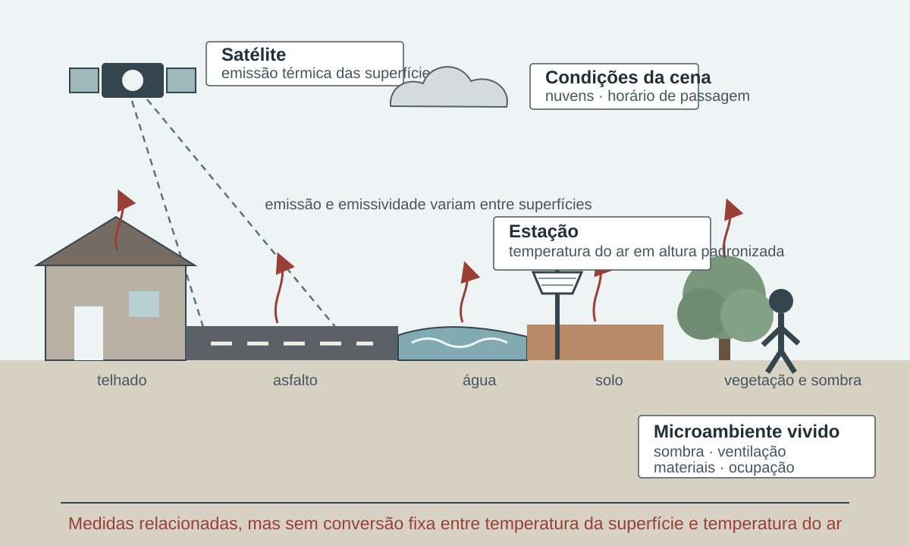

# Temperatura e condições térmicas {#sec-temperatura}

Temperatura organiza um domínio amplo: condições cotidianas, extremos de calor e frio, conforto térmico, ambientes urbanos e exposição ocupacional. Embora todas essas questões se relacionem ao balanço de energia, não são intercambiáveis. Cada forma de medir deve ser escolhida de acordo com a pergunta de vigilância ou gestão.

## Temperatura do ar

A temperatura do ar é normalmente medida em estações meteorológicas sob condições padronizadas. O valor depende do local, da altura, do abrigo, do instrumento, da frequência de registro e do controle de qualidade. A leitura de uma estação representa seu entorno imediato; não deve ser automaticamente atribuída a todo o município [@wmo2023climatological].

Séries subdiárias permitem calcular médias, máximas e mínimas diárias. Para que esses valores sejam comparáveis, é necessário declarar:

- A janela usada para definir o dia;
- O fuso horário;
- O critério mínimo de completude;
- O tratamento de valores suspeitos;
- A estação e seus metadados;
- Mudanças de instrumento ou localização.

Temperatura máxima diária é uma variável de entrada de vários indicadores consolidados. Neste livro ela não recebe ficha autônoma: a ficha é reservada à medida que tem definição metodológica publicada e finalidade interpretativa definida.

## Temperatura da superfície

Temperatura da superfície descreve a emissão térmica da superfície observada ou estimada por sensoriamento remoto. Ela pode revelar contrastes entre materiais urbanos, solo exposto, água e vegetação, sendo útil para estudos de ilhas de calor e heterogeneidade territorial [@jin2012uhi].

Ela não equivale à temperatura do ar. Horário de passagem do satélite, cobertura de nuvens, emissividade, tamanho do pixel e método de recuperação afetam o produto. A ausência de valor em dia nublado também não significa ausência de calor.

::: {.callout-warning title="Atenção"}
Não use temperatura da superfície e temperatura do ar como medidas substitutas sem uma justificativa física e uma validação compatível com o território e a finalidade.
:::

A distinção ganha forma na @fig-temperatura-ar-superficie, que separa o alvo observado pelo satélite, a medição do ar e o microambiente vivido.

{#fig-temperatura-ar-superficie fig-alt="Corte urbano no qual um satélite observa a emissão térmica de telhado, asfalto, água, solo e vegetação, enquanto uma estação mede a temperatura do ar e uma pessoa ocupa um microambiente sombreado." width="100%"}

[Fonte e autoria: elaboração própria. Licença: a mesma dos textos autorais da obra.]{.figure-source}

## Calor e frio

Calor e frio podem ser representados por limiares absolutos, posição na distribuição local ou combinação de duração e intensidade. Limiares absolutos são fáceis de comunicar, mas uma mesma temperatura pode ter significados diferentes conforme estação, infraestrutura, aclimatação e perfil populacional.

Limiares relativos, como percentis de uma série de referência, reconhecem o contexto climatológico. Em contrapartida, dependem da qualidade, extensão e estabilidade da série. A escolha do período de referência altera a classificação dos eventos e deve permanecer explícita [@zhang2005; @wmo2017normals].

Medidas úteis incluem:

- Temperatura média, máxima e mínima;
- Amplitude térmica diária;
- Anomalia em relação a uma referência;
- Dias e noites quentes ou frios;
- Duração e intensidade acumulada de episódios;
- Frequência anual ou sazonal.

Cada medida responde a uma pergunta. A máxima diária representa o pico térmico do dia; a mínima pode ser importante para avaliar ausência de resfriamento noturno; a anomalia descreve diferença em relação à referência, não necessariamente risco à saúde.

## Ondas de calor e de frio

::: {.callout-note icon=false title="Conceito-chave: ondas de calor e de frio"}
Uma onda é um episódio persistente. Sua definição exige ao menos uma variável, um limiar, uma duração mínima e uma regra de continuidade. Algumas definições usam valores absolutos; outras, percentis; outras combinam máximas e mínimas.

Não há definição universal adequada a todos os climas, populações e decisões. Para comparações, use a mesma definição ou apresente análise de sensibilidade. Para alertas, a definição precisa ser validada com capacidade operacional e efeitos relevantes no território [@perkins2013heatwaves; @wmoWho2015heat].

:::

Para qualquer definição de onda de calor, recomenda-se registrar:

- Início e término;
- Duração;
- Maior intensidade;
- Intensidade acumulada;
- Área atingida;
- População potencialmente exposta;
- Nível de incerteza.

## Umidade, sensação e conforto térmico

A umidade influencia a troca de calor entre corpo e ambiente. Índices de sensação térmica combinam variáveis para representar aspectos do estresse térmico, mas diferem em fórmula, domínio de validade e finalidade [@masterton1979; @steadman1994].

Ao usar um índice:

1. Identifique as variáveis necessárias;
2. Confira unidades e condições de validade;
3. Verifique se o índice foi concebido para calor, frio, ambiente interno ou trabalho;
4. Documente categorias e limiares;
5. Evite interpretar o índice como temperatura medida.


Conforto térmico inclui componentes ambientais, fisiológicos, comportamentais e contextuais. Temperatura do ar, umidade, radiação e vento interagem com vestimenta, atividade, adaptação e características do ambiente construído [@steadman1994; @brode2012utci].

Por isso, um índice de conforto não representa sozinho risco sanitário. Ele pode apoiar avaliação de ambientes e comunicação, desde que a população e a situação de uso sejam compatíveis com o método.

## Ilhas de calor

Ilhas de calor descrevem diferenças térmicas entre porções urbanas e áreas de referência. Podem ser analisadas pela temperatura do ar ou da superfície, o que produz medidas distintas [@jin2012uhi].

A delimitação da referência é uma decisão substantiva. Comparar o centro urbano com uma estação rural distante pode introduzir diferenças de altitude, relevo ou circulação atmosférica. Em imagens, a classificação do uso da terra, o horário e a cobertura de nuvens influenciam a estimativa.

Para uso em saúde, a medida térmica deve ser combinada com distribuição da população, condições habitacionais, mobilidade e acesso a proteção. Um mapa de temperatura sem população é um mapa de perigo, não de exposição.

## Exposição ocupacional

Trabalhadores ao ar livre, em cozinhas, fundições, lavanderias, galpões e outros ambientes podem enfrentar calor intenso. A avaliação ocupacional requer medidas, índices e protocolos próprios, além de considerar esforço, vestimenta, pausas, hidratação e organização do trabalho [@who2025workplaceheat; @niosh2016heat].

O WBGT é a medida de triagem consolidada para esse domínio. A ISO 7243:2017 o aplica à avaliação da exposição total ao longo de jornadas de até oito horas, em ambientes internos e externos, para adultos aptos ao trabalho; exposições muito curtas ficam fora desse escopo [@iso2017wbgt]. A ficha apresentada adiante documenta o índice e remete a interpretação dos valores à combinação entre carga ambiental, esforço, vestimenta, aclimatação e norma aplicável. Ela não fixa um limite jurídico único, pois o valor de referência depende dessas condições e da regulamentação vigente.

## Efeitos, defasagens e grupos vulnerabilizados

Condições térmicas podem se relacionar a agravos por caminhos diretos e indiretos. A análise deve considerar o desfecho específico, a escala temporal, a sazonalidade, a adaptação local e fatores que variam junto com a temperatura [@ipcc2022saude; @who2026heat; @romanello2024lancet].

Comparar uma curva de temperatura a uma curva de internações é insuficiente para concluir causalidade. Estudos analíticos precisam tratar tendência, sazonalidade, defasagem, qualidade do desfecho, autocorrelação e possíveis confundidores.


Alguns desfechos podem ocorrer no mesmo dia; outros aparecem após defasagem. Uma única escolha de defasagem pode omitir parte da associação ou selecionar um resultado casual. Defina janelas a priori, com justificativa substantiva, e apresente análises de sensibilidade quando aplicável.


Idade, condições crônicas, uso de medicamentos, gestação, trabalho, isolamento social, moradia, energia, água, arborização, mobilidade e acesso a serviços podem modificar risco e capacidade de proteção. Essas dimensões não devem ser reduzidas a uma lista fixa nem tratadas como atributos naturais dos grupos.

::: {.callout-important icon=false title="Conceito-chave: condição térmica, exposição, sobrecarga e efeito"}

Condição térmica descreve o ambiente por variáveis ou índices. Exposição acrescenta lugar, duração, atividade e presença. Sobrecarga térmica é a resposta fisiológica produzida pela troca de calor entre corpo e ambiente. Efeito em saúde é o desfecho clínico ou populacional observado ou estimado. Temperatura, índice biometeorológico, exposição e efeito ocupam etapas diferentes e não devem receber o mesmo nome.

:::

A escolha da medida começa pelo mecanismo. Para caracterizar clima, interessam distribuição, extremos, persistência e referência histórica. Para vigilância aguda, interessam previsão, temperatura observada, duração, recuperação noturna e território. Para ambiente de trabalho, radiação, vento, umidade, esforço, vestimenta e pausas podem ser indispensáveis. Para estudos epidemiológicos, a variável precisa corresponder à janela biológica e à localização da população. Uma medida adequada em uma dessas aplicações pode ser insuficiente nas demais [@wmo2023climatological; @wmoWho2015heat; @who2025workplaceheat].

A validação de um índice térmico tem pelo menos quatro componentes. O primeiro é matemático: fórmula, unidades e condições de aplicação foram reproduzidas. O segundo é ambiental: as entradas representam o microclima e o período de interesse. O terceiro é populacional: vestimenta, atividade, aclimatação, moradia e acesso a proteção são compatíveis com a interpretação. O quarto é decisório: categorias e limiares foram relacionados a ações e avaliados no território. Reproduzir corretamente uma fórmula não valida automaticamente um gatilho sanitário.

Indicadores relativos e absolutos cumprem papéis complementares. Percentis permitem reconhecer extremos em climas distintos, mas uma mesma categoria relativa pode corresponder a condições físicas diferentes. Limiares absolutos favorecem comunicação e proteção em contextos definidos, mas não incorporam adaptação local por si. Sistemas robustos podem acompanhar as duas referências e declarar qual delas ativa a decisão. A série usada para percentis precisa ser homogênea; a regra operacional precisa ser avaliada prospectivamente [@zhang2005; @perkins2013heatwaves; @wmoWho2015heat].

A noite merece atenção porque ausência de resfriamento reduz a oportunidade de recuperação e pode coincidir com moradias que retêm calor. Ainda assim, temperatura mínima externa não mede diretamente o quarto ou a carga fisiológica. O mesmo vale para temperatura de superfície: ela revela materiais e contrastes, mas não substitui o ar nem o ambiente interno. Combinar medidas é útil quando cada camada mantém significado próprio.

Na publicação, apresente a variável original junto ao índice sempre que possível. Informe fonte, altura ou nível, janela, fuso, período-base, completude, transformação, resolução e condição de validade. Para alertas, acrescente horizonte da previsão, hora de emissão, incerteza, autoridade e ações por nível. Para avaliação, preserve o que estava disponível no momento da decisão, não apenas a observação consolidada depois do evento [@wmo2023climatological; @who2023framework].

## Fontes, seleção e principais indicadores

O catálogo inicial registra duas alternativas para temperatura:

- [INMET](../../backmatter/indice-fontes.qmd#inmet), com observações e produtos meteorológicos;
- [ERA5-Land](../../backmatter/indice-fontes.qmd#era5-land), uma reanálise em grade.

Observação em estação e reanálise não são equivalentes. A escolha depende da pergunta, cobertura, resolução, duração da série, latência e possibilidade de validação. Em qualquer caso, arquive o identificador do produto, versão, data de acesso e transformação aplicada.


A seleção entre estação e reanálise depende do suporte necessário. Estações favorecem observação local e auditoria de instrumento, mas sua distribuição pode deixar áreas sem representação. Reanálises oferecem continuidade espacial e temporal, porém seus valores resultam de modelo e assimilação e precisam de avaliação regional. Interpolar estações ou recortar uma grade para o município são novas operações, que devem registrar método, células, ponderação e validação [@wmo2023climatological; @hersbach2020era5].

Produtos derivados exigem versão própria. UTCI calculado a partir de reanálise não é apenas “temperatura do ERA5”; incorpora radiação, vento, umidade e modelo termofisiológico. Temperatura de superfície depende de sensor e recuperação. Percentis dependem de série-base e tratamento de calendário. A ficha deve apontar tanto para a fonte das entradas quanto para a referência do método [@dinapoli2021era5heat; @copernicus2026utci; @jin2012uhi].

Para combinar fontes, preserve uma hierarquia de funções. Observação local pode verificar viés; grade pode preencher cobertura; previsão pode orientar ação; série consolidada pode sustentar avaliação. Não emende valores sem período de sobreposição e teste. Se a fonte operacional falhar, o protocolo deve declarar alternativa e diferença esperada.

A literatura epidemiológica utiliza temperatura média, máxima, mínima, temperatura aparente e múltiplas definições de onda de calor. Em 54 estudos cardiovasculares, foram identificadas 21 combinações de critérios para definir calor, 12 baseadas apenas em temperatura do ar e as demais combinando fatores meteorológicos [@nawaro2023]. Em uma avaliação de 29 definições aplicada a cinco tipos de atendimento em saúde, o desempenho e o limiar variaram segundo a medida e o desfecho; o resultado local de Brisbane não constitui limiar transferível para outro território [@xu2018heatmetrics]. A orientação conjunta da OMM e da OMS recomenda que gatilhos operacionais sejam relacionados aos efeitos locais sobre a saúde [@wmoWho2015heat]. Não há, portanto, uma definição meteorológica única que funcione como alerta universal.

Os principais indicadores usados em saúde pública podem ser organizados em sete famílias:

1. Ocorrência e contagem — ocorrência de onda de calor e número de ondas de calor (HWN);
2. Frequência e duração — número total de dias em ondas de calor (HWF), duração máxima (HWD), duração média (HWMD) e WSDI;
3. Intensidade, amplitude e severidade — intensidade média (HWM/HWI), máxima ou amplitude (HWA), intensidade acumulada, EHF e HWMId;
4. Componente noturno e composto — noites quentes durante episódios e ondas compostas diurnas e noturnas;
5. Estresse térmico biometeorológico — Índice de Calor, temperatura aparente, Humidex, UTCI e WBGT;
6. Extensão espacial — área atingida segundo uma definição espacialmente coerente [@skinner2025extent];
7. Exposição populacional — pessoas ou pessoas-dia expostas à onda de calor [@lancetcountdown2026data].

O conjunto HWN–HWF–HWD–HWM–HWA foi sistematizado como uma estrutura de múltiplos aspectos para separar número, dias participantes, persistência e magnitude dos episódios [@perkins2013heatwaves]. EHF acrescenta significância climatológica e aclimatação recente [@nairn2015ehf]. O HWMId acumula magnitudes diárias normalizadas em relação à climatologia local [@russo2015hwmid]. Índices biometeorológicos não são variantes nominais da mesma medida: usam entradas, modelos fisiológicos, condições de referência e domínios de aplicação distintos.

### Índices biometeorológicos: medidas distintas, não sinônimos

O Índice de Calor do National Weather Service combina temperatura do ar e umidade relativa nas condições de referência das tabelas de Steadman. A regressão de Rothfusz é usada apenas depois de uma avaliação preliminar e não deve ser extrapolada para combinações extremas fora de seu domínio [@nws2026heat; @rothfusz1990]. O Humidex também representa calor úmido, mas usa temperatura e pressão de vapor, tem fórmula própria e categorias operacionais canadenses [@masterton1979; @canada2021humidexformula; @canada2026humidex]. Uma classe de Humidex, portanto, não pode ser traduzida diretamente em uma classe do Índice de Calor.

A temperatura aparente externa usada pelo Bureau of Meteorology acrescenta o efeito do vento à temperatura e à pressão de vapor. A versão operacional à sombra não incorpora radiação solar direta e representa um adulto apropriadamente vestido e caminhando [@steadman1994; @bom2026apparent]. UTCI segue outra lógica: sua temperatura equivalente é obtida de um modelo termofisiológico que considera temperatura do ar, radiação, umidade e vento, com vestimenta adaptativa e atividade de referência [@brode2012utci]. O ERA5-HEAT disponibiliza UTCI e temperatura radiante média horárias em grade global, úteis para análises retrospectivas, mas insuficientes para representar a sombra e a ventilação de uma rua, residência ou posto de trabalho [@dinapoli2021era5heat; @copernicus2026utci].

WBGT foi desenvolvido para triagem de estresse térmico de pessoas fisicamente ativas e está consolidado em saúde ocupacional. Sua versão medida combina bulbo úmido natural, globo e, sob sol direto, temperatura do ar. O valor ambiental só se torna uma decisão de proteção quando interpretado com esforço, vestimenta, aclimatação e duração [@iso2017wbgt; @niosh2016heat]. Índice de Calor, Humidex, temperatura aparente, UTCI e WBGT não formam uma escala crescente de sofisticação: cada um responde a uma situação e conserva hipóteses próprias.

```{mermaid}
%%| label: fig-indices-biometeorologicos
%%| fig-cap: "Entradas e domínios dos principais índices biometeorológicos de calor"
%%| fig-alt: "Diagrama compara as variáveis meteorológicas e os domínios de aplicação do índice de calor, temperatura aparente, Humidex, UTCI e WBGT."
%%{init: {"htmlLabels": false, "flowchart": {"htmlLabels": false}}}%%
flowchart TD
  E["Variáveis meteorológicas<br/>e contexto de uso"] --> H["Temperatura + umidade<br/>Índice de Calor ou Humidex<br/>Comunicação de calor úmido"]
  E --> A["Temperatura + umidade + vento<br/>Temperatura aparente<br/>Condição externa à sombra"]
  E --> U["Temperatura + umidade + vento + radiação<br/>UTCI<br/>Estresse térmico externo"]
  E --> W["Bulbo úmido natural + globo + ar<br/>WBGT<br/>Triagem ocupacional e atividade física"]
  H ~~~ A
  A ~~~ U
  U ~~~ W
```

O componente noturno merece medida própria. TN90p quantifica a frequência de mínimas acima do percentil local. Ondas compostas exigem simultaneamente máximas e mínimas elevadas por dias consecutivos. Em 28 cidades do leste da Ásia, ondas compostas apresentaram riscos e frações de mortalidade maiores que ondas somente diurnas ou noturnas; o estudo também aplicou o CEHWI para representar o excesso térmico acumulado além da classificação binária [@liu2025cehwi]. Em 161 comunidades chinesas, eventos compostos também apresentaram riscos de mortalidade superiores aos eventos restritos ao dia ou à noite [@yang2024compound].

::: {#qua-indicadores-calor}

| Indicador | Base metodológica | Uso em saúde pública | Cuidado de interpretação |
|---|---|---|---|
| Ocorrência e HWN | Estrutura multiaspecto de Perkins e Alexander; uso recorrente em estudos | Frequência de episódios e comparação de anos | A definição-base da onda deve permanecer explícita |
| HWF, HWD e HWMD | Estrutura multiaspecto e literatura de impactos | Dias sob episódio e persistência | Total, máximo e média não são intercambiáveis |
| HWM/HWI, HWA e intensidade acumulada | Literatura climática e epidemiológica | Gradiente térmico do episódio e severidade | Unidade, referência e limiar devem ser declarados |
| TX90p — percentual de dias quentes | Índice ETCCDI/Climdex, com correção de inhomogeneidade publicada | Caracterização de calor relativo e tendência; exposição em análises de saúde | O percentil depende do período-base e do calendário |
| WSDI — duração de períodos quentes | Índice ETCCDI/Climdex | Persistência do calor; planejamento e estudos retrospectivos | Não constitui gatilho sanitário universal |
| EHF | Método publicado e usado operacionalmente na Austrália | Intensidade, aclimatação e classificação de severidade | A classe de severidade depende da distribuição local |
| HWMId | Método percentílico publicado para magnitude diária acumulada | Comparação de magnitude entre climas | Período-base e normalização condicionam o resultado |

Indicadores de temperatura e ondas de calor usados em saúde pública (continua)

:::

::: {#qua-indicadores-calor-conclusao}

| Indicador | Base metodológica | Uso em saúde pública | Cuidado de interpretação |
|---|---|---|---|
| Noites quentes e ondas compostas | Aplicações em estudos de mortalidade e ausência de recuperação noturna | Exposição noturna e episódios dia–noite | A definição publicada deve especificar componentes diurno e noturno |
| Temperatura média/máxima/mínima | Uso epidemiológico amplo, mas são variáveis, não indicadores completos | Modelos de séries temporais e limiares locais | Permanecem como variáveis explicativas, sem ficha genérica |
| Definição local de onda de calor por percentil e duração | Uso frequente, com definições heterogêneas | Alertas e estudos de morbimortalidade | Requer protocolo publicado e validação local |
| Índice de Calor, temperatura aparente e Humidex | Fórmulas operacionais difundidas | Comunicação e estudos de calor úmido | Categorias de índices distintos não devem ser convertidas entre si |
| WBGT e UTCI | Índices biometeorológicos consolidados em domínios próprios | Saúde do trabalhador, atividade física e estresse térmico | População, ambiente e protocolo de medida integram a interpretação |
| Temperatura de superfície e ilha de calor | Aplicações em estudos urbanos | Identificação de heterogeneidade intraurbana | Não substituem a exposição à temperatura do ar |
| Extensão territorial | Derivação espacial de definições de onda de calor | Coordenação regional e planejamento | Exige limiar, unidade espacial e regra de conectividade |
| População ou pessoas-dia expostas | Aplicações em monitoramento internacional e estudos de exposição | Quantificação de alcance populacional | Exige superfície populacional, referência temporal e tratamento da mobilidade |

Indicadores de temperatura e ondas de calor usados em saúde pública (conclusão)

:::

As fichas são apresentadas por indicador, e não como uma ficha genérica de “onda de calor”. As duas primeiras documentam TX90p e WSDI; as fichas subsequentes cobrem as demais famílias selecionadas. Nenhuma substitui um limiar calor–saúde validado localmente.











































## Aplicação na vigilância e na gestão

Um fluxo operacional possível é:

1. Escolher a pergunta e o território;
2. Selecionar fonte e indicador qualificados;
3. Acompanhar o valor atual e sua incerteza;
4. Comparar com referência sazonal e contexto local;
5. Identificar populações e serviços expostos;
6. Articular níveis de ação a protocolos previamente acordados;
7. Comunicar medida, significado e orientação;
8. Registrar ações e avaliar resultados.

Um limiar não deve acionar automaticamente a mesma resposta em todos os municípios. Capacidade assistencial, cobertura territorial, duração prevista e grupos expostos alteram a decisão. O indicador estrutura a situação; o protocolo organiza responsabilidades.

## Síntese

Temperatura do ar, temperatura da superfície e índices biometeorológicos descrevem componentes distintos das condições térmicas. A aplicação em saúde exige compatibilizar fonte, escala, período, exposição humana e desfecho, além de vincular limiares e alertas a protocolos locais previamente definidos.
