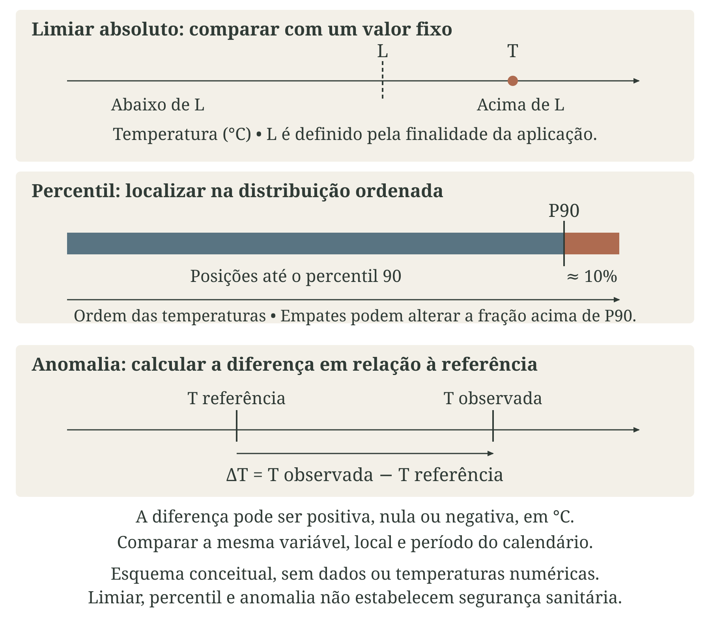
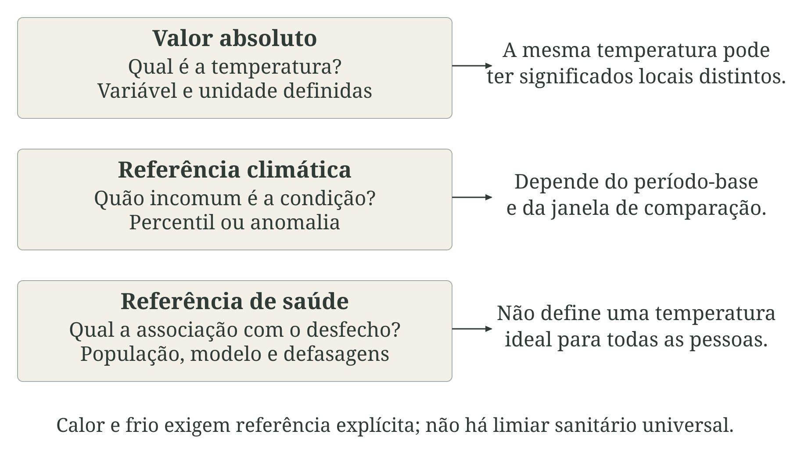
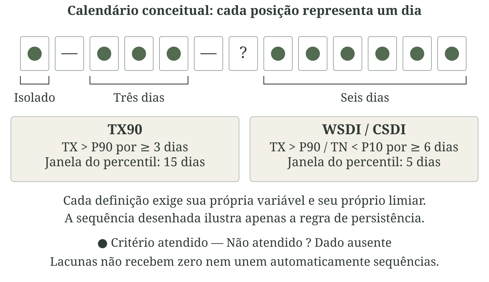
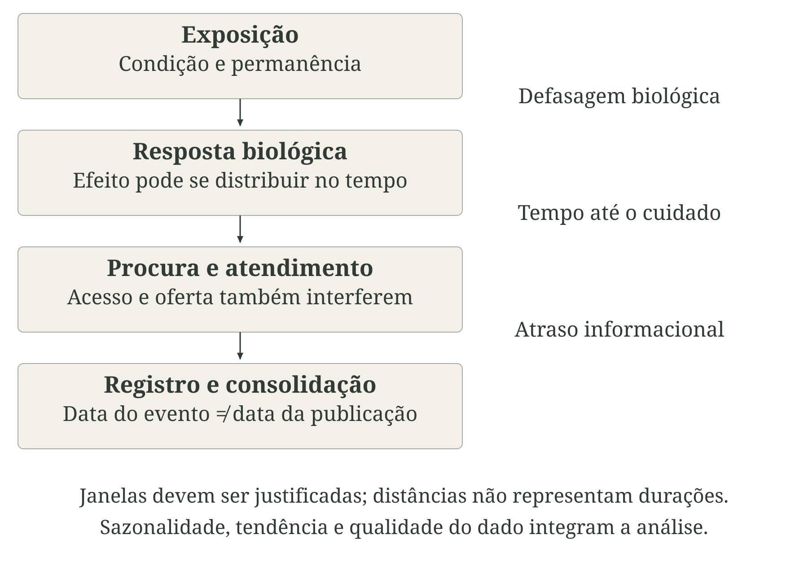
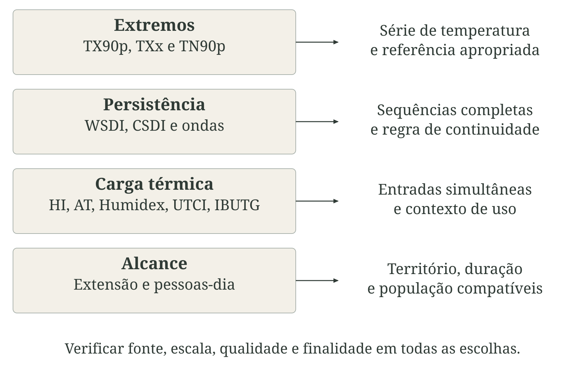
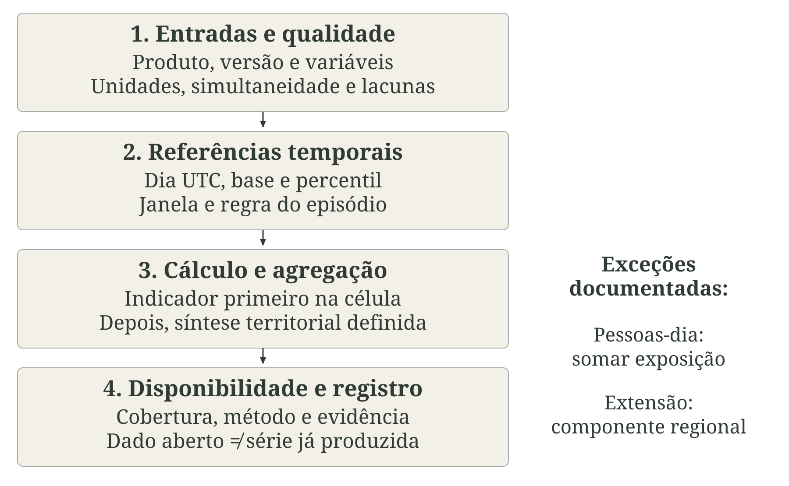
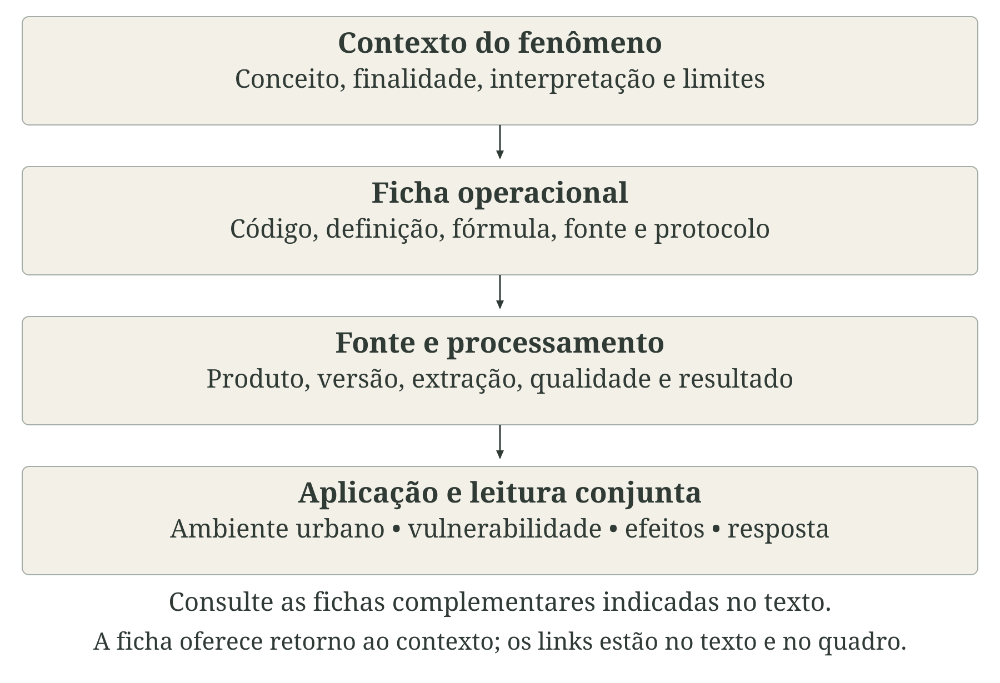

---
aliases:
  - /chapters/part-2/05-temperatura-condicoes-termicas.html
format:
  html:
    template-partials:
      - ../../includes/chapter-opening/title-block.html
chapter-opening:
  image: ../../assets/openings/cap7-temperatura-condicoes-termicas-web.webp
  alt: "Aquarela de bairro brasileiro hipotético sem pessoas, sob sol: rua pavimentada e telhados expostos contrastam com uma praça arborizada e caminhos sombreados, remetendo às diferentes condições térmicas do território."
---

# Temperatura e condições térmicas {#sec-temperatura}

A temperatura influencia o funcionamento do organismo, a ocorrência e a distribuição de doenças e as condições de prestação do cuidado. Para manter suas funções, o corpo precisa equilibrar o calor produzido pelo metabolismo e recebido do ambiente com aquele que dissipa. Quando a regulação térmica não consegue manter esse equilíbrio, podem ocorrer agravos à saúde. Na saúde pública, interessam tanto os extremos de calor e frio quanto as exposições recorrentes em moradias, deslocamentos, escolas, espaços de convivência e locais de trabalho [@ebi2021heat; @ipcc2022saude].

Durante a exposição ao calor, o esforço para dissipar calor aumenta a demanda cardiovascular, enquanto a perda de água pela sudorese, quando não compensada, favorece a desidratação. Essas condições podem contribuir para lesões renais e outros agravos. No frio, a vasoconstrição ajuda a conservar o calor corporal, mas pode aumentar a sobrecarga cardiovascular. Baixas temperaturas também estão associadas à hipotermia e ao agravamento de doenças respiratórias. Estudos de mortalidade identificam associações com temperaturas altas e baixas mesmo fora de episódios definidos como ondas de calor ou de frio. A relevância sanitária de cada faixa térmica depende, portanto, da distribuição das exposições, do desfecho e das características da população e do território [@ebi2021heat; @alahmad2023temperature; @gasparrini2015temperature; @who2018housing].

A exposição ao calor também está associada a desfechos gestacionais adversos, alterações do sono e maior frequência de atendimentos por problemas de saúde mental. A interpretação desses achados depende das populações estudadas e dos métodos de avaliação da exposição. Nas doenças transmissíveis, a temperatura pode modificar a sobrevivência e o desenvolvimento de vetores e patógenos, interagindo com a disponibilidade de água, o saneamento, a imunidade e o contexto social. Seus efeitos variam entre doenças, populações e territórios, sem implicar aumento uniforme dos riscos [@chersich2020pregnancy; @minor2022sleep; @norisarma2022mental; @mordecai2017temperature].

Essas relações articulam os fundamentos de clima, ambiente e saúde (@sec-clima-ambiente-saude) aos temas de precipitação e secas (@sec-precipitacao), qualidade do ar (@sec-qualidade-ar), água e saneamento (@sec-agua-saneamento) e efeitos sobre a saúde (@sec-efeitos-saude). Também envolvem a continuidade dos serviços (@sec-resposta): na rede do Sistema Único de Saúde (SUS), ambientes assistenciais, abastecimento de água, energia e conservação de insumos precisam funcionar durante condições térmicas adversas [@who2023framework].

Alguns conceitos orientam a discussão deste capítulo:

::: {.callout-note icon=false title="Conceitos-chave: do ambiente ao efeito em saúde"}
-  A temperatura do ar e a temperatura da superfície descrevem componentes distintos do ambiente térmico.
-  Índices térmicos combinam dados de temperatura com outras variáveis meteorológicas sob hipóteses específicas.
-  A exposição térmica considera também a duração do contato com o ambiente e a atividade realizada.
-  O efeito em saúde é o desfecho que pode ser observado ou estimado.
:::

A @fig-temperatura-conceitos organiza essas distinções. Moradia, vestimenta, atividade, condições de saúde e acesso à proteção modificam a relação entre ambiente e resposta individual (@sec-exposicao-vulnerabilidade). As fichas de extremos de temperatura e estresse térmico (@sec-fichas-temperatura-condicoes-termicas) operacionalizam medidas específicas; as de mortalidade e internações hospitalares (@sec-fichas-efeitos-saude) documentam desfechos, sem atribuí-los automaticamente à temperatura.

::: {.figure-with-source}

{#fig-temperatura-conceitos fig-alt="Duas cenas hipotéticas mostram um trabalhador da construção civil cansado em um canteiro sob calor e uma pessoa em situação de rua encolhida sob uma manta no frio. Ambos têm expressões sérias. O esquema distingue temperatura do ar e da superfície, índices calculados, exposição, resposta fisiológica e efeito em saúde. Moradia, trabalho e proteção modificam as relações. As setas não demonstram causalidade." width="100%" print-src="arte-cap7-00-conceitos-print.png"}

[Fonte: elaboração conceitual com base nas referências citadas no texto. Autoria: composição e rótulos próprios; aquarela produzida com IA (image_gen). Cenas e esquemas sem dados observados. Licença: a mesma dos textos autorais da obra.]{.figure-source}

:::

## Temperatura do ar

A temperatura do ar caracteriza seu estado térmico no local e no momento da observação. Nas estações meteorológicas, o sensor próximo à superfície é geralmente protegido da radiação solar direta por um abrigo ventilado. Tipo de abrigo, ventilação, altura, terreno e entorno integram a definição da medida. Um termômetro exposto ao sol pode registrar seu próprio aquecimento, comprometendo a medição da temperatura do ar [@wmo2024instrumentos].

O abrigo de Stevenson é um exemplo dessa proteção: uma caixa branca com venezianas que permitem a circulação do ar e reduzem a incidência direta de radiação e chuva sobre os sensores. A @fig-abrigo-stevenson mostra o abrigo fechado e aberto para a leitura do termômetro [@metoffice2025temperature; @wmo2024instrumentos].

::: {.figure-with-source}

{#fig-abrigo-stevenson fig-alt="Duas vistas ilustrativas de um abrigo branco com venezianas, cobertura dupla e pernas sobre gramado em terreno aberto. À esquerda, o abrigo fechado; à direita, a porta aberta revela os termômetros. Rótulos explicam proteção contra radiação e chuva, ventilação e medição do ar. A abertura é um recurso didático, sem leituras observadas." width="100%" print-src="arte-cap7-13-stevenson-print.png"}

[Fonte: elaboração própria.]{.figure-source}

:::

A padronização das medições favorece comparações, mas não torna os locais equivalentes. Altitude, relevo, proximidade de água, vegetação e construções condicionam a representatividade das observações. Uma estação em terreno aberto pode representar bem seu entorno, mas não necessariamente o interior de uma residência, uma rua estreita ou um posto de trabalho. O [Apêndice B](../../backmatter/apendice-estacoes.qmd) detalha instrumentos e instalações; o @sec-espaco-tempo distingue a localização da observação do suporte da análise.

Temperaturas instantâneas, médias e extremos descrevem aspectos distintos da variação térmica. Em uma série de leituras horárias, os extremos e a média calculados podem não representar variações ocorridas entre as medições. Observações mais frequentes oferecem maior detalhamento temporal, mas aumentam o volume de dados a processar [@wmo2024instrumentos; @wmo2023climatological].

::: {.callout-note icon=false title="Conceito-chave: média, máxima e mínima"}
-  $TX$ representa a temperatura máxima diária e $TN$, a mínima diária.
-  A temperatura média é calculada a partir das observações válidas do intervalo, conforme o método adotado.
-  A amplitude térmica diária corresponde à diferença entre $TX$ e $TN$.
:::

A @fig-temperatura-observacao sintetiza a passagem da medição à análise estatística. O processo inclui registrar metadados, verificar unidades, frequência e cobertura das observações e definir critérios de qualidade e cálculo de médias e extremos. Uma medição ausente não equivale a zero. Valores muito altos ou baixos podem representar eventos reais ou erros, e sua magnitude não justifica, isoladamente, a exclusão. É necessário verificar a consistência temporal, os metadados e a concordância com observações independentes. Registros inválidos devem ser preservados em sua forma original, com exclusão sinalizada e justificada; casos inconclusivos devem permanecer identificados como duvidosos. Essas decisões afetam a identificação dos extremos climáticos [@wmo2024instrumentos; @wmo2023climatological].

::: {.figure-with-source}

{#fig-temperatura-observacao fig-alt="Estação ilustrativa em terreno aberto. O fluxo liga observação com abrigo e horário, controle de qualidade e síntese diária de média, máxima e mínima. A máxima de leituras horárias pode diferir do extremo instrumental." width="100%" print-src="arte-cap7-01-observacao-print.png"}

[Fonte: elaboração própria.]{.figure-source}

:::

A escolha do indicador depende da pergunta. A [máxima anual da temperatura máxima diária — TXx](../../chapters/part-4/17-fichas-temperatura-condicoes-termicas.qmd#sec-cli-tem-02) identifica o maior valor do ano; o [percentual de dias quentes — TX90p](../../chapters/part-4/17-fichas-temperatura-condicoes-termicas.qmd#sec-cli-tem-01) expressa a frequência relativa à climatologia; e o [percentual de noites quentes — TN90p](../../chapters/part-4/17-fichas-temperatura-condicoes-termicas.qmd#sec-cli-cal-11) utiliza mínimas diárias como representação convencional das condições noturnas. As três fichas estão no @sec-fichas-temperatura-condicoes-termicas. Nenhum desses indicadores mede diretamente a temperatura corporal ou substitui as séries diárias necessárias a estudos de saúde.

## Temperatura de superfície

A temperatura de superfície descreve a condição térmica da superfície observada. Em produtos de infravermelho termal, é estimada a partir da radiância, considerando os efeitos atmosféricos e a emissividade. Esta expressa a capacidade de emissão de uma superfície em relação a um corpo negro à mesma temperatura. Sensores próximos ao alvo e orbitais observam radiação infravermelha, mas diferem em finalidade, escala e calibração. No sensoriamento remoto terrestre, LST é a sigla de *land surface temperature*, ou temperatura da superfície terrestre [@nasaTemperaturaSuperficie; @voogt2003thermal].

O termômetro infravermelho sem contato, utilizado na testa (@fig-termometro-infravermelho), recebe a radiação emitida pela pele, sem medir a temperatura do ar ou diretamente a do interior do corpo. A interpretação clínica depende do aparelho e de sua finalidade. Posição, distância, condições da testa e ambiente influenciam a leitura, que deve seguir as instruções do fabricante [@fda2025infrared].

::: {.figure-with-source}

{#fig-termometro-infravermelho fig-alt="Profissional de saúde e homem adulto, ambos com máscara, em ambiente interno. A profissional segura um termômetro infravermelho próximo à testa descoberta, sem contato e sem feixe luminoso. Rótulos distinguem a superfície observada, o sensor e os cuidados de posicionamento. Não há leitura numérica ou diagnóstico representado." width="100%" print-src="arte-cap7-14-infravermelho-print.png"}

[Fonte: elaboração própria.]{.figure-source}

:::

A @fig-lst-observacao apresenta a mesma paisagem em uma vista convencional e em uma representação térmica. As cores ilustram contrastes hipotéticos durante o dia, sem valores observados ou temperaturas fixas por tipo de cobertura. Horário, umidade, sombra e propriedades dos materiais modificam esses contrastes. A estimativa da LST requer considerar a atmosfera e a emissividade no processamento da radiância [@nasaTemperaturaSuperficie; @voogt2003thermal].

::: {.figure-with-source}

{#fig-lst-observacao fig-alt="Dois painéis da mesma área hipotética vista de cima: à esquerda, rio, árvores, gramado, quatro telhados, rua com ponte ligando as margens e solo; à direita, raster em cores falsas com as mesmas posições. Uma escala vai de menor a maior temperatura, sem valores. As letras A e B identificam copas e pavimento, com menor e maior temperatura apenas neste esquema diurno. Não há dados observados nem temperaturas fixas por cobertura." width="100%" print-src="arte-cap7-15-lst-print.png"}

[Fonte: elaboração própria; representação conceitual, sem dados observados.]{.figure-source}

:::

Em áreas urbanas, um pixel de imagem térmica pode reunir telhados, pavimentos e vegetação. A temperatura estimada não descreve cada elemento separadamente e depende das superfícies visíveis ao sensor e do ângulo de observação. Fachadas ocultas, ambientes internos e espaços sob copas não são diretamente caracterizados. A temperatura da superfície e a do ar também podem apresentar padrões espaciais e ciclos diários distintos [@voogt2003thermal].

Durante o dia, radiação solar, sombreamento, umidade do solo e propriedades dos materiais influenciam o aquecimento das superfícies. À noite, a liberação do calor armazenado modifica esses contrastes. Imagens diurnas e noturnas representam momentos distintos do comportamento térmico urbano; sua comparação exige horários e procedimentos de processamento compatíveis. Também é necessário distinguir o tamanho dos pixels do arquivo da resolução original da medição: reamostrar para pixels menores não acrescenta, por si só, informação observada [@jin2012uhi; @nasaTemperaturaSuperficie].

Nuvens limitam a estimativa da temperatura de superfície por infravermelho termal. A exclusão de pixels contaminados faz com que as composições representem apenas os momentos com observações válidas, frequentemente sob céu limpo. A ausência de uma imagem utilizável não indica ausência de calor ou frio. Para explicitar essas limitações e garantir a reprodutibilidade, documente datas de aquisição, máscaras de qualidade, emissividade, coleção e versão do produto, algoritmo e número de observações válidas.

::: {.callout-warning icon=false title="Atenção: medidas complementares"}
Temperaturas da superfície e do ar não são intercambiáveis: estimar uma a partir da outra exige modelos validados nas condições de aplicação. Uma associação observada em determinado local e horário não garante sua validade em outros contextos nem permite inferir, isoladamente, a exposição térmica no interior das moradias.
:::

A @fig-temperatura-ar-superficie distingue superfície observada, ar medido e microambiente vivido. As setas indicam alvos de observação, sem representar medições ou um balanço de energia quantificado.

::: {.figure-with-source}

{#fig-temperatura-ar-superficie fig-alt="Paisagem hipotética com satélite, superfícies, estação em área aberta e pessoa à sombra. Rótulos distinguem temperatura da superfície, temperatura do ar e microambiente. A perspectiva não representa escala de satélite, resolução ou dados medidos." width="100%" print-src="arte-cap7-02-ar-superficie-print.png"}

[Fonte: elaboração própria.]{.figure-source}

:::

Na saúde pública, imagens de temperatura de superfície ajudam a identificar contrastes térmicos e orientar levantamentos de campo. Sua interpretação articula uso da terra e urbanização (@sec-uso-terra), exposição e moradia (@sec-exposicao-vulnerabilidade). A [ficha de intensidade da ilha de calor de superfície — SUHII](../../chapters/part-4/21-fichas-uso-cobertura-terra-ambiente-urbano.qmd#sec-amb-urb-03), no @sec-fichas-uso-cobertura-terra-ambiente-urbano, documenta um produto específico. A comparação com as observações do ar das fichas térmicas (@sec-fichas-temperatura-condicoes-termicas) deve preservar as diferenças entre alvos e suportes.

## Calor e frio

Na física, calor é a energia transferida em razão de uma diferença de temperatura. Na meteorologia e na saúde pública, calor e frio designam condições térmicas caracterizadas em relação a uma referência. Há três critérios principais: limiares fixos, desvios em relação à climatologia local e associações com maior risco de adoecimento. Podem identificar os mesmos episódios, mas respondem a perguntas distintas [@wmo2023climatological; @wmoWho2015heat].

O equilíbrio térmico do organismo depende do calor produzido pelo metabolismo e das trocas de energia com o ambiente por radiação, convecção, condução e evaporação. Essas trocas variam conforme o ambiente, as características individuais, a vestimenta e a atividade física. A temperatura do ar, isoladamente, não caracteriza esse balanço. No calor, a dissipação pode ser insuficiente para evitar o acúmulo de calor corporal; no frio, as perdas podem superar a capacidade de produção e conservação de calor.

A aclimatação consiste em ajustes fisiológicos desenvolvidos pela exposição repetida a determinadas condições ambientais. No calor, pode antecipar a sudorese, reduzir a perda de eletrólitos e permitir a mesma atividade com menor frequência cardíaca e temperatura interna. Segundo o Instituto Nacional de Segurança e Saúde Ocupacional dos Estados Unidos (NIOSH), esses ajustes são graduais e podem ser parcialmente perdidos após períodos sem exposição. Dependem da intensidade e da duração da exposição e das condições individuais, sem eliminar os riscos do calor [@niosh2026acclimatization].

Nascer ou viver em uma região quente não garante aclimatação às condições ambientais e às exigências da atividade atual. Mudanças de cidade, estação ou tarefa podem alterar a exposição. Da mesma forma, a origem em uma região fria não assegura proteção diante de vento, umidade, vestimenta insuficiente ou exposição prolongada. A avaliação deve considerar a história de exposição e as condições presentes, sem atribuir tolerância fixa à origem geográfica. As respostas ao frio têm particularidades e não são simplesmente o inverso dos ajustes ao calor [@niosh2026acclimatization; @nioshcold].

A adaptação é mais ampla que a aclimatação fisiológica: abrange práticas cotidianas, moradia, vestimentas, organização do trabalho e serviços capazes de reduzir a exposição e seus efeitos. Pessoas habituadas ao mesmo clima podem ter acesso desigual a esses recursos. A aclimatação não substitui sombra, água, pausas, abrigo ou cuidado em saúde, e sentir-se acostumado ao calor ou ao frio não comprova ausência de risco [@niosh2016heat; @ipcc2022saude; @who2018housing].

### Valores para calor e frio

Valores de referência permitem identificar episódios, acompanhar sua frequência e duração, comparar períodos e territórios e orientar ações de saúde pública. A escolha depende da finalidade: reconhecer condições incomuns para o clima local, investigar associações com agravos ou definir situações que demandem medidas de proteção.

Um limiar absoluto é um valor fixo de temperatura, escolhido segundo a finalidade e o contexto. Não há um valor único de calor ou frio relevante para todas as populações. Percepção individual, clima local e critérios de alerta sanitário são perspectivas distintas.

Limiares relativos baseiam-se na distribuição das observações. O percentil 90, por exemplo, delimita aproximadamente os 10% superiores da distribuição. Depende da série, do período-base, da época do ano e do método de cálculo, não podendo ser determinado apenas pelos valores mínimo e máximo. Um dia acima desse limiar em uma região amena pode ser mais frio que um dia habitual em uma região quente. Valores repetidos e diferenças entre o período-base e o período analisado podem alterar a proporção de dias acima do limiar [@zhang2005].

A anomalia expressa a diferença entre uma observação e uma referência compatível, como a média climatológica do mesmo período do ano. Enquanto os percentis definem pontos de corte na distribuição, as anomalias quantificam desvios em relação à referência. Mesmo temperaturas próximas à média podem estar associadas a efeitos adversos: a normal climatológica descreve o clima, não uma faixa de segurança [@wmo2017normals; @gasparrini2015temperature].

A @fig-limiar-percentil-anomalia ilustra três operações: comparação com um limiar fixo, localização de um percentil na distribuição e cálculo da diferença em relação à referência. A anomalia pode ser positiva, nula ou negativa. Nenhuma dessas operações informa, isoladamente, a associação com um desfecho de saúde.

::: {.figure-with-source}

{#fig-limiar-percentil-anomalia fig-alt="Três painéis conceituais sem dados. Um eixo de temperatura situa T acima do limiar fixo L; uma faixa ordenada marca P90 e a fração superior de aproximadamente dez por cento; outro eixo mostra a diferença entre temperatura observada e referência. As posições não representam temperaturas numéricas ou limiares sanitários." width="100%" print-src="arte-cap7-16-limiar-percentil-anomalia-print.png"}

[Fonte: elaboração própria; esquema conceitual, sem dados observados.]{.figure-source}

:::

::: {.callout-note icon=false title="Nota técnica: normais climatológicas e seu cálculo"}

A normal climatológica padrão resume 30 anos, como 1991–2020. A Organização Meteorológica Mundial (OMM) recomenda atualizá-la a cada década para descrever o clima recente, mantendo referências fixas para comparações de longo prazo. Médias de poucos anos não recebem automaticamente essa denominação [@wmo2026normals].

Para calcular a normal de temperatura de um mês, obtenha primeiro sua média em cada ano, com observações diárias válidas e método consistente. Em seguida, calcule a média dos valores mensais aceitos após o controle de qualidade e completude do período-base. A normal de janeiro, por exemplo, reúne apenas os janeiros da base:

$$
N_m = \frac{1}{n_m}\sum_{a \in A_m}\overline{T}_{m,a}.
$$

$N_m$ é a normal do mês $m$, em °C; $\overline{T}_{m,a}$ é a temperatura média desse mês no ano $a$; $A_m$ reúne os anos com valor mensal aceito, e $n_m$ é seu número. A temperatura média, a média das máximas e a média das mínimas são estatísticas distintas. No produto do Instituto Nacional de Meteorologia (INMET), a média diária compensada tem método próprio, que deve ser preservado ao reproduzir suas normais [@inmet2022normais].

:::

O cálculo deve seguir os critérios de qualidade e completude da referência adotada. Documente dias e anos disponíveis, lacunas e mudanças de instrumento ou localização, sem preencher ausências com zero. Compare a mesma variável, local e período do calendário. Normais mensais não substituem os percentis diários, cujos períodos-base e janelas são definidos no @sec-fichas-temperatura-condicoes-termicas [@wmo2017normals; @inmet2022normais].

A temperatura associada a um desfecho, como internações ou mortalidade, depende da população, do período, do modelo e das defasagens, não constituindo uma temperatura ideal universal. A carga associada à temperatura pode envolver muitos dias moderadamente desfavoráveis, além dos extremos raros [@gasparrini2015temperature]. A @fig-referencias-termicas compara essas três referências.

::: {.figure-with-source}

{#fig-referencias-termicas fig-alt="Três faixas comparam valor absoluto, posição na climatologia e associação epidemiológica. Temperatura, percentil e temperatura de mínima mortalidade são referências diferentes. Não são propostos valores de alerta." width="100%" print-src="arte-cap7-03-referencias-print.png"}

[Fonte: elaboração própria.]{.figure-source}

:::

A análise deve considerar intensidade, frequência, variação diária e possibilidade de recuperação. [TXx](../../chapters/part-4/17-fichas-temperatura-condicoes-termicas.qmd#sec-cli-tem-02), [TX90p](../../chapters/part-4/17-fichas-temperatura-condicoes-termicas.qmd#sec-cli-tem-01), [TN90p](../../chapters/part-4/17-fichas-temperatura-condicoes-termicas.qmd#sec-cli-cal-11) e [dias em períodos de frio — CSDI](../../chapters/part-4/17-fichas-temperatura-condicoes-termicas.qmd#sec-cli-fri-01) têm funções complementares, detalhadas no @sec-fichas-temperatura-condicoes-termicas. A interpretação sanitária deve integrar vulnerabilidade e proteção (@sec-exposicao-vulnerabilidade) e métodos de análise dos efeitos sobre a saúde (@sec-efeitos-saude), sem deduzir o risco apenas da posição de um dia na distribuição climática.

## Ondas de calor e de frio

Uma onda de calor ou de frio caracteriza a persistência de temperaturas acima ou abaixo de determinados limiares por dias consecutivos, diferentemente de um extremo isolado. Como o clima e os efeitos sanitários variam entre regiões e populações, não existe uma definição única adequada a todos os contextos e aplicações epidemiológicas [@perkins2013heatwaves].

As definições de ondas diferem pela variável térmica, pelo limiar e pela duração mínima. Limiares absolutos identificam temperaturas acima ou abaixo de um valor fixo; limiares relativos, geralmente expressos por percentis históricos, identificam condições excepcionais em relação ao clima local, favorecendo comparações entre regiões climaticamente distintas.

Definições baseadas na temperatura máxima destacam a persistência do calor diurno; as baseadas na mínima podem identificar noites excepcionalmente quentes, com menor oportunidade de recuperação térmica. Outras abordagens utilizam a temperatura média ou combinam medidas. Para o frio, mínimas abaixo de um percentil local identificam condições excepcionais, mas não necessariamente os mesmos episódios de um limiar absoluto. Critérios distintos podem, portanto, gerar resultados diferentes na mesma série [@perkins2013heatwaves; @climdex2024].

A reprodução de uma definição exige explicitar variável, limiar, duração mínima, continuidade, área e período. Índices climáticos padronizados favorecem comparações e análises de tendências; sistemas de alerta precisam considerar a exposição prevista, os efeitos potenciais e a capacidade de resposta. A identificação retrospectiva de ondas e a emissão de alertas atendem a finalidades distintas e podem exigir critérios próprios [@wmoWho2015heat].

::: {.callout-note icon=false title="Conceito-chave: persistência e contagem"}
O Índice de Duração de Períodos Quentes (WSDI) contabiliza os dias em sequências de pelo menos seis dias consecutivos com temperatura máxima (TX) acima do percentil 90. O Índice de Duração de Períodos Frios (CSDI) adota a mesma duração mínima, com temperatura mínima (TN) abaixo do percentil 10. Nas fichas, os percentis são calculados para cada dia do calendário com base em 1961–1990. Ambos contabilizam dias em sequências qualificadas, não o número de ondas [@climdex2024].
:::

Outros indicadores descrevem frequência, duração e magnitude das ondas de calor. A família TX90 das fichas utiliza sequências de pelo menos três dias consecutivos com máxima acima do percentil 90, estimado em janela diferente da do WSDI. O [HWN](../../chapters/part-4/17-fichas-temperatura-condicoes-termicas.qmd#sec-cli-cal-03) informa o número de ondas; o [HWF](../../chapters/part-4/17-fichas-temperatura-condicoes-termicas.qmd#sec-cli-cal-04), o total de dias em ondas; o [HWD](../../chapters/part-4/17-fichas-temperatura-condicoes-termicas.qmd#sec-cli-cal-05) e o [HWMD](../../chapters/part-4/17-fichas-temperatura-condicoes-termicas.qmd#sec-cli-cal-06), respectivamente, a duração máxima e média; e o [HWM](../../chapters/part-4/17-fichas-temperatura-condicoes-termicas.qmd#sec-cli-cal-07) e o [HWA](../../chapters/part-4/17-fichas-temperatura-condicoes-termicas.qmd#sec-cli-cal-08), aspectos da magnitude. A nomenclatura deve vir acompanhada dos critérios metodológicos, pois siglas semelhantes podem corresponder a operações distintas [@perkins2013heatwaves].

A comparação entre as [fichas de WSDI](../../chapters/part-4/17-fichas-temperatura-condicoes-termicas.qmd#sec-cli-cal-01), [CSDI](../../chapters/part-4/17-fichas-temperatura-condicoes-termicas.qmd#sec-cli-fri-01) e os indicadores TX90 evidencia a influência dos limiares e da duração mínima. Lacunas na série comprometem a identificação das sequências: não devem ser classificadas como dias sem evento nem usadas para unir automaticamente períodos separados. Episódios que atravessam a virada do ano devem ser identificados na série contínua antes da atribuição dos dias ou eventos aos anos, conforme cada ficha. A @fig-episodios-termicos ilustra essas distinções sem utilizar dados observados.

::: {.figure-with-source}

{#fig-episodios-termicos fig-alt="Calendário esquemático sem temperaturas observadas. Círculos indicam critério atendido, traços indicam não atendido e interrogação indica lacuna. Uma sequência de três dias atende à persistência TX90; outra de seis atende à persistência WSDI ou CSDI se a variável e o limiar próprios forem cumpridos. Lacunas não unem episódios." width="100%" print-src="arte-cap7-04-episodios-print.png"}

[Fonte: elaboração própria.]{.figure-source}

:::

A dimensão noturna complementa a análise: TN90p descreve a frequência de mínimas elevadas, sem exigir continuidade; a [ficha de ondas compostas — CHW](../../chapters/part-4/17-fichas-temperatura-condicoes-termicas.qmd#sec-cli-cal-12) exige máximas e mínimas simultaneamente elevadas por dias consecutivos. O [índice cumulativo de excesso de calor em ondas de calor — CEHWI](../../chapters/part-4/17-fichas-temperatura-condicoes-termicas.qmd#sec-cli-cal-13) quantifica o excesso térmico e distingue tipos de episódio. Estudos em localidades asiáticas identificaram associações distintas com a mortalidade para ondas diurnas, noturnas e compostas, sem estabelecer um limiar transferível ao Brasil [@liu2025cehwi; @yang2024compound].

A caracterização dos episódios deve registrar início, término, duração, intensidade, extensão, população potencialmente exposta e incerteza. As fichas térmicas (@sec-fichas-temperatura-condicoes-termicas) detalham as operações; o @sec-desastres contextualiza os episódios e o @sec-resposta aborda alertas e ações. A preparação deve incluir o frio, mesmo onde o calor recebe maior atenção [@brasil2026frio].

## Sensação, conforto e estresse térmico

Uma mesma temperatura do ar pode corresponder a diferentes condições de troca de calor com o ambiente. Umidade, vento e radiação solar influenciam essas trocas, a percepção térmica e a regulação da temperatura corporal.

O resfriamento pela sudorese depende da evaporação do suor, influenciada pela umidade do ar. A umidade relativa expressa a proximidade da saturação àquela temperatura, não a quantidade de vapor independentemente da temperatura [@wmo2024instrumentos; @masterton1979].

O gradiente de pressão de vapor, a ventilação junto à pele e a resistência da vestimenta condicionam a perda de calor por evaporação. A radiação solar e as superfícies quentes podem aumentar a carga térmica mesmo com pouca variação da temperatura do ar. O vento modifica as trocas convectivas e evaporativas, em interação com temperatura, umidade e condições de exposição [@niosh2016heat].

::: {.callout-note icon=false title="Conceito-chave: sensação, conforto e estresse térmico"}
-  Sensação térmica refere-se à percepção de quente ou frio; índices chamados de “sensação” estimam condições equivalentes sob hipóteses definidas.
-  Conforto envolve a avaliação da pessoa sobre o ambiente.
-  Estresse térmico descreve a carga imposta pelas condições térmicas, enquanto a sobrecarga é a resposta fisiológica.
-  Sensação, desconforto e estresse não são medidas intercambiáveis [@brode2012utci; @niosh2016heat].
:::

A @fig-indices-biometeorologicos relaciona fatores ambientais aos índices de sensação, conforto e estresse térmico. A interpretação depende das variáveis meteorológicas e das hipóteses de atividade, vestimenta e exposição.

::: {.figure-with-source}

{#fig-indices-biometeorologicos fig-alt="Pessoa em ambiente externo entre superfície exposta ao sol e árvore. O quadro associa temperatura e umidade ao HI e Humidex; acrescenta vento para AT e radiação para UTCI; distingue as medidas instrumentais do WBGT/IBUTG. Atividade e vestimenta condicionam a interpretação." width="100%" print-src="arte-cap7-05-indices-print.png"}

[Fonte: elaboração própria.]{.figure-source}

:::

Os cinco índices a seguir são organizados em três grupos: aproximações simplificadas de temperatura aparente, um índice baseado em modelo termofisiológico e um índice instrumental de avaliação ocupacional. Cada método tem história e domínio próprios. A síntese das variáveis em um número facilita a comunicação, mas não constitui medida individual de conforto, diagnóstico ou risco clínico.

### Índices simplificados de temperatura aparente

O [Índice de Calor — HI](../../chapters/part-4/17-fichas-temperatura-condicoes-termicas.qmd#sec-cli-est-01), do inglês *Heat Index*, combina temperatura do ar e umidade relativa para estimar calor aparente à sombra e sob vento fraco. O Serviço Nacional de Meteorologia dos Estados Unidos (NWS) utiliza a regressão de Rothfusz, baseada nas relações de Steadman, com avaliação preliminar e domínio de aplicação próprios. A equação da ficha requer temperaturas em graus Fahrenheit; o resultado pode ser convertido para Celsius, mas não se devem inserir valores em °C nos coeficientes definidos para °F [@rothfusz1990; @nws2026heat].

O HI auxilia a comunicação do calor úmido, mas não incorpora diretamente vento observado, radiação recebida, vestimenta ou esforço físico. Não caracteriza, portanto, uma atividade intensa ao sol, e suas categorias não constituem limites sanitários universais [@nws2026heat].

O [Humidex](../../chapters/part-4/17-fichas-temperatura-condicoes-termicas.qmd#sec-cli-est-03) sintetiza calor e umidade por meio da temperatura do ar e da pressão de vapor, que pode ser calculada a partir do ponto de orvalho. Embora sua escala evoque temperatura aparente, é um índice adimensional, sem o símbolo °C. A fórmula da ficha utiliza temperatura do ar em °C e ponto de orvalho em kelvin. Vento e radiação não integram o cálculo, e as categorias canadenses não são diretamente conversíveis nas do HI [@masterton1979; @canada2021humidexformula; @canada2026humidex].

A [temperatura aparente — AT](../../chapters/part-4/17-fichas-temperatura-condicoes-termicas.qmd#sec-cli-est-02), do inglês *apparent temperature*, combina temperatura, pressão de vapor e vento. A ficha adota a formulação externa à sombra do Bureau of Meteorology australiano, com vento a 10 m e resultado em °C. Mantidas as demais entradas, maior pressão de vapor eleva a AT, enquanto maior velocidade do vento a reduz. Essa propriedade da equação não implica que qualquer vento proteja todas as pessoas sob calor intenso. Como existem formulações para outros ambientes, inclusive internos, é necessário identificar a variante utilizada [@steadman1994; @bom2026thermalcomfort].

### Índice baseado em modelo termofisiológico

O [Índice Térmico Universal do Clima — UTCI](../../chapters/part-4/17-fichas-temperatura-condicoes-termicas.qmd#sec-cli-est-04), do inglês *Universal Thermal Climate Index*, utiliza um modelo de termorregulação associado a um modelo de vestimenta. Combina temperatura do ar, umidade, vento e temperatura radiante média para estimar a temperatura de um ambiente de referência que produziria resposta fisiológica equivalente. O resultado, em °C, não corresponde à temperatura corporal [@brode2012utci].

A temperatura radiante média representa as trocas radiantes entre o corpo e o entorno, não a temperatura de uma única superfície. O UTCI contempla calor e frio, sob hipóteses de atividade e vestimenta que não representam todas as pessoas e tarefas. A ficha utiliza o ERA5-HEAT e seleciona métricas de calor. A aplicação requer verificar a altura de referência do vento, o domínio do cálculo e a representação da radiação: uma estimativa em grade não reproduz automaticamente a sombra de uma rua [@brode2012utci; @dinapoli2021era5heat].

### Índice instrumental para exposição ocupacional

O [WBGT](../../chapters/part-4/17-fichas-temperatura-condicoes-termicas.qmd#sec-cli-est-05), do inglês *wet bulb globe temperature*, corresponde ao Índice de Bulbo Úmido Termômetro de Globo (IBUTG) na aplicação brasileira. Combina a temperatura de bulbo úmido natural, sensível à evaporação e à ventilação, e a temperatura de globo, influenciada pelas trocas radiantes e convectivas. Sob carga solar direta, inclui também a temperatura do ar. O resultado em °C é um índice ambiental, não a temperatura interna do trabalhador [@iso2017wbgt; @fundacentro2025nho06].

A ficha exige medições no posto de trabalho e avaliação do período crítico de 60 minutos, conforme a Norma de Higiene Ocupacional 06 (NHO 06), da Fundacentro. A interpretação considera o metabolismo da tarefa, a vestimenta, a aclimatização e a duração da exposição. A temperatura de bulbo úmido natural não deve ser substituída sem justificativa por valores calculados de outra forma, nem o IBUTG local por uma média diária de estação [@fundacentro2025nho06].

O @qua-indices-biometeorologicos reúne as diferenças práticas. As fórmulas, domínios e regras de agregação estão nas respectivas fichas do @sec-fichas-temperatura-condicoes-termicas.

::: {#qua-indices-biometeorologicos}

| Índice e escala | Entradas ambientais | Aplicação | Limite central |
|---|---|---|---|
| HI; °F ou °C após conversão | Temperatura do ar e umidade relativa | Comunicação de calor úmido | Referência de sombra e vento fraco; domínio restrito. |
| Humidex; adimensional | Temperatura do ar e pressão de vapor | Comunicação de desconforto por calor e umidade | Sem vento ou radiação; categorias próprias. |
| AT; °C | Temperatura do ar, pressão de vapor e vento a 10 m | Temperatura aparente externa à sombra | Depende da variante; não inclui sol direto nesta formulação. |
| UTCI; °C equivalente | Temperatura do ar, umidade, vento e temperatura radiante média | Estresse térmico externo por calor ou frio | Atividade e vestimenta de referência; a ficha seleciona calor. |
| WBGT/IBUTG; °C | Bulbo úmido natural, globo e ar quando há carga solar direta | Avaliação da exposição ocupacional ao calor | Exige contexto do posto, tarefa, roupa, aclimatização e duração. |

Índices biometeorológicos: entradas, aplicações e limites de interpretação

:::

A escolha do índice depende do mecanismo e do contexto de exposição. Antes do cálculo, verifique entradas, unidades, domínio, altura do vento, radiação e agregação. Índices aplicados a grades meteorológicas não reproduzem automaticamente a sombra de uma rua ou o interior de uma casa. As fichas biometeorológicas (@sec-fichas-temperatura-condicoes-termicas) detalham fórmulas e limites; o @sec-exposicao-vulnerabilidade aborda presença e proteção nos diferentes ambientes.

## Ilhas de calor

Ilha de calor designa o contraste térmico entre uma área urbana e um entorno de referência. Sua intensidade pode ser expressa pela diferença de temperatura, desde que variável, horário e método sejam compatíveis. É necessário distinguir a ilha de calor de superfície, estimada por sensoriamento remoto, da ilha de calor do ar, observada ou estimada na atmosfera urbana [@jin2012uhi; @voogt2003thermal].

O contraste decorre de diferenças no balanço de energia. Materiais e geometrias urbanas modificam a absorção, o armazenamento e a liberação de calor; impermeabilização e disponibilidade de água condicionam a energia destinada à evaporação. Edificações alteram sombra, ventilação e trocas radiantes com o céu, enquanto atividades humanas acrescentam fontes de calor. Esses mecanismos variam no espaço e ao longo do dia, inclusive conforme a duração da insolação [@oke1982energy].

Cidade e campo não são categorias termicamente homogêneas. Uma referência rural distante pode introduzir diferenças de altitude, relevo, cobertura ou circulação. Na própria cidade, bairros compactos, áreas abertas, parques e zonas industriais apresentam características distintas. As zonas climáticas locais permitem descrever estrutura, cobertura, materiais e atividade humana de forma comparável, sem dispensar medições [@stewart2012lcz].

A @fig-ilhas-calor-contexto destaca essas propriedades e a necessidade de uma referência. As cenas hipotéticas não representam contagens de árvores ou edifícios, temperaturas ou eficácia de intervenções.

::: {.figure-with-source}

{#fig-ilhas-calor-contexto fig-alt="Dois ambientes urbanos hipotéticos com materiais e cobertura vegetal diferentes. O esquema relaciona geometria e materiais, sombra e evapotranspiração à interpretação do contraste térmico. Comparar exige a mesma variável, período e referência. As cenas não quantificam temperaturas ou benefícios." width="100%" print-src="arte-cap7-06-ilhas-print.png"}

[Fonte: elaboração própria.]{.figure-source}

:::

O sinal e a intensidade do contraste dependem da variável e do momento. Nem toda área urbana é sempre mais quente que sua referência, e contrastes de superfície não equivalem aos do ar. Comparações entre territórios ou intervenções exigem compatibilidade de produto, estação do ano, horário e critérios de seleção, com registro de mudanças na referência.

Na saúde pública, a análise deve incorporar população, tempo de permanência, moradia e acesso à proteção. A vegetação modifica sombreamento e evapotranspiração, mas sua presença não demonstra acesso da população à sombra. Essa distinção articula a análise térmica ao @sec-uso-terra, às fichas de vegetação e espaços públicos (@sec-fichas-uso-cobertura-terra-ambiente-urbano) — [Índice de Vegetação por Diferença Normalizada — NDVI do entorno](../../chapters/part-4/21-fichas-uso-cobertura-terra-ambiente-urbano.qmd#sec-amb-veg-01), [espaço público aberto](../../chapters/part-4/21-fichas-uso-cobertura-terra-ambiente-urbano.qmd#sec-amb-urb-01) e [proximidade de verde público](../../chapters/part-4/21-fichas-uso-cobertura-terra-ambiente-urbano.qmd#sec-amb-urb-02) — e ao @sec-exposicao-vulnerabilidade. A [ficha SUHII](../../chapters/part-4/21-fichas-uso-cobertura-terra-ambiente-urbano.qmd#sec-amb-urb-03) documenta o contraste superficial de um produto específico, sem estimar o benefício sanitário do plantio de árvores ou substituir avaliações locais.

## Exposição ocupacional

A atividade laboral combina condições ambientais e produção metabólica de calor, podendo intensificar a sobrecarga térmica. Exposições relevantes ocorrem ao ar livre e em ambientes internos, como cozinhas, fundições, lavanderias e galpões. Ritmo e duração da atividade, vestimenta, equipamentos de proteção, pausas, água e aclimatização modificam a exposição. Uma estação meteorológica contextualiza o dia, mas não caracteriza um posto próximo a fontes de calor ou com ventilação restrita [@who2025workplaceheat; @niosh2016heat].

A avaliação pelo WBGT/IBUTG combina medidas ambientais e características da atividade. A norma ISO 7243:2017 da Organização Internacional de Normalização o emprega como método de triagem. No Brasil, a [ficha de IBUTG](../../chapters/part-4/17-fichas-temperatura-condicoes-termicas.qmd#sec-cli-est-05) especifica a medição no posto e a interpretação conforme a NHO 06 da Fundacentro. A janela de avaliação é de 60 minutos, não uma média diária de estação, e exige estimativa da taxa metabólica e verificação das condições previstas no método [@iso2017wbgt; @fundacentro2025nho06].

O frio exige avaliação própria, como em câmaras refrigeradas, transporte de produtos e trabalho externo sob vento e umidade. Tempo de permanência, contato com superfícies frias, roupa molhada e possibilidade de recuperação em ambiente aquecido modificam a exposição. Proteção, treinamento e organização do trabalho devem considerar essas condições, sem extrapolar índices concebidos para o calor [@nioshcold]. A @fig-trabalho-termico contrapõe as duas situações e destaca fatores que a temperatura externa não resume.

::: {.figure-with-source}

{#fig-trabalho-termico fig-alt="Duas cenas hipotéticas mostram trabalho externo com área de pausa e trabalho em câmara refrigerada. Rótulos destacam carga ambiental, esforço, roupa, tempo de permanência e recuperação. A imagem não estabelece limites ocupacionais." width="100%" print-src="arte-cap7-07-trabalho-print.png"}

[Fonte: elaboração conceitual com base nas referências citadas no texto. Autoria: composição e rótulos próprios; aquarela produzida com IA (image_gen). Cenas e esquemas sem dados observados. Licença: a mesma dos textos autorais da obra.]{.figure-source}

:::

As fichas biometeorológicas (@sec-fichas-temperatura-condicoes-termicas) delimitam a aplicação de cada medida. A análise deve considerar atividades e deslocamentos (@sec-exposicao-vulnerabilidade) e a capacidade institucional de proteger trabalhadores e manter serviços (@sec-resposta). Para tornar a avaliação auditável, registre postos, jornadas, medidas de controle e critérios de interpretação. Os limites legais e técnicos devem seguir a regulamentação aplicável, sem adotar um corte municipal único.

## Efeitos, defasagens e grupos vulnerabilizados

A análise das relações entre temperatura e saúde começa pela definição do desfecho e do mecanismo plausível. Agravos diretamente relacionados ao calor ou ao frio, descompensações de condições crônicas e mudanças na utilização dos serviços são resultados distintos. Associações cardiovasculares com extremos térmicos, por exemplo, não permitem atribuir a cada episódio os óbitos individuais ocorridos durante ele [@alahmad2023temperature]. O @sec-efeitos-saude distingue contagem, taxa, excesso e atribuição.

Os efeitos podem ocorrer no mesmo dia ou nos dias subsequentes. Exposição, resposta biológica, procura por cuidado e registro não compartilham necessariamente a mesma data. Modelos não lineares com defasagem distribuída representam a forma da associação e sua distribuição temporal, mas exigem escolhas justificadas de janela e flexibilidade [@gasparrini2010dlnm]. A @fig-temperatura-defasagens distingue esses tempos sem estabelecer uma duração universal para calor ou frio.

::: {.figure-with-source}

{#fig-temperatura-defasagens fig-alt="Etapas distinguem exposição térmica, resposta biológica, procura por cuidado, atendimento e registro. As conexões separam defasagem biológica, tempo até o cuidado e atraso informacional. As distâncias gráficas não correspondem a durações." width="100%" print-src="arte-cap7-08-defasagens-print.png"}

[Fonte: elaboração própria.]{.figure-source}

:::

A comparação visual entre curvas de temperatura e internações não basta para inferir causalidade. A análise deve considerar tendências, sazonalidade, calendário, qualidade dos registros e fatores associados à exposição e ao desfecho. A poluição atmosférica pode integrar exposições combinadas ou atuar como fator de confusão ou mediador, conforme a pergunta e o modelo causal adotado (@sec-qualidade-ar) [@hernan2020causal].

Os efeitos indiretos também exigem a especificação dos mecanismos. Modelos de arboviroses indicam respostas não lineares à temperatura, mas condições favoráveis ao vetor não demonstram ocorrência de casos. Água, criadouros, população suscetível, circulação do agente e controle vetorial integram o contexto. Nas infecções respiratórias, circulação de patógenos, ventilação, contatos e suscetibilidade também contribuem para a sazonalidade, que não deve ser atribuída exclusivamente à temperatura [@mordecai2017temperature; @ipcc2022saude].

Idade, gestação, doenças preexistentes e determinados tratamentos modificam a suscetibilidade; renda, moradia, trabalho, isolamento e acesso aos serviços condicionam a proteção. Chersich e colaboradores documentam associações entre calor e desfechos gestacionais, com heterogeneidade entre estudos. Pesquisas sobre sono e atendimentos por problemas de saúde mental ampliam o conjunto de desfechos relevantes, mas suas populações e medidas não representam automaticamente todos os territórios brasileiros [@chersich2020pregnancy; @minor2022sleep; @norisarma2022mental].

No frio, moradias inadequadas podem prolongar a exposição após a melhora do tempo externo. Isolamento térmico, aquecimento seguro, ventilação e capacidade de custear energia integram a avaliação domiciliar [@who2018housing]. No calor, a mínima externa não representa diretamente a temperatura do dormitório nem a recuperação noturna. Essas diferenças exigem estratificação e conhecimento territorial (@sec-exposicao-vulnerabilidade).

As fichas de vulnerabilidade e habitação (@sec-fichas-exposicao-vulnerabilidade) — [Índice de Vulnerabilidade Social](../../chapters/part-4/23-fichas-exposicao-vulnerabilidade.qmd#sec-exp-vul-01) e [adensamento domiciliar](../../chapters/part-4/23-fichas-exposicao-vulnerabilidade.qmd#sec-exp-hab-02) — caracterizam o contexto, mas não medem especificamente a suscetibilidade térmica. As fichas de mortalidade e internações hospitalares (@sec-fichas-efeitos-saude) documentam [mortalidade por causas selecionadas](../../chapters/part-4/24-fichas-efeitos-saude.qmd#sec-efe-mor-01), [padronização por idade](../../chapters/part-4/24-fichas-efeitos-saude.qmd#sec-efe-mor-02) e [internações no SUS](../../chapters/part-4/24-fichas-efeitos-saude.qmd#sec-efe-mob-01). A seleção de causas e grupos deve ser explícita, pois nem todas as relações sanitárias discutidas neste capítulo dispõem de ficha própria.

## Da pergunta à escolha dos indicadores {#fontes-seleção-e-principais-indicadores}

A pergunta orienta a escolha do indicador térmico. Identificar dias incomuns, descrever ondas, avaliar a carga térmica de uma atividade e estimar a população exposta exigem medidas distintas. A @fig-selecao-termica aplica os critérios gerais do @sec-fontes-fichas às questões deste capítulo.

::: {.figure-with-source}

{#fig-selecao-termica fig-alt="Matriz de decisão relaciona extremos a séries de temperatura, persistência a sequências, carga térmica a variáveis simultâneas e alcance a território e população. Toda escolha passa por verificação de fonte, escala, qualidade e finalidade." width="100%" print-src="arte-cap7-09-selecao-print.png"}

[Fonte: elaboração própria.]{.figure-source}

:::

Para extremos, é necessário distinguir o valor máximo da frequência de ultrapassagem de um limiar. Para ondas, a continuidade é central: o número de episódios não informa o total de dias nem a duração do mais longo. A magnitude depende da referência e da operação que sintetiza o excesso térmico. O @qua-indicadores-calor organiza essas medidas complementares.

A carga térmica depende das variáveis ambientais e das condições de atividade representadas pelo índice; o alcance de um episódio, da área atingida e, quando pertinente, da população exposta. Contrastes urbanos exigem distinguir ar e superfície e definir a referência territorial. O @qua-indicadores-calor-conclusao reúne essas dimensões, que podem complementar um painel conforme a pergunta.

Uma fórmula correta pode receber entradas pouco representativas ou ser interpretada com categorias inadequadas à população e à atividade. Revisões de métricas de calor e saúde mostram que o desempenho depende da definição e do desfecho; resultados locais não estabelecem gatilhos universais [@nawaro2023; @xu2018heatmetrics; @wmoWho2015heat]. As fichas da Parte IV documentam fontes, produtos, versões e procedimentos.

::: {#qua-indicadores-calor}

| Pergunta | Medidas e fichas | Leitura e limite principal |
|---|---|---|
| Quão frequentes ou intensos são os extremos? | [TX90p](../../chapters/part-4/17-fichas-temperatura-condicoes-termicas.qmd#sec-cli-tem-01), [TXx](../../chapters/part-4/17-fichas-temperatura-condicoes-termicas.qmd#sec-cli-tem-02) e [TN90p](../../chapters/part-4/17-fichas-temperatura-condicoes-termicas.qmd#sec-cli-cal-11) | Frequência relativa e máximo absoluto respondem a perguntas distintas. |
| Há persistência de calor ou frio? | [WSDI](../../chapters/part-4/17-fichas-temperatura-condicoes-termicas.qmd#sec-cli-cal-01) e [CSDI](../../chapters/part-4/17-fichas-temperatura-condicoes-termicas.qmd#sec-cli-fri-01) | Contam dias em sequências qualificadas; não constituem alertas sanitários universais. |
| Quantas ondas ocorreram e quanto duraram? | [Ocorrência](../../chapters/part-4/17-fichas-temperatura-condicoes-termicas.qmd#sec-cli-cal-02), [HWN](../../chapters/part-4/17-fichas-temperatura-condicoes-termicas.qmd#sec-cli-cal-03), [HWF](../../chapters/part-4/17-fichas-temperatura-condicoes-termicas.qmd#sec-cli-cal-04), [HWD](../../chapters/part-4/17-fichas-temperatura-condicoes-termicas.qmd#sec-cli-cal-05) e [HWMD](../../chapters/part-4/17-fichas-temperatura-condicoes-termicas.qmd#sec-cli-cal-06) | Exigem a mesma definição-base; total, máximo e média não são equivalentes. |
| Qual a magnitude do episódio? | [HWM](../../chapters/part-4/17-fichas-temperatura-condicoes-termicas.qmd#sec-cli-cal-07), [HWA](../../chapters/part-4/17-fichas-temperatura-condicoes-termicas.qmd#sec-cli-cal-08), [EHF](../../chapters/part-4/17-fichas-temperatura-condicoes-termicas.qmd#sec-cli-cal-09) e [HWMId](../../chapters/part-4/17-fichas-temperatura-condicoes-termicas.qmd#sec-cli-cal-10) | Diferem em referência, normalização e unidade; não formam uma escala única. |

Perguntas e famílias de indicadores térmicos: extremos e persistência

:::

::: {#qua-indicadores-calor-conclusao}

| Pergunta | Medidas e fichas | Leitura e limite principal |
|---|---|---|
| Dia e noite permanecem quentes? | [Ondas compostas](../../chapters/part-4/17-fichas-temperatura-condicoes-termicas.qmd#sec-cli-cal-12) e [CEHWI](../../chapters/part-4/17-fichas-temperatura-condicoes-termicas.qmd#sec-cli-cal-13) | Classificação dos dias e excesso acumulado são medidas diferentes. |
| Qual componente da carga térmica interessa? | [HI](../../chapters/part-4/17-fichas-temperatura-condicoes-termicas.qmd#sec-cli-est-01), [AT](../../chapters/part-4/17-fichas-temperatura-condicoes-termicas.qmd#sec-cli-est-02), [Humidex](../../chapters/part-4/17-fichas-temperatura-condicoes-termicas.qmd#sec-cli-est-03), [UTCI](../../chapters/part-4/17-fichas-temperatura-condicoes-termicas.qmd#sec-cli-est-04) e [IBUTG](../../chapters/part-4/17-fichas-temperatura-condicoes-termicas.qmd#sec-cli-est-05) | As entradas e condições de uso devem corresponder ao ambiente e à atividade. |
| Qual o alcance do episódio? | [Extensão regional](../../chapters/part-4/17-fichas-temperatura-condicoes-termicas.qmd#sec-cli-exp-01) e [pessoas-dia](../../chapters/part-4/17-fichas-temperatura-condicoes-termicas.qmd#sec-cli-exp-02) | Área atingida e exposição populacional não são intercambiáveis. |
| Como o ambiente urbano varia? | [SUHII](../../chapters/part-4/21-fichas-uso-cobertura-terra-ambiente-urbano.qmd#sec-amb-urb-03) e [vegetação do entorno](../../chapters/part-4/21-fichas-uso-cobertura-terra-ambiente-urbano.qmd#sec-amb-veg-01) | Contrastes e cobertura não medem diretamente exposição pessoal ou efeito sanitário. |

Perguntas e famílias de indicadores térmicos: exposição e contexto

:::

A família HWN–HWF–HWD–HWM–HWA distingue contagem, duração e intensidade dos episódios [@perkins2013heatwaves]. O Fator de Excesso de Calor (EHF) compara condições recentes e a referência climatológica; o Índice Diário de Magnitude de Ondas de Calor (HWMId) acumula magnitudes normalizadas [@nairn2015ehf; @russo2015hwmid]. A [extensão regional](../../chapters/part-4/17-fichas-temperatura-condicoes-termicas.qmd#sec-cli-exp-01) depende da conectividade espacial, enquanto [pessoas-dia](../../chapters/part-4/17-fichas-temperatura-condicoes-termicas.qmd#sec-cli-exp-02) combina duração e população em grupos etários definidos [@skinner2025extent; @lancetcountdown2026data]. Essas medidas não constituem uma escala única de severidade.

As 23 fichas térmicas (@sec-fichas-temperatura-condicoes-termicas) documentam métodos específicos. Parte delas utiliza definições padronizadas pelo ETCCDI, sigla inglesa da Equipe de Especialistas em Detecção e Índices de Mudanças Climáticas. O painel deve explicitar também o que não mede, especialmente exposições em ambientes internos, frio ocupacional e efeitos sanitários sem ficha específica.

## Protocolo de cálculo e disponibilidade

A reprodução dos indicadores requer definir produto, variável, unidades, calendário, completude, períodos-base e agregação, conforme as fichas do @sec-fichas-temperatura-condicoes-termicas. A @fig-protocolo-termico organiza essas etapas; o @sec-espaco-tempo e o [Apêndice metodológico](../../backmatter/apendice-metodologico.qmd) detalham a compatibilização dos dados.

::: {.figure-with-source}

{#fig-protocolo-termico fig-alt="Quatro etapas: qualificar entradas; fixar calendário e referência; calcular na célula e agregar; documentar resultado e cobertura. Exceções são explícitas: pessoas-dia soma exposição e extensão regional acompanha componentes espaciais." width="100%" print-src="arte-cap7-10-protocolo-print.png"}

[Fonte: elaboração própria.]{.figure-source}

:::

### Entradas e qualidade

A série climática principal das fichas utiliza o ERA5-Land horário, disponível desde 1950. Máximas e mínimas são extraídas de dias UTC completos. Verifique as 24 horas, a conversão de unidades e a máscara válida antes de calcular TX e TN. Cada ficha define o tratamento das lacunas diárias em meses, anos e sequências. Não preencha falhas com zero nem combine observações de estação e reanálise como uma única série.

Os índices biometeorológicos exigem entradas simultâneas. Temperatura máxima e umidade máxima de horas diferentes podem representar uma condição inexistente. Calcule na resolução indicada e agregue posteriormente. Documente fonte, versão e transformações conforme o @sec-fontes-fichas.

### Referências temporais

Referência climatológica, janela de estimação do percentil e duração do episódio são parâmetros distintos. O quadro reúne essas definições, necessárias à comparação e reprodução dos indicadores.

::: {#qua-protocolos-termicos}

| Família | Referência e regra das fichas |
|---|---|
| [TX90p](../../chapters/part-4/17-fichas-temperatura-condicoes-termicas.qmd#sec-cli-tem-01), [TN90p](../../chapters/part-4/17-fichas-temperatura-condicoes-termicas.qmd#sec-cli-cal-11), [WSDI](../../chapters/part-4/17-fichas-temperatura-condicoes-termicas.qmd#sec-cli-cal-01) e [CSDI](../../chapters/part-4/17-fichas-temperatura-condicoes-termicas.qmd#sec-cli-fri-01) | Base 1961–1990; janela calendário de cinco dias. WSDI e CSDI exigem seis dias consecutivos. |
| [Ondas TX90](../../chapters/part-4/17-fichas-temperatura-condicoes-termicas.qmd#sec-cli-cal-02) e aspectos HWN–HWA | Base 1961–1990; janela calendário de 15 dias; TX > P90 por pelo menos três dias. |
| [EHF](../../chapters/part-4/17-fichas-temperatura-condicoes-termicas.qmd#sec-cli-cal-09) | Base 1961–1990; P95 de todas as médias diárias da base, sem janela calendário; comparação com condições recentes conforme a fórmula. |
| [HWMId](../../chapters/part-4/17-fichas-temperatura-condicoes-termicas.qmd#sec-cli-cal-10) | Base 1981–2010; P90 de TX em janela de 31 dias; pelo menos três dias. Normalização pelos quantis dos máximos anuais. |
| [Ondas compostas](../../chapters/part-4/17-fichas-temperatura-condicoes-termicas.qmd#sec-cli-cal-12) e [CEHWI](../../chapters/part-4/17-fichas-temperatura-condicoes-termicas.qmd#sec-cli-cal-13) | Base 1981–2010; janela de 15 dias; pelo menos dois dias. Componentes, desigualdades e tipos de episódio seguem cada ficha. |
| [Extensão regional](../../chapters/part-4/17-fichas-temperatura-condicoes-termicas.qmd#sec-cli-exp-01) | Reprodução do estudo de 1980–2019 com Berkeley Earth e algoritmo espacial próprio. |
| [Pessoas-dia](../../chapters/part-4/17-fichas-temperatura-condicoes-termicas.qmd#sec-cli-exp-02) | Base térmica 1986–2005; TX e TN > P95 por pelo menos dois dias; população anual WorldPop de 2000–2020. |

Referências temporais e definições que devem acompanhar o cálculo

:::

TXx, HI, AT e Humidex dispensam base percentílica para o cálculo, mas sua classificação ou comparação pode exigir uma referência. A ficha de [UTCI](../../chapters/part-4/17-fichas-temperatura-condicoes-termicas.qmd#sec-cli-est-04) utiliza ERA5-HEAT v1.1; a de [IBUTG](../../chapters/part-4/17-fichas-temperatura-condicoes-termicas.qmd#sec-cli-est-05) adota o período de exposição medido no posto de trabalho, não uma climatologia municipal.

### Cálculo e agregação

Salvo exceção documentada, calcule o indicador em cada célula antes de agregá-lo pela área de interseção com a malha municipal de 2022 do Instituto Brasileiro de Geografia e Estatística (IBGE). Aplicar o limiar à temperatura média municipal é uma operação distinta. A média territorial de contagens pode ser fracionária e não indica necessariamente um episódio simultâneo em todo o município.

A extensão regional representa a área do componente que intercepta o município e pode superar sua área. Pessoas-dia soma a população exposta em cada dia, separadamente para menores de um ano e pessoas com 65 anos ou mais, sem calcular média municipal por área. O cruzamento das grades deve conservar população e geometria.

As definições de intensidade também diferem: na família TX90, HWM é a média das médias dos eventos e HWA, o pico do evento de maior média. EHF é expresso em °C²; no CEHWI, o valor diário está em °C e a soma no evento, em °C·dia. Esses indicadores não são intercambiáveis.

### Disponibilidade e documentação

“Calculável com dados abertos” indica a existência de entradas públicas especificadas, embora serviços como o Climate Data Store (CDS) possam exigir cadastro gratuito. “Depende de dados locais” refere-se, neste conjunto, ao IBUTG instrumental. Nenhum rótulo afirma que uma série nacional já foi produzida. As fichas distinguem documentação verificada, acesso e eventual cálculo testado.

A saída deve registrar produto, versão, acesso, território, código municipal, fuso, período-base, cobertura e regras de agregação. Preserve as séries intermediárias necessárias à auditoria e identifique observações, reanálises e previsões. A documentação específica está nas fichas, organizadas na seção final do capítulo.

## Aplicação na vigilância e na gestão

O uso dos indicadores na gestão envolve quatro etapas: preparação antes da estação crítica, acompanhamento de previsões e observações, resposta ao episódio e avaliação. O ciclo articula meteorologia, vigilância, atenção primária, assistência, saúde do trabalhador, defesa civil e proteção social. A @fig-gestao-termica sintetiza essas etapas, em continuidade com o @sec-indicador-decisao e o @sec-resposta [@wmoWho2015heat; @who2023framework].

::: {.figure-with-source}

{#fig-gestao-termica fig-alt="Três cenas hipotéticas mostram planejamento, visita de cuidado e infraestrutura do serviço. Um ciclo vetorial articula preparar, monitorar, agir e avaliar, com retorno ao planejamento. As cenas não representam cobertura ou eficácia medidas." width="100%" print-src="arte-cap7-11-gestao-print.png"}

[Fonte: elaboração própria.]{.figure-source}

:::

### Preparar o território e os serviços

O planejamento começa pelo perfil térmico local e pelas condições de vida da população. Identifique sazonalidade, fontes confiáveis, áreas pouco representadas, condições habitacionais e atividades expostas. Defina responsabilidades, canais de comunicação, cobertura de visitas e alternativas para falhas de água ou energia. A preparação deve contemplar calor e frio; as diretrizes brasileiras de frio estão na Nota Técnica Conjunta nº 270/2026, que substituiu a orientação de 2025 [@brasil2026frio].

O @sec-exposicao-vulnerabilidade orienta a identificação de necessidades, distinguindo privação territorial e risco individual. A [ficha de pessoas-dia](../../chapters/part-4/17-fichas-temperatura-condicoes-termicas.qmd#sec-cli-exp-02) caracteriza a exposição ao calor em duas faixas etárias, sem representar toda a população ou o número de indivíduos distintos. Para o frio, combine [persistência climatológica](../../chapters/part-4/17-fichas-temperatura-condicoes-termicas.qmd#sec-cli-fri-01) com dados de moradia, serviços e observações locais, sem presumir equivalência sanitária com a métrica de exposição ao calor.

### Monitorar e definir a resposta

Um painel operacional deve reunir previsões e observações, duração esperada do episódio, condições noturnas, população potencialmente exposta e capacidade de resposta. Distinga valores previstos dos observados e informe data e hora de emissão, horizonte, incertezas e última atualização. Sínteses anuais como WSDI e CSDI apoiam diagnósticos e avaliações históricas, mas não constituem, por si, sistemas de aviso antecipado.

Cada gatilho de ação deve ter responsável, área de aplicação e procedimento acordado, com antecedência suficiente para a resposta. Percentis contextualizam a raridade do evento; temperaturas e informações assistenciais ajudam a avaliar a situação e orientar ações. As categorias de alerta devem considerar o desempenho local e a viabilidade das respostas. Categorias internacionais de índices biometeorológicos podem gerar orientações inadequadas quando adotadas sem validação nas condições de uso [@wmoWho2015heat].

As fichas de preparação e continuidade dos serviços de saúde (@sec-fichas-resposta-adaptacao-resiliencia) distinguem componentes institucionais: [responsabilidade por emergência e continuidade](../../chapters/part-4/25-fichas-resposta-adaptacao-resiliencia.qmd#sec-res-gov-01), [perfil de riscos](../../chapters/part-4/25-fichas-resposta-adaptacao-resiliencia.qmd#sec-res-ris-01) e [plano de emergência](../../chapters/part-4/25-fichas-resposta-adaptacao-resiliencia.qmd#sec-res-pla-01). A [ficha de alerta precoce — SPAR C5.1](../../chapters/part-4/25-fichas-resposta-adaptacao-resiliencia.qmd#sec-res-alr-01) utiliza a autoavaliação anual dos Estados Partes do Regulamento Sanitário Internacional (SPAR), de escala nacional, e não mede o desempenho de alertas municipais. Essa avaliação exige documentar emissão, recebimento e ação local.

### Agir e comunicar

Durante o calor, as ações podem incluir acesso à água e a ambientes protegidos, adequação de atividades e acompanhamento de pessoas com dificuldade de proteção. No frio, ganham relevância abrigo, aquecimento seguro, proteção no trabalho e continuidade do cuidado de condições crônicas. Atenção primária e assistência social podem acompanhar pessoas isoladas ou em situação de rua; a rede assistencial deve manter acesso e fluxos de atendimento compatíveis com a situação [@who2026heat; @brasil2026frio].

As mensagens devem informar condição esperada, período, local, medidas possíveis e meios de obter ajuda. As orientações devem seguir protocolos oficiais e considerar os recursos disponíveis. A comunicação depende de linguagem, alcance, acessibilidade e viabilidade das recomendações (@sec-indicador-decisao).

Nos estabelecimentos, acompanhe [interrupções de água](../../chapters/part-4/25-fichas-resposta-adaptacao-resiliencia.qmd#sec-res-wat-01) e [interrupções de energia](../../chapters/part-4/25-fichas-resposta-adaptacao-resiliencia.qmd#sec-res-ene-01) e verifique alternativas operacionais. Esses registros ajudam a avaliar a manutenção de ambientes assistenciais e insumos, mas não medem diretamente conforto térmico, qualidade do cuidado ou eficácia da resposta [@who2023framework].

### Avaliar e ajustar

Após o episódio, compare previsão e observação e avalie cobertura das ações, dificuldades de acesso e continuidade dos serviços. Examine mortalidade e internações hospitalares (@sec-fichas-efeitos-saude), explicitando critérios de seleção, janelas e referências conforme o @sec-efeitos-saude. A redução de internações após uma ação não demonstra sua eficácia sem desenho de avaliação adequado, pois mudanças na procura e no acesso também alteram os registros [@hernan2020causal; @cdc2024evaluation].

Preserve as informações disponíveis no momento da decisão e as séries consolidadas posteriores. Esse registro ajuda a distinguir falhas de previsão, atrasos de comunicação, insuficiência da resposta e limitações dos dados. Os resultados devem orientar o próximo ciclo de planejamento, recuperação e adaptação (@sec-resposta).

## Localização das fichas operacionais

As 23 fichas estão reunidas no @sec-fichas-temperatura-condicoes-termicas. O quadro as organiza pela pergunta principal, com links diretos aos indicadores, que remetem ao capítulo de contexto e às fontes. A @fig-navegacao-termica sintetiza esse percurso e a articulação com indicadores urbanos (@sec-fichas-uso-cobertura-terra-ambiente-urbano), de vulnerabilidade (@sec-fichas-exposicao-vulnerabilidade), mortalidade e internações hospitalares (@sec-fichas-efeitos-saude) e resposta (@sec-fichas-resposta-adaptacao-resiliencia).

::: {.figure-with-source}

{#fig-navegacao-termica fig-alt="Roteiro liga capítulo de contexto, ficha de indicador e fonte com versão e método. O retorno apoia interpretação e aplicação. Indicadores urbanos, de vulnerabilidade, efeitos e resposta complementam o percurso." width="100%" print-src="arte-cap7-12-navegacao-print.png"}

[Fonte: elaboração própria.]{.figure-source}

:::

<!-- Âncoras legadas: preservam links publicados antes da separação das fichas. -->
``{=html}
``{=html}
``{=html}
``{=html}
``{=html}
``{=html}
``{=html}
``{=html}
``{=html}
``{=html}
``{=html}
``{=html}
``{=html}
``{=html}
``{=html}
``{=html}
``{=html}
``{=html}
``{=html}
``{=html}
``{=html}
``{=html}
``{=html}

| Finalidade | Ficha | Indicador |
|---|---|---|
| Extremos e frequência | [CLI-TEM-01](../../chapters/part-4/17-fichas-temperatura-condicoes-termicas.qmd#sec-cli-tem-01) | Dias quentes — TX90p |
| Extremos e frequência | [CLI-TEM-02](../../chapters/part-4/17-fichas-temperatura-condicoes-termicas.qmd#sec-cli-tem-02) | Máxima anual da temperatura máxima diária — TXx |
| Extremos e frequência | [CLI-CAL-11](../../chapters/part-4/17-fichas-temperatura-condicoes-termicas.qmd#sec-cli-cal-11) | Noites quentes — TN90p |
| Persistência | [CLI-CAL-01](../../chapters/part-4/17-fichas-temperatura-condicoes-termicas.qmd#sec-cli-cal-01) | Duração de períodos quentes — WSDI |
| Persistência | [CLI-FRI-01](../../chapters/part-4/17-fichas-temperatura-condicoes-termicas.qmd#sec-cli-fri-01) | Dias em períodos de frio — CSDI |
| Ocorrência e duração | [CLI-CAL-02](../../chapters/part-4/17-fichas-temperatura-condicoes-termicas.qmd#sec-cli-cal-02) | Ocorrência de ondas TX90 |
| Ocorrência e duração | [CLI-CAL-03](../../chapters/part-4/17-fichas-temperatura-condicoes-termicas.qmd#sec-cli-cal-03) | Número de ondas — HWN |
| Ocorrência e duração | [CLI-CAL-04](../../chapters/part-4/17-fichas-temperatura-condicoes-termicas.qmd#sec-cli-cal-04) | Dias em ondas — HWF |
| Ocorrência e duração | [CLI-CAL-05](../../chapters/part-4/17-fichas-temperatura-condicoes-termicas.qmd#sec-cli-cal-05) | Duração máxima — HWD |
| Ocorrência e duração | [CLI-CAL-06](../../chapters/part-4/17-fichas-temperatura-condicoes-termicas.qmd#sec-cli-cal-06) | Duração média — HWMD |
| Magnitude e excesso | [CLI-CAL-07](../../chapters/part-4/17-fichas-temperatura-condicoes-termicas.qmd#sec-cli-cal-07) | Magnitude média — HWM |
| Magnitude e excesso | [CLI-CAL-08](../../chapters/part-4/17-fichas-temperatura-condicoes-termicas.qmd#sec-cli-cal-08) | Amplitude máxima — HWA |
| Magnitude e excesso | [CLI-CAL-09](../../chapters/part-4/17-fichas-temperatura-condicoes-termicas.qmd#sec-cli-cal-09) | Fator de Excesso de Calor — EHF |
| Magnitude e excesso | [CLI-CAL-10](../../chapters/part-4/17-fichas-temperatura-condicoes-termicas.qmd#sec-cli-cal-10) | Magnitude diária — HWMId |
| Dia e noite | [CLI-CAL-12](../../chapters/part-4/17-fichas-temperatura-condicoes-termicas.qmd#sec-cli-cal-12) | Dias em ondas compostas — CHW |
| Dia e noite | [CLI-CAL-13](../../chapters/part-4/17-fichas-temperatura-condicoes-termicas.qmd#sec-cli-cal-13) | Excesso acumulado — CEHWI |
| Índices biometeorológicos | [CLI-EST-01](../../chapters/part-4/17-fichas-temperatura-condicoes-termicas.qmd#sec-cli-est-01) | Índice de Calor — HI |
| Índices biometeorológicos | [CLI-EST-02](../../chapters/part-4/17-fichas-temperatura-condicoes-termicas.qmd#sec-cli-est-02) | Temperatura aparente — AT |
| Índices biometeorológicos | [CLI-EST-03](../../chapters/part-4/17-fichas-temperatura-condicoes-termicas.qmd#sec-cli-est-03) | Humidex |
| Índices biometeorológicos | [CLI-EST-04](../../chapters/part-4/17-fichas-temperatura-condicoes-termicas.qmd#sec-cli-est-04) | UTCI |
| Exposição ocupacional | [CLI-EST-05](../../chapters/part-4/17-fichas-temperatura-condicoes-termicas.qmd#sec-cli-est-05) | WBGT/IBUTG |
| Alcance territorial | [CLI-EXP-01](../../chapters/part-4/17-fichas-temperatura-condicoes-termicas.qmd#sec-cli-exp-01) | Extensão regional das ondas de calor |
| Exposição populacional | [CLI-EXP-02](../../chapters/part-4/17-fichas-temperatura-condicoes-termicas.qmd#sec-cli-exp-02) | Pessoas-dia expostas a ondas de calor |
