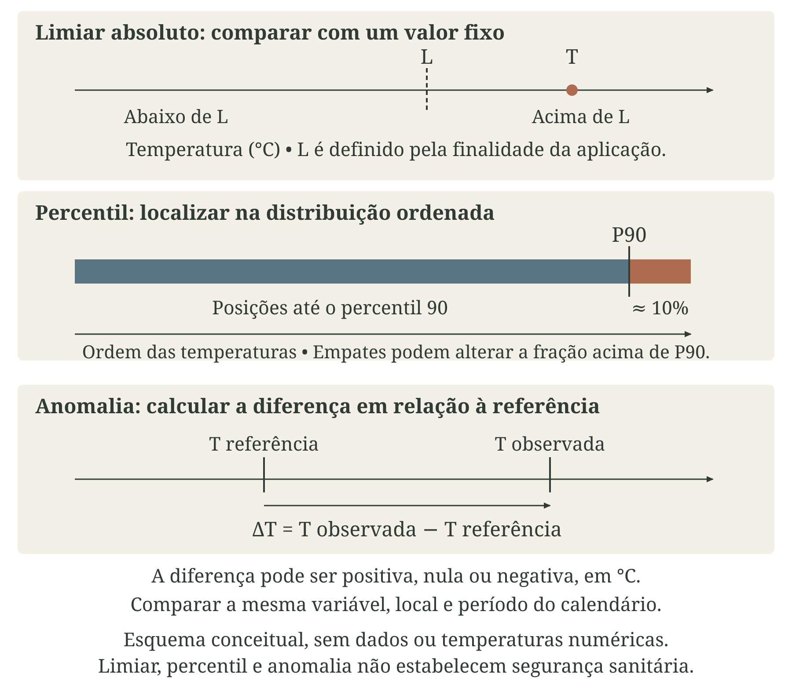
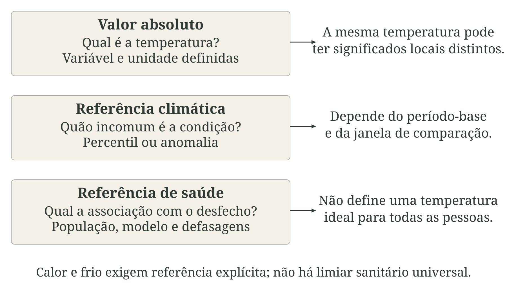
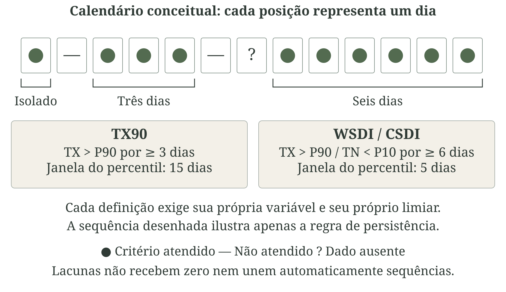
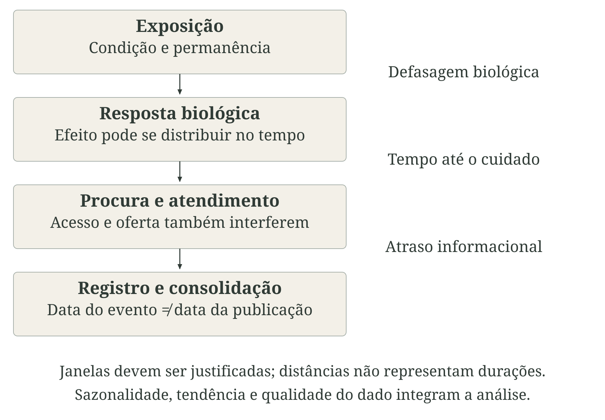
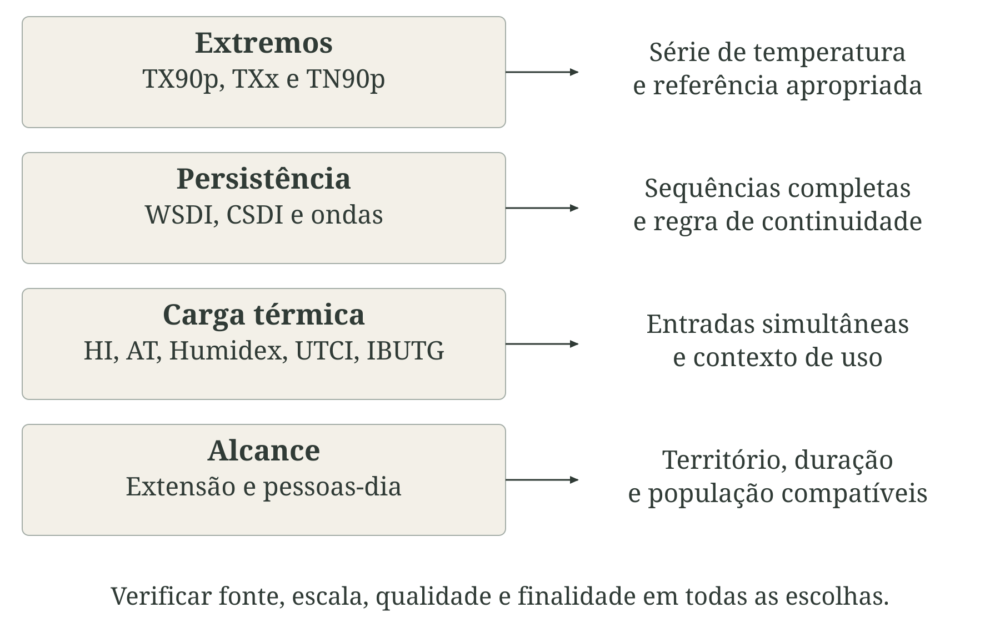
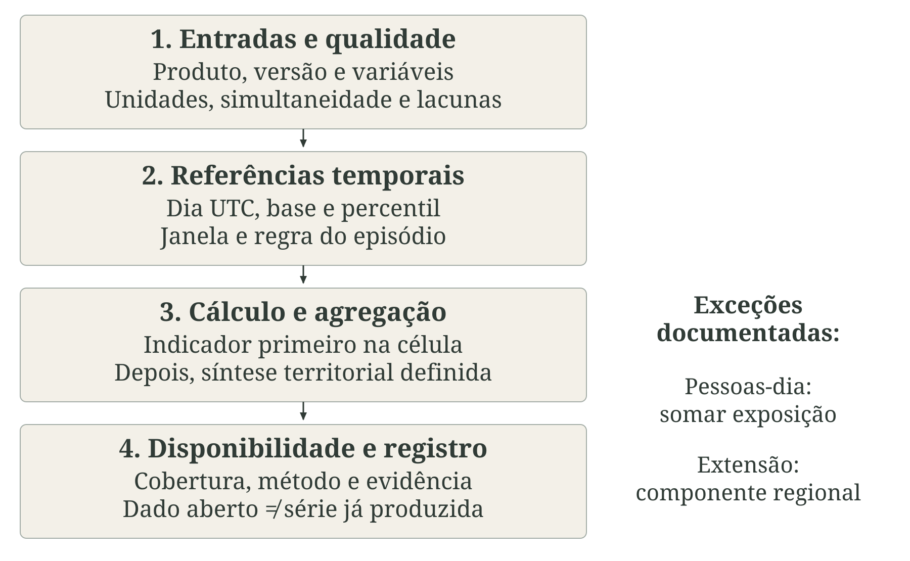
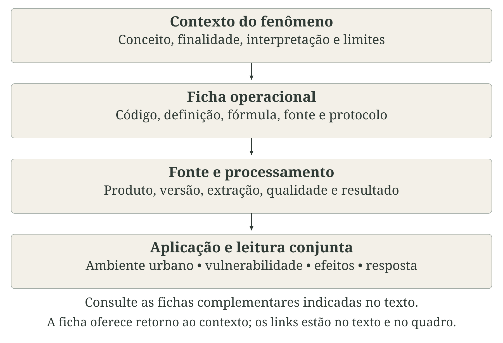

---
aliases:
  - /chapters/part-2/05-temperatura-condicoes-termicas.html
format:
  html:
    template-partials:
      - ../../includes/chapter-opening/title-block.html
chapter-opening:
  image: ../../assets/openings/cap7-temperatura-condicoes-termicas-web.webp
  alt: "Aquarela de bairro brasileiro hipotético sem pessoas, sob sol: rua pavimentada e telhados expostos contrastam com uma praça arborizada e caminhos sombreados, remetendo às diferentes condições térmicas do território."
---

# Temperatura e condições térmicas {#sec-temperatura}

A temperatura influencia a saúde em diferentes dimensões: afeta o funcionamento do organismo, a ocorrência e a distribuição de doenças e as condições em que o cuidado é oferecido. Para manter suas funções, o corpo precisa equilibrar o calor produzido pelo metabolismo e recebido do ambiente com aquele que dissipa. Quando os mecanismos de regulação térmica não conseguem preservar esse equilíbrio, podem ocorrer agravos à saúde. Na perspectiva da saúde pública, compreender os efeitos da temperatura exige considerar tanto os episódios de calor e frio extremos quanto as exposições recorrentes ao longo da vida cotidiana, em moradias, deslocamentos, escolas, espaços de convivência e locais de trabalho [@ebi2021heat; @ipcc2022saude].

Durante a exposição ao calor, o esforço do organismo para dissipar calor aumenta a demanda sobre o sistema cardiovascular, enquanto a perda de água pela sudorese, quando não compensada, favorece a desidratação. Essas condições podem contribuir para lesão renal e outros agravos relacionados ao calor. No frio, mecanismos como a vasoconstrição ajudam a conservar o calor corporal, mas podem aumentar a sobrecarga cardiovascular. A exposição a baixas temperaturas também está associada à hipotermia e ao agravamento de doenças respiratórias. Estudos de mortalidade identificam associações com temperaturas altas e baixas também em dias que não integram episódios formalmente definidos como ondas de calor ou de frio. Assim, a relevância de cada faixa térmica para a saúde pública depende da distribuição das exposições, do desfecho analisado e das características da população e do contexto local [@ebi2021heat; @alahmad2023temperature; @gasparrini2015temperature; @who2018housing].

A exposição ao calor também tem sido associada a desfechos adversos da gestação, alterações do sono e maior frequência de atendimentos por problemas de saúde mental. A interpretação desses achados exige considerar as características das populações estudadas e os métodos utilizados para avaliar a exposição. Nas doenças transmissíveis, a temperatura pode afetar a sobrevivência e o desenvolvimento de vetores e patógenos, modificando a dinâmica de transmissão. Esses efeitos interagem com a disponibilidade de água, as condições de saneamento, a imunidade da população e o contexto social. Assim, temperaturas mais elevadas produzem repercussões distintas entre doenças, populações e territórios, sem implicar um aumento uniforme dos riscos à saúde [@chersich2020pregnancy; @minor2022sleep; @norisarma2022mental; @mordecai2017temperature].

Essas relações conectam o capítulo à discussão de clima, ambiente e saúde (@sec-clima-ambiente-saude), aos temas de precipitação e secas (@sec-precipitacao), qualidade do ar (@sec-qualidade-ar) e água e saneamento (@sec-agua-saneamento), e à análise de efeitos sobre a saúde (@sec-efeitos-saude). Também alcançam a continuidade dos serviços (@sec-resposta): na rede do Sistema Único de Saúde (SUS), ambientes assistenciais, abastecimento de água, energia e conservação de insumos precisam funcionar durante condições térmicas adversas [@who2023framework].

Neste capítulo, iremos abordar alguns conceitos-chave:

::: {.callout-note icon=false title="Conceitos-chave: do ambiente ao efeito em saúde"}
-  A temperatura do ar e a temperatura de uma superfície descrevem temperaturas distintas.
-  Índices térmicos combinam dados de temperatura com outras variáveis meteorológicas sob hipóteses específicas.
-  O conceito de exposição acrescenta duração e atividade desenvolvida sob determinada temperatura ou índice térmico.
-  O efeito em saúde é o desfecho que pode ser observado ou estimado.
:::

A @fig-temperatura-conceitos organiza essas distinções. Moradia, vestimenta, atividade, condições de saúde e acesso à proteção modificam a relação entre ambiente e resposta individual, como desenvolvido no @sec-exposicao-vulnerabilidade. As fichas de extremos de temperatura e estresse térmico (@sec-fichas-temperatura-condicoes-termicas) operacionalizam medidas específicas; as fichas de mortalidade e internações hospitalares (@sec-fichas-efeitos-saude) documentam os desfechos, sem convertê-los automaticamente em eventos atribuíveis à temperatura.

::: {.figure-with-source}

{#fig-temperatura-conceitos fig-alt="Duas cenas hipotéticas mostram um trabalhador da construção civil cansado em um canteiro sob calor e uma pessoa em situação de rua encolhida sob uma manta no frio. Ambos têm expressões sérias. O esquema distingue temperatura do ar e da superfície, índices calculados, exposição, resposta fisiológica e efeito em saúde. Moradia, trabalho e proteção modificam as relações. As setas não demonstram causalidade." width="100%" print-src="arte-cap7-00-conceitos-print.png"}

[Fonte: elaboração conceitual com base nas referências citadas no texto. Autoria: composição e rótulos próprios; aquarela produzida com IA (image_gen). Cenas e esquemas sem dados observados. Licença: a mesma dos textos autorais da obra.]{.figure-source}

:::

## Temperatura do ar

A temperatura do ar caracteriza o estado térmico do ar no lugar e no momento da observação. Em estações meteorológicas, a medição próxima à superfície é feita geralmente com o sensor protegido da radiação solar direta por um abrigo ventilado, que permite a troca de ar com o ambiente. O tipo de abrigo, ventilação, altura, terreno e entorno integram a definição da observação; um termômetro exposto ao sol pode responder ao seu próprio aquecimento, comprometendo a interpretação como temperatura do ar [@wmo2024instrumentos].

O abrigo de Stevenson é um exemplo dessa proteção: uma caixa branca com venezianas que permitem a circulação do ar e reduzem a incidência direta de radiação e chuva sobre os sensores instalados. A @fig-abrigo-stevenson ilustra um abrigo, que é aberto para a observação do termômetro e fechado em seguida [@metoffice2025temperature; @wmo2024instrumentos].

::: {.figure-with-source}

{#fig-abrigo-stevenson fig-alt="Duas vistas ilustrativas de um abrigo branco com venezianas, cobertura dupla e pernas sobre gramado em terreno aberto. À esquerda, o abrigo fechado; à direita, a porta aberta revela os termômetros. Rótulos explicam proteção contra radiação e chuva, ventilação e medição do ar. A abertura é um recurso didático, sem leituras observadas." width="100%" print-src="arte-cap7-13-stevenson-print.png"}

[Fonte: elaboração própria.]{.figure-source}

:::

A padronização de condições para se medir a temperatura favorece comparações, mas não torna os lugares equivalentes. Altitude, relevo, proximidade de água, vegetação e construções condicionam o entorno representado pela medição. Uma estação em terreno aberto pode descrever adequadamente sua localização e, ainda assim, não representar o quarto de uma residência, uma rua estreita ou um posto de trabalho. O [Apêndice B](../../backmatter/apendice-estacoes.qmd) detalha instrumentos e instalações; o @sec-espaco-tempo explica a diferença entre localização da observação e suporte da análise.

Também é importante considerar como a temperatura é registrada no tempo: a temperatura instantânea, a média da temperatura e valores extremos são registros com significados diferentes. Se a temperatura instantânea é registrada de hora em hora, os valores máximos, mínimos e a média da série de valores não irão considerar picos ou quedas ocorridas entre as medições. Em uma série de registros de temperatura, quanto mais frequentes são as observações, maior é o detalhamento possível, mas o volume de dados pode apresentar desafios adicionais [@wmo2024instrumentos; @wmo2023climatological].

::: {.callout-note icon=false title="Conceito-chave: média, máxima e mínima"}
-  $TX$ representa a temperatura máxima diária e $TN$ a mínima diária observadas em um intervalo.
-  A temperatura média é calculada com a série de observações em um intervalo.
-  A amplitude térmica diária é obtida com a subtração de $TX$ e $TN$.
:::

A @fig-temperatura-observacao apresenta as decisões envolvidas na passagem da medição da temperatura à sua síntese estatística. Esse processo inclui o registro de metadados, a verificação da unidade de medida, da frequência e da cobertura das observações, além da definição de critérios de qualidade e de procedimentos para calcular médias, máximas e mínimas na presença de valores ausentes ou extremos. Uma medição ausente por falha do equipamento, por exemplo, não equivale a uma temperatura igual a zero. Já valores muito altos ou baixos podem refletir eventos reais ou erros de medição e registro. Sua magnitude, isoladamente, não justifica a exclusão: é necessário avaliar a consistência temporal, os metadados da coleta e a concordância com observações independentes. Quando um registro for considerado inválido, seu valor original deve ser preservado, e a exclusão das análises, sinalizada e justificada. Casos inconclusivos devem permanecer identificados como duvidosos. Essas decisões influenciam diretamente os resultados das análises e a identificação dos extremos climáticos [@wmo2024instrumentos; @wmo2023climatological].

::: {.figure-with-source}

{#fig-temperatura-observacao fig-alt="Estação ilustrativa em terreno aberto. O fluxo liga observação com abrigo e horário, controle de qualidade e síntese diária de média, máxima e mínima. A máxima de leituras horárias pode diferir do extremo instrumental." width="100%" print-src="arte-cap7-01-observacao-print.png"}

[Fonte: elaboração própria.]{.figure-source}

:::

A escolha de um indicador de temperatura deve responder a uma pergunta específica. A [máxima anual da temperatura máxima diária — TXx](../../chapters/part-4/17-fichas-temperatura-condicoes-termicas.qmd#sec-cli-tem-02) identifica o maior valor do ano. O [percentual de dias quentes — TX90p](../../chapters/part-4/17-fichas-temperatura-condicoes-termicas.qmd#sec-cli-tem-01) expressa frequência relativa à climatologia, e o [percentual de noites quentes — TN90p](../../chapters/part-4/17-fichas-temperatura-condicoes-termicas.qmd#sec-cli-cal-11) usa mínimas diárias como representação convencional da componente noturna. As três fichas estão no @sec-fichas-temperatura-condicoes-termicas. Observa-se que nenhum desses indicadores aborda diretamente a temperatura corporal ou substitui séries diárias de temperatura necessárias a estudos de saúde.

## Temperatura de superfície

A temperatura de superfície descreve a condição térmica de uma superfície observada por um sensor. Nos produtos de infravermelho termal, ela é estimada a partir da radiância, com tratamento da atmosfera e da emissividade. Esta última expressa a capacidade de emissão de uma superfície em relação a um corpo negro à mesma temperatura. Sensores próximos ao alvo e sensores orbitais podem observar radiação infravermelha, mas seus produtos têm finalidades, escalas e calibrações diferentes. No sensoriamento remoto terrestre, a sigla LST vem de *land surface temperature*, temperatura da superfície terrestre [@nasaTemperaturaSuperficie; @voogt2003thermal].

Um exemplo é o termômetro infravermelho sem contato, usado na testa de uma pessoa (@fig-termometro-infravermelho). O sensor recebe radiação emitida pela pele; não mede a temperatura do ar nem observa diretamente o interior do corpo. A interpretação clínica da leitura depende do aparelho e de seu uso previsto. Posição, distância, condição da testa e ambiente influenciam a medição; as instruções do fabricante precisam ser respeitadas. [@fda2025infrared].

::: {.figure-with-source}

{#fig-termometro-infravermelho fig-alt="Profissional de saúde e homem adulto, ambos com máscara, em ambiente interno. A profissional segura um termômetro infravermelho próximo à testa descoberta, sem contato e sem feixe luminoso. Rótulos distinguem a superfície observada, o sensor e os cuidados de posicionamento. Não há leitura numérica ou diagnóstico representado." width="100%" print-src="arte-cap7-14-infravermelho-print.png"}

[Fonte: elaboração própria.]{.figure-source}

:::

A @fig-lst-observacao relaciona a superfície vista de cima à sua representação térmica. Os dois painéis mantêm a posição da água, das copas, dos telhados, da rua com sua ponte e do solo; no painel da direita, as cores representam contrastes de temperatura em uma condição diurna hipotética. A escala é relativa, sem valores observados. Ela não estabelece uma temperatura fixa para cada cobertura: horário, umidade, sombra e propriedades dos materiais modificam esses contrastes. Para estimar a LST, o processamento da radiância recebida pelo sensor precisa considerar a atmosfera e a emissividade [@nasaTemperaturaSuperficie; @voogt2003thermal].

::: {.figure-with-source}

{#fig-lst-observacao fig-alt="Dois painéis da mesma área hipotética vista de cima: à esquerda, rio, árvores, gramado, quatro telhados, rua com ponte ligando as margens e solo; à direita, raster em cores falsas com as mesmas posições. Uma escala vai de menor a maior temperatura, sem valores. As letras A e B identificam copas e pavimento, com menor e maior temperatura apenas neste esquema diurno. Não há dados observados nem temperaturas fixas por cobertura." width="100%" print-src="arte-cap7-15-lst-print.png"}

[Fonte: elaboração própria; representação conceitual, sem dados observados.]{.figure-source}

:::

Em áreas urbanas, um único pixel de uma imagem térmica pode reunir superfícies com propriedades distintas, como telhados, pavimentos e vegetação. A temperatura estimada para esse pixel não descreve separadamente cada um desses elementos e depende das superfícies visíveis ao sensor, conforme o ângulo de observação. Fachadas ocultas, ambientes internos e espaços sob as copas das árvores, portanto, não são diretamente caracterizados. Além disso, a temperatura da superfície não equivale à temperatura do ar: ambas podem apresentar padrões espaciais e ciclos diários distintos [@voogt2003thermal].

Durante o dia, a incidência de radiação solar, o sombreamento, a umidade do solo e as propriedades dos materiais influenciam o aquecimento das superfícies. À noite, a liberação do calor armazenado modifica esses contrastes. Imagens diurnas e noturnas retratam, assim, momentos distintos do comportamento térmico urbano. Sua interpretação e comparação exigem considerar os horários de aquisição e a compatibilidade entre produtos e procedimentos de processamento. Também é necessário distinguir o tamanho dos pixels do arquivo disponibilizado da resolução original da medição: a reamostragem para pixels menores não acrescenta, por si só, detalhe à informação observada [@jin2012uhi; @nasaTemperaturaSuperficie].

A presença de nuvens limita a estimativa da temperatura da superfície por sensores de infravermelho termal. A exclusão de pixels contaminados é necessária, mas as composições resultantes representam apenas os momentos com observações válidas, frequentemente sob céu limpo. Essa seleção deve ser considerada na interpretação dos resultados, e a ausência de uma imagem utilizável não indica ausência de calor ou de frio. Para tornar essas limitações explícitas e permitir a reprodução da análise, a síntese deve ser acompanhada das datas de aquisição, das máscaras de qualidade aplicadas, das informações sobre emissividade, da identificação da coleção e da versão do produto, do algoritmo utilizado e do número de observações válidas.

::: {.callout-warning icon=false title="Atenção: medidas complementares"}
A temperatura da superfície e a temperatura do ar não são diretamente intercambiáveis: estimar uma a partir da outra exige modelos validados para as condições de aplicação. Uma associação observada em determinado território e horário não garante que essa relação se mantenha em outros contextos, nem permite, por si só, inferir a exposição térmica no interior das moradias.
:::

A @fig-temperatura-ar-superficie distingue superfície observada, ar medido e microambiente vivido. As setas indicam alvos de observação, sem representar medições ou um balanço de energia quantificado.

::: {.figure-with-source}

{#fig-temperatura-ar-superficie fig-alt="Paisagem hipotética com satélite, superfícies, estação em área aberta e pessoa à sombra. Rótulos distinguem temperatura da superfície, temperatura do ar e microambiente. A perspectiva não representa escala de satélite, resolução ou dados medidos." width="100%" print-src="arte-cap7-02-ar-superficie-print.png"}

[Fonte: elaboração própria.]{.figure-source}

:::

Na saúde pública, imagens de temperatura da superfície obtidas por sensoriamento remoto podem ajudar a identificar contrastes térmicos no território e orientar a seleção de áreas para levantamentos de campo. Sua interpretação se articula aos processos de uso da terra e urbanização (@sec-uso-terra) e às condições de exposição e moradia (@sec-exposicao-vulnerabilidade). A [ficha de intensidade da ilha de calor de superfície — SUHII](../../chapters/part-4/21-fichas-uso-cobertura-terra-ambiente-urbano.qmd#sec-amb-urb-03), no @sec-fichas-uso-cobertura-terra-ambiente-urbano, documenta um produto específico. Para comparar com observações do ar, consulte as fichas térmicas (@sec-fichas-temperatura-condicoes-termicas), mantendo separados os alvos e os suportes.

## Calor e frio

Na física, calor é a energia transferida em razão de uma diferença de temperatura. Na meteorologia e na saúde pública, os termos “calor” e “frio” designam condições térmicas cuja caracterização depende de uma referência. Explicitar essa referência permite distinguir três critérios: o uso de limiares fixos de temperatura, o desvio em relação à climatologia local e a associação com maior risco de adoecimento. Esses critérios podem identificar os mesmos episódios, mas respondem a perguntas distintas [@wmo2023climatological; @wmoWho2015heat].

O equilíbrio térmico do organismo depende da produção de calor pelo metabolismo e das trocas de energia com o ambiente por radiação, convecção, condução e evaporação. A direção e a intensidade dessas trocas variam conforme as condições ambientais, as características da pessoa, a vestimenta e a atividade física. Por isso, a temperatura do ar, isoladamente, não permite caracterizar todo o balanço térmico. Em ambientes quentes, a dissipação de calor pode ser insuficiente para evitar seu acúmulo no organismo; em ambientes frios, as perdas podem superar a capacidade do corpo de produzir e conservar calor.

A aclimatação consiste em ajustes fisiológicos desenvolvidos em resposta à exposição repetida a determinadas condições ambientais. No calor, esses ajustes podem antecipar o início da sudorese, reduzir a perda de eletrólitos pelo suor e permitir a realização de uma mesma atividade com menor frequência cardíaca e menor temperatura interna. Segundo o Instituto Nacional de Segurança e Saúde Ocupacional dos Estados Unidos (NIOSH), a aquisição desses ajustes é gradual, e parte deles pode ser perdida após períodos sem exposição. Seu desenvolvimento depende da intensidade e da duração da exposição e das condições individuais; mesmo quando presente, a aclimatação não elimina os riscos associados ao calor [@niosh2026acclimatization].

Ter nascido ou vivido em uma região quente, portanto, não garante aclimatação às condições ambientais e às exigências da atividade atual. Mudanças de cidade, de estação do ano ou de tarefa podem alterar o padrão de exposição. Da mesma forma, ter nascido em uma região fria não assegura proteção diante de vento, umidade, vestimenta insuficiente ou exposição prolongada ao frio. A avaliação deve considerar a história de exposição em conjunto com as condições presentes, sem atribuir à origem geográfica uma tolerância fixa ao calor ou ao frio. As respostas de adaptação ao frio, por sua vez, precisam ser compreendidas em suas particularidades, e não como uma simples inversão dos ajustes observados no calor [@niosh2026acclimatization; @nioshcold].

A adaptação tem alcance mais amplo que a aclimatação fisiológica e abrange práticas cotidianas, condições de moradia, vestimentas, organização do trabalho e serviços capazes de reduzir a exposição e seus efeitos sobre a saúde. Pessoas habituadas ao mesmo clima podem ter acesso muito desigual a esses recursos. A aclimatação, portanto, não substitui sombra, água, pausas, abrigo adequado ou cuidado em saúde. Da mesma forma, sentir-se acostumado ao calor ou ao frio não comprova ausência de risco [@niosh2016heat; @ipcc2022saude; @who2018housing].

### Valores para calor e frio

Estabelecer valores de referência para caracterizar o calor e o frio permite transformar essas noções em critérios explícitos para a análise e a tomada de decisão. Esses critérios ajudam a identificar episódios, acompanhar sua frequência e duração, comparar períodos e territórios e orientar ações de saúde pública, como a preparação dos serviços e a emissão de alertas. A escolha dos valores deve partir da finalidade pretendida: reconhecer condições incomuns para determinado clima, investigar associações com agravos à saúde ou definir situações que demandem medidas de proteção.

Um limiar absoluto corresponde a um valor fixo de temperatura, cuja escolha deve considerar a finalidade e o contexto de aplicação. Não existe um único valor que delimite condições de calor ou de frio relevantes para todas as populações e situações. A percepção individual, a comparação com o clima local e os critérios para emitir um alerta sanitário expressam perspectivas distintas, que precisam ser explicitadas.

Outra abordagem utiliza limiares relativos à distribuição das observações, como os percentis. O percentil 90, por exemplo, delimita aproximadamente os 10% mais elevados da distribuição. Seu valor depende da série, do período de referência, da época do ano e do método de cálculo; conhecer apenas as temperaturas mínima e máxima não permite determiná-lo. Um dia acima desse limiar em uma região de clima ameno pode registrar uma temperatura inferior à habitual em uma região mais quente. Além disso, valores repetidos e diferenças entre o período de referência e o período analisado podem alterar a proporção de dias que ultrapassa o limiar [@zhang2005].

A anomalia, por sua vez, expressa a diferença entre uma observação e uma referência compatível, como a média climatológica para o mesmo período do ano. Percentis e anomalias fornecem informações distintas: os primeiros definem pontos de corte na distribuição; as segundas quantificam o desvio em relação à referência. Uma temperatura próxima da média climatológica pode, ainda assim, estar associada a efeitos adversos à saúde. A normal climatológica descreve o clima de referência e não estabelece uma faixa de segurança [@wmo2017normals; @gasparrini2015temperature].

A @fig-limiar-percentil-anomalia representa essas operações sem atribuir temperaturas numéricas. No primeiro painel, compara-se a temperatura com um limiar fixo; no segundo, localiza-se o percentil na ordenação da distribuição; no terceiro, calcula-se a diferença em relação a uma referência compatível. A anomalia pode ser positiva, nula ou negativa. A posição de um valor nesses esquemas não informa, por si só, sua associação com um desfecho de saúde.

::: {.figure-with-source}

{#fig-limiar-percentil-anomalia fig-alt="Três painéis conceituais sem dados. Um eixo de temperatura situa T acima do limiar fixo L; uma faixa ordenada marca P90 e a fração superior de aproximadamente dez por cento; outro eixo mostra a diferença entre temperatura observada e referência. As posições não representam temperaturas numéricas ou limiares sanitários." width="100%" print-src="arte-cap7-16-limiar-percentil-anomalia-print.png"}

[Fonte: elaboração própria; esquema conceitual, sem dados observados.]{.figure-source}

:::

::: {.callout-note icon=false title="Nota técnica: normais climatológicas e seu cálculo"}

A normal climatológica padrão resume um período de 30 anos, como 1991–2020. A Organização Meteorológica Mundial (OMM) recomenda atualizar essa referência a cada década para descrever o clima recente, mantendo também referências fixas para comparações de longo prazo. Uma média de poucos anos não deve receber automaticamente a mesma denominação [@wmo2026normals].

Para obter a normal de temperatura de um mês, primeiro calcule a média desse mês em cada ano, com observações diárias válidas e método consistente; depois calcule a média dos valores mensais aceitos após controle de qualidade e verificação da completude no período-base. Assim, a normal de janeiro reúne os janeiros da base, sem misturar meses de estações diferentes:

$$
N_m = \frac{1}{n_m}\sum_{a \in A_m}\overline{T}_{m,a}.
$$

$N_m$ é a normal do mês $m$, em °C; $\overline{T}_{m,a}$ é a temperatura média desse mês no ano $a$; $A_m$ reúne os anos com valor mensal aceito, e $n_m$ é seu número. A temperatura média, a média das máximas e a média das mínimas são estatísticas distintas. No produto do Instituto Nacional de Meteorologia (INMET), a média diária compensada tem método próprio, que deve ser preservado ao reproduzir suas normais [@inmet2022normais].

:::

Na aplicação desse cálculo, siga os critérios de qualidade e completude da referência metodológica adotada. Documente dias e anos disponíveis, lacunas e mudanças de instrumento ou localização; não preencha ausências com zero. Compare a mesma variável, local e período do calendário. Normais mensais não substituem os percentis diários das fichas, cujos períodos-base e janelas permanecem aqueles definidos no @sec-fichas-temperatura-condicoes-termicas [@wmo2017normals; @inmet2022normais].

Do ponto de vista epidemiológico, a temperatura associada a um desfecho de saúde, como internações ou mortalidade, depende da população, do período, do modelo e das defasagens; não é uma temperatura ideal universal. A carga associada à temperatura pode envolver muitos dias moderadamente desfavoráveis, além dos extremos raros [@gasparrini2015temperature]. A @fig-referencias-termicas compara essas três leituras.

::: {.figure-with-source}

{#fig-referencias-termicas fig-alt="Três faixas comparam valor absoluto, posição na climatologia e associação epidemiológica. Temperatura, percentil e temperatura de mínima mortalidade são referências diferentes. Não são propostos valores de alerta." width="100%" print-src="arte-cap7-03-referencias-print.png"}

[Fonte: elaboração própria.]{.figure-source}

:::

Na prática, acompanhe intensidade, frequência, variação diária e oportunidade de recuperação. [TXx](../../chapters/part-4/17-fichas-temperatura-condicoes-termicas.qmd#sec-cli-tem-02), [TX90p](../../chapters/part-4/17-fichas-temperatura-condicoes-termicas.qmd#sec-cli-tem-01), [TN90p](../../chapters/part-4/17-fichas-temperatura-condicoes-termicas.qmd#sec-cli-cal-11) e [dias em períodos de frio — CSDI](../../chapters/part-4/17-fichas-temperatura-condicoes-termicas.qmd#sec-cli-fri-01) têm funções complementares, detalhadas no @sec-fichas-temperatura-condicoes-termicas. A leitura sanitária deve ser construída com as condições de vulnerabilidade e proteção (@sec-exposicao-vulnerabilidade) e com os métodos de análise de efeitos sobre a saúde (@sec-efeitos-saude), em vez de deduzir risco apenas da posição de um dia na distribuição climática.

## Ondas de calor e de frio

A ideia de onda está diretamente relacionada à persistência de determinadas condições climáticas ao longo do tempo. Diferentemente de um dia isolado de calor ou frio intenso, uma onda caracteriza-se pela ocorrência de uma sequência de dias em que as temperaturas permanecem acima ou abaixo de determinados limiares. Entretanto, como as características climáticas variam entre regiões e os efeitos sobre a saúde dependem de diferentes fatores, não existe uma definição única de onda de calor ou de frio que seja adequada a todos os contextos e aplicações epidemiológicas [@perkins2013heatwaves].

As definições de ondas de calor e de frio podem ser agrupadas em diferentes abordagens, que se distinguem principalmente pela variável de temperatura utilizada, pelo limiar adotado e pela duração mínima necessária para caracterizar um episódio de onda. Algumas definições utilizam limiares absolutos, considerando, por exemplo, a permanência da temperatura acima de determinado valor, enquanto outras empregam limiares relativos, geralmente expressos por percentis da distribuição histórica de temperaturas de uma localidade. Essa segunda abordagem permite identificar condições excepcionalmente quentes ou frias em relação ao clima habitual de cada região, favorecendo comparações entre localidades com características climáticas distintas.

Outra diferença importante está na escolha da variável utilizada para identificar os episódios. Definições baseadas na temperatura máxima destacam a persistência do calor durante o dia, enquanto aquelas que utilizam a temperatura mínima podem identificar períodos em que as noites permanecem excepcionalmente quentes, dificultando o resfriamento noturno. Há também abordagens que consideram a temperatura média ou combinam diferentes medidas para representar a exposição térmica. No caso das ondas de frio, a distinção é semelhante: uma sequência de temperaturas mínimas abaixo de um percentil local representa uma condição excepcional em relação ao clima habitual, mas não necessariamente corresponde aos mesmos episódios identificados por um limiar absoluto. Assim, diferentes critérios podem produzir resultados distintos, mesmo quando aplicados à mesma série de temperaturas [@perkins2013heatwaves; @climdex2024].

Para que uma definição possa ser reproduzida e seus resultados interpretados adequadamente, é necessário explicitar a variável considerada, o limiar utilizado, a duração mínima e os critérios de continuidade, além da área geográfica e do período de análise. Essas escolhas também dependem da finalidade do indicador. Enquanto índices climáticos padronizados favorecem a identificação de tendências e a comparação de episódios entre regiões e períodos, sistemas de alerta precisam considerar a exposição prevista, seus possíveis efeitos sobre a saúde da população e a capacidade de resposta dos serviços de saúde. Dessa forma, embora a identificação retrospectiva de ondas e a emissão de alertas estejam relacionadas, elas atendem a objetivos diferentes e podem exigir critérios específicos [@wmoWho2015heat].

::: {.callout-note icon=false title="Conceito-chave: persistência e contagem"}
A persistência é um elemento central de indicadores como o Índice de Duração de Períodos Quentes (WSDI) e o Índice de Duração de Períodos Frios (CSDI). O primeiro contabiliza os dias pertencentes a sequências de pelo menos seis dias consecutivos com temperatura máxima (TX) acima do percentil 90, enquanto o segundo utiliza o mesmo critério de duração para identificar sequências com temperatura mínima (TN) abaixo do percentil 10. Nas fichas deste livro, os percentis são calculados para cada dia do calendário, utilizando o período de referência de 1961 a 1990. É importante observar que esses indicadores expressam o total de dias pertencentes às sequências identificadas, e não o número de ondas ocorridas [@climdex2024].
:::

Além desses índices, existem famílias de indicadores que permitem caracterizar diferentes aspectos das ondas de calor, como sua frequência, duração e magnitude. Nas fichas apresentadas neste livro, a família de indicadores baseada em TX90 utiliza sequências de pelo menos três dias consecutivos com temperatura máxima acima do percentil 90, adotando uma janela de estimação do percentil diferente daquela utilizada no WSDI. A partir da identificação desses episódios, é possível descrevê-los de diferentes maneiras: o [HWN](../../chapters/part-4/17-fichas-temperatura-condicoes-termicas.qmd#sec-cli-cal-03) informa o número de ondas identificadas, enquanto o [HWF](../../chapters/part-4/17-fichas-temperatura-condicoes-termicas.qmd#sec-cli-cal-04) contabiliza o total de dias que integram essas ondas. Já o [HWD](../../chapters/part-4/17-fichas-temperatura-condicoes-termicas.qmd#sec-cli-cal-05) e o [HWMD](../../chapters/part-4/17-fichas-temperatura-condicoes-termicas.qmd#sec-cli-cal-06) descrevem, respectivamente, a maior duração e a duração média dos episódios, ao passo que o [HWM](../../chapters/part-4/17-fichas-temperatura-condicoes-termicas.qmd#sec-cli-cal-07) e o [HWA](../../chapters/part-4/17-fichas-temperatura-condicoes-termicas.qmd#sec-cli-cal-08) permitem caracterizar sua magnitude, conforme as definições adotadas. Embora esses indicadores sejam frequentemente apresentados em conjunto, é importante que sua nomenclatura esteja sempre acompanhada dos critérios metodológicos utilizados, uma vez que siglas semelhantes podem corresponder a diferentes formas de operacionalização [@perkins2013heatwaves].

A comparação entre as [fichas de WSDI](../../chapters/part-4/17-fichas-temperatura-condicoes-termicas.qmd#sec-cli-cal-01) e [CSDI](../../chapters/part-4/17-fichas-temperatura-condicoes-termicas.qmd#sec-cli-fri-01) e os indicadores da família TX90 evidencia como diferentes escolhas metodológicas influenciam a identificação e a caracterização dos episódios. Além dos limiares e da duração mínima, o tratamento da continuidade da série também merece atenção, pois a presença de dados ausentes pode comprometer a identificação de sequências. Uma lacuna de observação não deve ser interpretada como um dia sem ocorrência do evento, tampouco pode ser utilizada para unir automaticamente dois períodos separados. Da mesma forma, episódios que atravessam a passagem de dezembro para janeiro precisam ser identificados inicialmente na série contínua, antes que seus dias ou eventos sejam atribuídos aos respectivos anos, conforme as regras de cada indicador. A @fig-episodios-termicos ilustra essas diferenças entre a contagem de dias e a identificação de sequências, utilizando exemplos esquemáticos, sem representar dados observados.

::: {.figure-with-source}

{#fig-episodios-termicos fig-alt="Calendário esquemático sem temperaturas observadas. Círculos indicam critério atendido, traços indicam não atendido e interrogação indica lacuna. Uma sequência de três dias atende à persistência TX90; outra de seis atende à persistência WSDI ou CSDI se a variável e o limiar próprios forem cumpridos. Lacunas não unem episódios." width="100%" print-src="arte-cap7-04-episodios-print.png"}

[Fonte: elaboração própria.]{.figure-source}

:::

A noite acrescenta outra dimensão. TN90p descreve frequência de mínimas elevadas, sem exigir sequência; a [ficha de ondas compostas — CHW](../../chapters/part-4/17-fichas-temperatura-condicoes-termicas.qmd#sec-cli-cal-12) exige máximas e mínimas elevadas simultaneamente por dias consecutivos. O [índice cumulativo de excesso de calor em ondas de calor — CEHWI](../../chapters/part-4/17-fichas-temperatura-condicoes-termicas.qmd#sec-cli-cal-13) acrescenta medida do excesso térmico e separa os tipos de episódio. Estudos em localidades asiáticas encontraram diferenças na associação com mortalidade entre ondas diurnas, noturnas e compostas; os resultados não fixam um limiar transferível para o Brasil [@liu2025cehwi; @yang2024compound].

Registre início, término, duração, intensidade, extensão, população potencialmente exposta e incerteza. As fichas térmicas (@sec-fichas-temperatura-condicoes-termicas) detalham as operações; o @sec-desastres situa os episódios no contexto dos desastres, e o @sec-resposta trata da organização dos alertas e das ações. A preparação para o frio deve integrar esse planejamento, mesmo onde eventos de calor recebem maior atenção [@brasil2026frio].

## Sensação, conforto e estresse térmico

A mesma temperatura do ar pode acompanhar condições muito diferentes de troca de calor, influenciando como a temperatura é percebida e gerenciada pelo corpo humano. Outros fatores meteorológicos como umidade do ar, vento e radiação solar influenciam os mecanismos de troca de calor, sua percepção e regulação do corpo.

No corpo, o resfriamento pelo suor depende de sua evaporação, que é determinada também pela umidade do ar. A umidade relativa expressa a proximidade da saturação do ar àquela temperatura; não é uma medida direta da quantidade de vapor independente da temperatura [@wmo2024instrumentos; @masterton1979].

A disponibilidade de um gradiente de pressão de vapor, a ventilação junto à pele e a resistência da roupa condicionam essa perda de calor. Radiação solar e superfícies quentes podem ampliar a carga térmica mesmo quando a temperatura do ar varia pouco. Vento modifica trocas convectivas e evaporativas; seu efeito precisa ser interpretado com temperatura, umidade e características da exposição [@niosh2016heat].

::: {.callout-note icon=false title="Conceito-chave: sensação, conforto e estresse térmico"}
-  Sensação térmica refere-se à percepção de quente ou frio; índices chamados de “sensação” estimam condições equivalentes sob hipóteses definidas.
-  Conforto envolve a avaliação da pessoa sobre o ambiente.
-  Estresse térmico descreve a carga imposta pelas condições térmicas, enquanto a sobrecarga é a resposta fisiológica.
-  Sensação, desconforto e estresse não são medidas intercambiáveis [@brode2012utci; @niosh2016heat].
:::

A @fig-indices-biometeorologicos relaciona fatores ambientais a alguns índices de sensação, conforto e estresse térmico. Sua interpretação depende das variáveis meteorológicas consideradas e das hipóteses sobre atividade, vestimenta e exposição.

::: {.figure-with-source}

{#fig-indices-biometeorologicos fig-alt="Pessoa em ambiente externo entre superfície exposta ao sol e árvore. O quadro associa temperatura e umidade ao HI e Humidex; acrescenta vento para AT e radiação para UTCI; distingue as medidas instrumentais do WBGT/IBUTG. Atividade e vestimenta condicionam a interpretação." width="100%" print-src="arte-cap7-05-indices-print.png"}

[Fonte: elaboração própria.]{.figure-source}

:::

Os cinco índices apresentados a seguir podem ser organizados em três grupos para orientar a escolha: aproximações simplificadas de temperatura aparente, um índice baseado em modelo termofisiológico e um índice instrumental voltado à avaliação ocupacional. Essa organização é didática: cada método tem uma história e um domínio próprios. Reunir variáveis em um número facilita a comunicação, mas não transforma o resultado em medida individual de conforto, diagnóstico ou risco clínico.

### Índices simplificados de temperatura aparente

O [Índice de Calor — HI](../../chapters/part-4/17-fichas-temperatura-condicoes-termicas.qmd#sec-cli-est-01), do inglês *Heat Index*, combina temperatura do ar e umidade relativa para representar calor aparente em condições de sombra e vento fraco. O Serviço Nacional de Meteorologia dos Estados Unidos (NWS) usa operacionalmente a regressão de Rothfusz, baseada nas relações desenvolvidas por Steadman. Ela requer avaliação preliminar e respeito ao domínio de aplicação. A equação da ficha usa graus Fahrenheit; sua saída pode ser convertida para graus Celsius, mas inserir °C nos coeficientes definidos para °F produz erro [@rothfusz1990; @nws2026heat].

O HI é útil para comunicar condições de calor úmido. Não incorpora diretamente o vento observado, a radiação recebida pela pessoa, sua roupa ou seu esforço. Assim, não descreve sozinho uma atividade intensa ao sol, e suas categorias não constituem limites sanitários universais [@nws2026heat].

O [Humidex](../../chapters/part-4/17-fichas-temperatura-condicoes-termicas.qmd#sec-cli-est-03) também sintetiza calor e umidade, mas usa a pressão de vapor, que pode ser calculada a partir do ponto de orvalho. Embora sua escala evoque uma temperatura aparente, o Humidex é apresentado como índice adimensional, sem o símbolo °C. Na fórmula documentada na ficha, a temperatura do ar entra em °C e o ponto de orvalho em kelvin; confundir essas unidades altera o resultado. Vento e radiação não entram no cálculo. Suas categorias são próprias do sistema canadense e não devem ser convertidas diretamente nas do HI [@masterton1979; @canada2021humidexformula; @canada2026humidex].

A [temperatura aparente — AT](../../chapters/part-4/17-fichas-temperatura-condicoes-termicas.qmd#sec-cli-est-02), do inglês *apparent temperature*, acrescenta o efeito do vento à temperatura e à pressão de vapor. A ficha adota a aproximação externa à sombra do Bureau of Meteorology australiano, com vento a 10 m e resultado em °C. Nessa formulação, maior pressão de vapor eleva a AT, enquanto maior velocidade do vento reduz seu valor, mantidas as demais entradas. Essa relação é uma propriedade da equação; não permite concluir que qualquer vento proteja qualquer pessoa em calor intenso. Existem formulações de AT para outros ambientes, inclusive internos, e o nome do índice precisa vir acompanhado da variante utilizada [@steadman1994; @bom2026thermalcomfort].

### Índice baseado em modelo termofisiológico

O [Índice Térmico Universal do Clima — UTCI](../../chapters/part-4/17-fichas-temperatura-condicoes-termicas.qmd#sec-cli-est-04), do inglês *Universal Thermal Climate Index*, deriva de um modelo de termorregulação integrado a um modelo de vestimenta. Combina temperatura do ar, umidade, vento e temperatura radiante média para estimar a temperatura de um ambiente de referência que produziria uma resposta fisiológica equivalente. O resultado é expresso em °C e não corresponde à temperatura corporal [@brode2012utci].

A temperatura radiante média resume a troca de radiação entre o corpo e o entorno; não é a temperatura de uma única superfície. O UTCI permite considerar tanto calor quanto frio, mas representa atividade e vestimenta segundo suas hipóteses, sem reproduzir todas as pessoas e tarefas. A ficha do livro usa o produto ERA5-HEAT e seleciona métricas de calor. Ao aplicá-lo, verifique a altura de referência do vento, o domínio do cálculo e a representação da radiação: uma estimativa em grade não resolve automaticamente a sombra de uma rua [@brode2012utci; @dinapoli2021era5heat].

### Índice instrumental para exposição ocupacional

O [WBGT](../../chapters/part-4/17-fichas-temperatura-condicoes-termicas.qmd#sec-cli-est-05), do inglês *wet bulb globe temperature*, corresponde ao Índice de Bulbo Úmido Termômetro de Globo (IBUTG) na aplicação brasileira. Combina a temperatura de bulbo úmido natural, sensível à evaporação e à ventilação, com a temperatura de globo, que responde às trocas radiantes e convectivas. Na presença de carga solar direta, inclui também a temperatura do ar. O resultado em °C é um índice ambiental, não uma medição da temperatura interna do trabalhador [@iso2017wbgt; @fundacentro2025nho06].

A ficha requer medições no posto de trabalho e avaliação do período crítico de 60 minutos segundo a Norma de Higiene Ocupacional 06 (NHO 06), da Fundacentro. Metabolismo da tarefa, vestimenta, aclimatização e duração das condições observadas participam da interpretação. O bulbo úmido natural não deve ser substituído sem justificativa por uma temperatura de bulbo úmido calculada de outro modo, nem o IBUTG local por uma média diária de estação [@fundacentro2025nho06].

O @qua-indices-biometeorologicos reúne as diferenças práticas. As fórmulas, domínios e regras de agregação estão nas respectivas fichas do @sec-fichas-temperatura-condicoes-termicas.

::: {#qua-indices-biometeorologicos}

| Índice e escala | Entradas ambientais | Aplicação | Limite central |
|---|---|---|---|
| HI; °F ou °C após conversão | Temperatura do ar e umidade relativa | Comunicação de calor úmido | Referência de sombra e vento fraco; domínio restrito. |
| Humidex; adimensional | Temperatura do ar e pressão de vapor | Comunicação de desconforto por calor e umidade | Sem vento ou radiação; categorias próprias. |
| AT; °C | Temperatura do ar, pressão de vapor e vento a 10 m | Temperatura aparente externa à sombra | Depende da variante; não inclui sol direto nesta formulação. |
| UTCI; °C equivalente | Temperatura do ar, umidade, vento e temperatura radiante média | Estresse térmico externo por calor ou frio | Atividade e vestimenta de referência; a ficha seleciona calor. |
| WBGT/IBUTG; °C | Bulbo úmido natural, globo e ar quando há carga solar direta | Avaliação da exposição ocupacional ao calor | Exige contexto do posto, tarefa, roupa, aclimatização e duração. |

Índices biometeorológicos: entradas, aplicações e limites de interpretação

:::

Escolha o índice pelo mecanismo e pelo contexto: confira entradas, unidades, domínio, altura do vento, radiação e agregação antes de calcular. O índice aplicado à grade meteorológica não reproduz automaticamente a sombra de uma rua ou o interior de uma casa. As fórmulas e limites estão nas fichas biometeorológicas (@sec-fichas-temperatura-condicoes-termicas); as diferenças entre ambiente externo, presença e proteção estão no @sec-exposicao-vulnerabilidade.

## Ilhas de calor

Ilha de calor é um conceito geográfico, que designa um contraste térmico existente entre uma área urbana e um entorno de referência. Sua intensidade pode ser expressa como diferença de temperatura entre esses ambientes, desde que variável, horário e método sejam compatíveis. É necessário distinguir ilha de calor da superfície, medida por sensoriamento remoto, e ilha de calor do ar, observada ou estimada na atmosfera urbana [@jin2012uhi; @voogt2003thermal].

O contraste se relaciona ao balanço de energia. Materiais e geometrias urbanas modificam absorção, armazenamento e liberação de calor; a impermeabilização e a disponibilidade de água condicionam a parcela de energia consumida na evaporação. Edificações alteram sombreamento, ventilação e troca radiativa com o céu, enquanto atividades humanas acrescentam fontes de calor. Esses mecanismos variam no espaço e ao longo do dia: um material sombreado durante a manhã pode apresentar comportamento diferente após horas de insolação [@oke1982energy].

Assim, não basta comparar “cidade” e “campo” como categorias homogêneas. Uma referência rural distante pode introduzir diferenças de altitude, relevo, cobertura ou circulação. Mesmo dentro de uma cidade, bairros compactos, áreas abertas, parques e zonas industriais têm características distintas. A classificação em zonas climáticas locais propõe descrever estrutura, cobertura, materiais e atividade humana de forma comparável; ela organiza o entorno das observações, sem dispensar medições [@stewart2012lcz].

A @fig-ilhas-calor-contexto destaca essas propriedades e a necessidade de uma referência. As cenas são hipotéticas: a quantidade desenhada de árvores e edifícios não representa contagens, temperaturas ou eficácia estimada de intervenções.

::: {.figure-with-source}

{#fig-ilhas-calor-contexto fig-alt="Dois ambientes urbanos hipotéticos com materiais e cobertura vegetal diferentes. O esquema relaciona geometria e materiais, sombra e evapotranspiração à interpretação do contraste térmico. Comparar exige a mesma variável, período e referência. As cenas não quantificam temperaturas ou benefícios." width="100%" print-src="arte-cap7-06-ilhas-print.png"}

[Fonte: elaboração própria.]{.figure-source}

:::

O sinal e a intensidade do contraste dependem do momento e da variável. Não se deve concluir que toda porção urbana é sempre mais quente que qualquer referência ou que o contraste de superfície equivale ao contraste do ar. Para comparar territórios ou avaliar intervenções, mantenha produto, estação do ano, horário e regras de seleção; registre também mudanças na referência.

Na aplicação em saúde, acrescente população, permanência, moradia e acesso à proteção. Vegetação pode modificar sombreamento e evapotranspiração, mas um índice de vegetação não informa sozinho se a população consegue acessar a área ou permanecer à sombra. Essa distinção conecta a análise térmica ao @sec-uso-terra, às fichas de vegetação e espaços públicos (@sec-fichas-uso-cobertura-terra-ambiente-urbano) — [Índice de Vegetação por Diferença Normalizada — NDVI do entorno](../../chapters/part-4/21-fichas-uso-cobertura-terra-ambiente-urbano.qmd#sec-amb-veg-01), [espaço público aberto](../../chapters/part-4/21-fichas-uso-cobertura-terra-ambiente-urbano.qmd#sec-amb-urb-01) e [proximidade de verde público](../../chapters/part-4/21-fichas-uso-cobertura-terra-ambiente-urbano.qmd#sec-amb-urb-02) — e ao @sec-exposicao-vulnerabilidade. A [ficha SUHII](../../chapters/part-4/21-fichas-uso-cobertura-terra-ambiente-urbano.qmd#sec-amb-urb-03) documenta o contraste superficial de um produto específico; não estima benefício sanitário de plantar árvores nem substitui avaliação local.

## Exposição ocupacional

A atividade laboral combina condições ambientais e a produção metabólica de calor do corpo, podendo intensificar a sobrecarga térmica e os riscos à saúde. Exposições importantes ocorrem em atividades de trabalho ao ar livre e em cozinhas, fundições, lavanderias, galpões e outros ambientes internos. O ritmo e duração das atividades, roupa, equipamentos de proteção, pausas, acesso à água e aclimatização interferem na exposição. Uma estação meteorológica pode contextualizar o dia, mas não caracteriza sozinha um posto de trabalho próximo a uma fonte de calor ou com ventilação restrita [@who2025workplaceheat; @niosh2016heat].

A avaliação pelos indicadores WBGT/IBUTG integra medidas ambientais e a caracterização da atividade. A norma 7243:2017 da Organização Internacional de Normalização (ISO) o emprega como método de triagem; no Brasil, a [ficha de IBUTG](../../chapters/part-4/17-fichas-temperatura-condicoes-termicas.qmd#sec-cli-est-05) especifica medição no local e interpretação segundo a Norma de Higiene Ocupacional 06 (NHO 06), da Fundacentro. Na operacionalização do livro, a janela de avaliação é de 60 minutos. Ela não deve ser confundida com média diária de estação, tampouco aplicada sem estimar a taxa metabólica e verificar as condições previstas no método [@iso2017wbgt; @fundacentro2025nho06].

O frio também exige avaliação própria, por exemplo em câmaras refrigeradas, transporte de produtos e trabalho externo com vento e umidade. Tempo de permanência, contato com superfícies frias, roupa molhada e possibilidade de recuperação em local aquecido alteram a exposição. Proteção, treinamento e organização do trabalho precisam considerar essas condições; índices concebidos para calor não devem ser extrapolados para esse uso [@nioshcold]. A @fig-trabalho-termico contrapõe duas situações e destaca fatores que a temperatura externa não resume.

::: {.figure-with-source}

{#fig-trabalho-termico fig-alt="Duas cenas hipotéticas mostram trabalho externo com área de pausa e trabalho em câmara refrigerada. Rótulos destacam carga ambiental, esforço, roupa, tempo de permanência e recuperação. A imagem não estabelece limites ocupacionais." width="100%" print-src="arte-cap7-07-trabalho-print.png"}

[Fonte: elaboração conceitual com base nas referências citadas no texto. Autoria: composição e rótulos próprios; aquarela produzida com IA (image_gen). Cenas e esquemas sem dados observados. Licença: a mesma dos textos autorais da obra.]{.figure-source}

:::

As fichas biometeorológicas (@sec-fichas-temperatura-condicoes-termicas) permitem verificar o domínio de cada medida. A análise deve articular-se à exposição durante atividades e deslocamentos (@sec-exposicao-vulnerabilidade) e à capacidade institucional de proteger trabalhadores e manter serviços (@sec-resposta). O uso correto da fórmula é apenas uma etapa: registrar postos, jornadas, medidas de controle e critérios de interpretação torna a avaliação auditável. Limites legais e técnicos devem ser consultados na regulamentação aplicável à situação, sem adotar um corte municipal único.

## Efeitos, defasagens e grupos vulnerabilizados

Relacionar temperatura e saúde começa por definir o desfecho e o mecanismo plausível. Doenças diretamente relacionadas ao calor ou ao frio, descompensações de condições crônicas e mudanças na utilização dos serviços constituem resultados diferentes. As associações cardiovasculares com temperaturas extremas, por exemplo, não permitem classificar cada óbito ocorrido durante um episódio como causado por ele [@alahmad2023temperature]. As distinções entre contagem, taxa, excesso e atribuição são desenvolvidas no @sec-efeitos-saude.

A dimensão temporal é parte dessa definição. Efeitos podem ocorrer no mesmo dia ou se distribuir por dias subsequentes; temperatura, processo biológico, procura por cuidado e registro não compartilham necessariamente a mesma data. Modelos não lineares com defasagem distribuída permitem representar conjuntamente a forma da associação e sua distribuição no tempo, mas dependem de escolhas justificadas de janela e flexibilidade [@gasparrini2010dlnm]. A @fig-temperatura-defasagens separa esses tempos, sem fixar uma duração universal para calor ou frio.

::: {.figure-with-source}

{#fig-temperatura-defasagens fig-alt="Etapas distinguem exposição térmica, resposta biológica, procura por cuidado, atendimento e registro. As conexões separam defasagem biológica, tempo até o cuidado e atraso informacional. As distâncias gráficas não correspondem a durações." width="100%" print-src="arte-cap7-08-defasagens-print.png"}

[Fonte: elaboração própria.]{.figure-source}

:::

Comparar visualmente curvas de temperatura e internações é insuficiente para inferir causalidade. A análise deve considerar tendência, sazonalidade, calendário, qualidade dos registros e fatores associados à exposição e ao desfecho. A poluição pode integrar exposições combinadas ou estruturas de confundimento e mediação, dependendo da pergunta; seu tratamento deve decorrer do modelo causal, em diálogo com o @sec-qualidade-ar [@hernan2020causal].

As relações indiretas também precisam de especificação. Modelos de arboviroses mostram respostas térmicas não lineares de processos de transmissão; condições favoráveis ao vetor não bastam para demonstrar ocorrência de casos. Água, criadouros, população suscetível, circulação do agente e ações de controle compõem o contexto. Para infecções respiratórias, circulação de patógenos, ventilação, contatos e suscetibilidade precisam integrar a leitura da sazonalidade, evitando atribuí-la exclusivamente à temperatura [@mordecai2017temperature; @ipcc2022saude].

Idade, gestação, doenças preexistentes e determinados tratamentos podem modificar suscetibilidade, enquanto renda, moradia, trabalho, isolamento e acesso a serviços condicionam proteção. A revisão de Chersich e colaboradores documenta associações entre calor e desfechos gestacionais, com heterogeneidade entre estudos. Pesquisas sobre sono e atendimentos por saúde mental ampliam as dimensões relevantes, mas suas populações e medidas não representam automaticamente todos os territórios brasileiros [@chersich2020pregnancy; @minor2022sleep; @norisarma2022mental].

No frio, condições habitacionais inadequadas podem prolongar a exposição mesmo após a melhora do tempo externo. Isolamento térmico, aquecimento seguro, ventilação e capacidade de custear energia pertencem à interpretação da exposição domiciliar [@who2018housing]. No calor, a temperatura mínima externa tampouco descreve diretamente o dormitório ou a recuperação noturna. Essas diferenças exigem estratificação e conhecimento territorial, como discutido no @sec-exposicao-vulnerabilidade.

As fichas de vulnerabilidade e habitação (@sec-fichas-exposicao-vulnerabilidade) — [Índice de Vulnerabilidade Social](../../chapters/part-4/23-fichas-exposicao-vulnerabilidade.qmd#sec-exp-vul-01) e [adensamento domiciliar](../../chapters/part-4/23-fichas-exposicao-vulnerabilidade.qmd#sec-exp-hab-02) — ajudam a caracterizar contextos, mas não são índices específicos de suscetibilidade térmica. As fichas de mortalidade e internações hospitalares (@sec-fichas-efeitos-saude) documentam [mortalidade por causas selecionadas](../../chapters/part-4/24-fichas-efeitos-saude.qmd#sec-efe-mor-01), [padronização por idade](../../chapters/part-4/24-fichas-efeitos-saude.qmd#sec-efe-mor-02) e [internações no SUS](../../chapters/part-4/24-fichas-efeitos-saude.qmd#sec-efe-mob-01). A escolha das causas e dos grupos deve permanecer explícita; o catálogo não oferece ficha própria para cada relação sanitária mencionada neste capítulo.

## Da pergunta à escolha dos indicadores {#fontes-seleção-e-principais-indicadores}

A escolha de um indicador térmico começa pela pergunta que se deseja responder. Identificar dias incomuns, descrever a duração de uma onda, avaliar a carga térmica de uma atividade e estimar a população exposta são tarefas diferentes. A passagem da pergunta à medida exige reconhecer qual dimensão interessa e quais condições precisam ser representadas. Os critérios gerais de seleção são discutidos no @sec-fontes-fichas; a @fig-selecao-termica os aproxima das questões deste capítulo.

::: {.figure-with-source}

{#fig-selecao-termica fig-alt="Matriz de decisão relaciona extremos a séries de temperatura, persistência a sequências, carga térmica a variáveis simultâneas e alcance a território e população. Toda escolha passa por verificação de fonte, escala, qualidade e finalidade." width="100%" print-src="arte-cap7-09-selecao-print.png"}

[Fonte: elaboração própria.]{.figure-source}

:::

Quando a pergunta se refere a extremos, interessa distinguir o valor máximo da frequência de ultrapassagem de um limiar. Quando se refere a ondas, a continuidade dos dias se torna central: o número de episódios não informa, sozinho, quantos dias eles somaram ou quanto durou o mais longo. Para examinar a magnitude, é necessário conhecer a referência e a operação que resumem o excesso de calor. O @qua-indicadores-calor organiza essas escolhas, sem tratar as medidas como substitutas umas das outras.

Outras perguntas exigem ampliar a descrição da temperatura. A carga térmica depende das variáveis ambientais e das condições de atividade representadas pelo índice; o alcance de um episódio depende da área atingida e, quando pertinente, da população exposta. Já o contraste térmico urbano requer distinguir ar e superfície e definir uma referência territorial. Essas dimensões aparecem no @qua-indicadores-calor-conclusao e podem complementar um painel, desde que sua contribuição para a pergunta esteja explícita.

Antes de adotar uma medida, confira sua interpretação e seus limites: uma fórmula corretamente implementada pode receber entradas pouco representativas ou ser usada com categorias inadequadas à população e à atividade. Revisões de métricas calor–saúde mostram que o desempenho depende da definição e do desfecho; o resultado de uma cidade não estabelece um gatilho universal [@nawaro2023; @xu2018heatmetrics; @wmoWho2015heat]. As fichas vinculadas nos quadros documentam fontes, produtos, versões e procedimentos. Assim, a seleção conceitual conduz à consulta operacional, sem repetir aqui o catálogo da Parte IV.

::: {#qua-indicadores-calor}

| Pergunta | Medidas e fichas | Leitura e limite principal |
|---|---|---|
| Quão frequentes ou intensos são os extremos? | [TX90p](../../chapters/part-4/17-fichas-temperatura-condicoes-termicas.qmd#sec-cli-tem-01), [TXx](../../chapters/part-4/17-fichas-temperatura-condicoes-termicas.qmd#sec-cli-tem-02) e [TN90p](../../chapters/part-4/17-fichas-temperatura-condicoes-termicas.qmd#sec-cli-cal-11) | Frequência relativa e máximo absoluto respondem a perguntas distintas. |
| Há persistência de calor ou frio? | [WSDI](../../chapters/part-4/17-fichas-temperatura-condicoes-termicas.qmd#sec-cli-cal-01) e [CSDI](../../chapters/part-4/17-fichas-temperatura-condicoes-termicas.qmd#sec-cli-fri-01) | Contam dias em sequências qualificadas; não constituem alertas sanitários universais. |
| Quantas ondas ocorreram e quanto duraram? | [Ocorrência](../../chapters/part-4/17-fichas-temperatura-condicoes-termicas.qmd#sec-cli-cal-02), [HWN](../../chapters/part-4/17-fichas-temperatura-condicoes-termicas.qmd#sec-cli-cal-03), [HWF](../../chapters/part-4/17-fichas-temperatura-condicoes-termicas.qmd#sec-cli-cal-04), [HWD](../../chapters/part-4/17-fichas-temperatura-condicoes-termicas.qmd#sec-cli-cal-05) e [HWMD](../../chapters/part-4/17-fichas-temperatura-condicoes-termicas.qmd#sec-cli-cal-06) | Exigem a mesma definição-base; total, máximo e média não são equivalentes. |
| Qual a magnitude do episódio? | [HWM](../../chapters/part-4/17-fichas-temperatura-condicoes-termicas.qmd#sec-cli-cal-07), [HWA](../../chapters/part-4/17-fichas-temperatura-condicoes-termicas.qmd#sec-cli-cal-08), [EHF](../../chapters/part-4/17-fichas-temperatura-condicoes-termicas.qmd#sec-cli-cal-09) e [HWMId](../../chapters/part-4/17-fichas-temperatura-condicoes-termicas.qmd#sec-cli-cal-10) | Diferem em referência, normalização e unidade; não formam uma escala única. |

Perguntas e famílias de indicadores térmicos: extremos e persistência

:::

::: {#qua-indicadores-calor-conclusao}

| Pergunta | Medidas e fichas | Leitura e limite principal |
|---|---|---|
| Dia e noite permanecem quentes? | [Ondas compostas](../../chapters/part-4/17-fichas-temperatura-condicoes-termicas.qmd#sec-cli-cal-12) e [CEHWI](../../chapters/part-4/17-fichas-temperatura-condicoes-termicas.qmd#sec-cli-cal-13) | Classificação dos dias e excesso acumulado são medidas diferentes. |
| Qual componente da carga térmica interessa? | [HI](../../chapters/part-4/17-fichas-temperatura-condicoes-termicas.qmd#sec-cli-est-01), [AT](../../chapters/part-4/17-fichas-temperatura-condicoes-termicas.qmd#sec-cli-est-02), [Humidex](../../chapters/part-4/17-fichas-temperatura-condicoes-termicas.qmd#sec-cli-est-03), [UTCI](../../chapters/part-4/17-fichas-temperatura-condicoes-termicas.qmd#sec-cli-est-04) e [IBUTG](../../chapters/part-4/17-fichas-temperatura-condicoes-termicas.qmd#sec-cli-est-05) | As entradas e condições de uso devem corresponder ao ambiente e à atividade. |
| Qual o alcance do episódio? | [Extensão regional](../../chapters/part-4/17-fichas-temperatura-condicoes-termicas.qmd#sec-cli-exp-01) e [pessoas-dia](../../chapters/part-4/17-fichas-temperatura-condicoes-termicas.qmd#sec-cli-exp-02) | Área atingida e exposição populacional não são intercambiáveis. |
| Como o ambiente urbano varia? | [SUHII](../../chapters/part-4/21-fichas-uso-cobertura-terra-ambiente-urbano.qmd#sec-amb-urb-03) e [vegetação do entorno](../../chapters/part-4/21-fichas-uso-cobertura-terra-ambiente-urbano.qmd#sec-amb-veg-01) | Contrastes e cobertura não medem diretamente exposição pessoal ou efeito sanitário. |

Perguntas e famílias de indicadores térmicos: exposição e contexto

:::

Os quadros permitem selecionar medidas complementares. O conjunto HWN–HWF–HWD–HWM–HWA distingue contagem, duração e intensidade dos episódios [@perkins2013heatwaves]. O Fator de Excesso de Calor (EHF) acrescenta uma comparação com condições recentes à referência climatológica; o Índice Diário de Magnitude de Ondas de Calor (HWMId) acumula magnitudes normalizadas [@nairn2015ehf; @russo2015hwmid]. Para o alcance, a [extensão regional](../../chapters/part-4/17-fichas-temperatura-condicoes-termicas.qmd#sec-cli-exp-01) depende da conectividade espacial, enquanto [pessoas-dia](../../chapters/part-4/17-fichas-temperatura-condicoes-termicas.qmd#sec-cli-exp-02) combina duração e população em grupos etários definidos [@skinner2025extent; @lancetcountdown2026data]. Cada escolha acrescenta uma dimensão à leitura, sem estabelecer uma escala única de severidade.

As 23 fichas térmicas (@sec-fichas-temperatura-condicoes-termicas) documentam métodos específicos. Indicadores ETCCDI, sigla inglesa da Equipe de Especialistas em Detecção e Índices de Mudanças Climáticas, fornecem definições padronizadas para parte desse conjunto. A escolha do painel deve manter visível tanto o que foi medido quanto o que ficou fora dele, especialmente exposições internas, frio ocupacional e efeitos sanitários sem ficha específica.

## Protocolo de cálculo e disponibilidade

Depois de escolher a medida, é necessário fixar um procedimento reproduzível. As fichas do @sec-fichas-temperatura-condicoes-termicas são a referência para produto, variável, unidades, calendário, completude, períodos-base e agregação. A sequência da @fig-protocolo-termico organiza a leitura dessas regras; os detalhes de compatibilização são apresentados no @sec-espaco-tempo e no [Apêndice metodológico](../../backmatter/apendice-metodologico.qmd).

::: {.figure-with-source}

{#fig-protocolo-termico fig-alt="Quatro etapas: qualificar entradas; fixar calendário e referência; calcular na célula e agregar; documentar resultado e cobertura. Exceções são explícitas: pessoas-dia soma exposição e extensão regional acompanha componentes espaciais." width="100%" print-src="arte-cap7-10-protocolo-print.png"}

[Fonte: elaboração própria.]{.figure-source}

:::

### Entradas e qualidade

A série climática principal das fichas usa ERA5-Land horário, com disponibilidade histórica desde 1950. Temperaturas máximas e mínimas são extraídas de dias UTC completos. Verifique as 24 horas, a conversão de unidades e a máscara válida antes de produzir TX e TN. A ficha determina como lacunas diárias afetam o mês, o ano e as sequências; não preencha falhas com zero nem emende observação de estação e reanálise como se constituíssem uma única série.

As entradas dos índices biometeorológicos precisam ser simultâneas. Calcular um índice com temperatura máxima e umidade máxima registradas em horas diferentes pode produzir uma condição que não existiu. Calcule na resolução indicada e agregue depois. A fonte, sua versão e as transformações devem permanecer documentadas, conforme o @sec-fontes-fichas.

### Referências temporais

O quadro abaixo explicita as diferenças que mais afetam a comparação. A referência climatológica, a janela de estimação do percentil e a duração do episódio são parâmetros separados; manter apenas o nome do índice não garante reprodução do resultado.

::: {#qua-protocolos-termicos}

| Família | Referência e regra das fichas |
|---|---|
| [TX90p](../../chapters/part-4/17-fichas-temperatura-condicoes-termicas.qmd#sec-cli-tem-01), [TN90p](../../chapters/part-4/17-fichas-temperatura-condicoes-termicas.qmd#sec-cli-cal-11), [WSDI](../../chapters/part-4/17-fichas-temperatura-condicoes-termicas.qmd#sec-cli-cal-01) e [CSDI](../../chapters/part-4/17-fichas-temperatura-condicoes-termicas.qmd#sec-cli-fri-01) | Base 1961–1990; janela calendário de cinco dias. WSDI e CSDI exigem seis dias consecutivos. |
| [Ondas TX90](../../chapters/part-4/17-fichas-temperatura-condicoes-termicas.qmd#sec-cli-cal-02) e aspectos HWN–HWA | Base 1961–1990; janela calendário de 15 dias; TX > P90 por pelo menos três dias. |
| [EHF](../../chapters/part-4/17-fichas-temperatura-condicoes-termicas.qmd#sec-cli-cal-09) | Base 1961–1990; P95 de todas as médias diárias da base, sem janela calendário; comparação com condições recentes conforme a fórmula. |
| [HWMId](../../chapters/part-4/17-fichas-temperatura-condicoes-termicas.qmd#sec-cli-cal-10) | Base 1981–2010; P90 de TX em janela de 31 dias; pelo menos três dias. Normalização pelos quantis dos máximos anuais. |
| [Ondas compostas](../../chapters/part-4/17-fichas-temperatura-condicoes-termicas.qmd#sec-cli-cal-12) e [CEHWI](../../chapters/part-4/17-fichas-temperatura-condicoes-termicas.qmd#sec-cli-cal-13) | Base 1981–2010; janela de 15 dias; pelo menos dois dias. Componentes, desigualdades e tipos de episódio seguem cada ficha. |
| [Extensão regional](../../chapters/part-4/17-fichas-temperatura-condicoes-termicas.qmd#sec-cli-exp-01) | Reprodução do estudo de 1980–2019 com Berkeley Earth e algoritmo espacial próprio. |
| [Pessoas-dia](../../chapters/part-4/17-fichas-temperatura-condicoes-termicas.qmd#sec-cli-exp-02) | Base térmica 1986–2005; TX e TN > P95 por pelo menos dois dias; população anual WorldPop de 2000–2020. |

Referências temporais e definições que devem acompanhar o cálculo

:::

TXx e as fórmulas de HI, AT e Humidex não precisam de base percentílica para produzir seus valores. Isso não elimina a necessidade de definir referência quando se deseja classificar ou comparar esses resultados. No [UTCI](../../chapters/part-4/17-fichas-temperatura-condicoes-termicas.qmd#sec-cli-est-04), a ficha utiliza ERA5-HEAT v1.1; no [IBUTG](../../chapters/part-4/17-fichas-temperatura-condicoes-termicas.qmd#sec-cli-est-05), a referência é o período de exposição medido no posto, e não uma climatologia municipal.

### Cálculo e agregação

Salvo exceção documentada, calcule primeiro o indicador em cada célula e só depois agregue pela área de interseção com a malha municipal de 2022 do Instituto Brasileiro de Geografia e Estatística (IBGE). Aplicar um limiar à média municipal de temperatura é outra operação. A média territorial de contagens pode ser fracionária e não descreve necessariamente um episódio simultâneo em todo o município.

As exceções alteram o significado da saída. Extensão regional representa a área do componente que intercepta o município e pode exceder sua área. Pessoas-dia soma população exposta multiplicada por dias, separadamente para menores de um ano e pessoas com 65 anos ou mais; não utiliza média municipal por área. Conservar população e geometria é indispensável ao cruzar grades.

Verifique também as definições de intensidade: na família TX90, HWM é a média das médias dos eventos e HWA é o pico do evento de maior média. EHF tem unidade °C²; no CEHWI, o valor diário está em °C e sua soma no evento em °C·dia. Essas diferenças impedem substituir uma coluna por outra com base apenas na aparência dos números.

### Disponibilidade e documentação

“Calculável com dados abertos” identifica entradas públicas especificadas; serviços como o Climate Data Store (CDS) podem exigir cadastro gratuito. “Depende de dados locais” identifica, neste conjunto, o IBUTG instrumental. Os rótulos não afirmam que uma série nacional já foi produzida. As fichas separam documentação verificada, acesso e eventual cálculo testado, informando o alcance de cada verificação.

Registre produto, versão, acesso, território, código municipal, fuso, período-base, cobertura e regras de agregação junto à saída. Preserve as séries intermediárias necessárias à auditoria e sinalize observação, reanálise ou previsão. A consulta às fichas específicas está organizada na seção final deste capítulo, evitando repetir a documentação completa dentro do protocolo.

## Aplicação na vigilância e na gestão

Aplicar os indicadores exige organizar decisões ao longo do tempo: preparar-se antes da estação crítica, acompanhar condições previstas e observadas, responder durante o episódio e avaliar o que ocorreu. Esse ciclo articula serviços meteorológicos, vigilância, atenção primária, assistência, saúde do trabalhador, defesa civil e proteção social. A @fig-gestao-termica explicita as etapas, em continuidade com o @sec-indicador-decisao e o @sec-resposta [@wmoWho2015heat; @who2023framework].

::: {.figure-with-source}

{#fig-gestao-termica fig-alt="Três cenas hipotéticas mostram planejamento, visita de cuidado e infraestrutura do serviço. Um ciclo vetorial articula preparar, monitorar, agir e avaliar, com retorno ao planejamento. As cenas não representam cobertura ou eficácia medidas." width="100%" print-src="arte-cap7-11-gestao-print.png"}

[Fonte: elaboração própria.]{.figure-source}

:::

### Preparar o território e os serviços

O planejamento começa pelo estabelecimento de um perfil térmico local e pelo conhecimento das condições em que a população vive. Identifique sazonalidade, fontes confiáveis, áreas pouco representadas, condições habitacionais e atividades expostas. Estabeleça responsabilidades, canais de comunicação, cobertura de visitas e alternativas para falhas de água ou energia. A preparação precisa contemplar calor e frio; as diretrizes brasileiras de frio vigentes estão na Nota Técnica Conjunta nº 270/2026, que substituiu a orientação de 2025 [@brasil2026frio].

Use o @sec-exposicao-vulnerabilidade para orientar a identificação de necessidades, preservando a distinção entre privação territorial e risco individual. A [ficha de pessoas-dia](../../chapters/part-4/17-fichas-temperatura-condicoes-termicas.qmd#sec-cli-exp-02) serve para uma pergunta definida sobre exposição ao calor em duas faixas etárias; não deve ser extrapolada para toda a população ou convertida em contagem de pessoas diferentes. Para o frio, combine a [persistência climatológica](../../chapters/part-4/17-fichas-temperatura-condicoes-termicas.qmd#sec-cli-fri-01) com informações de moradia, serviços e observação local, sem presumir equivalência sanitária com essa métrica de calor.

### Monitorar e definir a resposta

Um painel operacional deve integrar previsões e observações disponíveis, duração esperada do episódio, condições térmicas noturnas, população potencialmente exposta e capacidade de resposta dos serviços. Os valores previstos devem ser claramente diferenciados dos observados, com indicação da data e hora de emissão, do horizonte da previsão, das incertezas e da última atualização. Sínteses anuais de indicadores como WSDI e CSDI apoiam o diagnóstico e a avaliação histórica, mas sua publicação, por si só, não constitui um sistema de aviso antecipado.

Cada gatilho de ação deve estar associado a um responsável, a uma área de aplicação e a um procedimento previamente acordado, com antecedência suficiente para executar a resposta. Os percentis ajudam a contextualizar o caráter incomum do evento, enquanto os valores de temperatura e as informações assistenciais contribuem para avaliar a situação e orientar as ações. A definição de categorias de alerta exige considerar tanto seu desempenho no contexto local quanto a viabilidade das respostas previstas. A adoção de categorias internacionais de índices biometeorológicos, sem validação nas condições de uso, pode resultar em orientações inadequadas [@wmoWho2015heat].

As fichas de preparação e continuidade dos serviços de saúde (@sec-fichas-resposta-adaptacao-resiliencia) ajudam a distinguir componentes institucionais: [responsabilidade por emergência e continuidade](../../chapters/part-4/25-fichas-resposta-adaptacao-resiliencia.qmd#sec-res-gov-01), [perfil de riscos](../../chapters/part-4/25-fichas-resposta-adaptacao-resiliencia.qmd#sec-res-ris-01) e [plano de emergência](../../chapters/part-4/25-fichas-resposta-adaptacao-resiliencia.qmd#sec-res-pla-01). A [ficha de alerta precoce — SPAR C5.1](../../chapters/part-4/25-fichas-resposta-adaptacao-resiliencia.qmd#sec-res-alr-01) usa o instrumento de autoavaliação anual dos Estados Partes do Regulamento Sanitário Internacional (SPAR) e tem escala nacional; seu resultado não mede o desempenho do alerta de um município. Para avaliar esse desempenho, é necessário documentar emissão, recebimento e ação local.

### Agir e comunicar

Durante episódios de calor, a resposta pode envolver acesso à água e a ambientes protegidos, adequação de atividades e acompanhamento de pessoas com dificuldade de se proteger. No frio, abrigo, aquecimento seguro, proteção no trabalho e continuidade do cuidado de condições crônicas ganham relevância. A atenção primária e a assistência social podem organizar contato com pessoas isoladas e em situação de rua; a rede assistencial precisa manter acesso e fluxos de atendimento compatíveis com a situação [@who2026heat; @brasil2026frio].

As mensagens devem explicar condição esperada, período, local, medidas possíveis e meios de obter ajuda. Oriente segundo protocolos oficiais e recursos efetivamente acessíveis. Comunicação útil depende de linguagem, alcance, acessibilidade e capacidade de executar a recomendação, como desenvolvido no @sec-indicador-decisao.

Para os estabelecimentos, acompanhe [interrupções de água](../../chapters/part-4/25-fichas-resposta-adaptacao-resiliencia.qmd#sec-res-wat-01) e [interrupções de energia](../../chapters/part-4/25-fichas-resposta-adaptacao-resiliencia.qmd#sec-res-ene-01) e verifique alternativas operacionais. Esses registros se conectam à manutenção de ambientes assistenciais e insumos, mas não medem sozinhos conforto térmico, qualidade do cuidado ou sucesso da resposta [@who2023framework].

### Avaliar e ajustar

Após o episódio, confronte previsão e observação, cobertura das ações, dificuldades de acesso e continuidade dos serviços. Examine os desfechos das fichas de mortalidade e internações hospitalares (@sec-fichas-efeitos-saude) com as cautelas do @sec-efeitos-saude, mantendo critérios de seleção, janelas e referências explícitos. A queda de internações após uma ação não prova sua eficácia sem desenho de avaliação compatível; mudanças na procura ou no acesso também alteram os registros [@hernan2020causal; @cdc2024evaluation].

Preserve o que estava disponível no momento da decisão, além das séries consolidadas posteriores. Esse registro permite distinguir falha de previsão, atraso de comunicação, insuficiência da resposta e limitações do dado. As lições devem alimentar o próximo ciclo de planejamento, conforme os processos de resposta, recuperação e adaptação (@sec-resposta).

## Localização das fichas operacionais

As 23 fichas deste domínio estão no @sec-fichas-temperatura-condicoes-termicas. O quadro as organiza pela pergunta principal; os links levam diretamente ao indicador. Cada ficha apresenta retorno ao capítulo de contexto e acesso às fontes. A @fig-navegacao-termica mostra esse percurso e a ligação com os indicadores urbanos (@sec-fichas-uso-cobertura-terra-ambiente-urbano), os indicadores de vulnerabilidade (@sec-fichas-exposicao-vulnerabilidade), os indicadores de mortalidade e internações hospitalares (@sec-fichas-efeitos-saude) e os indicadores de resposta (@sec-fichas-resposta-adaptacao-resiliencia).

::: {.figure-with-source}

{#fig-navegacao-termica fig-alt="Roteiro liga capítulo de contexto, ficha de indicador e fonte com versão e método. O retorno apoia interpretação e aplicação. Indicadores urbanos, de vulnerabilidade, efeitos e resposta complementam o percurso." width="100%" print-src="arte-cap7-12-navegacao-print.png"}

[Fonte: elaboração própria.]{.figure-source}

:::

<!-- Âncoras legadas: preservam links publicados antes da separação das fichas. -->
``{=html}
``{=html}
``{=html}
``{=html}
``{=html}
``{=html}
``{=html}
``{=html}
``{=html}
``{=html}
``{=html}
``{=html}
``{=html}
``{=html}
``{=html}
``{=html}
``{=html}
``{=html}
``{=html}
``{=html}
``{=html}
``{=html}
``{=html}

| Finalidade | Ficha | Indicador |
|---|---|---|
| Extremos e frequência | [CLI-TEM-01](../../chapters/part-4/17-fichas-temperatura-condicoes-termicas.qmd#sec-cli-tem-01) | Dias quentes — TX90p |
| Extremos e frequência | [CLI-TEM-02](../../chapters/part-4/17-fichas-temperatura-condicoes-termicas.qmd#sec-cli-tem-02) | Máxima anual da temperatura máxima diária — TXx |
| Extremos e frequência | [CLI-CAL-11](../../chapters/part-4/17-fichas-temperatura-condicoes-termicas.qmd#sec-cli-cal-11) | Noites quentes — TN90p |
| Persistência | [CLI-CAL-01](../../chapters/part-4/17-fichas-temperatura-condicoes-termicas.qmd#sec-cli-cal-01) | Duração de períodos quentes — WSDI |
| Persistência | [CLI-FRI-01](../../chapters/part-4/17-fichas-temperatura-condicoes-termicas.qmd#sec-cli-fri-01) | Dias em períodos de frio — CSDI |
| Ocorrência e duração | [CLI-CAL-02](../../chapters/part-4/17-fichas-temperatura-condicoes-termicas.qmd#sec-cli-cal-02) | Ocorrência de ondas TX90 |
| Ocorrência e duração | [CLI-CAL-03](../../chapters/part-4/17-fichas-temperatura-condicoes-termicas.qmd#sec-cli-cal-03) | Número de ondas — HWN |
| Ocorrência e duração | [CLI-CAL-04](../../chapters/part-4/17-fichas-temperatura-condicoes-termicas.qmd#sec-cli-cal-04) | Dias em ondas — HWF |
| Ocorrência e duração | [CLI-CAL-05](../../chapters/part-4/17-fichas-temperatura-condicoes-termicas.qmd#sec-cli-cal-05) | Duração máxima — HWD |
| Ocorrência e duração | [CLI-CAL-06](../../chapters/part-4/17-fichas-temperatura-condicoes-termicas.qmd#sec-cli-cal-06) | Duração média — HWMD |
| Magnitude e excesso | [CLI-CAL-07](../../chapters/part-4/17-fichas-temperatura-condicoes-termicas.qmd#sec-cli-cal-07) | Magnitude média — HWM |
| Magnitude e excesso | [CLI-CAL-08](../../chapters/part-4/17-fichas-temperatura-condicoes-termicas.qmd#sec-cli-cal-08) | Amplitude máxima — HWA |
| Magnitude e excesso | [CLI-CAL-09](../../chapters/part-4/17-fichas-temperatura-condicoes-termicas.qmd#sec-cli-cal-09) | Fator de Excesso de Calor — EHF |
| Magnitude e excesso | [CLI-CAL-10](../../chapters/part-4/17-fichas-temperatura-condicoes-termicas.qmd#sec-cli-cal-10) | Magnitude diária — HWMId |
| Dia e noite | [CLI-CAL-12](../../chapters/part-4/17-fichas-temperatura-condicoes-termicas.qmd#sec-cli-cal-12) | Dias em ondas compostas — CHW |
| Dia e noite | [CLI-CAL-13](../../chapters/part-4/17-fichas-temperatura-condicoes-termicas.qmd#sec-cli-cal-13) | Excesso acumulado — CEHWI |
| Índices biometeorológicos | [CLI-EST-01](../../chapters/part-4/17-fichas-temperatura-condicoes-termicas.qmd#sec-cli-est-01) | Índice de Calor — HI |
| Índices biometeorológicos | [CLI-EST-02](../../chapters/part-4/17-fichas-temperatura-condicoes-termicas.qmd#sec-cli-est-02) | Temperatura aparente — AT |
| Índices biometeorológicos | [CLI-EST-03](../../chapters/part-4/17-fichas-temperatura-condicoes-termicas.qmd#sec-cli-est-03) | Humidex |
| Índices biometeorológicos | [CLI-EST-04](../../chapters/part-4/17-fichas-temperatura-condicoes-termicas.qmd#sec-cli-est-04) | UTCI |
| Exposição ocupacional | [CLI-EST-05](../../chapters/part-4/17-fichas-temperatura-condicoes-termicas.qmd#sec-cli-est-05) | WBGT/IBUTG |
| Alcance territorial | [CLI-EXP-01](../../chapters/part-4/17-fichas-temperatura-condicoes-termicas.qmd#sec-cli-exp-01) | Extensão regional das ondas de calor |
| Exposição populacional | [CLI-EXP-02](../../chapters/part-4/17-fichas-temperatura-condicoes-termicas.qmd#sec-cli-exp-02) | Pessoas-dia expostas a ondas de calor |
