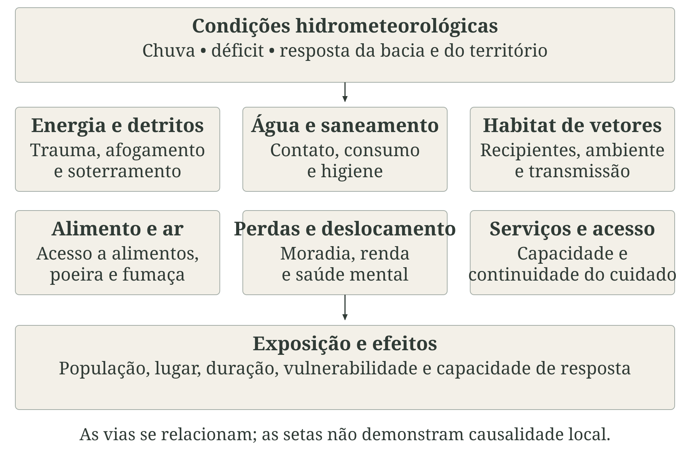
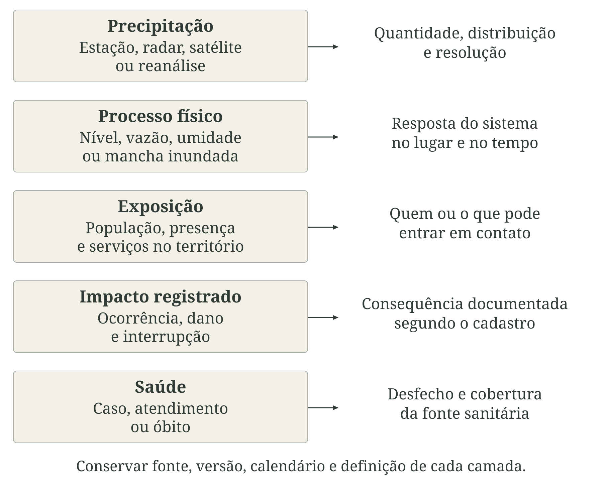

# Precipitação, secas, inundações e deslizamentos {#sec-precipitacao}

A água conecta o clima às condições em que as pessoas vivem, trabalham e recebem cuidados de saúde. A quantidade e a distribuição das chuvas influenciam a disponibilidade de água para consumo e higiene, a produção de alimentos e a circulação de agentes infecciosos. Essas relações se manifestam tanto na sazonalidade das chuvas quanto em períodos de excesso ou déficit. Compreender como o regime pluviométrico modifica os riscos e as necessidades de proteção da população é fundamental para a saúde pública [@ipcc2022saude; @barcellos2009clima].

Eventos extremos, como inundações e movimentos de massa, podem causar afogamentos e lesões graves. Danos à infraestrutura de tratamento e distribuição de água ampliam a exposição a doenças e dificultam a higiene e o preparo de alimentos. Perdas de renda e moradia e dificuldades de acesso a serviços também afetam a saúde. A recuperação desses sistemas pode levar muito mais tempo que o próprio evento físico [@who2014floods; @who2026drought; @freitas2014desastres].

As relações entre chuva e saúde não se restringem aos desastres imediatos. A chuva pode criar ou renovar habitats de vetores, enquanto períodos secos podem estimular o armazenamento inadequado de água nos domicílios. Temperatura e manejo ambiental também influenciam esses mecanismos. Um estudo sobre dengue no Brasil identificou associações distintas com condições úmidas e secas, conforme o grau de urbanização e a regularidade do abastecimento de água. A análise deve, portanto, considerar o contexto e as defasagens temporais, sem pressupor uma relação proporcional entre chuva e incidência da doença [@lowe2021dengue].

As secas também podem provocar insegurança alimentar, exposição à poeira, perda de meios de vida e sofrimento psíquico. Tanto o excesso quanto o déficit de água podem interromper o transporte e o atendimento, comprometendo a continuidade dos serviços do Sistema Único de Saúde (SUS). Esses efeitos se relacionam aos temas de temperatura (@sec-temperatura), qualidade do ar (@sec-qualidade-ar), saneamento (@sec-agua-saneamento) e resposta e adaptação [@brasil2026planoseca; @who2023framework].

::: {.callout-note icon=false title="Conceito-chave: fenômeno, exposição e consequência"}
-  Precipitação: deposição de água em estado líquido ou sólido, como chuva, neve ou granizo.
-  Estiagem e seca: a estiagem caracteriza a redução ou interrupção das chuvas; a seca, um déficit hídrico persistente, definido conforme a referência, o sistema afetado e a duração.
-  Cheia e inundação: a cheia é a elevação do nível do curso de água; a inundação ocorre quando a água ultrapassa os limites habituais do canal e ocupa áreas adjacentes.
-  Alagamento: acúmulo temporário de água, frequentemente em áreas urbanas, associado à insuficiência de drenagem.
-  Enxurrada: escoamento rápido, concentrado e de elevada energia.
-  Movimentos de massa: deslocamento de solo, rocha ou detritos pela ação da gravidade.
-  Exposição: presença de pessoas, bens ou infraestrutura em áreas sujeitas a um perigo.
-  Desastre: grave perturbação do funcionamento de uma comunidade ou sociedade decorrente da interação entre eventos perigosos, exposição, vulnerabilidade e capacidade de resposta.
-  Efeito sobre a saúde: alteração nas condições de saúde que deve ser caracterizada por métodos específicos [@undrr2017terminology; @cemaden2026ameacas].
:::

A @fig-cadeia-hidrometeorologica organiza essas distinções. Embora essencial à vida, o regime de chuvas pode contribuir para situações de risco em determinadas condições. As fichas do @sec-fichas-precipitacao-secas-eventos-hidrologicos descrevem medidas climáticas cuja interpretação deve considerar a exposição e a vulnerabilidade (@sec-exposicao-vulnerabilidade) e os efeitos sobre a saúde (@sec-efeitos-saude).

::: {.figure-with-source}

{#fig-cadeia-hidrometeorologica fig-alt="Três paisagens hipotéticas contrastam chuva regular, excesso e déficit. O esquema distingue precipitação, estiagem e seca, processos hidrológicos e movimentos de massa, exposição, efeitos sanitários e desastre. Água, vetores, alimento, ar e serviços mediam relações modificadas por vulnerabilidade e capacidade." width="100%" print-src="arte-cap8-00-conceitos-print.png"}

[Fonte: elaboração própria.]{.figure-source}

:::

## Precipitação e variabilidade das chuvas

A precipitação corresponde à água que chega à superfície terrestre em estado líquido ou sólido. No Brasil, predomina a chuva, embora outras formas possam ocorrer. O volume acumulado em determinado intervalo é expresso pela altura da lâmina de água, geralmente em milímetros: 1 mm equivale a 1 litro por metro quadrado. A intensidade expressa a taxa de precipitação, geralmente em mm/h [@wmo2024instrumentos; @wmo2023climatological].

A precipitação pode ser medida ou estimada por diferentes métodos. Pluviômetros registram a precipitação em pontos específicos; a precisão depende do vento, de obstruções, respingos, manutenção e resolução do registro. Radares meteorológicos estimam campos de precipitação a partir do sinal refletido pelos hidrometeoros, enquanto produtos de satélite utilizam dados de sensores e algoritmos. Reanálises combinam modelos e observações para reconstruir estados passados do sistema climático. Cada produto possui cobertura, frequência e incertezas próprias. A @fig-precipitacao-observacao ilustra a relação entre medição e interpretação. Os instrumentos e instalações são descritos no [Apêndice B](../../backmatter/apendice-estacoes.qmd).

::: {.figure-with-source}

{#fig-precipitacao-observacao fig-alt="Pluviômetro e técnico em terreno aberto, com cidade distante. Três etapas relacionam lâmina em milímetros, intervalo de acumulação e suporte espacial. A estação observa um ponto; a média territorial exige método próprio." width="100%" print-src="arte-cap8-01-observacao-print.png"}

[Fonte: elaboração própria]{.figure-source}

:::

A precipitação costuma ser acumulada por dia, semana, mês, estação ou ano [@wmo2023climatological]. Um mesmo total mensal pode resultar de chuvas concentradas em poucos dias ou de episódios frequentes e moderados. O início e o término da estação chuvosa, os intervalos secos e a distribuição espacial da precipitação ajudam a interpretar o abastecimento, as condições de trabalho e os habitats dos vetores [@barcellos2009clima; @wmo2023climatological].

A [ficha PRCPTOT](../../chapters/part-4/18-fichas-precipitacao-secas-eventos-hidrologicos.qmd#sec-cli-prc-06) soma a precipitação anual dos dias úmidos, definidos por valores iguais ou superiores a 1 mm. Distingue-se, portanto, do total que inclui todos os dias. Em aplicações sanitárias, deve ser complementada por indicadores de intensidade, persistência, água e saneamento (@sec-fichas-agua-saneamento-qualidade-ambiental).

### Chuvas intensas

A chuva intensa pode ser caracterizada por diferentes métricas, conforme o objetivo da análise. Percentis identificam a raridade de um evento em relação ao histórico local; valores absolutos expressam o volume precipitado; máximos identificam os maiores valores em intervalos definidos. Nenhuma dessas medidas estabelece, isoladamente, um limiar universal de dano [@climdex2024; @wmo2023climatological].

A [ficha Rx1day](../../chapters/part-4/18-fichas-precipitacao-secas-eventos-hidrologicos.qmd#sec-cli-prc-01) registra a maior precipitação diária do período. A [ficha R95p](../../chapters/part-4/18-fichas-precipitacao-secas-eventos-hidrologicos.qmd#sec-cli-prc-03) soma a precipitação dos dias que superam o percentil 95 dos dias úmidos do período-base. R95p pode aumentar pela maior frequência desses dias, pelo maior volume precipitado neles ou por ambos. Sua unidade é mm; a contribuição percentual desses dias é expressa por R95pTOT. A @fig-chuvas-intensas distingue intensidade, máximo diário e volume em dias muito úmidos.

::: {.figure-with-source}

{#fig-chuvas-intensas fig-alt="Três linhas diferenciam intensidade por intervalo, Rx1day como máximo diário e R95p como soma acima do percentil 95. O período-base pertence à definição de R95p. Não há série numérica nem limiar sanitário proposto." width="100%" print-src="arte-cap8-02-intensidade-print.png"}

[Fonte: elaboração própria.]{.figure-source}

:::

Eventos subdiários, com duração de minutos ou horas, merecem atenção especial em pequenas bacias hidrográficas e áreas urbanas. O acumulado diário pode ocultar picos de intensidade que excedem a capacidade de drenagem. A análise de enxurradas e alagamentos rápidos requer séries de resolução subdiária e relações de intensidade-duração-frequência (IDF).

O período de retorno expressa a frequência estatística de um evento de determinada magnitude ou superior. Sob condições estacionárias, um período de retorno de dez anos corresponde a uma probabilidade anual de excedência de 10%, e não à ocorrência regular de um evento a cada dez anos. Mudanças climáticas e transformações na ocupação urbana exigem cautela no uso de registros históricos para estimar perigos e riscos futuros [@wmo2023climatological; @ipcc2021extremes].

A ocorrência de danos depende não apenas da chuva, mas também da impermeabilização do solo, da declividade, da manutenção da drenagem, dos níveis dos rios e da exposição da população. Esses fatores são abordados no @sec-uso-terra, nas respectivas fichas (@sec-fichas-uso-cobertura-terra-ambiente-urbano) e nas fichas de desastres (@sec-fichas-eventos-severos-desastres).

### Chuvas persistentes

A persistência de um evento deve ser definida por critérios explícitos, como o número de dias consecutivos acima de um limiar ou a duração de determinadas condições hidrológicas. Chuvas moderadas e repetidas podem saturar o solo e sobrecarregar a drenagem. Seus efeitos dependem das condições antecedentes, da capacidade de armazenamento da bacia e da resposta do sistema, aspectos que a contagem de dias chuvosos não mede diretamente.

A [ficha Rx5day](../../chapters/part-4/18-fichas-precipitacao-secas-eventos-hidrologicos.qmd#sec-cli-prc-02) registra o maior acumulado em cinco dias consecutivos. A [ficha CWD](../../chapters/part-4/18-fichas-precipitacao-secas-eventos-hidrologicos.qmd#sec-cli-prc-05) registra a maior sequência de dias com precipitação de pelo menos 1 mm. Sequências de igual duração podem apresentar volumes distintos, e uma janela de cinco dias pode incluir dias secos. A @fig-chuvas-persistentes ilustra a complementaridade dessas medidas [@climdex2024].

::: {.figure-with-source}

{#fig-chuvas-persistentes fig-alt="Sequência didática de símbolos distingue dia úmido, dia seco e dado ausente. Uma janela Rx5day inclui cinco dias válidos, mesmo contendo dia seco; CWD acompanha dias úmidos consecutivos. O desenho não contém medições e a lacuna não é classificada como seca." width="100%" print-src="arte-cap8-03-persistencia-print.png"}

[Fonte: elaboração própria.]{.figure-source}

:::

O tempo de resposta hidrológica varia conforme a escala. Pequenas bacias podem reagir rapidamente à chuva, enquanto grandes sistemas fluviais recebem aportes de áreas distantes e de dias anteriores. Assim, uma inundação pode persistir após o fim da chuva local. Restringir a análise à precipitação de um único município ou dia pode ocultar a relação entre o evento e seus impactos [@who2014floods; @cemaden2026ameacas].

Inundações prolongadas podem dificultar o acesso a serviços, manter ambientes úmidos e alterar a qualidade da água. A investigação dessas relações com a saúde requer medidas intermediárias, como nível da água, extensão da área atingida e interrupções dos serviços. Consulte o @sec-agua-saneamento, as fichas de qualidade da água (@sec-fichas-agua-saneamento-qualidade-ambiental) e a [ficha de interrupções dos serviços de saúde](../../chapters/part-4/22-fichas-eventos-severos-desastres.qmd#sec-des-sau-02).

### Ausência de chuva

Para o índice de dias secos consecutivos (CDD), um dia é classificado como seco quando a precipitação é inferior a 1 mm, podendo incluir pequenas quantidades de chuva. O [CDD](../../chapters/part-4/18-fichas-precipitacao-secas-eventos-hidrologicos.qmd#sec-cli-prc-04) registra a maior sequência ininterrupta desses dias em determinado período. Dados ausentes não devem ser tratados como zero, pois essa substituição pode criar ou prolongar artificialmente sequências secas [@climdex2024].

Um período sem chuva na estação seca não equivale a uma interrupção das chuvas na estação chuvosa. A aridez é uma característica climática de longo prazo; a sazonalidade seca corresponde ao padrão esperado das estações; e a seca caracteriza um déficit hídrico em relação a uma referência e a um processo específicos. A escassez de água pode decorrer de demanda, infraestrutura ou gestão, mesmo sem anomalia meteorológica. A @fig-ausencia-chuva ilustra essas distinções [@wmo2016drought].

::: {.figure-with-source}

{#fig-ausencia-chuva fig-alt="Três perguntas separam CDD, SPI-3 e disponibilidade de água. CDD classifica sequências, SPI-3 compara acumulados com a referência e escassez requer informação de oferta, demanda e acesso. Não se trata de uma sequência obrigatória." width="100%" print-src="arte-cap8-04-ausencia-print.png"}

[Fonte: elaboração própria.]{.figure-source}

:::

Anomalias percentuais podem ser enganosas em meses pouco chuvosos: pequenas variações absolutas produzem grandes diferenças percentuais quando o valor de referência é baixo. O [SPI-3](../../chapters/part-4/18-fichas-precipitacao-secas-eventos-hidrologicos.qmd#sec-cli-sec-01) utiliza a distribuição ajustada dos acumulados de três meses para expressar déficits e excessos de precipitação em escala padronizada. O SPI não representa uma redução percentual da chuva nem mede diretamente a disponibilidade hídrica [@wmo2012spi].

Em estudos de saúde, os indicadores climáticos devem ser articulados aos mecanismos de exposição, como intermitência do abastecimento, armazenamento de água, insegurança alimentar e presença de poeira e fumaça. Essas condições variam conforme o território e as respostas locais. A análise pode integrar as fichas de água e saneamento (@sec-fichas-agua-saneamento-qualidade-ambiental), qualidade do ar e fumaça (@sec-fichas-qualidade-ar-queimadas-fumaca) e o @sec-efeitos-saude [@who2026drought; @lowe2021dengue].

## Secas e estiagens

As definições de estiagem e seca variam entre a climatologia, a agricultura, a hidrologia e os registros administrativos. A estiagem geralmente se refere à redução ou interrupção da chuva por períodos mais curtos; a seca caracteriza um déficit persistente, definido pela referência, pelo sistema afetado e pela duração. Ao empregar classificações institucionais, explicite a fonte e os critérios, sem generalizar durações específicas como regras universais [@wmo2016drought; @brasil2026planoseca].

O déficit de precipitação pode se propagar pelo solo, pela vegetação e pelos corpos de água, com diferentes defasagens e graus de amortecimento. O armazenamento prévio pode sustentar o abastecimento temporariamente, enquanto o calor e a demanda elevada agravam a escassez. A recuperação também é desigual: o retorno das chuvas não repõe imediatamente aquíferos e reservatórios nem recupera safras e fontes de renda. A @fig-propagacao-seca apresenta essas interações, que não seguem uma sequência obrigatória [@wmo2016drought; @ipcc2022saude].

::: {.figure-with-source}

{#fig-propagacao-seca fig-alt="Paisagem hipotética com cultivo estressado, reservatório baixo e bairro. O esquema distingue precipitação, solo e vegetação, rios e reservatórios e acesso a água e alimentos. Demanda, calor, armazenamento e resposta modificam a propagação; o retorno da chuva não recupera tudo ao mesmo tempo." width="100%" print-src="arte-cap8-05-seca-print.png"}

[Fonte: elaboração própria.]{.figure-source}

:::

::: {#qua-tipos-seca}

| Tipo | Processo dominante | Exemplos de medidas | Relação com saúde |
|---|---|---|---|
| Meteorológica | Precipitação abaixo da referência | SPI e anomalias de precipitação | Contexto climático para investigar exposições |
| Agrícola ou ecológica | Água insuficiente no solo e estresse de plantas ou ecossistemas | Umidade do solo, balanço hídrico e vegetação | Produção de alimentos, renda, poeira e fogo |
| Hidrológica | Redução de vazões, níveis e armazenamento | Vazão, nível, volume útil e água subterrânea | Abastecimento, deslocamento e operação de serviços |
| Socioeconômica | Oferta insuficiente diante da demanda por bens e serviços dependentes de água | Interrupções, produção, preços e população afetada | Higiene, alimentação, meios de vida e cuidado |

Tipos de seca e sua relação com saúde

:::

A Organização Meteorológica Mundial (OMM) recomenda o Índice Padronizado de Precipitação (SPI) para caracterizar secas meteorológicas. O SPI-1 considera o acumulado de um mês; o SPI-3, de três meses; e os índices SPI-6 e SPI-12, períodos mais longos. Essas escalas não correspondem automaticamente aos tipos de seca apresentados no @qua-tipos-seca. Sua relação com a umidade do solo, a vazão e a disponibilidade hídrica deve ser avaliada para cada sistema [@wmo2012spi; @wmo2016drought].

O SPI transforma os acumulados de precipitação em uma escala padronizada. Valores negativos indicam condições mais secas em relação à distribuição ajustada; positivos, condições mais úmidas. O zero corresponde à mediana dessa distribuição, não necessariamente à média de precipitação. O livro adota o SPI-3, conforme a [ficha CLI-SEC-01](../../chapters/part-4/18-fichas-precipitacao-secas-eventos-hidrologicos.qmd#sec-cli-sec-01). Uma classe mensal isolada não caracteriza a trajetória de uma seca: a delimitação de episódios exige regras explícitas de início, duração e término.

O Índice Padronizado de Precipitação e Evapotranspiração (SPEI) incorpora a demanda evaporativa ao considerar a diferença entre precipitação e evapotranspiração potencial. Sua interpretação depende do método de estimativa da evapotranspiração e do ajuste probabilístico. O SPEI caracteriza esse balanço climático; o SPI, a anomalia da precipitação; e o CDD, a persistência de dias secos. O SPEI é apresentado para comparação conceitual, enquanto as fichas deste domínio adotam o SPI-3 [@vicenteserrano2010spei].

A análise dos efeitos da seca sobre a saúde deve relacionar o déficit hídrico à regularidade e à qualidade do abastecimento, à segurança alimentar, à exposição à fumaça e à mobilidade. Essas relações variam entre bairros urbanos, áreas rurais e comunidades ribeirinhas. Recomenda-se articular os índices climáticos às fichas de água e saneamento (@sec-fichas-agua-saneamento-qualidade-ambiental), qualidade do ar e fumaça (@sec-fichas-qualidade-ar-queimadas-fumaca) e resposta dos serviços (@sec-fichas-resposta-adaptacao-resiliencia), considerando a exposição e a vulnerabilidade territorial (@sec-exposicao-vulnerabilidade).

## Inundações, alagamentos e enxurradas

O ciclo hidrológico envolve interceptação, infiltração, armazenamento, evapotranspiração e escoamento. A distribuição da chuva entre esses processos depende das características do terreno e das condições antecedentes, como a umidade do solo. A resposta varia conforme a escala: um rio integra contribuições de toda a bacia, enquanto uma rua depende da infraestrutura de drenagem e de suas conexões. O volume precipitado e a área inundada são, portanto, medidas distintas: a inundação resulta da resposta do sistema hidrológico, não apenas da chuva [@wmo2023climatological; @cemaden2026ameacas].

::: {.callout-note icon=false title="Conceito-chave: cheia, inundação, alagamento e enxurrada"}
-  Cheia, também chamada de enchente em parte da literatura técnica, é a elevação do nível do curso d'água, sem necessariamente haver transbordamento.
-  Inundação ocorre quando a água ultrapassa os limites habituais do canal e ocupa áreas adjacentes.
-  Alagamento é o acúmulo temporário de água, frequentemente em áreas urbanas, associado à insuficiência do escoamento e da drenagem. Enxurrada é o escoamento rápido, concentrado e de elevada energia [@cemaden2016enxurrada; @cemaden2026ameacas].
:::

A @fig-processos-hidrologicos ilustra essas distinções. Não há sequência obrigatória entre os quatro fenômenos: alagamentos podem ocorrer sem transbordamento de rios, e enxurradas podem percorrer vertentes ou canais estreitos. Em áreas costeiras, a maré e as condições a jusante podem dificultar a drenagem. Em grandes bacias, a chuva a montante pode elevar o nível da água em locais onde pouco choveu. A análise deve preservar a localização e o horário das observações.

::: {.figure-with-source}

{#fig-processos-hidrologicos fig-alt="Quatro cortes vetoriais sem escala mostram água elevada dentro do canal, transbordamento sobre margens, água acumulada em depressão urbana e escoamento concentrado sobre declive. Profundidade, velocidade e duração são dimensões complementares." width="100%" print-src="arte-cap8-06-processos-print.png"}

[Fonte: elaboração própria.]{.figure-source}

:::

O **nível** corresponde à altura da superfície da água em relação a uma referência; a **vazão**, ao volume que atravessa uma seção por unidade de tempo. A conversão depende da geometria da seção e de relações calibradas localmente. Para avaliar a exposição humana e o potencial de dano, devem-se considerar também a profundidade, a velocidade da água, a duração, a extensão inundada, a rapidez da elevação do nível e o acesso a rotas de saída. Uma mesma extensão inundada pode, assim, representar condições de risco distintas [@who2014floods; @cemaden2026ameacas].

Manchas de inundação obtidas por sensoriamento remoto são estimativas sujeitas ao tipo de sensor, ao horário de passagem, à resolução e ao processamento. Nuvens em imagens ópticas, vegetação densa e confusão com superfícies de água permanentes podem comprometer a classificação. O cruzamento dessas manchas com a população residente estima a exposição potencial no território, mas não identifica quem permaneceu, evacuou, trabalhava ou estava em trânsito durante o evento. Mapas de previsão devem ser distinguidos dos observados, conforme o @sec-espaco-tempo e o @sec-exposicao-vulnerabilidade.

População potencialmente exposta, pessoas diretamente afetadas e notificações de agravos são medidas com definições e fontes distintas. As [fichas de pessoas afetadas](../../chapters/part-4/22-fichas-eventos-severos-desastres.qmd#sec-des-hum-02) e de [danos em instalações de saúde](../../chapters/part-4/22-fichas-eventos-severos-desastres.qmd#sec-des-sau-01) documentam consequências. A ficha de [Rx1day](../../chapters/part-4/18-fichas-precipitacao-secas-eventos-hidrologicos.qmd#sec-cli-prc-01) caracteriza a chuva e não substitui essas medidas. O @sec-desastres aprofunda a interpretação dos registros administrativos [@undrr2017terminology].

## Deslizamentos

Movimentos de massa são deslocamentos de solo, rocha ou detritos pela ação da gravidade. Incluem deslizamentos, quedas de blocos e fluxos de detritos, que variam conforme o material, a geometria, a velocidade e a extensão. Embora a água possa desencadeá-los, são processos geomorfológicos distintos das inundações [@cemaden2022massa; @who2026landslides].

A chuva pode alterar a umidade do solo e a pressão da água no terreno, comprometendo a estabilidade das encostas. A suscetibilidade depende da declividade, da geologia, da espessura do solo, da vegetação, da drenagem e de intervenções humanas, como cortes e aterros. A chuva acumulada e a intensidade recente ajudam a identificar possíveis gatilhos, mas não medem diretamente a estabilidade da encosta. A @fig-encostas-chuva ilustra essas interações e não substitui uma avaliação geotécnica [@cemaden2022massa; @cemaden2026alerta].

::: {.figure-with-source}

{#fig-encostas-chuva fig-alt="Encosta urbana hipotética com cicatriz de deslizamento e material sobre acesso viário. Chuva antecedente e recente interage com material, relevo e drenagem; pessoas, redes e acessos podem ser atingidos. A imagem não classifica o risco de um local real." width="100%" print-src="arte-cap8-07-encostas-print.png"}

[Fonte: elaboração própria.]{.figure-source}

:::

A análise do risco distingue suscetibilidade (propensão física do terreno a movimentos de massa), exposição (presença de pessoas ou bens nas áreas que podem ser atingidas) e vulnerabilidade (propensão a sofrer danos e limitações da capacidade de resposta). A localização de uma moradia em uma encosta não determina, isoladamente, seu risco: é preciso considerar a trajetória potencial do movimento, as condições construtivas e as características locais. Esses aspectos são abordados no @sec-uso-terra, no @sec-exposicao-vulnerabilidade e nas fichas de vulnerabilidade (@sec-fichas-exposicao-vulnerabilidade).

Limiares de precipitação podem integrar sistemas de alerta, desde que validados e acompanhados de informações sobre o método, o período de calibração e o desempenho. Limiares definidos para uma encosta não são automaticamente transferíveis a outra. A resposta exige monitoramento, inspeção técnica, comunicação e condições de evacuação; um indicador climático anual não é suficiente [@cemaden2026alerta].

Além de traumas, soterramento e asfixia, deslizamentos podem causar ruptura de redes, isolamento, perda de moradia, deslocamento e interrupção prolongada do cuidado. A ficha de [Rx5day](../../chapters/part-4/18-fichas-precipitacao-secas-eventos-hidrologicos.qmd#sec-cli-prc-02) caracteriza a acumulação de chuva; as [fichas de mortes e desaparecidos](../../chapters/part-4/22-fichas-eventos-severos-desastres.qmd#sec-des-hum-01) e de [interrupções dos serviços](../../chapters/part-4/22-fichas-eventos-severos-desastres.qmd#sec-des-sau-02) registram consequências. A escolha da medida depende da pergunta investigada [@who2026landslides].

## Caminhos entre eventos hidrometeorológicos e saúde

Relacionar clima e saúde exige identificar os mecanismos entre a condição ambiental e o desfecho. Um fenômeno pode atuar por diferentes vias, e uma doença pode ter múltiplos determinantes. O excesso de água pode provocar contato com contaminantes, modificar habitats de vetores e interromper o acesso ao cuidado. O déficit pode comprometer a higiene, a produção e o transporte. Saneamento, moradia, trabalho, proteção social e capacidade de resposta modificam essas relações [@ipcc2022saude; @who2021edrmresearch].

A @fig-vias-hidrossanitarias sintetiza essas vias. As setas representam relações conceituais sustentadas pela literatura, sem demonstrar sua ocorrência em um território específico. A investigação deve distinguir observação, hipótese de mecanismo e estimativa de associação, conforme o @sec-efeitos-saude. As fichas de mortalidade e internações (@sec-fichas-efeitos-saude) não abrangem todos os agravos nem atribuem sua ocorrência à chuva.

::: {.figure-with-source}

{#fig-vias-hidrossanitarias fig-alt="Esquema relaciona chuva, déficit e resposta territorial a seis vias: energia da água e detritos; água e saneamento; habitats de vetores; alimentos e ar; perdas e deslocamentos; serviços e acesso. Efeitos dependem da exposição, vulnerabilidade, capacidade e tempo." width="100%" print-src="arte-cap8-08-vias-print.png"}

[Fonte: elaboração própria.]{.figure-source}

:::

### Danos imediatos e exposições durante a recuperação

Inundações rápidas e enxurradas podem causar afogamentos, traumas, quedas, ferimentos por detritos e acidentes elétricos. Movimentos de massa também podem provocar soterramento e asfixia. A profundidade e a velocidade da água, a estabilidade das estruturas, a visibilidade e o tempo disponível para saída condicionam o perigo. Pessoas em trânsito, trabalhadores e equipes de resposta podem estar expostos mesmo sem residir na área atingida [@who2014floods; @who2026landslides].

A exposição pode persistir após o recuo das águas, durante o retorno à moradia, a remoção de entulho, a limpeza, o contato com instalações danificadas e o esforço físico. Uma análise restrita ao dia da chuva ignora parte dessas exposições. A @fig-recuperacao-exposicoes distingue evento, retorno e recuperação, sem estabelecer prazos universais.

::: {.figure-with-source}

{#fig-recuperacao-exposicoes fig-alt="Duas cenas hipotéticas mostram rua inundada sem pessoas na água e preparação de limpeza após a água baixar. Adultos usam roupas compridas, botas e luvas. O esquema distingue perigos do evento, exposições no retorno e necessidade de acompanhamento; a cena não é um protocolo de limpeza." width="100%" print-src="arte-cap8-09-recuperacao-print.png"}

[Fonte: elaboração própria.]{.figure-source}

:::

As [fichas de mortes e desaparecidos](../../chapters/part-4/22-fichas-eventos-severos-desastres.qmd#sec-des-hum-01) e de [pessoas diretamente afetadas](../../chapters/part-4/22-fichas-eventos-severos-desastres.qmd#sec-des-hum-02) devem ser interpretadas conforme as regras do cadastro. A [ficha de internações SUS por causa](../../chapters/part-4/24-fichas-efeitos-saude.qmd#sec-efe-mob-01) descreve internações em um universo definido, não todas as lesões. A integração das fontes exige verificar duplicações, datas, locais e critérios, conforme o @sec-desastres.

A vigilância deve registrar as circunstâncias dos agravos e a cobertura da busca. Menos atendimentos podem indicar menor ocorrência de agravos, mas também isolamento ou dificuldades de acesso. Comparações temporais devem considerar a capacidade de atendimento e notificação, além das mudanças no perigo [@who2021edrmresearch].

### Água, saneamento e leptospirose

Chuvas e condições inadequadas de escoamento podem transportar matéria fecal, sedimentos e substâncias químicas para mananciais e locais de contato humano com a água. Falhas no tratamento e na distribuição ampliam a exposição a contaminantes. Durante secas, a redução da disponibilidade hídrica e a intermitência do abastecimento podem dificultar a higiene e aumentar a dependência de fontes alternativas sem garantia de segurança sanitária. Os efeitos sobre as doenças diarreicas dependem do patógeno, do saneamento, das condições ambientais antecedentes e do intervalo entre exposição e adoecimento [@levy2016waterborne].

Essas relações não têm direção única: transporte e diluição de contaminantes podem coexistir. O volume de chuva não informa a concentração de contaminantes na água consumida. É necessário considerar origem, tratamento, distribuição, armazenamento e uso, como na @fig-agua-contato. As [fichas de E. coli](../../chapters/part-4/20-fichas-agua-saneamento-qualidade-ambiental.qmd#sec-san-agu-02), [cloro residual](../../chapters/part-4/20-fichas-agua-saneamento-qualidade-ambiental.qmd#sec-san-agu-03) e [turbidez](../../chapters/part-4/20-fichas-agua-saneamento-qualidade-ambiental.qmd#sec-san-agu-04) avaliam aspectos distintos, dependentes da amostragem e do ponto de coleta [@brasil2024agua].

::: {.figure-with-source}

{#fig-agua-contato fig-alt="Três vinhetas hipotéticas mostram córrego turvo, infraestrutura de abastecimento e uso doméstico. O esquema distingue transporte de contaminantes, tratamento e distribuição, armazenamento e uso. Um ramo separa ingestão de contato com água ou lama; leptospirose é uma zoonose bacteriana, sem vetor mosquito." width="100%" print-src="arte-cap8-10-agua-print.png"}

[Fonte: elaboração própria.]{.figure-source}

:::

A leptospirose é uma zoonose bacteriana transmitida pelo contato direto ou indireto com a urina de animais infectados, especialmente roedores. O contato com água ou lama contaminada favorece a entrada da bactéria pelas mucosas ou pela pele, sobretudo quando há lesões ou imersão prolongada. Essa transmissão ambiental distingue-se da transmissão vetorial. A investigação epidemiológica deve considerar exposições ocupacionais, limpeza de áreas inundadas, condições de saneamento e contato com ambientes contaminados fora do domicílio [@brasil2026leptospirose].

O período entre exposição e início dos sintomas, somado ao tempo até o atendimento e a notificação, pode produzir uma defasagem entre a chuva e o registro do caso. A definição de casos e a investigação das exposições devem seguir as orientações oficiais: chuvas intensas ou inundações não confirmam o diagnóstico. O @sec-agua-saneamento e o @sec-efeitos-saude orientam a integração de dados ambientais e epidemiológicos, distinguindo exposição, adoecimento e registro.

### Doenças vetoriais e ecologia da transmissão

A precipitação modifica a disponibilidade e a dinâmica dos habitats das formas imaturas de mosquitos, cujas características variam entre espécies. Recipientes domésticos, reservatórios, margens de corpos de água e outras coleções hídricas oferecem condições distintas para a reprodução e o desenvolvimento dos vetores. A temperatura e outras condições ambientais também influenciam esse desenvolvimento. A transmissão depende, ainda, da presença do agente infeccioso e do contato entre vetores e hospedeiros suscetíveis [@ipcc2022saude; @mordecai2017temperature].

Períodos chuvosos e secos podem favorecer a transmissão da dengue por mecanismos distintos. A chuva pode ampliar a disponibilidade de criadouros pelo acúmulo de água em recipientes. Durante a seca, sobretudo quando o abastecimento é irregular, o armazenamento doméstico inadequado pode manter esses ambientes. Por outro lado, chuvas muito intensas podem provocar transbordamento e remoção de formas imaturas, reduzindo temporariamente sua presença em determinados criadouros. A @fig-chuva-vetores ilustra esses mecanismos e a influência do manejo dos recipientes [@lowe2021dengue].

::: {.figure-with-source}

{#fig-chuva-vetores fig-alt="Quintais hipotéticos contrastam recipiente enchido pela chuva e tambor aberto usado para armazenamento durante período seco. Agente observa o segundo recipiente. O esquema relaciona água nos recipientes, manejo, temperatura e vetor à possibilidade de transmissão, condicionada ao agente e à população suscetível." width="100%" print-src="arte-cap8-11-vetores-print.png"}

[Fonte: elaboração própria.]{.figure-source}

:::

Lowe et al. analisaram séries mensais de casos de dengue em microrregiões brasileiras por meio de modelos que consideram relações não lineares e efeitos defasados das condições hidrometeorológicas. A associação entre seca e incidência subsequente de dengue foi particularmente relevante em áreas urbanizadas com interrupções no abastecimento. Os resultados reforçam a importância de analisar clima e infraestrutura conjuntamente, mas não permitem definir uma defasagem única para diferentes municípios, doenças ou indicadores. O índice de seca utilizado no estudo também não equivale necessariamente ao SPI-3 adotado neste livro [@lowe2021dengue].

Para outras doenças vetoriais, é preciso considerar as características dos vetores, dos habitats, dos agentes infecciosos e dos territórios, sem extrapolar diretamente os mecanismos observados para a dengue. Sazonalidade, mobilidade, imunidade, intervenções de controle e capacidade de detecção da vigilância podem modificar os padrões epidemiológicos. As séries de precipitação ajudam a contextualizar essas doenças, mas não substituem informações epidemiológicas e entomológicas [@ipcc2022saude].

A análise pode combinar [CDD](../../chapters/part-4/18-fichas-precipitacao-secas-eventos-hidrologicos.qmd#sec-cli-prc-04), [CWD](../../chapters/part-4/18-fichas-precipitacao-secas-eventos-hidrologicos.qmd#sec-cli-prc-05) ou [SPI-3](../../chapters/part-4/18-fichas-precipitacao-secas-eventos-hidrologicos.qmd#sec-cli-sec-01) com dados de abastecimento, conforme os capítulos de temperatura (@sec-temperatura), água e saneamento (@sec-agua-saneamento) e efeitos sobre a saúde (@sec-efeitos-saude). O livro não apresenta fichas específicas de infestação vetorial ou incidência de dengue; esses desfechos requerem definições e fontes próprias.

### Segurança alimentar, poeira e fumaça

A escassez hídrica pode comprometer a produção agrícola, a criação de animais e a disponibilidade de alimentos. O acesso à alimentação depende também da renda, dos preços, da distribuição e da proteção social. A baixa precipitação não equivale, portanto, à insegurança alimentar, cuja avaliação requer indicadores próprios de disponibilidade e acesso. Perdas produtivas podem atingir territórios não afetados diretamente pela seca, por meio das cadeias de abastecimento e dos mercados. A recuperação dos meios de subsistência pode ser mais lenta que a normalização das chuvas [@who2026drought; @ipcc2022saude].

A redução da umidade do solo e da vegetação pode favorecer a emissão e a ressuspensão de poeira e a propagação de incêndios. A ocorrência de fogo depende também de fontes de ignição e práticas de manejo. A exposição à fumaça resulta das emissões, do transporte e da dispersão dos poluentes e da presença de pessoas nas áreas atingidas. Indicadores como CDD e SPI caracterizam condições hidroclimáticas, mas não medem a concentração de material particulado. A @fig-seca-alimento-ar distingue as vias que relacionam a seca à segurança alimentar daquelas associadas ao fogo e à qualidade do ar.

::: {.figure-with-source}

{#fig-seca-alimento-ar fig-alt="Vinhetas hipotéticas de produção e acesso a alimentos e de ambiente seco com fumaça distante. Duas vias distinguem produção, renda e acesso de emissões, transporte e concentração. SPI e CDD não medem diretamente nutrição nem material particulado." width="100%" print-src="arte-cap8-12-alimento-ar-print.png"}

[Fonte: elaboração própria.]{.figure-source}

:::

A análise pode articular o [SPI-3](../../chapters/part-4/18-fichas-precipitacao-secas-eventos-hidrologicos.qmd#sec-cli-sec-01) às fichas de qualidade do ar (@sec-fichas-qualidade-ar-queimadas-fumaca), especialmente à de [PM2,5 de fumaça ponderado pela população](../../chapters/part-4/19-fichas-qualidade-ar-queimadas-fumaca.qmd#sec-amb-fum-01). O @sec-qualidade-ar desenvolve a cadeia emissão–concentração–exposição–efeito. As fichas de mortalidade e internações (@sec-fichas-efeitos-saude) auxiliam na investigação dos desfechos, sem atribuir automaticamente sua ocorrência à seca [@who2021air].

A vigilância nutricional e a avaliação do acesso aos alimentos complementam essa análise. As fichas deste capítulo não medem diretamente insegurança alimentar, desnutrição ou perda de renda. A seleção de fontes adicionais deve considerar população, periodicidade, representatividade e conceito, conforme o @sec-fontes-fichas.

### Deslocamento, perdas e saúde mental

Perdas de moradia, bens, renda, vínculos sociais e segurança podem provocar sofrimento psíquico durante e após eventos extremos. A incerteza, o endividamento e a recorrência de ameaças podem prolongar seus efeitos e a necessidade de cuidado. Nas secas, a deterioração gradual das condições de vida pode dificultar a identificação do início desses processos. Em eventos súbitos, evacuação, deslocamento e permanência em abrigos podem alterar abruptamente a vida cotidiana [@ipcc2022saude; @who2026drought; @freitas2014desastres].

Um estudo na Inglaterra identificou associações entre inundações, perturbações da vida cotidiana e problemas de saúde mental avaliados um ano após o evento. O desenho do estudo, a participação dos indivíduos e o contexto limitam a generalização das estimativas. Os resultados destacam a necessidade de distinguir a inundação direta da residência das alterações da rotina, ambas relevantes para caracterizar a exposição. Reforçam também a importância do acompanhamento da saúde mental após a fase aguda, pois os efeitos podem persistir mesmo depois do recuo das águas [@waite2017flooding].

::: {.figure-with-source}

{#fig-deslocamento-cuidado fig-alt="Pessoa com bagagem em acolhimento temporário e conversa reservada com profissional em outra vinheta. O esquema relaciona perdas, mudança da rotina, redes de apoio e acompanhamento. As pessoas têm expressões sérias; a imagem não atribui diagnósticos." width="100%" print-src="arte-cap8-13-deslocamento-print.png"}

[Fonte: elaboração própria.]{.figure-source}

:::

A @fig-deslocamento-cuidado relaciona perdas materiais e sociais, deslocamento e redes de apoio. O sofrimento psíquico não equivale necessariamente a um transtorno mental, e as pessoas afetadas podem apresentar desfechos distintos. Sua avaliação requer instrumentos adequados, acompanhamento e atenção às condições sociais que influenciam exposição, vulnerabilidade e recuperação. Abrigos, moradias temporárias e territórios de acolhimento podem apresentar novas demandas de atenção à saúde e apoio psicossocial, inclusive fora das áreas diretamente atingidas [@who2014floods; @who2021edrmresearch].

A ficha de pessoas afetadas e as fichas de vulnerabilidade (@sec-fichas-exposicao-vulnerabilidade) ajudam a caracterizar a população atingida, mas não medem diretamente o sofrimento psíquico individual. Dados de saúde mental e acompanhamento psicossocial requerem definições, instrumentos e estratégias de registro específicos. Os capítulos de exposição e vulnerabilidade (@sec-exposicao-vulnerabilidade), efeitos sobre a saúde (@sec-efeitos-saude) e resposta (@sec-resposta) orientam a integração da caracterização das exposições, do monitoramento de desfechos e das ações de cuidado.

### Continuidade do cuidado e capacidade dos serviços

Eventos hidrometeorológicos podem aumentar a demanda por serviços de saúde e, simultaneamente, reduzir sua capacidade de atendimento. Interrupções de água, energia, insumos, comunicação e acesso podem comprometer unidades mesmo sem danos físicos às instalações. Dificuldades de deslocamento de profissionais e pacientes restringem o atendimento, enquanto serviços em outros territórios podem absorver parte da demanda. A avaliação da rede de saúde deve considerar não apenas os estabelecimentos inundados, mas também suas dependências operacionais, a acessibilidade e a redistribuição territorial da demanda [@who2023framework; @who2014floods].

A continuidade dos serviços inclui assistência a pessoas com condições crônicas, acompanhamento de gestantes, dispensação de medicamentos, vacinação, urgência e vigilância em saúde. A importância de cada dependência operacional varia conforme as funções do serviço. Armazenamento de insumos, cadeia de frio, higiene, funcionamento de laboratórios e transporte apresentam diferentes sensibilidades às interrupções. A @fig-continuidade-hidrica sintetiza essas interdependências e as condições de acesso, cuja manutenção exige medidas articuladas e adaptadas a cada estabelecimento.

::: {.figure-with-source}

{#fig-continuidade-hidrica fig-alt="Unidade de saúde hipotética com reservação de água, acesso viário e ambiente de atendimento. O esquema separa infraestrutura, chegada de pessoas e insumos e cuidado continuado. Unidade fora da inundação também pode perder capacidade." width="100%" print-src="arte-cap8-14-servicos-print.png"}

[Fonte: elaboração própria.]{.figure-source}

:::

As [fichas de interrupção de água](../../chapters/part-4/25-fichas-resposta-adaptacao-resiliencia.qmd#sec-res-wat-01) e de [energia](../../chapters/part-4/25-fichas-resposta-adaptacao-resiliencia.qmd#sec-res-ene-01) registram falhas relevantes; a [ficha de serviços básicos de água, saneamento e higiene](../../chapters/part-4/25-fichas-resposta-adaptacao-resiliencia.qmd#sec-res-was-01) caracteriza componentes da infraestrutura. A [ficha de interrupções associadas a desastres](../../chapters/part-4/22-fichas-eventos-severos-desastres.qmd#sec-des-sau-02) utiliza outra fonte e definição. A comparação dos resultados deve preservar os denominadores, períodos e universos de referência.

O @sec-resposta aborda preparação e continuidade. A avaliação do atendimento deve incluir encaminhamentos, remarcações, demanda reprimida e recuperação da operação. A redução das internações durante o evento não demonstra menor necessidade de cuidado [@who2023framework].

### Defasagens e interpretação epidemiológica

A precipitação, a resposta hidrológica, a exposição humana e o registro dos desfechos de saúde seguem dinâmicas temporais distintas. As defasagens podem envolver o escoamento, o deslocamento da água, o desenvolvimento de vetores, a incubação de doenças, a busca por atendimento e a notificação. Nas secas, impactos mediados pela produção agrícola, pelo abastecimento e pela renda podem se acumular e persistir após a normalização das condições climáticas. A @fig-relogios-hidrometeorologicos ilustra essas escalas temporais, relevantes para a interpretação das associações epidemiológicas [@gasparrini2010dlnm; @levy2016waterborne].

::: {.figure-with-source}

{#fig-relogios-hidrometeorologicos fig-alt="Quatro faixas distinguem precipitação ou déficit, resposta hidrológica, contato e deslocamento, e sintomas, atendimento e notificação. Setas não têm escala de tempo; defasagem física, biológica e atraso informacional são distintos." width="100%" print-src="arte-cap8-15-relogios-print.png"}

[Fonte: elaboração própria.]{.figure-source}

:::

O delineamento epidemiológico deve definir exposição, desfecho, população, unidade espacial e período de observação. Modelos com defasagens distribuídas permitem investigar associações ao longo do tempo, inclusive relações não lineares quando adequadamente especificados. Essa flexibilidade não dispensa hipóteses fundamentadas nem o controle de sazonalidade, tendências temporais e outros fatores relevantes. Selecionar janelas temporais apenas pela magnitude das associações observadas aumenta o risco de interpretar variações aleatórias como associações reais [@gasparrini2010dlnm; @hernan2020causal].

A análise deve distinguir fatores de confusão de variáveis mediadoras, conforme seu papel nas relações causais investigadas. Para estimar o efeito total de um déficit de precipitação sobre um desfecho, o ajuste indiscriminado por intermediários, como a interrupção do abastecimento, pode bloquear parte dos mecanismos causais e alterar a estimativa. Investigar mecanismos de mediação exige delineamentos e pressupostos apropriados. Diagramas conceituais ajudam a explicitar hipóteses, mas as relações causais representadas devem ser sustentadas por teoria e evidências empíricas [@hernan2020causal].

O @sec-espaco-tempo e o @sec-efeitos-saude aprofundam essas questões. A integração das fichas climáticas (@sec-fichas-precipitacao-secas-eventos-hidrologicos) com as de mortalidade e internações (@sec-fichas-efeitos-saude) deve considerar a compatibilidade entre as resoluções dos dados e as escalas dos processos. Máximos anuais de precipitação, por exemplo, não permitem reconstruir as condições na data de exposição de cada indivíduo. As análises devem documentar escolhas metodológicas, apresentar avaliações de sensibilidade e explicitar limitações de cobertura e resolução, sem inferir relações causais individuais diretamente de associações territoriais.

## Fontes, seleção e principais indicadores

A escolha metodológica deve partir da pergunta de pesquisa. Descrever um regime pluviométrico, investigar uma enxurrada e monitorar uma seca exigem escalas temporais distintas. Séries mensais longas são adequadas à análise de déficits prolongados, mas insuficientes para processos que evoluem em minutos. Dados de alerta rápido subsidiam a resposta imediata, mas devem ser avaliados antes de integrar séries históricas [@wmo2023climatological; @wmo2016drought].

O [Instituto Nacional de Meteorologia (INMET)](../../backmatter/indice-fontes.qmd#inmet) disponibiliza dados de estações, enquanto o [Centro Nacional de Monitoramento e Alertas de Desastres Naturais (Cemaden)](../../backmatter/indice-fontes.qmd#cemaden) mantém redes voltadas ao monitoramento de riscos. A utilização desses dados exige verificar unidades, fusos horários, intervalos de coleta e situação de validação dos registros. Instrumentos e métodos são descritos no [Apêndice B](../../backmatter/apendice-estacoes.qmd) e no @sec-fontes-fichas.

Produtos em grade ampliam a cobertura espacial, mas apresentam incertezas próprias. O [ERA5-Land](../../backmatter/indice-fontes.qmd#era5-land) é uma reanálise, enquanto o [CHIRPS v3](../../backmatter/indice-fontes.qmd#chirps-v3) estima a precipitação a partir de informações de satélite e estações pluviométricas. A versão diária RNL utiliza a precipitação do ERA5 (não do ERA5-Land) para desagregar os totais de cinco dias. Por essa dependência metodológica, sua comparação com o ERA5-Land não constitui uma validação plenamente independente da família ERA5. A representação dos extremos depende da rede de estações, do relevo e da resolução do método [@chirps2026v3; @ecmwf2026daily].

A @fig-fontes-hidrometeorologicas organiza a análise em cinco camadas: precipitação, processo físico, exposição, impacto registrado e desfecho sanitário. Radares e satélites complementam as informações sobre a distribuição espacial da chuva; sensores de nível e vazão caracterizam a resposta hidrológica; e cadastros de ocorrências documentam consequências. Essas camadas não são intercambiáveis. Os capítulos de exposição e efeitos aprofundam as etapas finais dessa cadeia [@undrr2017terminology].

::: {.figure-with-source}

{#fig-fontes-hidrometeorologicas fig-alt="Matriz relaciona precipitação a observações ou estimativas, processo físico a nível ou mancha, exposição a presença e território, impacto a cadastro de consequências e saúde a registros sanitários. Cada camada mantém fonte, tempo e definição." width="100%" print-src="arte-cap8-16-fontes-print.png"}

[Fonte: elaboração própria.]{.figure-source}

:::

A seleção da fonte deve considerar extensão e homogeneidade da série, cobertura espacial, resolução, latência, frequência de revisões e disponibilidade de metadados. Falhas técnicas durante tempestades ou interrupções de energia podem comprometer os registros justamente nos períodos de maior interesse. Uma série aparentemente completa em escala anual não garante a representação dos eventos subdiários. Os períodos-base dos índices padronizados e dos percentis devem ser documentados para assegurar a comparabilidade [@wmo2023climatological; @wmo2012spi].

O @qua-indicadores-precipitacao apresenta sete medidas de precipitação e seca. Elas não substituem indicadores como área inundada, volume útil de reservatórios, incidência de doenças ou número de pessoas afetadas. Essas medidas complementares exigem protocolos específicos e podem ser integradas às fichas de água e saneamento (@sec-fichas-agua-saneamento-qualidade-ambiental), eventos severos e desastres (@sec-fichas-eventos-severos-desastres) e efeitos sobre a saúde (@sec-fichas-efeitos-saude).

::: {#qua-indicadores-precipitacao}

| Indicador | Aspecto representado | Uso em saúde pública | Cuidado de interpretação |
|---|---|---|---|
| [Rx1day](../../chapters/part-4/18-fichas-precipitacao-secas-eventos-hidrologicos.qmd#sec-cli-prc-01) | Maior acumulado diário | Contexto de episódios agudos | Pode ocultar concentração subdiária |
| [Rx5day](../../chapters/part-4/18-fichas-precipitacao-secas-eventos-hidrologicos.qmd#sec-cli-prc-02) | Maior soma em cinco dias | Contexto de saturação e resposta da bacia | Não mede umidade do solo ou vazão |
| [R95p](../../chapters/part-4/18-fichas-precipitacao-secas-eventos-hidrologicos.qmd#sec-cli-prc-03) | Total nos dias acima do percentil 95 | Concentração de chuva em extremos | Depende da base; unidade em mm |
| [CDD](../../chapters/part-4/18-fichas-precipitacao-secas-eventos-hidrologicos.qmd#sec-cli-prc-04) | Maior sequência de dias secos | Contexto de água, alimento, poeira e fogo | Não define sozinho seca ou escassez |
| [CWD](../../chapters/part-4/18-fichas-precipitacao-secas-eventos-hidrologicos.qmd#sec-cli-prc-05) | Maior sequência de dias úmidos | Persistência e exposições mediadas | Não informa intensidade ou volume |
| [SPI-3](../../chapters/part-4/18-fichas-precipitacao-secas-eventos-hidrologicos.qmd#sec-cli-sec-01) | Anomalia do acumulado trimestral | Contexto de déficit ou excesso | Não incorpora evapotranspiração ou impacto |
| [PRCPTOT](../../chapters/part-4/18-fichas-precipitacao-secas-eventos-hidrologicos.qmd#sec-cli-prc-06) | Total anual em dias úmidos | Regime pluviométrico e denominador de R95pTOT | Exclui dias com menos de 1 mm |

Indicadores de precipitação e seca usados em saúde pública

:::

## Protocolo de cálculo e disponibilidade

A classificação 'Calculável com dados abertos' nas sete fichas indica que as entradas e os métodos estão disponíveis para o cálculo reproduzível, não que exista uma série nacional consolidada. O protocolo principal utiliza a precipitação do ERA5-Land (desde 1950), disponível no Climate Data Store (CDS), e adota o CHIRPS v3 daily RNL (desde 1981) como alternativa. Devem-se preservar produtos, versões e referências de cada série, pois a combinação de fontes pode introduzir descontinuidades. Dados de pluviômetros locais podem subsidiar comparações ou a elaboração de séries observacionais próprias [@chirps2026v3; @ecmwf2026daily].

A @fig-protocolo-precipitacao sintetiza as etapas de preparação dos dados, definição do calendário, controle de qualidade, cálculo e publicação. As especificações constam nas fichas do @sec-fichas-precipitacao-secas-eventos-hidrologicos e devem ser interpretadas em conjunto com o @sec-espaco-tempo e o [Apêndice metodológico](../../backmatter/apendice-metodologico.qmd).

::: {.figure-with-source}

{#fig-protocolo-precipitacao fig-alt="Fluxo parte da precipitação diária qualificada e se divide. Índices anuais são calculados por célula antes da média municipal; SPI-3 começa pela precipitação média municipal, seguida de somas e ajuste. Ambos exigem documentação de versão, referência e cobertura." width="100%" print-src="arte-cap8-17-protocolo-print.png"}

[Fonte: elaboração própria.]{.figure-source}

:::

## Aplicação na gestão

Painéis de monitoramento ganham utilidade na gestão quando vinculados a decisões e responsabilidades. Dados históricos caracterizam a sazonalidade e as áreas historicamente expostas. O monitoramento operacional utiliza informações disponíveis em tempo útil para a ação. A avaliação posterior examina ações, acesso e consequências. A @fig-gestao-hidrometeorologica relaciona essas funções complementares de preparação, monitoramento, ação e aprendizagem [@who2023framework; @who2021edrmresearch].

::: {.figure-with-source}

{#fig-gestao-hidrometeorologica fig-alt="Equipe em reunião e visita a uma comunidade, em cenas hipotéticas. Ciclo vetorial articula preparação, acompanhamento, ação e avaliação; gatilhos exigem responsabilidade e contexto. A cena não representa eficácia medida." width="100%" print-src="arte-cap8-18-gestao-print.png"}

[Fonte: elaboração própria.]{.figure-source}

:::

A preparação contínua envolve caracterizar os regimes locais de chuva e seca, identificar áreas suscetíveis, serviços e grupos vulneráveis, e atualizar rotas de evacuação e contatos. Inclui também verificar acessos alternativos, planejar a continuidade do abastecimento de água e energia, organizar estoques e preparar meios alternativos de comunicação. A [ficha de perfil de riscos do estabelecimento](../../chapters/part-4/25-fichas-resposta-adaptacao-resiliencia.qmd#sec-res-ris-01) e a [ficha de plano de emergência com continuidade](../../chapters/part-4/25-fichas-resposta-adaptacao-resiliencia.qmd#sec-res-pla-01) apoiam esse trabalho. Os capítulos de vulnerabilidade (@sec-exposicao-vulnerabilidade) e resposta e resiliência (@sec-resposta) oferecem o contexto para sua interpretação.

Durante chuvas intensas, recomenda-se combinar previsões e observações na escala adequada, verificar condições antecedentes, níveis dos rios, alertas oficiais e informações sobre população, acesso e serviços. Nas secas, deve-se articular o [SPI-3](../../chapters/part-4/18-fichas-precipitacao-secas-eventos-hidrologicos.qmd#sec-cli-sec-01) à disponibilidade hídrica, ao abastecimento, às condições alimentares, à qualidade do ar e ao funcionamento dos serviços. Indicadores históricos de precipitação (@sec-fichas-precipitacao-secas-eventos-hidrologicos) contextualizam essas análises, mas não oferecem, isoladamente, previsões de enxurradas.

O limiar meteorológico descreve uma condição do fenômeno; o limiar de impacto relaciona essa condição a consequências em determinado contexto; e o gatilho operacional define quando acionar uma medida, considerando capacidades, autoridades, responsabilidades e procedimentos. Essa distinção evita interpretar um percentil, uma classe de seca ou uma cor de alerta como ordem automática. O Plano Nacional de Seca e Estiagem organiza estágios e ações para a saúde, mas sua aplicação territorial exige articulação entre esferas de gestão e serviços, não apenas a transposição de valores numéricos [@brasil2026planoseca].

A resposta exige articulação entre vigilância em saúde, atenção primária, assistência social, saúde do trabalhador, defesa civil, abastecimento de água e proteção social. A comunicação deve informar as condições, áreas afetadas, períodos de atenção, incertezas, ações recomendadas e canais de apoio. A seca pode deteriorar gradualmente as condições de vida, enquanto eventos de chuva podem produzir exposições persistentes durante a limpeza e a recuperação. O monitoramento e a comunicação devem considerar essas temporalidades, conforme o @sec-indicador-decisao.

Recomenda-se acompanhar [interrupções de água](../../chapters/part-4/25-fichas-resposta-adaptacao-resiliencia.qmd#sec-res-wat-01), [energia](../../chapters/part-4/25-fichas-resposta-adaptacao-resiliencia.qmd#sec-res-ene-01), condições de acesso e redistribuição da demanda. A [ficha de alerta precoce e resposta nacional — SPAR C5.1](../../chapters/part-4/25-fichas-resposta-adaptacao-resiliencia.qmd#sec-res-alr-01) utiliza uma autoavaliação nacional, cujo resultado não mede o desempenho de alertas municipais. A avaliação local deve registrar emissão, recebimento e compreensão da mensagem, decisão e ação [@who2021spar; @who2023framework].

A avaliação deve comparar as informações disponíveis no momento da decisão com os dados consolidados posteriormente. Recomenda-se registrar o identificador do episódio, o território, a cronologia, as fontes, as versões e as revisões das decisões. Além dos danos finais, devem-se examinar alertas não confirmados, eventos não detectados, atrasos e obstáculos à resposta. As fichas de desastres (@sec-fichas-eventos-severos-desastres) e de mortalidade e internações (@sec-fichas-efeitos-saude) oferecem dimensões complementares. Comparações devem considerar a gravidade do evento, a cobertura dos registros e o desenho da avaliação: menos atendimentos não demonstram, por si só, maior eficácia [@who2021edrmresearch; @cdc2024evaluation].

## Localização das fichas operacionais

As sete fichas do @sec-fichas-precipitacao-secas-eventos-hidrologicos apresentam conceito, finalidade, cálculo, fonte, disponibilidade, limitações e links de retorno ao capítulo. A escolha parte da pergunta de interesse e da adequação da medida ao processo e à escala investigados. A @fig-navegacao-hidrologica ilustra o percurso entre contexto, método, fonte e aplicação.

::: {.figure-with-source}

{#fig-navegacao-hidrologica fig-alt="Roteiro liga contexto do fenômeno, fichas de precipitação e seca, fontes e protocolo, e indicadores complementares de ambiente e saúde. Links no texto permitem retorno ao contexto e acesso ao indicador específico." width="100%" print-src="arte-cap8-19-navegacao-print.png"}

[Fonte: elaboração própria.]{.figure-source}

:::

<!-- Âncoras legadas: preservam links anteriores à separação entre contexto e fichas. -->
``{=html}
``{=html}
``{=html}
``{=html}
``{=html}
``{=html}
``{=html}

| Pergunta | Ficha na Parte IV | Indicador |
|---|---|---|
| Qual foi o maior acumulado diário? | [CLI-PRC-01](../../chapters/part-4/18-fichas-precipitacao-secas-eventos-hidrologicos.qmd#sec-cli-prc-01) | Máxima em um dia — Rx1day |
| Qual foi a maior soma em cinco dias? | [CLI-PRC-02](../../chapters/part-4/18-fichas-precipitacao-secas-eventos-hidrologicos.qmd#sec-cli-prc-02) | Máxima em cinco dias — Rx5day |
| Quanto choveu nos dias acima do percentil 95? | [CLI-PRC-03](../../chapters/part-4/18-fichas-precipitacao-secas-eventos-hidrologicos.qmd#sec-cli-prc-03) | Chuva em dias muito úmidos — R95p |
| Quanto durou a maior sequência seca? | [CLI-PRC-04](../../chapters/part-4/18-fichas-precipitacao-secas-eventos-hidrologicos.qmd#sec-cli-prc-04) | Dias consecutivos secos — CDD |
| Quanto durou a maior sequência úmida? | [CLI-PRC-05](../../chapters/part-4/18-fichas-precipitacao-secas-eventos-hidrologicos.qmd#sec-cli-prc-05) | Dias consecutivos úmidos — CWD |
| Qual foi a anomalia padronizada do trimestre? | [CLI-SEC-01](../../chapters/part-4/18-fichas-precipitacao-secas-eventos-hidrologicos.qmd#sec-cli-sec-01) | Seca meteorológica — SPI-3 |
| Qual foi o total anual em dias úmidos? | [CLI-PRC-06](../../chapters/part-4/18-fichas-precipitacao-secas-eventos-hidrologicos.qmd#sec-cli-prc-06) | Precipitação em dias úmidos — PRCPTOT |

Para investigar efeitos sobre a saúde, recomenda-se complementar a medida climática com indicadores de temperatura (@sec-fichas-temperatura-condicoes-termicas), qualidade do ar e fumaça (@sec-fichas-qualidade-ar-queimadas-fumaca), água e saneamento (@sec-fichas-agua-saneamento-qualidade-ambiental), ambiente urbano (@sec-fichas-uso-cobertura-terra-ambiente-urbano), desastres (@sec-fichas-eventos-severos-desastres), vulnerabilidade (@sec-fichas-exposicao-vulnerabilidade), mortalidade e internações (@sec-fichas-efeitos-saude) e resposta (@sec-fichas-resposta-adaptacao-resiliencia). Os capítulos correspondentes orientam a verificação da finalidade, da unidade e da população de referência antes da combinação dos indicadores.
