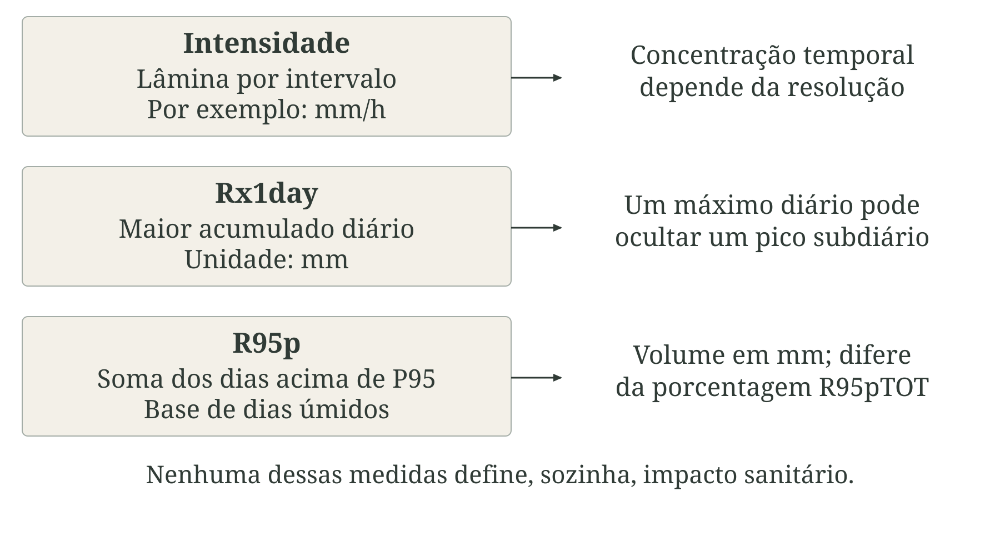
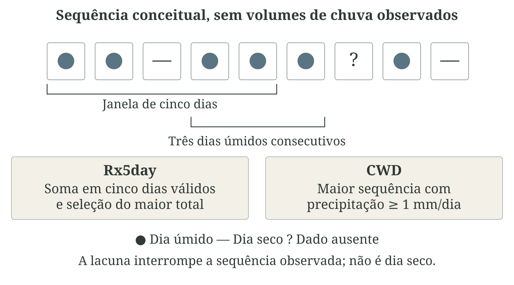
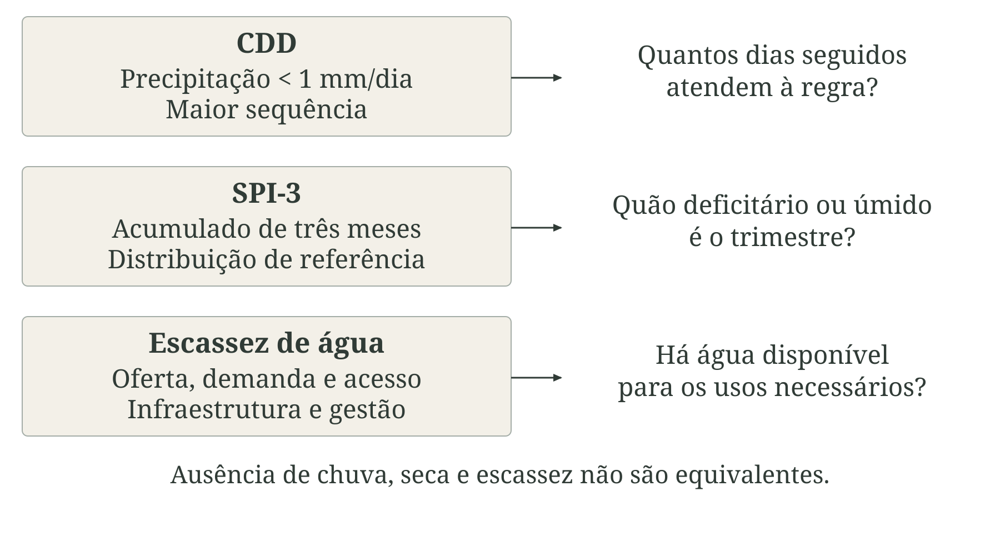
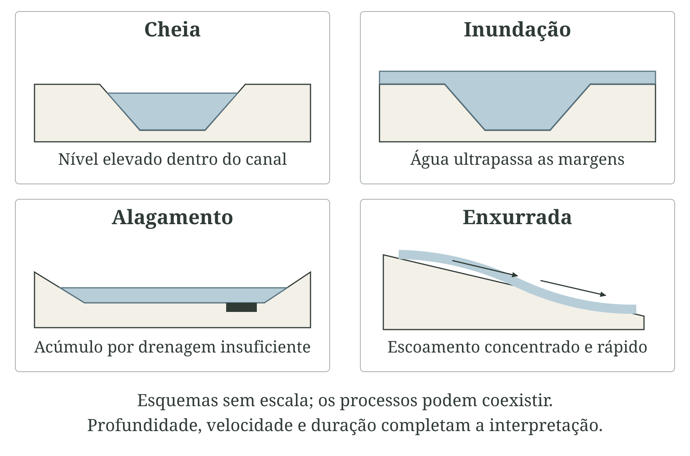
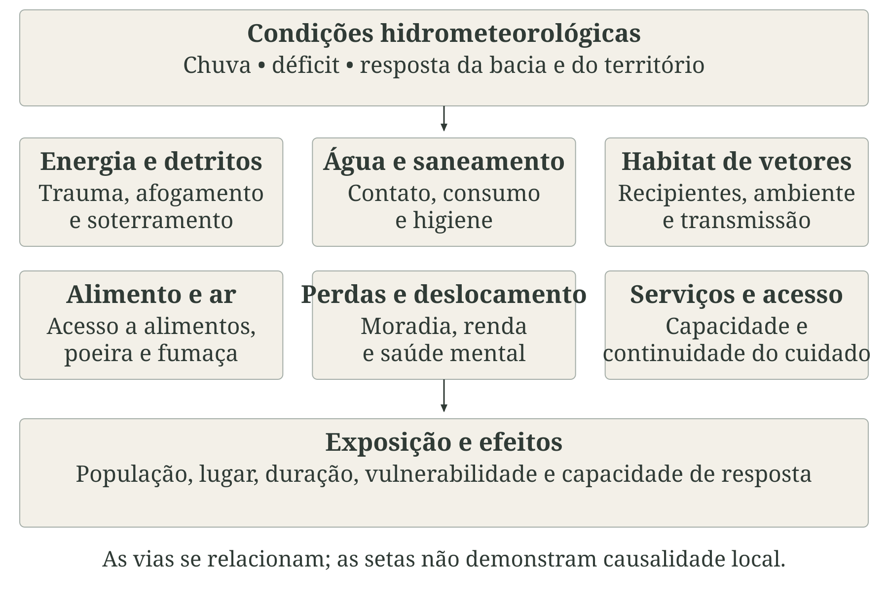
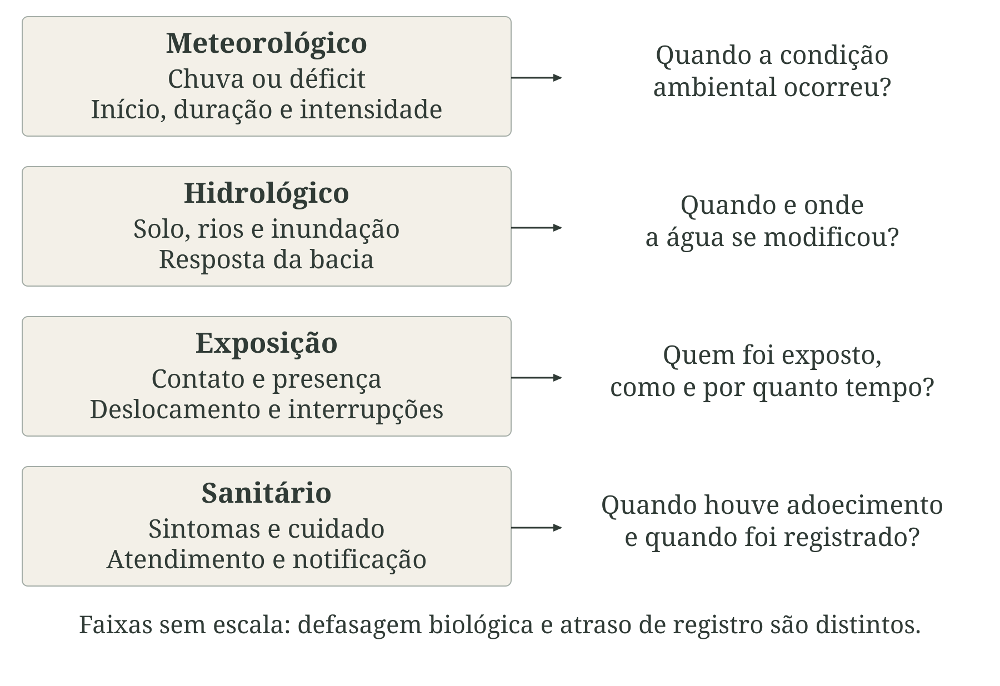
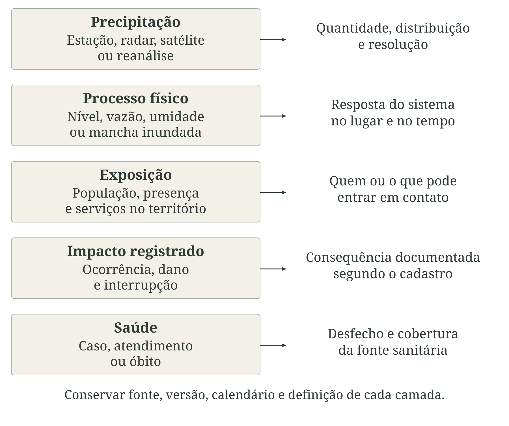
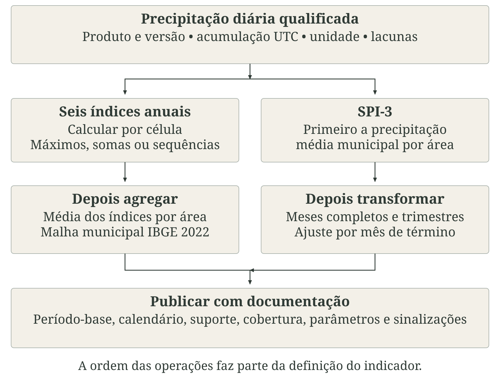
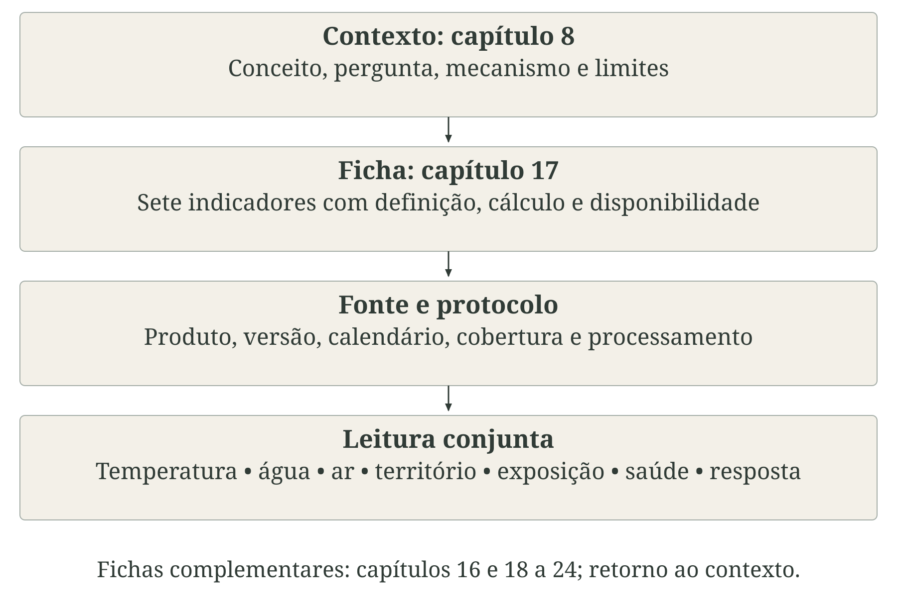

# Precipitação, secas, inundações e deslizamentos {#sec-precipitacao}

A água conecta o clima às condições em que as pessoas vivem, trabalham e recebem cuidado. A quantidade de chuva e sua distribuição no tempo e no espaço participam da disponibilidade de água, da produção de alimentos, da qualidade ambiental e da circulação de agentes infecciosos. Essas relações ocorrem durante a alternância habitual entre estações e também quando há excesso ou déficit persistente de precipitação. Para a saúde pública, interessa compreender como o regime de chuvas modifica exposições, necessidades e possibilidades de proteção [@ipcc2022saude; @barcellos2009clima].

Parte dos efeitos é imediata e visível: afogamentos, lesões e soterramentos durante inundações, enxurradas ou movimentos de massa. Outros dependem de etapas intermediárias. O comprometimento da captação, do tratamento e da distribuição de água pode alterar a exposição a patógenos; a redução da água disponível pode dificultar higiene e preparo de alimentos. Perdas de produção, renda e moradia, deslocamentos e dificuldades de acesso aos serviços também repercutem sobre a saúde. O tempo de recuperação desses sistemas pode ultrapassar o do evento físico [@who2014floods; @who2026drought; @freitas2014desastres].

As doenças vetoriais ajudam a perceber por que a análise não deve ficar restrita à ocorrência de desastres. A chuva pode criar ou renovar habitats aquáticos; escoamentos fortes podem removê-los temporariamente; períodos secos podem estimular o armazenamento doméstico de água. Temperatura, características dos recipientes, abastecimento, manejo ambiental, mobilidade e circulação dos agentes modificam essas relações. Um estudo brasileiro sobre dengue encontrou associações distintas após condições extremamente úmidas e secas, com diferenças segundo urbanização e interrupções do abastecimento. Isso exige examinar contexto e defasagens, sem presumir aumento uniforme de doença a cada aumento de chuva [@lowe2021dengue].

Secas também se articulam à insegurança alimentar, à poeira e à fumaça, às perdas de meios de vida e ao sofrimento psíquico. Tanto o excesso quanto a escassez de água podem interromper deslocamentos, abastecimento e atendimento, afetando a continuidade do cuidado no Sistema Único de Saúde (SUS). A discussão se conecta aos capítulos de [temperatura](../../chapters/part-2/07-temperatura-condicoes-termicas.qmd), [qualidade do ar](../../chapters/part-2/09-qualidade-ar-queimadas-fumaca.qmd), [água e saneamento](../../chapters/part-2/10-agua-saneamento-qualidade-ambiental.qmd) e [resposta e adaptação](../../chapters/part-3/15-resposta-adaptacao-resiliencia.qmd) [@brasil2026planoseca; @who2023framework].

::: {.callout-note icon=false title="Conceito-chave: fenômeno, exposição e consequência"}
Precipitação é uma entrada de água no sistema. Estiagem e seca descrevem situações de redução ou déficit de chuva, segundo referência e duração especificadas. Cheia, inundação, alagamento e enxurrada descrevem processos hidrológicos distintos; movimentos de massa envolvem deslocamento de solo ou rocha pela gravidade. Exposição acrescenta quem ou o que está em contato com essas condições. Desastre envolve perturbações graves resultantes da interação entre eventos perigosos, exposição, vulnerabilidade e capacidade. Efeito em saúde é uma consequência que precisa ser observada ou estimada por método próprio [@undrr2017terminology; @cemaden2026ameacas].
:::

A @fig-cadeia-hidrometeorologica organiza essas distinções. O regime de chuvas não é, por si só, um dano: pode sustentar a vida e, em determinadas condições, participar de processos perigosos. As [fichas de precipitação e seca, no capítulo 18](../../chapters/part-4/18-fichas-precipitacao-secas-eventos-hidrologicos.qmd), descrevem medidas climáticas específicas. Sua interpretação ganha sentido quando articulada aos capítulos de [exposição e vulnerabilidade](../../chapters/part-3/13-exposicao-vulnerabilidade.qmd) e [efeitos sobre a saúde](../../chapters/part-3/14-efeitos-saude.qmd).

::: {.figure-with-source}

{#fig-cadeia-hidrometeorologica fig-alt="Três paisagens hipotéticas contrastam chuva regular, excesso e déficit. O esquema distingue precipitação, estiagem e seca, processos hidrológicos e movimentos de massa, exposição, efeitos sanitários e desastre. Água, vetores, alimento, ar e serviços mediam relações modificadas por vulnerabilidade e capacidade." width="100%" print-src="arte-cap8-00-conceitos-print.png"}

[Fonte: elaboração conceitual com base em IPCC (2022); UNDRR; OMS; Lowe et al. (2021). Autoria: composição e rótulos próprios; aquarela produzida com IA (image_gen). Cenas e esquemas sem dados observados. Licença: a mesma dos textos autorais da obra.]{.figure-source}

:::

## Precipitação e variabilidade das chuvas

Precipitação é a água que alcança a superfície em forma líquida ou sólida. A chuva predomina nas aplicações brasileiras discutidas aqui, embora outras formas de precipitação possam ser relevantes em situações particulares. O acumulado é expresso como lâmina de água: 1 mm corresponde a 1 litro por metro quadrado de superfície horizontal. Intensidade relaciona essa lâmina ao intervalo de ocorrência, por exemplo em mm/h. Uma quantidade acumulada sem a duração não descreve a intensidade do episódio [@wmo2024instrumentos; @wmo2023climatological].

Pluviômetros observam a precipitação que alcança a abertura do instrumento em um ponto. Vento, obstrução, respingos, manutenção e resolução de registro influenciam a medida. Radares meteorológicos estimam campos a partir do sinal recebido dos hidrometeoros, enquanto produtos de satélite utilizam informações de sensores e algoritmos; reanálises combinam modelos e observações para reconstruir o estado do sistema. Cada produto tem suporte espacial, frequência e fontes de erro próprios. A @fig-precipitacao-observacao liga medição e interpretação; instrumentos e instalações são detalhados no [Apêndice B](../../backmatter/apendice-estacoes.qmd).

::: {.figure-with-source}

{#fig-precipitacao-observacao fig-alt="Pluviômetro e técnico em terreno aberto, com cidade distante. Três etapas relacionam lâmina em milímetros, intervalo de acumulação e suporte espacial. A estação observa um ponto; a média territorial exige método próprio." width="100%" print-src="arte-cap8-01-observacao-print.png"}

[Fonte: elaboração conceitual com base em OMM, guias de instrumentos e práticas climatológicas. Autoria: composição e rótulos próprios; aquarela produzida com IA (image_gen). Cenas e esquemas sem dados observados. Licença: a mesma dos textos autorais da obra.]{.figure-source}

:::

O total diário depende de quando o dia começa e termina. Uma janela das 9h às 9h não equivale à de meia-noite a meia-noite. O horário em Tempo Universal Coordenado (UTC), o fuso local, o fechamento da observação e a convenção para traços de precipitação devem acompanhar os dados. Um mesmo episódio pode ser repartido em dois dias por uma convenção e concentrado em um por outra. Essa questão é desenvolvida no [capítulo sobre espaço, tempo e qualidade](../../chapters/part-1/04-espaco-tempo-qualidade.qmd) [@wmo2023climatological].

A variabilidade inclui diferenças entre horas, dias, estações e anos. O mesmo total mensal pode resultar de episódios concentrados ou de chuvas frequentes e moderadas. Início e término da estação chuvosa, intervalos secos dentro dela e distribuição espacial sobre a bacia ajudam a interpretar o abastecimento, o trabalho e os habitats dos vetores. Uma estação representa seu entorno; a média municipal é outro suporte; a bacia hidrográfica pode atravessar limites administrativos. Essas unidades precisam ser relacionadas explicitamente antes de vincular precipitação e registros sanitários [@barcellos2009clima; @wmo2023climatological].

A [ficha PRCPTOT](../../chapters/part-4/18-fichas-precipitacao-secas-eventos-hidrologicos.qmd#sec-cli-prc-06) resume a chuva anual em dias úmidos, definidos por precipitação de pelo menos 1 mm. Essa soma exclui os dias abaixo do limiar, distinguindo-se de um total que inclua toda a precipitação. Para aplicações sanitárias, deve ser complementada por indicadores de intensidade e persistência e pelas [medidas de água e saneamento](../../chapters/part-4/20-fichas-agua-saneamento-qualidade-ambiental.qmd).

### Chuvas intensas

Chuva intensa pode ser descrita por intensidade em determinado intervalo, por ultrapassagem de um limiar absoluto, por posição na distribuição local ou pelo máximo observado no período. Essas definições respondem a perguntas diferentes. Um percentil identifica raridade em relação à base escolhida; um valor absoluto expressa quantidade; um máximo seleciona um episódio dentro do intervalo de análise. Nenhuma dessas operações, isoladamente, estabelece um limiar universal de dano [@climdex2024; @wmo2023climatological].

A [ficha Rx1day](../../chapters/part-4/18-fichas-precipitacao-secas-eventos-hidrologicos.qmd#sec-cli-prc-01) apresenta a maior precipitação diária do período. A [ficha R95p](../../chapters/part-4/18-fichas-precipitacao-secas-eventos-hidrologicos.qmd#sec-cli-prc-03) soma os volumes dos dias cuja precipitação supera o percentil 95 dos dias úmidos da base. R95p pode aumentar porque ocorreram mais dias acima do limiar, porque esses dias foram mais chuvosos ou por ambas as razões. Sua unidade é mm; a contribuição percentual desses dias, R95pTOT, é outra medida. A @fig-chuvas-intensas distingue máximo, concentração e intensidade.

::: {.figure-with-source}

{#fig-chuvas-intensas fig-alt="Três linhas diferenciam intensidade por intervalo, Rx1day como máximo diário e R95p como soma acima do percentil 95. O período-base pertence à definição de R95p. Não há série numérica nem limiar sanitário proposto." width="100%" print-src="arte-cap8-02-intensidade-print.png"}

[Fonte: elaboração conceitual com base em Climdex; fichas CLI-PRC-01 e CLI-PRC-03. Autoria: composição e rótulos próprios. Cenas e esquemas sem dados observados. Licença: a mesma dos textos autorais da obra.]{.figure-source}

:::

Eventos subdiários merecem atenção em pequenas bacias e áreas urbanas. A soma diária pode esconder uma concentração breve que ultrapasse a capacidade de drenagem. Para enxurradas e alagamentos rápidos, séries em minutos ou horas e relações intensidade–duração–frequência podem ser necessárias. Período de retorno expressa uma probabilidade sob um modelo e suas hipóteses; não é um calendário que determina quando outro evento ocorrerá. Mudanças na série, na urbanização e nas condições climáticas limitam a transferência de uma relação histórica para outra situação [@wmo2023climatological; @ipcc2021extremes].

A passagem da chuva ao dano depende de impermeabilização, declividade, solo, manutenção da drenagem, níveis de rios e exposição. Essa mediação conecta a análise ao [capítulo sobre uso da terra e ambiente urbano](../../chapters/part-2/11-uso-cobertura-terra-ambiente-urbano.qmd), às suas [fichas](../../chapters/part-4/21-fichas-uso-cobertura-terra-ambiente-urbano.qmd) e às [fichas de desastres](../../chapters/part-4/22-fichas-eventos-severos-desastres.qmd). O índice anual caracteriza o histórico; a avaliação de um episódio exige a série e as condições disponíveis naquele momento.

### Chuvas persistentes

Persistência indica continuidade, mas precisa de uma regra: dias sucessivos que ultrapassam um limiar, acumulação em uma janela ou permanência de condições hidrológicas. Chuvas moderadas repetidas podem elevar a umidade do solo e sustentar aportes à rede de drenagem. O efeito depende do estado antecedente, das perdas, do armazenamento e da resposta da bacia; a contagem de dias chuvosos não observa diretamente nenhum desses componentes [@wmo2023climatological; @who2014floods].

A [ficha Rx5day](../../chapters/part-4/18-fichas-precipitacao-secas-eventos-hidrologicos.qmd#sec-cli-prc-02) registra a maior soma em cinco dias consecutivos. A [ficha CWD](../../chapters/part-4/18-fichas-precipitacao-secas-eventos-hidrologicos.qmd#sec-cli-prc-05) registra a maior sequência de dias com pelo menos 1 mm. Uma sequência pode ter igual duração e volumes muito diferentes; uma janela de cinco dias pode conter dias secos. A @fig-chuvas-persistentes mostra por que as duas medidas são complementares [@climdex2024].

::: {.figure-with-source}

{#fig-chuvas-persistentes fig-alt="Sequência didática de símbolos distingue dia úmido, dia seco e dado ausente. Uma janela Rx5day inclui cinco dias válidos, mesmo contendo dia seco; CWD acompanha dias úmidos consecutivos. O desenho não contém medições e a lacuna não é classificada como seca." width="100%" print-src="arte-cap8-03-persistencia-print.png"}

[Fonte: elaboração conceitual com base em Climdex; fichas CLI-PRC-02 e CLI-PRC-05. Autoria: composição e rótulos próprios. Cenas e esquemas sem dados observados. Licença: a mesma dos textos autorais da obra.]{.figure-source}

:::

O tempo de resposta físico orienta a janela de análise. Pequenas bacias podem responder rapidamente; grandes sistemas fluviais integram aportes de áreas distantes e de dias anteriores. Também pode continuar a haver inundação depois de cessar a chuva local. Usar apenas a precipitação do município ou do dia do atendimento pode perder esse encadeamento [@who2014floods; @cemaden2026ameacas].

Para a saúde, persistência pode representar dificuldades de acesso, manutenção de ambientes úmidos e mudanças na qualidade da água. O vínculo deve ser demonstrado por informações intermediárias, como nível, extensão inundada, qualidade da água e interrupções. Consulte o [capítulo de água e saneamento](../../chapters/part-2/10-agua-saneamento-qualidade-ambiental.qmd), as [fichas de qualidade da água](../../chapters/part-4/20-fichas-agua-saneamento-qualidade-ambiental.qmd) e a [ficha de interrupções dos serviços de saúde](../../chapters/part-4/22-fichas-eventos-severos-desastres.qmd#sec-des-sau-02).

### Ausência de chuva

Um dia seco é uma classificação operacional. Na [ficha CDD](../../chapters/part-4/18-fichas-precipitacao-secas-eventos-hidrologicos.qmd#sec-cli-prc-04), corresponde a precipitação inferior a 1 mm, podendo incluir pequenas quantidades de água. CDD mede a maior sequência desses dias. Um dado ausente não permite saber se o dia foi seco: transformá-lo em zero cria ou prolonga artificialmente sequências [@climdex2024].

Um intervalo sem chuva esperado na estação seca tem significado diferente de uma interrupção no período em que normalmente chove. Aridez descreve uma condição climática de longo prazo; sazonalidade seca descreve a alternância esperada; seca envolve déficit em relação a uma referência e a um processo especificados. Também é possível haver escassez de água por demanda, infraestrutura ou gestão mesmo sem anomalia meteorológica. A @fig-ausencia-chuva separa essas perguntas [@wmo2016drought].

::: {.figure-with-source}

{#fig-ausencia-chuva fig-alt="Três perguntas separam CDD, SPI-3 e disponibilidade de água. CDD classifica sequências, SPI-3 compara acumulados com a referência e escassez requer informação de oferta, demanda e acesso. Não se trata de uma sequência obrigatória." width="100%" print-src="arte-cap8-04-ausencia-print.png"}

[Fonte: elaboração conceitual com base em OMM (2012, 2016); fichas CLI-PRC-04 e CLI-SEC-01. Autoria: composição e rótulos próprios. Cenas e esquemas sem dados observados. Licença: a mesma dos textos autorais da obra.]{.figure-source}

:::

Anomalias percentuais são intuitivas, mas podem ser instáveis em meses com pouca chuva esperada: o denominador pequeno amplia a diferença relativa. O [SPI-3](../../chapters/part-4/18-fichas-precipitacao-secas-eventos-hidrologicos.qmd#sec-cli-sec-01) usa a distribuição ajustada dos acumulados de três meses para caracterizar déficit ou excesso padronizado. Não é uma porcentagem de redução da chuva nem uma medida direta de água disponível [@wmo2012spi].

O uso em saúde exige acompanhar os elos posteriores. Intermitência do abastecimento, armazenamento domiciliar, acesso a alimentos, poeira e fumaça podem mudar durante períodos secos, dependendo do território e das respostas. As [fichas de água e saneamento](../../chapters/part-4/20-fichas-agua-saneamento-qualidade-ambiental.qmd), as [fichas de qualidade do ar e fumaça](../../chapters/part-4/19-fichas-qualidade-ar-queimadas-fumaca.qmd) e o [capítulo de efeitos sobre a saúde](../../chapters/part-3/14-efeitos-saude.qmd) permitem organizar essa leitura [@who2026drought; @lowe2021dengue].

## Secas e estiagens

Estiagem e seca têm definições que variam entre climatologia, agricultura, hidrologia e registros administrativos. Estiagem costuma designar redução ou interrupção da chuva esperada em um intervalo mais curto; seca caracteriza um déficit persistente, delimitado pela referência, duração e sistema considerado. Ao usar uma classificação institucional, é necessário declarar sua fonte e seus critérios. Não se deve transformar uma duração mencionada em determinado documento em limite universal entre os dois termos [@wmo2016drought; @brasil2026planoseca].

O déficit pode se propagar da precipitação para o solo, a vegetação, os rios e os reservatórios. Essa propagação envolve atrasos e amortecimento: armazenamento anterior pode sustentar o abastecimento, enquanto demanda elevada e calor podem acelerar dificuldades. A recuperação também é desigual; o retorno da chuva não recompõe imediatamente aquíferos, reservatórios, safras, renda ou acesso aos serviços. A @fig-propagacao-seca representa esses componentes sem impor uma sequência obrigatória [@wmo2016drought; @ipcc2022saude].

::: {.figure-with-source}

{#fig-propagacao-seca fig-alt="Paisagem hipotética com cultivo estressado, reservatório baixo e bairro. O esquema distingue precipitação, solo e vegetação, rios e reservatórios e acesso a água e alimentos. Demanda, calor, armazenamento e resposta modificam a propagação; o retorno da chuva não recupera tudo ao mesmo tempo." width="100%" print-src="arte-cap8-05-seca-print.png"}

[Fonte: elaboração conceitual com base em OMM (2016); IPCC (2022); Ministério da Saúde (2026). Autoria: composição e rótulos próprios; aquarela produzida com IA (image_gen). Cenas e esquemas sem dados observados. Licença: a mesma dos textos autorais da obra.]{.figure-source}

:::

::: {#qua-tipos-seca}

| Tipo | Processo dominante | Exemplos de medidas | Relação com saúde |
|---|---|---|---|
| Meteorológica | Precipitação abaixo da referência | SPI e anomalias de precipitação | Contexto climático para investigar exposições |
| Agrícola ou ecológica | Água insuficiente no solo e estresse de plantas ou ecossistemas | Umidade do solo, balanço hídrico e vegetação | Produção de alimentos, renda, poeira e fogo |
| Hidrológica | Redução de vazões, níveis e armazenamento | Vazão, nível, volume útil e água subterrânea | Abastecimento, deslocamento e operação de serviços |
| Socioeconômica | Oferta insuficiente diante da demanda por bens e serviços dependentes de água | Interrupções, produção, preços e população afetada | Higiene, alimentação, meios de vida e cuidado |

Tipos de seca e sua relação com saúde

:::

A Organização Meteorológica Mundial (OMM) recomenda o Índice Padronizado de Precipitação (SPI) para a caracterização meteorológica. O acumulado escolhido muda a pergunta: SPI-1 responde ao mês recente; SPI-3 integra três meses; SPI-6 e SPI-12 acompanham acúmulos mais longos. Essas escalas não são equivalentes automáticos dos tipos de seca do quadro. A relação com umidade do solo, vazão ou disponibilidade precisa ser examinada no sistema estudado [@wmo2012spi; @wmo2016drought].

O SPI transforma a probabilidade do acumulado em uma escala normal padronizada. Valores negativos indicam déficit em relação à distribuição ajustada e positivos indicam condição relativamente úmida. Zero corresponde à mediana dessa distribuição, não necessariamente à média de chuva. Na [ficha CLI-SEC-01](../../chapters/part-4/18-fichas-precipitacao-secas-eventos-hidrologicos.qmd#sec-cli-sec-01), o protocolo é SPI-3. A delimitação de episódios requer regras explícitas de início, término, duração e intensidade; uma classe mensal não informa sozinha toda a trajetória do evento.

O Índice Padronizado de Precipitação e Evapotranspiração (SPEI) acrescenta a demanda evaporativa por meio de um balanço climático entre precipitação e evapotranspiração potencial. Sua interpretação depende do método usado para estimar essa demanda e do ajuste probabilístico. SPEI, SPI e CDD não são intercambiáveis: representam balanço climático, anomalia da precipitação e persistência de dias secos, respectivamente. O SPEI é apresentado aqui como comparação conceitual; as fichas deste domínio mantêm o SPI-3 [@vicenteserrano2010spei].

Para a saúde, é necessário aproximar o déficit de suas consequências: regularidade e qualidade da água, produção e acesso a alimentos, exposição à fumaça, deslocamentos e funcionamento da rede assistencial. Esses componentes podem evoluir de modo diferente entre bairros, zonas rurais e comunidades ribeirinhas. Articule os índices climáticos às [fichas de água](../../chapters/part-4/20-fichas-agua-saneamento-qualidade-ambiental.qmd), de [fumaça](../../chapters/part-4/19-fichas-qualidade-ar-queimadas-fumaca.qmd) e de [resposta dos serviços](../../chapters/part-4/25-fichas-resposta-adaptacao-resiliencia.qmd), com a interpretação territorial do [capítulo de vulnerabilidade](../../chapters/part-3/13-exposicao-vulnerabilidade.qmd).

## Inundações, alagamentos e enxurradas

O ciclo hidrológico envolve interceptação, infiltração, armazenamento, evapotranspiração e escoamento. A chuva se distribui entre esses componentes conforme características do terreno e condições antecedentes. A resposta de um rio integra contribuições da bacia; a resposta de uma rua depende também da drenagem e das conexões com outros trechos. Essa perspectiva explica por que volume precipitado e área inundada são informações diferentes [@wmo2023climatological; @cemaden2026ameacas].

::: {.callout-note icon=false title="Conceito-chave: cheia, inundação, alagamento e enxurrada"}
Cheia, também chamada de enchente em parte da literatura técnica, é a elevação do nível do curso d'água, sem necessariamente haver transbordamento. Inundação ocorre quando a água ultrapassa os limites habituais do canal e ocupa áreas adjacentes. Alagamento é acúmulo temporário de água, frequentemente urbano, associado à insuficiência do escoamento e da drenagem. Enxurrada é escoamento rápido, concentrado e de elevada energia. Os usos cotidianos dos termos podem se sobrepor; registros comparáveis precisam de definições explícitas [@cemaden2016enxurrada; @cemaden2026ameacas].
:::

A @fig-processos-hidrologicos apresenta a distinção física. Não há uma sequência obrigatória entre os quatro termos: um alagamento pode ocorrer sem transbordamento de rio, e uma enxurrada pode percorrer uma vertente ou canal estreito. Na zona costeira, maré e condições a jusante podem dificultar a drenagem; em bacias extensas, a chuva a montante pode produzir elevação do nível onde pouco choveu. A caracterização deve conservar a localização e o horário das diferentes observações.

::: {.figure-with-source}

{#fig-processos-hidrologicos fig-alt="Quatro cortes vetoriais sem escala mostram água elevada dentro do canal, transbordamento sobre margens, água acumulada em depressão urbana e escoamento concentrado sobre declive. Profundidade, velocidade e duração são dimensões complementares." width="100%" print-src="arte-cap8-06-processos-print.png"}

[Fonte: elaboração conceitual com base em Cemaden, definições de ameaças naturais; OMS (2014). Autoria: composição e rótulos próprios. Cenas e esquemas sem dados observados. Licença: a mesma dos textos autorais da obra.]{.figure-source}

:::

Nível é a altura da superfície da água em relação a uma referência; vazão é o volume que atravessa uma seção por unidade de tempo. A conversão entre ambos depende das características da seção e de uma relação calibrada, que pode mudar. Para avaliar contato e dano, também interessam profundidade, velocidade, duração, extensão inundada, velocidade de subida e acesso a rotas de saída. Uma mancha com igual extensão pode representar condições muito diferentes conforme esses atributos [@who2014floods; @cemaden2026ameacas].

Uma mancha obtida por sensoriamento remoto é uma estimativa condicionada ao sensor, ao horário de passagem, à resolução e ao método. Água sob vegetação, nuvens em sensores ópticos e confusão com superfícies permanentes podem limitar a classificação. O cruzamento com população residente estima uma dimensão de exposição territorial: não identifica automaticamente quem permaneceu, evacuou, trabalhava ou estava em trânsito. Mapas previstos e observados também devem ser identificados separadamente, como discutido nos capítulos de [qualidade dos dados](../../chapters/part-1/04-espaco-tempo-qualidade.qmd) e [exposição](../../chapters/part-3/13-exposicao-vulnerabilidade.qmd).

A população potencialmente exposta, as pessoas diretamente afetadas e as notificações de agravos resultam de definições e fontes distintas. As [fichas de pessoas afetadas](../../chapters/part-4/22-fichas-eventos-severos-desastres.qmd#sec-des-hum-02) e de [danos em instalações de saúde](../../chapters/part-4/22-fichas-eventos-severos-desastres.qmd#sec-des-sau-01) documentam registros de consequências. A ficha de [Rx1day](../../chapters/part-4/18-fichas-precipitacao-secas-eventos-hidrologicos.qmd#sec-cli-prc-01) documenta chuva; não deve ocupar o lugar dessas medidas. O [capítulo de desastres](../../chapters/part-2/12-eventos-severos-desastres.qmd) desenvolve a interpretação dos registros administrativos [@undrr2017terminology].

## Deslizamentos

Movimento de massa designa o deslocamento de solo, rocha ou detritos pela gravidade. Deslizamentos são parte desse conjunto, que também compreende quedas de blocos e fluxos de detritos, entre outros processos. Eles diferem quanto ao material, à geometria, à velocidade e à extensão. Embora a água possa participar de sua deflagração, são processos geomorfológicos, e não sinônimos de inundação [@cemaden2022massa; @who2026landslides].

A chuva pode modificar a umidade e as pressões da água no terreno, reduzindo a estabilidade em determinadas condições. Declividade, características geológicas, espessura do solo, cobertura, drenagem, cortes, aterros e vazamentos influenciam a suscetibilidade. O acumulado antecedente e a intensidade recente ajudam a caracterizar a condição de deflagração, mas não medem diretamente a estabilidade da encosta. A @fig-encostas-chuva relaciona esses componentes sem representar um laudo geotécnico [@cemaden2022massa; @cemaden2026alerta].

::: {.figure-with-source}

{#fig-encostas-chuva fig-alt="Encosta urbana hipotética com cicatriz de deslizamento e material sobre acesso viário. Chuva antecedente e recente interage com material, relevo e drenagem; pessoas, redes e acessos podem ser atingidos. A imagem não classifica o risco de um local real." width="100%" print-src="arte-cap8-07-encostas-print.png"}

[Fonte: elaboração conceitual com base em Cemaden; OMS, Landslides. Autoria: composição e rótulos próprios; aquarela produzida com IA (image_gen). Cenas e esquemas sem dados observados. Licença: a mesma dos textos autorais da obra.]{.figure-source}

:::

Suscetibilidade descreve a propensão física à ocorrência; exposição identifica pessoas e estruturas que podem ser alcançadas; vulnerabilidade e capacidade modificam as consequências. A localização de uma moradia em encosta não permite, sozinha, classificar seu risco. É preciso considerar o percurso possível do material, as condições da construção e as informações técnicas locais. Articule essa leitura aos capítulos de [uso da terra](../../chapters/part-2/11-uso-cobertura-terra-ambiente-urbano.qmd), [exposição e vulnerabilidade](../../chapters/part-3/13-exposicao-vulnerabilidade.qmd) e às [fichas de vulnerabilidade](../../chapters/part-4/23-fichas-exposicao-vulnerabilidade.qmd).

Limiares de chuva podem integrar sistemas de alerta, desde que se conheçam área de validade, fonte, período de calibração e desempenho. Um limiar calibrado em outra encosta não é automaticamente transferível. Monitoramento, inspeção técnica, comunicação e possibilidade de evacuação integram a resposta; um indicador climático anual não oferece sozinho essa operação [@cemaden2026alerta].

Além de trauma, soterramento e asfixia, podem ocorrer ruptura de redes, isolamento, perda de moradia, deslocamento e interrupção prolongada do cuidado. A consulta a [Rx5day](../../chapters/part-4/18-fichas-precipitacao-secas-eventos-hidrologicos.qmd#sec-cli-prc-02) contextualiza acumulação; as [fichas de mortes e desaparecidos](../../chapters/part-4/22-fichas-eventos-severos-desastres.qmd#sec-des-hum-01) e de [interrupções dos serviços](../../chapters/part-4/22-fichas-eventos-severos-desastres.qmd#sec-des-sau-02) abordam consequências documentadas. A escolha depende da pergunta e deve conservar essa distinção [@who2026landslides].

## Caminhos entre eventos hidrometeorológicos e saúde

Relacionar clima e saúde exige descrever o percurso entre a condição ambiental e o desfecho. O mesmo fenômeno pode atuar por várias vias, e uma mesma doença pode ter determinantes diferentes. Excesso de água pode provocar contato com contaminantes, alterar habitats ou interromper acesso; déficit pode comprometer higiene, produção e transporte. Saneamento, condições de moradia, trabalho, proteção social e capacidade de resposta modificam esses percursos [@ipcc2022saude; @who2021edrmresearch].

A @fig-vias-hidrossanitarias organiza as vias discutidas a seguir. As setas indicam relações conceituais sustentadas pela literatura, sem demonstrar que ocorreram em um território específico. A investigação deve distinguir observação, hipótese de mecanismo e estimativa de associação, conforme o [capítulo de efeitos sobre a saúde](../../chapters/part-3/14-efeitos-saude.qmd). As [fichas de mortalidade e internações hospitalares](../../chapters/part-4/24-fichas-efeitos-saude.qmd) oferecem medidas de mortalidade e internações, mas não abrangem todos os agravos nem atribuem sua ocorrência à chuva.

::: {.figure-with-source}

{#fig-vias-hidrossanitarias fig-alt="Esquema relaciona chuva, déficit e resposta territorial a seis vias: energia da água e detritos; água e saneamento; habitats de vetores; alimentos e ar; perdas e deslocamentos; serviços e acesso. Efeitos dependem da exposição, vulnerabilidade, capacidade e tempo." width="100%" print-src="arte-cap8-08-vias-print.png"}

[Fonte: elaboração conceitual com base em IPCC (2022); OMS; capítulos 13 a 15. Autoria: composição e rótulos próprios. Cenas e esquemas sem dados observados. Licença: a mesma dos textos autorais da obra.]{.figure-source}

:::

### Danos imediatos e exposições durante a recuperação

Inundações rápidas e enxurradas podem produzir afogamentos, trauma, quedas, ferimentos por detritos e acidentes elétricos. Movimentos de massa acrescentam soterramento e asfixia. Profundidade e velocidade da água, estabilidade das estruturas, visibilidade e tempo para saída condicionam o perigo. Pessoas em deslocamento, trabalhadores e equipes de resposta podem estar expostos mesmo sem residir na área atingida [@who2014floods; @who2026landslides].

A exposição pode continuar após a retração da água. Retorno à moradia, remoção de entulho, limpeza, contato com instalações danificadas e esforço físico compõem outras situações. Um recorte restrito ao dia da chuva perde parte desse período. A @fig-recuperacao-exposicoes distingue evento, retorno e recuperação, sem estabelecer prazos iguais para todos os locais.

::: {.figure-with-source}

{#fig-recuperacao-exposicoes fig-alt="Duas cenas hipotéticas mostram rua inundada sem pessoas na água e preparação de limpeza após a água baixar. Adultos usam roupas compridas, botas e luvas. O esquema distingue perigos do evento, exposições no retorno e necessidade de acompanhamento; a cena não é um protocolo de limpeza." width="100%" print-src="arte-cap8-09-recuperacao-print.png"}

[Fonte: elaboração conceitual com base em OMS (2014); OMS (2022), pesquisa em gestão de riscos de emergências e desastres. Autoria: composição e rótulos próprios; aquarela produzida com IA (image_gen). Cenas e esquemas sem dados observados. Licença: a mesma dos textos autorais da obra.]{.figure-source}

:::

As [fichas de mortes e desaparecidos](../../chapters/part-4/22-fichas-eventos-severos-desastres.qmd#sec-des-hum-01) e de [pessoas diretamente afetadas](../../chapters/part-4/22-fichas-eventos-severos-desastres.qmd#sec-des-hum-02) devem ser lidas com as regras do cadastro. A [ficha de internações SUS por causa](../../chapters/part-4/24-fichas-efeitos-saude.qmd#sec-efe-mob-01) descreve eventos assistenciais em um universo definido, não todas as lesões. Relacionar fontes exige examinar duplicações, data do evento, local e critérios, conforme o [capítulo de desastres](../../chapters/part-2/12-eventos-severos-desastres.qmd).

A vigilância precisa registrar as circunstâncias dos agravos e a cobertura da busca. Menos atendimentos pode significar menor ocorrência, mas também isolamento ou dificuldade de acesso. Uma comparação entre períodos deve considerar a capacidade de notificar e atender, além da mudança física do perigo [@who2021edrmresearch].

### Água, saneamento e leptospirose

Chuvas e escoamento podem transportar matéria fecal, sedimentos e substâncias químicas para mananciais e locais de contato. A falha no tratamento ou na distribuição pode ampliar exposições. Durante secas, menor disponibilidade e intermitência podem dificultar higiene e favorecer fontes alternativas inseguras. O efeito sobre doenças diarreicas varia conforme patógeno, saneamento, condições antecedentes e intervalo entre exposição e doença [@levy2016waterborne].

Essas relações não têm uma direção única: o transporte e a diluição de contaminantes, por exemplo, podem coexistir. Um total de chuva não informa sua concentração na água consumida. É preciso representar origem, tratamento, distribuição, armazenamento e uso, como na @fig-agua-contato. As [fichas de E. coli](../../chapters/part-4/20-fichas-agua-saneamento-qualidade-ambiental.qmd#sec-san-agu-02), [cloro residual](../../chapters/part-4/20-fichas-agua-saneamento-qualidade-ambiental.qmd#sec-san-agu-03) e [turbidez](../../chapters/part-4/20-fichas-agua-saneamento-qualidade-ambiental.qmd#sec-san-agu-04) medem aspectos diferentes, dependentes da amostragem e do ponto de coleta [@brasil2024agua].

::: {.figure-with-source}

{#fig-agua-contato fig-alt="Três vinhetas hipotéticas mostram córrego turvo, infraestrutura de abastecimento e uso doméstico. O esquema distingue transporte de contaminantes, tratamento e distribuição, armazenamento e uso. Um ramo separa ingestão de contato com água ou lama; leptospirose é uma zoonose bacteriana, sem vetor mosquito." width="100%" print-src="arte-cap8-10-agua-print.png"}

[Fonte: elaboração conceitual com base em Levy et al. (2016); Ministério da Saúde, Leptospirose. Autoria: composição e rótulos próprios; aquarela produzida com IA (image_gen). Cenas e esquemas sem dados observados. Licença: a mesma dos textos autorais da obra.]{.figure-source}

:::

Leptospirose é uma zoonose bacteriana relacionada à exposição direta ou indireta à urina de animais infectados, especialmente roedores. Água e lama contaminadas podem permitir a entrada da bactéria por mucosas e pela pele, particularmente quando lesionada ou submetida a imersão prolongada. Essa via não depende de mosquito e deve ser distinguida da transmissão vetorial. A investigação precisa considerar contato, trabalho, limpeza e condições de saneamento, além de exposição fora da residência [@brasil2026leptospirose].

O intervalo entre contato e sintomas e o tempo até atendimento e notificação afastam o registro sanitário da data da chuva. A definição de casos e a busca de exposição devem seguir a orientação oficial; chuva ou inundação, isoladamente, não confirmam diagnóstico. O [capítulo de água e saneamento](../../chapters/part-2/10-agua-saneamento-qualidade-ambiental.qmd) e o [capítulo de efeitos](../../chapters/part-3/14-efeitos-saude.qmd) ajudam a relacionar dados ambientais e epidemiológicos sem confundi-los.

### Doenças vetoriais e ecologia da transmissão

A precipitação participa da disponibilidade de habitats para formas imaturas de mosquitos, mas a chuva necessária e o tipo de habitat variam entre espécies. Recipientes domésticos, reservatórios, margens e outras coleções de água não cumprem a mesma função. O desenvolvimento do vetor também depende da temperatura e de condições locais, enquanto a transmissão exige a presença do agente e oportunidades de contato com hospedeiros [@ipcc2022saude; @mordecai2017temperature].

Para dengue, tanto chuvas quanto seca podem favorecer condições de transmissão por caminhos distintos. Recipientes podem acumular água com a chuva; sob falhas do abastecimento, o armazenamento doméstico pode manter criadouros durante períodos secos. Chuvas muito fortes também podem remover formas imaturas de certos habitats. A @fig-chuva-vetores destaca essas possibilidades e o papel do manejo dos recipientes [@lowe2021dengue].

::: {.figure-with-source}

{#fig-chuva-vetores fig-alt="Quintais hipotéticos contrastam recipiente enchido pela chuva e tambor aberto usado para armazenamento durante período seco. Agente observa o segundo recipiente. O esquema relaciona água nos recipientes, manejo, temperatura e vetor à possibilidade de transmissão, condicionada ao agente e à população suscetível." width="100%" print-src="arte-cap8-11-vetores-print.png"}

[Fonte: elaboração conceitual com base em Lowe et al. (2021); IPCC (2022). Autoria: composição e rótulos próprios; aquarela produzida com IA (image_gen). Cenas e esquemas sem dados observados. Licença: a mesma dos textos autorais da obra.]{.figure-source}

:::

Lowe et al. estudaram dados mensais de dengue em microrregiões brasileiras e modelaram relações não lineares e defasadas com condições hidrometeorológicas. A associação após seca foi particularmente relevante em contextos urbanizados com interrupções do abastecimento. O estudo sustenta a investigação conjunta de clima e infraestrutura; seus resultados não definem uma defasagem universal para qualquer município, doença ou índice. O índice de seca utilizado no estudo também não deve ser tratado como equivalente ao SPI-3 das fichas [@lowe2021dengue].

Para outras doenças vetoriais, é necessário explicitar vetor, habitat, agente e território, em vez de transportar diretamente o modelo da dengue. Sazonalidade, mobilidade, imunidade, intervenções de controle e capacidade de detecção podem alterar o padrão observado. As séries de chuva ajudam a contextualizar, mas não substituem vigilância epidemiológica e entomológica [@ipcc2022saude].

A análise pode combinar [CDD](../../chapters/part-4/18-fichas-precipitacao-secas-eventos-hidrologicos.qmd#sec-cli-prc-04), [CWD](../../chapters/part-4/18-fichas-precipitacao-secas-eventos-hidrologicos.qmd#sec-cli-prc-05) ou [SPI-3](../../chapters/part-4/18-fichas-precipitacao-secas-eventos-hidrologicos.qmd#sec-cli-sec-01) com informações de abastecimento, conforme os capítulos de [temperatura](../../chapters/part-2/07-temperatura-condicoes-termicas.qmd), [água](../../chapters/part-2/10-agua-saneamento-qualidade-ambiental.qmd) e [efeitos](../../chapters/part-3/14-efeitos-saude.qmd). O livro não oferece uma ficha específica de infestação vetorial ou incidência de dengue; a utilização desses desfechos requer definição e fonte próprias.

### Segurança alimentar, poeira e fumaça

Déficits de água podem reduzir produção agrícola, criação de animais e disponibilidade de alimentos, mas a alimentação das famílias também depende de renda, preços, distribuição e proteção social. Insegurança alimentar não é sinônimo de baixa precipitação: é uma condição de acesso e disponibilidade que precisa de mensuração própria. Perdas produtivas podem repercutir além do território diretamente seco, e a recuperação dos meios de vida pode ser mais lenta que a recuperação da chuva [@who2026drought; @ipcc2022saude].

A perda de umidade de solo e vegetação pode favorecer poeira e condições para propagação de fogo. A ocorrência de incêndio depende ainda de ignição e manejo, enquanto a exposição à fumaça depende de emissões, transporte, dispersão e presença humana. Assim, CDD ou SPI não medem concentração de material particulado. A @fig-seca-alimento-ar separa o caminho dos alimentos daquele da qualidade do ar.

::: {.figure-with-source}

{#fig-seca-alimento-ar fig-alt="Vinhetas hipotéticas de produção e acesso a alimentos e de ambiente seco com fumaça distante. Duas vias distinguem produção, renda e acesso de emissões, transporte e concentração. SPI e CDD não medem diretamente nutrição nem material particulado." width="100%" print-src="arte-cap8-12-alimento-ar-print.png"}

[Fonte: elaboração conceitual com base em OMS, Drought; IPCC (2022); OMS (2021), qualidade do ar. Autoria: composição e rótulos próprios; aquarela produzida com IA (image_gen). Cenas e esquemas sem dados observados. Licença: a mesma dos textos autorais da obra.]{.figure-source}

:::

Articule [SPI-3](../../chapters/part-4/18-fichas-precipitacao-secas-eventos-hidrologicos.qmd#sec-cli-sec-01) às [fichas de qualidade do ar](../../chapters/part-4/19-fichas-qualidade-ar-queimadas-fumaca.qmd), especialmente [PM2,5 de fumaça ponderado pela população](../../chapters/part-4/19-fichas-qualidade-ar-queimadas-fumaca.qmd#sec-amb-fum-01). A cadeia emissão–concentração–exposição–efeito é desenvolvida no [capítulo sobre queimadas e fumaça](../../chapters/part-2/09-qualidade-ar-queimadas-fumaca.qmd). As [fichas de mortalidade e internações hospitalares](../../chapters/part-4/24-fichas-efeitos-saude.qmd) podem apoiar a investigação de desfechos definidos, sem atribuir automaticamente seus registros à seca [@who2021air].

A vigilância nutricional e a avaliação de acesso a alimentos complementam essa leitura. O conjunto de fichas deste capítulo não mensura diretamente insegurança alimentar, desnutrição ou perda de renda. A escolha de dados adicionais deve observar população, periodicidade, representatividade e conceito, seguindo o [capítulo sobre seleção de fontes e qualificação de indicadores](../../chapters/part-1/05-fontes-fichas.qmd).

### Deslocamento, perdas e saúde mental

Perda de moradia, pertences, renda, vínculos e segurança pode gerar sofrimento psíquico durante e após um evento. Incerteza sobre retorno, endividamento e repetição de ameaças prolongam demandas de cuidado. Na seca, a deterioração gradual dos meios de vida pode tornar menos visível o início do processo; em eventos súbitos, evacuação e abrigo alteram rapidamente a vida cotidiana [@ipcc2022saude; @who2026drought; @freitas2014desastres].

Um estudo inglês sobre inundações encontrou associação entre exposição ou perturbação da vida cotidiana e problemas de saúde mental avaliados um ano depois. O desenho, a participação e o contexto limitam a transferência das estimativas para outros territórios. A contribuição para este capítulo é mostrar que água dentro da residência e interrupção da rotina são dimensões diferentes de exposição e que a observação não deve terminar quando a água baixa [@waite2017flooding].

::: {.figure-with-source}

{#fig-deslocamento-cuidado fig-alt="Pessoa com bagagem em acolhimento temporário e conversa reservada com profissional em outra vinheta. O esquema relaciona perdas, mudança da rotina, redes de apoio e acompanhamento. As pessoas têm expressões sérias; a imagem não atribui diagnósticos." width="100%" print-src="arte-cap8-13-deslocamento-print.png"}

[Fonte: elaboração conceitual com base em Waite et al. (2017); OMS; Freitas et al. (2014). Autoria: composição e rótulos próprios; aquarela produzida com IA (image_gen). Cenas e esquemas sem dados observados. Licença: a mesma dos textos autorais da obra.]{.figure-source}

:::

A @fig-deslocamento-cuidado relaciona perdas, deslocamento e redes de apoio. Sofrimento não deve ser convertido automaticamente em diagnóstico, nem toda pessoa atingida apresentará o mesmo desfecho. A avaliação precisa de instrumentos adequados, continuidade e atenção às condições sociais. Abrigos, moradias temporárias e territórios de acolhimento podem concentrar novas necessidades fora da mancha inicial do evento [@who2014floods; @who2021edrmresearch].

A [ficha de pessoas afetadas](../../chapters/part-4/22-fichas-eventos-severos-desastres.qmd#sec-des-hum-02) e as [fichas de vulnerabilidade](../../chapters/part-4/23-fichas-exposicao-vulnerabilidade.qmd) ajudam a caracterizar parte do contexto, mas não medem sofrimento individual. Dados de saúde mental e acompanhamento psicossocial exigem definição própria. Os capítulos de [exposição](../../chapters/part-3/13-exposicao-vulnerabilidade.qmd), [efeitos](../../chapters/part-3/14-efeitos-saude.qmd) e [resposta](../../chapters/part-3/15-resposta-adaptacao-resiliencia.qmd) orientam a articulação entre contexto, registro e cuidado.

### Continuidade do cuidado e capacidade dos serviços

Eventos hidrometeorológicos podem aumentar a demanda e reduzir a capacidade de atendimento ao mesmo tempo. Uma unidade pode sofrer dano físico ou permanecer intacta, mas ficar sem água, energia, insumos, comunicação ou acesso. Trabalhadores e pacientes podem não conseguir chegar; serviços de outro território podem receber a demanda deslocada. Essas situações tornam insuficiente contar apenas estabelecimentos dentro da área inundada [@who2023framework; @who2014floods].

A continuidade inclui cuidados de condições crônicas, acompanhamento de gestantes, dispensação de medicamentos, vacinação, urgências e atividades de vigilância. A importância de cada dependência deve ser avaliada segundo o serviço: armazenamento de insumos, cadeia fria, higiene, laboratório e transporte não são igualmente sensíveis a todas as falhas. A @fig-continuidade-hidrica organiza dependências e acesso sem sugerir que uma única solução assegure o funcionamento.

::: {.figure-with-source}

{#fig-continuidade-hidrica fig-alt="Unidade de saúde hipotética com reservação de água, acesso viário e ambiente de atendimento. O esquema separa infraestrutura, chegada de pessoas e insumos e cuidado continuado. Unidade fora da inundação também pode perder capacidade." width="100%" print-src="arte-cap8-14-servicos-print.png"}

[Fonte: elaboração conceitual com base em OMS (2023), sistemas de saúde resilientes ao clima. Autoria: composição e rótulos próprios; aquarela produzida com IA (image_gen). Cenas e esquemas sem dados observados. Licença: a mesma dos textos autorais da obra.]{.figure-source}

:::

As [fichas de interrupção de água](../../chapters/part-4/25-fichas-resposta-adaptacao-resiliencia.qmd#sec-res-wat-01) e de [energia](../../chapters/part-4/25-fichas-resposta-adaptacao-resiliencia.qmd#sec-res-ene-01) registram falhas relevantes; a [ficha de serviços básicos de água, saneamento e higiene](../../chapters/part-4/25-fichas-resposta-adaptacao-resiliencia.qmd#sec-res-was-01) aborda componentes da estrutura. A [ficha de interrupções associadas a desastres](../../chapters/part-4/22-fichas-eventos-severos-desastres.qmd#sec-des-sau-02) tem outra origem e definição. Resultados devem manter seus denominadores, períodos e universos.

O [capítulo de resiliência dos sistemas de saúde](../../chapters/part-3/15-resposta-adaptacao-resiliencia.qmd) desenvolve preparação e continuidade. Para avaliar atendimento, é necessário examinar também encaminhamentos, remarcações, procura reprimida e recuperação da operação. Uma redução de internações durante o evento não demonstra redução da necessidade de cuidado [@who2023framework].

### Defasagens e interpretação epidemiológica

A chuva observada, a resposta da bacia, o contato humano e o registro de doença obedecem a tempos distintos. O intervalo pode incluir escoamento, deslocamento, desenvolvimento de vetores, incubação, procura por atendimento e notificação. Na seca, efeitos mediados por produção, abastecimento e renda podem se acumular e continuar após a normalização do indicador climático. A @fig-relogios-hidrometeorologicos separa esses relógios [@gasparrini2010dlnm; @levy2016waterborne].

::: {.figure-with-source}

{#fig-relogios-hidrometeorologicos fig-alt="Quatro faixas distinguem precipitação ou déficit, resposta hidrológica, contato e deslocamento, e sintomas, atendimento e notificação. Setas não têm escala de tempo; defasagem física, biológica e atraso informacional são distintos." width="100%" print-src="arte-cap8-15-relogios-print.png"}

[Fonte: elaboração conceitual com base em Gasparrini et al. (2010); Levy et al. (2016); capítulos 4 e 14. Autoria: composição e rótulos próprios. Cenas e esquemas sem dados observados. Licença: a mesma dos textos autorais da obra.]{.figure-source}

:::

O desenho epidemiológico deve especificar exposição, desfecho, população, unidade espacial e período. Modelos com defasagens distribuídas permitem examinar associações ao longo do tempo, inclusive não lineares; sua flexibilidade não dispensa hipótese nem controle de sazonalidade, tendências e outros fatores relevantes. Escolher a janela apenas porque produziu a associação mais forte aumenta o risco de interpretar ruído como evidência [@gasparrini2010dlnm; @hernan2020causal].

Também importa distinguir variável mediadora de fator de confusão. Se a pergunta é sobre o efeito total de um déficit de chuva, controlar indiscriminadamente uma consequência intermediária, como interrupção do abastecimento, pode alterar o efeito estimado. Se a pergunta é sobre aquele caminho específico, são necessários desenho e pressupostos compatíveis. Um diagrama conceitual ajuda a tornar a hipótese explícita, mas suas setas não substituem evidência [@hernan2020causal].

Os capítulos de [espaço, tempo e qualidade](../../chapters/part-1/04-espaco-tempo-qualidade.qmd) e de [efeitos sobre a saúde](../../chapters/part-3/14-efeitos-saude.qmd) desenvolvem essas escolhas. Ao combinar as [fichas climáticas](../../chapters/part-4/18-fichas-precipitacao-secas-eventos-hidrologicos.qmd) e as [fichas de mortalidade e internações hospitalares](../../chapters/part-4/24-fichas-efeitos-saude.qmd), mantenha as séries adequadas à escala da pergunta: máximos anuais não reconstituem o dia de exposição de cada paciente. Documente análises de sensibilidade e limites de cobertura, evitando inferência individual a partir de associações territoriais.

## Fontes, seleção e principais indicadores

A escolha começa pela pergunta. Descrever regime pluviométrico, investigar uma enxurrada, acompanhar seca e relacionar exposição a agravos requerem resoluções e tempos de disponibilização diferentes. Uma série mensal longa pode sustentar análise de déficit e ser inadequada para um processo que evolui em minutos. Uma transmissão rápida pode ajudar a resposta e ainda necessitar de controle antes de compor uma série histórica [@wmo2023climatological; @wmo2016drought].

O [Instituto Nacional de Meteorologia (INMET)](../../backmatter/indice-fontes.qmd#inmet) oferece observações de estações. O [Centro Nacional de Monitoramento e Alertas de Desastres Naturais (Cemaden)](../../backmatter/indice-fontes.qmd#cemaden) mantém redes orientadas ao monitoramento de risco. Verifique, em cada produto, unidade, fuso, intervalo, qualidade e caráter bruto ou consolidado do registro. O [Apêndice B](../../backmatter/apendice-estacoes.qmd) detalha instrumentos; o [capítulo de seleção de fontes e qualificação de indicadores](../../chapters/part-1/05-fontes-fichas.qmd) orienta a avaliação da documentação.

Produtos em grade ampliam a cobertura, mas não eliminam incerteza. O [ERA5-Land](../../backmatter/indice-fontes.qmd#era5-land) é uma reanálise, enquanto o [CHIRPS v3](../../backmatter/indice-fontes.qmd#chirps-v3) combina informações para estimar precipitação. A versão diária RNL utiliza ERA5 na desagregação temporal, de modo que não constitui uma validação inteiramente independente dessa família de reanálises. Rede de estações, relevo, resolução e método influenciam a representação dos extremos [@chirps2026v3; @ecmwf2026daily].

A @fig-fontes-hidrometeorologicas separa cinco camadas: precipitação, processo físico, exposição, impacto registrado e desfecho sanitário. Radar e satélite podem complementar a distribuição espacial da chuva; sensores de nível e medições de vazão representam a resposta hidrológica; cadastro de ocorrências representa consequências documentadas. Substituir uma camada por outra modifica o significado da análise. Os capítulos de [desastres](../../chapters/part-2/12-eventos-severos-desastres.qmd), [exposição](../../chapters/part-3/13-exposicao-vulnerabilidade.qmd) e [efeitos](../../chapters/part-3/14-efeitos-saude.qmd) aprofundam as últimas etapas [@undrr2017terminology].

::: {.figure-with-source}

{#fig-fontes-hidrometeorologicas fig-alt="Matriz relaciona precipitação a observações ou estimativas, processo físico a nível ou mancha, exposição a presença e território, impacto a cadastro de consequências e saúde a registros sanitários. Cada camada mantém fonte, tempo e definição." width="100%" print-src="arte-cap8-16-fontes-print.png"}

[Fonte: elaboração conceitual com base em OMM; UNDRR; arquitetura das fichas do livro. Autoria: composição e rótulos próprios. Cenas e esquemas sem dados observados. Licença: a mesma dos textos autorais da obra.]{.figure-source}

:::

Antes de selecionar uma fonte, examine extensão e homogeneidade da série, cobertura espacial, resolução, latência, revisões e disponibilidade de metadados. Falhas durante tempestades ou falta de energia podem se concentrar justamente nos episódios de interesse. Completude anual aparentemente boa não garante observação adequada do extremo subdiário. Períodos-base de índices padronizados e percentílicos precisam de documentação adicional [@wmo2023climatological; @wmo2012spi].

O quadro apresenta as sete medidas operacionais do [capítulo 18](../../chapters/part-4/18-fichas-precipitacao-secas-eventos-hidrologicos.qmd). Nenhuma mede diretamente área inundada, volume útil de reservatório, incidência de doença ou população afetada. Essas medidas complementares precisam de dados e protocolos apropriados, e podem ser relacionadas às [fichas de água](../../chapters/part-4/20-fichas-agua-saneamento-qualidade-ambiental.qmd), de [desastres](../../chapters/part-4/22-fichas-eventos-severos-desastres.qmd) e de [mortalidade e internações hospitalares](../../chapters/part-4/24-fichas-efeitos-saude.qmd).

::: {#qua-indicadores-precipitacao}

| Indicador | Aspecto representado | Uso em saúde pública | Cuidado de interpretação |
|---|---|---|---|
| [Rx1day](../../chapters/part-4/18-fichas-precipitacao-secas-eventos-hidrologicos.qmd#sec-cli-prc-01) | Maior acumulado diário | Contexto de episódios agudos | Pode ocultar concentração subdiária |
| [Rx5day](../../chapters/part-4/18-fichas-precipitacao-secas-eventos-hidrologicos.qmd#sec-cli-prc-02) | Maior soma em cinco dias | Contexto de saturação e resposta da bacia | Não mede umidade do solo ou vazão |
| [R95p](../../chapters/part-4/18-fichas-precipitacao-secas-eventos-hidrologicos.qmd#sec-cli-prc-03) | Volume acima do percentil 95 | Concentração de chuva em extremos | Depende da base; unidade em mm |
| [CDD](../../chapters/part-4/18-fichas-precipitacao-secas-eventos-hidrologicos.qmd#sec-cli-prc-04) | Maior sequência de dias secos | Contexto de água, alimento, poeira e fogo | Não define sozinho seca ou escassez |
| [CWD](../../chapters/part-4/18-fichas-precipitacao-secas-eventos-hidrologicos.qmd#sec-cli-prc-05) | Maior sequência de dias úmidos | Persistência e exposições mediadas | Não informa intensidade ou volume |
| [SPI-3](../../chapters/part-4/18-fichas-precipitacao-secas-eventos-hidrologicos.qmd#sec-cli-sec-01) | Anomalia do acumulado trimestral | Contexto de déficit ou excesso | Não incorpora evapotranspiração ou impacto |
| [PRCPTOT](../../chapters/part-4/18-fichas-precipitacao-secas-eventos-hidrologicos.qmd#sec-cli-prc-06) | Total anual em dias úmidos | Regime pluviométrico e denominador de R95pTOT | Exclui dias com menos de 1 mm |

Indicadores de precipitação e seca usados em saúde pública

:::

## Protocolo de cálculo e disponibilidade

As sete fichas têm o rótulo “Calculável com dados abertos”. Isso identifica entradas e métodos disponíveis, não uma série municipal nacional já produzida. O protocolo principal utiliza precipitação ERA5-Land desde 1950, com cadastro gratuito no Climate Data Store (CDS). A alternativa CHIRPS v3 daily RNL final começa em 1981. As duas séries devem conservar produto, versão e referência próprios; emendá-las pode introduzir descontinuidades. Pluviômetros locais são úteis para comparação e para produzir séries observadas separadas [@chirps2026v3; @ecmwf2026daily].

A @fig-protocolo-precipitacao organiza o percurso entre entrada, calendário, qualidade, cálculo e publicação. As especificações completas estão nas [fichas do capítulo 18](../../chapters/part-4/18-fichas-precipitacao-secas-eventos-hidrologicos.qmd). Sua leitura deve acompanhar o [capítulo de espaço, tempo e qualidade](../../chapters/part-1/04-espaco-tempo-qualidade.qmd) e o [Apêndice metodológico](../../backmatter/apendice-metodologico.qmd).

::: {.figure-with-source}

{#fig-protocolo-precipitacao fig-alt="Fluxo parte da precipitação diária qualificada e se divide. Índices anuais são calculados por célula antes da média municipal; SPI-3 começa pela precipitação média municipal, seguida de somas e ajuste. Ambos exigem documentação de versão, referência e cobertura." width="100%" print-src="arte-cap8-17-protocolo-print.png"}

[Fonte: elaboração conceitual com base em Protocolos das sete fichas do capítulo 18; ECMWF. Autoria: composição e rótulos próprios. Cenas e esquemas sem dados observados. Licença: a mesma dos textos autorais da obra.]{.figure-source}

:::

No produto horário ERA5-Land usado nas fichas, o registro de precipitação das 00 UTC contém o acumulado das 24 horas anteriores. Para o dia de referência, utiliza-se o registro das 00 UTC do dia seguinte, convertendo metros em milímetros pela multiplicação por 1.000. Somar os acumulados horários sem desacumulação repete partes do mesmo volume. Essa convenção é específica do produto e não deve ser transferida automaticamente para outros conjuntos ERA5. A série diária em UTC também não é, por simples mudança de rótulo, uma série por dia civil brasileiro [@ecmwf2026daily].

A ordem das operações altera a medida. Para [Rx1day](../../chapters/part-4/18-fichas-precipitacao-secas-eventos-hidrologicos.qmd#sec-cli-prc-01), [Rx5day](../../chapters/part-4/18-fichas-precipitacao-secas-eventos-hidrologicos.qmd#sec-cli-prc-02), [R95p](../../chapters/part-4/18-fichas-precipitacao-secas-eventos-hidrologicos.qmd#sec-cli-prc-03), [CDD](../../chapters/part-4/18-fichas-precipitacao-secas-eventos-hidrologicos.qmd#sec-cli-prc-04), [CWD](../../chapters/part-4/18-fichas-precipitacao-secas-eventos-hidrologicos.qmd#sec-cli-prc-05) e [PRCPTOT](../../chapters/part-4/18-fichas-precipitacao-secas-eventos-hidrologicos.qmd#sec-cli-prc-06), calcula-se o índice por célula antes da média ponderada pela área de interseção com os municípios da malha de 2022 do Instituto Brasileiro de Geografia e Estatística (IBGE). A média de máximos locais não é o máximo da chuva média municipal; os extremos das células podem ter ocorrido em datas diferentes. Médias territoriais de durações podem ser fracionárias.

Os seis indicadores anuais seguem regras de elegibilidade das fichas: precipitação negativa ou ausente não é dia seco; anos com mais de 15 dias ausentes, ou mais de três em qualquer mês, são inválidos; a cobertura espacial válida deve alcançar pelo menos 90% da área municipal. São escolhas operacionais do livro, e não garantia de ausência de viés. Lacunas remanescentes podem reduzir somas, máximos e durações. Publique completude, sinalização de limites inferiores nas sequências e critérios de exclusão junto aos resultados.

Em Rx5day, a janela é atribuída ao seu último dia. Por isso, o cálculo do início do ano carrega os quatro dias finais do ano anterior e exige cinco valores válidos. Em CDD e CWD, adota-se a variante anual truncada em 31 de dezembro: a sequência que atravessa a virada é repartida. Lacunas interrompem a sequência observada e exigem sinalização; não demonstram uma interrupção física. Comparar com durações de episódios completos que cruzam anos exige reconhecer a diferença de definição.

R95p utiliza o percentil 95 dos dias com pelo menos 1 mm na base 1961–1990 para ERA5-Land, calculado pelo método de quantil tipo 8, sem janela móvel de calendário. Soma-se a precipitação dos dias que excedem estritamente esse valor. A base alternativa CHIRPS é 1981–2010. PRCPTOT fornece o denominador da contribuição percentual R95pTOT: 100 vezes R95p dividido por PRCPTOT. A porcentagem deve ser identificada separadamente, calculada no suporte espacial declarado e não definida quando o denominador for zero [@climdex2024].

O [SPI-3](../../chapters/part-4/18-fichas-precipitacao-secas-eventos-hidrologicos.qmd#sec-cli-sec-01) segue outra ordem: primeiro se obtém a precipitação diária média municipal ponderada por área, com máscara espacial constante e cobertura de pelo menos 90%; depois, somam-se meses completos e trimestres. O ajuste usa distribuição gama de dois parâmetros por máxima verossimilhança, separadamente para cada mês de término, com tratamento da proporção de zeros. A transformação para a escala normal deve conservar parâmetros, diagnósticos e sinalizações [@wmo2012spi].

A base SPI-3 é 1961–1990 no ERA5-Land e 1982–2011 no CHIRPS. A diferença decorre da necessidade dos meses antecedentes: janeiro e fevereiro de 1981 não dispõem de todo o trimestre no CHIRPS. Exigem-se 30 acumulados completos por mês de término, incluindo antecedentes ao início da base. Falta de variabilidade suficiente, menos de dois valores positivos distintos ou falha no ajuste produz ausência sinalizada; probabilidades nos extremos zero ou um produzem resultados não finitos, que não devem ser truncados arbitrariamente. Esses requisitos são específicos do protocolo e não se substituem pelos critérios de completude dos índices anuais.

O arquivo de saída deve conservar indicador, produto, versão, unidade, território, calendário, período-base, cobertura e método de agregação. O fechamento anual compreende anos completos; 2026 permanece parcial enquanto não houver todo o ano disponível. Uma atualização histórica precisa distinguir mudança de fenômeno de revisão do produto ou do processamento. Essas precauções dão continuidade ao percurso do [dado à decisão](../../chapters/part-1/06-indicador-decisao.qmd).

## Aplicação na gestão

Um painel ganha utilidade quando se vincula a decisões e responsabilidades. O diagnóstico histórico informa sazonalidade, áreas expostas e dependências; o acompanhamento operacional utiliza informações emitidas em tempo útil; a avaliação posterior examina ações, acesso e consequências. Essas funções se complementam e não devem ser confundidas. A @fig-gestao-hidrometeorologica relaciona preparação, monitoramento, ação e aprendizagem [@who2023framework; @who2021edrmresearch].

::: {.figure-with-source}

{#fig-gestao-hidrometeorologica fig-alt="Equipe em reunião e visita a uma comunidade, em cenas hipotéticas. Ciclo vetorial articula preparação, acompanhamento, ação e avaliação; gatilhos exigem responsabilidade e contexto. A cena não representa eficácia medida." width="100%" print-src="arte-cap8-18-gestao-print.png"}

[Fonte: elaboração conceitual com base em OMS (2023); Ministério da Saúde (2026); capítulo 6. Autoria: composição e rótulos próprios; aquarela produzida com IA (image_gen). Cenas e esquemas sem dados observados. Licença: a mesma dos textos autorais da obra.]{.figure-source}

:::

Na preparação, identifique condições locais de chuva e seca, áreas suscetíveis, rotas, serviços e grupos com dificuldades de proteção. Verifique contatos, alternativas de acesso, continuidade de água e energia, estoques e meios de comunicação. A [ficha de perfil de riscos do estabelecimento](../../chapters/part-4/25-fichas-resposta-adaptacao-resiliencia.qmd#sec-res-ris-01) e a [ficha de plano de emergência com continuidade](../../chapters/part-4/25-fichas-resposta-adaptacao-resiliencia.qmd#sec-res-pla-01) apoiam a organização desse trabalho. Os capítulos de [vulnerabilidade](../../chapters/part-3/13-exposicao-vulnerabilidade.qmd) e [resposta e resiliência](../../chapters/part-3/15-resposta-adaptacao-resiliencia.qmd) oferecem o contexto de interpretação.

Para chuva intensa, combine previsão e observação na escala necessária, condições antecedentes, níveis de rios, alertas e informações sobre população, acesso e serviços. Para seca, articule [SPI-3](../../chapters/part-4/18-fichas-precipitacao-secas-eventos-hidrologicos.qmd#sec-cli-sec-01), disponibilidade hídrica, abastecimento, condições alimentares, qualidade do ar e operação assistencial. Os indicadores históricos de [precipitação](../../chapters/part-4/18-fichas-precipitacao-secas-eventos-hidrologicos.qmd) ajudam a contextualizar; seu cálculo anual não oferece antecedência para uma enxurrada.

Limiar meteorológico descreve uma condição do fenômeno. Limiar de impacto relaciona essa condição a consequências em um contexto. Gatilho operacional acrescenta capacidade, autoridade, responsabilidades e procedimento. Documentar os três evita que um percentil, uma classe de seca ou uma cor de alerta seja adotado como ordem automática sem interpretação local. O plano nacional de seca e estiagem organiza estágios e ações do setor saúde; sua aplicação territorial requer articulação entre esferas e serviços, e não transposição mecânica de um número [@brasil2026planoseca].

A resposta deve articular vigilância, atenção primária, assistência, saúde do trabalhador, defesa civil, abastecimento e proteção social. A comunicação precisa informar condição, local, período, incerteza, ação possível e canais de apoio. Na seca, a piora pode ser gradual; após chuvas, algumas exposições permanecem durante limpeza e recuperação. A comunicação e o acompanhamento devem refletir essas temporalidades, como desenvolvido no [capítulo de análise de situação de saúde e decisão pública](../../chapters/part-1/06-indicador-decisao.qmd).

Acompanhe [interrupções de água](../../chapters/part-4/25-fichas-resposta-adaptacao-resiliencia.qmd#sec-res-wat-01), [energia](../../chapters/part-4/25-fichas-resposta-adaptacao-resiliencia.qmd#sec-res-ene-01), acessos e demanda deslocada. A [ficha de alerta precoce e resposta nacional — SPAR C5.1](../../chapters/part-4/25-fichas-resposta-adaptacao-resiliencia.qmd#sec-res-alr-01) usa uma autoavaliação nacional; seu resultado não mensura o desempenho do alerta municipal. Para avaliar esse desempenho, registre emissão, recebimento, compreensão, decisão e ação local [@who2021spar; @who2023framework].

Na avaliação, confronte o que estava disponível no momento da decisão com as informações consolidadas depois. Registre identificador do episódio, território, horários, fontes, versões, decisões e revisões. Examine alertas não confirmados, eventos não detectados, atrasos e obstáculos de resposta, além dos danos finais. As [fichas de desastres](../../chapters/part-4/22-fichas-eventos-severos-desastres.qmd) e de [mortalidade e internações hospitalares](../../chapters/part-4/24-fichas-efeitos-saude.qmd) contribuem com dimensões próprias. Comparações de resultados precisam considerar gravidade do evento, cobertura dos registros e desenho de avaliação, sem atribuir eficácia automaticamente à redução de atendimentos [@who2021edrmresearch; @cdc2024evaluation].

## Localização das fichas operacionais

As sete fichas estão reunidas no [capítulo 18](../../chapters/part-4/18-fichas-precipitacao-secas-eventos-hidrologicos.qmd). Cada uma apresenta conceito, finalidade, cálculo, fonte, disponibilidade, limitações e retorno ao capítulo de contexto. A escolha começa pela pergunta; a ficha permite verificar se a medida representa o processo e a escala de interesse. A @fig-navegacao-hidrologica mostra o percurso entre contexto, método, fonte e aplicação.

::: {.figure-with-source}

{#fig-navegacao-hidrologica fig-alt="Roteiro liga contexto do capítulo 8, fichas do capítulo 18, fontes e protocolo, e indicadores complementares dos capítulos 16 e 18 a 24. Links no texto permitem retorno ao contexto e acesso ao indicador específico." width="100%" print-src="arte-cap8-19-navegacao-print.png"}

[Fonte: elaboração conceitual com base em Arquitetura editorial do livro. Autoria: composição e rótulos próprios. Cenas e esquemas sem dados observados. Licença: a mesma dos textos autorais da obra.]{.figure-source}

:::

<!-- Âncoras legadas: preservam links anteriores à separação entre contexto e fichas. -->
``{=html}
``{=html}
``{=html}
``{=html}
``{=html}
``{=html}
``{=html}

| Pergunta | Ficha na Parte IV | Indicador |
|---|---|---|
| Qual foi o maior acumulado diário? | [CLI-PRC-01](../../chapters/part-4/18-fichas-precipitacao-secas-eventos-hidrologicos.qmd#sec-cli-prc-01) | Máxima em um dia — Rx1day |
| Qual foi a maior soma em cinco dias? | [CLI-PRC-02](../../chapters/part-4/18-fichas-precipitacao-secas-eventos-hidrologicos.qmd#sec-cli-prc-02) | Máxima em cinco dias — Rx5day |
| Quanto choveu nos dias acima do percentil 95? | [CLI-PRC-03](../../chapters/part-4/18-fichas-precipitacao-secas-eventos-hidrologicos.qmd#sec-cli-prc-03) | Chuva em dias muito úmidos — R95p |
| Quanto durou a maior sequência seca? | [CLI-PRC-04](../../chapters/part-4/18-fichas-precipitacao-secas-eventos-hidrologicos.qmd#sec-cli-prc-04) | Dias consecutivos secos — CDD |
| Quanto durou a maior sequência úmida? | [CLI-PRC-05](../../chapters/part-4/18-fichas-precipitacao-secas-eventos-hidrologicos.qmd#sec-cli-prc-05) | Dias consecutivos úmidos — CWD |
| Qual foi a anomalia padronizada do trimestre? | [CLI-SEC-01](../../chapters/part-4/18-fichas-precipitacao-secas-eventos-hidrologicos.qmd#sec-cli-sec-01) | Seca meteorológica — SPI-3 |
| Qual foi o total anual em dias úmidos? | [CLI-PRC-06](../../chapters/part-4/18-fichas-precipitacao-secas-eventos-hidrologicos.qmd#sec-cli-prc-06) | Precipitação em dias úmidos — PRCPTOT |

Para acompanhar o percurso até a saúde, complemente a medida climática com os domínios pertinentes: [temperatura](../../chapters/part-4/17-fichas-temperatura-condicoes-termicas.qmd), [qualidade do ar e fumaça](../../chapters/part-4/19-fichas-qualidade-ar-queimadas-fumaca.qmd), [água e saneamento](../../chapters/part-4/20-fichas-agua-saneamento-qualidade-ambiental.qmd), [ambiente urbano](../../chapters/part-4/21-fichas-uso-cobertura-terra-ambiente-urbano.qmd), [desastres](../../chapters/part-4/22-fichas-eventos-severos-desastres.qmd), [vulnerabilidade](../../chapters/part-4/23-fichas-exposicao-vulnerabilidade.qmd), [mortalidade e internações hospitalares](../../chapters/part-4/24-fichas-efeitos-saude.qmd) e [resposta](../../chapters/part-4/25-fichas-resposta-adaptacao-resiliencia.qmd). Os capítulos explicativos correspondentes ajudam a conferir finalidade, unidade e população antes de combinar indicadores.
