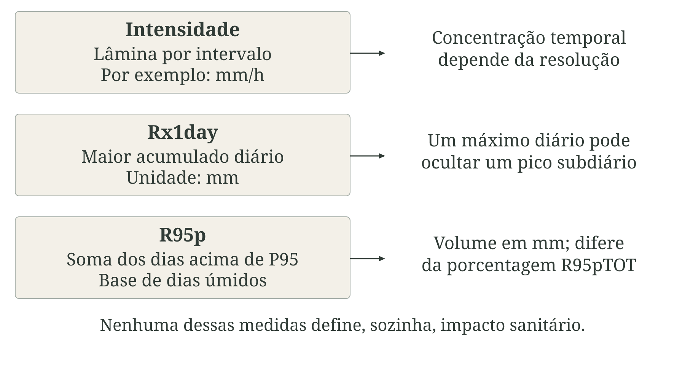
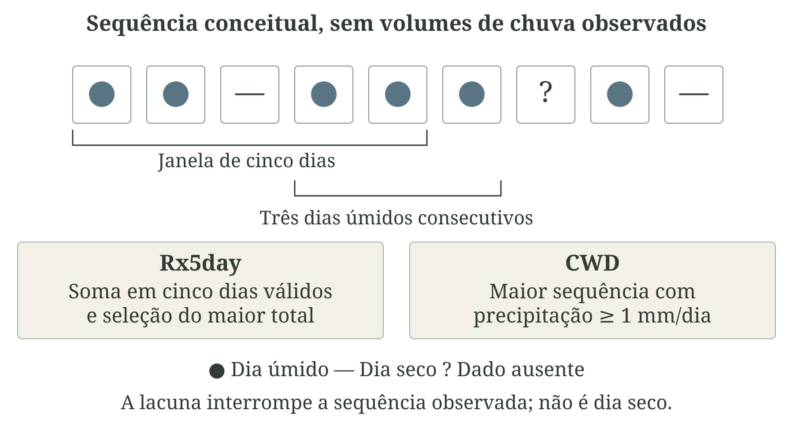
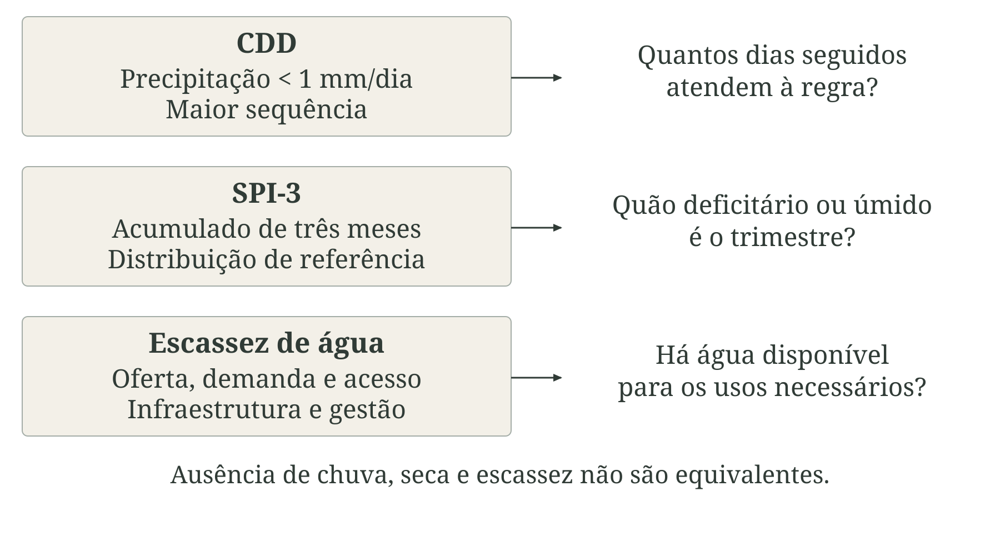
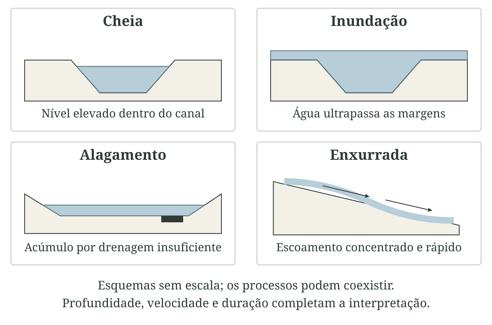
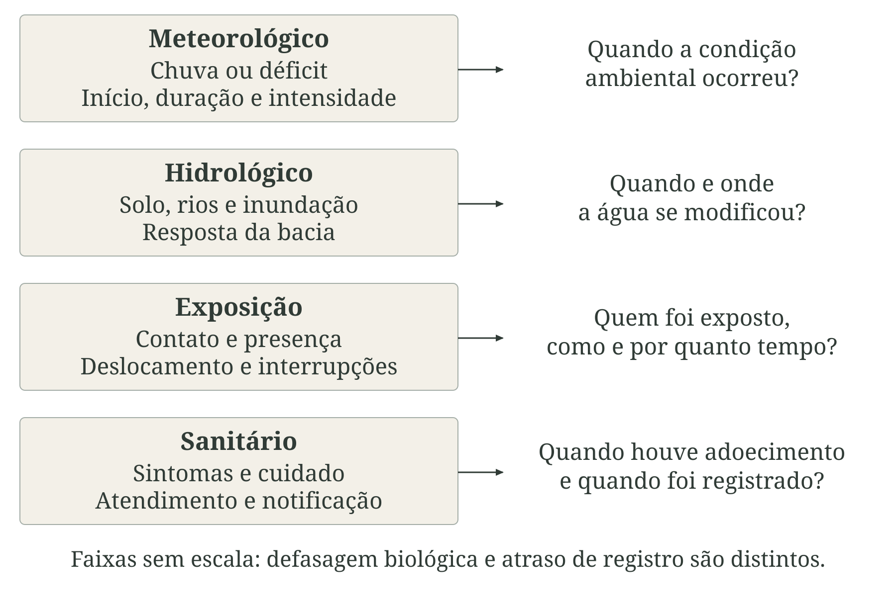
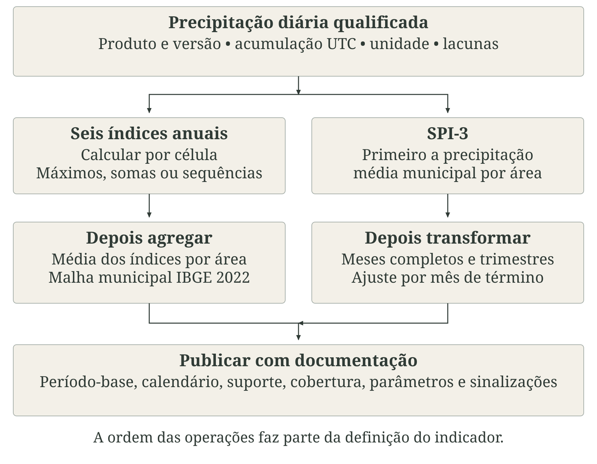
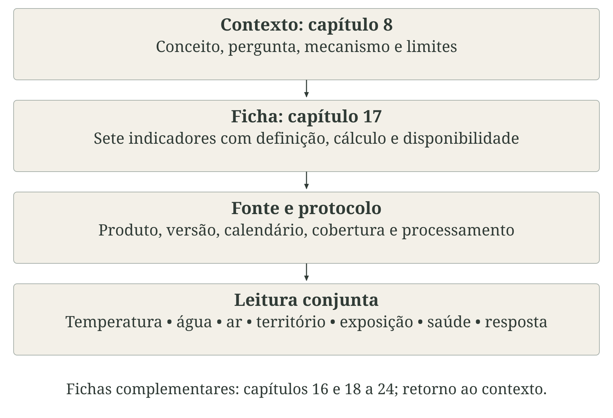

# Precipitação, secas, inundações e deslizamentos {#sec-precipitacao}

A água conecta o clima às condições em que as pessoas vivem, trabalham e recebem cuidados de saúde. A quantidade e a distribuição das chuvas influenciam diretamente a disponibilidade de água para consumo e higiene, a produção de alimentos e a circulação de agentes infecciosos. Essas relações aparecem tanto na rotina das estações quanto em períodos de excesso ou falta de chuva. Para a saúde pública, é essencial entender como o regime de chuvas altera os riscos e as necessidades de proteção da população [@ipcc2022saude; @barcellos2009clima].

Essa relação se torna evidente em eventos extremos, como inundações e movimentos de massa, que podem causar afogamentos e lesões graves. Além disso, quando a infraestrutura de tratamento e distribuição de água é prejudicada, a população fica mais exposta a doenças, pois a falta de água dificulta a higiene e o preparo de alimentos. Perdas de renda, de moradia e dificuldades de acesso a serviços também impactam a saúde. É importante notar que a recuperação desses sistemas pode demorar muito mais do que a duração do próprio evento físico [@who2014floods; @who2026drought; @freitas2014desastres].

No entanto, a análise do clima não deve se limitar apenas aos desastres imediatos; as doenças transmitidas por vetores oferecem um exemplo importante dessa complexidade. Por exemplo, a chuva pode criar ou renovar habitats para vetores, enquanto períodos secos podem levar ao armazenamento inadequado de água em casa. Outros fatores, como a temperatura e o manejo do ambiente, também influenciam essas relações. Um estudo sobre a dengue no Brasil mostrou que as condições de umidade e seca afetam a doença de formas diferentes, dependendo do nível de urbanização e do abastecimento de água. Isso exige que analisemos o contexto e o tempo de resposta, evitando a ideia de que o aumento da chuva causará sempre um aumento proporcional nas doenças [@lowe2021dengue].

Por outro lado, as secas também trazem riscos significativos, como a insegurança alimentar, a poeira, a perda de meios de vida e o sofrimento psicológico. Tanto o excesso quanto a falta de água podem interromper o transporte e o atendimento médico, prejudicando a continuidade dos serviços do Sistema Único de Saúde (SUS). Essa discussão se conecta aos temas de temperatura (@sec-temperatura), qualidade do ar (@sec-qualidade-ar), saneamento (@sec-agua-saneamento) e planos de resposta e adaptação [@brasil2026planoseca; @who2023framework].

::: {.callout-note icon=false title="Conceito-chave: fenômeno, exposição e consequência"}
-  Precipitação: Fenômeno atmosférico caracterizado pela ocorrência de chuva, neve ou granizo.
-  Estiagem e Seca: A estiagem refere-se à diminuição na frequência ou volume de chuvas. A seca é o déficit hídrico prolongado (climatológico, hidrológico ou agrícola), definido por métricas e durações específicas.
-  Cheia: o aumento do nível do rio; a inundação é o transbordamento para áreas não planejadas.
-  Alagamento: acúmulo de água em áreas urbanas (falha de drenagem).
-  Enxurrada: fluxo rápido e súbito de água.
-  Movimentos de Massa: Deslocamento de solo, rocha ou detritos pela ação da gravidade.
Exposição: A medida do contato de pessoas, bens ou infraestrutura com condições de perigo.
-  Desastre: Resultado da interação entre um evento perigoso, a exposição da população e a vulnerabilidade do sistema.
-  Efeito em Saúde: Impacto na saúde pública resultante da interação entre ambiente, clima e saúde, que deve ser mensurado por métodos específicos [@undrr2017terminology; @cemaden2026ameacas].
:::

A @fig-cadeia-hidrometeorologica organiza essas distinções. Embora o regime de chuvas seja fundamental para a vida e não represente, por si só, um perigo, ele pode contribuir para processos de risco em condições específicas. As fichas de indicadores sobre precipitação e seca, no @sec-fichas-precipitacao-secas-eventos-hidrologicos, descrevem medidas climáticas específicas. Sua interpretação ganha sentido quando articulada aos capítulos de exposição e vulnerabilidade (@sec-exposicao-vulnerabilidade) e efeitos sobre a saúde (@sec-efeitos-saude).

::: {.figure-with-source}

{#fig-cadeia-hidrometeorologica fig-alt="Três paisagens hipotéticas contrastam chuva regular, excesso e déficit. O esquema distingue precipitação, estiagem e seca, processos hidrológicos e movimentos de massa, exposição, efeitos sanitários e desastre. Água, vetores, alimento, ar e serviços mediam relações modificadas por vulnerabilidade e capacidade." width="100%" print-src="arte-cap8-00-conceitos-print.png"}

[Fonte: elaboração própria.]{.figure-source}

:::

## Precipitação e variabilidade das chuvas

A precipitação caracteriza-se pela deposição de água sobre a superfície em estado líquido ou sólido. No contexto brasileiro analisado aqui, a chuva é a forma predominante, embora outras formas de precipitação possam ocorrer em situações específicas. Os valores de precipitação são expressos pelo acúmulo de água em um período determinado, medidos como a altura da lâmina d'água (geralmente em milímetros). Por definição, 1 mm equivale a 1 litro por metro quadrado de superfície. Além do acúmulo, pode-se medir a intensidade da precipitação, que representa a taxa de variação dessa lâmina em uma unidade de tempo, expressa em mm/h [@wmo2024instrumentos; @wmo2023climatological].

Existem diversas formas de se registrar e estimar a precipitação. Os pluviômetros são instrumentos meteorológicos utilizados para observar e registrar a precipitação em pontos específicos, embora a precisão da medida seja influenciada por fatores como o vento, obstruções, respingos, manutenção e a resolução do registro. Complementarmente, os radares meteorológicos estimam campos de precipitação a partir do sinal refletido pelos hidrometeoros, enquanto os produtos de satélite utilizam dados de sensores e algoritmos. As reanálises meteorológicas, por sua vez, combinam modelos e observações para reconstruir o estado do sistema climático. Cada produto possui cobertura espacial, frequência e incertezas próprias. A relação entre medição e interpretação é ilustrada na @fig-precipitacao-observacao, e os detalhes sobre instrumentos e instalações constam no(../../backmatter/apendice-estacoes.qmd).

::: {.figure-with-source}

{#fig-precipitacao-observacao fig-alt="Pluviômetro e técnico em terreno aberto, com cidade distante. Três etapas relacionam lâmina em milímetros, intervalo de acumulação e suporte espacial. A estação observa um ponto; a média territorial exige método próprio." width="100%" print-src="arte-cap8-01-observacao-print.png"}

[Fonte: elaboração própria]{.figure-source}

:::

A precipitação costuma ser mensurada em medidas acumuladas por dia, semana, mês, estação e ano [@wmo2023climatological]. Um  total mensal pode resultar de episódios concentrados em poucos dias ou de chuvas frequentes e moderadas por todo o mês. Datas de início e término da estação chuvosa, intervalos secos dentro dela e a distribuição espacial da precipitação sobre o território ajudam a interpretar o abastecimento, o trabalho e os habitats dos vetores [@barcellos2009clima; @wmo2023climatological].

A [ficha PRCPTOT](../../chapters/part-4/18-fichas-precipitacao-secas-eventos-hidrologicos.qmd#sec-cli-prc-06) resume a chuva anual em dias úmidos, definidos por precipitação de pelo menos 1 mm. Essa soma exclui os dias abaixo do limiar, distinguindo-se de um total que inclua toda a precipitação. Para aplicações sanitárias, deve ser complementada por indicadores de intensidade e persistência e pelas medidas de água e saneamento (@sec-fichas-agua-saneamento-qualidade-ambiental).

### Chuvas intensas

Um episódio de chuva intensa pode ser definido por diferentes critérios, dependendo do objetivo da análise. Por exemplo, o uso de percentis ajuda a identificar a raridade de um evento em relação ao histórico local; o valor absoluto expressa a quantidade de chuva; e o valor máximo destaca o pico de intensidade em um período determinado. É importante notar que essas métricas respondem a perguntas diferentes e nenhuma delas, isoladamente, estabelece um limiar universal de dano [@climdex2024; @wmo2023climatological].

A [ficha Rx1day](../../chapters/part-4/18-fichas-precipitacao-secas-eventos-hidrologicos.qmd#sec-cli-prc-01) apresenta a maior precipitação diária do período. A [ficha R95p](../../chapters/part-4/18-fichas-precipitacao-secas-eventos-hidrologicos.qmd#sec-cli-prc-03) soma os volumes dos dias cuja precipitação supera o percentil 95 dos dias úmidos da base. R95p pode aumentar porque ocorreram mais dias acima do limiar, porque esses dias foram mais chuvosos ou por ambas as razões. Sua unidade é mm; a contribuição percentual desses dias, R95pTOT, é outra medida. A @fig-chuvas-intensas distingue máximo, concentração e intensidade.

::: {.figure-with-source}

{#fig-chuvas-intensas fig-alt="Três linhas diferenciam intensidade por intervalo, Rx1day como máximo diário e R95p como soma acima do percentil 95. O período-base pertence à definição de R95p. Não há série numérica nem limiar sanitário proposto." width="100%" print-src="arte-cap8-02-intensidade-print.png"}

[Fonte: elaboração própria.]{.figure-source}

:::

Eventos de curta duração que ocorrem em minutos ou horas (também chamados de subsidiários) exigem atenção especial em pequenas bacias hidrográficas e áreas urbanas. A soma diária de chuvas pode ocultar picos de intensidade repentinos que excedem a capacidade de drenagem da área. Para analisar enxurradas e alagamentos rápidos, é essencial utilizar séries temporais de curtos períodos, associadas às relações de Intensidade-Duração-Frequência (IDF). 

Eventos como chuvas intensas tem um período de retorno, que é o tempo estimado em que um episódio ocorra novamente. Por exemplo: "Uma chuva nessa intensidade ocorre apenas a cada 10 anos." Mas isso não pode ser confundido com um cronômetro de previsão. Esse conceito representa apenas a frequência estatística de um evento (por exemplo, a chance de uma cheia ocorrer em cada ano) e não o momento exato em que ele voltará a acontecer. Além disso, o planejamento de riscos enfrenta um desafio importante: o crescimento urbano acelerado e as mudanças climáticas estão transformando as dinâmicas naturais. Por isso, dados históricos podem não ser suficientes para prever eventos futuros se forem aplicados sem considerar as mudanças nas condições atuais do ambiente [@wmo2023climatological; @ipcc2021extremes].

Da ocorrência de uma chuva, em qualquer intensidade, para um dano efetivo depende de diversos fatores coomo impermeabilização do solo, declividade, manutenção da drenagem, níveis de rios e exposição da população ao risco. Essa mediação conecta a análise ao @sec-uso-terra, às suas fichas (@sec-fichas-uso-cobertura-terra-ambiente-urbano) e às fichas de desastres (@sec-fichas-eventos-severos-desastres).

### Chuvas persistentes

A persistência caracteriza a continuidade de um evento, mas ela deve ser definida por regras claras, como o número de dias sucessivos acima de um certo limite ou a permanência de condições hidrológicas específicas. Por exemplo, chuvas moderadas e repetidas podem saturar o solo e sobrecarregar a rede de drenagem. É fundamental notar, porém, que o impacto desses eventos depende de variáveis como o estado antecedente (condições prévias do terreno), a capacidade de armazenamento da bacia e a resposta do sistema. Portanto, a simples contagem de dias chuvosos tem limitações, pois não capta esses elementos físicos e hidrológicos de forma direta.

A [ficha Rx5day](../../chapters/part-4/18-fichas-precipitacao-secas-eventos-hidrologicos.qmd#sec-cli-prc-02) registra a maior soma em cinco dias consecutivos. A [ficha CWD](../../chapters/part-4/18-fichas-precipitacao-secas-eventos-hidrologicos.qmd#sec-cli-prc-05) registra a maior sequência de dias com pelo menos 1 mm. Uma sequência pode ter igual duração e volumes muito diferentes; uma janela de cinco dias pode conter dias secos. A @fig-chuvas-persistentes mostra por que as duas medidas são complementares [@climdex2024].

::: {.figure-with-source}

{#fig-chuvas-persistentes fig-alt="Sequência didática de símbolos distingue dia úmido, dia seco e dado ausente. Uma janela Rx5day inclui cinco dias válidos, mesmo contendo dia seco; CWD acompanha dias úmidos consecutivos. O desenho não contém medições e a lacuna não é classificada como seca." width="100%" print-src="arte-cap8-03-persistencia-print.png"}

[Fonte: elaboração própria.]{.figure-source}

:::

A análise deve considerar o tempo de resposta físico do sistema: enquanto pequenas bacias podem reagir rapidamente ao volume de chuva, grandes sistemas fluviais recebem aportes de áreas distantes e de dias anteriores. Isso explica por que uma inundação pode persistir mesmo após a chuva local ter cessado. Portanto, basear a análise apenas na precipitação registrada em um único município ou em um único dia pode ocultar essa complexidade, perdendo a conexão entre o evento original e o impacto observado [@who2014floods; @cemaden2026ameacas].

Essa persistência física repercute diretamente na saúde pública, pois condições prolongadas de inundação podem dificultar o acesso a serviços, favorecer a manutenção de ambientes úmidos e alterar a qualidade da água. Para estabelecer um vínculo claro entre esses eventos e os desfechos em saúde, é necessário utilizar indicadores intermediários — como o nível da água, a extensão da área afetada e o registro de interrupções nos serviços de saúde. Detalhes sobre esses parâmetros podem ser consultados na seção sobre @sec-agua-saneamento e nas fichas sobre qualidade da água (@sec-fichas-agua-saneamento-qualidade-ambiental), além da [ficha de interrupções dos serviços de saúde](../../chapters/part-4/22-fichas-eventos-severos-desastres.qmd#sec-des-sau-02).

### Ausência de chuva

A definição de "dia seco" é uma classificação operacional utilizada para o cálculo do índice de dias secos consecutivos (CDD). Neste contexto, um dia é considerado seco quando a precipitação é inferior a 1 mm (podendo, portanto, incluir quantidades mínimas de água). O [CDD](../../chapters/part-4/18-fichas-precipitacao-secas-eventos-hidrologicos.qmd#sec-cli-prc-04) registra a maior sequência ininterrupta desses dias em um período determinado. É fundamental não tratar dados ausentes como valores de zero: uma ausência de registro não confirma que o dia foi seco e, se preenchido incorretamente como zero, pode criar ou prolongar artificialmente as sequências de dias secos, comprometendo a precisão da análise [@climdex2024].

É importante distinguir entre um período sem chuva esperado na estação seca e uma interrupção inesperada durante o período em que normalmente chove. Para organizar essas diferenças, utilizamos três conceitos distintos: a aridez (característica climática de longo prazo), a sazonalidade seca (o padrão esperado de alternância entre as estações) e a seca (um déficit hídrico em relação a uma referência e a um processo específicos). Além disso, é fundamental notar que a escassez de água pode ocorrer por razões de demanda, infraestrutura ou falhas de gestão, mesmo que não haja uma anomalia meteorológica associada. Essas distinções são detalhadas na @fig-ausencia-chuva [@wmo2016drought].

::: {.figure-with-source}

{#fig-ausencia-chuva fig-alt="Três perguntas separam CDD, SPI-3 e disponibilidade de água. CDD classifica sequências, SPI-3 compara acumulados com a referência e escassez requer informação de oferta, demanda e acesso. Não se trata de uma sequência obrigatória." width="100%" print-src="arte-cap8-04-ausencia-print.png"}

[Fonte: elaboração própria.]{.figure-source}

:::

Embora sejam intuitivas, as anomalias percentuais podem ser enganosas em meses de baixa pluviosidade, pois pequenas variações no volume de chuva podem gerar grandes variações percentuais devido ao baixo valor de referência. Para garantir uma análise mais robusta, o indicador [SPI-3](../../chapters/part-4/18-fichas-precipitacao-secas-eventos-hidrologicos.qmd#sec-cli-sec-01) utiliza a distribuição ajustada de acumulados de três meses para caracterizar o déficit ou excesso de forma padronizada. É importante ressaltar que o SPI não representa uma porcentagem de redução da chuva, nem uma medida direta de disponibilidade hídrica, mas sim uma comparação estatística da anomalia em relação ao esperado [@wmo2012spi].

Para aplicar esses indicadores em estudos de saúde, é fundamental não analisar o fenômeno climático isoladamente, mas sim considerar as variáveis intermediárias que ele provoca. Fatores como a intermitência no abastecimento, as práticas de armazenamento de água, a segurança alimentar e a presença de poeira e fumaça são variáveis que variam conforme o território e as respostas locais. Para organizar essa análise de forma robusta, recomenda-se o cruzamento de informações das fichas de água e saneamento (@sec-fichas-agua-saneamento-qualidade-ambiental), de qualidade do ar e fumaça (@sec-fichas-qualidade-ar-queimadas-fumaca) e da seção sobre efeitos em saúde (@sec-efeitos-saude) [@who2026drought; @lowe2021dengue].

## Secas e estiagens

As definições de estiagem e seca variam conforme a área de atuação (climatologia, agricultura, hidrologia) ou o contexto do registro administrativo. Enquanto a estiagem geralmente se refere à redução ou interrupção da chuva em períodos de tempo mais curtos, a seca caracteriza um déficit persistente, sendo definida pela referência adotada, pelo sistema afetado e pela duração do evento. Ao adotar qualquer classificação institucional, é fundamental declarar explicitamente a fonte e os critérios utilizados. Além disso, deve-se evitar a interpretação de uma duração citada em um documento específico como se fosse uma regra universal para distinguir os dois termos [@wmo2016drought; @brasil2026planoseca].

O déficit hídrico provocado pela baixa precipitação propaga-se pelo solo, pela vegetação e pelos corpos d'água. Essa propagação envolve processos de atraso e amortecimento: por exemplo, o armazenamento de água anterior pode sustentar o abastecimento por um período, enquanto o calor excessivo e a demanda elevada podem acentuar as dificuldades. Além disso, a recuperação desses sistemas é desigual e não imediata, uma vez que o retorno das chuvas não repõe instantaneamente os níveis dos aquíferos e reservatórios, nem recupera safras ou fontes de renda. A @fig-propagacao-seca ilustra esses componentes e suas interações, destacando que a dinâmica entre eles não segue uma sequência obrigatória [@wmo2016drought; @ipcc2022saude].

::: {.figure-with-source}

{#fig-propagacao-seca fig-alt="Paisagem hipotética com cultivo estressado, reservatório baixo e bairro. O esquema distingue precipitação, solo e vegetação, rios e reservatórios e acesso a água e alimentos. Demanda, calor, armazenamento e resposta modificam a propagação; o retorno da chuva não recupera tudo ao mesmo tempo." width="100%" print-src="arte-cap8-05-seca-print.png"}

[Fonte: elaboração própria.]{.figure-source}

:::

::: {#qua-tipos-seca}

| Tipo | Processo dominante | Exemplos de medidas | Relação com saúde |
|---|---|---|---|
| Meteorológica | Precipitação abaixo da referência | SPI e anomalias de precipitação | Contexto climático para investigar exposições |
| Agrícola ou ecológica | Água insuficiente no solo e estresse de plantas ou ecossistemas | Umidade do solo, balanço hídrico e vegetação | Produção de alimentos, renda, poeira e fogo |
| Hidrológica | Redução de vazões, níveis e armazenamento | Vazão, nível, volume útil e água subterrânea | Abastecimento, deslocamento e operação de serviços |
| Socioeconômica | Oferta insuficiente diante da demanda por bens e serviços dependentes de água | Interrupções, produção, preços e população afetada | Higiene, alimentação, meios de vida e cuidado |

Tipos de seca e sua relação com saúde

:::

A Organização Meteorológica Mundial (OMM) recomenda o Índice Padronizado de Precipitação (SPI) para a caracterização de secas de origem meteorológica. A janela de acúmulo selecionada altera a perspectiva da análise: o SPI-1 avalia o mês mais recente; o SPI-3 integra três meses; e os índices SPI-6 e SPI-12 monitoram períodos mais longos. Entretanto, essas escalas não são equivalentes automáticos aos tipos de seca apresentados [no quadro]. Portanto, a relação entre os índices e variáveis como umidade do solo, vazão ou disponibilidade de água deve ser examinada e validada individualmente para cada sistema estudado [@wmo2012spi; @wmo2016drought].

O índice SPI funciona ao converter o acúmulo de chuva em uma escala normalizada, o que permite comparar variações de precipitação entre diferentes períodos de forma estatística. Nele, os valores negativos indicam um déficit em relação à distribuição ajustada, enquanto os valores positivos sinalizam condições mais úmidas. É importante destacar que o valor zero corresponde à mediana dessa distribuição, e não necessariamente à média de chuva. Nesta análise, adotamos o protocolo SPI-3, conforme detalhado na [ficha CLI-SEC-01](../../chapters/part-4/18-fichas-precipitacao-secas-eventos-hidrologicos.qmd#sec-cli-sec-01). Por fim, para delimitar a extensão de um evento de seca, não basta observar uma classe mensal isolada, pois uma única medição não descreve a trajetória completa do fenômeno. É necessário, portanto, estabelecer regras explícicas para identificar o início, a duração e o término de cada episódio.

O Índice Padronizado de Precipitação e Evapotranspiração (SPEI) amplia a análise ao incluir a demanda evaporativa, considerando o balanço entre a precipitação e a evapotranspiração potencial. É importante notar, porém, que a interpretação do SPEI depende diretamente do método de estimativa e do ajuste probabilístico adotados. Além disso, é fundamental não confundir o SPEI com o SPI ou o CDD, pois eles representam fenômenos distintos: o SPEI avalia o balanço hídrico, o SPI a anomalia da precipitação e o CDD a persistência de dias secos. Embora o SPEI seja apresentado aqui como uma comparação conceitual para enriquecer o texto, as análises nas fichas deste domínio permanecem fundamentadas no índice SPI-3 [@vicenteserrano2010spei].

Para compreender os impactos na saúde, é fundamental conectar o déficit hídrico às suas consequências práticas, tais como a regularidade e a qualidade da água, a segurança alimentar, a exposição à fumaça e a mobilidade da população. É importante considerar que essas condições podem se manifestar de formas distintas dependendo do contexto — seja em bairros urbanos, zonas rurais ou comunidades ribeirinhas. Portanto, a análise deve articular os índices climáticos às fichas de saneamento e qualidade da água (@sec-fichas-agua-saneamento-qualidade-ambiental), de qualidade do ar e fumaça (@sec-fichas-qualidade-ar-queimadas-fumaca) e de resposta aos serviços (@sec-fichas-resposta-adaptacao-resiliencia), fundamentada pela interpretação de exposição e vulnerabilidade territorial (@sec-exposicao-vulnerabilidade).

## Inundações, alagamentos e enxurradas

O ciclo hidrológico é composto por processos de interceptação, infiltração, armazenamento, evapotranspiração e escoamento. A forma como a chuva se distribui entre esses componentes depende das características do terreno e das condições antecedentes (como a umidade do solo prévia). É fundamental observar que a resposta de um sistema depende da sua escala: enquanto um rio integra as contribuições de toda a sua bacia, a resposta de uma rua depende da infraestrutura de drenagem e das conexões com outros trechos. Essa perspectiva explica por que o volume precipitado e a área inundada são informações distintas: a inundação é uma resposta do sistema a um evento de precipitação, e não apenas um reflexo direto da chuva [@wmo2023climatological; @cemaden2026ameacas].

::: {.callout-note icon=false title="Conceito-chave: cheia, inundação, alagamento e enxurrada"}
-  Cheia, também chamada de enchente em parte da literatura técnica, é a elevação do nível do curso d'água, sem necessariamente haver transbordamento.
-  Inundação ocorre quando a água ultrapassa os limites habituais do canal e ocupa áreas adjacentes.
-  Alagamento é acúmulo temporário de água, frequentemente urbano, associado à insuficiência do escoamento e da drenagem. Enxurrada é escoamento rápido, concentrado e de elevada energia [@cemaden2016enxurrada; @cemaden2026ameacas].
:::

A @fig-processos-hidrologicos apresenta a distinção física. Não há uma sequência obrigatória entre os quatro termos: um alagamento pode ocorrer sem transbordamento de rio, e uma enxurrada pode percorrer uma vertente ou canal estreito. Na zona costeira, maré e condições a jusante podem dificultar a drenagem; em bacias extensas, a chuva a montante pode produzir elevação do nível onde pouco choveu. A caracterização deve conservar a localização e o horário das diferentes observações.

::: {.figure-with-source}

{#fig-processos-hidrologicos fig-alt="Quatro cortes vetoriais sem escala mostram água elevada dentro do canal, transbordamento sobre margens, água acumulada em depressão urbana e escoamento concentrado sobre declive. Profundidade, velocidade e duração são dimensões complementares." width="100%" print-src="arte-cap8-06-processos-print.png"}

[Fonte: elaboração própria.]{.figure-source}

:::

Enquanto o **nível** refere-se à altura da superfície da água em relação a uma referência, a **vazão** representa o volume que atravessa uma seção por unidade de tempo. A conversão entre esses dois parâmetros depende das características geométricas da seção e de relações calibradas que variam conforme o contexto. Contudo, para avaliar o contato humano e o risco de dano, é fundamental considerar variáveis adicionais como profundidade, velocidade, duração, extensão inundada, velocidade de subida e acessibilidade a rotas de saída. Isso ocorre porque uma mesma extensão de inundação pode representar condições de risco muito distintas, dependendo desses atributos dinâmicos [@who2104floods; @cemaden2026ameacas].

As manchas de inundação identificadas por sensoriamento remoto são estimativas condicionais, sujeitas a limitações como o tipo de sensor, o horário de passagem, a resolução e o método de processamento. Fatores como nuvens em sensores ópticos, vegetação densa e a confusão com superfícies permanentes podem comprometer a precisão da classificação. Embora o cruzamento desses dados com a população residente permita estimar uma dimensão de exposição territorial, essa análise não identifica automaticamente a dinâmica de deslocamento humano — como quem permaneceu, evacuou, trabalhava ou estava em trânsito no momento do evento. Por fim, é fundamental distinguir os mapas de previsão dos mapas observados, conforme detalhado nos capítulos de qualidade dos dados (@sec-espaco-tempo) e de exposição (@sec-exposicao-vulnerabilidade).

A população potencialmente exposta, as pessoas diretamente afetadas e as notificações de agravos resultam de definições e fontes distintas. As [fichas de pessoas afetadas](../../chapters/part-4/22-fichas-eventos-severos-desastres.qmd#sec-des-hum-02) e de [danos em instalações de saúde](../../chapters/part-4/22-fichas-eventos-severos-desastres.qmd#sec-des-sau-01) documentam registros de consequências. A ficha de [Rx1day](../../chapters/part-4/18-fichas-precipitacao-secas-eventos-hidrologicos.qmd#sec-cli-prc-01) documenta chuva; não deve ocupar o lugar dessas medidas. O @sec-desastres desenvolve a interpretação dos registros administrativos [@undrr2017terminology].

## Deslizamentos

O movimento de massa refere-se ao deslocamento de solo, rocha ou detritos impulsionados pela gravidade. Os deslizamentos são um exemplo desse fenômeno, que abrange ainda quedas de blocos e fluxos de detritos, variando conforme o material envolvido, a geometria, a velocidade e a extensão do evento. Embora a água possa atuar como um gatilho para esses processos, trata-se de fenômenos geomorfológicos distintos de inundações e, portanto, não devem ser confundidos [@cemaden2022massa; @who2026landslides].

A chuva pode alterar a umidade do solo e a pressão da água no terreno, comprometendo a estabilidade de encostas em condições específicas. A suscetibilidade a esses movimentos é influenciada por fatores como a declividade, as características geológicas, a espessura do solo, a cobertura vegetal, o sistema de drenagem e as intervenções humanas (como cortes e aterros). Embora o acumulado de chuva antecedente e a intensidade recente ajudem a identificar o gatilho para um evento, eles não medem, por si só, o grau de estabilidade da encosta. A @fig-encostas-chuva ilustra a interação entre esses componentes, mas não deve ser interpretada como um laudo técnico de engenharia geotécnica [@cemaden2022massa; @cemaden2026alerta].

::: {.figure-with-source}

{#fig-encostas-chuva fig-alt="Encosta urbana hipotética com cicatriz de deslizamento e material sobre acesso viário. Chuva antecedente e recente interage com material, relevo e drenagem; pessoas, redes e acessos podem ser atingidos. A imagem não classifica o risco de um local real." width="100%" print-src="arte-cap8-07-encostas-print.png"}

[Fonte: elaboração própria.]{.figure-source}

:::

A compreensão do risco exige a distinção entre três pilares: a suscetibilidade (a propensão física de um terreno a um evento), a exposição (quem ou o que está na área) e a vulnerabilidade (o impacto e a capacidade de resposta). Por exemplo, a localização de uma moradia em uma encosta não define, isoladamente, o seu risco; é necessário considerar o traçado do movimento de massa, as condições construtivas e as especificidades técnicas locais. Para uma análise integrada, essa interpretação deve articular as seções de uso da terra (@sec-uso-terra), exposição e vulnerabilidade (@sec-exposicao-vulnerabilidade) e as fichas de vulnerabilidade (@sec-fichas-exposicao-vulnerabilidade).

Limiares de referência para a quantidade de chuva podem integrar sistemas de alerta, desde que sejam validados, com método, período de calibração e desempenho. Um limiar calibrado em outra encosta não é automaticamente transferível. Monitoramento, inspeção técnica, comunicação e possibilidade de evacuação integram a resposta; um indicador climático anual não oferece sozinho essa operação [@cemaden2026alerta].

Além de trauma, soterramento e asfixia, podem ocorrer ruptura de redes, isolamento, perda de moradia, deslocamento e interrupção prolongada do cuidado. A consulta a [Rx5day](../../chapters/part-4/18-fichas-precipitacao-secas-eventos-hidrologicos.qmd#sec-cli-prc-02) contextualiza acumulação; as [fichas de mortes e desaparecidos](../../chapters/part-4/22-fichas-eventos-severos-desastres.qmd#sec-des-hum-01) e de [interrupções dos serviços](../../chapters/part-4/22-fichas-eventos-severos-desastres.qmd#sec-des-sau-02) abordam consequências documentadas. A escolha depende da pergunta e deve conservar essa distinção [@who2026landslides].

## Caminhos entre eventos hidrometeorológicos e saúde

Relacionar clima e saúde exige descrever o percurso entre a condição ambiental e o desfecho. O mesmo fenômeno pode atuar por várias vias e uma mesma doença pode ter determinantes diferentes. Excesso de água pode provocar contato com contaminantes, alterar habitats de vetores ou interromper acesso ao cuidado. O déficit de água pode comprometer higiene, produção e transporte. Saneamento, condições de moradia, trabalho, proteção social e capacidade de resposta modificam esses percursos [@ipcc2022saude; @who2021edrmresearch].

A @fig-vias-hidrossanitarias organiza as vias discutidas a seguir. As setas indicam relações conceituais sustentadas pela literatura, sem demonstrar que ocorreram em um território específico. A investigação deve distinguir observação, hipótese de mecanismo e estimativa de associação, conforme o @sec-efeitos-saude. As fichas de mortalidade e internações hospitalares (@sec-fichas-efeitos-saude) oferecem medidas de mortalidade e internações, mas não abrangem todos os agravos nem atribuem sua ocorrência à chuva.

::: {.figure-with-source}

{#fig-vias-hidrossanitarias fig-alt="Esquema relaciona chuva, déficit e resposta territorial a seis vias: energia da água e detritos; água e saneamento; habitats de vetores; alimentos e ar; perdas e deslocamentos; serviços e acesso. Efeitos dependem da exposição, vulnerabilidade, capacidade e tempo." width="100%" print-src="arte-cap8-08-vias-print.png"}

[Fonte: elaboração própria.]{.figure-source}

:::

### Danos imediatos e exposições durante a recuperação

Inundações rápidas e enxurradas podem produzir afogamentos, trauma, quedas, ferimentos por detritos e acidentes elétricos. Movimentos de massa acrescentam soterramento e asfixia. Profundidade e velocidade da água, estabilidade das estruturas, visibilidade e tempo para saída condicionam o perigo. Pessoas em deslocamento, trabalhadores e equipes de resposta podem estar expostos mesmo sem residir na área atingida [@who2014floods; @who2026landslides].

A exposição pode continuar após a retração da água. Retorno à moradia, remoção de entulho, limpeza, contato com instalações danificadas e esforço físico compõem outras situações. Um recorte de análise restrito ao dia da chuva perde parte desse período. A @fig-recuperacao-exposicoes distingue evento, retorno e recuperação, sem estabelecer prazos iguais para todos os locais.

::: {.figure-with-source}

{#fig-recuperacao-exposicoes fig-alt="Duas cenas hipotéticas mostram rua inundada sem pessoas na água e preparação de limpeza após a água baixar. Adultos usam roupas compridas, botas e luvas. O esquema distingue perigos do evento, exposições no retorno e necessidade de acompanhamento; a cena não é um protocolo de limpeza." width="100%" print-src="arte-cap8-09-recuperacao-print.png"}

[Fonte: elaboração própria.]{.figure-source}

:::

As [fichas de mortes e desaparecidos](../../chapters/part-4/22-fichas-eventos-severos-desastres.qmd#sec-des-hum-01) e de [pessoas diretamente afetadas](../../chapters/part-4/22-fichas-eventos-severos-desastres.qmd#sec-des-hum-02) devem ser lidas com as regras do cadastro. A [ficha de internações SUS por causa](../../chapters/part-4/24-fichas-efeitos-saude.qmd#sec-efe-mob-01) descreve eventos assistenciais em um universo definido, não todas as lesões. Relacionar fontes exige examinar duplicações, data do evento, local e critérios, conforme o @sec-desastres.

A vigilância precisa registrar as circunstâncias dos agravos e a cobertura da busca. Menos atendimentos pode significar menor ocorrência, mas também isolamento ou dificuldade de acesso de pacientes aos serviços de saúde. Uma comparação entre períodos deve considerar a capacidade de notificar e atender, além da mudança física do perigo [@who2021edrmresearch].

### Água, saneamento e leptospirose

Chuvas e condições inadequadas de escoamento podem transportar matéria fecal, sedimentos e substâncias químicas para mananciais e ambientes onde ocorre contato humano com a água. Falhas nos sistemas de tratamento e distribuição de água podem ampliar a exposição a esses contaminantes. Durante períodos de seca, a redução da disponibilidade hídrica e a intermitência do abastecimento podem comprometer as práticas de higiene e aumentar a dependência de fontes alternativas de água sem garantia de segurança sanitária. A magnitude e a direção dos efeitos sobre a ocorrência de doenças diarreicas dependem do patógeno envolvido, das condições de saneamento, das circunstâncias ambientais e sanitárias antecedentes e do intervalo entre a exposição e o desenvolvimento da doença [@levy2016waterborne].

Essas relações não têm uma direção única: o transporte e a diluição de contaminantes, por exemplo, podem coexistir. Um total de chuva não informa sua concentração na água consumida. É preciso representar origem, tratamento, distribuição, armazenamento e uso, como na @fig-agua-contato. As [fichas de E. coli](../../chapters/part-4/20-fichas-agua-saneamento-qualidade-ambiental.qmd#sec-san-agu-02), [cloro residual](../../chapters/part-4/20-fichas-agua-saneamento-qualidade-ambiental.qmd#sec-san-agu-03) e [turbidez](../../chapters/part-4/20-fichas-agua-saneamento-qualidade-ambiental.qmd#sec-san-agu-04) medem aspectos diferentes, dependentes da amostragem e do ponto de coleta [@brasil2024agua].

::: {.figure-with-source}

{#fig-agua-contato fig-alt="Três vinhetas hipotéticas mostram córrego turvo, infraestrutura de abastecimento e uso doméstico. O esquema distingue transporte de contaminantes, tratamento e distribuição, armazenamento e uso. Um ramo separa ingestão de contato com água ou lama; leptospirose é uma zoonose bacteriana, sem vetor mosquito." width="100%" print-src="arte-cap8-10-agua-print.png"}

[Fonte: elaboração própria.]{.figure-source}

:::

A leptospirose é uma zoonose bacteriana transmitida pelo contato direto ou indireto com a urina de animais infectados, especialmente roedores. A exposição à água e à lama contaminadas pode favorecer a penetração da bactéria no organismo por meio das mucosas ou da pele, sobretudo quando há lesões ou imersão prolongada. Trata-se, portanto, de uma forma de transmissão ambiental, que não envolve vetores e deve ser distinguida da transmissão vetorial. A investigação epidemiológica deve considerar as circunstâncias de exposição, incluindo atividades ocupacionais, limpeza de ambientes atingidos por inundações, condições de saneamento e possíveis contatos com ambientes contaminados fora do domicílio [@brasil2026leptospirose].

O intervalo entre a exposição e o início dos sintomas, somado ao tempo transcorrido até o atendimento e a notificação, pode produzir uma defasagem entre a ocorrência da chuva e o registro do caso nos sistemas de informação em saúde. A definição de casos e a investigação das possíveis exposições devem seguir as orientações oficiais, uma vez que a ocorrência de chuvas intensas ou inundações, por si só, não confirma o diagnóstico. As seções @sec-agua-saneamento e @sec-efeitos-saude oferecem elementos para integrar a análise de dados ambientais e epidemiológicos, preservando a distinção entre eventos de exposição, ocorrência da doença e registros nos sistemas de informação.

### Doenças vetoriais e ecologia da transmissão

A precipitação influencia a disponibilidade e a dinâmica dos habitats utilizados pelas formas imaturas de mosquitos, embora a quantidade de chuva necessária e as características desses ambientes variem entre as espécies. Recipientes domésticos, reservatórios, margens de corpos d’água e outras coleções hídricas apresentam condições distintas para a reprodução e o desenvolvimento dos vetores. Além da disponibilidade de água, o desenvolvimento dos mosquitos depende da temperatura e de condições ambientais locais. A transmissão, por sua vez, requer a presença do agente infeccioso e condições que favoreçam o contato entre vetores e hospedeiros suscetíveis [@ipcc2022saude; @mordecai2017temperature].

No caso da dengue, tanto períodos chuvosos quanto secos podem favorecer a transmissão por mecanismos distintos. Durante as chuvas, o acúmulo de água em recipientes pode ampliar a disponibilidade de criadouros. Em períodos de seca, especialmente quando há irregularidade no abastecimento de água, o armazenamento doméstico inadequado pode proporcionar condições para a manutenção desses ambientes. Por outro lado, precipitações muito intensas podem provocar o transbordamento de recipientes e a remoção de formas imaturas, reduzindo temporariamente sua presença em determinados criadouros. A @fig-chuva-vetores ilustra esses mecanismos e destaca a importância do manejo dos recipientes na modulação dos efeitos da precipitação sobre a proliferação dos vetores [@lowe2021dengue].

::: {.figure-with-source}

{#fig-chuva-vetores fig-alt="Quintais hipotéticos contrastam recipiente enchido pela chuva e tambor aberto usado para armazenamento durante período seco. Agente observa o segundo recipiente. O esquema relaciona água nos recipientes, manejo, temperatura e vetor à possibilidade de transmissão, condicionada ao agente e à população suscetível." width="100%" print-src="arte-cap8-11-vetores-print.png"}

[Fonte: elaboração própria.]{.figure-source}

:::

Lowe et al. analisaram séries mensais de casos de dengue em microrregiões brasileiras, utilizando modelos que consideram relações não lineares e efeitos defasados das condições hidrometeorológicas sobre a ocorrência da doença. A associação entre períodos de seca e a incidência subsequente de dengue mostrou-se particularmente relevante em áreas urbanizadas com interrupções no abastecimento de água. Esses resultados reforçam a importância de analisar conjuntamente as condições climáticas e a infraestrutura de abastecimento, mas não permitem estabelecer uma defasagem temporal única, aplicável indistintamente a diferentes municípios, doenças ou indicadores. Além disso, o índice de seca empregado no estudo não deve ser considerado equivalente ao SPI-3 apresentado nas fichas deste livro, dadas as diferenças entre suas definições e propriedades [@lowe2021dengue].

Para outras doenças de transmissão vetorial, a interpretação das relações com a precipitação deve considerar as características específicas dos vetores, seus habitats, os agentes infecciosos e os contextos territoriais, evitando a extrapolação direta dos mecanismos observados para a dengue. Fatores como sazonalidade, mobilidade populacional, imunidade, intervenções de controle e capacidade de detecção dos sistemas de vigilância podem modificar os padrões epidemiológicos observados. Assim, as séries temporais de precipitação contribuem para contextualizar a dinâmica dessas doenças, mas devem ser analisadas em conjunto com informações epidemiológicas e entomológicas, sem substituí-las [@ipcc2022saude].

A análise pode combinar [CDD](../../chapters/part-4/18-fichas-precipitacao-secas-eventos-hidrologicos.qmd#sec-cli-prc-04), [CWD](../../chapters/part-4/18-fichas-precipitacao-secas-eventos-hidrologicos.qmd#sec-cli-prc-05) ou [SPI-3](../../chapters/part-4/18-fichas-precipitacao-secas-eventos-hidrologicos.qmd#sec-cli-sec-01) com informações de abastecimento, conforme os capítulos de temperatura (@sec-temperatura), água (@sec-agua-saneamento) e efeitos (@sec-efeitos-saude). O livro não oferece uma ficha específica de infestação vetorial ou incidência de dengue; a utilização desses desfechos requer definição e fonte próprias.

### Segurança alimentar, poeira e fumaça

A escassez hídrica pode comprometer a produção agrícola, a criação de animais e a disponibilidade de alimentos. Entretanto, o acesso das famílias à alimentação também depende de fatores socioeconômicos, como renda, preços, sistemas de distribuição e mecanismos de proteção social. A insegurança alimentar, portanto, não pode ser diretamente equiparada à baixa precipitação, pois envolve dimensões de disponibilidade e acesso que exigem indicadores e métodos de avaliação específicos. Os impactos das perdas produtivas podem se estender a territórios não diretamente afetados pela seca, por meio das cadeias de abastecimento e dos mercados de alimentos. Além disso, a recuperação dos meios de subsistência pode ocorrer em ritmo mais lento que o restabelecimento das condições pluviométricas [@who2026drought; @ipcc2022saude].

A redução da umidade do solo e da vegetação pode favorecer a emissão e a ressuspensão de poeira, além de criar condições propícias à propagação de incêndios. A ocorrência do fogo, contudo, também depende de fatores como fontes de ignição e práticas de manejo do território. A exposição humana à fumaça, por sua vez, resulta da interação entre a intensidade e a composição das emissões, o transporte atmosférico, as condições de dispersão dos poluentes e a presença de populações nas áreas afetadas. Dessa forma, indicadores de precipitação e seca, como CDD e SPI, permitem caracterizar condições hidroclimáticas, mas não representam medidas diretas da concentração de material particulado no ar. A @fig-seca-alimento-ar ilustra essa distinção, apresentando separadamente os mecanismos que relacionam a seca à segurança alimentar e aqueles associados à ocorrência de incêndios e à qualidade do ar.

::: {.figure-with-source}

{#fig-seca-alimento-ar fig-alt="Vinhetas hipotéticas de produção e acesso a alimentos e de ambiente seco com fumaça distante. Duas vias distinguem produção, renda e acesso de emissões, transporte e concentração. SPI e CDD não medem diretamente nutrição nem material particulado." width="100%" print-src="arte-cap8-12-alimento-ar-print.png"}

[Fonte: elaboração própria.]{.figure-source}

:::

Articule [SPI-3](../../chapters/part-4/18-fichas-precipitacao-secas-eventos-hidrologicos.qmd#sec-cli-sec-01) às fichas de qualidade do ar (@sec-fichas-qualidade-ar-queimadas-fumaca), especialmente [PM2,5 de fumaça ponderado pela população](../../chapters/part-4/19-fichas-qualidade-ar-queimadas-fumaca.qmd#sec-amb-fum-01). A cadeia emissão–concentração–exposição–efeito é desenvolvida no @sec-qualidade-ar. As fichas de mortalidade e internações hospitalares (@sec-fichas-efeitos-saude) podem apoiar a investigação de desfechos definidos, sem atribuir automaticamente seus registros à seca [@who2021air].

A vigilância nutricional e a avaliação de acesso a alimentos complementam essa leitura. O conjunto de fichas deste capítulo não mensura diretamente insegurança alimentar, desnutrição ou perda de renda. A escolha de dados adicionais deve observar população, periodicidade, representatividade e conceito, seguindo o @sec-fontes-fichas.

### Deslocamento, perdas e saúde mental

A perda de moradia, bens materiais, renda, vínculos sociais e condições de segurança pode desencadear sofrimento psíquico durante e após eventos climáticos extremos. A incerteza quanto ao retorno à normalidade, o endividamento e a recorrência de ameaças podem prolongar os impactos sobre a saúde mental e a necessidade de cuidados. Nos períodos de seca, a deterioração gradual das condições de vida e dos meios de subsistência pode dificultar a identificação do início desses processos. Em eventos súbitos, por outro lado, a necessidade de evacuação, o deslocamento e a permanência em abrigos podem provocar mudanças abruptas na vida cotidiana [@ipcc2022saude; @who2026drought; @freitas2014desastres].

Um estudo realizado na Inglaterra identificou associações entre a exposição a inundações, as perturbações da vida cotidiana decorrentes desses eventos e problemas de saúde mental avaliados um ano após sua ocorrência. Entretanto, as características do desenho do estudo, a participação dos indivíduos e as particularidades do contexto investigado limitam a generalização das estimativas para outras populações e territórios. Os resultados destacam a importância de distinguir a inundação direta da residência das perturbações nas atividades cotidianas, reconhecendo ambas como dimensões relevantes da exposição. Também reforçam a necessidade de acompanhamento dos efeitos sobre a saúde mental para além da fase aguda do desastre, uma vez que suas repercussões podem persistir mesmo após o recuo das águas [@waite2017flooding].

::: {.figure-with-source}

{#fig-deslocamento-cuidado fig-alt="Pessoa com bagagem em acolhimento temporário e conversa reservada com profissional em outra vinheta. O esquema relaciona perdas, mudança da rotina, redes de apoio e acompanhamento. As pessoas têm expressões sérias; a imagem não atribui diagnósticos." width="100%" print-src="arte-cap8-13-deslocamento-print.png"}

[Fonte: elaboração própria.]{.figure-source}

:::

A @fig-deslocamento-cuidado ilustra as relações entre perdas materiais e sociais, deslocamento populacional e redes de apoio. O sofrimento psíquico associado a essas experiências não deve ser automaticamente interpretado como um transtorno mental, tampouco se deve pressupor que todas as pessoas afetadas apresentarão os mesmos desfechos. A avaliação desses impactos requer instrumentos adequados, acompanhamento ao longo do tempo e consideração das condições sociais que influenciam a exposição, a vulnerabilidade e a recuperação. Além disso, abrigos, moradias temporárias e territórios que recebem populações deslocadas podem apresentar novas demandas de atenção à saúde e apoio psicossocial, inclusive fora das áreas diretamente atingidas pelo evento [@who2014floods; @who2021edrmresearch].

A ficha de pessoas afetadas e as fichas de vulnerabilidade (@sec-fichas-exposicao-vulnerabilidade) contribuem para caracterizar a população atingida e suas condições de vulnerabilidade, mas não permitem mensurar diretamente o sofrimento psíquico individual. A produção e a interpretação de dados sobre saúde mental e acompanhamento psicossocial exigem definições operacionais, instrumentos de avaliação e estratégias de registro específicos. Os capítulos sobre exposição e vulnerabilidade (@sec-exposicao-vulnerabilidade), efeitos sobre a saúde (@sec-efeitos-saude) e resposta (@sec-resposta) oferecem subsídios para integrar a caracterização das condições de exposição, o monitoramento dos desfechos e a organização das ações de cuidado.

### Continuidade do cuidado e capacidade dos serviços

Eventos hidrometeorológicos podem aumentar a demanda por serviços de saúde ao mesmo tempo que comprometem sua capacidade de atendimento. Os impactos sobre os estabelecimentos não se restringem aos danos físicos às instalações, uma vez que a interrupção do abastecimento de água, do fornecimento de energia elétrica, da disponibilidade de insumos, dos sistemas de comunicação ou das condições de acesso pode prejudicar o funcionamento de unidades estruturalmente preservadas. Além disso, dificuldades de deslocamento de profissionais e pacientes podem limitar a prestação e o acesso aos cuidados, enquanto serviços localizados em outros territórios podem receber parte da demanda deslocada. Dessa forma, a avaliação dos impactos sobre a rede de saúde não deve se limitar à identificação dos estabelecimentos situados nas áreas inundadas, mas considerar também as dependências operacionais, as condições de acessibilidade e a redistribuição territorial da demanda [@who2023framework; @who2014floods].

A continuidade dos serviços de saúde abrange a assistência a pessoas com condições crônicas, o acompanhamento de gestantes, a dispensação de medicamentos, a vacinação, os atendimentos de urgência e as atividades de vigilância em saúde. A relevância de cada dependência operacional varia conforme as características e as funções do serviço. O armazenamento de insumos, a manutenção da cadeia de frio, as condições de higiene, o funcionamento dos laboratórios e a disponibilidade de transporte, por exemplo, apresentam diferentes graus de sensibilidade às interrupções de infraestrutura e abastecimento. A @fig-continuidade-hidrica sistematiza essas interdependências e as condições de acesso, destacando que a manutenção dos serviços exige medidas articuladas e adaptadas às necessidades de cada estabelecimento, em vez de depender de uma solução isolada.

::: {.figure-with-source}

{#fig-continuidade-hidrica fig-alt="Unidade de saúde hipotética com reservação de água, acesso viário e ambiente de atendimento. O esquema separa infraestrutura, chegada de pessoas e insumos e cuidado continuado. Unidade fora da inundação também pode perder capacidade." width="100%" print-src="arte-cap8-14-servicos-print.png"}

[Fonte: elaboração própria.]{.figure-source}

:::

As [fichas de interrupção de água](../../chapters/part-4/25-fichas-resposta-adaptacao-resiliencia.qmd#sec-res-wat-01) e de [energia](../../chapters/part-4/25-fichas-resposta-adaptacao-resiliencia.qmd#sec-res-ene-01) registram falhas relevantes; a [ficha de serviços básicos de água, saneamento e higiene](../../chapters/part-4/25-fichas-resposta-adaptacao-resiliencia.qmd#sec-res-was-01) aborda componentes da estrutura. A [ficha de interrupções associadas a desastres](../../chapters/part-4/22-fichas-eventos-severos-desastres.qmd#sec-des-sau-02) tem outra origem e definição. Resultados devem manter seus denominadores, períodos e universos.

O @sec-resposta desenvolve preparação e continuidade. Para avaliar atendimento, é necessário examinar também encaminhamentos, remarcações, procura reprimida e recuperação da operação. Uma redução de internações durante o evento não demonstra redução da necessidade de cuidado [@who2023framework].

### Defasagens e interpretação epidemiológica

A precipitação observada, a resposta hidrológica da bacia, a exposição humana e o registro dos desfechos de saúde apresentam dinâmicas temporais distintas. As defasagens entre esses processos podem envolver o escoamento superficial, o deslocamento da água, o desenvolvimento de vetores, o período de incubação das doenças, a busca por atendimento e os procedimentos de notificação. Em situações de seca, os impactos mediados por alterações na produção agrícola, no abastecimento de água e na renda podem se acumular ao longo do tempo e persistir mesmo após a normalização dos indicadores climáticos. A @fig-relogios-hidrometeorologicos ilustra essas diferentes escalas temporais e destaca a importância de considerar as defasagens entre os eventos ambientais, os mecanismos de exposição e os desfechos de saúde na interpretação das associações epidemiológicas [@gasparrini2010dlnm; @levy2016waterborne].

::: {.figure-with-source}

{#fig-relogios-hidrometeorologicos fig-alt="Quatro faixas distinguem precipitação ou déficit, resposta hidrológica, contato e deslocamento, e sintomas, atendimento e notificação. Setas não têm escala de tempo; defasagem física, biológica e atraso informacional são distintos." width="100%" print-src="arte-cap8-15-relogios-print.png"}

[Fonte: elaboração própria.]{.figure-source}

:::

O desenho de estudos epidemiológicos deve definir claramente a exposição, o desfecho, a população de interesse, a unidade espacial de análise e o período de observação. Modelos com defasagens distribuídas permitem investigar como as associações entre exposição e desfecho se distribuem ao longo do tempo, incluindo relações não lineares quando utilizadas especificações apropriadas. Entretanto, essa flexibilidade metodológica não dispensa a formulação de hipóteses fundamentadas nem o controle adequado da sazonalidade, das tendências temporais e de outros fatores relevantes. A seleção de janelas temporais com base exclusivamente na intensidade das associações observadas aumenta o risco de identificar padrões espúrios e interpretar variações aleatórias como evidências de associação [@gasparrini2010dlnm; @hernan2020causal].

A análise também exige distinguir fatores de confusão de variáveis mediadoras, considerando o papel de cada uma nas relações causais investigadas. Quando o objetivo é estimar o efeito total de um déficit de precipitação sobre determinado desfecho, o ajuste indiscriminado para variáveis intermediárias, como a interrupção do abastecimento de água, pode bloquear parte dos mecanismos causais e modificar o efeito estimado. Por outro lado, a investigação de mecanismos específicos de mediação requer desenhos analíticos e pressupostos causais compatíveis com essa finalidade. Diagramas conceituais podem auxiliar na explicitação das hipóteses e na identificação das relações entre variáveis, mas as relações causais representadas por suas setas precisam ser sustentadas por conhecimento teórico e evidências empíricas [@hernan2020causal].

Os capítulos sobre espaço, tempo e qualidade dos dados (@sec-espaco-tempo) e efeitos sobre a saúde (@sec-efeitos-saude) aprofundam essas questões metodológicas. Na integração das fichas climáticas (@sec-fichas-precipitacao-secas-eventos-hidrologicos) com as fichas de mortalidade e internações hospitalares (@sec-fichas-efeitos-saude), é fundamental considerar a compatibilidade entre as resoluções temporais e espaciais dos dados e as escalas dos processos investigados. Indicadores agregados, como máximos anuais de precipitação, por exemplo, não permitem reconstruir as condições ambientais presentes na data de exposição de cada indivíduo. As análises devem documentar as escolhas metodológicas, apresentar avaliações de sensibilidade e explicitar as limitações de cobertura e resolução dos dados, evitando extrapolar associações observadas em unidades territoriais para relações causais no nível individual.

## Fontes, seleção e principais indicadores

A escolha começa pela pergunta. Descrever regime pluviométrico, investigar uma enxurrada, acompanhar seca e relacionar exposição a agravos requerem resoluções e tempos de disponibilização diferentes. Uma série mensal longa pode sustentar análise de déficit e ser inadequada para um processo que evolui em minutos. Uma transmissão rápida pode ajudar a resposta e ainda necessitar de controle antes de compor uma série histórica [@wmo2023climatological; @wmo2016drought].

O [Instituto Nacional de Meteorologia (INMET)](../../backmatter/indice-fontes.qmd#inmet) oferece observações de estações. O [Centro Nacional de Monitoramento e Alertas de Desastres Naturais (Cemaden)](../../backmatter/indice-fontes.qmd#cemaden) mantém redes orientadas ao monitoramento de risco. Verifique, em cada produto, unidade, fuso, intervalo, qualidade e caráter bruto ou consolidado do registro. O [Apêndice B](../../backmatter/apendice-estacoes.qmd) detalha instrumentos; o @sec-fontes-fichas orienta a avaliação da documentação.

Produtos em grade ampliam a cobertura, mas não eliminam incerteza. O [ERA5-Land](../../backmatter/indice-fontes.qmd#era5-land) é uma reanálise, enquanto o [CHIRPS v3](../../backmatter/indice-fontes.qmd#chirps-v3) combina informações para estimar precipitação. A versão diária RNL utiliza ERA5 na desagregação temporal, de modo que não constitui uma validação inteiramente independente dessa família de reanálises. Rede de estações, relevo, resolução e método influenciam a representação dos extremos [@chirps2026v3; @ecmwf2026daily].

A @fig-fontes-hidrometeorologicas separa cinco camadas: precipitação, processo físico, exposição, impacto registrado e desfecho sanitário. Radar e satélite podem complementar a distribuição espacial da chuva; sensores de nível e medições de vazão representam a resposta hidrológica; cadastro de ocorrências representa consequências documentadas. Substituir uma camada por outra modifica o significado da análise. Os capítulos de desastres (@sec-desastres), exposição (@sec-exposicao-vulnerabilidade) e efeitos (@sec-efeitos-saude) aprofundam as últimas etapas [@undrr2017terminology].

::: {.figure-with-source}

{#fig-fontes-hidrometeorologicas fig-alt="Matriz relaciona precipitação a observações ou estimativas, processo físico a nível ou mancha, exposição a presença e território, impacto a cadastro de consequências e saúde a registros sanitários. Cada camada mantém fonte, tempo e definição." width="100%" print-src="arte-cap8-16-fontes-print.png"}

[Fonte: elaboração conceitual com base em OMM; UNDRR; arquitetura das fichas do livro. Autoria: composição e rótulos próprios. Cenas e esquemas sem dados observados. Licença: a mesma dos textos autorais da obra.]{.figure-source}

:::

Antes de selecionar uma fonte, examine extensão e homogeneidade da série, cobertura espacial, resolução, latência, revisões e disponibilidade de metadados. Falhas durante tempestades ou falta de energia podem se concentrar justamente nos episódios de interesse. Completude anual aparentemente boa não garante observação adequada do extremo subdiário. Períodos-base de índices padronizados e percentílicos precisam de documentação adicional [@wmo2023climatological; @wmo2012spi].

O quadro apresenta as sete medidas operacionais do @sec-fichas-precipitacao-secas-eventos-hidrologicos. Nenhuma mede diretamente área inundada, volume útil de reservatório, incidência de doença ou população afetada. Essas medidas complementares precisam de dados e protocolos apropriados, e podem ser relacionadas às fichas de água (@sec-fichas-agua-saneamento-qualidade-ambiental), de desastres (@sec-fichas-eventos-severos-desastres) e de mortalidade e internações hospitalares (@sec-fichas-efeitos-saude).

::: {#qua-indicadores-precipitacao}

| Indicador | Aspecto representado | Uso em saúde pública | Cuidado de interpretação |
|---|---|---|---|
| [Rx1day](../../chapters/part-4/18-fichas-precipitacao-secas-eventos-hidrologicos.qmd#sec-cli-prc-01) | Maior acumulado diário | Contexto de episódios agudos | Pode ocultar concentração subdiária |
| [Rx5day](../../chapters/part-4/18-fichas-precipitacao-secas-eventos-hidrologicos.qmd#sec-cli-prc-02) | Maior soma em cinco dias | Contexto de saturação e resposta da bacia | Não mede umidade do solo ou vazão |
| [R95p](../../chapters/part-4/18-fichas-precipitacao-secas-eventos-hidrologicos.qmd#sec-cli-prc-03) | Volume acima do percentil 95 | Concentração de chuva em extremos | Depende da base; unidade em mm |
| [CDD](../../chapters/part-4/18-fichas-precipitacao-secas-eventos-hidrologicos.qmd#sec-cli-prc-04) | Maior sequência de dias secos | Contexto de água, alimento, poeira e fogo | Não define sozinho seca ou escassez |
| [CWD](../../chapters/part-4/18-fichas-precipitacao-secas-eventos-hidrologicos.qmd#sec-cli-prc-05) | Maior sequência de dias úmidos | Persistência e exposições mediadas | Não informa intensidade ou volume |
| [SPI-3](../../chapters/part-4/18-fichas-precipitacao-secas-eventos-hidrologicos.qmd#sec-cli-sec-01) | Anomalia do acumulado trimestral | Contexto de déficit ou excesso | Não incorpora evapotranspiração ou impacto |
| [PRCPTOT](../../chapters/part-4/18-fichas-precipitacao-secas-eventos-hidrologicos.qmd#sec-cli-prc-06) | Total anual em dias úmidos | Regime pluviométrico e denominador de R95pTOT | Exclui dias com menos de 1 mm |

Indicadores de precipitação e seca usados em saúde pública

:::

## Protocolo de cálculo e disponibilidade

As sete fichas têm o rótulo “Calculável com dados abertos”. Isso identifica entradas e métodos disponíveis, não uma série municipal nacional já produzida. O protocolo principal utiliza precipitação ERA5-Land desde 1950, com cadastro gratuito no Climate Data Store (CDS). A alternativa CHIRPS v3 daily RNL final começa em 1981. As duas séries devem conservar produto, versão e referência próprios; emendá-las pode introduzir descontinuidades. Pluviômetros locais são úteis para comparação e para produzir séries observadas separadas [@chirps2026v3; @ecmwf2026daily].

A @fig-protocolo-precipitacao organiza o percurso entre entrada, calendário, qualidade, cálculo e publicação. As especificações completas estão nas fichas do @sec-fichas-precipitacao-secas-eventos-hidrologicos. Sua leitura deve acompanhar o @sec-espaco-tempo e o [Apêndice metodológico](../../backmatter/apendice-metodologico.qmd).

::: {.figure-with-source}

{#fig-protocolo-precipitacao fig-alt="Fluxo parte da precipitação diária qualificada e se divide. Índices anuais são calculados por célula antes da média municipal; SPI-3 começa pela precipitação média municipal, seguida de somas e ajuste. Ambos exigem documentação de versão, referência e cobertura." width="100%" print-src="arte-cap8-17-protocolo-print.png"}

[Fonte: elaboração conceitual com base em Protocolos das sete fichas do @sec-fichas-precipitacao-secas-eventos-hidrologicos; ECMWF. Autoria: composição e rótulos próprios. Cenas e esquemas sem dados observados. Licença: a mesma dos textos autorais da obra.]{.figure-source}

:::

No produto horário ERA5-Land usado nas fichas, o registro de precipitação das 00 UTC contém o acumulado das 24 horas anteriores. Para o dia de referência, utiliza-se o registro das 00 UTC do dia seguinte, convertendo metros em milímetros pela multiplicação por 1.000. Somar os acumulados horários sem desacumulação repete partes do mesmo volume. Essa convenção é específica do produto e não deve ser transferida automaticamente para outros conjuntos ERA5. A série diária em UTC também não é, por simples mudança de rótulo, uma série por dia civil brasileiro [@ecmwf2026daily].

A ordem das operações altera a medida. Para [Rx1day](../../chapters/part-4/18-fichas-precipitacao-secas-eventos-hidrologicos.qmd#sec-cli-prc-01), [Rx5day](../../chapters/part-4/18-fichas-precipitacao-secas-eventos-hidrologicos.qmd#sec-cli-prc-02), [R95p](../../chapters/part-4/18-fichas-precipitacao-secas-eventos-hidrologicos.qmd#sec-cli-prc-03), [CDD](../../chapters/part-4/18-fichas-precipitacao-secas-eventos-hidrologicos.qmd#sec-cli-prc-04), [CWD](../../chapters/part-4/18-fichas-precipitacao-secas-eventos-hidrologicos.qmd#sec-cli-prc-05) e [PRCPTOT](../../chapters/part-4/18-fichas-precipitacao-secas-eventos-hidrologicos.qmd#sec-cli-prc-06), calcula-se o índice por célula antes da média ponderada pela área de interseção com os municípios da malha de 2022 do Instituto Brasileiro de Geografia e Estatística (IBGE). A média de máximos locais não é o máximo da chuva média municipal; os extremos das células podem ter ocorrido em datas diferentes. Médias territoriais de durações podem ser fracionárias.

Os seis indicadores anuais seguem regras de elegibilidade das fichas: precipitação negativa ou ausente não é dia seco; anos com mais de 15 dias ausentes, ou mais de três em qualquer mês, são inválidos; a cobertura espacial válida deve alcançar pelo menos 90% da área municipal. São escolhas operacionais do livro, e não garantia de ausência de viés. Lacunas remanescentes podem reduzir somas, máximos e durações. Publique completude, sinalização de limites inferiores nas sequências e critérios de exclusão junto aos resultados.

Em Rx5day, a janela é atribuída ao seu último dia. Por isso, o cálculo do início do ano carrega os quatro dias finais do ano anterior e exige cinco valores válidos. Em CDD e CWD, adota-se a variante anual truncada em 31 de dezembro: a sequência que atravessa a virada é repartida. Lacunas interrompem a sequência observada e exigem sinalização; não demonstram uma interrupção física. Comparar com durações de episódios completos que cruzam anos exige reconhecer a diferença de definição.

R95p utiliza o percentil 95 dos dias com pelo menos 1 mm na base 1961–1990 para ERA5-Land, calculado pelo método de quantil tipo 8, sem janela móvel de calendário. Soma-se a precipitação dos dias que excedem estritamente esse valor. A base alternativa CHIRPS é 1981–2010. PRCPTOT fornece o denominador da contribuição percentual R95pTOT: 100 vezes R95p dividido por PRCPTOT. A porcentagem deve ser identificada separadamente, calculada no suporte espacial declarado e não definida quando o denominador for zero [@climdex2024].

O [SPI-3](../../chapters/part-4/18-fichas-precipitacao-secas-eventos-hidrologicos.qmd#sec-cli-sec-01) segue outra ordem: primeiro se obtém a precipitação diária média municipal ponderada por área, com máscara espacial constante e cobertura de pelo menos 90%; depois, somam-se meses completos e trimestres. O ajuste usa distribuição gama de dois parâmetros por máxima verossimilhança, separadamente para cada mês de término, com tratamento da proporção de zeros. A transformação para a escala normal deve conservar parâmetros, diagnósticos e sinalizações [@wmo2012spi].

A base SPI-3 é 1961–1990 no ERA5-Land e 1982–2011 no CHIRPS. A diferença decorre da necessidade dos meses antecedentes: janeiro e fevereiro de 1981 não dispõem de todo o trimestre no CHIRPS. Exigem-se 30 acumulados completos por mês de término, incluindo antecedentes ao início da base. Falta de variabilidade suficiente, menos de dois valores positivos distintos ou falha no ajuste produz ausência sinalizada; probabilidades nos extremos zero ou um produzem resultados não finitos, que não devem ser truncados arbitrariamente. Esses requisitos são específicos do protocolo e não se substituem pelos critérios de completude dos índices anuais.

O arquivo de saída deve conservar indicador, produto, versão, unidade, território, calendário, período-base, cobertura e método de agregação. O fechamento anual compreende anos completos; 2026 permanece parcial enquanto não houver todo o ano disponível. Uma atualização histórica precisa distinguir mudança de fenômeno de revisão do produto ou do processamento. Essas precauções dão continuidade ao percurso do dado à decisão (@sec-indicador-decisao).

## Aplicação na gestão

Um painel ganha utilidade quando se vincula a decisões e responsabilidades. O diagnóstico histórico informa sazonalidade, áreas expostas e dependências; o acompanhamento operacional utiliza informações emitidas em tempo útil; a avaliação posterior examina ações, acesso e consequências. Essas funções se complementam e não devem ser confundidas. A @fig-gestao-hidrometeorologica relaciona preparação, monitoramento, ação e aprendizagem [@who2023framework; @who2021edrmresearch].

::: {.figure-with-source}

{#fig-gestao-hidrometeorologica fig-alt="Equipe em reunião e visita a uma comunidade, em cenas hipotéticas. Ciclo vetorial articula preparação, acompanhamento, ação e avaliação; gatilhos exigem responsabilidade e contexto. A cena não representa eficácia medida." width="100%" print-src="arte-cap8-18-gestao-print.png"}

[Fonte: elaboração conceitual com base em OMS (2023); Ministério da Saúde (2026); @sec-indicador-decisao. Autoria: composição e rótulos próprios; aquarela produzida com IA (image_gen). Cenas e esquemas sem dados observados. Licença: a mesma dos textos autorais da obra.]{.figure-source}

:::

Na preparação, identifique condições locais de chuva e seca, áreas suscetíveis, rotas, serviços e grupos com dificuldades de proteção. Verifique contatos, alternativas de acesso, continuidade de água e energia, estoques e meios de comunicação. A [ficha de perfil de riscos do estabelecimento](../../chapters/part-4/25-fichas-resposta-adaptacao-resiliencia.qmd#sec-res-ris-01) e a [ficha de plano de emergência com continuidade](../../chapters/part-4/25-fichas-resposta-adaptacao-resiliencia.qmd#sec-res-pla-01) apoiam a organização desse trabalho. Os capítulos de vulnerabilidade (@sec-exposicao-vulnerabilidade) e resposta e resiliência (@sec-resposta) oferecem o contexto de interpretação.

Para chuva intensa, combine previsão e observação na escala necessária, condições antecedentes, níveis de rios, alertas e informações sobre população, acesso e serviços. Para seca, articule [SPI-3](../../chapters/part-4/18-fichas-precipitacao-secas-eventos-hidrologicos.qmd#sec-cli-sec-01), disponibilidade hídrica, abastecimento, condições alimentares, qualidade do ar e operação assistencial. Os indicadores históricos de precipitação (@sec-fichas-precipitacao-secas-eventos-hidrologicos) ajudam a contextualizar; seu cálculo anual não oferece antecedência para uma enxurrada.

Limiar meteorológico descreve uma condição do fenômeno. Limiar de impacto relaciona essa condição a consequências em um contexto. Gatilho operacional acrescenta capacidade, autoridade, responsabilidades e procedimento. Documentar os três evita que um percentil, uma classe de seca ou uma cor de alerta seja adotado como ordem automática sem interpretação local. O plano nacional de seca e estiagem organiza estágios e ações do setor saúde; sua aplicação territorial requer articulação entre esferas e serviços, e não transposição mecânica de um número [@brasil2026planoseca].

A resposta deve articular vigilância, atenção primária, assistência, saúde do trabalhador, defesa civil, abastecimento e proteção social. A comunicação precisa informar condição, local, período, incerteza, ação possível e canais de apoio. Na seca, a piora pode ser gradual; após chuvas, algumas exposições permanecem durante limpeza e recuperação. A comunicação e o acompanhamento devem refletir essas temporalidades, como desenvolvido no @sec-indicador-decisao.

Acompanhe [interrupções de água](../../chapters/part-4/25-fichas-resposta-adaptacao-resiliencia.qmd#sec-res-wat-01), [energia](../../chapters/part-4/25-fichas-resposta-adaptacao-resiliencia.qmd#sec-res-ene-01), acessos e demanda deslocada. A [ficha de alerta precoce e resposta nacional — SPAR C5.1](../../chapters/part-4/25-fichas-resposta-adaptacao-resiliencia.qmd#sec-res-alr-01) usa uma autoavaliação nacional; seu resultado não mensura o desempenho do alerta municipal. Para avaliar esse desempenho, registre emissão, recebimento, compreensão, decisão e ação local [@who2021spar; @who2023framework].

Na avaliação, confronte o que estava disponível no momento da decisão com as informações consolidadas depois. Registre identificador do episódio, território, horários, fontes, versões, decisões e revisões. Examine alertas não confirmados, eventos não detectados, atrasos e obstáculos de resposta, além dos danos finais. As fichas de desastres (@sec-fichas-eventos-severos-desastres) e de mortalidade e internações hospitalares (@sec-fichas-efeitos-saude) contribuem com dimensões próprias. Comparações de resultados precisam considerar gravidade do evento, cobertura dos registros e desenho de avaliação, sem atribuir eficácia automaticamente à redução de atendimentos [@who2021edrmresearch; @cdc2024evaluation].

## Localização das fichas operacionais

As sete fichas estão reunidas no @sec-fichas-precipitacao-secas-eventos-hidrologicos. Cada uma apresenta conceito, finalidade, cálculo, fonte, disponibilidade, limitações e retorno ao capítulo de contexto. A escolha começa pela pergunta; a ficha permite verificar se a medida representa o processo e a escala de interesse. A @fig-navegacao-hidrologica mostra o percurso entre contexto, método, fonte e aplicação.

::: {.figure-with-source}

{#fig-navegacao-hidrologica fig-alt="Roteiro liga contexto do fenômeno, fichas de precipitação e seca, fontes e protocolo, e indicadores complementares de ambiente e saúde. Links no texto permitem retorno ao contexto e acesso ao indicador específico." width="100%" print-src="arte-cap8-19-navegacao-print.png"}

[Fonte: elaboração conceitual com base em Arquitetura editorial do livro. Autoria: composição e rótulos próprios. Cenas e esquemas sem dados observados. Licença: a mesma dos textos autorais da obra.]{.figure-source}

:::

<!-- Âncoras legadas: preservam links anteriores à separação entre contexto e fichas. -->
``{=html}
``{=html}
``{=html}
``{=html}
``{=html}
``{=html}
``{=html}

| Pergunta | Ficha na Parte IV | Indicador |
|---|---|---|
| Qual foi o maior acumulado diário? | [CLI-PRC-01](../../chapters/part-4/18-fichas-precipitacao-secas-eventos-hidrologicos.qmd#sec-cli-prc-01) | Máxima em um dia — Rx1day |
| Qual foi a maior soma em cinco dias? | [CLI-PRC-02](../../chapters/part-4/18-fichas-precipitacao-secas-eventos-hidrologicos.qmd#sec-cli-prc-02) | Máxima em cinco dias — Rx5day |
| Quanto choveu nos dias acima do percentil 95? | [CLI-PRC-03](../../chapters/part-4/18-fichas-precipitacao-secas-eventos-hidrologicos.qmd#sec-cli-prc-03) | Chuva em dias muito úmidos — R95p |
| Quanto durou a maior sequência seca? | [CLI-PRC-04](../../chapters/part-4/18-fichas-precipitacao-secas-eventos-hidrologicos.qmd#sec-cli-prc-04) | Dias consecutivos secos — CDD |
| Quanto durou a maior sequência úmida? | [CLI-PRC-05](../../chapters/part-4/18-fichas-precipitacao-secas-eventos-hidrologicos.qmd#sec-cli-prc-05) | Dias consecutivos úmidos — CWD |
| Qual foi a anomalia padronizada do trimestre? | [CLI-SEC-01](../../chapters/part-4/18-fichas-precipitacao-secas-eventos-hidrologicos.qmd#sec-cli-sec-01) | Seca meteorológica — SPI-3 |
| Qual foi o total anual em dias úmidos? | [CLI-PRC-06](../../chapters/part-4/18-fichas-precipitacao-secas-eventos-hidrologicos.qmd#sec-cli-prc-06) | Precipitação em dias úmidos — PRCPTOT |

Para acompanhar o percurso até a saúde, complemente a medida climática com os domínios pertinentes: temperatura (@sec-fichas-temperatura-condicoes-termicas), qualidade do ar e fumaça (@sec-fichas-qualidade-ar-queimadas-fumaca), água e saneamento (@sec-fichas-agua-saneamento-qualidade-ambiental), ambiente urbano (@sec-fichas-uso-cobertura-terra-ambiente-urbano), desastres (@sec-fichas-eventos-severos-desastres), vulnerabilidade (@sec-fichas-exposicao-vulnerabilidade), mortalidade e internações hospitalares (@sec-fichas-efeitos-saude) e resposta (@sec-fichas-resposta-adaptacao-resiliencia). Os capítulos explicativos correspondentes ajudam a conferir finalidade, unidade e população antes de combinar indicadores.
