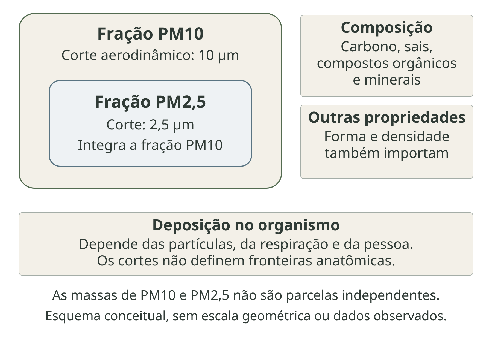
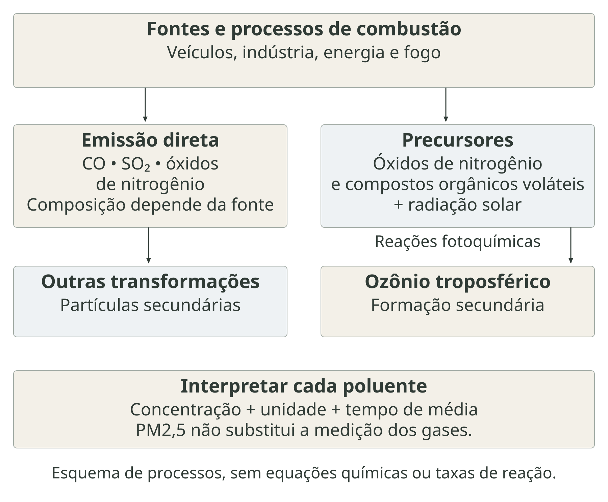
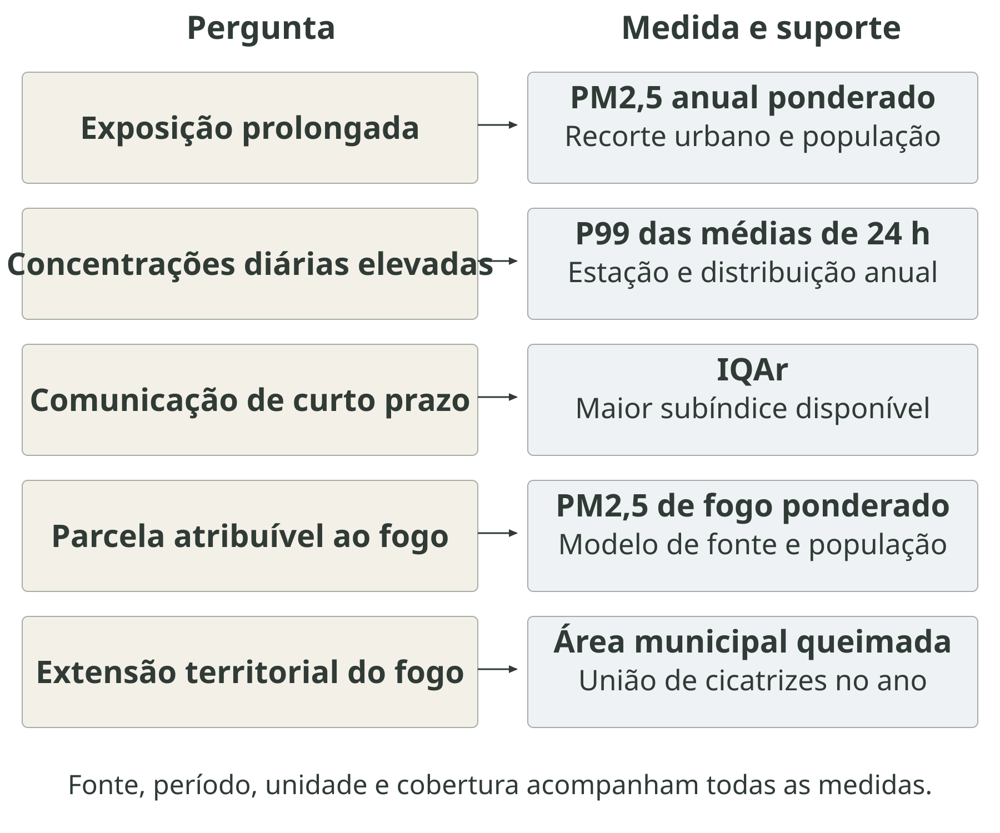
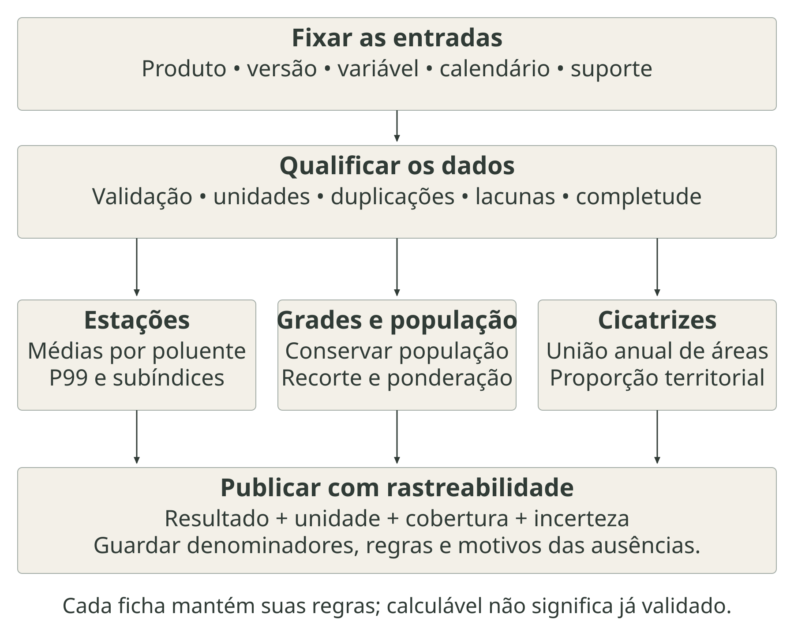

---
aliases:
  - /chapters/part-2/07-qualidade-ar-queimadas-fumaca.html
format:
  html:
    template-partials:
      - ../../includes/chapter-opening/title-block.html
chapter-opening:
  image: ../../assets/openings/cap9-qualidade-ar-queimadas-fumaca-web.webp
  alt: "Aquarela de transição rural e urbana brasileira hipotética sem pessoas. Uma queimada distante em vegetação baixa emite fumaça que se dispersa sobre o vale em direção a um bairro, mantendo relevo e construções visíveis."
---

# Qualidade do ar, queimadas e fumaça {#sec-qualidade-ar}

A qualidade do ar influencia as condições de vida, trabalho e saúde das populações. A inalação de partículas e gases poluentes pode desencadear sintomas agudos, agravar doenças preexistentes e contribuir para o adoecimento e a mortalidade. Os efeitos atingem sobretudo os sistemas respiratório e cardiovascular, e exposições prolongadas estão associadas ao risco de câncer de pulmão. A Organização Mundial da Saúde (OMS) reconhece a poluição atmosférica como importante fator de risco à saúde, mesmo em concentrações inferiores às anteriormente consideradas críticas [@who2021air; @epa2019pm].

Queimadas e incêndios acrescentam uma dimensão episódica e territorial à poluição atmosférica. A fumaça pode atingir áreas distantes de sua origem e aumentar a demanda por serviços de saúde em populações já expostas às emissões do tráfego e da indústria. No Brasil, estudos de séries temporais identificaram associações entre o material particulado fino (PM2,5) proveniente de incêndios e o aumento de internações hospitalares, com variações por causa de internação e faixa etária [@ye2021wildfirebrasil].

Além dos efeitos respiratórios da inalação de fumaça, os incêndios podem provocar queimaduras, traumas, deslocamentos populacionais e interrupções de serviços essenciais. Esses impactos exigem respostas distintas, que articulam os fundamentos das relações entre clima, ambiente e saúde (@sec-clima-ambiente-saude), a gestão de eventos severos e desastres (@sec-desastres) e a capacidade de resposta dos sistemas de saúde (@sec-resposta) [@who2026wildfires; @brasil2024fumaca217].

A distribuição do risco depende da localização das fontes, da dispersão dos poluentes e das possibilidades de reduzir a exposição. Crianças, pessoas idosas, pessoas com doenças preexistentes e trabalhadores expostos demandam atenção especial. Condições de moradia, renda, ocupação e acesso ao cuidado influenciam as possibilidades de proteção, conforme discutido nos capítulos sobre exposição e vulnerabilidade (@sec-exposicao-vulnerabilidade) e efeitos sobre a saúde (@sec-efeitos-saude).

::: {.callout-note icon=false title="Conceito-chave: da fonte ao efeito"}
-  Emissão é a liberação de poluentes por uma fonte.
-  Concentração é a quantidade presente de poluente em determinado volume de ar.
-  Exposição é o contato com o poluente ao longo do tempo. Dose é a quantidade inalada, depositada ou absorvida, conforme a definição adotada. Efeito é uma alteração na saúde, observada ou estimada.
-  Um indicador de uma dessas etapas não mede automaticamente as demais [@who2003environmentalindicators; @epa2019exposure].
:::

A @fig-cadeia-ar-saude sintetiza essas relações. O @sec-fichas-qualidade-ar-queimadas-fumaca apresenta fichas de indicadores de concentração, comunicação da qualidade do ar e extensão do fogo. O [Apêndice B](../../backmatter/apendice-estacoes.qmd) descreve instrumentos, redes e exemplos de observação.

::: {.figure-with-source}

{#fig-cadeia-ar-saude fig-alt="Bairro hipotético com fogo distante, fumaça, moradias e visita de saúde. O esquema distingue emissão, concentração ambiente, exposição, dose e efeito, com transporte e transformação entre fonte e concentração. Meteorologia, microambientes e suscetibilidade modificam as relações; as setas não atribuem causalidade a casos individuais." width="100%" print-src="arte-cap9-00-conceitos-print.png"}

[Fonte: elaboração própria.]{.figure-source}

:::

## Poluição atmosférica e fontes de emissão

A qualidade do ar é determinada pela presença de partículas e gases, cujas concentrações, combinações e duração da exposição podem afetar a saúde e o meio ambiente. Em um território, as concentrações resultam tanto de emissões locais quanto do transporte de poluentes de outras regiões. Identificar uma fonte próxima ajuda a formular hipóteses, mas não permite determinar, isoladamente, a concentração registrada por uma estação ou a exposição de uma pessoa [@who2021air; @epa2022sensores].

As fontes de emissão podem ser fixas (indústrias e usinas de geração de energia), móveis (veículos e máquinas) ou difusas (poeira, movimentação do solo e atividades agrícolas). Há também fontes naturais, como o aerossol marinho e a poeira mineral. Essa classificação descreve as características das fontes, mas não estabelece sua importância relativa para a saúde. A contribuição de cada fonte depende da atividade, do combustível utilizado, dos sistemas de controle de emissões e das condições atmosféricas.

O inventário de emissões reúne estimativas por substância, fonte, local e período, geralmente expressas em massa por unidade de tempo. Já o monitoramento registra concentrações em locais e intervalos específicos. Relacionar essas informações exige modelos de dispersão e transporte químico: toneladas emitidas não podem ser convertidas diretamente em concentrações locais expressas em microgramas por metro cúbico ($\mu g/m^3$) [@epa2022sensores].

Os poluentes podem ser primários, quando emitidos diretamente, ou secundários, quando formados por reações químicas na atmosfera. O material particulado pode ter ambas as origens. O vento e a mistura vertical redistribuem os poluentes, enquanto a deposição seca e a precipitação contribuem para sua remoção. A estabilidade atmosférica e as inversões térmicas podem dificultar a dispersão, favorecendo o acúmulo de poluentes próximo à superfície. Essas relações são importantes para interpretar a qualidade do ar em conjunto com a temperatura (@sec-temperatura) e a precipitação (@sec-precipitacao).

A @fig-ar-fontes ilustra as fontes de emissão sem quantificar suas contribuições relativas. A distribuição do tráfego, das atividades produtivas e da ocupação territorial relaciona essas fontes ao uso da terra (@sec-uso-terra). A escolha de indicadores de concentração anual, de concentrações de pico ou de comunicação de risco deve seguir as fichas do @sec-fichas-qualidade-ar-queimadas-fumaca, considerando que um inventário de emissões, isoladamente, não fornece essas medidas.

::: {.figure-with-source}

{#fig-ar-fontes fig-alt="Paisagem hipotética reúne tráfego, indústria, solo exposto e fogo em vegetação. Rótulos distinguem fontes móveis, fixas e difusas. Poluentes primários são emitidos; secundários se formam na atmosfera. A dimensão ou cor da fumaça não representa participação nas emissões." width="100%" print-src="arte-cap9-01-fontes-print.png"}

[Fonte: elaboração própria.]{.figure-source}

:::

### Material particulado

O material particulado é constituído por partículas sólidas e gotículas suspensas no ar, cujo comportamento depende do tamanho, da forma e da densidade. Além da sigla MP, em português, utiliza-se frequentemente a sigla PM (do inglês **particulate matter**), seguida do valor de corte do diâmetro aerodinâmico, em micrômetros, como em PM10 e PM2,5 [@epa2019pm].

A fração PM2,5 está contida na PM10; suas concentrações, portanto, não devem ser somadas como componentes independentes. A concentração da fração grossa, situada entre os dois cortes, pode ser obtida por diferença apenas quando as medições são compatíveis. Os dispositivos de seleção de partículas apresentam curvas de eficiência próprias, de modo que os valores de corte não correspondem a filtros perfeitos nem a limites absolutos de deposição no organismo.

As partículas finas podem alcançar regiões profundas do sistema respiratório. Sua deposição, entretanto, depende também do padrão respiratório e das características fisiológicas individuais, não havendo correspondência exclusiva entre uma classe de tamanho e um órgão-alvo. A concentração em massa tampouco informa a composição química: amostras com concentrações idênticas podem apresentar propriedades distintas. O carbono negro, por exemplo, é um componente ou marcador de processos de combustão, mas não equivale à massa total de PM2,5 [@epa2019pm; @reid2016fumaca].

A @fig-ar-particulas distingue tamanho, composição e interpretação sanitária do material particulado. A [ficha AMB-AR-01](../../chapters/part-4/19-fichas-qualidade-ar-queimadas-fumaca.qmd#sec-amb-ar-01) apresenta a concentração anual de PM2,5 ponderada pela população urbana; a [AMB-AR-02](../../chapters/part-4/19-fichas-qualidade-ar-queimadas-fumaca.qmd#sec-amb-ar-02), o percentil 99 das médias de 24 horas; e a [AMB-FUM-01](../../chapters/part-4/19-fichas-qualidade-ar-queimadas-fumaca.qmd#sec-amb-fum-01), a concentração atribuível ao fogo. Cada indicador responde a uma questão distinta. A investigação das relações com internações e mortalidade requer os desfechos e métodos discutidos no @sec-efeitos-saude.

::: {.figure-with-source}

{#fig-ar-particulas fig-alt="Esquema vetorial mostra PM2,5 dentro da fração PM10, cujos cortes aerodinâmicos são 2,5 e 10 micrômetros. Composição, forma e densidade aparecem como propriedades adicionais. A deposição depende de partículas e respiração; os cortes não são fronteiras anatômicas. O desenho não está em escala." width="100%" print-src="arte-cap9-02-particulas-print.png"}

[Fonte: elaboração própria.]{.figure-source}

:::

### Gases poluentes

Diversos gases presentes na atmosfera podem afetar a saúde. O ozônio troposférico (O₃) é um poluente secundário, formado por reações fotoquímicas entre óxidos de nitrogênio e compostos orgânicos voláteis sob a ação da radiação solar. Os óxidos de nitrogênio (NOₓ) são emitidos principalmente em processos de combustão, como os de veículos automotores, usinas termelétricas e instalações industriais. Os compostos orgânicos voláteis (COVs) provêm de emissões veiculares, atividades industriais, evaporação de combustíveis, uso de solventes e fontes naturais, como a vegetação. Queimadas e incêndios também emitem esses precursores e podem favorecer a formação de ozônio em áreas situadas a sotavento, dependendo das condições atmosféricas [@epa2020ozonioisa]. Ao contrário do ozônio estratosférico, que protege a superfície terrestre da radiação ultravioleta, o ozônio próximo à superfície constitui um importante poluente atmosférico. Embora o calor e a insolação possam favorecer sua formação, o monitoramento deve considerar também os precursores e o transporte atmosférico [@epa2026ozonio].

Outros gases relevantes para a saúde são o dióxido de nitrogênio (NO₂), associado à combustão e à formação de ozônio e partículas secundárias; o dióxido de enxofre (SO₂), proveniente de atividades industriais e da queima de combustíveis; e o monóxido de carbono (CO), produzido pela combustão incompleta, que interfere no transporte de oxigênio pelo sangue. A exposição a esses poluentes pode produzir diferentes efeitos à saúde, incluindo efeitos respiratórios, especialmente em pessoas com doenças preexistentes e outros grupos vulneráveis [@who2021air].

A @fig-ar-gases distingue a emissão direta de poluentes e sua formação na atmosfera. O monitoramento de PM2,5 não informa, por si só, a concentração desses gases. A [Índice de Qualidade do Ar (IQAr) — ficha AMB-AR-03](../../chapters/part-4/19-fichas-qualidade-ar-queimadas-fumaca.qmd#sec-amb-ar-03) utiliza a tabela de comunicação do Ministério do Meio Ambiente e Mudança do Clima (MMA), respeitando a unidade e o tempo de média de cada poluente [@brasil2025iqar]. A análise dos efeitos deve seguir as definições de desfecho do @sec-efeitos-saude.

::: {.figure-with-source}

{#fig-ar-gases fig-alt="Dois percursos distinguem emissões diretas de CO, SO₂ e óxidos de nitrogênio e formação fotoquímica de ozônio a partir de precursores. Transformações também contribuem para partículas secundárias. Concentração, unidade e tempo de média permanecem específicos de cada poluente." width="100%" print-src="arte-cap9-03-gases-print.png"}

[Fonte: elaboração própria.]{.figure-source}

:::

A @tbl-guias-oms-ar apresenta os níveis-guia de qualidade do ar da OMS de 2021, que distinguem exposições de curto e longo prazo. Para as concentrações de 24 horas indicadas, o percentil 99 admite aproximadamente três ou quatro dias de excedência ao ano, não correspondendo ao valor máximo diário nem a um limite sem exceções. Para o ozônio, a estação de pico corresponde aos seis meses consecutivos com a maior média das máximas médias diárias de oito horas [@who2021air].

| Poluente | Tempo de média da diretriz OMS 2021 | Nível-guia |
|---|---|---:|
| PM2,5 | Anual | 5 µg/m³ |
| PM2,5 | 24 horas, percentil 99 | 15 µg/m³ |
| PM10 | Anual | 15 µg/m³ |
| PM10 | 24 horas, percentil 99 | 45 µg/m³ |
| O₃ | Estação de pico | 60 µg/m³ |
| O₃ | Máxima média diária de 8 horas, percentil 99 | 100 µg/m³ |
| NO₂ | Anual | 10 µg/m³ |
| NO₂ | 24 horas, percentil 99 | 25 µg/m³ |
| SO₂ | 24 horas, percentil 99 | 40 µg/m³ |
| CO | 24 horas, percentil 99 | 4 mg/m³ |

: Níveis-guia de qualidade do ar da OMS de 2021 {#tbl-guias-oms-ar}

Os níveis-guia orientam a redução do risco à saúde, mas não garantem a ausência de efeitos adversos em concentrações inferiores. No Brasil, a Resolução do Conselho Nacional do Meio Ambiente (CONAMA) nº 506/2024 estabelece padrões intermediários e finais, com calendário de implantação. A avaliação da conformidade regulatória deve considerar o padrão vigente no período analisado, distinguindo-o das diretrizes sanitárias da OMS [@brasil2024conama506].

A comparação exige atenção às unidades e aos tempos de média. A OMS expressa a concentração de CO em mg/m³, enquanto a tabela brasileira do IQAr adotada na ficha utiliza partes por milhão (ppm) e médias de oito horas. A conversão entre concentração em massa e fração volumétrica depende da temperatura e da pressão. A simples substituição da unidade ou a comparação de médias com durações distintas produz resultados inválidos [@brasil2025iqar].

## Medição, modelagem e representatividade

Estações de referência fornecem observações pontuais, cuja representatividade depende de sua localização. Uma estação instalada em uma via movimentada não representa necessariamente todo o bairro, assim como a média de várias estações não equivale a uma média ponderada pela população. A qualidade dos registros depende da documentação dos equipamentos, da localização, da altura da entrada de ar, do fuso horário e do histórico operacional, além dos procedimentos de calibração, manutenção e validação. Mudanças nos instrumentos ou nos locais de instalação podem comprometer a comparabilidade das séries. Esses aspectos são discutidos no @sec-espaco-tempo e no [Apêndice B](../../backmatter/apendice-estacoes.qmd).

Sensores de baixo custo podem ampliar a cobertura espacial do monitoramento, mas seu desempenho varia conforme a umidade, a temperatura e a composição das partículas. Recomenda-se avaliar sua concordância com instrumentos de referência por meio da colocalização, isto é, da operação simultânea dos equipamentos no mesmo local, antes de utilizá-los em larga escala. O acompanhamento da deriva instrumental e a manutenção periódica também são necessários para preservar a qualidade dos registros [@epa2022sensores; @epa2026colocalizacao].

O sensoriamento remoto por satélite oferece outra perspectiva da qualidade do ar, baseada na interação da radiação com a atmosfera. A profundidade óptica de aerossóis (**Aerosol Optical Depth** — AOD) é uma medida adimensional da atenuação da radiação pela coluna de aerossóis, e não da concentração à superfície em $\mu g/m^3$. A relação entre essas medidas depende da distribuição vertical, da umidade e das propriedades das partículas. A disponibilidade das observações orbitais também depende da cobertura de nuvens e das condições de recuperação do sinal [@epa2019pm; @who2026pm25].

Modelos de transporte químico e dispersão representam as emissões, as condições meteorológicas e as transformações dos poluentes na atmosfera. Podem subsidiar reanálises, que reconstituem estados passados, previsões de condições futuras e produtos híbridos. Uma resolução espacial mais fina, entretanto, não garante maior acurácia local: a qualidade das estimativas depende dos dados de entrada, da representação das fontes, dos procedimentos de validação e, quando aplicável, dos dados de treinamento [@hu2025firepm].

A @fig-ar-observacao compara essas formas de obtenção de dados. Na divulgação dos resultados, devem ser distinguidas observações, estimativas e previsões, com indicação de dados ausentes e valores provisórios. A ausência de monitoramento não significa ausência de poluição. Os critérios de seleção de fontes do @sec-fontes-fichas orientam a escolha entre o produto modelado da [AMB-AR-01](../../chapters/part-4/19-fichas-qualidade-ar-queimadas-fumaca.qmd#sec-amb-ar-01) e as séries de estações da [AMB-AR-02](../../chapters/part-4/19-fichas-qualidade-ar-queimadas-fumaca.qmd#sec-amb-ar-02) e da [AMB-AR-03](../../chapters/part-4/19-fichas-qualidade-ar-queimadas-fumaca.qmd#sec-amb-ar-03).

::: {.figure-with-source}

{#fig-ar-observacao fig-alt="Estação de referência e sensor compacto estão em terreno aberto, com técnica e cidade ao fundo. Um satélite fora de escala representa observação da coluna. Quatro campos diferenciam estação, sensor avaliado por co-localização, satélite e modelo. AOD é adimensional e não equivale a PM2,5 superficial." width="100%" print-src="arte-cap9-04-observacao-print.png"}

[Fonte: elaboração própria.]{.figure-source}

:::

## Queimadas e incêndios

O fogo pode ser utilizado intencionalmente em práticas de manejo ou ocorrer de forma indesejada e descontrolada. Sua propagação depende da ignição, da disponibilidade e umidade do material combustível, do vento e do relevo. O termo *queimada* é empregado em diferentes contextos, enquanto *incêndio florestal* designa o fogo que se propaga de forma descontrolada pela vegetação. Para fins de monitoramento, é necessário distinguir a ocorrência de fogo, sua detecção por sensoriamento remoto e a delimitação da área atingida. Cada medida tem finalidades e limitações próprias. Imagens de satélite, isoladamente, tampouco permitem determinar a legalidade de uma ocorrência. O Programa Queimadas do Instituto Nacional de Pesquisas Espaciais (INPE) documenta essas distinções e as limitações dos dados de monitoramento [@inpe2026faq].

Secas e períodos prolongados sem precipitação podem reduzir a umidade do material combustível e favorecer a propagação do fogo. As formas de ocupação e manejo da terra influenciam a quantidade, a distribuição e a continuidade espacial desse material. Os indicadores de [duração de períodos secos — CLI-PRC-04](../../chapters/part-4/18-fichas-precipitacao-secas-eventos-hidrologicos.qmd#sec-cli-prc-04) e de [seca meteorológica — CLI-SEC-01](../../chapters/part-4/18-fichas-precipitacao-secas-eventos-hidrologicos.qmd#sec-cli-sec-01), apresentados no @sec-fichas-precipitacao-secas-eventos-hidrologicos, caracterizam as condições meteorológicas antecedentes que podem favorecer o fogo. Não permitem, contudo, identificar a ignição nem substituem produtos específicos de avaliação do risco de fogo. Sua interpretação deve considerar os aspectos discutidos nos capítulos sobre precipitação e secas (@sec-precipitacao) e uso e cobertura da terra (@sec-uso-terra).

Um foco ativo de fogo é o registro de atividade térmica associada à combustão, detectada por um sensor remoto e identificada por um algoritmo em determinado momento. Um mesmo incêndio pode gerar várias detecções, enquanto ocorrências de pequena extensão, curta duração ou encobertas por nuvens podem não ser registradas. A capacidade de detecção depende do sensor, da resolução espacial, do horário de passagem do satélite, das condições atmosféricas e das características da combustão. Para comparar contagens de focos no espaço e no tempo, recomenda-se utilizar um sistema de referência com critérios de detecção consistentes, evitando agregar indiscriminadamente registros de diferentes satélites [@inpe2026faq].

A área queimada corresponde à extensão da superfície atingida pelo fogo, geralmente mapeada pela identificação das cicatrizes deixadas pela combustão na vegetação. Não pode ser estimada pela simples multiplicação do número de focos ativos pela área nominal dos pixels do sensor. A identificação de uma cicatriz tampouco informa diretamente a intensidade da combustão, a quantidade de material consumido ou as emissões de poluentes. A @fig-ar-fogo ilustra essas três formas de representar o fogo em um território hipotético, sem utilizar detecções reais.

::: {.figure-with-source}

{#fig-ar-fogo fig-alt="Três painéis mostram fogo em vegetação, grade esquemática de detecção sobre a mesma cena e cicatriz após o fogo. Os dois primeiros reutilizam exatamente o mesmo recorte; a terceira vinheta representa outro momento. Células destacadas não são detecções reais e a grade não tem resolução geográfica. Focos não são contagem de incêndios nem área queimada." width="100%" print-src="arte-cap9-05-fogo-print.png"}

[Fonte: elaboração própria.]{.figure-source}

:::

A [ficha AMB-FOG-01](../../chapters/part-4/19-fichas-qualidade-ar-queimadas-fumaca.qmd#sec-amb-fog-01) apresenta o percentual da área municipal atingida pelo fogo ao longo de um ano, calculado com um produto de sensoriamento remoto de versão definida. A união espacial das cicatrizes anuais evita contabilizar repetidamente a mesma superfície, mas não informa quantas vezes ela foi atingida. Um valor igual a zero indica ausência de cicatrizes mapeadas pelo produto, não necessariamente ausência de fogo. A avaliação das consequências desses eventos exige informações sobre os impactos na população, as perdas materiais e a interrupção de serviços (@sec-desastres), além dos processos de emissão e dispersão atmosférica da fumaça.

## Fumaça e transporte atmosférico

A fumaça é uma mistura complexa de partículas e gases, que inclui material particulado fino (PM2,5), componentes carbonáceos, monóxido de carbono, compostos orgânicos e precursores de poluentes secundários. Sua composição depende das características e da umidade do material combustível, bem como das condições e fases da combustão. Durante o transporte atmosférico, processos físicos e químicos modificam as propriedades da mistura. Assim, uma pluma de fumaça pode apresentar, longe de sua origem, características diferentes das observadas próximo à fonte de emissão [@reid2016fumaca; @hu2025firepm].

O transporte e a dispersão da fumaça dependem das características da emissão e das condições meteorológicas. A altura de injeção determina as camadas atmosféricas em que os poluentes são inicialmente introduzidos; o vento, a turbulência e a estabilidade atmosférica influenciam sua trajetória e mistura vertical. Durante o percurso, os poluentes podem sofrer transformações químicas ou ser removidos por deposição seca e úmida. A presença de uma pluma em altitude sobre um município não implica, necessariamente, concentrações elevadas próximo à superfície. A distância da fonte, isoladamente, também não permite caracterizar a distribuição das concentrações nem a potencial exposição da população.

A interpretação do transporte e da dispersão da fumaça deve considerar as condições de temperatura e estabilidade atmosférica (@sec-temperatura), a precipitação e os períodos de seca (@sec-precipitacao). Para a vigilância em saúde, também é necessário identificar onde e quando a população pode estar exposta. Poluentes podem percorrer longas distâncias e atingir municípios distintos daqueles em que ocorreram os incêndios. Embora os limites administrativos orientem a gestão e a vigilância em saúde, o transporte atmosférico exige uma abordagem que ultrapasse essas delimitações territoriais.

A @fig-fumaca-exposicao relaciona detecção de fogo, observação de aerossóis, concentração e exposição. Observações orbitais e medições de estações fornecem informações complementares. Imagens de plumas ajudam a interpretar episódios de fumaça, mas sua tonalidade não permite estimar diretamente a dose individual.

::: {.figure-with-source}

{#fig-fumaca-exposicao fig-alt="Pluma liga fogo em vegetação a uma cidade distante em paisagem hipotética. O esquema distingue fogo e emissões, transporte e transformação, observação orbital, concentração medida ou modelada, exposição em microambientes e dose. Pluma elevada não determina sozinha concentração no solo; PM2,5 total não é a parcela de fogo." width="100%" print-src="arte-cap9-06-transporte-print.png"}

[Fonte: elaboração própria.]{.figure-source}

:::

::: {.callout-important icon=false title="Conceito-chave: PM2,5 total e parcela atribuível ao fogo"}
A concentração total de material particulado fino (PM2,5) resulta de diferentes fontes de emissão e processos de formação de partículas na atmosfera. Estimar a parcela atribuível ao fogo requer métodos capazes de distinguir sua contribuição das demais fontes. As concentrações observadas durante queimadas ou incêndios florestais, portanto, não podem ser integralmente atribuídas à fumaça. É necessário distinguir duas etapas analíticas: atribuir parte da concentração atmosférica a uma fonte de emissão e atribuir efeitos sobre a saúde à exposição aos poluentes dessa fonte.
:::

A contribuição do fogo para as concentrações de PM2,5 pode ser estimada por simulações atmosféricas com e sem emissões de fogo, pelo uso de traçadores ou pela integração de inventários de emissões, sensoriamento remoto e modelagem atmosférica. Hu et al. disponibilizaram estimativas diárias para o período de 2000 a 2023, com diferentes inventários de emissões. A [ficha AMB-FUM-01](../../chapters/part-4/19-fichas-qualidade-ar-queimadas-fumaca.qmd#sec-amb-fum-01) adota a variante baseada no inventário GFED4.1s (*Global Fire Emissions Database*) e os procedimentos correspondentes de agregação e ponderação populacional. Como a escolha do inventário influencia as estimativas, sua substituição constitui uma mudança metodológica que exige identificar uma nova série de dados, e não apenas atualizar os arquivos [@hu2025firepm].

A interpretação dessas estimativas para a saúde deve considerar a exposição e a vulnerabilidade da população (@sec-exposicao-vulnerabilidade). Na investigação dos efeitos da fumaça sobre a morbidade hospitalar, a [ficha EFE-MOB-01](../../chapters/part-4/24-fichas-efeitos-saude.qmd#sec-efe-mob-01) fornece uma definição operacional do desfecho. Estimar as internações atribuíveis à exposição à fumaça, entretanto, exige métodos epidemiológicos específicos, pois os registros hospitalares não permitem estabelecer diretamente essa relação causal.

## Exposição e efeitos agudos e crônicos

A exposição humana à poluição atmosférica depende das concentrações dos poluentes, dos locais frequentados e do tempo de permanência em cada um deles. Ao longo do dia, as pessoas transitam por microambientes como residências, vias públicas, meios de transporte, locais de trabalho, escolas e serviços de saúde. Nesses ambientes, as concentrações variam conforme a infiltração do ar externo, as fontes internas de emissão e as condições de ventilação e filtração. A dose inalada depende também do volume de ar respirado, que pode aumentar durante atividades físicas. Estimar a dose depositada no sistema respiratório ou absorvida pelo organismo requer informações adicionais às medições das estações de qualidade do ar [@epa2019exposure].

Em estudos populacionais, as concentrações ambientais podem servir como aproximação da exposição, desde que sejam explicitados os pressupostos e as limitações dessa abordagem. A ponderação pela população atribui maior peso às áreas mais populosas, estimando a concentração ambiental média nos locais onde se encontra a população representada, em vez da média territorial. Essa medida não representa os deslocamentos cotidianos nem as condições de exposição nos diferentes microambientes. A comparabilidade dos indicadores depende também da delimitação da população considerada. A [AMB-AR-01](../../chapters/part-4/19-fichas-qualidade-ar-queimadas-fumaca.qmd#sec-amb-ar-01) utiliza um recorte urbano previamente definido, enquanto a [AMB-FUM-01](../../chapters/part-4/19-fichas-qualidade-ar-queimadas-fumaca.qmd#sec-amb-fum-01) adota um domínio populacional próprio. A comparação de seus resultados deve considerar essas diferenças.

Estudos sobre exposições de curto prazo geralmente utilizam concentrações horárias ou diárias e consideram possíveis defasagens entre a exposição e a manifestação dos efeitos. Estudos sobre exposições prolongadas utilizam médias de meses ou anos, conforme o delineamento epidemiológico. A duração da exposição não determina necessariamente a natureza do efeito: uma exposição breve pode desencadear a exacerbação aguda de uma doença crônica. O emprego dos termos *agudo* e *crônico* deve, portanto, explicitar se a referência é à exposição ou ao efeito sobre a saúde [@epa2019pm].

Localidades com concentrações médias anuais semelhantes podem apresentar diferenças na magnitude, frequência e duração dos episódios de poluição. A análise das médias de longo prazo deve ser complementada por séries diárias, percentis, duração dos episódios e cobertura temporal dos dados. O percentil 99 (P99), adotado na [AMB-AR-02](../../chapters/part-4/19-fichas-qualidade-ar-queimadas-fumaca.qmd#sec-amb-ar-02), caracteriza as concentrações mais elevadas da distribuição anual. Como não preserva a sequência temporal das observações, não permite determinar a duração de um episódio de fumaça. A @fig-ar-exposicao ilustra diferentes dimensões temporais da exposição, sem representar séries de concentração ou estimativas de risco.

::: {.figure-with-source}

{#fig-ar-exposicao fig-alt="Três cenas conceituais apresentam trabalho na rua, mãe e criança em casa e pessoa idosa em consulta. Os quadros distinguem concentrações de curto prazo e médias prolongadas, com atividade, proteção, suscetibilidade e acesso ao cuidado. Não há séries, frequências ou riscos simulados." width="100%" print-src="arte-cap9-07-exposicao-print.png"}

[Fonte: elaboração própria.]{.figure-source}

:::

Partículas e gases da fumaça podem provocar irritação e inflamação das vias respiratórias, agravar doenças como a asma e a doença pulmonar obstrutiva crônica (DPOC) e aumentar a demanda por serviços de saúde. A revisão de Reid et al. identificou evidências mais consistentes de associação entre a exposição à fumaça de incêndios e a morbidade respiratória, enquanto os resultados para outros desfechos foram mais heterogêneos. A comunicação de risco deve considerar que a magnitude dos efeitos e a força das evidências variam conforme o desfecho e a fonte de emissão [@reid2016fumaca].

Os efeitos da poluição atmosférica não se restringem ao sistema respiratório. A inflamação sistêmica, o estresse oxidativo, as alterações na regulação do sistema nervoso autônomo e a disfunção vascular ajudam a explicar as associações entre a exposição ao material particulado e os desfechos cardiovasculares. A avaliação integrada da Agência de Proteção Ambiental dos Estados Unidos (EPA) reúne evidências epidemiológicas, experimentais e mecanísticas dessas relações. O conhecimento sobre os efeitos do PM2,5 no ar ambiente, contudo, é mais abrangente que o disponível para fontes específicas, como a fumaça de incêndios. Isso limita a aplicação direta de estimativas de risco a exposições a misturas de composição distinta [@epa2019pm].

No Brasil, Ye et al. investigaram 1.814 municípios e identificaram associações de curto prazo entre a exposição ao material particulado de incêndios e as internações por todas as causas, doenças respiratórias e cardiovasculares, com variações entre regiões e faixas etárias. A interpretação dos resultados deve considerar a resolução espacial das estimativas de exposição e a cobertura dos registros hospitalares. As associações populacionais não permitem determinar a causa de uma internação individual nem generalizar automaticamente as estimativas de risco para todos os municípios brasileiros [@ye2021wildfirebrasil].

Características biológicas, sociais e territoriais influenciam os efeitos da fumaça sobre a saúde. Crianças apresentam particularidades fisiológicas relacionadas ao desenvolvimento, enquanto pessoas idosas e com doenças preexistentes podem apresentar menor reserva funcional. O trabalho ao ar livre, as moradias precárias, que podem favorecer a infiltração da fumaça, e as dificuldades de acesso aos serviços de saúde podem intensificar ou prolongar a exposição ou limitar a proteção e o cuidado. O [Índice de Vulnerabilidade Social — EXP-VUL-01](../../chapters/part-4/23-fichas-exposicao-vulnerabilidade.qmd#sec-exp-vul-01) ajuda a contextualizar essas desigualdades, mas não constitui uma medida específica da suscetibilidade à fumaça. Sua interpretação deve considerar as dimensões discutidas no @sec-exposicao-vulnerabilidade.

A exposição prolongada à poluição atmosférica está associada ao aumento da mortalidade e à ocorrência de câncer de pulmão. A investigação dos efeitos materno-infantis e das consequências da exposição recorrente à fumaça exige a definição dos desfechos e a avaliação da força das evidências para cada relação [@who2021air; @epa2019pm]. Os incêndios também afetam a saúde por outras vias: perdas materiais, deslocamentos populacionais e interrupções da assistência podem comprometer a saúde mental e a continuidade do cuidado de pessoas com doenças crônicas [@who2026wildfires].

O delineamento epidemiológico deve ser compatível com a exposição e os desfechos investigados. Estudos de séries temporais permitem analisar associações entre variações diárias das concentrações e a frequência de eventos de saúde; estudos longitudinais podem investigar efeitos da exposição prolongada entre indivíduos ou grupos. Comparações entre municípios devem considerar a composição etária, as condições socioeconômicas e a cobertura e qualidade dos registros de saúde. A interpretação de associações territoriais como estimativas de risco individual pode incorrer em falácia ecológica. O planejamento do estudo deve definir a população, o período de observação e as variáveis de ajuste dos modelos [@hernan2020causal].

Funções concentração–resposta permitem quantificar as relações entre a exposição à poluição atmosférica e os desfechos de saúde. O risco relativo expressa a magnitude da associação entre níveis de exposição e a ocorrência de um desfecho. O número de eventos atribuíveis depende também do tamanho da população exposta e da frequência do desfecho. Estimar a carga de doença requer definir um cenário contrafactual de exposição e explicitar os pressupostos sobre a ocorrência dos desfechos nesse cenário. Os níveis-guia da OMS não devem ser interpretados automaticamente como limiares de ausência de efeitos adversos. A escolha do cenário de referência e da função concentração–resposta deve ser fundamentada, conforme discutido no @sec-efeitos-saude [@gasparrini2014attributable].

A recorrência de episódios de fumaça acrescenta outra dimensão à exposição. A média anual pode ocultar episódios intensos concentrados em determinadas épocas, enquanto a contagem de dias com concentrações elevadas não distingue sua magnitude. Uma medida complementar é a integral das concentrações em uma janela temporal definida, expressa em unidades de concentração multiplicadas pelo tempo. Essa medida não equivale à dose absorvida pelo organismo. Comparações entre territórios exigem janelas temporais, critérios de identificação de episódios e procedimentos de tratamento de dados ausentes bem definidos. Informações sobre a recorrência e os intervalos entre episódios podem subsidiar o planejamento dos serviços de saúde. Seu uso para estimar efeitos, entretanto, requer validação e métodos epidemiológicos compatíveis com a exposição e os desfechos.

A análise epidemiológica deve considerar tendências temporais, sazonalidade, efeitos de calendário, temperatura e outros fatores relevantes segundo o modelo causal adotado. É necessário distinguir o intervalo entre a exposição e a manifestação biológica do efeito, o tempo até a procura por atendimento e os atrasos no registro. Durante um incêndio, a redução das internações pode refletir dificuldades de acesso aos serviços, e não menor morbidade. Da mesma forma, a coincidência espacial ou temporal entre focos de fogo e aumento da mortalidade não constitui, isoladamente, evidência causal [@hernan2020causal; @gasparrini2010dlnm]. Essas questões são aprofundadas no @sec-efeitos-saude. As fichas [EFE-MOR-01](../../chapters/part-4/24-fichas-efeitos-saude.qmd#sec-efe-mor-01), [EFE-MOR-02](../../chapters/part-4/24-fichas-efeitos-saude.qmd#sec-efe-mor-02) e [EFE-MOB-01](../../chapters/part-4/24-fichas-efeitos-saude.qmd#sec-efe-mob-01), reunidas no @sec-fichas-efeitos-saude, caracterizam a mortalidade e as internações hospitalares, mas não estimam diretamente a carga de doença atribuível à poluição atmosférica.

## Fontes, seleção e principais indicadores

A escolha das fontes de dados deve partir da questão de saúde investigada e considerar a abrangência e as limitações dos sistemas de monitoramento. As [redes de qualidade do ar](../../backmatter/indice-fontes.qmd#redes-qualidade-ar) fornecem medições de concentrações nos locais com estações. O [MonitorAr](../../backmatter/indice-fontes.qmd#monitorar-mma) centraliza dados dessas redes, sem eliminar diferenças na cobertura espacial e temporal ou nos procedimentos de validação. O [CAMS — Copernicus Atmosphere Monitoring Service](../../backmatter/indice-fontes.qmd#cams) disponibiliza produtos de monitoramento e modelagem atmosférica, cuja utilização exige identificar variáveis, camadas atmosféricas, resoluções e versões. O [Programa Queimadas do INPE](../../backmatter/indice-fontes.qmd#queimadas-inpe) complementa essas informações com dados sobre a ocorrência de fogo [@inpe2026queimadas].

Bases de abrangência global e produtos de modelagem atmosférica são úteis para caracterizar a exposição de longo prazo e comparar territórios, sobretudo em regiões com poucas estações de monitoramento. A [base da OMS](../../backmatter/indice-fontes.qmd#who-air) e os produtos utilizados nas fichas possuem finalidades, fontes de dados e métodos próprios. Para assegurar a reprodutibilidade das análises, não basta identificar a instituição responsável, como a OMS, o CAMS ou o INPE. É necessário documentar os produtos, suas versões e as variáveis selecionadas, conforme o @sec-fontes-fichas.

A @fig-ar-selecao e o @qua-indicadores-ar relacionam questões de interesse para a saúde, indicadores e limites de interpretação. A [AMB-AR-01](../../chapters/part-4/19-fichas-qualidade-ar-queimadas-fumaca.qmd#sec-amb-ar-01) adapta à escala municipal o conceito do indicador 11.6.2 dos Objetivos de Desenvolvimento Sustentável (ODS), referente às concentrações médias anuais de material particulado em áreas urbanas, ponderadas pela população. A ficha documenta os procedimentos dessa adaptação, incluindo a delimitação do recorte urbano. As cinco fichas de qualidade do ar, queimadas e fumaça estão reunidas no @sec-fichas-qualidade-ar-queimadas-fumaca.

::: {.figure-with-source}

{#fig-ar-selecao fig-alt="Cinco linhas associam exposição prolongada a PM2,5 anual ponderado; concentrações diárias elevadas a P99; comunicação a IQAr; parcela de fumaça a PM2,5 de fogo; extensão territorial a área queimada. As medidas mantêm diferentes suportes e não formam uma escala única de risco." width="100%" print-src="arte-cap9-08-selecao-print.png"}

[Fonte: elaboração própria.]{.figure-source}

:::

::: {#qua-indicadores-ar}

| Indicador e ficha | Pergunta sanitária | Cuidado de interpretação |
|---|---|---|
| [PM2,5 anual ponderado — AMB-AR-01](../../chapters/part-4/19-fichas-qualidade-ar-queimadas-fumaca.qmd#sec-amb-ar-01) | Como se distribui a exposição ambiente de longo prazo no recorte urbano? | É estimativa modelada; a média não descreve episódios. |
| [P99 das médias de 24 h — AMB-AR-02](../../chapters/part-4/19-fichas-qualidade-ar-queimadas-fumaca.qmd#sec-amb-ar-02) | Quão elevadas são as concentrações diárias na estação ao longo do ano? | O percentil não é máximo nem duração de episódio. |
| [IQAr — AMB-AR-03](../../chapters/part-4/19-fichas-qualidade-ar-queimadas-fumaca.qmd#sec-amb-ar-03) | Como comunicar a condição de curto prazo? | O maior subíndice determina a classe; dados ausentes exigem sinalização. |
| [PM2,5 de fogo ponderado — AMB-FUM-01](../../chapters/part-4/19-fichas-qualidade-ar-queimadas-fumaca.qmd#sec-amb-fum-01) | Qual a exposição ambiente à parcela modelada de fogo? | A atribuição depende de inventário e modelagem. |
| [Área municipal queimada — AMB-FOG-01](../../chapters/part-4/19-fichas-qualidade-ar-queimadas-fumaca.qmd#sec-amb-fog-01) | Qual a extensão territorial anual mapeada do fogo? | Não mede emissão, concentração ou dose. |
| Focos ativos, informação contextual | Onde e quando o sensor detectou fogo? | Não contam necessariamente incêndios distintos; não há ficha própria no livro. |

Indicadores de qualidade do ar, fogo e fumaça usados em saúde pública

:::

Os indicadores do quadro não abrangem todas as dimensões da vigilância da qualidade do ar. O monitoramento de PM10, O₃, NO₂, SO₂ e CO deve preservar as séries de concentração e os respectivos tempos de média, inclusive quando utilizados no Índice de Qualidade do Ar (IQAr). A caracterização de episódios de poluição exige dados com resolução temporal adequada, que complementem as médias anuais. A análise das desigualdades na exposição requer cobertura dos dados e recortes populacionais comparáveis.

A seleção dos produtos deve considerar suas finalidades. Previsões de qualidade do ar subsidiam ações de curto prazo, e seu desempenho deve ser avaliado em relação a observações. Reanálises e outros produtos históricos são úteis em estudos retrospectivos, embora possam ter menor frequência de atualização que as previsões operacionais. Independentemente da fonte, a interpretação deve considerar o suporte espacial dos dados — estações, grades regulares ou agregados municipais — e os procedimentos de agregação espacial e temporal. A cobertura nacional não garante qualidade homogênea dos dados entre regiões.

Para assegurar transparência e reprodutibilidade, recomenda-se documentar a instituição produtora, o produto, a versão, as variáveis, o nível vertical de referência, as resoluções espacial e temporal, o período de abrangência e os critérios de controle de qualidade. Quando houver ponderação populacional, devem ser registrados também o ano de referência e o domínio espacial da população. A comparação entre versões de um produto deve utilizar, preferencialmente, períodos coincidentes, para distinguir alterações metodológicas e atualizações dos dados de entrada da variabilidade do fenômeno. Essa documentação permite reproduzir as análises e identificar a necessidade de revisar as séries e os indicadores, conforme o @sec-espaco-tempo e o @sec-fontes-fichas.

A integração de informações em painéis de monitoramento ajuda a compreender as relações entre fogo, qualidade do ar, exposição e saúde. Cada informação deve manter sua unidade, fonte, referência temporal e natureza observacional ou modelada. Representar focos de fogo, concentrações e utilização dos serviços de saúde em uma escala comum pode sugerir equivalência indevida entre fenômenos distintos. Os indicadores de exposição e vulnerabilidade (@sec-fichas-exposicao-vulnerabilidade), mortalidade e internações (@sec-fichas-efeitos-saude) ajudam a contextualizar as condições de exposição e os desfechos nos territórios. Sua combinação, contudo, não constitui por si só um índice de risco à saúde, cuja elaboração exige fundamentação conceitual, critérios metodológicos e validação.

## Protocolo de cálculo e disponibilidade

O protocolo de processamento estabelece procedimentos explícitos e reproduzíveis para o cálculo dos indicadores. Antes do cálculo, devem ser definidos o produto, a versão, a variável, a unidade, o calendário de referência, o suporte espacial e os critérios de identificação e tratamento de registros inválidos. Recomenda-se preservar os arquivos originais e registrar a data de obtenção dos dados. A distinção entre registros provisórios e validados é particularmente importante durante episódios de poluição: a divulgação oportuna subsidia ações imediatas de vigilância, enquanto a validação posterior assegura maior qualidade às análises retrospectivas.

O SatPM reúne estimativas de concentração de PM2,5 obtidas pela integração de observações orbitais e modelagem atmosférica. O GHS-POP é a grade populacional produzida no âmbito do **Global Human Settlement Layer** (GHSL). Para estimar as concentrações de material particulado atribuíveis ao fogo, utiliza-se o modelo de transporte químico GEOS-Chem e a versão GFED4.1s do inventário de emissões de fogo. A identificação desses produtos, modelos e inventários assegura a rastreabilidade dos indicadores. Sua substituição pode alterar os resultados, comprometer a comparabilidade das séries e exigir revisão dos procedimentos de cálculo.

| Ficha | Disponibilidade no protocolo | Entrada fixada |
|---|---|---|
| [AMB-AR-01](../../chapters/part-4/19-fichas-qualidade-ar-queimadas-fumaca.qmd#sec-amb-ar-01) | Calculável com dados abertos | SatPM V6.GL.03 total, 1998–2024, e GHS-POP R2023A |
| [AMB-AR-02](../../chapters/part-4/19-fichas-qualidade-ar-queimadas-fumaca.qmd#sec-amb-ar-02) | Calculável com dados locais centralizados | PM2,5 horário por estação do MonitorAr; P99 anual |
| [AMB-AR-03](../../chapters/part-4/19-fichas-qualidade-ar-queimadas-fumaca.qmd#sec-amb-ar-03) | Calculável com dados locais centralizados | Seis poluentes por estação; tabela IQAr de 2025 |
| [AMB-FUM-01](../../chapters/part-4/19-fichas-qualidade-ar-queimadas-fumaca.qmd#sec-amb-fum-01) | Calculável com dados abertos | PM2,5 de fogo GEOS-Chem/GFED4.1s, 2000–2023 |
| [AMB-FOG-01](../../chapters/part-4/19-fichas-qualidade-ar-queimadas-fumaca.qmd#sec-amb-fog-01) | Calculável com dados abertos | MapBiomas Fogo Coleção 5 v1, 1985–2025 |

Antes de calcular indicadores com séries de estações, devem ser verificados registros duplicados, fusos horários, unidades, sinalizadores de validação (*flags*) e lacunas temporais. Para o cálculo do percentil 99 (P99), a [AMB-AR-02](../../chapters/part-4/19-fichas-qualidade-ar-queimadas-fumaca.qmd#sec-amb-ar-02) exige registros válidos em pelo menos 16 horas distintas por dia, médias diárias válidas em pelo menos 90% dos dias do ano e em metade dos dias de cada quadrimestre. O percentil é calculado pelo estimador de quantil do tipo 7. Os critérios de cobertura anual e a escolha do estimador são definições metodológicas da ficha e não certificam conformidade regulatória.

Na [AMB-AR-03](../../chapters/part-4/19-fichas-qualidade-ar-queimadas-fumaca.qmd#sec-amb-ar-03), o cálculo do IQAr respeita os tempos de média de cada poluente. Para O₃ e CO, utilizam-se médias móveis de oito horas, incluindo, quando necessário, observações das horas anteriores ao início do dia, conforme o protocolo. A aplicação da tabela de 2025 a todo o período permite comparações retrospectivas sob critérios uniformes, mantendo separados os resultados dos boletins originalmente divulgados pelas redes. Se faltar informação válida de qualquer um dos seis poluentes, o resultado deve ser identificado como IQAr parcial, mesmo quando calculado pelo maior subíndice disponível.

A concentração média ponderada pela população é calculada pela expressão $\overline{C}_{P}=\sum_i C_i P_i/\sum_i P_i$, em que $C_i$ é a concentração do poluente na unidade espacial válida $i$ e $P_i$, a população representada nessa unidade. A soma dos produtos das concentrações pelas respectivas populações é dividida pela população total incluída no cálculo, preservando a unidade de concentração. O procedimento deve respeitar a delimitação espacial, a cobertura mínima e a sequência de agregação temporal de cada ficha. Na compatibilização das grades de concentração e população, a redistribuição das contagens populacionais por interseções espaciais deve conservar os totais, propriedade não garantida pela interpolação bilinear.

Embora utilizem ponderação populacional, as fichas adotam diferentes procedimentos de agregação espacial e temporal. A [AMB-AR-01](../../chapters/part-4/19-fichas-qualidade-ar-queimadas-fumaca.qmd#sec-amb-ar-01) utiliza concentrações médias anuais de PM2,5 em áreas urbanas previamente delimitadas. A [AMB-FUM-01](../../chapters/part-4/19-fichas-qualidade-ar-queimadas-fumaca.qmd#sec-amb-fum-01) calcula médias diárias ponderadas pela população e depois as agrega anualmente, com critérios próprios de cobertura. Em ambos os casos, a exclusão de parcelas da população por falta de estimativas válidas deve ser documentada, informando-se a cobertura populacional válida e os denominadores utilizados. A [AMB-FOG-01](../../chapters/part-4/19-fichas-qualidade-ar-queimadas-fumaca.qmd#sec-amb-fog-01), por sua vez, mede a proporção da superfície territorial atingida pelo fogo, sem ponderação populacional.

A @fig-ar-protocolo sintetiza o processamento dos indicadores, da preparação dos dados à obtenção dos resultados. Os procedimentos de compatibilização espacial e temporal seguem os princípios do @sec-espaco-tempo. As fórmulas, os critérios de validade e o tratamento de situações excepcionais são detalhados nas fichas do @sec-fichas-qualidade-ar-queimadas-fumaca. A classificação de um indicador como *calculável* significa que existem dados e condições metodológicas para produzi-lo, não que suas séries municipais já tenham sido calculadas, submetidas ao controle de qualidade ou validadas.

::: {.figure-with-source}

{#fig-ar-protocolo fig-alt="Fluxo liga escolha de produto e versão, controle de qualidade, cálculo e publicação. Três ramificações distinguem séries de estação, grades com população e cicatrizes territoriais. Cada uma mantém regras próprias; cobertura, unidade e incerteza acompanham o resultado." width="100%" print-src="arte-cap9-09-protocolo-print.png"}

[Fonte: elaboração própria.]{.figure-source}

:::

``{=html}
Consulte a [ficha AMB-AR-01 — PM2,5 anual ponderado](../../chapters/part-4/19-fichas-qualidade-ar-queimadas-fumaca.qmd#sec-amb-ar-01), na Parte IV`~(p. #ref(<sec-amb-ar-01>, form: "page", supplement: none))`{=typst}.

``{=html}
Consulte a [ficha AMB-AR-02 — PM2,5 de curto prazo — P99 24h](../../chapters/part-4/19-fichas-qualidade-ar-queimadas-fumaca.qmd#sec-amb-ar-02), na Parte IV`~(p. #ref(<sec-amb-ar-02>, form: "page", supplement: none))`{=typst}.

``{=html}
Consulte a [ficha AMB-AR-03 — Índice de Qualidade do Ar](../../chapters/part-4/19-fichas-qualidade-ar-queimadas-fumaca.qmd#sec-amb-ar-03), na Parte IV`~(p. #ref(<sec-amb-ar-03>, form: "page", supplement: none))`{=typst}.

``{=html}
Consulte a [ficha AMB-FUM-01 — PM2,5 de fumaça ponderado pela população](../../chapters/part-4/19-fichas-qualidade-ar-queimadas-fumaca.qmd#sec-amb-fum-01), na Parte IV`~(p. #ref(<sec-amb-fum-01>, form: "page", supplement: none))`{=typst}.

``{=html}
Consulte a [ficha AMB-FOG-01 — Área municipal queimada](../../chapters/part-4/19-fichas-qualidade-ar-queimadas-fumaca.qmd#sec-amb-fog-01), na Parte IV`~(p. #ref(<sec-amb-fog-01>, form: "page", supplement: none))`{=typst}.

## Alertas e aplicação na gestão

Um alerta deve associar as evidências disponíveis a decisões com responsáveis, prazos e meios de execução. O Índice de Qualidade do Ar (IQAr) facilita a comunicação ao converter concentrações em subíndices e adotar o maior deles. A classe de qualidade do ar deve ser acompanhada da identificação do poluente determinante, da concentração, do tempo de média, da estação ou área representada, do horário e da cobertura dos dados. O IQAr é adimensional e não deve substituir as concentrações em análises epidemiológicas [@brasil2025iqar].

Durante episódios de fumaça, a equipe de vigilância pode reunir observações e previsões de PM2,5, informações sobre o fogo e a trajetória da pluma, a população potencialmente exposta e o funcionamento dos serviços. As fontes e incertezas dessas informações devem permanecer identificadas. O produto histórico da [AMB-FUM-01](../../chapters/part-4/19-fichas-qualidade-ar-queimadas-fumaca.qmd#sec-amb-fum-01) não constitui uma previsão operacional, assim como a série retrospectiva do [IQAr — AMB-AR-03](../../chapters/part-4/19-fichas-qualidade-ar-queimadas-fumaca.qmd#sec-amb-ar-03) não substitui o boletim atual da rede responsável.

A @fig-ar-gestao apresenta o ciclo de monitoramento, decisão, comunicação e avaliação, articulando a utilização dos indicadores na tomada de decisão (@sec-indicador-decisao) à preparação e à continuidade dos serviços de saúde (@sec-resposta).

::: {.figure-with-source}

{#fig-ar-gestao fig-alt="Três cenas de aquarela mostram equipe intersetorial, orientação no trabalho e unidade de saúde em funcionamento. O ciclo vetorial liga monitorar, decidir, comunicar e avaliar, retornando ao planejamento. Responsabilidades e recursos sustentam as ações; as cenas não medem eficácia." width="100%" print-src="arte-cap9-10-gestao-print.png"}

[Fonte: elaboração conceitual com base em MMA (2025); Ministério da Saúde, Nota Técnica Conjunta 217/2024; @sec-indicador-decisao e @sec-resposta. Autoria: composição e rótulos próprios; aquarela produzida com IA (image_gen). Sem dados observados. Licença: a mesma dos textos autorais da obra.]{.figure-source}

:::

Uma rotina de gestão pode ser organizada em sete passos:

1. Verificar os dados, o horário, a validação, a representatividade e as lacunas.
2. Identificar o poluente determinante e as evidências sobre sua fonte, explicitando quando a atribuição é apenas uma hipótese.
3. Avaliar a evolução prevista, a duração e as áreas potencialmente atingidas, em articulação com os serviços de meteorologia e os órgãos ambientais.
4. Identificar grupos com maiores barreiras à proteção e serviços potencialmente expostos, incluindo escolas, abrigos e instituições de longa permanência.
5. Acionar as medidas previstas no protocolo local e divulgar as orientações em formatos acessíveis.
6. Acompanhar sintomas, procura por atendimento, internações e continuidade da assistência, considerando os atrasos dos registros.
7. Registrar decisões, alcance das mensagens e dificuldades de execução para aperfeiçoar a resposta.

O Ministério da Saúde orienta a articulação entre atenção primária, serviços de urgência, hospitais e saúde indígena em emergências decorrentes de secas, estiagens e incêndios. O conhecimento do território, a definição dos fluxos de encaminhamento e a preparação da rede contribuem para organizar o atendimento. Estoques, transporte e condições de funcionamento devem ser adequados à demanda prevista, em coordenação com os órgãos ambientais, a defesa civil e as equipes de combate ao fogo [@brasil2024fumaca217].

A adoção de recomendações individuais depende das condições concretas de proteção. Reduzir atividades ao ar livre pode exigir a reorganização do trabalho. Permanecer em casa pode não reduzir a exposição quando há infiltração de fumaça ou fontes internas de poluição. A criação de ambientes com ar mais limpo exige considerar ventilação, filtração, ocupação e conforto térmico. A comunicação deve explicar quais medidas são possíveis, quem deve adotá-las e com que apoio, evitando transferir toda a responsabilidade às pessoas expostas [@epa2019exposure; @who2024sdhequity].

As fichas de [ponto focal — RES-GOV-01](../../chapters/part-4/25-fichas-resposta-adaptacao-resiliencia.qmd#sec-res-gov-01), [perfil de riscos — RES-RIS-01](../../chapters/part-4/25-fichas-resposta-adaptacao-resiliencia.qmd#sec-res-ris-01) e [plano de continuidade — RES-PLA-01](../../chapters/part-4/25-fichas-resposta-adaptacao-resiliencia.qmd#sec-res-pla-01), reunidas no @sec-fichas-resposta-adaptacao-resiliencia, permitem avaliar componentes da preparação dos estabelecimentos. A [RES-ALR-01](../../chapters/part-4/25-fichas-resposta-adaptacao-resiliencia.qmd#sec-res-alr-01) caracteriza a capacidade nacional de alerta e resposta, não o desempenho de alertas municipais de fumaça.

A avaliação posterior deve considerar o alcance e a compreensão das mensagens, a execução das medidas, as barreiras encontradas e a continuidade do cuidado. As séries da [EFE-MOB-01](../../chapters/part-4/24-fichas-efeitos-saude.qmd#sec-efe-mob-01) permitem acompanhar a utilização dos serviços, mas a interpretação de mudanças nas internações exige avaliar o acesso e a cobertura dos registros. Os resultados da avaliação devem orientar ajustes nos protocolos, nas responsabilidades e nos recursos para episódios futuros.
