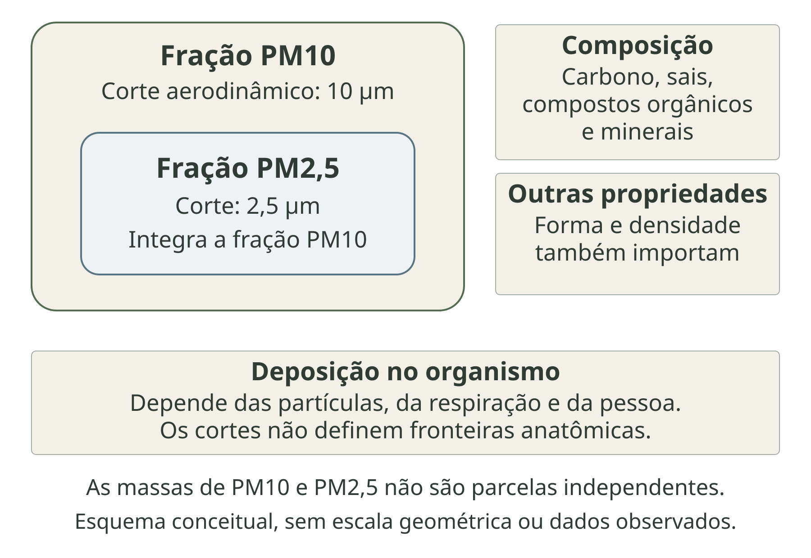
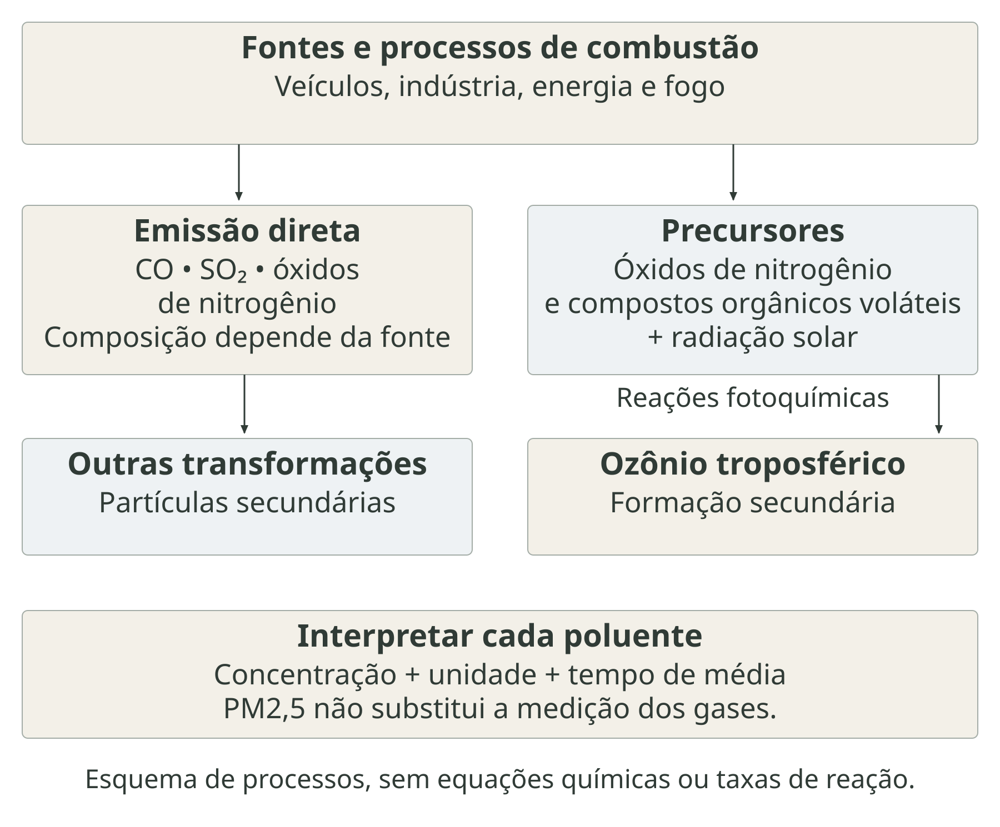
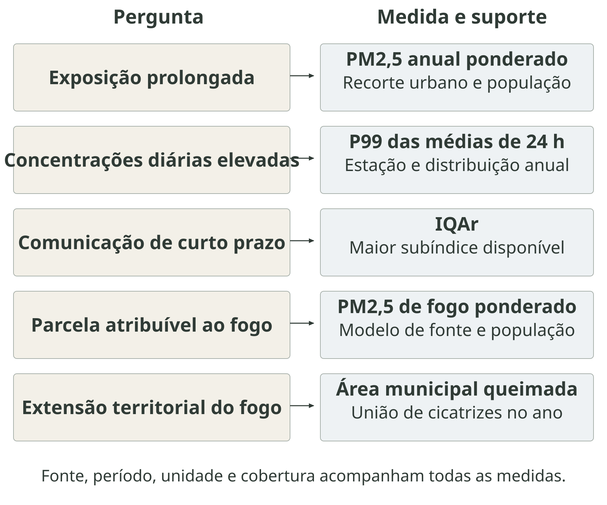
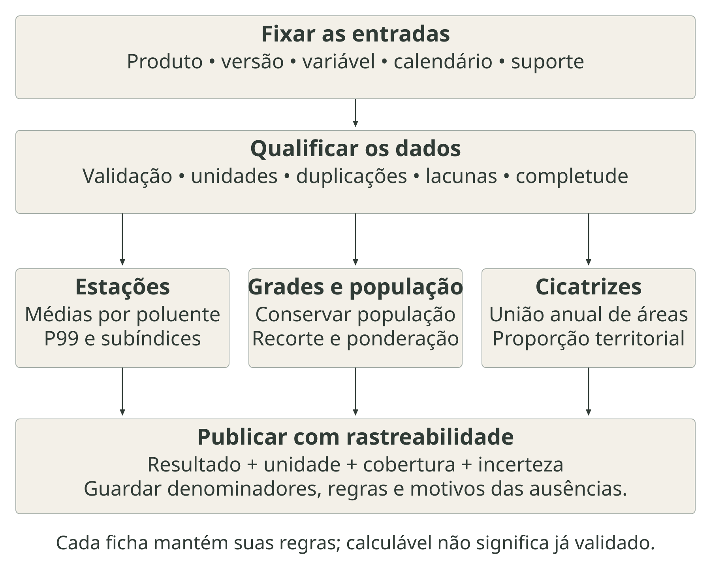

---
aliases:
  - /chapters/part-2/07-qualidade-ar-queimadas-fumaca.html
format:
  html:
    template-partials:
      - ../../includes/chapter-opening/title-block.html
chapter-opening:
  image: ../../assets/openings/cap9-qualidade-ar-queimadas-fumaca-web.webp
  alt: "Aquarela de transição rural e urbana brasileira hipotética sem pessoas. Uma queimada distante em vegetação baixa emite fumaça que se dispersa sobre o vale em direção a um bairro, mantendo relevo e construções visíveis."
---

# Qualidade do ar, queimadas e fumaça {#sec-qualidade-ar}

A qualidade do ar participa das condições em que as pessoas vivem, trabalham e recebem cuidado. Respirar ar com partículas e gases poluentes pode desencadear sintomas, agravar doenças existentes e contribuir para adoecimento e morte. Os efeitos alcançam o sistema respiratório e o cardiovascular; exposições prolongadas também se relacionam ao câncer de pulmão. A Organização Mundial da Saúde (OMS) considera a poluição atmosférica um fator de risco relevante para a saúde, inclusive em concentrações inferiores às que motivavam preocupação em avaliações anteriores. A avaliação integrada da Agência de Proteção Ambiental dos Estados Unidos (EPA) complementa essa base de evidências [@who2021air; @epa2019pm].

Queimadas e incêndios acrescentam uma dimensão episódica e territorial a esse problema. A fumaça pode atingir localidades afastadas do fogo, elevar a demanda por atendimento e encontrar populações já expostas a emissões do tráfego, da indústria ou de outras fontes. No Brasil, estudo de séries temporais com internações do Sistema Único de Saúde (SUS), entre 2000 e 2015, identificou associações entre material particulado fino (PM2,5) proveniente de incêndios e hospitalizações, com diferenças por causa e idade. A exposição foi estimada por modelo atmosférico; o estudo não equiparou a contagem de focos à concentração respirada [@ye2021wildfirebrasil].

Os incêndios também podem produzir queimaduras, traumas, deslocamento, perdas materiais e interrupção dos cuidados. Esses caminhos se somam à inalação de fumaça e exigem respostas distintas. A discussão se conecta aos [fundamentos de clima, ambiente e saúde](../../chapters/part-1/01-clima-ambiente-saude.qmd), aos [eventos severos e desastres](../../chapters/part-2/12-eventos-severos-desastres.qmd) e à [capacidade de resposta dos serviços](../../chapters/part-3/15-resposta-adaptacao-resiliencia.qmd) [@who2026wildfires; @brasil2024fumaca217].

A distribuição do risco depende de onde estão as fontes, de como os poluentes se deslocam e de quem pode reduzir o contato. Crianças, pessoas idosas, pessoas com doenças preexistentes e trabalhadores expostos merecem atenção, mas suscetibilidade biológica e vulnerabilidade social não são sinônimos. Moradia, renda, ocupação e acesso ao cuidado modificam as possibilidades de proteção, como desenvolvido nos capítulos sobre [exposição e vulnerabilidade](../../chapters/part-3/13-exposicao-vulnerabilidade.qmd) e [efeitos sobre a saúde](../../chapters/part-3/14-efeitos-saude.qmd).

::: {.callout-note icon=false title="Conceito-chave: da fonte ao efeito"}
Emissão é a liberação de poluentes por uma fonte. Concentração é a quantidade presente em determinado volume de ar. Exposição descreve o contato ao longo do tempo; dose incorpora a quantidade inalada, depositada ou absorvida, conforme a definição adotada. Efeito é uma alteração de saúde observada ou estimada. Um indicador de uma dessas etapas não mede automaticamente as demais [@who2003environmentalindicators; @epa2019exposure].
:::

A @fig-cadeia-ar-saude organiza essas relações. As [fichas do capítulo 19](../../chapters/part-4/19-fichas-qualidade-ar-queimadas-fumaca.qmd) operacionalizam medidas de concentração, comunicação e extensão do fogo. O [Apêndice B](../../backmatter/apendice-estacoes.qmd) complementa o percurso com instrumentos, redes e exemplos de observação.

::: {.figure-with-source}

{#fig-cadeia-ar-saude fig-alt="Bairro hipotético com fogo distante, fumaça, moradias e visita de saúde. O esquema distingue emissão, concentração ambiente, exposição, dose e efeito, com transporte e transformação entre fonte e concentração. Meteorologia, microambientes e suscetibilidade modificam as relações; as setas não atribuem causalidade a casos individuais." width="100%" print-src="arte-cap9-00-conceitos-print.png"}

[Fonte: elaboração conceitual com base em OMS (2021); EPA (2019), avaliação de exposição; fundamentos discutidos no capítulo. Autoria: composição e rótulos próprios; aquarela produzida com IA (image_gen). Sem dados observados. Licença: a mesma dos textos autorais da obra.]{.figure-source}

:::

## Poluição atmosférica e fontes de emissão

Poluição atmosférica resulta da presença de partículas e gases em concentração, duração e combinação capazes de afetar a saúde e o ambiente. O ar de um território reúne contribuições locais e transportadas. Por isso, identificar uma fonte próxima ajuda a formular hipóteses, mas não determina sozinho o que uma estação medirá ou o que uma pessoa inalará [@who2021air; @epa2022sensores].

As fontes fixas incluem instalações industriais e de geração de energia; fontes móveis incluem veículos e máquinas em deslocamento. Fontes difusas distribuem emissões por áreas ou atividades, como poeira ressuspensa, movimentação de solo e certas práticas agrícolas. Há também contribuições naturais, como aerossol marinho e poeira mineral. Essas categorias descrevem características das fontes; não estabelecem uma ordem universal de importância sanitária. A contribuição efetiva depende da atividade, do combustível, dos controles e das condições atmosféricas.

Um inventário organiza estimativas de emissão por substância, fonte, lugar e período, frequentemente em massa por unidade de tempo. Ele pode combinar informações de atividade com fatores de emissão. Já uma rede de monitoramento registra concentrações em pontos e intervalos definidos. Comparar os dois requer um modelo de dispersão ou de transporte e química; toneladas emitidas não podem ser lidas diretamente como microgramas por metro cúbico no bairro [@epa2022sensores].

Poluentes primários são lançados diretamente; poluentes secundários se formam por transformação de precursores. Partículas podem ter ambas as origens. Vento e mistura vertical redistribuem a massa emitida; deposição seca e remoção pela precipitação retiram parte dela da atmosfera. Estabilidade e inversões podem dificultar a dispersão junto à superfície. Essas relações articulam os capítulos de [temperatura](../../chapters/part-2/07-temperatura-condicoes-termicas.qmd) e [precipitação e secas](../../chapters/part-2/08-precipitacao-secas-eventos-hidrologicos.qmd) com a interpretação da qualidade do ar.

A @fig-ar-fontes apresenta fontes em uma paisagem conceitual, sem atribuir participação numérica a cada uma. A organização do transporte, das atividades produtivas e da ocupação territorial também aproxima o tema do [capítulo sobre uso e cobertura da terra](../../chapters/part-2/11-uso-cobertura-terra-ambiente-urbano.qmd). A escolha entre concentração anual, episódios e comunicação deve seguir as [fichas de qualidade do ar](../../chapters/part-4/19-fichas-qualidade-ar-queimadas-fumaca.qmd), e não apenas a disponibilidade de um inventário.

::: {.figure-with-source}

{#fig-ar-fontes fig-alt="Paisagem hipotética reúne tráfego, indústria, solo exposto e fogo em vegetação. Rótulos distinguem fontes móveis, fixas e difusas. Poluentes primários são emitidos; secundários se formam na atmosfera. A dimensão ou cor da fumaça não representa participação nas emissões." width="100%" print-src="arte-cap9-01-fontes-print.png"}

[Fonte: elaboração conceitual com base em OMS (2021); EPA, Enhanced Air Sensor Guidebook (2022). Autoria: composição e rótulos próprios; aquarela produzida com IA (image_gen). Sem dados observados. Licença: a mesma dos textos autorais da obra.]{.figure-source}

:::

### Material particulado

Material particulado é uma mistura de partículas sólidas e gotículas suspensas no ar. O diâmetro aerodinâmico descreve o comportamento da partícula no ar por comparação com uma esfera de densidade de referência; não corresponde necessariamente à sua dimensão geométrica. Tamanho, forma e densidade afetam esse comportamento. As frações PM10 e PM2,5 são definidas por convenções de seleção por tamanho, com diâmetros de corte de 10 µm e 2,5 µm. Em documentos brasileiros, também aparecem como MP10 e MP2,5; este capítulo usa PM para manter correspondência com as fichas [@epa2019pm].

PM2,5 integra a fração PM10, de modo que as duas concentrações não devem ser somadas como componentes independentes. A fração mais grossa entre esses cortes pode ser obtida por diferença apenas quando as medições forem compatíveis. Os dispositivos de seleção possuem curvas de eficiência: os valores de corte não representam peneiras perfeitas nem fronteiras rígidas de deposição no organismo.

Partículas finas podem alcançar regiões profundas do sistema respiratório. A deposição depende também da respiração e das características da pessoa; não existe correspondência exclusiva entre uma classe de tamanho e um órgão. A massa medida pode reunir carbono, compostos orgânicos, sais e componentes minerais. Duas amostras com a mesma concentração em massa podem ter composição e propriedades diferentes. Carbono negro é um componente ou marcador associado a processos de combustão, não um sinônimo de toda a massa de PM2,5 [@epa2019pm; @reid2016fumaca].

A @fig-ar-particulas separa classificação por tamanho, composição e interpretação sanitária. A [ficha AMB-AR-01](../../chapters/part-4/19-fichas-qualidade-ar-queimadas-fumaca.qmd#sec-amb-ar-01) descreve PM2,5 anual ponderado pela população urbana; a [AMB-AR-02](../../chapters/part-4/19-fichas-qualidade-ar-queimadas-fumaca.qmd#sec-amb-ar-02), o percentil 99 das médias de 24 horas; e a [AMB-FUM-01](../../chapters/part-4/19-fichas-qualidade-ar-queimadas-fumaca.qmd#sec-amb-fum-01), a parcela atribuível ao fogo. Seus resultados respondem a perguntas diferentes. A relação com internações e mortalidade requer os desfechos e métodos discutidos no [capítulo 14](../../chapters/part-3/14-efeitos-saude.qmd).

::: {.figure-with-source}

{#fig-ar-particulas fig-alt="Esquema vetorial mostra PM2,5 dentro da fração PM10, cujos cortes aerodinâmicos são 2,5 e 10 micrômetros. Composição, forma e densidade aparecem como propriedades adicionais. A deposição depende de partículas e respiração; os cortes não são fronteiras anatômicas. O desenho não está em escala." width="100%" print-src="arte-cap9-02-particulas-print.png"}

[Fonte: elaboração conceitual com base em EPA, Integrated Science Assessment for Particulate Matter (2019); OMS (2021). Autoria: composição e rótulos próprios; esquema vetorial autoral. Sem dados observados. Licença: a mesma dos textos autorais da obra.]{.figure-source}

:::

### Gases poluentes

O ozônio troposférico (O₃) se forma por reações fotoquímicas envolvendo óxidos de nitrogênio e compostos orgânicos voláteis, sob influência da radiação solar. Ele pode apresentar concentrações elevadas a distância das fontes de seus precursores. O ozônio na estratosfera contribui para a proteção contra radiação ultravioleta; o ozônio próximo à superfície é um poluente relevante para a saúde. Calor e insolação favorecem certas condições de formação, mas não substituem a análise dos precursores e do transporte [@epa2026ozonio].

O dióxido de nitrogênio (NO₂) está relacionado à combustão e participa da química que forma ozônio e partículas secundárias. O dióxido de enxofre (SO₂) tem entre suas fontes a queima de combustíveis contendo enxofre e processos industriais, além de fontes naturais. O monóxido de carbono (CO), produzido por combustão incompleta, interfere no transporte de oxigênio pelo sangue. Ozônio e gases irritantes podem afetar as vias respiratórias, com relevância particular para pessoas com doenças preexistentes [@who2021air].

A orientação técnica do Ministério do Meio Ambiente e Mudança do Clima (MMA) estabelece a tabela brasileira de comunicação adotada neste livro [@brasil2025iqar]. A @fig-ar-gases diferencia emissão direta e formação secundária. Monitorar PM2,5 não informa, por si, a concentração desses gases. No [Índice de Qualidade do Ar (IQAr) — ficha AMB-AR-03](../../chapters/part-4/19-fichas-qualidade-ar-queimadas-fumaca.qmd#sec-amb-ar-03), cada poluente entra com sua unidade e janela temporal; a análise dos efeitos mantém a definição do desfecho apresentada no [capítulo 14](../../chapters/part-3/14-efeitos-saude.qmd).

::: {.figure-with-source}

{#fig-ar-gases fig-alt="Dois percursos distinguem emissões diretas de CO, SO₂ e óxidos de nitrogênio e formação fotoquímica de ozônio a partir de precursores. Transformações também contribuem para partículas secundárias. Concentração, unidade e tempo de média permanecem específicos de cada poluente." width="100%" print-src="arte-cap9-03-gases-print.png"}

[Fonte: elaboração conceitual com base em OMS (2021); EPA, Ground-level Ozone Basics; MMA (2025). Autoria: composição e rótulos próprios; esquema vetorial autoral. Sem dados observados. Licença: a mesma dos textos autorais da obra.]{.figure-source}

:::

A @tbl-guias-oms-ar reúne os níveis-guia da OMS de 2021. A média anual descreve um horizonte diferente da concentração de curto prazo. Para os valores de 24 horas indicados, o percentil 99 admite aproximadamente três ou quatro dias de excedência ao ano; não equivale ao maior valor diário nem a um teto sem exceções. Para o ozônio, a estação de pico corresponde aos seis meses consecutivos com a maior média das máximas médias diárias de oito horas [@who2021air].

| Poluente | Tempo de média da diretriz OMS 2021 | Nível-guia |
|---|---|---:|
| PM2,5 | Anual | 5 µg/m³ |
| PM2,5 | 24 horas, percentil 99 | 15 µg/m³ |
| PM10 | Anual | 15 µg/m³ |
| PM10 | 24 horas, percentil 99 | 45 µg/m³ |
| O₃ | Estação de pico | 60 µg/m³ |
| O₃ | Máxima média diária de 8 horas, percentil 99 | 100 µg/m³ |
| NO₂ | Anual | 10 µg/m³ |
| NO₂ | 24 horas, percentil 99 | 25 µg/m³ |
| SO₂ | 24 horas, percentil 99 | 40 µg/m³ |
| CO | 24 horas, percentil 99 | 4 mg/m³ |

: Níveis-guia de qualidade do ar da OMS de 2021 {#tbl-guias-oms-ar}

Os níveis-guia orientam redução de risco e não certificam ausência de efeitos abaixo deles. No Brasil, a Resolução do Conselho Nacional do Meio Ambiente (CONAMA) nº 506/2024 estabelece padrões intermediários e finais, com calendário de implantação. Uma comparação regulatória deve identificar a etapa aplicável ao período; uma comparação com a diretriz sanitária deve ser nomeada como tal [@brasil2024conama506].

A unidade também precisa acompanhar a interpretação: na tabela da OMS, CO aparece em mg/m³, enquanto a tabela brasileira do IQAr adotada na ficha usa partes por milhão (ppm) e janela de oito horas. A conversão entre concentração em massa e fração volumétrica exige condições de temperatura e pressão. Alterar somente o símbolo da unidade ou comparar médias com durações diferentes produz um resultado inválido [@brasil2025iqar].

## Medição, modelagem e representatividade

Medir, estimar e prever são operações distintas. Estações de referência fornecem observações em um ponto, com métodos e procedimentos de qualidade definidos. Sua implantação pode privilegiar tráfego, área industrial, fundo urbano ou fundo regional. A localização da estação integra o significado da série: uma medida junto a uma via movimentada não representa automaticamente todos os bairros, e uma média entre estações não se torna uma média populacional apenas por receber o nome do município.

O controle de qualidade começa nos metadados: método, identificação do equipamento, posição e altura da entrada de ar, entorno, fuso, intervalo de integração, unidade e histórico operacional. Calibração, manutenção, validação dos registros e critérios de completude precisam acompanhar os dados. Mudança de instrumento ou local pode produzir uma ruptura de comparabilidade. Essas decisões retomam o [capítulo sobre espaço, tempo e qualidade](../../chapters/part-1/04-espaco-tempo-qualidade.qmd); os equipamentos são descritos no [Apêndice B](../../backmatter/apendice-estacoes.qmd).

Sensores de menor custo podem ampliar a cobertura, mas seu desempenho varia com ambiente, umidade, temperatura e composição das partículas. Co-localização significa operar o sensor próximo a um instrumento de referência, no mesmo período, para avaliar a concordância. Uma correção ajustada em determinada condição deve ser examinada antes de ser transferida a outra. Acompanhamento de deriva e manutenção continuam necessários depois da implantação [@epa2022sensores; @epa2026colocalizacao].

Satélites observam a interação da radiação com a atmosfera e a superfície. A profundidade óptica de aerossóis (*aerosol optical depth*, AOD) descreve a atenuação da radiação pela coluna de aerossóis e é adimensional; não é uma concentração superficial em µg/m³. A relação entre coluna e superfície depende da distribuição vertical, da umidade e das propriedades das partículas. Nuvens, passagem orbital e recuperação do sinal limitam a disponibilidade. Produtos de PM2,5 derivados de satélite acrescentam modelos e outras informações a essa observação [@epa2019pm; @who2026pm25].

Modelos de transporte químico representam emissões, meteorologia e transformações. Assimilação incorpora observações ao estado modelado; reanálises procuram produzir campos retrospectivos consistentes; previsões avançam para períodos futuros. Produtos híbridos combinam fontes, mas continuam dependentes dos dados de treinamento e validação. Uma grade mais fina não garante, sozinha, maior acurácia em cada bairro [@hu2025firepm].

A @fig-ar-observacao compara esses suportes. Na publicação, devem permanecer identificados observação, estimativa e previsão, assim como dados ausentes e valores provisórios. Ausência de monitoramento não significa ar limpo. A seleção documentada no [capítulo 5](../../chapters/part-1/05-fontes-fichas.qmd) fundamenta a escolha entre o produto modelado da [AMB-AR-01](../../chapters/part-4/19-fichas-qualidade-ar-queimadas-fumaca.qmd#sec-amb-ar-01) e as séries de estação da [AMB-AR-02](../../chapters/part-4/19-fichas-qualidade-ar-queimadas-fumaca.qmd#sec-amb-ar-02) e da [AMB-AR-03](../../chapters/part-4/19-fichas-qualidade-ar-queimadas-fumaca.qmd#sec-amb-ar-03).

::: {.figure-with-source}

{#fig-ar-observacao fig-alt="Estação de referência e sensor compacto estão em terreno aberto, com técnica e cidade ao fundo. Um satélite fora de escala representa observação da coluna. Quatro campos diferenciam estação, sensor avaliado por co-localização, satélite e modelo. AOD é adimensional e não equivale a PM2,5 superficial." width="100%" print-src="arte-cap9-04-observacao-print.png"}

[Fonte: elaboração conceitual com base em EPA, Enhanced Air Sensor Guidebook (2022) e guia de co-localização; Hu et al. (2025). Autoria: composição e rótulos próprios; aquarela produzida com IA (image_gen). Sem dados observados. Licença: a mesma dos textos autorais da obra.]{.figure-source}

:::

## Queimadas e incêndios

O fogo pode integrar práticas de manejo ou ocorrer de forma indesejada e sem controle. Sua propagação depende de ignição, combustível disponível, umidade, vento e relevo. O termo queimada é usado em diferentes contextos; incêndio florestal se refere ao fogo que se propaga pela vegetação sem controle. O registro de uma ocorrência, a detecção orbital e a delimitação de sua superfície atingida são objetos distintos. A classificação legal de uma prática não pode ser deduzida somente de uma imagem. As definições e limitações de monitoramento do Programa Queimadas do Instituto Nacional de Pesquisas Espaciais (INPE) ajudam a delimitar esses objetos [@inpe2026faq].

Seca e períodos sem chuva podem reduzir a umidade de parte dos combustíveis, enquanto ocupação e manejo modificam sua quantidade e continuidade. A [duração de períodos secos — CLI-PRC-04](../../chapters/part-4/18-fichas-precipitacao-secas-eventos-hidrologicos.qmd#sec-cli-prc-04) e o [índice de seca meteorológica — CLI-SEC-01](../../chapters/part-4/18-fichas-precipitacao-secas-eventos-hidrologicos.qmd#sec-cli-sec-01), no capítulo 18, ajudam a contextualizar condições antecedentes. Nenhum deles mede a ignição nem substitui um produto de risco de fogo. A leitura conjunta exige os capítulos sobre [precipitação e secas](../../chapters/part-2/08-precipitacao-secas-eventos-hidrologicos.qmd) e [uso e cobertura da terra](../../chapters/part-2/11-uso-cobertura-terra-ambiente-urbano.qmd).

Um foco ativo é uma detecção realizada por sensor e algoritmo em determinado momento. Um mesmo incêndio pode gerar várias detecções; fogo pequeno, breve ou encoberto pode não ser detectado. Satélite, resolução, horário, nuvens e características da combustão alteram a observação. Para comparar contagens, é necessário manter o sistema de referência e seus critérios, em vez de reunir indiscriminadamente todos os satélites disponíveis [@inpe2026faq].

Área queimada descreve a extensão mapeada da superfície atingida, geralmente por cicatrizes observadas após o fogo. Não se obtém essa área multiplicando o número de focos pela área nominal de um pixel. Tampouco uma cicatriz informa diretamente intensidade da combustão, quantidade de combustível consumido ou emissão atmosférica. A @fig-ar-fogo apresenta as três leituras em um território hipotético; as posições gráficas não são resultados de detecção.

::: {.figure-with-source}

{#fig-ar-fogo fig-alt="Três painéis mostram fogo em vegetação, grade esquemática de detecção sobre a mesma cena e cicatriz após o fogo. Os dois primeiros reutilizam exatamente o mesmo recorte; a terceira vinheta representa outro momento. Células destacadas não são detecções reais e a grade não tem resolução geográfica. Focos não são contagem de incêndios nem área queimada." width="100%" print-src="arte-cap9-05-fogo-print.png"}

[Fonte: elaboração conceitual com base em INPE, perguntas frequentes do Programa Queimadas; protocolo da ficha de área queimada. Autoria: composição e rótulos próprios; aquarela produzida com IA (image_gen). Sem dados observados. Licença: a mesma dos textos autorais da obra.]{.figure-source}

:::

A [ficha AMB-FOG-01](../../chapters/part-4/19-fichas-qualidade-ar-queimadas-fumaca.qmd#sec-amb-fog-01) usa o percentual da área municipal queimada no ano, com produto e versão definidos. A união anual de cicatrizes evita contar repetidamente a mesma superfície, mas não informa quantas vezes ela queimou. O zero significa ausência de cicatriz mapeada no produto disponível, não comprovação de ausência de fogo. A avaliação das perdas, das pessoas atingidas e da interrupção de serviços pertence à leitura dos [desastres](../../chapters/part-2/12-eventos-severos-desastres.qmd), complementada pela análise atmosférica da fumaça.

## Fumaça e transporte atmosférico

Fumaça é uma mistura variável de partículas e gases resultante da combustão. Inclui PM2,5, componentes carbonáceos, monóxido de carbono, compostos orgânicos e precursores de poluentes secundários. Combustível, umidade e fase de combustão influenciam sua composição; a mistura muda durante o transporte. Uma pluma envelhecida pode diferir daquela observada junto às chamas [@reid2016fumaca; @hu2025firepm].

A altura de injeção determina em que camadas parte da emissão entra na atmosfera. Vento, turbulência e estabilidade influenciam a trajetória e a mistura vertical. A deposição e a precipitação removem poluentes, enquanto reações químicas transformam a mistura. Uma pluma elevada observada sobre um município não demonstra, por si, concentração elevada junto ao solo; a descida e a mistura com o ar da superfície precisam ser representadas. Distância ao fogo é insuficiente para caracterizar esse percurso.

Esses processos aproximam a análise das condições de [temperatura e estabilidade](../../chapters/part-2/07-temperatura-condicoes-termicas.qmd) e de [chuva e seca](../../chapters/part-2/08-precipitacao-secas-eventos-hidrologicos.qmd). Para a vigilância, interessam o local da população e o momento em que a fumaça pode alcançá-la. O município que registra o fogo e aquele que recebe a pluma podem ser diferentes. Fronteiras administrativas organizam a gestão, mas não delimitam o transporte atmosférico.

A @fig-fumaca-exposicao relaciona detecção de fogo, observação de aerossóis, concentração e exposição. Medidas orbitais e estações oferecem evidências complementares. Uma imagem da pluma pode apoiar a interpretação de um episódio; ela não autoriza converter a tonalidade desenhada ou observada em dose individual.

::: {.figure-with-source}

{#fig-fumaca-exposicao fig-alt="Pluma liga fogo em vegetação a uma cidade distante em paisagem hipotética. O esquema distingue fogo e emissões, transporte e transformação, observação orbital, concentração medida ou modelada, exposição em microambientes e dose. Pluma elevada não determina sozinha concentração no solo; PM2,5 total não é a parcela de fogo." width="100%" print-src="arte-cap9-06-transporte-print.png"}

[Fonte: elaboração conceitual com base em INPE; Reid et al. (2016); Hu et al. (2025); EPA (2019), avaliação de exposição. Autoria: composição e rótulos próprios; aquarela produzida com IA (image_gen). Sem dados observados. Licença: a mesma dos textos autorais da obra.]{.figure-source}

:::

::: {.callout-important icon=false title="Conceito-chave: PM2,5 total e parcela atribuível ao fogo"}
PM2,5 total reúne contribuições de várias fontes. PM2,5 atribuível ao fogo é uma estimativa que procura separar essa contribuição por método explícito. Medir PM2,5 durante uma queimada não transforma toda a concentração em fumaça de incêndio. A atribuição da fonte e a atribuição de efeitos à exposição são duas etapas analíticas diferentes.
:::

Entre as abordagens de atribuição estão simulações com e sem emissões de fogo, traçadores e métodos que combinam inventários, sensoriamento e modelagem. Hu et al. publicaram campos diários para 2000–2023, com variantes baseadas em inventários distintos. A [ficha AMB-FUM-01](../../chapters/part-4/19-fichas-qualidade-ar-queimadas-fumaca.qmd#sec-amb-fum-01) fixa a variante GFED4.1s, ligada à base global de emissões de fogo, e o processamento populacional correspondente. Trocar de inventário exige uma nova identificação da série; não é uma simples atualização de arquivo [@hu2025firepm].

A interpretação sanitária combina esse produto com o [capítulo sobre exposição](../../chapters/part-3/13-exposicao-vulnerabilidade.qmd). Para examinar internações, a [ficha EFE-MOB-01](../../chapters/part-4/24-fichas-efeitos-saude.qmd#sec-efe-mob-01) fornece uma definição operacional do desfecho, sem classificar automaticamente cada internação como causada pela fumaça.

## Exposição e efeitos agudos e crônicos

Exposição acrescenta duração e presença à concentração ambiental. Uma pessoa percorre microambientes: casa, rua, transporte, trabalho, escola e serviço de saúde. Infiltração do ar externo, fontes internas, ventilação e filtração modificam as concentrações encontradas. A dose inalada depende também do volume de ar respirado; atividade física pode aumentar esse volume. Dose depositada e absorvida são definições adicionais, não resultados fornecidos diretamente por uma estação [@epa2019exposure].

Uma superfície de concentração ambiente é uma aproximação útil para estudos populacionais, desde que essa aproximação seja nomeada. Ponderar pela população desloca a pergunta de “qual a média do território?” para “qual a concentração média nos locais ponderados pela população representada?”. Isso não reconstrói deslocamentos nem condições individuais. A [AMB-AR-01](../../chapters/part-4/19-fichas-qualidade-ar-queimadas-fumaca.qmd#sec-amb-ar-01) usa um recorte urbano fixado; a [AMB-FUM-01](../../chapters/part-4/19-fichas-qualidade-ar-queimadas-fumaca.qmd#sec-amb-fum-01) utiliza seu próprio domínio populacional. Os resultados não devem ser comparados como se os denominadores fossem idênticos.

Exposições de curto prazo são estudadas com concentrações horárias ou diárias e janelas de defasagem; exposições prolongadas, com médias de meses ou anos, conforme o desenho. A resposta aguda pode ocorrer sobre uma doença crônica. Assim, “agudo” e “crônico” podem qualificar tanto o horizonte de exposição quanto o processo de adoecimento, e essa distinção deve ser explicitada [@epa2019pm].

Duas localidades podem ter médias anuais semelhantes e distribuições diárias muito diferentes. Por isso, a média de longo prazo deve ser lida junto a séries diárias, percentis, duração de episódios e cobertura dos dados. O percentil 99 (P99) da [AMB-AR-02](../../chapters/part-4/19-fichas-qualidade-ar-queimadas-fumaca.qmd#sec-amb-ar-02) caracteriza a parte superior da distribuição anual, mas não conserva a sequência dos dias; sozinho, não permite reconhecer a duração de uma pluma. A @fig-ar-exposicao organiza esses horizontes sem simular séries ou riscos.

::: {.figure-with-source}

{#fig-ar-exposicao fig-alt="Três cenas conceituais apresentam trabalho na rua, mãe e criança em casa e pessoa idosa em consulta. Os quadros distinguem concentrações de curto prazo e médias prolongadas, com atividade, proteção, suscetibilidade e acesso ao cuidado. Não há séries, frequências ou riscos simulados." width="100%" print-src="arte-cap9-07-exposicao-print.png"}

[Fonte: elaboração conceitual com base em EPA (2019); Reid et al. (2016); Ye et al. (2021). Autoria: composição e rótulos próprios; aquarela produzida com IA (image_gen). Sem dados observados. Licença: a mesma dos textos autorais da obra.]{.figure-source}

:::

Nas vias respiratórias, partículas e gases podem provocar irritação e respostas inflamatórias, agravar asma e doença pulmonar obstrutiva crônica e aumentar a procura por atendimento. A revisão de Reid et al. encontrou evidência mais consistente para morbidade respiratória por fumaça, com maior heterogeneidade para outros desfechos. Essa diferença deve acompanhar a comunicação: a força da evidência não é uniforme para toda doença e toda fonte [@reid2016fumaca].

Inflamação sistêmica, estresse oxidativo, alterações autonômicas e disfunção vascular ajudam a explicar efeitos cardiovasculares associados ao material particulado. A avaliação integrada da Agência de Proteção Ambiental dos Estados Unidos (EPA) reúne evidências epidemiológicas, experimentais e mecanísticas. A base de conhecimento sobre PM2,5 ambiente é mais ampla que a de algumas exposições específicas à fumaça; não se deve transferir automaticamente toda estimativa de risco entre misturas [@epa2019pm].

O estudo brasileiro de Ye et al. analisou 1.814 municípios e encontrou associações de curto prazo com internações por todas as causas, respiratórias e cardiovasculares, com variação entre regiões e idades. A resolução do modelo de exposição e a cobertura das internações integram seus limites. O resultado oferece evidência populacional, sem permitir identificar a causa de um atendimento individual ou aplicar o mesmo coeficiente a qualquer município [@ye2021wildfirebrasil].

Crianças têm organismos em desenvolvimento; pessoas idosas e pessoas com doenças preexistentes podem apresentar menor reserva funcional. Trabalho externo, moradia com infiltração de fumaça e dificuldades de acesso ao cuidado podem prolongar a exposição ou limitar a proteção. O [Índice de Vulnerabilidade Social — EXP-VUL-01](../../chapters/part-4/23-fichas-exposicao-vulnerabilidade.qmd#sec-exp-vul-01) ajuda a contextualizar desigualdades, mas não é uma medida específica de suscetibilidade à fumaça. Sua leitura deve acompanhar o [capítulo 13](../../chapters/part-3/13-exposicao-vulnerabilidade.qmd).

Para efeitos de longo prazo, a literatura sobre poluição ambiente sustenta relações com mortalidade e câncer de pulmão; a avaliação de efeitos materno-infantis e de episódios repetidos de fumaça deve identificar o desfecho e a evidência correspondente [@who2021air; @epa2019pm]. Além da inalação, perdas, deslocamento e interrupção do cuidado podem afetar saúde mental e condições crônicas durante incêndios [@who2026wildfires].

A escolha do desenho determina quais relações podem ser investigadas. Séries temporais examinam variações da exposição e dos eventos ao longo dos dias; estudos de acompanhamento podem avaliar diferenças de exposição prolongada entre pessoas ou grupos. Uma comparação entre municípios precisa considerar composição etária, condições sociais e diferenças no registro dos desfechos. Agregar uma associação territorial para descrevê-la como risco individual ultrapassa o suporte da análise. A definição da população sob observação, do período e do conjunto de ajustes deve preceder a estimativa [@hernan2020causal].

Uma função concentração–resposta relaciona níveis de exposição à frequência ou ao risco do desfecho no contexto estudado. Risco relativo descreve uma comparação; número de eventos depende também do tamanho da população e da frequência de base. Estimar carga atribuível acrescenta a escolha de um cenário de referência e hipóteses sobre o que ocorreria sob outra exposição. O valor-guia da OMS não se converte automaticamente em um ponto abaixo do qual o efeito é zero. As escolhas de referência e de função precisam ser justificadas, como discutido no [capítulo sobre efeitos na saúde](../../chapters/part-3/14-efeitos-saude.qmd) [@gasparrini2014attributable].

Episódios repetidos acrescentam uma questão de trajetória: uma média anual pode ocultar intervalos concentrados em uma estação, enquanto a contagem de dias elevados não conserva sua intensidade. A concentração acumulada em uma janela expressa concentração multiplicada por tempo e, portanto, muda de unidade; ela ainda não é dose absorvida. Antes de comparar territórios, declare a janela, o critério de episódio e o tratamento das lacunas. Esses resumos complementam as fichas, mas não ganham automaticamente validação como novos indicadores de efeito. Para o serviço de saúde, documentar recorrência e intervalos entre episódios pode orientar planejamento; estimar a consequência sanitária exige exposição, desfecho e método compatíveis.

A análise epidemiológica precisa considerar tendência, sazonalidade, calendário, temperatura e fatores definidos pelo modelo causal. Defasagem biológica, tempo até o atendimento e atraso de registro não são a mesma coisa. A redução de internações durante um evento pode refletir barreiras de acesso, e a coincidência entre focos e óbitos não demonstra causalidade [@hernan2020causal; @gasparrini2010dlnm]. O [capítulo 14](../../chapters/part-3/14-efeitos-saude.qmd) desenvolve essas escolhas; as fichas [EFE-MOR-01](../../chapters/part-4/24-fichas-efeitos-saude.qmd#sec-efe-mor-01), [EFE-MOR-02](../../chapters/part-4/24-fichas-efeitos-saude.qmd#sec-efe-mor-02) e [EFE-MOB-01](../../chapters/part-4/24-fichas-efeitos-saude.qmd#sec-efe-mob-01), no capítulo 24, documentam mortalidade e internações sem convertê-las em carga atribuível à poluição.

## Fontes, seleção e principais indicadores

A fonte deve ser escolhida a partir da pergunta sanitária. As [redes de qualidade do ar](../../backmatter/indice-fontes.qmd#redes-qualidade-ar) fornecem medições onde existem estações; o [MonitorAr](../../backmatter/indice-fontes.qmd#monitorar-mma) centraliza arquivos, sem eliminar diferenças de cobertura e validação entre redes. O [CAMS — Copernicus Atmosphere Monitoring Service](../../backmatter/indice-fontes.qmd#cams) oferece produtos atmosféricos cuja variável, camada, resolução e edição precisam ser identificadas. O [Programa Queimadas do INPE](../../backmatter/indice-fontes.qmd#queimadas-inpe), do Instituto Nacional de Pesquisas Espaciais, organiza informações de fogo [@inpe2026queimadas].

Bases globais e produtos modelados são úteis para exposição de longo prazo e comparação territorial. A [base da OMS](../../backmatter/indice-fontes.qmd#who-air) e os produtos operacionais das fichas têm finalidades e entradas próprias. Informar apenas “dados da OMS”, “do CAMS” ou “do INPE” não identifica um conjunto reproduzível. O [capítulo sobre seleção de fontes e qualificação de indicadores](../../chapters/part-1/05-fontes-fichas.qmd) orienta a passagem entre instituição, produto e variável.

A @fig-ar-selecao e o @qua-indicadores-ar relacionam pergunta, medida e limite de interpretação. O indicador anual da primeira linha adapta ao município o conceito do Objetivo de Desenvolvimento Sustentável (ODS) 11.6.2; essa adaptação e seu recorte urbano estão documentados na [AMB-AR-01](../../chapters/part-4/19-fichas-qualidade-ar-queimadas-fumaca.qmd#sec-amb-ar-01). As cinco fichas estão reunidas no [capítulo 19](../../chapters/part-4/19-fichas-qualidade-ar-queimadas-fumaca.qmd).

::: {.figure-with-source}

{#fig-ar-selecao fig-alt="Cinco linhas associam exposição prolongada a PM2,5 anual ponderado; concentrações diárias elevadas a P99; comunicação a IQAr; parcela de fumaça a PM2,5 de fogo; extensão territorial a área queimada. As medidas mantêm diferentes suportes e não formam uma escala única de risco." width="100%" print-src="arte-cap9-08-selecao-print.png"}

[Fonte: elaboração conceitual com base em Protocolos das cinco fichas do capítulo 19. Autoria: composição e rótulos próprios; esquema vetorial autoral. Sem dados observados. Licença: a mesma dos textos autorais da obra.]{.figure-source}

:::

::: {#qua-indicadores-ar}

| Indicador e ficha | Pergunta sanitária | Cuidado de interpretação |
|---|---|---|
| [PM2,5 anual ponderado — AMB-AR-01](../../chapters/part-4/19-fichas-qualidade-ar-queimadas-fumaca.qmd#sec-amb-ar-01) | Como se distribui a exposição ambiente de longo prazo no recorte urbano? | É estimativa modelada; a média não descreve episódios. |
| [P99 das médias de 24 h — AMB-AR-02](../../chapters/part-4/19-fichas-qualidade-ar-queimadas-fumaca.qmd#sec-amb-ar-02) | Quão elevadas são as concentrações diárias na estação ao longo do ano? | O percentil não é máximo nem duração de episódio. |
| [IQAr — AMB-AR-03](../../chapters/part-4/19-fichas-qualidade-ar-queimadas-fumaca.qmd#sec-amb-ar-03) | Como comunicar a condição de curto prazo? | O maior subíndice determina a classe; dados ausentes exigem sinalização. |
| [PM2,5 de fogo ponderado — AMB-FUM-01](../../chapters/part-4/19-fichas-qualidade-ar-queimadas-fumaca.qmd#sec-amb-fum-01) | Qual a exposição ambiente à parcela modelada de fogo? | A atribuição depende de inventário e modelagem. |
| [Área municipal queimada — AMB-FOG-01](../../chapters/part-4/19-fichas-qualidade-ar-queimadas-fumaca.qmd#sec-amb-fog-01) | Qual a extensão territorial anual mapeada do fogo? | Não mede emissão, concentração ou dose. |
| Focos ativos, informação contextual | Onde e quando o sensor detectou fogo? | Não contam necessariamente incêndios distintos; não há ficha própria no livro. |

Indicadores de qualidade do ar, fogo e fumaça usados em saúde pública

:::

O quadro não esgota a vigilância por poluente. PM10, O₃, NO₂, SO₂ e CO precisam conservar suas séries e tempos de média, inclusive quando usados no IQAr. Quando a pergunta envolve um evento, a média anual deve ser complementada por dados temporais apropriados; quando envolve desigualdade, a cobertura e o suporte da população precisam ser comparáveis.

A comparação de fontes deve incluir a finalidade para a qual foram produzidas. Uma previsão serve ao planejamento imediato, mas seu desempenho precisa ser avaliado frente a observações; uma reanálise ou produto histórico pode apoiar estudos retrospectivos, sem oferecer a mesma atualização. Resultados de estação, grade e município devem conservar o suporte original e a operação usada para a agregação. A existência de arquivos para todo o país não implica qualidade homogênea em todos os lugares.

Para documentar a escolha, registre produtor, produto, edição, variável, nível vertical, resolução, período e regras de qualidade. Acrescente o ano e o domínio da população quando houver ponderação. Comparações entre versões devem usar períodos comuns e examinar se a diferença resulta de atualização do método, das entradas ou do fenômeno. Esse registro permite que outra equipe reconstrua a seleção e reconheça o que precisa ser reprocessado, seguindo os critérios dos [capítulos 4](../../chapters/part-1/04-espaco-tempo-qualidade.qmd) e [5](../../chapters/part-1/05-fontes-fichas.qmd).

Um painel pode reunir essas camadas, mas cada uma deve manter unidade, fonte, horário e natureza do dado. Focos, concentração e utilização de serviços não devem receber uma escala comum que sugira equivalência. A leitura conjunta com as [fichas de vulnerabilidade](../../chapters/part-4/23-fichas-exposicao-vulnerabilidade.qmd) e de [mortalidade e internações hospitalares](../../chapters/part-4/24-fichas-efeitos-saude.qmd) acrescenta contexto e desfechos, sem formar automaticamente um índice de risco validado.

## Protocolo de cálculo e disponibilidade

O protocolo transforma uma pergunta em operações reproduzíveis. Antes de calcular, fixe produto, edição, variável, unidade, calendário, suporte espacial e regras para registros inválidos. Preserve os arquivos de entrada e a data de obtenção. A distinção entre dado provisório e validado é especialmente importante em episódios: rapidez de divulgação e consolidação posterior têm funções diferentes.

SatPM identifica o produto de PM2,5 derivado da integração de informações orbitais e modelagem; GHS-POP é a grade populacional do *Global Human Settlement Layer*. GEOS-Chem é o modelo de transporte químico empregado no produto de fogo, e GFED4.1s identifica o inventário selecionado. Essas designações preservam a rastreabilidade; não autorizam substituir as entradas por outra concentração ou outra grade sem revisar o método.

| Ficha | Disponibilidade no protocolo | Entrada fixada |
|---|---|---|
| [AMB-AR-01](../../chapters/part-4/19-fichas-qualidade-ar-queimadas-fumaca.qmd#sec-amb-ar-01) | Calculável com dados abertos | SatPM V6.GL.03 total, 1998–2024, e GHS-POP R2023A |
| [AMB-AR-02](../../chapters/part-4/19-fichas-qualidade-ar-queimadas-fumaca.qmd#sec-amb-ar-02) | Calculável com dados locais centralizados | PM2,5 horário por estação do MonitorAr; P99 anual |
| [AMB-AR-03](../../chapters/part-4/19-fichas-qualidade-ar-queimadas-fumaca.qmd#sec-amb-ar-03) | Calculável com dados locais centralizados | Seis poluentes por estação; tabela IQAr de 2025 |
| [AMB-FUM-01](../../chapters/part-4/19-fichas-qualidade-ar-queimadas-fumaca.qmd#sec-amb-fum-01) | Calculável com dados abertos | PM2,5 de fogo GEOS-Chem/GFED4.1s, 2000–2023 |
| [AMB-FOG-01](../../chapters/part-4/19-fichas-qualidade-ar-queimadas-fumaca.qmd#sec-amb-fog-01) | Calculável com dados abertos | MapBiomas Fogo Coleção 5 v1, 1985–2025 |

Nas séries de estação, confira duplicações, fuso, unidades, flags de validação e lacunas antes de calcular as médias. A [AMB-AR-02](../../chapters/part-4/19-fichas-qualidade-ar-queimadas-fumaca.qmd#sec-amb-ar-02) exige ao menos 16 horas distintas válidas por dia, 90% dos dias no ano e metade dos dias de cada quadrimestre, calculando P99 pelo quantil tipo 7. As exigências anuais e a escolha do estimador são decisões operacionais da ficha, não uma certificação automática de conformidade regulatória.

Na [AMB-AR-03](../../chapters/part-4/19-fichas-qualidade-ar-queimadas-fumaca.qmd#sec-amb-ar-03), cada poluente mantém seu tempo de média. O₃ e CO exigem janelas móveis de oito horas, incluindo as horas anteriores ao início do dia conforme o protocolo. A tabela de 2025 é fixada para comparação retrospectiva; o boletim originalmente publicado pela rede permanece separado. A falta de qualquer um dos seis poluentes recebe indicação de IQAr parcial, mesmo quando é possível calcular o máximo dos subíndices disponíveis.

Nas médias ponderadas, a operação conceitual é $\overline{C}_{P}=\sum_i C_i P_i/\sum_i P_i$, em que $C_i$ é a concentração na unidade espacial válida e $P_i$ a população representada nessa unidade. O numerador soma concentração multiplicada pela população; o denominador soma a população incluída, mantendo a unidade da concentração no resultado. A operação deve seguir o recorte, a cobertura mínima e a ordem temporal de cada ficha. Repartir contagens populacionais por interseções exige conservar seus totais; interpolação bilinear de contagens não substitui esse procedimento.

A [AMB-AR-01](../../chapters/part-4/19-fichas-qualidade-ar-queimadas-fumaca.qmd#sec-amb-ar-01) usa concentração anual e recorte urbano definido. A [AMB-FUM-01](../../chapters/part-4/19-fichas-qualidade-ar-queimadas-fumaca.qmd#sec-amb-fum-01) calcula a média populacional diária antes da agregação anual, com regras próprias de cobertura. População excluída por falta de concentração não pode desaparecer do relatório: cobertura válida e denominadores acompanham a estimativa. A [AMB-FOG-01](../../chapters/part-4/19-fichas-qualidade-ar-queimadas-fumaca.qmd#sec-amb-fog-01), por sua vez, calcula uma proporção territorial, sem ponderação populacional.

A @fig-ar-protocolo organiza esse percurso. As regras espaciais e temporais dialogam com o [capítulo 4](../../chapters/part-1/04-espaco-tempo-qualidade.qmd); as fórmulas completas e exceções permanecem nas [fichas do capítulo 19](../../chapters/part-4/19-fichas-qualidade-ar-queimadas-fumaca.qmd). “Calculável” descreve disponibilidade e condições de processamento, não afirma que uma série municipal já foi calculada ou validada.

::: {.figure-with-source}

{#fig-ar-protocolo fig-alt="Fluxo liga escolha de produto e versão, controle de qualidade, cálculo e publicação. Três ramificações distinguem séries de estação, grades com população e cicatrizes territoriais. Cada uma mantém regras próprias; cobertura, unidade e incerteza acompanham o resultado." width="100%" print-src="arte-cap9-09-protocolo-print.png"}

[Fonte: elaboração conceitual com base em Protocolos das cinco fichas do capítulo 19 e princípios do capítulo 4. Autoria: composição e rótulos próprios; esquema vetorial autoral. Sem dados observados. Licença: a mesma dos textos autorais da obra.]{.figure-source}

:::

``{=html}
Consulte a [ficha AMB-AR-01 — PM2,5 anual ponderado](../../chapters/part-4/19-fichas-qualidade-ar-queimadas-fumaca.qmd#sec-amb-ar-01), na Parte IV`~(p. #ref(<sec-amb-ar-01>, form: "page", supplement: none))`{=typst}.

``{=html}
Consulte a [ficha AMB-AR-02 — PM2,5 de curto prazo — P99 24h](../../chapters/part-4/19-fichas-qualidade-ar-queimadas-fumaca.qmd#sec-amb-ar-02), na Parte IV`~(p. #ref(<sec-amb-ar-02>, form: "page", supplement: none))`{=typst}.

``{=html}
Consulte a [ficha AMB-AR-03 — Índice de Qualidade do Ar](../../chapters/part-4/19-fichas-qualidade-ar-queimadas-fumaca.qmd#sec-amb-ar-03), na Parte IV`~(p. #ref(<sec-amb-ar-03>, form: "page", supplement: none))`{=typst}.

``{=html}
Consulte a [ficha AMB-FUM-01 — PM2,5 de fumaça ponderado pela população](../../chapters/part-4/19-fichas-qualidade-ar-queimadas-fumaca.qmd#sec-amb-fum-01), na Parte IV`~(p. #ref(<sec-amb-fum-01>, form: "page", supplement: none))`{=typst}.

``{=html}
Consulte a [ficha AMB-FOG-01 — Área municipal queimada](../../chapters/part-4/19-fichas-qualidade-ar-queimadas-fumaca.qmd#sec-amb-fog-01), na Parte IV`~(p. #ref(<sec-amb-fog-01>, form: "page", supplement: none))`{=typst}.

## Alertas e aplicação na gestão

Um alerta conecta evidência a uma decisão com responsáveis, prazo e meios de execução. O Índice de Qualidade do Ar (IQAr) facilita a comunicação ao transformar concentrações em subíndices e adotar o maior deles. A classe deve vir acompanhada do poluente determinante, concentração, tempo de média, estação ou área representada, horário e cobertura. O índice é adimensional; não deve substituir as concentrações em análises epidemiológicas [@brasil2025iqar].

Durante fumaça, a equipe pode reunir observações e previsões de PM2,5, informação sobre fogo e trajetória da pluma, população potencialmente exposta e funcionamento dos serviços. Essas camadas conservam identificação e incerteza. O produto histórico da [AMB-FUM-01](../../chapters/part-4/19-fichas-qualidade-ar-queimadas-fumaca.qmd#sec-amb-fum-01) não é uma previsão operacional; a série retrospectiva do [IQAr — AMB-AR-03](../../chapters/part-4/19-fichas-qualidade-ar-queimadas-fumaca.qmd#sec-amb-ar-03) também não substitui o boletim atual da rede responsável.

A @fig-ar-gestao organiza monitoramento, decisão, comunicação e avaliação. As ações retomam o [capítulo 6](../../chapters/part-1/06-indicador-decisao.qmd), que vincula indicadores a decisões, e o [capítulo 15](../../chapters/part-3/15-resposta-adaptacao-resiliencia.qmd), que trata de preparação e continuidade.

::: {.figure-with-source}

{#fig-ar-gestao fig-alt="Três cenas de aquarela mostram equipe intersetorial, orientação no trabalho e unidade de saúde em funcionamento. O ciclo vetorial liga monitorar, decidir, comunicar e avaliar, retornando ao planejamento. Responsabilidades e recursos sustentam as ações; as cenas não medem eficácia." width="100%" print-src="arte-cap9-10-gestao-print.png"}

[Fonte: elaboração conceitual com base em MMA (2025); Ministério da Saúde, Nota Técnica Conjunta 217/2024; capítulos 6 e 15. Autoria: composição e rótulos próprios; aquarela produzida com IA (image_gen). Sem dados observados. Licença: a mesma dos textos autorais da obra.]{.figure-source}

:::

Uma rotina de gestão pode ser organizada em sete passos:

1. Verificar dado, horário, validação, representatividade e lacunas.
2. Identificar poluente determinante e evidências da fonte, explicitando quando a atribuição é apenas uma hipótese.
3. Avaliar evolução prevista, duração e áreas potencialmente alcançadas, com meteorologia e órgãos ambientais.
4. Localizar grupos com maiores barreiras de proteção e serviços expostos, incluindo escolas, abrigos e instituições de longa permanência.
5. Acionar medidas previstas no protocolo local e comunicar a informação em formatos acessíveis.
6. Acompanhar sintomas, procura por cuidado, internações e continuidade assistencial, respeitando os atrasos dos registros.
7. Registrar decisões, alcance das mensagens e dificuldades de execução para revisar a resposta.

O Ministério da Saúde orienta a articulação da atenção primária com urgência, hospitais e saúde indígena nas emergências por seca, estiagem e incêndios. Conhecimento do território, fluxos de encaminhamento e preparação da rede ajudam a organizar o atendimento. Estoques, transporte e condições de funcionamento precisam acompanhar a previsão de demanda, em coordenação com ambiente, defesa civil e responsáveis pelo combate ao fogo [@brasil2024fumaca217].

Recomendações individuais dependem de meios concretos. Reduzir atividades externas pode ser inviável sem reorganização do trabalho; permanecer em casa pode não reduzir a exposição quando a fumaça infiltra e existem fontes internas. Ambientes com ar mais limpo exigem avaliação de ventilação, filtração, ocupação e conforto térmico. A comunicação deve explicar o que pode ser feito, por quem e com qual apoio, evitando transferir toda a responsabilidade às pessoas expostas [@epa2019exposure; @who2024sdhequity].

As fichas de [ponto focal — RES-GOV-01](../../chapters/part-4/25-fichas-resposta-adaptacao-resiliencia.qmd#sec-res-gov-01), [perfil de riscos — RES-RIS-01](../../chapters/part-4/25-fichas-resposta-adaptacao-resiliencia.qmd#sec-res-ris-01) e [plano de continuidade — RES-PLA-01](../../chapters/part-4/25-fichas-resposta-adaptacao-resiliencia.qmd#sec-res-pla-01), no capítulo 25, permitem verificar componentes da preparação dos estabelecimentos. A [RES-ALR-01](../../chapters/part-4/25-fichas-resposta-adaptacao-resiliencia.qmd#sec-res-alr-01) descreve capacidade nacional de alerta e resposta; sua escala não deve ser confundida com desempenho de um alerta municipal de fumaça.

A avaliação posterior combina alcance e compreensão das mensagens, execução das medidas, barreiras encontradas e manutenção do cuidado. As séries da [EFE-MOB-01](../../chapters/part-4/24-fichas-efeitos-saude.qmd#sec-efe-mob-01) ajudam a acompanhar utilização dos serviços, mas mudanças nas internações exigem examinar acesso e cobertura do registro. A gestão transforma esse retorno em ajustes do protocolo, responsabilidades e recursos para o episódio seguinte.
