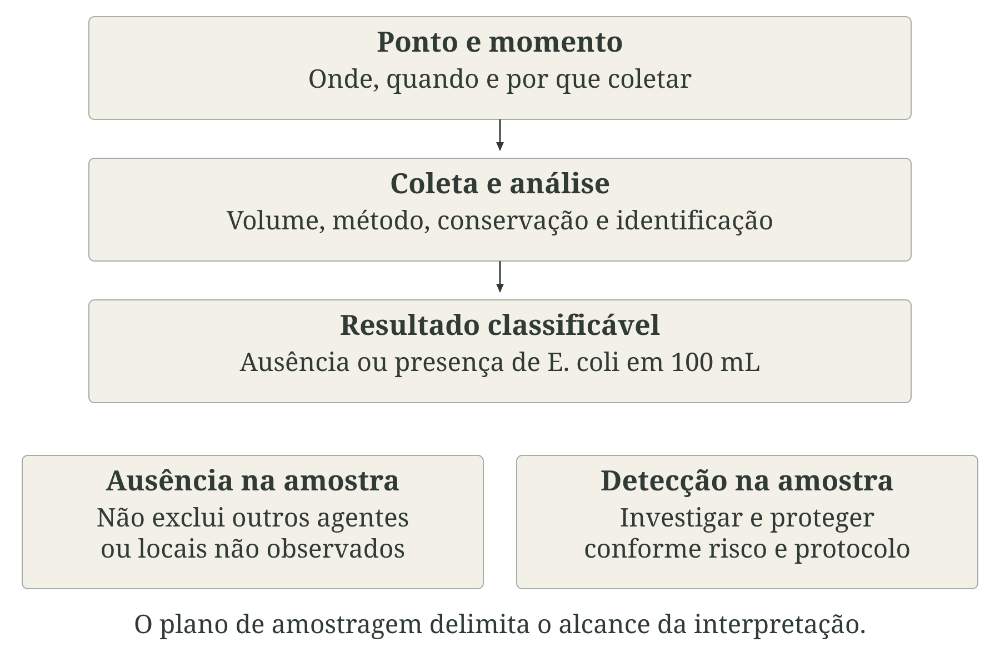
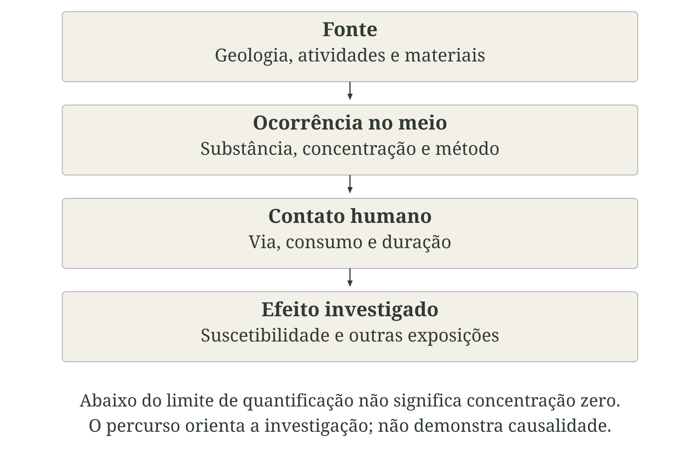
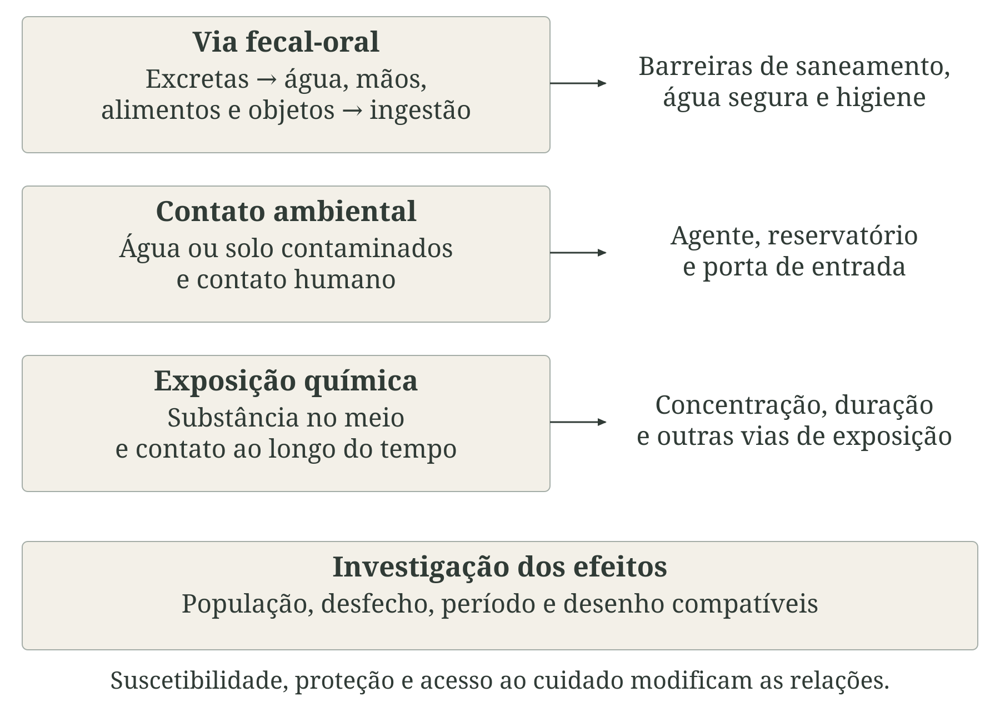
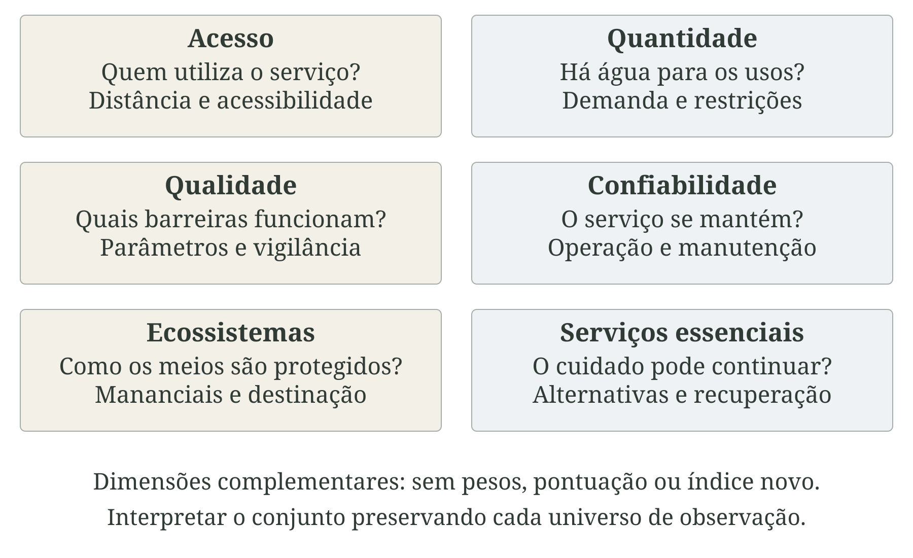
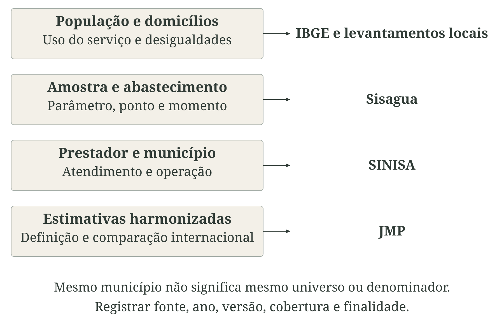
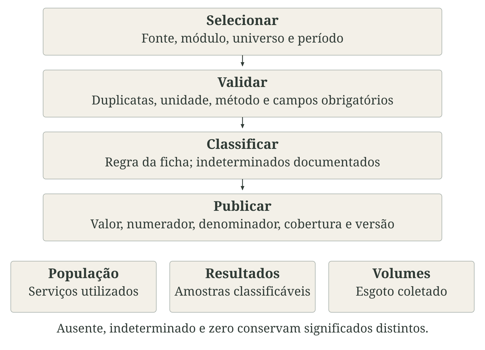
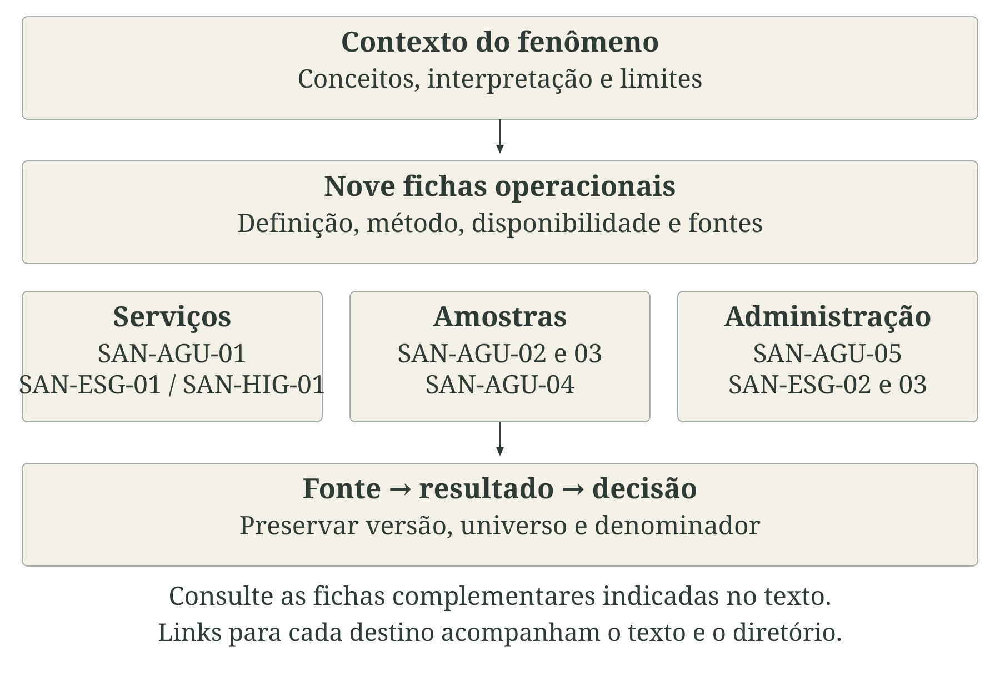

---
aliases:
  - /chapters/part-2/08-agua-saneamento-qualidade-ambiental.html
---

# Água, saneamento e higiene {#sec-agua-saneamento}

Água, saneamento e higiene participam da proteção da saúde em atividades tão diferentes quanto beber, preparar alimentos, tomar banho, cuidar de uma criança e realizar um procedimento em uma unidade de saúde. A proteção depende da quantidade disponível, da qualidade da água e das condições de acesso, mas também do destino das excretas e dos resíduos. Uma falha pode alcançar pessoas que não utilizam o serviço que a originou: o lançamento de esgoto, por exemplo, pode comprometer usos da água a jusante. Por isso, a análise reúne condições domiciliares, infraestrutura coletiva e qualidade ambiental [@who2020waterquantity; @who2018sanitation].

No Brasil, saneamento básico abrange abastecimento de água potável, esgotamento sanitário, limpeza urbana e manejo de resíduos sólidos, além de drenagem e manejo das águas pluviais urbanas. Esgotamento sanitário é, portanto, um componente desse conjunto. Na literatura internacional, a expressão WASH, de *water, sanitation and hygiene*, reúne água, manejo sanitário de excretas e higiene; o termo *sanitation* não deve ser automaticamente traduzido como toda a abrangência legal brasileira do saneamento básico [@brasil2007saneamento; @who2018sanitation].

::: {.callout-note icon=false title="Conceito-chave: condições, serviços e saúde"}

Qualidade ambiental descreve condições dos meios, como água, solo e ar, segundo o uso e o objetivo de avaliação. Potabilidade se refere aos requisitos da água destinada ao consumo humano. Serviço seguro combina acesso e funcionamento com proteção sanitária ao longo da cadeia. Higiene envolve condições e práticas de cuidado. Segurança hídrica integra quantidade, qualidade, acesso e confiabilidade ao longo do tempo. Exposição é o contato das pessoas com um agente; efeito é uma alteração da saúde que precisa ser investigada.

:::

Essas distinções, organizadas na @fig-cadeia-agua-saneamento, orientam a escolha dos indicadores. Uma ligação domiciliar informa uma condição de acesso; uma amostra informa o que foi encontrado em determinado ponto e momento; uma internação informa um evento assistencial. Nenhum desses registros, isoladamente, demonstra o funcionamento de toda a cadeia. Sua integração exige reconhecer unidades, populações e períodos, retomando a discussão de [dados, variáveis, índices e indicadores](../../chapters/part-1/03-dados-variaveis-indices-indicadores.qmd).

::: {.figure-with-source}

{#fig-cadeia-agua-saneamento fig-alt="Paisagem hipotética relaciona abastecimento, instalação sanitária e cuidado. O esquema distingue água segura, esgotamento, higiene, qualidade ambiental, exposição, efeitos e resposta. Segurança hídrica reúne condições que precisam persistir no tempo." width="100%" print-src="arte-cap10-00-conceitos-print.png"}

[Fonte: elaboração conceitual a partir de OMS (2018, 2020, 2022); Lei nº 11.445/2007. Autoria: composição própria; aquarela produzida com IA (image_gen). Licença: a mesma dos textos autorais da obra.]{.figure-source}

:::

O [capítulo 8](../../chapters/part-2/08-precipitacao-secas-eventos-hidrologicos.qmd) explica precipitação, secas e processos hidrológicos. Aqui, o foco é como os serviços e as barreiras sanitárias funcionam no cotidiano e sob perturbações. A chuva pode alterar a água captada e a seca pode restringir o abastecimento, mas a exposição depende também de manutenção, tratamento, armazenamento e capacidade institucional. Os indicadores operacionais estão nas [fichas de água, esgotamento sanitário e higiene](../../chapters/part-4/20-fichas-agua-saneamento-qualidade-ambiental.qmd); as [fichas de mortalidade e internações hospitalares](../../chapters/part-4/24-fichas-efeitos-saude.qmd) e as [fichas de preparação e continuidade dos serviços de saúde](../../chapters/part-4/25-fichas-resposta-adaptacao-resiliencia.qmd) completam a leitura sem estabelecer atribuição automática.

## Água para consumo humano

Água para consumo humano inclui a destinada à ingestão, ao preparo de alimentos e à higiene pessoal. Sua origem não determina sua segurança: água de rede, poço ou solução coletiva precisa ser avaliada segundo condições de captação, tratamento, distribuição e uso. Transparência, gosto e odor influenciam a aceitação, mas a aparência não comprova ausência de contaminantes. Também é necessário distinguir os requisitos de potabilidade dos requisitos específicos de usos assistenciais, como o processamento da água para diálise [@brasil2024agua; @who2022drinking].

A norma brasileira é o Anexo XX da Portaria de Consolidação nº 5/2017 do Gabinete do Ministro do Ministério da Saúde (GM/MS), atualizado pelas Portarias nº 888/2021 e nº 2.472/2021. Ela diferencia sistema de abastecimento de água (SAA), que fornece água coletivamente por rede; solução alternativa coletiva (SAC), sem rede de distribuição; e solução alternativa individual (SAI), destinada a uma família e seus agregados. Essas categorias organizam responsabilidades e registros, sem funcionar como classificação automática de qualidade [@brasil2021portaria888; @brasil2021portaria2472].

Controle é a atividade do responsável pelo sistema ou solução coletiva para verificar e manter a qualidade. Vigilância é a atuação da autoridade de saúde pública para avaliar o atendimento à norma e o risco à população. Os dados se complementam, mas diferem em finalidade, seleção dos pontos e frequência. Uma comparação deve identificar a origem do registro; simplesmente reunir todas as amostras pode misturar monitoramento operacional, rotina sanitária e investigação de situações críticas [@oliveira2019sisagua; @brasil2024agua].

A Organização Mundial da Saúde (OMS) recomenda uma abordagem preventiva do manancial ao consumidor. O plano de segurança da água identifica perigos, situações capazes de introduzi-los e medidas para impedir ou reduzir a exposição. A verificação laboratorial participa dessa abordagem, juntamente com inspeção, acompanhamento operacional e correção. A @fig-agua-abastecimento representa essas etapas; o esquema é conceitual, sem prescrever uma tecnologia única de tratamento [@who2023wsp].

::: {.figure-with-source}

{#fig-agua-abastecimento fig-alt="Paisagem hipotética mostra captação, tratamento, reservação e cidade. O esquema acompanha a cadeia até o uso, distinguindo controle pelo responsável e vigilância pela autoridade de saúde. A paisagem não prescreve uma tecnologia de tratamento." width="100%" print-src="arte-cap10-01-abastecimento-print.png"}

[Fonte: elaboração conceitual a partir de OMS (2023), Water safety plan manual; Ministério da Saúde (2024). Autoria: composição própria; aquarela produzida com IA (image_gen). Licença: a mesma dos textos autorais da obra.]{.figure-source}

:::

A leitura das [fichas do capítulo 20](../../chapters/part-4/20-fichas-agua-saneamento-qualidade-ambiental.qmd) deve considerar o alcance de cada medida. A ficha [SAN-AGU-05](../../chapters/part-4/20-fichas-agua-saneamento-qualidade-ambiental.qmd#sec-san-agu-05) descreve atendimento por rede; [SAN-AGU-02](../../chapters/part-4/20-fichas-agua-saneamento-qualidade-ambiental.qmd#sec-san-agu-02), [SAN-AGU-03](../../chapters/part-4/20-fichas-agua-saneamento-qualidade-ambiental.qmd#sec-san-agu-03) e [SAN-AGU-04](../../chapters/part-4/20-fichas-agua-saneamento-qualidade-ambiental.qmd#sec-san-agu-04) resumem resultados de parâmetros específicos. Já [SAN-AGU-01](../../chapters/part-4/20-fichas-agua-saneamento-qualidade-ambiental.qmd#sec-san-agu-01) articula componentes populacionais de serviço seguro. Em estabelecimentos de saúde, acrescentam-se a continuidade e as condições de funcionamento tratadas no [capítulo 15](../../chapters/part-3/15-resposta-adaptacao-resiliencia.qmd) e nas fichas [RES-WAT-01](../../chapters/part-4/25-fichas-resposta-adaptacao-resiliencia.qmd#sec-res-wat-01) e [RES-WAS-01](../../chapters/part-4/25-fichas-resposta-adaptacao-resiliencia.qmd#sec-res-was-01).

### Abastecimento, acesso e regularidade

Fonte melhorada é uma classificação do tipo de instalação e de seu potencial de proteção. Ela não atesta a qualidade de cada fornecimento. O Programa Conjunto da OMS e do Fundo das Nações Unidas para a Infância (UNICEF) de Monitoramento do Abastecimento de Água, Saneamento e Higiene (JMP) distingue níveis de serviço. O nível básico utiliza fonte melhorada com coleta em até 30 minutos, considerando ida, volta e espera; acima desse tempo, o serviço é limitado. O nível gerido de forma segura exige fonte melhorada no domicílio ou terreno, disponível quando necessária e livre de contaminação fecal e química prioritária [@jmp2026water].

O Objetivo de Desenvolvimento Sustentável (ODS) 6.1.1 acompanha essa última condição. Sua definição reúne dimensões que podem divergir: uma residência pode ter torneira e sofrer desabastecimento; outra pode receber água em quantidade suficiente sem informações adequadas de qualidade. A @fig-agua-acesso mostra que localização, continuidade e qualidade precisam ser verificadas separadamente. A aparência das cenas não classifica a segurança dos serviços.

::: {.figure-with-source}

{#fig-agua-acesso fig-alt="Duas cenas conceituais mostram uso de água no quintal e transporte de recipiente. Três requisitos de serviço seguro aparecem separados: fonte no local, disponibilidade e qualidade. A aparência da água não comprova potabilidade." width="100%" print-src="arte-cap10-02-acesso-print.png"}

[Fonte: elaboração conceitual a partir de JMP, Drinking water; Howard et al. (2020). Autoria: composição própria; aquarela produzida com IA (image_gen). Licença: a mesma dos textos autorais da obra.]{.figure-source}

:::

A quantidade necessária envolve beber, cozinhar, higiene pessoal e limpeza. Distância, tempo, esforço físico e custo interferem no volume efetivamente utilizado. A avaliação deve incluir quem busca água, a acessibilidade dos pontos e a dependência de cuidadores. Médias municipais podem ocultar famílias que restringem usos por dificuldade de pagamento ou que combinam fontes em períodos distintos. O levantamento deve registrar essas alternativas, em vez de presumir que a fonte principal declarada descreve toda a exposição [@who2020waterquantity].

Interrupções também modificam as condições da rede e do domicílio. Perda de pressão pode favorecer intrusão quando existem defeitos e fontes externas de contaminação; armazenamento prolongado e recipientes inadequados podem acrescentar riscos. Esses mecanismos dependem da instalação e do manejo, não sendo consequência inevitável de toda interrupção. Duração, frequência, extensão territorial e população atingida precisam acompanhar o registro de continuidade [@who2023wsp; @brasil2024agua].

As fichas [SAN-AGU-01](../../chapters/part-4/20-fichas-agua-saneamento-qualidade-ambiental.qmd#sec-san-agu-01) e [SAN-AGU-05](../../chapters/part-4/20-fichas-agua-saneamento-qualidade-ambiental.qmd#sec-san-agu-05), no [capítulo 20](../../chapters/part-4/20-fichas-agua-saneamento-qualidade-ambiental.qmd), permitem separar serviço seguro e atendimento por rede. A análise de desigualdades pode ser articulada ao [capítulo sobre exposição e vulnerabilidade](../../chapters/part-3/13-exposicao-vulnerabilidade.qmd) e às [fichas do capítulo 23](../../chapters/part-4/23-fichas-exposicao-vulnerabilidade.qmd), conservando o território e o denominador de cada medida. Para unidades de saúde, [RES-WAT-01](../../chapters/part-4/25-fichas-resposta-adaptacao-resiliencia.qmd#sec-res-wat-01) mede ocorrência de interrupção na semana anterior entre estabelecimentos com informação válida; esse recorte não representa a continuidade domiciliar nem todo o ano.

### Qualidade microbiológica

A presença de *Escherichia coli*, abreviada como *E. coli*, indica contaminação fecal e necessidade de investigação sanitária. O parâmetro funciona como indicador: não identifica todos os patógenos, sua origem específica ou a doença que poderá ocorrer. Coliformes totais auxiliam a avaliação das condições do sistema, mas não possuem a mesma especificidade para contaminação fecal. Confundir esses grupos compromete tanto a interpretação quanto a construção da série [@who2022drinking; @brasil2024agua].

A ausência de *E. coli* em 100 mL é uma referência central da avaliação microbiológica. O volume faz parte da informação: resultados obtidos com volumes ou métodos diferentes não podem ser classificados apenas pelo número ou pela palavra registrada. Coleta, conservação, transporte, tempo até a análise e procedimento laboratorial influenciam a validade do resultado. Esses aspectos devem acompanhar a cadeia de identificação da amostra e as regras de aceitação [@brasil2024agua].

Uma amostra negativa se refere ao material examinado. Não exclui contaminação intermitente, pontos não amostrados ou agentes que se comportam diferentemente do indicador. A @fig-agua-microbiologia separa a observação do alcance da conclusão. Resultados positivos requerem avaliação e medidas oportunas; a investigação e a recoleta não devem ser apresentadas como motivo para adiar proteção quando houver risco identificado [@who2023wsp].

::: {.figure-with-source}

{#fig-agua-microbiologia fig-alt="O percurso liga ponto e momento, coleta e análise, resultado e avaliação. Ausência de E. coli em 100 mL se refere à amostra; detecção indica necessidade de ação. Cobertura do plano e representatividade limitam conclusões populacionais." width="100%" print-src="arte-cap10-03-microbiologia-print.png"}

[Fonte: elaboração conceitual a partir de Ministério da Saúde (2024); Oliveira Júnior et al. (2019). Autoria: composição própria. Licença: a mesma dos textos autorais da obra.]{.figure-source}

:::

Conformidade também depende de onde se observou. Um conjunto concentrado em áreas centrais pode deixar pouco representadas soluções alternativas e localidades periféricas. Mudanças na proporção de amostras conformes podem decorrer da inclusão de pontos críticos, além de mudanças reais da água. É necessário publicar número de resultados classificáveis, distribuição dos pontos, finalidade da coleta e execução do plano, evitando tratar o universo de amostras como amostra probabilística da população [@oliveira2019sisagua].

A ficha [SAN-AGU-02](../../chapters/part-4/20-fichas-agua-saneamento-qualidade-ambiental.qmd#sec-san-agu-02), no [capítulo 20](../../chapters/part-4/20-fichas-agua-saneamento-qualidade-ambiental.qmd), fixa o cálculo para registros elegíveis do Sisagua. As regras de comparabilidade do [capítulo 4](../../chapters/part-1/04-espaco-tempo-qualidade.qmd) ajudam a identificar alterações de suporte e método. Uma associação com internações ou outros desfechos exige o desenho epidemiológico discutido no [capítulo 14](../../chapters/part-3/14-efeitos-saude.qmd) e a escolha de medidas nas [fichas de mortalidade e internações hospitalares](../../chapters/part-4/24-fichas-efeitos-saude.qmd), sem transformar detecção ambiental em diagnóstico individual.

### Turbidez e desinfecção

Turbidez é uma propriedade óptica relacionada ao espalhamento da luz por partículas. Pode variar com características do manancial, remoção de partículas no tratamento e condições da distribuição. Não mede diretamente a concentração de um patógeno. Sua utilidade sanitária decorre, entre outros aspectos, da avaliação da filtração e da possibilidade de partículas dificultarem a ação do desinfetante. Os critérios precisam ser aplicados à tecnologia, etapa e ponto correspondentes [@who2022drinking; @brasil2024agua].

O residual de desinfetante acompanha a permanência de uma barreira na água distribuída. Sua interpretação depende do agente empregado, do tempo de contato, das condições da água e das características do sistema. Um residual dentro da faixa não garante sozinho proteção contra todos os microrganismos; um residual insuficiente sinaliza a necessidade de investigar consumo do agente, dosagem, tempo de permanência e integridade da rede. Turbidez e residual são complementares, conforme a @fig-agua-desinfeccao.

::: {.figure-with-source}

{#fig-agua-desinfeccao fig-alt="Três cenas hipotéticas mostram tratamento, análise e ponto de consumo. O esquema distingue partículas, barreira de desinfecção e etapa de coleta. A figura não descreve um procedimento de coleta nem certifica a segurança pela aparência." width="100%" print-src="arte-cap10-04-desinfeccao-print.png"}

[Fonte: elaboração conceitual a partir de OMS (2022), Guidelines for drinking-water quality; Portarias GM/MS nº 888 e nº 2.472/2021. Autoria: composição própria; aquarela produzida com IA (image_gen). Licença: a mesma dos textos autorais da obra.]{.figure-source}

:::

A norma prevê manutenção mínima de 0,2 mg/L de cloro residual livre, 2 mg/L de cloro residual combinado ou 0,2 mg/L de dióxido de cloro na distribuição e nos pontos de consumo. Esses agentes não podem ser reunidos sob uma mesma faixa. A Portaria nº 2.472/2021 também explicita a medição de cor aparente, turbidez e residual nas amostras coletadas para análises bacteriológicas, favorecendo a leitura conjunta dos parâmetros [@brasil2021portaria888; @brasil2021portaria2472].

O monitoramento deve registrar unidade, instrumento, método, calibração e momento da medição. Alterações entre coleta e análise podem reduzir a comparabilidade, especialmente de parâmetros que se modificam rapidamente. A inspeção dos processos e dos registros operacionais ajuda a distinguir ocorrência localizada de falha persistente. Comparar médias isoladas pode esconder episódios relevantes: a distribuição dos valores e a localização das excedências devem permanecer recuperáveis [@brasil2024agua].

As fichas [SAN-AGU-03](../../chapters/part-4/20-fichas-agua-saneamento-qualidade-ambiental.qmd#sec-san-agu-03) e [SAN-AGU-04](../../chapters/part-4/20-fichas-agua-saneamento-qualidade-ambiental.qmd#sec-san-agu-04), no [capítulo 20](../../chapters/part-4/20-fichas-agua-saneamento-qualidade-ambiental.qmd), adotam recortes específicos para cloro residual livre e turbidez na distribuição. O limite utilizado nessa etapa não deve ser aplicado à filtração. O [capítulo 4](../../chapters/part-1/04-espaco-tempo-qualidade.qmd) orienta o tratamento de unidades, mudanças de método e lacunas; a interpretação do resultado deve sempre retornar à etapa da cadeia em que a observação ocorreu.

### Qualidade química

A qualidade química exige identificar a substância e a situação de exposição. Fontes podem ser geológicas, agrícolas, industriais ou associadas aos materiais e processos do próprio abastecimento. Arsênio, nitrato, fluoreto, agrotóxicos, metais e subprodutos da desinfecção têm propriedades, métodos e referências diferentes. A prioridade de monitoramento depende do contexto do manancial, das atividades no território e do histórico, juntamente com as exigências normativas [@who2022drinking; @brasil2024agua].

Concentração e duração são dimensões distintas. Alguns perigos exigem resposta a episódios agudos; outros demandam acompanhamento de exposições repetidas. O fluoreto requer leitura específica da concentração e da finalidade do monitoramento; não cabe apresentar toda presença como dano. Da mesma forma, reconhecer subprodutos da desinfecção exige aperfeiçoar o controle do processo preservando a proteção microbiológica. Uma soma indiscriminada de excedências esconderia essas diferenças [@brasil2024agua].

A @fig-agua-quimica organiza fonte, ocorrência, contato e efeito como etapas de investigação. Encontrar uma substância em água bruta não demonstra, por si só, a concentração no consumo ou a dose recebida por uma pessoa. A avaliação precisa considerar tratamento, mistura de fontes, consumo, duração e outras vias relevantes. Monitoramento ambiental e estimativa de exposição humana permanecem produtos diferentes.

::: {.figure-with-source}

{#fig-agua-quimica fig-alt="Etapas separam fonte, ocorrência no meio, contato humano e efeito investigado. Duas notas distinguem concentração de duração e limite de quantificação de ausência. As setas indicam percurso de investigação, sem atribuição causal automática." width="100%" print-src="arte-cap10-05-quimica-print.png"}

[Fonte: elaboração conceitual a partir de OMS (2022); Ministério da Saúde (2024). Autoria: composição própria. Licença: a mesma dos textos autorais da obra.]{.figure-source}

:::

Limite de detecção descreve a capacidade de distinguir um sinal analítico; limite de quantificação se refere à mensuração com desempenho especificado. Resultado abaixo desses limites não deve ser convertido automaticamente em zero. Se a capacidade analítica não permite avaliar o valor de referência, a conformidade pode ficar indeterminada. Conservar valor original, unidade, qualificadores e método permite revisar a classificação sem perder a informação [@brasil2024agua; @who2023dqa].

A ficha [SAN-AGU-01](../../chapters/part-4/20-fichas-agua-saneamento-qualidade-ambiental.qmd#sec-san-agu-01), no [capítulo 20](../../chapters/part-4/20-fichas-agua-saneamento-qualidade-ambiental.qmd), inclui químicos prioritários no protocolo de serviço seguro, mas não cobre todo o padrão brasileiro de potabilidade. O livro não apresenta uma ficha autônoma de índice químico geral. A integração com uso do solo deve remeter ao [capítulo 11](../../chapters/part-2/11-uso-cobertura-terra-ambiente-urbano.qmd) e às [fichas ambientais relacionadas](../../chapters/part-4/21-fichas-uso-cobertura-terra-ambiente-urbano.qmd), enquanto a interpretação de efeitos segue o [capítulo 14](../../chapters/part-3/14-efeitos-saude.qmd) e as [fichas de saúde](../../chapters/part-4/24-fichas-efeitos-saude.qmd). Nenhuma dessas remissões substitui a avaliação específica da substância.

## Esgotamento sanitário

O esgotamento sanitário protege a saúde quando impede que excretas alcancem pessoas por contato direto ou pela contaminação dos meios. Sua avaliação precisa acompanhar o percurso da instalação sanitária até o tratamento e a destinação. A simples presença de vaso sanitário ou ligação à rede informa apenas parte dessa trajetória. A segurança também depende de operação, manutenção e condições de trabalho de quem realiza coleta, esvaziamento e transporte [@who2018sanitation].

No ODS 6.2.1a, serviço gerido de forma segura utiliza instalação melhorada não compartilhada com outros domicílios e manejo seguro das excretas: tratamento e disposição no local, ou remoção e tratamento fora dele. A classificação distingue instalações compartilhadas, soluções não melhoradas e defecação a céu aberto. Soluções locais podem integrar o nível seguro, desde que sua cadeia seja demonstrada; conexão à rede não comprova tratamento [@jmp2026sanitation; @un2026sdg621].

A @fig-esgotamento-cadeia apresenta dois percursos. Nos sistemas em rede, devem ser avaliados coleta, transporte, tratamento e destinação. Nas soluções locais, contenção e tratamento no terreno podem coexistir com remoção periódica do lodo, que também precisa de transporte e destino adequados. O planejamento de segurança do saneamento permite examinar perigos e grupos expostos em cada etapa, inclusive trabalhadores, moradores vizinhos e usuários da água ou do solo a jusante [@who2022ssp].

::: {.figure-with-source}

{#fig-esgotamento-cadeia fig-alt="Duas cenas conceituais representam rede urbana e solução local com remoção de lodo. Percursos distinguem coleta, transporte, tratamento e destinação, incluindo tratamento e disposição no local. A segurança depende de verificar toda a cadeia." width="100%" print-src="arte-cap10-06-esgotamento-print.png"}

[Fonte: elaboração conceitual a partir de OMS (2022), Sanitation safety planning; JMP, Sanitation. Autoria: composição própria; aquarela produzida com IA (image_gen). Licença: a mesma dos textos autorais da obra.]{.figure-source}

:::

A localização e a manutenção de uma solução local precisam ser compatíveis com características do terreno, ocupação, água subterrânea e acesso para operação. Fotografar uma tampa ou registrar a existência de fossa não informa estanqueidade, funcionamento ou destino do material removido. A investigação combina cadastro, inspeção e registros de esvaziamento e tratamento. Quando o destino é desconhecido, essa lacuna deve aparecer no diagnóstico, sem conversão automática em atendimento seguro ou em ausência de serviço [@jmp2026sanitation].

Cobertura populacional e tratamento de volumes respondem a perguntas diferentes. Um percentual elevado de tratamento do esgoto coletado pode coexistir com baixa coleta. Também não informa a qualidade final do efluente nem a exposição de cada morador. É necessário explicitar se o denominador corresponde à população, ao volume coletado ou ao total gerado e conservar as definições do produtor. A ficha [SAN-ESG-03](../../chapters/part-4/20-fichas-agua-saneamento-qualidade-ambiental.qmd#sec-san-esg-03) usa o volume coletado conforme o SINISA; não estima a fração de todo o esgoto gerado no território [@sinisa2025resultados].

A dimensão comunitária ajuda a entender por que a melhoria pode beneficiar pessoas além do domicílio conectado. Em Salvador, duas coortes infantis acompanhadas antes e depois de um programa de saneamento documentaram redução da diarreia associada à intervenção urbana. O estudo sustenta a relevância das condições do entorno, mas sua estimativa não deve ser transferida diretamente a qualquer município ou usada para prever o efeito de uma obra isolada [@barreto2007sanitation].

As fichas [SAN-ESG-01](../../chapters/part-4/20-fichas-agua-saneamento-qualidade-ambiental.qmd#sec-san-esg-01), [SAN-ESG-02](../../chapters/part-4/20-fichas-agua-saneamento-qualidade-ambiental.qmd#sec-san-esg-02) e [SAN-ESG-03](../../chapters/part-4/20-fichas-agua-saneamento-qualidade-ambiental.qmd#sec-san-esg-03), reunidas no [capítulo 20](../../chapters/part-4/20-fichas-agua-saneamento-qualidade-ambiental.qmd), distinguem serviço seguro, atendimento por rede coletora e tratamento do coletado. A interpretação territorial se articula ao [capítulo 13](../../chapters/part-3/13-exposicao-vulnerabilidade.qmd) e às [fichas de vulnerabilidade](../../chapters/part-4/23-fichas-exposicao-vulnerabilidade.qmd); a investigação de agravos deve utilizar as definições do [capítulo 14](../../chapters/part-3/14-efeitos-saude.qmd) e as [fichas de mortalidade e internações hospitalares](../../chapters/part-4/24-fichas-efeitos-saude.qmd), com população e período compatíveis.

## Higiene, drenagem, resíduos e contaminação ambiental

Higiene envolve práticas e condições materiais que ajudam a interromper o contato com agentes nocivos. O ODS 6.2.1b observa uma condição específica: instalação para lavagem das mãos com água e sabão disponíveis no domicílio. Essa observação não mede frequência, duração ou técnica de lavagem, nem representa todas as dimensões da higiene. Uma instalação sem insumos no momento da visita também precisa ser distinguida da inexistência de instalação [@jmp2026hygiene].

A prática depende de acesso contínuo à água, custo dos insumos, espaço, acessibilidade e organização do cuidado. A avaliação deve considerar crianças, pessoas com deficiência e quem depende de ajuda. Privacidade e condições para o cuidado menstrual ampliam a discussão além do indicador básico. Interpretar dificuldades de higiene apenas como escolha individual oculta barreiras que exigem respostas de infraestrutura e gestão [@who2020waterquantity; @who2018sanitation].

Domicílios, escolas, abrigos e serviços de saúde constituem universos diferentes. Em estabelecimentos assistenciais, água, sanitários, higiene das mãos, limpeza e resíduos participam do controle de infecções e da qualidade do cuidado. O instrumento de melhoria de água e saneamento em estabelecimentos de saúde (WASH FIT, de *Water and Sanitation for Health Facility Improvement Tool*), da OMS e do UNICEF, organiza avaliação de riscos e melhoria progressiva dessas condições. Uma média domiciliar não permite concluir que uma unidade possui insumos, acessibilidade ou serviços funcionais nos pontos em que são necessários [@who2022washfit].

Drenagem e manejo de resíduos integram a proteção ambiental cotidiana. Obstruções, manutenção insuficiente e ligações indevidas podem aproximar águas contaminadas de moradias, circulação e locais de trabalho. O [capítulo 8](../../chapters/part-2/08-precipitacao-secas-eventos-hidrologicos.qmd) trata dos processos de alagamento; aqui interessa o contato sanitário e o desempenho dos serviços. Redes de drenagem e redes de esgoto têm funções próprias, e a identificação de uma não comprova atendimento pela outra [@brasil2007saneamento; @who2014floods].

Resíduos exigem observar geração, segregação quando aplicável, acondicionamento, coleta, transporte, tratamento e destinação. A taxa de coleta não descreve todos esses componentes. Resíduos acumulados podem criar abrigos ou condições favoráveis a animais de interesse sanitário, obstruir o escoamento e expor trabalhadores; esses mecanismos devem ser investigados segundo material, manejo e contexto, sem atribuir automaticamente qualquer doença à presença de lixo. Nos serviços de saúde, a avaliação deve incluir a proteção de trabalhadores e usuários [@who2022washfit].

A @fig-higiene-ambiente reúne intervenções em escalas distintas. O desenho não certifica instalações nem representa um procedimento técnico completo. Contaminação ambiental requer identificar agente, meio e localização; exposição humana acrescenta via de contato, população e tempo. Água de um córrego, água distribuída e água armazenada no domicílio não são amostras intercambiáveis. Os resultados devem conservar a finalidade de monitoramento a que pertencem [@who2022drinking].

::: {.figure-with-source}

{#fig-higiene-ambiente fig-alt="Três vinhetas mostram lavagem das mãos, manutenção de drenagem e armazenamento de resíduos de serviço de saúde. Rótulos distinguem meios e práticas, escoamento e contato, coleta e destino. Cores dos recipientes não representam uma norma de segregação." width="100%" print-src="arte-cap10-07-higiene-print.png"}

[Fonte: elaboração conceitual a partir de JMP, Hygiene; OMS/UNICEF (2022), WASH FIT; Lei nº 11.445/2007. Autoria: composição própria; aquarela produzida com IA (image_gen). Licença: a mesma dos textos autorais da obra.]{.figure-source}

:::

A ficha [SAN-HIG-01](../../chapters/part-4/20-fichas-agua-saneamento-qualidade-ambiental.qmd#sec-san-hig-01), no [capítulo 20](../../chapters/part-4/20-fichas-agua-saneamento-qualidade-ambiental.qmd), descreve meios domésticos para higiene; [RES-WAS-01](../../chapters/part-4/25-fichas-resposta-adaptacao-resiliencia.qmd#sec-res-was-01), no [capítulo 25](../../chapters/part-4/25-fichas-resposta-adaptacao-resiliencia.qmd), aborda estabelecimentos. As conexões com urbanização e desastres estão nos [capítulos 11](../../chapters/part-2/11-uso-cobertura-terra-ambiente-urbano.qmd) e [12](../../chapters/part-2/12-eventos-severos-desastres.qmd) e nas [fichas do capítulo 21](../../chapters/part-4/21-fichas-uso-cobertura-terra-ambiente-urbano.qmd) e [do capítulo 22](../../chapters/part-4/22-fichas-eventos-severos-desastres.qmd). Esses indicadores complementares descrevem contexto e consequências; não constituem medidas diretas de toda a cadeia de resíduos ou da eficiência da drenagem.

## Efeitos sobre a saúde e suas vias

A relação entre saneamento e saúde envolve diferentes cadeias de transmissão e exposição. Na via fecal-oral, agentes eliminados nas fezes podem alcançar água, mãos, alimentos, objetos e solo e, posteriormente, ser ingeridos. Proteção do abastecimento, manejo de excretas, higiene das mãos e dos alimentos atuam em pontos distintos. Uma doença diarreica pode resultar de mais de uma dessas vias; observar um caso não identifica a origem da infecção [@who2018sanitation].

Outros mecanismos precisam permanecer separados. A leptospirose envolve contato com água ou solo contaminados pela urina de animais infectados; a relação com esgoto e resíduos passa por condições ambientais e presença de reservatórios. Algumas parasitoses envolvem contato com solo ou hospedeiros intermediários. Substâncias químicas dependem de suas propriedades, concentração e duração da exposição. A @fig-agua-vias-saude distingue essas trajetórias sem atribuir uma mesma dinâmica a todos os agravos [@brasil2026leptospirose; @who2022ssp].

::: {.figure-with-source}

{#fig-agua-vias-saude fig-alt="Três linhas distinguem transmissão fecal-oral, contato com água ou solo contaminados e exposição química. As linhas se ligam à investigação de efeitos; suscetibilidade, proteção e acesso ao cuidado modificam as relações." width="100%" print-src="arte-cap10-08-vias-print.png"}

[Fonte: elaboração conceitual a partir de OMS (2018, 2022); Ministério da Saúde, Leptospirose; Hernán e Robins (2020). Autoria: composição própria. Licença: a mesma dos textos autorais da obra.]{.figure-source}

:::

As barreiras ambientais se combinam com suscetibilidade e acesso ao cuidado. Crianças pequenas, pessoas idosas e pessoas com condições que aumentem o risco de complicações podem requerer atenção específica. A dificuldade de obter água ou utilizar sanitários também interfere no cuidado de pessoas dependentes. O [capítulo sobre exposição e vulnerabilidade](../../chapters/part-3/13-exposicao-vulnerabilidade.qmd) aprofunda essa distinção entre estar em contato, ter maior suscetibilidade e dispor de meios de proteção.

Infecções entéricas recorrentes e condições nutricionais podem interagir, mas não se deve prometer que qualquer intervenção domiciliar produzirá melhora mensurável do crescimento infantil. Ensaios do programa WASH Benefits em Bangladesh e no Quênia mostraram resultados diferentes para diarreia e não sustentaram um ganho uniforme de crescimento com as intervenções de água, saneamento e higiene avaliadas. Intensidade da intervenção, adesão, condições comunitárias, rotas persistentes e desfecho estudado limitam a generalização [@luby2018wash; @null2018wash].

Tempo dedicado à coleta de água, insegurança no acesso a sanitários, falta de privacidade e custos adicionais podem afetar educação, trabalho e bem-estar. Esses efeitos ampliam a importância sanitária dos serviços, mas requerem medidas próprias. Um percentual de amostras conformes não representa dignidade, segurança ou carga de trabalho doméstico; uma cobertura de rede também não revela como benefícios e encargos se distribuem entre os membros da família [@who2020waterquantity].

Na análise epidemiológica, declare exposição, desfecho, população e janela temporal antes de combinar bases. A data de coleta pode diferir do início da contaminação, do adoecimento e do atendimento. Sazonalidade, condições sociais, alimentação, mobilidade e acesso assistencial podem influenciar as associações. Comparações municipais são úteis para planejamento, mas não permitem inferir que toda pessoa internada consumiu água do ponto amostrado. A discussão de causalidade do [capítulo 14](../../chapters/part-3/14-efeitos-saude.qmd) orienta esses cuidados [@levy2016waterborne; @hernan2020causal].

As [fichas de mortalidade e internações hospitalares](../../chapters/part-4/24-fichas-efeitos-saude.qmd) definem os desfechos disponíveis. Em particular, [EFE-MOB-01](../../chapters/part-4/24-fichas-efeitos-saude.qmd#sec-efe-mob-01) utiliza grupos de causas de internações do Sistema Único de Saúde (SUS) e não constitui uma ficha específica de doenças atribuíveis à água. Sua aplicação deve respeitar esse recorte. Os indicadores do [capítulo 20](../../chapters/part-4/20-fichas-agua-saneamento-qualidade-ambiental.qmd) descrevem condições dos serviços e resultados de monitoramento; a investigação pode exigir dados epidemiológicos, laboratoriais e territoriais adicionais. Interrupções da assistência devem ser examinadas separadamente nas [fichas de preparação e continuidade dos serviços de saúde](../../chapters/part-4/25-fichas-resposta-adaptacao-resiliencia.qmd).

## Segurança hídrica

Segurança hídrica é a capacidade de manter água em quantidade e qualidade adequadas para as necessidades humanas e dos ecossistemas, com confiabilidade diante de pressões e perturbações. O Plano Nacional de Segurança Hídrica, publicado em 2019 pela Agência Nacional de Águas (ANA), organiza a avaliação nas dimensões humana, econômica, ecossistêmica e de resiliência. Essa abordagem amplia a leitura para além do volume armazenado ou da existência de uma obra [@ana2019seguranca].

Para a saúde pública, o ponto de partida é traduzir essas dimensões em perguntas sobre pessoas e serviços: quem dispõe de água, quando ela está disponível, quais barreiras sanitárias funcionam e como o cuidado será mantido durante uma falha. A confiabilidade depende de manutenção, energia, pessoal, insumos, comunicação e capacidade de recuperação. Uma fonte alternativa só contribui para a proteção quando sua disponibilidade, qualidade e acesso são avaliados [@who2023wsp; @who2023framework].

A @fig-seguranca-hidrica-dimensoes apresenta dimensões complementares, sem pesos ou pontuação. Seu uso é orientar a leitura conjunta, não criar um índice novo. Um território pode melhorar cobertura e continuar com interrupções; outro pode ter bons resultados nas amostras e baixa cobertura da vigilância. A avaliação precisa tornar essas combinações visíveis, inclusive em soluções rurais, periferias e instituições que podem ficar pouco representadas nas médias.

::: {.figure-with-source}

{#fig-seguranca-hidrica-dimensoes fig-alt="Seis campos descrevem acesso, quantidade, qualidade, confiabilidade, ecossistemas e continuidade dos serviços essenciais. Campos sem pesos, escores ou magnitudes; o conjunto orienta perguntas e não constitui um índice." width="100%" print-src="arte-cap10-09-seguranca-print.png"}

[Fonte: elaboração conceitual a partir de ANA (2019); OMS (2023, 2024). Autoria: composição própria. Licença: a mesma dos textos autorais da obra.]{.figure-source}

:::

::: {#qua-seguranca-hidrica}

| Dimensão sanitária | Pergunta e medida relacionada |
|---|---|
| Acesso e disponibilidade | Quem utiliza serviço seguro? Componentes de [SAN-AGU-01](../../chapters/part-4/20-fichas-agua-saneamento-qualidade-ambiental.qmd#sec-san-agu-01) e atendimento por rede em [SAN-AGU-05](../../chapters/part-4/20-fichas-agua-saneamento-qualidade-ambiental.qmd#sec-san-agu-05). |
| Manejo de excretas | Qual cadeia é atendida? [SAN-ESG-01](../../chapters/part-4/20-fichas-agua-saneamento-qualidade-ambiental.qmd#sec-san-esg-01), [SAN-ESG-02](../../chapters/part-4/20-fichas-agua-saneamento-qualidade-ambiental.qmd#sec-san-esg-02) e [SAN-ESG-03](../../chapters/part-4/20-fichas-agua-saneamento-qualidade-ambiental.qmd#sec-san-esg-03). |
| Higiene | Há instalação com água e sabão? [SAN-HIG-01](../../chapters/part-4/20-fichas-agua-saneamento-qualidade-ambiental.qmd#sec-san-hig-01). |
| Qualidade da água | O que mostram as amostras elegíveis? [SAN-AGU-02](../../chapters/part-4/20-fichas-agua-saneamento-qualidade-ambiental.qmd#sec-san-agu-02), [SAN-AGU-03](../../chapters/part-4/20-fichas-agua-saneamento-qualidade-ambiental.qmd#sec-san-agu-03) e [SAN-AGU-04](../../chapters/part-4/20-fichas-agua-saneamento-qualidade-ambiental.qmd#sec-san-agu-04). |
| Vigilância | Quais pontos e populações foram observados? Execução do plano e investigação documentada. |
| Continuidade assistencial | Houve interrupção e os serviços básicos funcionam? [RES-WAT-01](../../chapters/part-4/25-fichas-resposta-adaptacao-resiliencia.qmd#sec-res-wat-01) e [RES-WAS-01](../../chapters/part-4/25-fichas-resposta-adaptacao-resiliencia.qmd#sec-res-was-01). |

Dimensões de segurança hídrica para a saúde

:::

O quadro combina indicadores consolidados e informações de gestão que não possuem ficha autônoma. Isso evita apresentar toda necessidade informacional como indicador já calculável. Para avaliar continuidade, por exemplo, é preciso registrar evento, duração, abrangência e consequência; para avaliar resposta, relacionar a ocorrência às medidas adotadas. A existência de um plano, por si só, não demonstra sua execução [@who2024resilienceindicators].

As [fichas de precipitação e seca meteorológica do capítulo 18](../../chapters/part-4/18-fichas-precipitacao-secas-eventos-hidrologicos.qmd) e o [capítulo 8](../../chapters/part-2/08-precipitacao-secas-eventos-hidrologicos.qmd) ajudam a caracterizar pressões externas, enquanto o [capítulo 20](../../chapters/part-4/20-fichas-agua-saneamento-qualidade-ambiental.qmd) informa componentes sanitários. A capacidade de manter e recuperar serviços está no [capítulo 15](../../chapters/part-3/15-resposta-adaptacao-resiliencia.qmd) e nas [fichas do capítulo 25](../../chapters/part-4/25-fichas-resposta-adaptacao-resiliencia.qmd). Essa divisão permite estudar como um evento afeta o abastecimento sem repetir aqui os métodos de identificação de secas e inundações.

## Fontes, seleção e principais indicadores

A seleção começa pela pergunta, como discutido no [capítulo sobre seleção de fontes e qualificação de indicadores](../../chapters/part-1/05-fontes-fichas.qmd). Para saber quem utiliza um serviço, são necessários dados populacionais; para avaliar um resultado analítico, registros de amostras; para acompanhar a operação, informações de sistemas e prestadores. Unir bases pelo código municipal não resolve essas diferenças. A @fig-agua-fontes relaciona perguntas e unidades de observação.

::: {.figure-with-source}

{#fig-agua-fontes fig-alt="Quatro linhas relacionam população e domicílios ao IBGE e levantamentos locais, amostras ao Sisagua, operação ao SINISA e comparação internacional ao JMP. Integrar exige compatibilizar ano, universo e denominador." width="100%" print-src="arte-cap10-10-fontes-print.png"}

[Fonte: elaboração conceitual a partir de Oliveira Júnior et al. (2019); JMP; SINISA 2025; capítulo 5. Autoria: composição própria. Licença: a mesma dos textos autorais da obra.]{.figure-source}

:::

O [Programa Nacional de Vigilância da Qualidade da Água para Consumo Humano (Vigiagua)](../../backmatter/indice-fontes.qmd#vigiagua) utiliza o Sistema de Informação de Vigilância da Qualidade da Água para Consumo Humano (Sisagua), com cadastro de formas de abastecimento e registros de controle e vigilância. Seus dados apoiam a identificação de problemas sanitários, mas a disponibilidade de um registro não assegura cobertura de todas as formas ou de toda a população [@oliveira2019sisagua].

O [Sistema Nacional de Informações em Saneamento Básico (SINISA)](../../backmatter/indice-fontes.qmd#sinisa) reúne informações administrativas. O [Instituto Brasileiro de Geografia e Estatística (IBGE)](../../backmatter/indice-fontes.qmd#ibge) produz censos e pesquisas que permitem caracterizar domicílios e população, conforme variáveis e desenho de cada levantamento. O [JMP](../../backmatter/indice-fontes.qmd#jmp) harmoniza definições e estimativas internacionais. Essas funções são complementares; uma estimativa nacional não fornece automaticamente representatividade municipal [@sinisa2025resultados; @un2026sdg611; @un2026sdg621].

::: {#qua-indicadores-wash}

| Pergunta | Fichas relacionadas | Cuidado principal |
|---|---|---|
| O serviço reúne condições de segurança? | [SAN-AGU-01](../../chapters/part-4/20-fichas-agua-saneamento-qualidade-ambiental.qmd#sec-san-agu-01), [SAN-ESG-01](../../chapters/part-4/20-fichas-agua-saneamento-qualidade-ambiental.qmd#sec-san-esg-01) | Demonstrar os componentes requeridos. |
| Existem meios domésticos para higiene? | [SAN-HIG-01](../../chapters/part-4/20-fichas-agua-saneamento-qualidade-ambiental.qmd#sec-san-hig-01) | Disponibilidade observada não mede comportamento. |
| Como estão os parâmetros da água? | [SAN-AGU-02](../../chapters/part-4/20-fichas-agua-saneamento-qualidade-ambiental.qmd#sec-san-agu-02), [SAN-AGU-03](../../chapters/part-4/20-fichas-agua-saneamento-qualidade-ambiental.qmd#sec-san-agu-03), [SAN-AGU-04](../../chapters/part-4/20-fichas-agua-saneamento-qualidade-ambiental.qmd#sec-san-agu-04) | Denominador de resultados classificáveis. |
| Qual população é atendida por rede? | [SAN-AGU-05](../../chapters/part-4/20-fichas-agua-saneamento-qualidade-ambiental.qmd#sec-san-agu-05), [SAN-ESG-02](../../chapters/part-4/20-fichas-agua-saneamento-qualidade-ambiental.qmd#sec-san-esg-02) | Atendimento administrativo não equivale a serviço seguro. |
| Quanto do esgoto coletado é tratado? | [SAN-ESG-03](../../chapters/part-4/20-fichas-agua-saneamento-qualidade-ambiental.qmd#sec-san-esg-03) | Preservar o denominador de volume coletado. |

Indicadores de água, saneamento e higiene usados em saúde pública

:::

Mudanças de informantes, formulário, laboratório ou cobertura podem produzir descontinuidades. Documente versão, referência temporal, não resposta e critérios de processamento; a falta de observação deve permanecer visível. O [capítulo 4](../../chapters/part-1/04-espaco-tempo-qualidade.qmd) orienta essa avaliação, e as [fichas do capítulo 20](../../chapters/part-4/20-fichas-agua-saneamento-qualidade-ambiental.qmd) registram os requisitos particulares. O quadro apoia a seleção sem atribuir equivalência a medidas que respondem a perguntas diferentes [@who2023dqa].

## Protocolo de cálculo e disponibilidade

O cálculo deve começar pela leitura da ficha e pela identificação do universo elegível. A @fig-agua-protocolo organiza seleção, classificação e publicação. As [fichas do capítulo 20](../../chapters/part-4/20-fichas-agua-saneamento-qualidade-ambiental.qmd) são a referência operacional; o [capítulo 3](../../chapters/part-1/03-dados-variaveis-indices-indicadores.qmd) esclarece o papel dos denominadores e o [capítulo 4](../../chapters/part-1/04-espaco-tempo-qualidade.qmd) orienta compatibilidade espacial, temporal e qualidade.

::: {.figure-with-source}

{#fig-agua-protocolo fig-alt="O fluxo separa elegibilidade, validade, classificação e publicação. Três bases são distintas: população, resultados de amostras e volumes de esgoto. Ausente, indeterminado e zero conservam significados próprios." width="100%" print-src="arte-cap10-11-protocolo-print.png"}

[Fonte: elaboração conceitual a partir de Protocolos das nove fichas do capítulo 20. Autoria: composição própria. Licença: a mesma dos textos autorais da obra.]{.figure-source}

:::

Os ODS representados por [SAN-AGU-01](../../chapters/part-4/20-fichas-agua-saneamento-qualidade-ambiental.qmd#sec-san-agu-01), [SAN-ESG-01](../../chapters/part-4/20-fichas-agua-saneamento-qualidade-ambiental.qmd#sec-san-esg-01) e [SAN-HIG-01](../../chapters/part-4/20-fichas-agua-saneamento-qualidade-ambiental.qmd#sec-san-hig-01) dependem de levantamentos locais representativos e componentes compatíveis. No protocolo de água segura, o mínimo das três coberturas é uma estimativa agregada, não a proporção diretamente observada de domicílios que satisfazem simultaneamente todos os requisitos. Faltando um componente obrigatório, o resultado permanece ausente. Nem a fração de amostras conformes do Sisagua nem a cobertura de rede substituem o componente populacional de qualidade [@un2026sdg611; @un2026sdg621].

As fichas [SAN-AGU-02](../../chapters/part-4/20-fichas-agua-saneamento-qualidade-ambiental.qmd#sec-san-agu-02), [SAN-AGU-03](../../chapters/part-4/20-fichas-agua-saneamento-qualidade-ambiental.qmd#sec-san-agu-03) e [SAN-AGU-04](../../chapters/part-4/20-fichas-agua-saneamento-qualidade-ambiental.qmd#sec-san-agu-04) são classificadas como calculáveis com dados locais centralizados. Nelas, o recorte é motivo Rotina, forma SAA e procedência Sistema de Distribuição. As três fichas utilizam o módulo Vigilância, sem misturar resultados de Controle. É necessário aplicar a desduplicação da ficha e classificar apenas resultados com informação suficiente. *E. coli* exige ausência em 100 mL; cloro residual livre utiliza 0,2 a 5 mg/L, inclusive; turbidez, 0 a 5 unidades de turbidez (uT), inclusive. Essas faixas fixadas para comparação retrospectiva não equivalem à avaliação jurídica de cada ano ou de qualquer etapa do tratamento.

Resultados censurados, como “menor que” um limite analítico, só entram como conformes ou não conformes quando todo o intervalo possível permite a mesma classificação. Caso contrário, ficam indeterminados e fora do denominador, com contagem publicada. Sem resultados classificáveis, o percentual é ausente. O denominador é de resultados elegíveis de cada parâmetro, não de pessoas; não se devem combinar percentuais como se tivessem a mesma base.

As fichas [SAN-AGU-05](../../chapters/part-4/20-fichas-agua-saneamento-qualidade-ambiental.qmd#sec-san-agu-05), [SAN-ESG-02](../../chapters/part-4/20-fichas-agua-saneamento-qualidade-ambiental.qmd#sec-san-esg-02) e [SAN-ESG-03](../../chapters/part-4/20-fichas-agua-saneamento-qualidade-ambiental.qmd#sec-san-esg-03), calculáveis com dados abertos, preservam SINISA 2025, referência 2024, com a retificação. Mantêm os indicadores IAG0001, IES0001 e IES2004, seus componentes e bloqueios. Não resposta, bloqueio e zero são estados diferentes. As séries do antigo Sistema Nacional de Informações sobre Saneamento (SNIS) não devem ser emendadas ao SINISA sem reconciliação. Acesso público ao arquivo também não comprova uma licença específica de reutilização, não identificada nas fichas [@sinisa2025resultados].

## Aplicação na gestão

O diagnóstico deve reunir cobertura, continuidade, qualidade, alcance da vigilância e consequências para o cuidado. Prioridades podem surgir de baixa cobertura, falhas recorrentes ou ausência persistente de informações em territórios vulnerabilizados. Um município com poucos registros não deve parecer protegido apenas porque não há não conformidades cadastradas. O [capítulo sobre análise de situação de saúde e decisão pública](../../chapters/part-1/06-indicador-decisao.qmd) orienta a passagem da medida à pergunta gerencial.

::: {.callout-important icon=false title="Conceito-chave: serviço, vigilância e conformidade"}

Cobertura do serviço descreve a população atendida ou usuária. Cobertura da vigilância descreve o universo efetivamente observado em relação ao previsto. Conformidade descreve resultados que atendem ao critério entre os classificáveis. A interpretação deve apresentar essas dimensões juntas e conservar seus denominadores.

:::

A @fig-agua-gestao relaciona diagnóstico e resposta. Diante de um resultado relevante, a equipe verifica identificação, ponto, parâmetro e validade; avalia população potencialmente alcançada e gravidade; articula inspeção, medidas corretivas e comunicação; e acompanha a situação até verificar a resposta. A prioridade e o tempo de atuação dependem do risco, sem aguardar o fechamento de um painel anual. O registro deve permitir relacionar problema, responsável, providência e acompanhamento [@who2023wsp; @brasil2024agua].

::: {.figure-with-source}

{#fig-agua-gestao fig-alt="Três cenas hipotéticas mostram planejamento, observação e comunicação. O ciclo conecta verificar, avaliar risco, agir e acompanhar, com retorno ao planejamento. A quantidade de ações não demonstra por si só proteção alcançada." width="100%" print-src="arte-cap10-12-gestao-print.png"}

[Fonte: elaboração conceitual a partir de OMS (2023), Water safety plan manual; Ministério da Saúde (2024). Autoria: composição própria; aquarela produzida com IA (image_gen). Licença: a mesma dos textos autorais da obra.]{.figure-source}

:::

O planejamento preventivo envolve prestadores, vigilância, atenção à saúde, regulação e outros setores conforme o problema. Planos para estabelecimentos precisam considerar procedimentos críticos, reservação, fonte alternativa avaliada e condições de retomada. Comunicação acessível deve informar a população atingida, a orientação aplicável e como obter atualização. A contagem de inspeções ou recoletas, isoladamente, não demonstra resolução do risco [@who2022washfit; @who2024resilienceindicators].

As [fichas sanitárias](../../chapters/part-4/20-fichas-agua-saneamento-qualidade-ambiental.qmd) ajudam a acompanhar condições e resultados; as [fichas de vulnerabilidade](../../chapters/part-4/23-fichas-exposicao-vulnerabilidade.qmd) apoiam a análise territorial. Os [procedimentos de resposta do capítulo 15](../../chapters/part-3/15-resposta-adaptacao-resiliencia.qmd) e as fichas [RES-WAT-01](../../chapters/part-4/25-fichas-resposta-adaptacao-resiliencia.qmd#sec-res-wat-01) e [RES-WAS-01](../../chapters/part-4/25-fichas-resposta-adaptacao-resiliencia.qmd#sec-res-was-01), no [capítulo 25](../../chapters/part-4/25-fichas-resposta-adaptacao-resiliencia.qmd), acrescentam a situação dos estabelecimentos. Após a intervenção, compare períodos e universos compatíveis, documentando mudanças de cobertura que possam alterar os indicadores.

## Localização das fichas operacionais

O [capítulo 20](../../chapters/part-4/20-fichas-agua-saneamento-qualidade-ambiental.qmd) reúne as nove fichas deste tema. A @fig-agua-navegacao organiza a passagem da pergunta ao método e à fonte. Comece pela finalidade e pela interpretação; em seguida, confira universo, fórmula, disponibilidade e limitações. Os códigos distinguem medidas que podem ter nomes próximos e denominadores diferentes.

::: {.figure-with-source}

{#fig-agua-navegacao fig-alt="O percurso começa no capítulo 10, passa pelas nove fichas do capítulo 20 e chega à fonte e à decisão. Três famílias distinguem serviços populacionais, amostras de água e indicadores administrativos. Capítulos complementares apoiam estudos integrados." width="100%" print-src="arte-cap10-13-navegacao-print.png"}

[Fonte: elaboração conceitual a partir de Arquitetura editorial do livro e fichas do capítulo 20. Autoria: composição própria. Licença: a mesma dos textos autorais da obra.]{.figure-source}

:::

``{=html}

``{=html}

``{=html}

``{=html}

``{=html}

``{=html}

``{=html}

``{=html}

``{=html}

| Ficha no capítulo 20 | Indicador | Base de interpretação |
|---|---|---|
| [SAN-AGU-01](../../chapters/part-4/20-fichas-agua-saneamento-qualidade-ambiental.qmd#sec-san-agu-01)`~(p. #ref(<sec-san-agu-01>, form: "page", supplement: none))`{=typst} | Água gerida de forma segura — ODS 6.1.1 | População e componentes |
| [SAN-ESG-01](../../chapters/part-4/20-fichas-agua-saneamento-qualidade-ambiental.qmd#sec-san-esg-01)`~(p. #ref(<sec-san-esg-01>, form: "page", supplement: none))`{=typst} | Saneamento gerido de forma segura — ODS 6.2.1a | População e cadeia de excretas |
| [SAN-HIG-01](../../chapters/part-4/20-fichas-agua-saneamento-qualidade-ambiental.qmd#sec-san-hig-01)`~(p. #ref(<sec-san-hig-01>, form: "page", supplement: none))`{=typst} | Instalação para higiene — ODS 6.2.1b | População em domicílios |
| [SAN-AGU-02](../../chapters/part-4/20-fichas-agua-saneamento-qualidade-ambiental.qmd#sec-san-agu-02)`~(p. #ref(<sec-san-agu-02>, form: "page", supplement: none))`{=typst} | Amostras sem E. coli | Resultados classificáveis |
| [SAN-AGU-03](../../chapters/part-4/20-fichas-agua-saneamento-qualidade-ambiental.qmd#sec-san-agu-03)`~(p. #ref(<sec-san-agu-03>, form: "page", supplement: none))`{=typst} | Cloro residual livre conforme — distribuição | Resultados classificáveis |
| [SAN-AGU-04](../../chapters/part-4/20-fichas-agua-saneamento-qualidade-ambiental.qmd#sec-san-agu-04)`~(p. #ref(<sec-san-agu-04>, form: "page", supplement: none))`{=typst} | Turbidez conforme — distribuição | Resultados classificáveis |
| [SAN-AGU-05](../../chapters/part-4/20-fichas-agua-saneamento-qualidade-ambiental.qmd#sec-san-agu-05)`~(p. #ref(<sec-san-agu-05>, form: "page", supplement: none))`{=typst} | Atendimento por rede de água — IAG0001 | População de referência |
| [SAN-ESG-02](../../chapters/part-4/20-fichas-agua-saneamento-qualidade-ambiental.qmd#sec-san-esg-02)`~(p. #ref(<sec-san-esg-02>, form: "page", supplement: none))`{=typst} | Atendimento por rede coletora — IES0001 | População de referência |
| [SAN-ESG-03](../../chapters/part-4/20-fichas-agua-saneamento-qualidade-ambiental.qmd#sec-san-esg-03)`~(p. #ref(<sec-san-esg-03>, form: "page", supplement: none))`{=typst} | Tratamento do esgoto coletado — IES2004 | Volume coletado |

Para estudos integrados, as [fichas de precipitação e seca meteorológica](../../chapters/part-4/18-fichas-precipitacao-secas-eventos-hidrologicos.qmd), [ambientais urbanas](../../chapters/part-4/21-fichas-uso-cobertura-terra-ambiente-urbano.qmd), [de desastres](../../chapters/part-4/22-fichas-eventos-severos-desastres.qmd), [de vulnerabilidade](../../chapters/part-4/23-fichas-exposicao-vulnerabilidade.qmd), [de mortalidade e internações hospitalares](../../chapters/part-4/24-fichas-efeitos-saude.qmd) e [de resposta](../../chapters/part-4/25-fichas-resposta-adaptacao-resiliencia.qmd) oferecem medidas complementares. A combinação deve responder à pergunta definida, mantendo os recortes de cada ficha. Os vínculos de retorno presentes nas fichas permitem recuperar o contexto antes de interpretar o resultado ou orientar uma ação.
