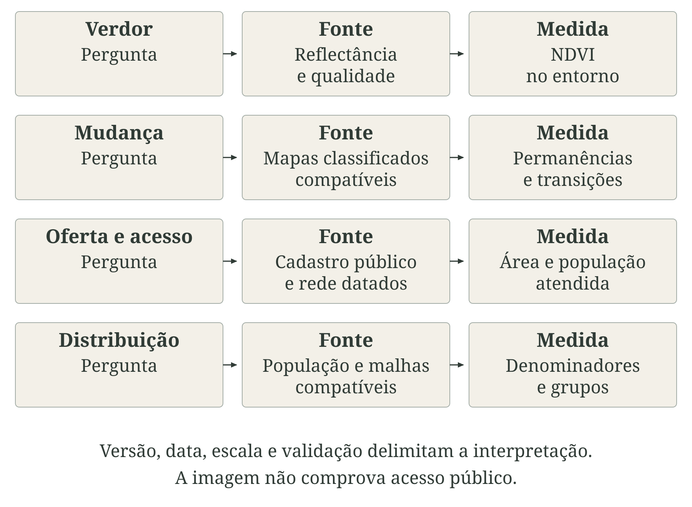
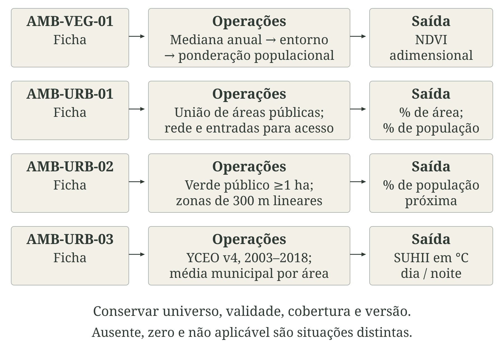
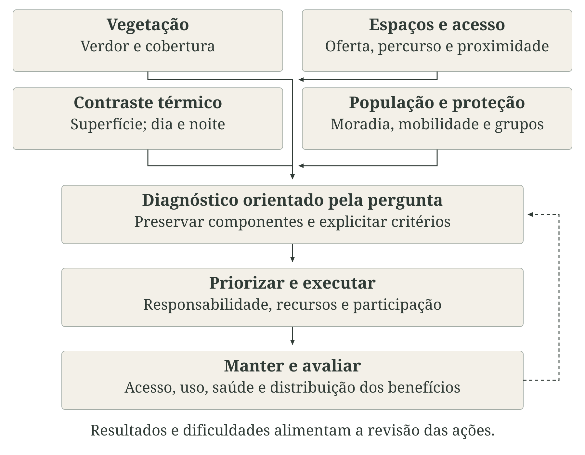

---
aliases:
  - /chapters/part-2/09-uso-cobertura-terra-ambiente-urbano.html
format:
  html:
    template-partials:
      - ../../includes/chapter-opening/title-block.html
chapter-opening:
  image: ../../assets/openings/cap11-uso-cobertura-terra-ambiente-urbano-web.webp
  alt: "Aquarela em vista elevada de território brasileiro hipotético sem pessoas: mata, cultivos, curso d’água com vegetação ciliar, bairros de diferentes densidades, parque e áreas pavimentadas formam um mosaico contínuo."
---

# Uso e cobertura da terra, vegetação e ambiente urbano {#sec-uso-terra}

A organização do território participa da produção da saúde. Onde se conservam florestas, se cultivam alimentos, se constroem moradias e se implantam vias e serviços, modificam-se os processos ambientais e as condições de vida. Uso, ocupação e cobertura do solo ajudam a compreender essas relações: influenciam o calor vivido, a circulação da água, as emissões, os deslocamentos, o trabalho e os encontros entre pessoas, animais e agentes infecciosos. Seus efeitos dependem da infraestrutura, da distribuição da população e das possibilidades de proteção [@ibge2013usoterra; @ipcc2022saude].

A expressão “terra” acompanha a terminologia dos sistemas de mapeamento e inclui a superfície e suas formas de utilização. “Solo”, em uso e ocupação do solo, refere-se aqui ao espaço territorial, sem restringir a discussão às propriedades pedológicas. Um mapa de vegetação, um cadastro de atividades e uma descrição da ocupação respondem a perguntas diferentes.

::: {.callout-note icon=false title="Conceito-chave: cobertura, uso e ocupação"}

Cobertura descreve o que recobre fisicamente a superfície: vegetação, água, solo exposto, telhados ou pavimentos. Uso descreve atividades e funções: moradia, agricultura, indústria, conservação, circulação ou recreação. Ocupação, na leitura territorial adotada aqui, descreve como população, edificações e infraestrutura se distribuem e se implantam no espaço, incluindo densidade e configuração. Essa definição analítica não substitui classificações cadastrais ou urbanísticas locais.

:::

Uma área arborizada pode ser um parque público, um jardim privado ou um cultivo. Um uso residencial pode reunir copas, edificações e superfícies impermeáveis; duas áreas com proporções semelhantes dessas coberturas podem ter densidades, acessos e condições de moradia diferentes. A @fig-terra-saude apresenta três leituras da mesma paisagem e seus caminhos até a saúde, retomando a relação entre clima, ambiente e saúde (@sec-clima-ambiente-saude).

::: {.figure-with-source}

{#fig-terra-saude fig-alt="A mesma paisagem hipotética distingue cobertura física, função de uso e distribuição da ocupação. Processos ambientais e sociais se ligam à exposição e à proteção antes dos efeitos na saúde." width="100%" print-src="arte-cap11-00-conceitos-print.png"}

[Fonte: elaboração conceitual com base em IBGE (2013); IPCC (2022); OMS Europa (2016). Autoria: composição e rótulos próprios; aquarela produzida com IA (image_gen). Cenas e esquemas sem dados observados. Licença: a mesma dos textos autorais da obra.]{.figure-source}

:::

Na dimensão ambiental, alterações de vegetação e materiais modificam trocas de energia, infiltração, escoamento, emissões e habitats. Na dimensão social, usos e formas de ocupação organizam acesso a alimento, trabalho, espaços de convivência, transporte e serviços. Esses caminhos se combinam: uma rota arborizada oferece sombra, mas sua contribuição à mobilidade depende de continuidade da calçada, segurança e destino. Benefícios e danos não decorrem de uma classe cartográfica isolada [@who2016greenspace; @ipcc2022saude].

Para estudar saúde, é preciso percorrer a cadeia entre característica territorial, processo ambiental ou social, contato humano e desfecho. A presença de uma fonte potencial de exposição não demonstra contato, e uma associação espacial não estabelece causalidade. O @sec-dados-indicadores distingue medida e representação; os capítulos de exposição e vulnerabilidade (@sec-exposicao-vulnerabilidade) e efeitos na saúde (@sec-efeitos-saude) orientam a ligação com população e resultados.

As quatro fichas de vegetação e ambiente urbano (@sec-fichas-uso-cobertura-terra-ambiente-urbano) operacionalizam dimensões específicas: verdor do entorno residencial estimado, oferta e acesso a espaços públicos, proximidade de verde público e contraste térmico de superfície. Sua seleção deve partir da pergunta sanitária e da escala em que o mecanismo pode ocorrer.

## Transformações do território e mecanismos de exposição

Transformação territorial envolve mudança de cobertura, de função ou de configuração, que nem sempre acontecem juntas. Um imóvel pode passar do uso residencial ao comercial sem alteração identificável na cobertura; impermeabilizar um quintal modifica a superfície sem necessariamente mudar o uso residencial. O sistema de classificação e a unidade mínima de mapeamento delimitam quais transformações serão observadas [@ibge2013usoterra].

Mapas de uso e cobertura são produtos de interpretação, classificação e validação. A classe de um pixel depende da informação espectral, das amostras, das regras e da legenda. Nuvens, mistura de materiais, sazonalidade e resolução dificultam a separação de classes. Acurácia global elevada não garante desempenho equivalente nas classes de interesse; erros de omissão e inclusão precisam ser examinados à luz da pergunta sanitária [@iso2023geoquality; @mapbiomas2023atbd8].

Uma análise de mudança deve comparar mapas compatíveis. A matriz de transição registra permanências e passagens entre classes; saldo líquido pequeno pode esconder perdas e ganhos em locais diferentes. Mudanças de coleção, sensor, algoritmo ou definição também podem produzir diferenças cartográficas sem transformação real equivalente. O @sec-espaco-tempo desenvolve esses problemas de comparação.

Desmatamento, perda de cobertura arbórea, degradação e fogo descrevem fenômenos distintos. Desmatamento exige a definição do sistema, do bioma e do período; degradação pode alterar estrutura e função sem conversão completa. Uma cicatriz de queimada informa área afetada por fogo, sem identificar o uso posterior ou a exposição à fumaça. PRODES e DETER têm finalidades e métodos diferentes: avisos operacionais do DETER não substituem a taxa anual oficial de desmatamento do PRODES [@inpedetermetodo].

A @fig-terra-transformacoes organiza a leitura de mudanças de uma paisagem hipotética. Vegetação, cultivo e expansão construída são visíveis, mas as vias sanitárias precisam de informação complementar. Para fumaça, área queimada, transporte atmosférico e concentração onde as pessoas estão ocupam etapas distintas da investigação.

::: {.figure-with-source}

{#fig-terra-transformacoes fig-alt="Duas vistas conceituais mostram mudanças de vegetação, cultivo e construção. O esquema distingue transformação, processo e contato humano, sem áreas medidas ou resultados observados." width="100%" print-src="arte-cap11-01-transformacoes-print.png"}

[Fonte: elaboração conceitual com base em IBGE (2013); IPCC (2022); INPE e MapBiomas. Autoria: composição e rótulos próprios; aquarela produzida com IA (image_gen). Cenas e esquemas sem dados observados. Licença: a mesma dos textos autorais da obra.]{.figure-source}

:::

A expansão agropecuária pode modificar circulação de trabalhadores, disponibilidade de água, produção de alimentos e interfaces entre pessoas e animais. Monoculturas, pastagens, irrigação e mosaicos de produção familiar envolvem práticas diversas. A classe “agropecuária” não mede dose de agrotóxico, regime de trabalho, qualidade do alimento ou contaminação: cada hipótese exige dados sobre atividade, agente, contato e tempo de exposição [@ipcc2022saude].

Na urbanização, convém separar área construída, população, densidade de edificações e impermeabilização. A superfície impermeável dificulta a infiltração, mas o escoamento também depende de chuva, solo, declividade, drenagem e conexão entre superfícies e cursos d'água. Ocupação de uma área suscetível acrescenta pessoas e bens a um processo físico; o dano depende ainda de moradia, alerta, mobilidade e resposta. Cobertura territorial não substitui observação hidrológica ou registro de impactos.

Localização e tempo da mudança devem corresponder ao mecanismo estudado. Conversão distante da população residente pode afetar trabalhadores móveis ou água que circula até outras áreas. O limite municipal tampouco contém necessariamente a bacia, o transporte de fumaça ou os deslocamentos cotidianos. Na epidemiologia, explicitar essas relações evita atribuir a todos os moradores a mesma exposição [@hernan2020causal].

Consultar os capítulos de precipitação e eventos hidrológicos (@sec-precipitacao), ar e fumaça (@sec-qualidade-ar), água e saneamento (@sec-agua-saneamento) e desastres (@sec-desastres). As fichas de [chuva máxima em cinco dias — CLI-PRC-02](../../chapters/part-4/18-fichas-precipitacao-secas-eventos-hidrologicos.qmd#sec-cli-prc-02), [PM2,5 de fumaça — AMB-FUM-01](../../chapters/part-4/19-fichas-qualidade-ar-queimadas-fumaca.qmd#sec-amb-fum-01), [água gerida de forma segura — SAN-AGU-01](../../chapters/part-4/20-fichas-agua-saneamento-qualidade-ambiental.qmd#sec-san-agu-01) e [pessoas afetadas por desastres — DES-HUM-02](../../chapters/part-4/22-fichas-eventos-severos-desastres.qmd#sec-des-hum-02) acrescentam dimensões próprias, sem demonstrar isoladamente que a mudança territorial causou o resultado.

## Áreas verdes e arborização

Áreas verdes incluem espaços com características e funções variadas. Arborização se refere ao componente arbóreo, que pode ocorrer em ruas, praças, parques e quintais. Cobertura vegetal inclui também estratos herbáceos e arbustivos; cobertura de copa descreve a projeção das copas. Um gramado e uma rua arborizada podem oferecer condições diferentes de sombra, permanência e circulação [@who2016greenspace].

::: {.callout-note icon=false title="Conceito-chave: disponibilidade, acessibilidade e uso"}

Disponibilidade informa existência ou quantidade de um recurso. Proximidade descreve uma distância definida. Acessibilidade incorpora possibilidade de entrada, percurso, barreiras, horários e condições de deslocamento. Uso corresponde à interação efetiva das pessoas com o espaço. Vegetação privada pode aumentar o verdor de uma área sem ampliar a oferta de espaços públicos.

:::

A @fig-verde-acesso mostra essas dimensões no mesmo bairro. Identificar árvores pela imagem, verificar uma entrada e observar o percurso são operações complementares. Cadastro e observação local permitem avaliar atributos que a imagem não revela, como gratuidade, manutenção, segurança percebida e adequação a diferentes necessidades.

::: {.figure-with-source}

{#fig-verde-acesso fig-alt="Bairro hipotético com jardim privado à esquerda e parque público com entrada à direita. Vegetação, acesso e uso são dimensões distintas. Os critérios de 300 m lineares e 400 m caminháveis pertencem a fichas diferentes; o desenho não está em escala." width="100%" print-src="arte-cap11-02-acesso-print.png"}

[Fonte: elaboração conceitual com base em OMS Europa (2016); ODS 11.7.1; fichas do @sec-fichas-uso-cobertura-terra-ambiente-urbano. Autoria: composição e rótulos próprios; aquarela produzida com IA (image_gen). Cenas e esquemas sem dados observados. Licença: a mesma dos textos autorais da obra.]{.figure-source}

:::

O Índice de Vegetação por Diferença Normalizada (NDVI) relaciona a reflectância no infravermelho próximo e no vermelho: a diferença entre as bandas é dividida por sua soma. A resposta espectral representa o verdor, mas sofre influência de solo, água, fenologia, mistura de coberturas e condições de observação. Em vegetação densa, aumentos de biomassa podem produzir pouca variação adicional do índice. NDVI alto não identifica espécie, biodiversidade, acesso público ou conforto no nível da rua.

A revisão de coortes de Rojas-Rueda e colaboradores usa NDVI para examinar relações entre verdor residencial e mortalidade. Essas associações não definem um limiar universal saudável nem garantem o efeito de uma intervenção em qualquer bairro [@rojasrueda2019greenspace]. A [ficha AMB-VEG-01](../../chapters/part-4/21-fichas-uso-cobertura-terra-ambiente-urbano.qmd#sec-amb-veg-01) adota uma especificação do entorno estimado em grade, cujo centro não é um endereço residencial observado.

A definição da vizinhança deve anteceder a análise. Entornos circulares, redes caminháveis, setores censitários e campos visuais representam relações distintas. O raio deve decorrer do mecanismo e da população; publicar apenas o raio com maior associação, entre muitos testados, favorece seleção analítica. Residência também não descreve toda a exposição de quem trabalha, estuda ou se desloca em outros lugares [@markevych2017pathways; @hernan2020causal].

O Objetivo de Desenvolvimento Sustentável (ODS) 11.7.1 apresenta duas séries: parcela territorial destinada a espaços abertos e ruas de uso público; e parcela populacional com acesso a espaços públicos abertos por percurso caminhável de até 400 m. Espaço aberto público pode incluir superfícies sem vegetação. As séries têm denominadores diferentes e devem ser publicadas separadamente [@un2026sdg1171].

A [ficha AMB-URB-01](../../chapters/part-4/21-fichas-uso-cobertura-terra-ambiente-urbano.qmd#sec-amb-urb-01) documenta a adaptação municipal dessas medidas. A [ficha AMB-URB-02](../../chapters/part-4/21-fichas-uso-cobertura-terra-ambiente-urbano.qmd#sec-amb-urb-02) mede outra dimensão: população a até 300 m lineares do limite de verde público contínuo com pelo menos 1 ha. Esse critério de planejamento não garante trajeto viável, entrada próxima ou benefício individual. Não converter distância linear em caminhável na interpretação.

Cobertura de copa, visibilidade da vegetação no nível da rua, percentual de verde e avaliações de qualidade podem complementar essas medidas. Cada uma exige definição e método próprios. Copa representa sombra potencial, cuja posição varia com horário e geometria; visibilidade não comprova acesso; parque cadastrado pode ter pouca vegetação. A escolha deve identificar qual dimensão orientará a intervenção.

As três fichas estão no @sec-fichas-uso-cobertura-terra-ambiente-urbano. Para investigar quem recebe os benefícios, combinar sua distribuição com o @sec-exposicao-vulnerabilidade e a [ficha do IVS — EXP-VUL-01](../../chapters/part-4/23-fichas-exposicao-vulnerabilidade.qmd#sec-exp-vul-01), respeitando ano e unidade territorial. A relação entre copa, sombra e ambiente térmico requer também a leitura do @sec-temperatura.

## Ilhas de calor urbanas

Ilha de calor urbana é um contraste térmico entre uma área urbana e uma referência não urbana definida. A intensidade depende do que se mede, onde e quando. A ilha de calor atmosférica descreve diferenças na temperatura do ar; a de superfície usa a temperatura radiométrica das superfícies observadas. Uma não pode ser convertida na outra por equivalência direta [@oke1982energy; @voogt2003thermal].

O balanço de energia ajuda a compreender o contraste. Materiais recebem, refletem, armazenam e liberam energia de maneiras diferentes. Albedo é a fração da radiação solar refletida; armazenamento térmico descreve energia retida nos materiais e posteriormente liberada. Água e vegetação favorecem a transferência de energia por evaporação e transpiração. A geometria de ruas e edifícios modifica sombra, trocas radiativas e ventilação; atividades humanas também liberam calor [@oke1982energy].

Esses processos variam durante o dia e a noite. Uma superfície sombreada pode aquecer menos durante o dia, enquanto a energia armazenada em construções contribui para condições noturnas. A configuração que favorece sombra nem sempre favorece ventilação. Densidade construída, vegetação e altura dos edifícios precisam ser analisadas como componentes de um sistema, sem classificar automaticamente densidade como proteção ou risco.

A @fig-terra-calor diferencia superfície, ar e ambiente interno. A paisagem é conceitual e não constitui um desenho amostral de estações. Em estudo real, a referência não urbana precisa ser examinada quanto a altitude, distância, cobertura, solo e água; diferenças topográficas ou de umidade podem se somar ao contraste de urbanização.

::: {.figure-with-source}

{#fig-terra-calor fig-alt="Cena conceitual com área aberta, bairro e corte de moradia. Superfície observada, ar medido e ambiente interno são alvos diferentes. A referência não urbana exige controle; a paisagem não define um par de estações." width="100%" print-src="arte-cap11-03-calor-print.png"}

[Fonte: elaboração conceitual com base em Oke (1982); Voogt e Oke (2003); Jin (2012). Autoria: composição e rótulos próprios; aquarela produzida com IA (image_gen). Cenas e esquemas sem dados observados. Licença: a mesma dos textos autorais da obra.]{.figure-source}

:::

A temperatura da superfície terrestre, ou LST, é estimada a partir da radiação emitida pelas superfícies visíveis ao sensor. Telhados, pavimentos e copas podem predominar na observação, enquanto interiores e áreas sob copas permanecem fora desse alvo. Emissividade, atmosfera, horário, nuvens e resolução influenciam a estimativa. Composições de imagens válidas representam a amostragem disponível, frequentemente sob céu aberto, e não todos os momentos da exposição [@voogt2003thermal].

A Intensidade da Ilha de Calor Urbana de Superfície (SUHII) expressa uma diferença térmica, não uma temperatura absoluta. A referência adotada pelos produtores participa do significado do resultado. Valor positivo indica superfície urbana mais quente que a referência naquele produto; zero não corresponde a ausência de calor perigoso. Um episódio regional de calor pode afetar áreas urbanas e não urbanas com contraste pequeno [@jin2012uhi].

A [ficha AMB-URB-03](../../chapters/part-4/21-fichas-uso-cobertura-terra-ambiente-urbano.qmd#sec-amb-urb-03) utiliza a versão histórica YCEO v4, de 2003 a 2018, conservando a referência original e separando dia e noite. A escala nominal de 300 m do produto distribuído não significa observações térmicas independentes nessa resolução. A série contextualiza heterogeneidade de superfície; não descreve as condições atuais de uma onda de calor [@yceo2026uhi].

A interpretação sanitária deve acrescentar duração do calor, temperatura do ar, umidade, radiação, atividades, moradia e possibilidades de proteção. O @sec-temperatura e as fichas de [noites quentes — CLI-CAL-11](../../chapters/part-4/17-fichas-temperatura-condicoes-termicas.qmd#sec-cli-cal-11) e [máxima anual — CLI-TEM-02](../../chapters/part-4/17-fichas-temperatura-condicoes-termicas.qmd#sec-cli-tem-02) fornecem outras medidas térmicas. O @sec-exposicao-vulnerabilidade e a [ficha de adensamento domiciliar — EXP-HAB-02](../../chapters/part-4/23-fichas-exposicao-vulnerabilidade.qmd#sec-exp-hab-02) ajudam a discutir condições de proteção, sem transformar o adensamento em medição de temperatura interna.

## Fragmentação, vetores e zoonoses

Na ecologia da paisagem, fragmentação descreve a divisão de um habitat em porções espacialmente separadas. Perda de habitat informa redução de quantidade; fragmentação informa também configuração. Processos que removem habitat frequentemente produzem os dois efeitos, mas suas contribuições precisam ser distinguidas na análise. Uma mesma proporção de cobertura pode corresponder a uma mancha contínua ou a diversas manchas isoladas [@fahrig2003fragmentation].

```{=typst}
#block(breakable: false)[
```

::: {.callout-note icon=false title="Conceito-chave: elementos da paisagem"}

Mancha é uma porção relativamente homogênea da classe considerada. Borda é a interface com outra cobertura; matriz é o mosaico circundante no qual as manchas se inserem. Conectividade descreve a ligação entre áreas: sua expressão estrutural depende da disposição espacial, enquanto a funcional considera a possibilidade de deslocamento do organismo ou processo estudado. Um corredor visível não garante conectividade para todas as espécies.

:::

```{=typst}
]
```

Número e área das manchas, densidade de borda e medidas de conectividade dependem da classe de interesse, do tamanho do pixel e da extensão analisada. Reamostrar o mapa pode unir manchas antes separadas ou eliminar pequenos fragmentos. Antes de calcular uma métrica, declarar qual habitat está sendo representado, para qual organismo e em qual escala; comparar métricas de mapas incompatíveis pode atribuir significado ecológico a uma diferença técnica.

A @fig-terra-fragmentacao apresenta manchas, matriz e interfaces de contato numa paisagem hipotética. As relações relevantes para a saúde não terminam na geometria: incluem presença de agentes, competência dos hospedeiros, abundância de vetores e atividades humanas. Não há um sentido universal de risco sanitário associado a “mais verde” ou “mais fragmentado”.

::: {.figure-with-source}

{#fig-terra-fragmentacao fig-alt="Manchas de mata em matriz de pastagem e cultivo, com corredor e moradias. Configuração, circulação de agentes e contato humano são etapas diferentes; não há risco sanitário universal associado à vegetação." width="100%" print-src="arte-cap11-04-fragmentacao-print.png"}

[Fonte: elaboração conceitual com base em Fahrig (2003); Gibb et al. (2020); IPCC (2022). Autoria: composição e rótulos próprios; aquarela produzida com IA (image_gen). Cenas e esquemas sem dados observados. Licença: a mesma dos textos autorais da obra.]{.figure-source}

:::

Gibb e colaboradores encontraram diferenças na composição de comunidades de hospedeiros conhecidos de patógenos compartilhados com humanos conforme o uso da terra, em uma análise global. O estudo sustenta a importância das interfaces produzidas pela transformação dos habitats, mas seu resultado não equivale a uma medida de incidência humana em cada local. Presença de hospedeiros, circulação do agente e transmissão para pessoas são etapas diferentes [@gibb2020zoonotic].

Uma hipótese epidemiológica precisa identificar agente, vetor quando houver, reservatório, modo de contato e população. A fragmentação pode modificar bordas e deslocamentos sem produzir a mesma resposta em todos os sistemas. Comparar doenças distintas apenas pelo percentual de vegetação pode agregar processos com direções, escalas e tempos diferentes. Da mesma forma, diversidade de espécies não é sinônimo de diversidade de hospedeiros competentes.

Em áreas urbanas, recipientes com água, abastecimento irregular, resíduos, temperatura, mobilidade e ações de controle podem participar de ciclos vetoriais. No trabalho rural, circulação e permanência em certas interfaces podem ser mais informativas do que cobertura ao redor do domicílio. A leitura deve articular ambiente, comportamento e vigilância específica, conforme os mecanismos discutidos no @sec-efeitos-saude [@ipcc2022saude].

Casos notificados também refletem acesso ao diagnóstico, busca de atendimento e cobertura de registro. Um mapa com maior número de casos perto de uma borda não prova que a infecção ocorreu ali. É necessário considerar local provável de exposição, denominador populacional, período, defasagens e possíveis fatores de confusão. Associação entre bairros não descreve automaticamente o risco de cada morador [@hernan2020causal].

Os capítulos de precipitação (@sec-precipitacao) e água e saneamento (@sec-agua-saneamento), com suas fichas de precipitação e seca meteorológica (@sec-fichas-precipitacao-secas-eventos-hidrologicos) e de serviços e qualidade da água (@sec-fichas-agua-saneamento-qualidade-ambiental), acrescentam contexto. A [ficha EFE-MOB-01](../../chapters/part-4/24-fichas-efeitos-saude.qmd#sec-efe-mob-01) mede internações por causa no SUS e pode apoiar uma investigação delimitada, mas não substitui vigilância de casos nem mede toda a incidência. As fichas urbanas (@sec-fichas-uso-cobertura-terra-ambiente-urbano) também não constituem índices genéricos de risco vetorial.

## Benefícios, riscos e desigualdades na saúde

As relações entre ambiente territorial e saúde envolvem exposições simultâneas e oportunidades de proteção. Calor, poluição, ruído, condições de moradia, mobilidade e verde podem se concentrar de forma desigual. Uma associação com vegetação deve ser interpretada nesse conjunto: o indicador pode representar parte do mecanismo, acompanhar condições sociais ou cumprir as duas funções. O desenho do estudo precisa tornar explícita a relação que se pretende estimar [@hernan2020causal; @who2024sdhequity].

Markevych e colaboradores organizam os caminhos entre espaços verdes e saúde em três domínios: reduzir exposições nocivas, restaurar capacidades e desenvolver capacidades. O primeiro inclui atenuação de calor e outros estressores; o segundo, recuperação do estresse e da atenção; o terceiro, oportunidades de atividade física e interação social. Essa organização ajuda a selecionar medidas e desfechos coerentes, sem supor que qualquer espaço verde ofereça todos os benefícios [@markevych2017pathways].

Na dimensão física, sombra e evapotranspiração participam da modificação do ambiente térmico. A relação com poluição depende também de espécies, posição das árvores, emissões e circulação do ar. Uma barreira vegetal e uma rua estreita com copas densas não têm necessariamente o mesmo efeito sobre dispersão. Para avaliar uma intervenção, importa medir a exposição pertinente nos locais de permanência e circulação, e não apenas a variação do verde detectado por satélite [@who2016greenspace].

Na dimensão psicológica e social, um espaço pode favorecer descanso, convivência e pertencimento quando suas condições permitem permanência e apropriação. Segurança percebida, iluminação, conforto, equipamentos e práticas de uso modificam essa relação. A @fig-terra-equidade contrasta barreiras e condições favoráveis de usufruto em dois espaços ilustrativos com vegetação. Não representa um experimento nem demonstra que uma obra produziu mudança de saúde.

::: {.figure-with-source}

{#fig-terra-equidade fig-alt="Duas cenas com vegetação: degraus e passeio danificado dificultam entrada à esquerda; acesso nivelado e sombra favorecem circulação e convivência à direita. São condições ilustrativas, sem resultados antes e depois." width="100%" print-src="arte-cap11-05-equidade-print.png"}

[Fonte: elaboração conceitual com base em OMS Europa (2016); Markevych et al. (2017); Anguelovski et al. (2022). Autoria: composição e rótulos próprios; aquarela produzida com IA (image_gen). Cenas e esquemas sem dados observados. Licença: a mesma dos textos autorais da obra.]{.figure-source}

:::

Qualidade e acesso não se reduzem à presença de uma entrada. Uma rota pode ser curta e ter travessias difíceis; um parque pode ser próximo e funcionar em horários incompatíveis com o trabalho; equipamentos podem não atender pessoas com deficiência ou responsáveis por crianças. A investigação local deve considerar necessidades diversas e ouvir usuários e pessoas que não frequentam o espaço. A ausência de uso não permite concluir, sozinha, que não há demanda.

Benefícios potenciais coexistem com riscos e necessidades de manejo. Espécies alergênicas, uso de pesticidas, queda de galhos, raízes que danificam passeios e manutenção inadequada precisam entrar no planejamento. A avaliação deve especificar o problema, a população e a medida de prevenção correspondente. Maximizar NDVI sem examinar espécie, localização e manutenção não responde a essas questões e pode esconder uma intervenção mal ajustada ao território.

A distribuição dos benefícios constitui uma dimensão do resultado. Uma média municipal crescente pode coexistir com perda de vegetação em bairros com menor capacidade de proteção. Estratificar por território e grupos sociais, quando os dados permitirem, ajuda a identificar essas diferenças. Entretanto, cruzar uma medida ambiental detalhada com um indicador social agregado não cria informação individual: o suporte e o denominador de cada camada precisam permanecer reconhecíveis.

Gentrificação verde descreve processos em que melhorias ambientais se articulam à valorização urbana e à transformação social, podendo restringir a permanência ou o usufruto por grupos historicamente desfavorecidos. Anguelovski e colaboradores examinam essa relação em cidades europeias e norte-americanas. A evidência justifica investigar efeitos distributivos, mas não autoriza transferir automaticamente seus resultados para cidades brasileiras ou afirmar que toda implantação de parque deslocará moradores [@anguelovski2022green].

A avaliação de uma intervenção verde deve explicitar sua teoria de mudança: qual ação modifica qual condição, para qual população e por qual caminho se espera alcançar saúde. Plantio é uma etapa; formação e sobrevivência das copas são outras. Entrega de um parque não demonstra uso; redução de temperatura de superfície não demonstra redução do calor interno. Indicadores de execução, manutenção, exposição e saúde precisam ocupar posições distintas no acompanhamento [@cdc2024evaluation].

Uma comparação antes e depois exige considerar sazonalidade, mudança populacional, outras obras e transformações do sistema de saúde. Se moradores forem substituídos, a melhora do indicador médio pode refletir composição da população. Se atendimentos diminuírem após dificuldade de acesso, o registro não comprova proteção. Definir população acompanhada, período, comparação e possíveis confundidores permite avaliar o alcance da conclusão [@hernan2020causal].

Os capítulos de exposição e vulnerabilidade (@sec-exposicao-vulnerabilidade), efeitos na saúde (@sec-efeitos-saude) e resposta e resiliência (@sec-resposta) complementam essa avaliação. A [ficha EXP-VUL-01](../../chapters/part-4/23-fichas-exposicao-vulnerabilidade.qmd#sec-exp-vul-01) descreve vulnerabilidade social agregada; a [ficha EFE-MOR-02](../../chapters/part-4/24-fichas-efeitos-saude.qmd#sec-efe-mor-02) permite comparar mortalidade com padronização etária; a [ficha RES-RIS-01](../../chapters/part-4/25-fichas-resposta-adaptacao-resiliencia.qmd#sec-res-ris-01) trata do perfil de riscos do estabelecimento. Nenhuma substitui a avaliação distributiva da intervenção, mas cada uma pode contribuir com uma dimensão pertinente.

## Fontes, seleção e principais indicadores

A escolha da fonte começa pela pergunta. Presença de vegetação, atividade exercida, população residente, acesso público e temperatura de superfície requerem informações diferentes. Um produto de imagem pode caracterizar cobertura; verificar o uso, a entrada e o funcionamento de um espaço exige outras evidências. A @fig-terra-fontes organiza essa passagem da pergunta à medida, articulada ao @sec-fontes-fichas.

::: {.figure-with-source}

{#fig-terra-fontes fig-alt="Quatro percursos relacionam imagens, mapas classificados, cadastros e população às medidas possíveis. Versão, data, escala e validação delimitam a interpretação; imagem não comprova acesso público." width="100%" print-src="arte-cap11-06-fontes-print.png"}

[Fonte: elaboração conceitual com base em IBGE (2013); MapBiomas (2023); @sec-espaco-tempo, @sec-fontes-fichas e @sec-fichas-uso-cobertura-terra-ambiente-urbano. Autoria: composição e rótulos próprios. Cenas e esquemas sem dados observados. Licença: a mesma dos textos autorais da obra.]{.figure-source}

:::

O [MapBiomas](../../backmatter/indice-fontes.qmd#mapbiomas) oferece mapas classificados com métodos, legendas e versões documentados. O documento de base teórica do algoritmo, ou ATBD, descreve o processo de produção de uma coleção; sua consulta permite reconhecer quais classes e regras sustentam uma análise. A referência à Coleção 8 usada aqui documenta um método, sem indicar que ela seja a edição mais recente ou recomendar misturar suas classes com outras coleções [@mapbiomas2023atbd8].

O [Landsat](../../backmatter/indice-fontes.qmd#landsat) fornece observações para índices espectrais e análises térmicas. É necessário identificar sensor, nível de processamento, bandas, fatores de escala, máscaras de qualidade e resolução original. NDVI e temperatura de superfície resultam de operações diferentes; fatores de reflectância não se aplicam a um produto que já contém contraste térmico em graus Celsius. A [ficha AMB-VEG-01](../../chapters/part-4/21-fichas-uso-cobertura-terra-ambiente-urbano.qmd#sec-amb-veg-01) e a [ficha AMB-URB-03](../../chapters/part-4/21-fichas-uso-cobertura-terra-ambiente-urbano.qmd#sec-amb-urb-03) explicitam as escolhas adotadas.

O [Instituto Brasileiro de Geografia e Estatística (IBGE)](../../backmatter/indice-fontes.qmd#ibge) provê população, malhas e informações territoriais. Grades populacionais, como o GHS-POP, acrescentam uma distribuição espacial estimada; não são cadastros de endereços. A combinação com imagens deve registrar data, método e unidade. Uma grade mais fina não torna o dado populacional uma observação domiciliar.

Cadastros municipais e levantamentos de campo acrescentam propriedade ou uso público, gratuidade, entradas, horários, equipamentos e manutenção. A identificação de um polígono potencialmente público numa imagem ou mapa colaborativo requer validação. Sem histórico cadastral, não se deve supor que o acesso atual existia nos anos anteriores. Essas dependências são centrais nas fichas de [espaço público — AMB-URB-01](../../chapters/part-4/21-fichas-uso-cobertura-terra-ambiente-urbano.qmd#sec-amb-urb-01) e [proximidade de verde — AMB-URB-02](../../chapters/part-4/21-fichas-uso-cobertura-terra-ambiente-urbano.qmd#sec-amb-urb-02).

Sazonalidade, nuvens e calendário de aquisição afetam comparações. Cena única, mediana anual e composição sazonal representam condições diferentes. Para mudanças territoriais, conservar produtos compatíveis; para exposição, verificar se a janela temporal corresponde à rotina e ao mecanismo. O @sec-espaco-tempo orienta compatibilização, mudanças de suporte e tratamento da incerteza [@iso2023geoquality].

O @qua-indicadores-urbano relaciona medidas a suas finalidades. As fichas consolidadas estão no @sec-fichas-uso-cobertura-terra-ambiente-urbano; as demais métricas exigem produto e protocolo específicos antes de serem adotadas como série operacional.

::: {#qua-indicadores-urbano}

| Medida e referência | Pergunta que apoia | Limite principal |
|---|---|---|
| [NDVI do entorno estimado — AMB-VEG-01](../../chapters/part-4/21-fichas-uso-cobertura-terra-ambiente-urbano.qmd#sec-amb-veg-01) | Quanto verdor envolve a população residencial estimada? | Não informa acesso, qualidade ou uso |
| [Espaço público — AMB-URB-01](../../chapters/part-4/21-fichas-uso-cobertura-terra-ambiente-urbano.qmd#sec-amb-urb-01) | Qual a oferta territorial e qual a população com acesso caminhável? | Duas medidas separadas; espaço aberto não é necessariamente verde |
| [Verde público a 300 m — AMB-URB-02](../../chapters/part-4/21-fichas-uso-cobertura-terra-ambiente-urbano.qmd#sec-amb-urb-02) | Quem reside próximo ao verde público elegível? | Distância linear não descreve percurso até entrada |
| [SUHII — AMB-URB-03](../../chapters/part-4/21-fichas-uso-cobertura-terra-ambiente-urbano.qmd#sec-amb-urb-03) | Qual o contraste térmico de superfície no produto? | Não mede temperatura do ar ou exposição individual |
| Cobertura de copa | Onde existe sombra potencial? | Sombra efetiva depende de geometria e horário |
| Percentual impermeável | Onde a superfície dificulta infiltração? | Escoamento e dano dependem de contexto hidrológico e ocupação |
| Métricas de fragmentação | Como se configura o habitat considerado? | Não constituem risco sanitário genérico |

Indicadores de vegetação e ambiente urbano usados em saúde pública

:::

Um índice composto pode facilitar comunicação, mas sua ponderação introduz escolhas sobre prioridades. Dois territórios com o mesmo escore podem precisar de ações diferentes. Conservar os componentes e explicitar as decisões de agregação mantém a interpretação ligada à intervenção, conforme o @sec-dados-indicadores.

## Protocolo de cálculo e disponibilidade

Um protocolo transforma o conceito em uma medida reproduzível: fixa produto, população, unidade espacial, período, operações, regras de validade e saída. Os quatro protocolos deste capítulo são especificações operacionais do livro. Critérios como cobertura mínima e recorte municipal precisam acompanhar o resultado; não devem ser apresentados como limiares universais de saúde. A @fig-terra-protocolo distingue seus percursos.

::: {.figure-with-source}

{#fig-terra-protocolo fig-alt="NDVI combina tempo, entorno e ponderação populacional; espaço público separa área e percurso; verde público usa distância linear; SUHII conserva o produto e separa dia e noite. Validade e universo antecedem a publicação." width="100%" print-src="arte-cap11-07-protocolo-print.png"}

[Fonte: elaboração conceitual com base em Protocolos das fichas AMB-VEG-01 e AMB-URB-01 a 03. Autoria: composição e rótulos próprios. Cenas e esquemas sem dados observados. Licença: a mesma dos textos autorais da obra.]{.figure-source}

:::

Na [ficha AMB-VEG-01](../../chapters/part-4/21-fichas-uso-cobertura-terra-ambiente-urbano.qmd#sec-amb-veg-01), a entrada é a reflectância de superfície Landsat Collection 2 Level-2, com bandas correspondentes a cada sensor. O processamento aplica escala e deslocamento, remove pixels inválidos pelas máscaras, calcula NDVI por cena e evita duplicar observações do mesmo dia. A mediana anual por pixel exige pelo menos três dias válidos; não se calcula NDVI diretamente sobre números digitais sem a conversão prescrita.

Em seguida, obtém-se a média espacial no círculo de 300 m ao redor do centro de cada célula populacional GHS-POP com população positiva. O entorno pode ultrapassar o limite municipal. Exige-se pelo menos 90% de área válida no círculo e, para publicar a média municipal ponderada pela população, pelo menos 90% da população municipal com entorno válido. Esses critérios são escolhas do protocolo. A interpolação populacional, a repartição das células de fronteira e a ordem mediana temporal → média espacial → ponderação populacional integram a definição; trocá-las produz outra medida.

Na [ficha AMB-URB-01](../../chapters/part-4/21-fichas-uso-cobertura-terra-ambiente-urbano.qmd#sec-amb-urb-01), o recorte U é a interseção da malha municipal IBGE 2022 com centros urbanos da classe 30 do GHS-SMOD 2020. A medida territorial divide a área da união de espaços abertos e ruas públicos em U pela área de U. A união evita contar sobreposições duas vezes. Eixos de ruas precisam de larguras observadas para representar área; o protocolo não autoriza imputar uma largura padrão.

A medida populacional dessa mesma ficha requer rede caminhável, barreiras e entradas datadas. Calcula-se separadamente a população de U atendida por percurso de até 400 m a uma entrada de espaço aberto público, admitindo destinos e trajetos além do município. Ruas isoladamente não são destinos dessa medida. Sem rede e entradas suficientes, o acesso fica ausente mesmo quando a parcela territorial pode ser calculada. Os dois resultados conservam nomes, unidades e denominadores próprios.

Na [ficha AMB-URB-02](../../chapters/part-4/21-fichas-uso-cobertura-terra-ambiente-urbano.qmd#sec-amb-urb-02), selecionam-se espaços verdes públicos contínuos com pelo menos 1 ha, verificando a área total antes de recortar pelo município. Unem-se as zonas de 300 m de distância linear ao limite dos espaços, inclusive os externos ao município, para contar cada fragmento populacional uma vez. Divide-se a população coberta pela população de U. Essa variante não usa rede caminhável; um obstáculo pode tornar o percurso real mais longo do que a proximidade representada.

Na [ficha AMB-URB-03](../../chapters/part-4/21-fichas-uso-cobertura-terra-ambiente-urbano.qmd#sec-amb-urb-03), as bandas Daytime e Nighttime do YCEO v4 já contêm SUHII em graus Celsius. A série anual é limitada a 2003–2018. Mantêm-se a referência térmica original e uma máscara fixa de elegibilidade por banda, formada pela união dos pixels válidos no período. Calcula-se a média municipal ponderada pela área de interseção, exigindo pelo menos 90% de área elegível válida em cada ano. Não subtrair outra referência rural, aplicar escala de reflectância ou juntar dia e noite [@yceo2026uhi].

| Ficha | Disponibilidade | Dependência decisiva |
|---|---|---|
| [AMB-VEG-01](../../chapters/part-4/21-fichas-uso-cobertura-terra-ambiente-urbano.qmd#sec-amb-veg-01) | Calculável com dados abertos | Imagens e população com cobertura válida |
| [AMB-URB-01](../../chapters/part-4/21-fichas-uso-cobertura-terra-ambiente-urbano.qmd#sec-amb-urb-01) | Depende de dados locais | Cadastro público datado; rede e entradas para acesso |
| [AMB-URB-02](../../chapters/part-4/21-fichas-uso-cobertura-terra-ambiente-urbano.qmd#sec-amb-urb-02) | Depende de dados locais | Cadastro de verde público elegível e população |
| [AMB-URB-03](../../chapters/part-4/21-fichas-uso-cobertura-terra-ambiente-urbano.qmd#sec-amb-urb-03) | Calculável com dados abertos | Cobertura urbana histórica do produto YCEO v4 |

::: {.callout-warning icon=false title="Atenção: ausência, zero e não aplicação"}

Cadastro incompleto ou cobertura insuficiente produzem ausência, não zero. Zero só é resultado quando os dados e o universo permitem verificar essa condição. Sem população ou área urbana elegível, as medidas dependentes desse recorte são não aplicáveis; sem pixels elegíveis no YCEO, sua síntese também não se aplica. A classe 30 não representa todo núcleo urbano brasileiro.

:::

Disponibilidade aberta não significa que uma série municipal completa esteja pronta ou validada. As fichas distinguem documentação verificada, acesso testado e cálculo integral. A publicação deve incluir cobertura, versão, ano, método e limitações, conforme o @sec-espaco-tempo e o [Apêndice metodológico](../../backmatter/apendice-metodologico.qmd). Os detalhes e as fontes persistentes estão nas fichas do @sec-fichas-uso-cobertura-terra-ambiente-urbano.

`<span id="sec-amb-veg-01"></span>`{=html}
Consulte a [ficha AMB-VEG-01 — NDVI do entorno residencial estimado — 300 m](../../chapters/part-4/21-fichas-uso-cobertura-terra-ambiente-urbano.qmd#sec-amb-veg-01), na Parte IV`~(p. #ref(<sec-amb-veg-01>, form: "page", supplement: none))`{=typst}.

`<span id="sec-amb-urb-01"></span>`{=html}
Consulte a [ficha AMB-URB-01 — Espaço público aberto — adaptação do ODS 11.7.1](../../chapters/part-4/21-fichas-uso-cobertura-terra-ambiente-urbano.qmd#sec-amb-urb-01), na Parte IV`~(p. #ref(<sec-amb-urb-01>, form: "page", supplement: none))`{=typst}.

`<span id="sec-amb-urb-02"></span>`{=html}
Consulte a [ficha AMB-URB-02 — Proximidade de verde público — 300 m lineares](../../chapters/part-4/21-fichas-uso-cobertura-terra-ambiente-urbano.qmd#sec-amb-urb-02), na Parte IV`~(p. #ref(<sec-amb-urb-02>, form: "page", supplement: none))`{=typst}.

`<span id="sec-amb-urb-03"></span>`{=html}
Consulte a [ficha AMB-URB-03 — SUHII anual — YCEO v4](../../chapters/part-4/21-fichas-uso-cobertura-terra-ambiente-urbano.qmd#sec-amb-urb-03), na Parte IV`~(p. #ref(<sec-amb-urb-03>, form: "page", supplement: none))`{=typst}.

## Aplicação na gestão

Na gestão, a pergunta territorial deve indicar o problema, a população, a decisão e o resultado a acompanhar. Investigar pouca sombra em rotas a unidades de saúde, acesso desigual a parques e exposição em áreas suscetíveis a inundação exige combinações diferentes de dados. O @sec-indicador-decisao oferece o percurso entre diagnóstico, escolha de ação e avaliação.

O diagnóstico pode combinar as fichas de [NDVI — AMB-VEG-01](../../chapters/part-4/21-fichas-uso-cobertura-terra-ambiente-urbano.qmd#sec-amb-veg-01), [espaço público — AMB-URB-01](../../chapters/part-4/21-fichas-uso-cobertura-terra-ambiente-urbano.qmd#sec-amb-urb-01), [proximidade de verde — AMB-URB-02](../../chapters/part-4/21-fichas-uso-cobertura-terra-ambiente-urbano.qmd#sec-amb-urb-02) e [SUHII — AMB-URB-03](../../chapters/part-4/21-fichas-uso-cobertura-terra-ambiente-urbano.qmd#sec-amb-urb-03) com população, moradia, deslocamentos e equipamentos. Acrescentar levantamentos locais permite verificar se o déficit detectado corresponde à experiência de quem vive e trabalha no território.

A @fig-camadas-urbanas organiza o caminho das camadas territoriais à ação. Prioridade não decorre apenas da maior temperatura superficial ou do menor NDVI: depende da coincidência entre condição ambiental, presença de pessoas, dificuldade de proteção e possibilidade de intervenção. O @sec-exposicao-vulnerabilidade e as fichas do @sec-fichas-exposicao-vulnerabilidade ajudam a tornar esses critérios explícitos.

::: {.figure-with-source}

{#fig-camadas-urbanas fig-alt="Vegetação, espaço e acesso, contraste térmico e população alimentam o diagnóstico. Priorizar, executar, manter e avaliar formam um ciclo com retorno ao diagnóstico e critérios explícitos." width="100%" print-src="arte-cap11-08-gestao-print.png"}

[Fonte: elaboração conceitual com base em @sec-indicador-decisao, @sec-uso-terra, @sec-exposicao-vulnerabilidade, @sec-efeitos-saude e @sec-resposta; CDC (2024). Autoria: composição e rótulos próprios. Cenas e esquemas sem dados observados. Licença: a mesma dos textos autorais da obra.]{.figure-source}

:::

Para cada área priorizada, registrar o problema mensurado, os grupos envolvidos, as informações ainda necessárias e a ação possível. Uma carteira de intervenções deve identificar órgão responsável, participação local, orçamento, prazo, manutenção e critérios de acompanhamento. Saúde contribui com mecanismos de exposição e necessidades de cuidado; ambiente, urbanismo, habitação, mobilidade e saneamento dispõem de instrumentos complementares. Responsabilidades compartilhadas precisam de coordenação definida.

As ações podem incluir arborização de rotas e áreas de espera, recuperação de permeabilidade, melhoria de travessias e acessos, manutenção de parques e proteção de margens. A seleção deve considerar condições locais, segurança, espécies adequadas e usos existentes. Uma intervenção pode melhorar uma dimensão e prejudicar outra; ouvir moradores, trabalhadores e usuários dos serviços ajuda a reconhecer conflitos, barreiras e efeitos distributivos antes e depois da implantação [@who2016greenspace; @who2024sdhequity].

Unidades de saúde integram essa paisagem. Acesso caminhável, sombra, espera protegida e continuidade de serviços devem ser examinados junto a condições do edifício e da rede assistencial. A [ficha RES-RIS-01](../../chapters/part-4/25-fichas-resposta-adaptacao-resiliencia.qmd#sec-res-ris-01) organiza o perfil de riscos do estabelecimento, e a [ficha RES-PLA-01](../../chapters/part-4/25-fichas-resposta-adaptacao-resiliencia.qmd#sec-res-pla-01) trata do plano de emergência com continuidade. O @sec-resposta conecta essas condições ao funcionamento dos serviços.

Na avaliação, distinguir execução, manutenção, mudança ambiental, acesso, uso e efeitos na saúde. Registrar sobrevivência e crescimento das árvores, condições dos percursos, permanência dos usuários e distribuição dos benefícios, conforme a intervenção. Quando houver uma pergunta de saúde, escolher desfecho, período e desenho de comparação adequados, com apoio do @sec-efeitos-saude e das fichas de mortalidade e internações hospitalares (@sec-fichas-efeitos-saude). Uma redução isolada de atendimentos não comprova eficácia [@cdc2024evaluation; @hernan2020causal].

O acompanhamento deve permitir revisão da decisão. Diante de copa ainda insuficiente, acesso restrito, manutenção interrompida ou benefícios concentrados, verificar se o problema está na execução, no tempo de maturação ou na hipótese de intervenção. Conservar linha de base, versões dos dados e registros das ações torna essa aprendizagem verificável e permite ajustar projetos e recursos com participação dos grupos afetados.
