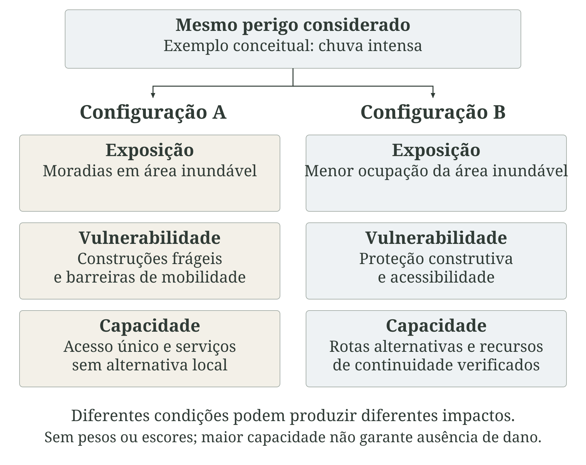
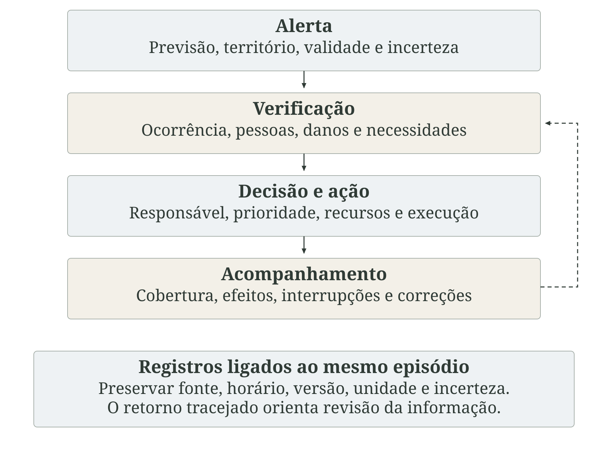
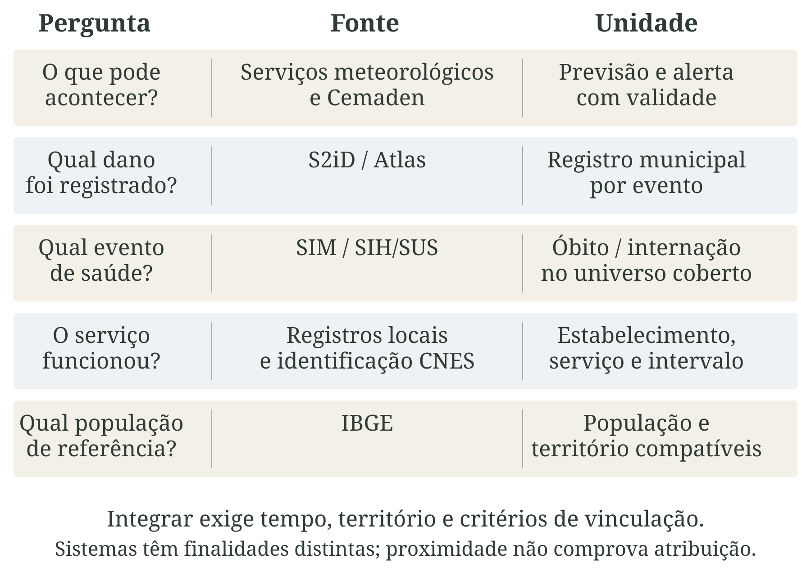
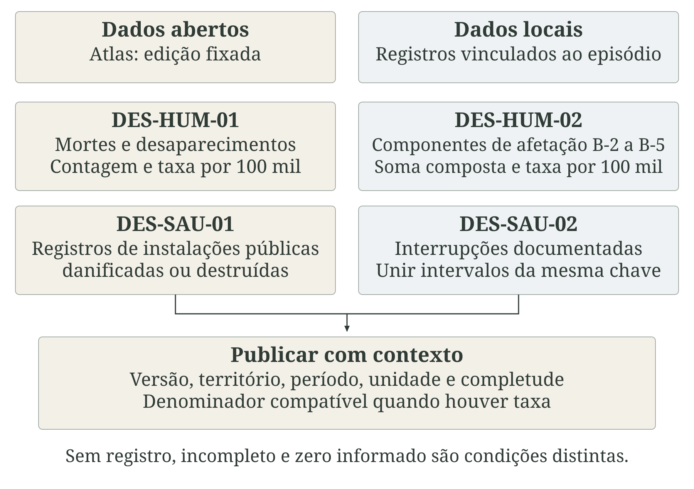
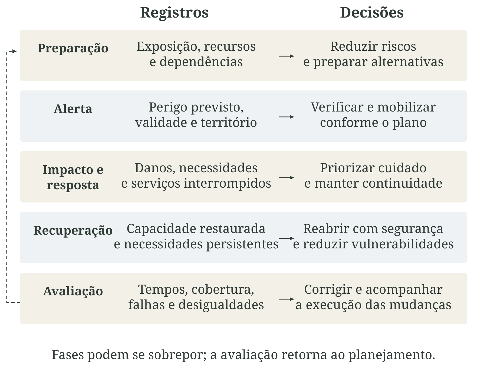

# Eventos meteorológicos severos e desastres {#sec-desastres}

Eventos meteorológicos severos podem afetar a saúde por caminhos simultâneos: produzir lesões, modificar condições ambientais, deslocar pessoas e interromper os serviços dos quais depende o cuidado. Uma tempestade pode causar trauma por queda de objetos e, ao danificar a rede elétrica, comprometer equipamentos e conservação de insumos. Mesmo depois de cessar o fenômeno, perdas de moradia, renda e vínculos sociais podem prolongar as necessidades de atenção. A análise sanitária precisa, portanto, acompanhar pessoas e serviços em diferentes momentos [@freitas2014desastres; @ipcc2022saude].

Evento extremo e evento severo respondem a perguntas diferentes. O Painel Intergovernamental sobre Mudança do Clima (IPCC) situa os extremos em seu contexto climático de referência. Extremo qualifica a raridade de uma condição em relação a uma distribuição de referência, considerando lugar, época do ano e duração. Severo qualifica sua intensidade ou seu potencial de produzir danos, segundo critérios próprios do fenômeno e do sistema de monitoramento. Uma ocorrência pode reunir as duas características, mas raridade estatística não mede, sozinha, gravidade sanitária. É necessário explicitar a definição usada, em continuidade com os [fundamentos de clima, ambiente e saúde](../../chapters/part-1/01-clima-ambiente-saude.qmd) [@ipcc2021extremes; @ipcc2022glossario].

Na terminologia do Escritório das Nações Unidas para a Redução do Risco de Desastres (UNDRR), desastre é uma perturbação grave do funcionamento de uma comunidade ou sociedade, resultante da interação de eventos perigosos com condições de exposição, vulnerabilidade e capacidade. O fenômeno físico participa dessa interação, mas sua ocorrência não determina, por si só, um desastre. A possibilidade de perdas é o risco; os danos efetivamente observados precisam ser registrados e investigados. Também pode haver feridos ou interrupções localizadas sem uma perturbação social caracterizada como desastre [@undrr2017terminology].

::: {.callout-note icon=false title="Conceito-chave: do fenômeno ao impacto sanitário"}

Perigo é o potencial de causar dano; exposição é a presença de pessoas e bens onde esse perigo pode atuar. Vulnerabilidade reúne condições que aumentam a suscetibilidade, enquanto capacidade abrange recursos e condições para lidar com o risco. Risco expressa perdas potenciais; desastre descreve a perturbação grave que se concretiza. Efeito na saúde é uma alteração clínica ou populacional, cuja relação com o episódio precisa de evidência. Esses conceitos orientam perguntas complementares e não constituem uma sequência inevitável [@undrr2017terminology].

:::

A @fig-risco-desastre organiza essas distinções. As relações abrangem efeitos diretos, como ferimentos, e indiretos, como agravamentos associados à interrupção do tratamento. A distribuição dos impactos depende de moradia, ocupação, mobilidade, redes de apoio e acesso aos serviços. A gestão dos riscos de emergências e desastres em saúde, proposta pela Organização Mundial da Saúde (OMS), integra prevenção, preparação, resposta e recuperação e envolve todo o sistema de saúde, além de outros setores [@who2019edrmframework].

::: {.figure-with-source}

{#fig-risco-desastre fig-alt="Paisagem hipotética mostra chuva, moradias próximas ao rio e uma unidade de saúde em área mais alta. Oito campos distinguem extremo, severo, perigo, exposição, vulnerabilidade, capacidade, risco e desastre. Efeitos diretos e indiretos na saúde dependem da interação no território; não há uma sequência inevitável de risco para desastre." width="100%" print-src="arte-cap12-00-conceitos-print.png"}

[Fonte: elaboração conceitual a partir de UNDRR (2017); IPCC (2021, 2022); OMS (2019). Autoria: composição própria; aquarela produzida com IA (image_gen). Licença: a mesma dos textos autorais da obra.]{.figure-source}

:::

Este capítulo concentra-se nos perigos meteorológicos de início rápido e na interpretação de perdas, danos e interrupções. Calor, seca e processos hidrológicos são desenvolvidos nos [capítulos 7](../../chapters/part-2/07-temperatura-condicoes-termicas.qmd) e [8](../../chapters/part-2/08-precipitacao-secas-eventos-hidrologicos.qmd). A relação com mudança climática exige análise específica de atribuição; não se presume que todo desastre tenha essa origem. A discussão conecta a [resposta do Sistema Único de Saúde (SUS)](../../chapters/part-1/02-mudanca-climatica-resposta-sus.qmd) aos capítulos de [exposição e vulnerabilidade](../../chapters/part-3/13-exposicao-vulnerabilidade.qmd), [efeitos na saúde](../../chapters/part-3/14-efeitos-saude.qmd) e [resposta e resiliência](../../chapters/part-3/15-resposta-adaptacao-resiliencia.qmd). As definições operacionais estão nas [fichas de desastres do capítulo 22](../../chapters/part-4/22-fichas-eventos-severos-desastres.qmd).

## Perigos meteorológicos de início rápido

Os perfis de perigo da UNDRR e do Conselho Internacional de Ciência (ISC) organizam definições, mecanismos e informações de monitoramento. Essa distinção permite tratar separadamente fenômenos que podem coexistir no mesmo episódio [@undrr2025thunderstorm].

Tempestades convectivas estão associadas a nuvens de grande desenvolvimento vertical e podem reunir chuva intensa, rajadas, descargas elétricas e granizo. Seus componentes não precisam alcançar a maior intensidade no mesmo local ou momento. Distinguir cada perigo permite reconhecer vias de exposição e necessidades de proteção: a chuva interessa ao escoamento e à inundação; o vento, à estabilidade de estruturas e à projeção de objetos; os raios, ao contato com descargas e às falhas em redes [@undrr2025thunderstorm].

Ciclones são sistemas de circulação atmosférica em torno de uma região de baixa pressão. Nos extratropicais, os contrastes de temperatura têm papel central em sua formação e intensificação; a categoria não é sinônimo de furacão. A atuação de um ciclone pode combinar vento, precipitação, ondas e elevação meteorológica do nível do mar. Para a saúde, a trajetória do centro é apenas parte da informação: interessa onde os perigos associados encontram população, acessos e serviços [@undrr2025extratropical].

Vento médio e rajada descrevem características distintas. A rajada representa uma intensificação breve, cuja medida depende do intervalo de observação. Altura do sensor, obstáculos e relevo influenciam a comparação entre estações; uma medição pontual não reconstrói todos os locais atingidos. Ao interpretar danos, é necessário considerar materiais, manutenção, árvores, objetos soltos e redes aéreas. Uma classificação de severidade deve informar a variável e a convenção adotadas, sem transformar um limiar de outra rede em regra universal.

Tornado é uma coluna de ar em rotação que se estende da base de uma nuvem cumuliforme até a superfície. Sua faixa de atuação pode ser muito localizada; uma estação próxima pode não medir os ventos mais intensos. A intensidade frequentemente é estimada pela avaliação dos danos, e essa estimativa deve ser distinguida de uma velocidade medida. Objetos projetados e colapso de estruturas são vias importantes de lesão. Relatos sem confirmação e mudanças na capacidade de observação limitam a interpretação de séries históricas [@undrr2025tornado].

Granizo é precipitação de partículas de gelo formadas em nuvens. Dimensão das pedras, quantidade, duração e vento associado influenciam os danos a pessoas, coberturas, veículos e lavouras. A perda do telhado pode tornar uma moradia temporariamente inadequada mesmo sem colapso de suas paredes. Relatos de moradores, radar e observações de superfície têm alcances diferentes e devem conservar sua identificação no registro [@undrr2025hail].

Descargas atmosféricas podem ocorrer dentro das nuvens, entre elas e entre nuvem e solo. A medida de atividade elétrica precisa informar o tipo de descarga, a área, o período e as características da rede de detecção. Raios que atingem pessoas ou estruturas podem causar lesões e mortes, iniciar incêndios e afetar energia e comunicação. Densidade de descargas é uma medida do perigo; mortes atribuídas são efeitos, que exigem informação sobre as circunstâncias da ocorrência [@undrr2025lightning].

A @fig-desastre-perigos compara alguns desses mecanismos, sem representar frequência ou magnitude observada. As medidas de precipitação e os processos de inundação, enxurrada e movimento de massa são detalhados no [capítulo 8](../../chapters/part-2/08-precipitacao-secas-eventos-hidrologicos.qmd) e nas [fichas do capítulo 18](../../chapters/part-4/18-fichas-precipitacao-secas-eventos-hidrologicos.qmd). Seus impactos devem ser articulados às [fichas de desastres](../../chapters/part-4/22-fichas-eventos-severos-desastres.qmd), sem usar quantidade de alertas como substituto de ocorrência confirmada. Em particular, a [ficha DES-HUM-01](../../chapters/part-4/22-fichas-eventos-severos-desastres.qmd#sec-des-hum-01) mede mortes e desaparecimentos registrados, não a intensidade meteorológica.

::: {.figure-with-source}

{#fig-desastre-perigos fig-alt="Quatro vinhetas hipotéticas mostram tempestade com raio, vento, granizo e tornado. Os rótulos relacionam perigos a lesões, danos à moradia e falhas de infraestrutura. Não representam frequência, escala comparável ou intensidade observada." width="100%" print-src="arte-cap12-01-perigos-print.png"}

[Fonte: elaboração conceitual a partir de UNDRR/ISC, Hazard Information Profiles (2025). Autoria: composição própria; aquarela produzida com IA (image_gen). Licença: a mesma dos textos autorais da obra.]{.figure-source}

:::

## Conceitos de desastre e risco

O risco deve ser situado em um território, período e conjunto de consequências. Perguntar apenas onde pode ocorrer chuva forte descreve um perigo; perguntar onde essa chuva pode interromper o acesso à maternidade exige também examinar população atendida, vias, alternativas e capacidade assistencial. O risco é dinâmico: varia com ocupação, infraestrutura, condições sociais e decisões institucionais [@undrr2017terminology; @who2021vulnerability].

::: {.callout-note icon=false title="Conceito-chave: componentes do risco"}

[Perigo.]{.field-label} Processo, fenômeno ou atividade com potencial de causar danos, caracterizado conforme intensidade, duração, extensão e probabilidade.

[Exposição.]{.field-label} Presença de pessoas, moradias, infraestrutura, meios de vida e outros bens em locais sujeitos ao perigo.

[Vulnerabilidade.]{.field-label} Condições físicas, sociais, econômicas e ambientais que aumentam a suscetibilidade aos impactos.

[Capacidade.]{.field-label} Combinação de recursos, conhecimentos, condições e instituições disponíveis para gerir riscos e seus efeitos.

[Risco de desastre.]{.field-label} Possibilidade de perdas humanas, materiais e de outras naturezas, em determinado período, relacionada à interação desses componentes [@undrr2017terminology].

:::

Exposição não se limita à população residente. Trabalhadores, estudantes, turistas e pessoas em trânsito podem estar em áreas atingidas; pacientes dependem de serviços localizados fora de seu bairro ou município. A unidade escolhida muda a pergunta: residentes em uma área inundável, pessoas presentes durante a ocorrência e usuários sem acesso ao cuidado são universos diferentes. A integração deve preservar essas distinções, conforme o [capítulo 13](../../chapters/part-3/13-exposicao-vulnerabilidade.qmd).

Vulnerabilidade não é uma qualidade natural de uma pessoa ou grupo. Moradia insegura, barreiras de comunicação, segregação territorial e acesso desigual à proteção resultam de processos sociais e institucionais. Idade e condição de saúde podem modificar necessidades, mas não substituem a análise dessas condições. A perspectiva da justiça socioambiental acrescenta a pergunta sobre quem participa das decisões, recebe investimentos e suporta os custos da prevenção e da reconstrução [@lacerdaFreitas2024justica].

Capacidade precisa ser observada em funcionamento. A existência de um abrigo não garante acessibilidade; um gerador instalado pode depender de combustível, manutenção e equipe. Redes comunitárias e conhecimento local também contribuem para a proteção. Entretanto, reconhecer esses recursos não transfere às comunidades a responsabilidade por suprir carências estruturais. A @fig-desastre-componentes compara configurações de risco sem lhes atribuir pesos ou uma classificação quantitativa.

::: {.figure-with-source}

{#fig-desastre-componentes fig-alt="Um mesmo perigo é considerado em duas configurações hipotéticas. Uma tem ocupação exposta, moradias frágeis e acesso único; a outra combina menor exposição, estruturas protegidas e alternativas de cuidado. A comparação distingue exposição, vulnerabilidade e capacidade, sem pesos, escores ou garantia de ausência de impactos." width="100%" print-src="arte-cap12-02-componentes-print.png"}

[Fonte: elaboração conceitual a partir de UNDRR (2017); OMS (2021); Lacerda e Freitas (2024). Autoria: composição vetorial própria. Licença: a mesma dos textos autorais da obra.]{.figure-source}

:::

Eventos compostos e efeitos em cascata ampliam essa análise. Vento e chuva podem ocorrer juntos, enquanto a interrupção de energia pode desencadear problemas no abastecimento, na comunicação e na assistência. A coexistência de perigos não demonstra, por si só, interação causal; é preciso descrever a sequência e as dependências. Da mesma forma, multiplicar escores de perigo, exposição e vulnerabilidade não produz automaticamente uma probabilidade de dano: escalas, pesos e compensações exigem justificativa [@ipcc2022glossario; @who2021edrmresearch].

Nas [fichas de vulnerabilidade social e adensamento domiciliar](../../chapters/part-4/23-fichas-exposicao-vulnerabilidade.qmd), a [EXP-VUL-01](../../chapters/part-4/23-fichas-exposicao-vulnerabilidade.qmd#sec-exp-vul-01) apresenta o Índice de Vulnerabilidade Social do Instituto de Pesquisa Econômica Aplicada (Ipea). Ele oferece contexto territorial, sem representar sozinho risco de um desastre específico. No [capítulo 25](../../chapters/part-4/25-fichas-resposta-adaptacao-resiliencia.qmd), a [RES-RIS-01](../../chapters/part-4/25-fichas-resposta-adaptacao-resiliencia.qmd#sec-res-ris-01) verifica perfis de risco documentados nos estabelecimentos. A interpretação dessas capacidades é desenvolvida no [capítulo 15](../../chapters/part-3/15-resposta-adaptacao-resiliencia.qmd).

## Danos humanos e materiais

Danos humanos incluem mortes, desaparecimentos, lesões e enfermidades atribuídas ao episódio. Pessoas diretamente afetadas abrangem categorias adicionais, como residentes de moradias danificadas ou destruídas e pessoas com meios de vida interrompidos. Na estrutura dos Objetivos de Desenvolvimento Sustentável (ODS) e do Marco de Sendai, mortes e desaparecimentos e pessoas diretamente afetadas são componentes distintos, que precisam permanecer identificáveis [@un2024disasters].

Morte e desaparecimento descrevem situações que podem mudar durante a investigação. Um desaparecido posteriormente identificado não deve permanecer em ambas as categorias na contagem individual final. Os totais agregados, entretanto, podem não permitir essa conferência. A [ficha DES-HUM-01](../../chapters/part-4/22-fichas-eventos-severos-desastres.qmd#sec-des-hum-01) explicita essa limitação ao trabalhar com os registros administrativos do Atlas. O total publicado não equivale a uma lista de pessoas cuja exclusividade tenha sido auditada.

A [ficha DES-HUM-02](../../chapters/part-4/22-fichas-eventos-severos-desastres.qmd#sec-des-hum-02) acompanha a composição Sendai B-2 a B-5: feridos ou enfermos, residentes de moradias danificadas, residentes de moradias destruídas e pessoas com meios de vida afetados. Uma mesma pessoa pode aparecer em componentes diferentes. Por isso, a soma deve ser apresentada como contagem composta, com suas parcelas, e não como total de indivíduos únicos. Número de atendimentos, número de famílias e número de pessoas também não são intercambiáveis [@un2024disasters].

Danos materiais descrevem comprometimento de bens e infraestrutura; perdas econômicas incluem consequências que podem persistir depois do dano inicial. A destruição de um equipamento e a interrupção da atividade que ele permitia realizar respondem a dimensões diferentes. Para a saúde pública, valor monetário e importância funcional precisam ser lidos conjuntamente. A perda de uma pequena unidade remota pode suprimir o único acesso próximo ao cuidado, embora seu custo de reposição seja inferior ao de uma grande instalação urbana [@undrr2017terminology].

A @fig-desastre-danos distingue pessoas, moradias e meios de vida. Ao estimar ocupantes a partir de imóveis, devem ser explicitados o coeficiente de ocupação, sua origem e a possibilidade de imóveis vazios ou de uso não residencial. Em levantamentos locais, a identificação protegida de pessoas e domicílios permite revisar categorias e acompanhar necessidades, respeitando acesso restrito e finalidade do registro.

::: {.figure-with-source}

{#fig-desastre-danos fig-alt="Três cenas conceituais mostram atendimento de uma pessoa, moradia com telhado danificado e comércio afetado por inundação. O esquema distingue componentes de afetação e destaca que uma pessoa pode aparecer em mais de um componente. Mortes e desaparecimentos são acompanhados separadamente; as vinhetas não representam contagens." width="100%" print-src="arte-cap12-03-danos-print.png"}

[Fonte: elaboração conceitual a partir de Nações Unidas (2024), metadados ODS 1.5.1; fichas [DES-HUM-01](../../chapters/part-4/22-fichas-eventos-severos-desastres.qmd#sec-des-hum-01) e [DES-HUM-02](../../chapters/part-4/22-fichas-eventos-severos-desastres.qmd#sec-des-hum-02). Autoria: composição própria; aquarela produzida com IA (image_gen). Licença: a mesma dos textos autorais da obra.]{.figure-source}

:::

A expressão por 100 mil habitantes facilita algumas comparações, mas não elimina diferenças de cobertura ou de composição populacional. Em municípios pequenos, poucos registros podem gerar taxas muito variáveis. Apresentar contagem, denominador, período e versão é indispensável. Para caracterizar quem estava efetivamente exposto, a população municipal pode ser insuficiente; a taxa oficial e uma análise específica da população atingida devem conservar nomes e denominadores próprios.

Os métodos operacionais estão no [capítulo 22](../../chapters/part-4/22-fichas-eventos-severos-desastres.qmd). Sua interpretação pode ser combinada com o [capítulo 13](../../chapters/part-3/13-exposicao-vulnerabilidade.qmd) e as [fichas do capítulo 23](../../chapters/part-4/23-fichas-exposicao-vulnerabilidade.qmd), para contexto social, e com o [capítulo 14](../../chapters/part-3/14-efeitos-saude.qmd) e as [fichas do capítulo 24](../../chapters/part-4/24-fichas-efeitos-saude.qmd), para leitura dos registros de saúde. Essas últimas abrangem causas selecionadas de mortalidade e internação e não substituem a investigação de lesões e mortes relacionadas ao desastre.

## Impactos sobre serviços de saúde

Serviços de saúde são simultaneamente recursos de resposta e sistemas expostos ao desastre. Sua continuidade depende do edifício, dos equipamentos, das pessoas e das redes externas. Dano estrutural afeta elementos resistentes da construção; danos não estruturais podem atingir instalações, mobiliário e equipamentos. A perda de funcionamento também pode ocorrer com a edificação intacta, por falta de acesso, água, energia ou insumos [@un2024infrastructure; @who2024resilienceindicators].

O indicador ODS 11.5.3 distingue infraestrutura crítica danificada ou destruída e interrupções de serviços básicos. Para o setor saúde, contar instalações físicas e contar episódios de interrupção são operações diferentes. Uma unidade pode sofrer dano sem suspender toda a assistência; outra pode interromper diferentes serviços por causas relacionadas. A informação sobre quais atividades ficaram indisponíveis é necessária para dimensionar consequências assistenciais [@un2024infrastructure].

As dependências representadas na @fig-desastre-servicos precisam ser examinadas em conjunto. Energia sustenta equipamentos e refrigeração; água e saneamento permitem higiene e procedimentos; comunicação coordena encaminhamentos; vias e transporte conectam usuários e trabalhadores à rede. Alternativas devem ser verificadas quanto à segurança e à capacidade real de atender. Sua simples presença em um inventário não comprova continuidade [@who2023framework].

::: {.figure-with-source}

{#fig-desastre-servicos fig-alt="Unidade de saúde hipotética permanece fisicamente intacta, enquanto um poste danificado e uma via alagada afetam seu entorno. Água, energia, acesso, equipes e insumos são dependências do funcionamento. Dano físico, interrupção e alternativa assistencial são registros distintos; equipamentos desenhados não comprovam funcionamento." width="100%" print-src="arte-cap12-04-servicos-print.png"}

[Fonte: elaboração conceitual a partir de Nações Unidas (2024), metadados ODS 11.5.3; OMS (2023, 2024). Autoria: composição própria; aquarela produzida com IA (image_gen). Licença: a mesma dos textos autorais da obra.]{.figure-source}

:::

Continuidade não significa manter qualquer atividade a qualquer custo. Um serviço pode necessitar de transferência, redução temporária ou reorganização para funcionar com segurança. O registro deve distinguir suspensão total, limitação parcial, alternativa implantada e necessidade ainda não atendida. Também deve especificar início, fim, estabelecimento, serviço e vínculo com o evento. Aumento da procura e redução da oferta podem ocorrer juntos; queda na produção assistencial, isoladamente, não comprova interrupção.

A [ficha DES-SAU-01](../../chapters/part-4/22-fichas-eventos-severos-desastres.qmd#sec-des-sau-01) soma registros de instalações públicas de saúde danificadas ou destruídas no Atlas. Ela não identifica todos os estabelecimentos únicos nem cobre automaticamente o setor privado. A [DES-SAU-02](../../chapters/part-4/22-fichas-eventos-severos-desastres.qmd#sec-des-sau-02) requer documentação local de episódios por estabelecimento, serviço e intervalo. Contagem, duração e capacidade assistencial perdida devem ser analisadas separadamente, conforme as definições do [capítulo 22](../../chapters/part-4/22-fichas-eventos-severos-desastres.qmd).

Os indicadores de condições de funcionamento complementam essa leitura. As fichas [RES-WAT-01](../../chapters/part-4/25-fichas-resposta-adaptacao-resiliencia.qmd#sec-res-wat-01) e [RES-ENE-01](../../chapters/part-4/25-fichas-resposta-adaptacao-resiliencia.qmd#sec-res-ene-01) tratam de interrupções de água e energia na semana anterior à avaliação; não exigem, por si, atribuição a desastre. A [RES-WAS-01](../../chapters/part-4/25-fichas-resposta-adaptacao-resiliencia.qmd#sec-res-was-01) caracteriza serviços básicos de água, saneamento, higiene, resíduos e limpeza. Os fundamentos estão nos [capítulos 10](../../chapters/part-2/10-agua-saneamento-qualidade-ambiental.qmd) e [15](../../chapters/part-3/15-resposta-adaptacao-resiliencia.qmd), com medidas ambientais complementares nas [fichas do capítulo 20](../../chapters/part-4/20-fichas-agua-saneamento-qualidade-ambiental.qmd).

## Efeitos humanos, deslocamento e recuperação

Os efeitos na saúde se distribuem em tempos sobrepostos. Durante o impacto, podem ocorrer afogamento, trauma, queimadura e outras lesões. Depois, surgem necessidades relacionadas à exposição ambiental, à perda de condições de vida e à interrupção do cuidado. A distinção entre efeitos imediatos e tardios organiza o acompanhamento, mas não estabelece prazos universais: duração da exposição, evolução clínica e capacidade de resposta variam entre episódios e populações [@freitas2014desastres].

Efeito direto decorre da atuação do perigo sobre a pessoa; efeito indireto pode decorrer das alterações que o evento produz no ambiente e nos serviços. Essa distinção precisa de uma regra de classificação. Um óbito ocorrido na mesma semana da tempestade pode não estar relacionado a ela, enquanto um agravamento posterior pode resultar de tratamento interrompido. Preservar causa básica, circunstâncias, datas e evidência do vínculo permite revisar a atribuição. O [capítulo 14](../../chapters/part-3/14-efeitos-saude.qmd) discute os limites entre registro, associação e efeito atribuído [@who2021edrmresearch; @hernan2020causal].

A ocorrência de um desastre não implica inevitavelmente uma epidemia. Os mecanismos precisam ser investigados: contaminação da água, alteração de condições de higiene, presença de agentes, mudanças na exposição a vetores e aglomeração podem criar situações específicas de transmissão. A água de inundação também pode aumentar o contato com material contaminado, como na leptospirose. As medidas de acesso, continuidade e qualidade da água, desenvolvidas no [capítulo 10](../../chapters/part-2/10-agua-saneamento-qualidade-ambiental.qmd) e nas [fichas do capítulo 20](../../chapters/part-4/20-fichas-agua-saneamento-qualidade-ambiental.qmd), ajudam a caracterizar esses caminhos [@levy2016waterborne; @brasil2026leptospirose].

Deslocamento pode ocorrer preventivamente, durante o impacto ou por impossibilidade de retorno. Pessoas acolhidas em abrigos são apenas parte da população deslocada: outras permanecem com familiares, em moradias provisórias ou fora do município. Acompanhar somente a ocupação dos abrigos pode ocultar necessidades de cuidado. O cadastro deve registrar destino, mobilidade e referência assistencial, com atualização e proteção das informações pessoais. Moradia danificada e presença em abrigo são categorias relacionadas, mas não equivalentes [@who2019edrmframework].

Nos locais de acolhimento, água, saneamento, ventilação, alimentação, acessibilidade, privacidade e segurança fazem parte das condições de saúde. O reconhecimento das necessidades deve incluir crianças, gestantes, pessoas idosas, pessoas com deficiência e quem depende de medicamentos, equipamentos ou assistência regular. A atenção primária pode articular busca ativa, recomposição do vínculo e encaminhamento, considerando também pessoas acolhidas fora dos abrigos [@brasil2024inundacoesaps].

A continuidade do tratamento de doenças crônicas envolve mais que fornecer medicamentos: depende de transporte, informação clínica, alimentação, insumos e serviços especializados. Perder esses apoios pode comprometer o controle de condições preexistentes. Para interpretar alterações nos registros assistenciais, considerar que menor número de consultas pode refletir dificuldade de acesso. As [fichas do capítulo 24](../../chapters/part-4/24-fichas-efeitos-saude.qmd) oferecem medidas de causas selecionadas, sem cobrir todas as necessidades decorrentes do desastre [@who2021vulnerability].

Saúde mental exige acompanhamento proporcional às necessidades e ao tempo de evolução. Medo, tristeza e sofrimento após perdas não devem ser automaticamente classificados como transtorno. Acolhimento, apoio social e continuidade da atenção a pessoas com condições preexistentes integram a resposta; situações de sofrimento persistente ou grave requerem avaliação e cuidado apropriados. Estudos sobre inundações mostram a relevância de acompanhar efeitos além da fase aguda, sem transferir estimativas de outros contextos diretamente para a população brasileira [@who2025mentalEmergencies; @waite2017flooding].

A @fig-desastre-recuperacao organiza o percurso de acompanhamento sem sugerir uma recuperação linear. Restabelecer água, moradia, renda, serviços e vínculos pode exigir tempos diferentes. A reabertura de uma unidade não encerra a necessidade de reabilitação e atenção psicossocial. Reconstruir com redução de risco implica rever localização, acessibilidade e condições de funcionamento, evitando reproduzir as vulnerabilidades anteriores [@who2024resilienceindicators].

::: {.figure-with-source}

{#fig-desastre-recuperacao fig-alt="Três vinhetas conceituais mostram acolhimento de uma família, consulta de acompanhamento e cuidado no território em recuperação. Uma faixa temporal qualitativa destaca necessidades sobrepostas, continuidade do tratamento e apoio psicossocial. Não há duração fixa nem promessa de recuperação linear." width="100%" print-src="arte-cap12-05-recuperacao-print.png"}

[Fonte: elaboração conceitual a partir de Freitas et al. (2014); Ministério da Saúde (2024); OMS (2025). Autoria: composição própria; aquarela produzida com IA (image_gen). Licença: a mesma dos textos autorais da obra.]{.figure-source}

:::

Acompanhar recuperação requer combinar necessidades populacionais, contexto e capacidade. Os [capítulos 13](../../chapters/part-3/13-exposicao-vulnerabilidade.qmd) e [22](../../chapters/part-4/23-fichas-exposicao-vulnerabilidade.qmd) apoiam a leitura das desigualdades. Os [capítulos 15](../../chapters/part-3/15-resposta-adaptacao-resiliencia.qmd) e [24](../../chapters/part-4/25-fichas-resposta-adaptacao-resiliencia.qmd) orientam a avaliação de preparação e continuidade. A [DES-SAU-02](../../chapters/part-4/22-fichas-eventos-severos-desastres.qmd#sec-des-sau-02) permite documentar o encerramento das interrupções, preservando o critério de retorno e os episódios ainda abertos.

## Vigilância e resposta do sistema de saúde

Vigilância em desastres precisa transformar registros incompletos e rapidamente mutáveis em informação útil para a proteção. Isso exige combinar detecção, verificação, análise, comunicação e acompanhamento das ações. A resposta articula avaliação rápida, assistência, laboratório, logística, proteção dos trabalhadores e continuidade dos serviços, com responsabilidades definidas entre saúde, proteção e defesa civil e outros setores [@who2019edrmframework].

Emergência em saúde pública demanda medidas urgentes de proteção e pode decorrer de eventos com diferentes origens. O termo não é sinônimo obrigatório de desastre: a necessidade de resposta sanitária não depende apenas de uma perturbação grave do funcionamento social. É preciso distinguir a situação observada, sua avaliação sanitária e os procedimentos administrativos de reconhecimento, que têm finalidades próprias [@undrr2017terminology; @brasil2024inundacoesaps].

O alerta é prospectivo: informa condições esperadas, território, validade e incerteza. A ocorrência é o fenômeno observado em um local e intervalo. A investigação do impacto verifica quem ou o que foi atingido e de que maneira. Esses registros devem poder ser relacionados sem perder sua identidade. O [capítulo 6](../../chapters/part-1/06-indicador-decisao.qmd) apresenta a passagem do indicador à decisão, incluindo responsabilidades e critérios de ação.

::: {.callout-important icon=false title="Conceito-chave: ocorrência, impacto atribuído e efeito em saúde"}

Ocorrência situa o fenômeno no tempo e no espaço. Impacto atribuído é um dano, perda ou interrupção vinculado ao episódio segundo critério explícito. Efeito em saúde é o desfecho clínico ou populacional observado ou estimado. O vínculo entre os três exige documentação; proximidade temporal ou espacial não basta para demonstrá-lo [@who2021edrmresearch; @hernan2020causal].

:::

Na avaliação rápida, a prioridade é identificar necessidades que mudam a decisão: áreas sem acesso, pessoas sem atendimento, água insegura, medicamentos indisponíveis e serviços interrompidos. A seleção de síndromes e agravos deve acompanhar os mecanismos plausíveis de exposição e o perfil local, em vez de aplicar uma lista indiferenciada. A busca ativa e o conhecimento territorial da atenção primária ajudam a reconhecer necessidades que não aparecem na demanda espontânea [@brasil2024inundacoesaps].

Um identificador persistente do episódio facilita a ligação entre alertas, boletins, áreas afetadas, abrigos, estabelecimentos e desfechos. Ele deve coexistir com os identificadores originais dos sistemas. Pessoa, atendimento, estabelecimento, serviço e intervalo são unidades distintas; reuni-las em uma única contagem produz resultados ambíguos. A @fig-desastre-vigilancia representa o fluxo de informação e a devolução necessária para corrigir registros e decisões.

::: {.figure-with-source}

{#fig-desastre-vigilancia fig-alt="Fluxo liga alerta, verificação local, decisão, ação e acompanhamento. Retorno tracejado orienta revisar a informação e a decisão. Um identificador de episódio conecta registros preservando fonte, horário, versão, unidade e incerteza." width="100%" print-src="arte-cap12-06-vigilancia-print.png"}

[Fonte: elaboração conceitual a partir de OMS (2019, 2022, 2023); capítulo 6. Autoria: composição vetorial própria. Licença: a mesma dos textos autorais da obra.]{.figure-source}

:::

Cada atualização deve conservar horário de referência, fonte, cobertura territorial, responsável e status de validação. Dados preliminares podem orientar uma ação antes da consolidação, desde que sua condição esteja explícita. Revisões posteriores não devem apagar o que estava disponível no momento da decisão. Falta de comunicação ou de cobertura é informação sobre o sistema de observação e não demonstra ausência de casos [@who2023dqa; @un2014statistics].

Comunicação de risco deve traduzir a informação em orientações compreensíveis e executáveis, reconhecendo idiomas, acessibilidade e condições materiais para agir. Avisar sobre um perigo não garante que as pessoas tenham recebido a mensagem ou disponham de transporte, abrigo e apoio. O acompanhamento deve distinguir emissão, recebimento, compreensão e ação. A coordenação também precisa proteger equipes e evitar que a coleta de dados comprometa o atendimento.

A [RES-ALR-01](../../chapters/part-4/25-fichas-resposta-adaptacao-resiliencia.qmd#sec-res-alr-01) descreve o nível nacional brasileiro de alerta precoce e resposta no instrumento de autoavaliação dos Estados Partes do Regulamento Sanitário Internacional (SPAR), componente C5.1. Ela não mede o desempenho de um alerta municipal específico. Para a organização dos estabelecimentos, as fichas [RES-GOV-01](../../chapters/part-4/25-fichas-resposta-adaptacao-resiliencia.qmd#sec-res-gov-01) e [RES-PLA-01](../../chapters/part-4/25-fichas-resposta-adaptacao-resiliencia.qmd#sec-res-pla-01) tratam de responsabilidade designada e planos de emergência com continuidade. A interpretação segue o [capítulo 15](../../chapters/part-3/15-resposta-adaptacao-resiliencia.qmd), combinada às [fichas de desastres](../../chapters/part-4/22-fichas-eventos-severos-desastres.qmd) e às [fichas de mortalidade e internações hospitalares](../../chapters/part-4/24-fichas-efeitos-saude.qmd), dentro de seus respectivos escopos.

## Fontes, seleção e principais indicadores

A fonte deve ser escolhida pela pergunta, pela unidade observada e pelo momento do episódio. O [Sistema Integrado de Informações sobre Desastres (S2iD)](../../backmatter/indice-fontes.qmd#s2id) organiza registros administrativos brasileiros de desastres, danos e perdas. O [Atlas Digital de Desastres](../../backmatter/indice-fontes.qmd#atlas-2026-v11) oferece uma base consolidada desses registros. A consolidação favorece análises históricas, mas não transforma o produto em vigilância clínica nem elimina diferenças de notificação [@atlas2026manual].

Os sistemas disponíveis pelo [Departamento de Informática do SUS (DATASUS)](../../backmatter/indice-fontes.qmd#datasus) registram dimensões próprias. O Sistema de Informações sobre Mortalidade (SIM) informa óbitos e suas causas; o Sistema de Informações Hospitalares do SUS (SIH/SUS) registra internações em seu universo de cobertura; o Cadastro Nacional de Estabelecimentos de Saúde (CNES) identifica serviços e recursos cadastrados. A existência desses registros não comprova vínculo com um desastre. Para esse fim, são necessários critérios de seleção, vinculação e investigação [@brasil2026sim; @brasil2026sih; @brasil2026cnes].

Fontes meteorológicas e o Centro Nacional de Monitoramento e Alertas de Desastres Naturais (Cemaden) oferecem observações e produtos prospectivos, com recortes e objetivos próprios. O [Instituto Brasileiro de Geografia e Estatística (IBGE)](../../backmatter/indice-fontes.qmd#ibge) fornece população e referências territoriais. Registros locais de acolhimento e de funcionamento dos serviços completam perguntas não respondidas pelos totais nacionais. A @fig-desastre-fontes mostra por que combinar fontes exige conservar o significado original de cada uma [@cemaden2026alerta].

::: {.figure-with-source}

{#fig-desastre-fontes fig-alt="Matriz associa condições esperadas a alertas, danos a S2iD e Atlas, eventos de saúde aos sistemas sanitários, continuidade a registros locais e população ao IBGE. A integração exige compatibilidade temporal, territorial e conceitual; vinculação não é automática." width="100%" print-src="arte-cap12-07-fontes-print.png"}

[Fonte: elaboração conceitual a partir de Atlas Digital de Desastres; DATASUS; IBGE; Cemaden; capítulo 5. Autoria: composição vetorial própria. Licença: a mesma dos textos autorais da obra.]{.figure-source}

:::

Antes da integração, verificar data do evento e data de registro, local de residência e de ocorrência, unidade territorial e versão. Um mesmo episódio pode envolver vários municípios; um município pode registrar ocorrências distintas no mesmo dia. Coincidência de data, município e tipo de desastre não constitui, sozinha, uma chave segura de deduplicação. A rastreabilidade segue os princípios discutidos no [capítulo 5](../../chapters/part-1/05-fontes-fichas.qmd).

O @qua-indicadores-desastre relaciona medidas consolidadas e usos sanitários. As especificações internacionais organizam a comparação; as fichas informam o que pode ser operacionalizado com as fontes adotadas. Manter essa diferença explícita evita apresentar uma aproximação administrativa como reprodução integral de um indicador internacional [@un2024disasters; @un2024infrastructure].

::: {#qua-indicadores-desastre .desastre-table}

| Medida e localização | Pergunta em saúde pública | Cuidado de interpretação |
|---|---|---|
| [Mortes e desaparecimentos registrados — DES-HUM-01](../../chapters/part-4/22-fichas-eventos-severos-desastres.qmd#sec-des-hum-01) | Qual impacto humano foi registrado? | Dados agregados não permitem auditar pessoas únicas |
| [Diretamente afetados — DES-HUM-02](../../chapters/part-4/22-fichas-eventos-severos-desastres.qmd#sec-des-hum-02) | Quais componentes de afetação estão presentes? | A soma Sendai B-2 a B-5 admite sobreposição entre componentes |
| [Danos em instalações públicas de saúde — DES-SAU-01](../../chapters/part-4/22-fichas-eventos-severos-desastres.qmd#sec-des-sau-01) | Qual dano físico foi registrado na infraestrutura? | Soma por evento; não corresponde a estabelecimentos únicos |
| [Interrupções de serviços — DES-SAU-02](../../chapters/part-4/22-fichas-eventos-severos-desastres.qmd#sec-des-sau-02) | Quais serviços ficaram indisponíveis? | Exige registros locais de intervalos e atribuição |
| Tempo de restauração, complementar à [DES-SAU-02](../../chapters/part-4/22-fichas-eventos-severos-desastres.qmd#sec-des-sau-02) | Por quanto tempo persistiu a interrupção? | Medida complementar, sem ficha autônoma; definir início e critério de retorno |

Indicadores de desastre e alcance de sua interpretação em saúde pública

:::

A seleção deve combinar impacto, exposição e capacidade, evitando um painel composto somente por danos já ocorridos. As [fichas do capítulo 23](../../chapters/part-4/23-fichas-exposicao-vulnerabilidade.qmd) acrescentam contexto social; as [do capítulo 24](../../chapters/part-4/24-fichas-efeitos-saude.qmd), medidas específicas de mortalidade e internação; as [do capítulo 25](../../chapters/part-4/25-fichas-resposta-adaptacao-resiliencia.qmd), condições de preparação e continuidade. Suas periodicidades e populações de referência devem ser mantidas, sem forçar equivalência com a data de um episódio.

## Protocolo de cálculo e disponibilidade

O protocolo transforma a definição em regras de seleção, cálculo e publicação. Deve identificar produto, versão, campos, chaves, unidade de contagem, período e tratamento de incompletude. A distinção entre dado, variável e indicador, apresentada no [capítulo 3](../../chapters/part-1/03-dados-variaveis-indices-indicadores.qmd), ajuda a entender por que obter uma coluna de valores é apenas uma etapa. A compatibilidade espacial e temporal segue o [capítulo 4](../../chapters/part-1/04-espaco-tempo-qualidade.qmd).

O Atlas deve ser interpretado segundo sua documentação e as regras de consolidação [@atlas2026manual]. As duas implementações baseadas em dados abertos usam a edição do Atlas 1991–2025, v1.1 de 6 de agosto de 2026, fixada nas [fichas do capítulo 22](../../chapters/part-4/22-fichas-eventos-severos-desastres.qmd). A identificação combina protocolo e município; a agregação anual usa a data do evento. Não se somam versões diferentes da base. Duplicatas exatas podem ser removidas, enquanto conflitos não resolvidos devem ser sinalizados, com sua consequência para a completude do total.

::: {.desastre-table}

| Ficha | Disponibilidade | Limite da implementação |
|---|---|---|
| [DES-HUM-01](../../chapters/part-4/22-fichas-eventos-severos-desastres.qmd#sec-des-hum-01) | Calculável com dados abertos | Mortes e desaparecimentos registrados; população compatível |
| [DES-HUM-02](../../chapters/part-4/22-fichas-eventos-severos-desastres.qmd#sec-des-hum-02) | Depende de dados locais | Componentes Sendai B-2 a B-5; total direto do Atlas não é equivalente |
| [DES-SAU-01](../../chapters/part-4/22-fichas-eventos-severos-desastres.qmd#sec-des-sau-01) | Calculável com dados abertos | Registros de instalações públicas danificadas ou destruídas |
| [DES-SAU-02](../../chapters/part-4/22-fichas-eventos-severos-desastres.qmd#sec-des-sau-02) | Depende de dados locais | Episódios documentados por estabelecimento, serviço, evento e intervalo |

:::

A @fig-desastre-protocolo diferencia os caminhos de cálculo. Na [DES-HUM-01](../../chapters/part-4/22-fichas-eventos-severos-desastres.qmd#sec-des-hum-01), os campos de mortos e desaparecidos são somados por município e ano, mantendo suas parcelas. A taxa divide essa soma pela população de referência e multiplica por 100 mil. A compatibilidade territorial deve ser verificada antes da divisão; códigos iguais ou semelhantes não dispensam a conferência de alterações de limites. Quando falta denominador compatível, a contagem pode ser apresentada e a taxa permanece ausente.

::: {.figure-with-source}

{#fig-desastre-protocolo fig-alt="Duas colunas separam dados abertos do Atlas, usados nas fichas DES-HUM-01 e DES-SAU-01, de dados locais necessários às fichas DES-HUM-02 e DES-SAU-02. O fluxo destaca versão, completude, unidade e publicação. Ausência de registro, incompletude e zero informado permanecem distintos." width="100%" print-src="arte-cap12-08-protocolo-print.png"}

[Fonte: elaboração conceitual a partir de Protocolos das quatro fichas do capítulo 22. Autoria: composição vetorial própria. Licença: a mesma dos textos autorais da obra.]{.figure-source}

:::

A ficha especifica Censos nos anos censitários e publicações anuais do IBGE nos demais, com uma ressalva para 2023: a relação publicada naquele ano usa a população do Censo 2022 com atualização territorial. O ano populacional deve ser registrado, sem apresentar esse produto como estimativa demográfica de 2023. Comparações históricas através de mudanças municipais podem exigir agregação em áreas mínimas comparáveis, baseada em correspondências oficiais.

A [DES-HUM-02](../../chapters/part-4/22-fichas-eventos-severos-desastres.qmd#sec-des-hum-02) requer apurar os quatro componentes de afetação. Deduplicar dentro de cada componente não elimina necessariamente a sobreposição entre eles. Dano e destruição da moradia devem ser categorias mutuamente exclusivas na situação final. Se um componente não puder ser apurado, o total permanece ausente. O campo de total de danos humanos diretos do Atlas inclui categorias diferentes, como mortes e desaparecimentos, e não reproduz a soma de afetados definida na ficha.

Na [DES-SAU-01](../../chapters/part-4/22-fichas-eventos-severos-desastres.qmd#sec-des-sau-01), somam-se os registros de instalações públicas danificadas e destruídas, preservando ambas as parcelas. Campos monetários não entram nessa soma. Uma instalação pode reaparecer em diferentes eventos; por isso, o resultado não deve ser denominado número de estabelecimentos únicos. Município-ano sem registro recebe a condição de ausência de registro e valor ausente. Zero exige registros elegíveis completos com zero informado; componente faltante torna o total incompleto.

Para a [DES-SAU-02](../../chapters/part-4/22-fichas-eventos-severos-desastres.qmd#sec-des-sau-02), os registros locais identificam estabelecimento, serviço, evento, início, fim, fuso e tipo de interrupção. Intervalos sobrepostos ou contíguos da mesma combinação são unidos; cada intervalo resultante constitui um episódio. O protocolo classifica como total o episódio que contenha algum trecho de interrupção total, sinalizando a mistura quando houver trechos parciais. Os episódios são contados pelo ano de início; duração é publicada separadamente e permanece censurada quando o episódio ainda está aberto.

::: {.callout-important icon=false title="Atenção: ausência, zero e substitutos inadequados"}

Registro ausente, evento não notificado e zero informado têm significados diferentes. Despesa de assistência médica no Atlas, cadastro de estabelecimento e redução de produção assistencial não comprovam interrupção de serviço. As regras das fichas preservam essas distinções e não autorizam preencher uma série nacional com substitutos sem evidência.

:::

Os métodos completos, campos e limitações estão nas quatro fichas operacionais:

``{=html}
Consulte a [ficha DES-HUM-01 — Mortes e desaparecimentos registrados](../../chapters/part-4/22-fichas-eventos-severos-desastres.qmd#sec-des-hum-01), na Parte IV`~(p. #ref(<sec-des-hum-01>, form: "page", supplement: none))`{=typst}.

``{=html}
Consulte a [ficha DES-HUM-02 — Pessoas diretamente afetadas por desastres](../../chapters/part-4/22-fichas-eventos-severos-desastres.qmd#sec-des-hum-02), na Parte IV`~(p. #ref(<sec-des-hum-02>, form: "page", supplement: none))`{=typst}.

``{=html}
Consulte a [ficha DES-SAU-01 — Danos registrados em instalações públicas de saúde](../../chapters/part-4/22-fichas-eventos-severos-desastres.qmd#sec-des-sau-01), na Parte IV`~(p. #ref(<sec-des-sau-01>, form: "page", supplement: none))`{=typst}.

``{=html}
Consulte a [ficha DES-SAU-02 — Interrupções de serviços de saúde](../../chapters/part-4/22-fichas-eventos-severos-desastres.qmd#sec-des-sau-02), na Parte IV`~(p. #ref(<sec-des-sau-02>, form: "page", supplement: none))`{=typst}.

## Aplicação na gestão

A comunicação integra a prevenção, a resposta e a recuperação. O @sec-comunicacao-risco discute como relacionar avisos, participação e acesso à proteção, sem culpabilizar as pessoas atingidas nem diluir responsabilidades institucionais.

Na gestão, o indicador precisa estar ligado a uma pergunta e a uma responsabilidade. Antes do evento, interessa reconhecer populações e serviços expostos, alternativas de acesso e necessidades de continuidade. Durante a resposta, mudam a frequência de atualização e a urgência das decisões. Na recuperação, ganham importância a duração das interrupções, o retorno seguro dos serviços e a persistência de necessidades. A @fig-linha-tempo-desastre relaciona esses momentos, retomando o percurso do [capítulo 6](../../chapters/part-1/06-indicador-decisao.qmd).

::: {.figure-with-source}

{#fig-linha-tempo-desastre fig-alt="Cinco etapas relacionam preparação, alerta, impacto e resposta, recuperação e avaliação. Cada etapa distingue os registros necessários e as decisões correspondentes. O retorno ao planejamento indica correções e aprendizagem; as fases podem se sobrepor." width="100%" print-src="arte-cap12-09-gestao-print.png"}

[Fonte: elaboração conceitual a partir de OMS (2019, 2024); capítulos 6 e 15. Autoria: composição vetorial própria. Licença: a mesma dos textos autorais da obra.]{.figure-source}

:::

Um quadro de situação deve combinar perigo observado ou previsto, exposição, impactos verificados, necessidades, recursos disponíveis e ações em andamento. Cada atualização deve trazer horário, cobertura e condição de validação. Mapas precisam distinguir área do perigo, residência, local do agravo, atendimento e serviço interrompido; localizar todos os registros no endereço da unidade de saúde pode deslocar artificialmente a interpretação territorial.

A priorização pode considerar gravidade das necessidades, número e perfil das pessoas atingidas, disponibilidade de alternativas e desigualdades de acesso. Indicadores apoiam essa decisão, mas seus totais não expressam todos esses critérios. Uma interrupção isolada pode ser decisiva se afetar o único serviço acessível. A leitura conjunta da [DES-SAU-02](../../chapters/part-4/22-fichas-eventos-severos-desastres.qmd#sec-des-sau-02) com a [RES-PLA-01](../../chapters/part-4/25-fichas-resposta-adaptacao-resiliencia.qmd#sec-res-pla-01) ajuda a relacionar impacto e preparação, sem presumir que ter um plano assegure sua execução.

Na recuperação, definir o que significa restabelecer: funcionamento parcial, plena capacidade ou operação segura com adaptação. O marco de início e o critério de término precisam ser verificáveis. Acompanhar apenas unidades reabertas pode ocultar falta de pessoal, redução de serviços ou dependência de soluções temporárias. A perspectiva de resiliência desenvolvida nos [capítulos 15](../../chapters/part-3/15-resposta-adaptacao-resiliencia.qmd) e [24](../../chapters/part-4/25-fichas-resposta-adaptacao-resiliencia.qmd) orienta o exame dessas condições [@who2024resilienceindicators].

A avaliação pós-evento deve reconstruir previsão, alerta, decisão, cobertura, tempos e resultados. Dano baixo pode refletir menor intensidade, pouca exposição, proteção eficaz ou sub-registro. Um alerta sem impacto não é automaticamente falso; a avaliação precisa considerar o que foi previsto e o que ocorreu, além das ações tomadas. Atribuir êxito ou falha apenas ao desfecho final ignora explicações alternativas [@cdc2024evaluation; @hernan2020causal].

O acompanhamento se completa quando os achados geram ações verificáveis: corrigir acessos, rever procedimentos, manter recursos, atualizar perfis de risco e incorporar a experiência das comunidades e dos trabalhadores. Registrar responsável, prazo, evidência de execução e nova avaliação conecta as [fichas de desastres](../../chapters/part-4/22-fichas-eventos-severos-desastres.qmd) às [fichas de preparação e continuidade dos serviços de saúde](../../chapters/part-4/25-fichas-resposta-adaptacao-resiliencia.qmd). Esse percurso permite usar a experiência do episódio para reduzir riscos e sustentar o cuidado no território.
