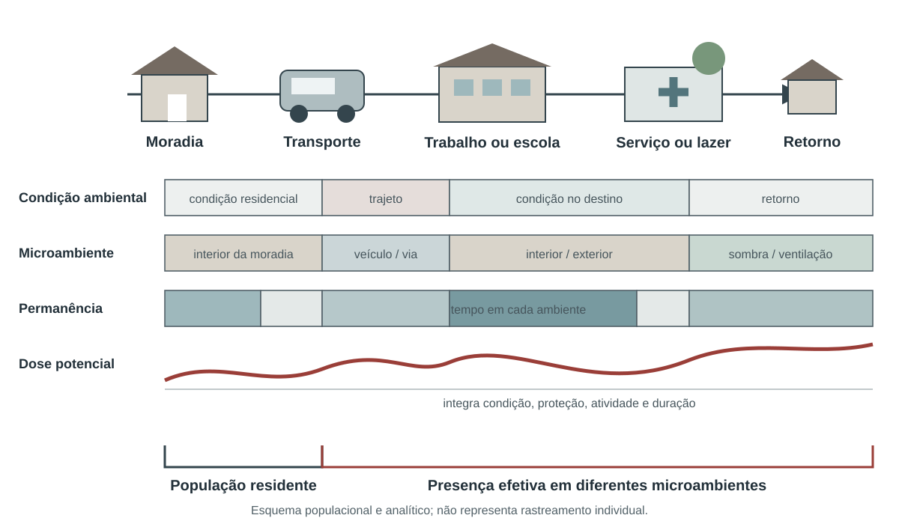

# Exposição e vulnerabilidade socioambiental {#sec-exposicao-vulnerabilidade}

::: {.callout-note icon=false title="Conceito-chave: exposição e vulnerabilidade"}

Exposição e vulnerabilidade explicam por que um mesmo perigo climático ou ambiental não alcança todas as pessoas do mesmo modo e não produz consequências iguais. A exposição descreve a presença de pessoas, serviços, infraestrutura ou atividades no tempo e no espaço do perigo. Vulnerabilidade reúne condições que aumentam a suscetibilidade ao dano ou reduzem a capacidade de antecipar, proteger-se, responder e se recuperar. Nenhuma das duas é sinônimo de desfecho [@ipcc2022glossario; @undrr2017terminology].

:::

Essa distinção é operacional. Um bairro pode ter temperatura elevada, mas pouca população presente durante o dia; outro pode registrar temperatura moderadamente menor e concentrar moradias sem ventilação, trabalho ao ar livre, pessoas clinicamente suscetíveis e acesso precário a água e atenção à saúde. Um indicador de perigo isolado favoreceria o primeiro. Um indicador de exposição e uma análise de vulnerabilidade podem mostrar por que o segundo exige maior proteção [@who2021vulnerability].

A avaliação recomendada pela OMS parte de riscos de saúde definidos, descreve populações e regiões afetadas, examina programas existentes e identifica opções de adaptação [@who2021vulnerability]. O processo não deve fabricar um índice único para toda decisão. Deve preservar a cadeia entre perigo, exposição, condições sociais, capacidade de resposta e efeito.

```{mermaid}
%%| label: fig-cadeia-exposicao-vulnerabilidade
%%| fig-cap: "Relação analítica entre perigo, exposição, vulnerabilidade, capacidade e efeito"
%%| fig-alt: "Diagrama mostra o perigo alcançando pessoas e ativos expostos; vulnerabilidade amplia e capacidade de proteção reduz os efeitos."
%%{init: {"htmlLabels": false, "flowchart": {"htmlLabels": false}}}%%
flowchart TD
  P["Perigo<br/>intensidade, duração, área"] --> E["Exposição<br/>quem, onde, quando"]
  V["Vulnerabilidade<br/>suscetibilidade e proteção"] --> R["Risco de efeito"]
  E --> R
  C["Capacidade de resposta"] -->|reduz ou modifica| R
  R --> D["Desfechos observados"]
  D --> A["Aprendizado e adaptação"]
  A --> C
```

## Exposição individual, populacional e territorial

Exposição individual requer trajetória, duração e intensidade no microambiente. Pode envolver endereço residencial, local de trabalho, deslocamentos, tempo em ambiente interno e medidas pessoais. É a forma mais próxima da experiência real, mas raramente está disponível para toda a população [@who2003environmentalindicators].

Exposição populacional combina uma superfície de perigo com uma distribuição de pessoas. O resultado pode ser uma contagem de residentes em área atingida, pessoas-dia, média ponderada pela população ou distribuição por grupos [@who2003environmentalindicators; @ipcc2022glossario]. Cada construção responde a uma pergunta:

::: {.callout-note icon=false title="Conceito-chave: medidas de exposição populacional"}

- Pessoas expostas estima quantas pessoas residem ou estavam presentes em unidades classificadas;
- Pessoas-dia integra número de pessoas e duração;
- Dias por pessoa permite comparar grupos de tamanhos diferentes;
- Exposição média ponderada pela população resume a intensidade média experimentada pela distribuição residencial;
- Proporção exposta relaciona o número exposto à população elegível.

:::

As fichas temáticas anteriores documentam aplicações consolidadas dessas construções: pessoas-dia de ondas de calor na @sec-cli-exp-02; PM2,5 anual ponderado pela população na @sec-amb-ar-01; PM2,5 atribuível à fumaça de incêndios ponderado pela população na @sec-amb-fum-01; acesso residencial a área verde na @sec-amb-urb-02; e pessoas diretamente afetadas por desastres na @sec-des-hum-02. Esses indicadores não são substituídos por uma ficha genérica de “população exposta”: a definição do perigo, a população, o tempo e o suporte espacial pertencem ao próprio indicador.

### O denominador muda a pergunta

Uma contagem de pessoas expostas é indispensável para dimensionar recursos. Uma proporção é necessária para comparar territórios de tamanhos diferentes. Dias por pessoa separam parcialmente o tamanho populacional da persistência do evento. Nenhuma medida deve ser escolhida apenas por produzir um mapa visualmente mais contrastado [@ripsa2026; @iso2023geoquality].

Se \(I_{g,t}\) indica exposição na célula \(g\) e no tempo \(t\), e \(Pop_{g,t}\) representa a população, uma estrutura frequente é:

$$
Pessoas\text{-}tempo=\sum_t\sum_g I_{g,t}\times Pop_{g,t}
$$

A expressão só é válida depois de definir o que torna \(I_{g,t}=1\). Para calor, pode ser a participação em uma onda com percentis de máxima e mínima; para inundação, presença na mancha com profundidade mínima; para fumaça, concentração atribuível acima de um critério. Sem a definição do perigo, a fórmula é vazia.

### Residência não é presença

Grades populacionais e Censos localizam residência habitual. Pessoas trabalham, estudam, cuidam, circulam e podem estar temporariamente deslocadas. A mobilidade é particularmente importante em centros comerciais, áreas turísticas, zonas industriais e rotas de evacuação. Quando não houver dados de presença, o produto deve ser chamado de população residente em área exposta, e não população efetivamente exposta [@who2003environmentalindicators; @who2021vulnerability].

O ambiente interno também modifica a exposição. Temperatura de estação não mede o interior da moradia; concentração externa de PM2,5 não equivale à dose inalada; água disponível no setor censitário não assegura continuidade no domicílio. Materiais, ventilação, ar-condicionado, filtros, ocupação, comportamento e interrupções de serviços formam pontes entre a condição ambiental e a experiência humana.

O percurso esquemático da @fig-residencia-presenca-exposicao reúne essas diferenças sem transformar residência, presença e dose em medidas equivalentes.

{#fig-residencia-presenca-exposicao fig-alt="Linha esquemática entre moradia, transporte, trabalho ou escola, serviço ou lazer e retorno. Quatro faixas distinguem condição ambiental, microambiente, permanência e dose potencial, contrastando residência com presença efetiva." width="100%"}

[Fonte e autoria: elaboração própria. Licença: a mesma dos textos autorais da obra.]{.figure-source}

## Vulnerabilidade, suscetibilidade e barreiras de proteção

Vulnerabilidade não é essência de uma pessoa, idade, povo ou lugar. Ela é produzida por relações sociais, decisões públicas, discriminação, ocupação do território, condições de trabalho, moradia, renda, redes de cuidado, acesso a informação e disponibilidade de serviços. Dizer que “pessoas idosas são vulneráveis” é insuficiente. É necessário distinguir suscetibilidade fisiológica, doença preexistente, dependência para atividades, isolamento, conforto térmico da moradia, renda, acesso a energia e presença de uma rede de apoio [@who2010sdhframework; @who2021vulnerability].

O mesmo cuidado vale para raça, cor, etnia, gênero, deficiência, situação migratória e pertencimento a povos e comunidades tradicionais. Essas categorias podem revelar desigualdades persistentes, mas não as causam biologicamente. Racismo ambiental, remoção territorial, barreiras linguísticas, invisibilidade estatística, informalidade do trabalho e menor acesso a políticas são mecanismos que devem aparecer na interpretação [@who2010sdhframework; @who2024sdhequity].


Lactentes dependem de cuidadores, têm termorregulação distinta e podem ser afetados por interrupções de água, energia, alimentação e atenção. Pessoas idosas formam um grupo heterogêneo; risco pode aumentar com doença cardiovascular ou renal, uso de medicamentos, mobilidade reduzida, isolamento e residência sem resfriamento. Idade deve ser desagregada em faixas pertinentes e combinada com condições de proteção, sem converter um ponto de corte administrativo em diagnóstico individual [@who2021vulnerability; @who2024sdhequity].


Doenças cardiovasculares, respiratórias, renais, metabólicas e neurológicas podem modificar a resposta ao calor, à poluição e a interrupções de cuidado. A continuidade de medicamentos, oxigênio, diálise, refrigeração de insumos e transporte é parte da exposição funcional durante emergências. Deficiência não equivale automaticamente a dependência, mas barreiras físicas, comunicacionais e atitudinais podem impedir acesso a alertas, abrigos, evacuação e serviços.

Dados de saúde individual exigem proteção de confidencialidade. Mapas de pequenos números ou condições raras podem identificar pessoas. Quando a finalidade for planejamento local, controles de acesso e divulgação agregada devem ser definidos antes da vinculação das bases.


Ocupação determina local, horário, esforço, vestimenta, proteção e capacidade de interromper a atividade. Trabalhadores rurais, da construção, limpeza urbana, transporte, cozinha, indústria e resposta a emergências podem enfrentar calor, fumaça, radiação e contaminantes em condições que a residência não revela. Informalidade e remuneração por produção reduzem a autonomia para fazer pausas [@who2025workplaceheat; @who2024sdhequity]. O WBGT da @sec-cli-est-05 ilustra por que a avaliação ocupacional deve combinar ambiente, carga metabólica, vestimenta, aclimatação e organização do trabalho.


Território, água, alimento, mobilidade, práticas culturais e autonomia são dimensões inseparáveis da saúde. Indicadores baseados apenas em renda domiciliar podem omitir perdas territoriais, contaminação, restrição de acesso a recursos e impactos sobre modos de vida. A análise deve respeitar direitos coletivos, consulta, governança dos dados e conhecimento local. A ausência de registros em sistemas nacionais não autoriza concluir ausência de exposição ou efeito [@who2024sdhequity; @who2023dqa].

A análise de vulnerabilidade precisa explicitar o mecanismo que liga uma condição ao dano. Idade pode modificar termorregulação ou dependência de cuidado; deficiência pode interagir com barreiras de comunicação e evacuação; trabalho define lugar, esforço e autonomia; renda influencia acesso a proteção; discriminação distribui exposição e recursos. Listar categorias sem mecanismo produz rótulo, não explicação. O mecanismo orienta a ação e indica quais dados adicionais são necessários [@who2010sdhframework; @who2021vulnerability].

::: {.callout-important icon=false title="Conceito-chave: suscetibilidade, barreira e capacidade"}

Suscetibilidade é a propensão a sofrer determinado efeito sob uma exposição. Barreira é a condição que impede acesso à proteção, informação ou cuidado. Capacidade é o recurso individual, comunitário ou institucional que permite antecipar, responder e recuperar. Uma mesma pessoa pode apresentar suscetibilidade em um mecanismo e capacidade elevada em outro; nenhum desses conceitos é identidade fixa.

:::

A categoria usada para desagregar precisa corresponder à finalidade. Faixas etárias administrativas podem ser úteis para cobertura de políticas e insuficientes para fisiologia. Diagnóstico registrado pode identificar necessidade clínica e omitir pessoas sem acesso. Ocupação formal pode excluir trabalho informal. Endereço pode localizar residência e omitir deslocamento. A análise deve documentar quem aparece, quem é aproximado e quem permanece invisível [@who2023dqa; @who2024sdhequity].

A interseção de condições também importa. Uma pessoa pode depender de equipamento elétrico, morar em área quente e enfrentar interrupção de energia; outra pode trabalhar ao ar livre, usar transporte demorado e residir em bairro com pouca água. Somar características em um escore não revela necessariamente essas dependências. Matrizes de perfis e cenários preservam combinações relevantes e permitem associar respostas específicas.

Vulnerabilidade territorial não significa homogeneidade interna. Setores e municípios reúnem pessoas, moradias e capacidades distintas. Taxas e índices apoiam priorização, mas precisam ser acompanhados por distribuição, componentes e validação local. Um território classificado com menor privação média ainda pode conter instituições, ocupações ou grupos com alto risco. A decisão deve evitar excluir pessoas por estarem fora da classe predominante [@openshaw1984; @who2024sdhequity].

Dados sensíveis exigem minimização. A pergunta deve definir o menor detalhamento necessário, quem pode acessar, por quanto tempo e com qual forma de divulgação. Pequenos números, condições raras, localização de povos e dependência tecnológica podem produzir reidentificação ou dano coletivo. Agregação e supressão reduzem risco, mas também podem apagar desigualdades; por isso, acesso protegido para ação local e publicação agregada podem ter desenhos diferentes.

Participação não é apenas validação final do mapa. Comunidades e trabalhadores podem identificar horários, rotas, barreiras, recursos e efeitos que os cadastros omitem. Sua contribuição deve ter consequência documentada sobre indicador, interpretação ou resposta. Consulta sem possibilidade de alterar a decisão oferece aparência de reconhecimento sem redistribuir poder [@who2024sdhequity].

O produto final deve ligar perfil a proteção. Para cada mecanismo priorizado, registre população, evidência, ação, responsável, recurso, antecedência, canal, cobertura e critério de avaliação. Essa matriz transforma vulnerabilidade em hipótese modificável e reduz o risco de publicar ordenações sem resposta.

## Moradia e infraestrutura cotidiana

Moradia liga perigos externos à exposição real. Cobertura e paredes, densidade de ocupação, ventilação, umidade, acesso a água e saneamento, estabilidade da posse, custo e localização influenciam calor interno, contaminação, possibilidade de permanecer em casa e capacidade de recuperar perdas [@un2024sdg111; @who2021vulnerability].

O indicador ODS 11.1.1 é uma medida consolidada de privação habitacional urbana. Ele reúne população em assentamentos precários ou informais e moradia inadequada, segundo componentes publicados [@un2024sdg111; @unhabitat2020sdg111]. Sua utilidade aumenta quando cada privação é apresentada separadamente. Um total de 30% não informa se predomina adensamento, falta de saneamento, insegurança de posse ou custo excessivo — problemas que exigem intervenções diferentes.

## Índices compostos

Índices compostos são úteis para triagem territorial quando sua arquitetura é pública. Também comprimem decisões: escolha de variáveis, transformação, peso, direção e universo de comparação. Dois índices com o mesmo nome podem medir realidades diferentes [@oecd2008composite].

O IVS do Ipea foi construído para o Brasil e combina 16 indicadores em infraestrutura urbana, capital humano e renda e trabalho [@ipea2015ivs; @marguti2018ivs]. O CDC/ATSDR SVI usa 16 variáveis e classificações percentílicas em quatro temas para planejamento de saúde pública e emergências nos Estados Unidos [@cdc2024svi; @flanagan2011svi]. O primeiro produz uma escala normalizada ancorada em parâmetros metodológicos; o segundo classifica posições relativas no universo da edição. Eles não são intercambiáveis.

::: {.callout-warning title="O que não fazer"}
Não somar perigo, exposição, vulnerabilidade e capacidade em um escore único apenas porque todas as camadas foram normalizadas entre zero e um. A operação pode compensar uma exposição extrema por um valor social baixo e ocultar justamente o território que exige ação.
:::

Quando um índice composto for usado, o painel deve permitir abrir:

1. O escore total;
2. Dimensões;
3. Componentes originais;
4. Ano e fonte;
5. Erro ou qualidade;
6. Mudanças de limites territoriais;
7. Critério de prioridade.

## Principais indicadores usados em saúde pública e gestão de riscos

Os indicadores consolidados de exposição e vulnerabilidade podem ser organizados por função, sem transformá-los em uma lista genérica:

::: {#qua-indicadores-exposicao-vulnerabilidade}

| Função | Indicadores consolidados | Aplicação | Limite principal |
|---|---|---|---|
| Quantificar alcance do perigo | pessoas expostas, pessoas-dia, dias por pessoa e médias ponderadas, definidos dentro de cada fenômeno | Dimensionar população e duração | Dependem da definição do perigo e da população |
| Caracterizar privação social no Brasil | IVS e suas três dimensões | Planejamento e estratificação territorial | Não contém perigo climático |
| Apoiar emergências nos Estados Unidos | CDC/ATSDR SVI, temas e variáveis | Saúde pública e resposta a desastres | Não é transferível diretamente ao Brasil |
| Descrever moradia urbana inadequada | ODS 11.1.1 e componentes | Habitação, saneamento, saúde e resiliência | A união composta oculta privações específicas |
| Identificar grupos com maior suscetibilidade | distribuição por idade, condição de saúde, deficiência, ocupação e demais categorias pertinentes | Busca ativa e desenho de proteção | Categorias não explicam os processos sociais |
| Medir proteção e resposta | indicadores do @sec-resposta | Capacidade de antecipar, manter e recuperar serviços | Existência documental não garante funcionamento |

Indicadores de exposição e vulnerabilidade e suas funções

:::

As três fichas a seguir documentam medidas publicadas que podem apoiar análise territorial. Os indicadores de exposição específicos permanecem nos capítulos dos respectivos fenômenos.







## Múltiplas exposições

Pessoas podem enfrentar calor, fumaça, interrupção de energia e falta de água no mesmo período. A coincidência pode ser:

::: {.callout-note icon=false title="Conceito-chave: formas de exposição composta"}

- Temporal, quando perigos ocorrem simultaneamente;
- Sequencial, quando um evento reduz a capacidade de enfrentar o seguinte;
- Espacial, quando diferentes fontes afetam o mesmo território;
- Social, quando as mesmas condições restringem proteção diante de vários perigos.

:::

Contar camadas sobrepostas é um começo, não uma estimativa de efeito conjunto. Interações biológicas, trajetórias temporais e correlação entre medidas precisam de desenho analítico. Um mapa de “quatro exposições” não informa se os efeitos se somam, multiplicam ou se uma camada é apenas proxy da outra [@ipcc2022saude; @oecd2008composite].

Uma matriz de coocorrência é mais transparente do que um escore arbitrário. Linhas podem representar territórios; colunas, exposições definidas; células, intensidade, duração ou presença. A gestão pode então priorizar combinações relevantes — por exemplo, calor forte, interrupção de energia e alta concentração de pessoas que dependem de equipamentos elétricos — sem perder o significado de cada variável.

## Mapas de risco e incerteza

Mapas são instrumentos de análise e decisão, não fotografias neutras. Unidade territorial, classificação, paleta, escala e ausência de dados alteram a mensagem. Percentis destacam posição relativa; limites absolutos mostram cumprimento de referência; números absolutos dimensionam recursos; taxas e proporções apoiam comparação [@iso2023geoquality; @openshaw1984].

O problema da unidade de área modificável e a falácia ecológica, discutidos no capítulo 3, são centrais. Um setor censitário de alta vulnerabilidade contém diversidade interna. Uma associação territorial não prova que toda pessoa ali tenha a condição média. Para evitar estigmatização:

- Nomeie a condição, não o território como essência;
- Mostre recursos, organizações e capacidades locais;
- Inclua incerteza e ausência de dados;
- Use mapas de componentes junto ao índice;
- Valide interpretações com equipes e comunidades;
- Registre quem pode acessar camadas sensíveis.

## Da descrição à proteção

O produto mínimo de uma análise de exposição e vulnerabilidade deve responder:

1. Qual perigo, intensidade, duração e período foram usados;
2. Qual população ou ativo foi considerado presente;
3. Quais condições modificam suscetibilidade e proteção;
4. Qual data e resolução têm as fontes;
5. Quem está invisível ou mal representado;
6. Que ação concreta cada achado pode acionar;
7. Quem tem responsabilidade e recurso para agir;
8. Como a ação será acompanhada.

Priorizar não significa apenas ordenar territórios. Pode significar ampliar antecedência do alerta, oferecer mensagem em formatos acessíveis, garantir água e energia, ajustar jornada de trabalho, organizar transporte, proteger medicamentos, abrir pontos de apoio ou intensificar vigilância. O valor do indicador está na ligação explícita entre uma condição mensurada, um direito e uma resposta possível [@who2024sdhequity; @who2021vulnerability].

## Síntese

Exposição depende de presença, duração e microambiente; vulnerabilidade resulta de processos que alteram suscetibilidade e proteção. Mapas e índices só orientam ação quando preservam componentes, incertezas e populações mal representadas e quando cada prioridade é ligada a uma medida concreta de proteção.
