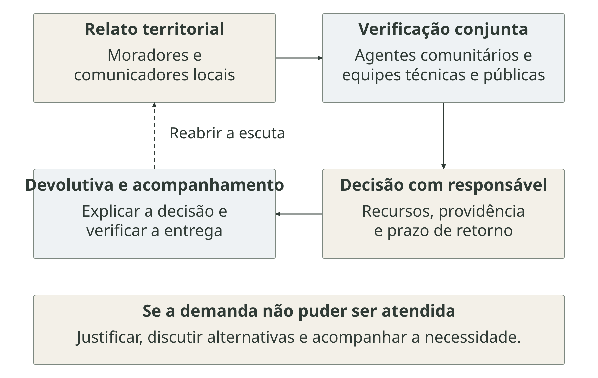
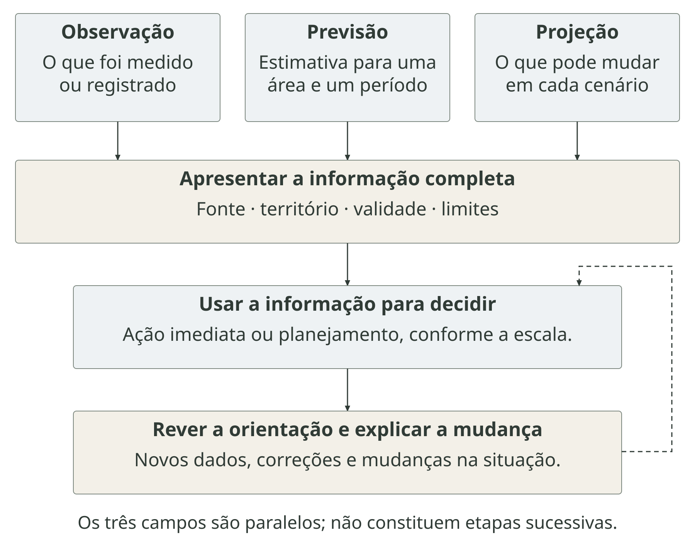
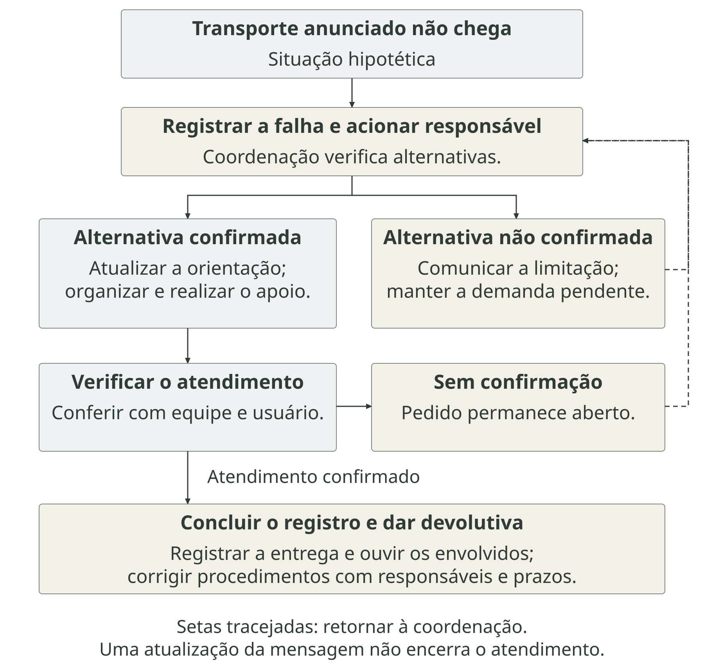

# Comunicação de risco em saúde e clima {#sec-comunicacao-risco}

Uma previsão de chuva forte chega à equipe de saúde. Ela informa a possibilidade de um evento, mas ainda é preciso reconhecer quem pode ser atingido, explicar as consequências e organizar a resposta. Para uma família que depende de transporte ou de cuidado contínuo, entender o aviso é parte de uma decisão que envolve outras pessoas e serviços. **Como uma informação sobre clima e saúde se transforma em proteção para a população?** Essa pergunta conduz o capítulo.

::: {.callout-note icon=false title="Conceito-chave: comunicação de risco"}
A Organização Mundial da Saúde (OMS) define comunicação de risco como a troca de informações, orientações e opiniões entre especialistas, autoridades e pessoas expostas a ameaças, para apoiar decisões de proteção. A população participa dessa troca com suas perguntas, experiências e necessidades [@who2020riskdefinition].
:::

Esse trabalho começa antes da emergência, quando se discutem problemas e prioridades, e continua durante a recuperação. A comunicação liga a análise de situação à decisão pública (@sec-indicador-decisao): permite explicar evidências, reconhecer divergências e acompanhar providências. O percurso deste capítulo vai da interpretação do risco às condições de agir, passando pela confiança, pela elaboração das orientações e pela avaliação da resposta. Assim, complementa a discussão sobre desastres (@sec-desastres) e resiliência dos serviços (@sec-resposta).

## Do aviso à comunicação de risco {#dos-sinos-aos-sistemas-de-alerta}

Avisar sobre perigos é uma prática antiga. O dossiê do Instituto do Patrimônio Histórico e Artístico Nacional (Iphan) sobre os sinos de Minas Gerais documenta o toque de rebate para incêndios e outras calamidades. Em São João del-Rei, o documento registra toques reconhecidos localmente, inclusive para indicar a localização do fogo. O exemplo mostra que a utilidade do sinal depende de um significado compartilhado e de pessoas capazes de reconhecê-lo [@iphan2016sinos, p. 120, 145].

Essa relação permanece nos canais atuais. Uma sirene pode chamar a atenção, enquanto rádio, celular e conversa presencial explicam a situação e esclarecem dúvidas. Os canais da @fig-comunicacao-praticas podem coexistir e cumprir funções complementares. Para quem recebe um aviso, importa reconhecer sua procedência, localizar-se na área indicada e compreender a orientação. A emissão abre um processo cujo resultado depende também das relações entre os participantes.

<!-- ARTE CAP16-01
Finalidade: Relacionar a antiguidade das práticas de aviso à necessidade de interpretação compartilhada, sem propor evolução tecnológica linear.
Composição e montagem: Duas vinhetas sem conexão cronológica; rótulos inferiores e uma faixa comum de interpretação. Nenhum mapa, data ou episódio reconstruído.
Rótulos: Aviso histórico; Toque de rebate documentado em Minas Gerais; Canais contemporâneos; Rádio, celular e conversa podem coexistir; Reconhecer o sinal e compartilhar seu significado.
Legenda: Práticas de aviso: sinais e significados compartilhados
Fontes: [@iphan2016sinos, p. 120, 145; @who2017riskcommunication]
Texto alternativo: Duas vinhetas conceituais mostram um sino e uma conversa atual com rádio e celular. Os rótulos distinguem o aviso histórico documentado dos canais contemporâneos e destacam reconhecimento e interpretação compartilhados. Não há sequência de substituição tecnológica nem reconstrução de um episódio histórico.
Prompt completo:
Use case: scientific-educational
Asset type: ARTE CAP16-01 — Práticas de aviso: sinais e significados compartilhados.
Input images: a imagem fornecida é APENAS referência de técnica, paleta e tratamento humano da série, não de composição nem de conteúdo. Criar uma cena nova.

Ilustração editorial em aquarela tradicional translúcida, combinada com traços finos e espontâneos de lápis grafite e nanquim. Contornos parcialmente abertos, hachuras leves e marcas discretas de rascunho. Textura sutil de papel aquarela, pigmentação irregular e transições suaves. Paleta de verdes naturais, azuis acinzentados, ocres e terracota, com saturação moderada. Preservar áreas de papel branco e bordas irregulares que se dissolvem no fundo. Pessoas com proporções naturais e diversidade de tons de pele. Linguagem visual madura, acolhedora e adequada à divulgação científica para adultos. Usar a imagem de referência fornecida pelo autor para manter o mesmo tratamento de pigmentos, contornos, luz, vegetação e figuras humanas. Preservar contraste legível também em escala de cinza. Manter mãos, dedos, braços e pernas anatomicamente coerentes, com proporções naturais, articulações plausíveis e continuidade entre os segmentos. Evitar dedos extras ou fundidos, membros duplicados, torções impossíveis e mãos ou pés disformes. Preferir gestos simples e poses claras, respeitando a perspectiva, as oclusões e as características de cada personagem. Sem texto, letras, números, logotipos ou marca-d'água: reservar espaços para rótulos acrescentados na diagramação. Evitar fotorrealismo e acabamento tridimensional. Não inventar dados, curvas quantitativas ou mapas de locais reais.

Composição horizontal, proporção 3:2, largura de pelo menos 1536 pixels. Fundo branco puro com bordas orgânicas dissolvidas e contraste também legível em cinza. Cenas de tamanho suficiente para leitura em livro de 160 × 230 mm.

Duas vinhetas lado a lado, separadas por papel branco, sem molduras. À esquerda, detalhe de um sino grande de bronze suspenso por estrutura de madeira plausível, boca, badalo e corda visíveis, sem pessoas, sem igreja identificável. Evocar o instrumento de aviso documentado, sem desenhar incêndio, enchente ou reconstituir época específica. À direita, pequena cena atual: uma agente comunitária conversa com duas pessoas adultas de tons de pele distintos, uma delas segura um celular com tela vazia; um rádio portátil está sobre uma pequena mesa. Fachadas discretas de bairro urbano brasileiro ao fundo. Objetos proporcionais, conversa tranquila, mãos simples. Não ligar as cenas por setas nem por linhas de tempo: são repertórios comunicativos diferentes. Reservar branco abaixo de cada vinheta para rótulos vetoriais.

Uma única ilustração final sem palavras, letras, números, setas, logotipos, marca-d’água ou títulos. A fauna, a água e a paisagem da referência não precisam aparecer. Usar a referência somente para o estilo.
-->

::: {.figure-with-source}

{#fig-comunicacao-praticas fig-alt="Duas vinhetas conceituais mostram um sino e uma conversa atual com rádio e celular. Os rótulos distinguem o aviso histórico documentado dos canais contemporâneos e destacam reconhecimento e interpretação compartilhados. Não há sequência de substituição tecnológica nem reconstrução de um episódio histórico." width="100%" print-src="arte-cap16-01-praticas-print.png" print-width="117mm"}

[Fonte: elaboração própria a partir de [@iphan2016sinos, p. 120, 145; @who2017riskcommunication]. Representação genérica. Aquarela com IA; composição autoral. Licença da obra.]{.figure-source}

:::

A comunicação de risco ganhou forma como campo de estudo nos anos 1980, em meio à crescente cobrança por participação nas decisões sobre riscos ambientais. Uma questão importante era entender por que especialistas e população avaliavam os mesmos perigos de maneiras diferentes. Esses debates ampliaram a atenção à confiança nas instituições, às experiências das pessoas e ao diálogo entre governos, empresas e comunidades. Com isso, o campo passou a reunir estudos sobre como as informações são produzidas, interpretadas e discutidas para orientar decisões que afetam a saúde e o ambiente [@looseQuinteros2025comunicacao, p. 92–94].

Na prática, informar que uma ameaça existe, orientar uma ação imediata e discutir sua prevenção são tarefas relacionadas, com tempos e necessidades diferentes. Um aviso de inundação exige rapidez e localização precisa. A discussão sobre drenagem e moradia envolve alternativas, recursos e compromissos que precisam ser acompanhados. O @qua-praticas-comunicacao-risco reúne práticas atuais e mostra como cada uma depende de condições para funcionar.

::: {#qua-praticas-comunicacao-risco}

| Prática | Para que serve | Condições para funcionar |
|---|---|---|
| Sirenes e avisos de inundação | Orientar a saída de uma área ameaçada | Rotas, transporte e acolhimento disponíveis |
| Rádio e comunicação comunitária sobre fumaça | Explicar a situação e os cuidados | Orientação e acesso a ambientes adequados |
| Boletins e mensagens sobre calor | Antecipar cuidados e organizar serviços | Água, condições de trabalho e assistência |
| Reuniões sobre adaptação | Definir prioridades e acompanhar ações | Participação nas decisões sobre recursos e serviços |

Práticas atuais de comunicação de riscos

:::

As situações apresentadas são exemplos de aplicação organizados para este capítulo. Elas também mostram por que a comunicação faz parte da gestão do risco: ao explicar um problema, a equipe ajuda a definir o que será discutido e quais respostas poderão ser cobradas.

## O que se comunica sobre o risco {#risco-conhecimento-e-poder}

Um boletim pode descrever a intensidade da chuva e deixar de fora a drenagem insuficiente, as moradias expostas e os serviços interrompidos. Isso altera a compreensão do problema. Quando toda a explicação se concentra no fenômeno meteorológico, as possibilidades de intervenção parecem se limitar a prever e avisar. Ao incluir as condições do território, tornam-se visíveis decisões sobre saneamento, habitação, acesso aos serviços e proteção social.

Ulrich Beck, em *Sociedade de risco*, relaciona a produção de riquezas à produção social de riscos e discute as disputas sobre seu reconhecimento [@beck2010risco]. Essa contribuição ajuda a perguntar quem consegue tornar um problema visível e quais causas entram na explicação pública. Aplicada à comunicação em saúde e clima, ela convida a examinar a ligação entre a informação divulgada e as escolhas que distribuem exposição e proteção.

Um exemplo hipotético é a discussão sobre calor em um bairro. Informar a temperatura permite reconhecer uma condição ambiental. Relacioná-la ao trabalho externo, às moradias quentes e ao acesso à água permite discutir quem permanece exposto e quais medidas são necessárias. A reunião com moradores pode então comparar prioridades, como intervenções nas edificações e nos espaços públicos. Para participar dessa escolha, as pessoas precisam conhecer os critérios utilizados, os recursos disponíveis e as limitações de cada proposta.

Mapas também participam dessa discussão. Um mapa de locais que já inundaram descreve uma experiência registrada; um mapa de previsão estima uma situação futura. Confundi-los pode levar o leitor a interpretar uma área sem registro como uma área segura. A equipe precisa explicar o que a delimitação representa e incorporar informações locais sobre caminhos, usos do território e pessoas que os cadastros não alcançam. As escolhas de escala e cobertura discutidas no @sec-espaco-tempo afetam, portanto, o sentido público do mapa.

A análise brasileira de justiça socioambiental relaciona a gestão dos desastres aos processos que distribuem desigualmente riscos e recursos [@lacerdaFreitas2024justica]. Isso exige examinar quais grupos participam do diagnóstico e quais experiências ficam ausentes. Publicar uma informação tecnicamente consistente é uma etapa; discutir suas implicações permite reconhecer necessidades e responsabilidades. A próxima questão é saber se a proteção proposta pode ser realizada por quem recebe a orientação.

## Comunicar sem culpabilizar {#comunicar-sem-culpabilizar}

Duas famílias podem compreender o mesmo aviso de saída e enfrentar possibilidades muito diferentes de agir. Uma dispõe de veículo e de um lugar onde ficar; outra depende de transporte acessível, de acompanhante e da continuidade de medicamentos. Se a avaliação observar apenas quem deixou a casa, poderá interpretar a falta de apoio como falta de disposição. Conhecer as condições da decisão muda tanto a conversa quanto a resposta necessária.

Norma Valencio examina como o tecnicismo pode reduzir a experiência dos desastres à execução de procedimentos e desconsiderar o sofrimento social dos grupos afetados [@valencio2014tecnicismo]. Essa crítica ajuda a perceber o que se perde quando uma pessoa é tratada apenas como destinatária de uma ordem. O receio de separar-se da família, perder meios de trabalho ou interromper um tratamento precisa ser compreendido na organização da proteção. Uma orientação que ignora essas questões pode permanecer inviável mesmo depois de explicada várias vezes.

Em uma situação hipotética de evacuação, a equipe pode descobrir que uma moradora entendeu o destino indicado, mas depende de equipamento de cuidado e não sabe se poderá utilizá-lo no acolhimento. Repetir a rota não responde à dúvida. É preciso verificar as condições do destino e organizar o deslocamento e o cuidado. A comunicação identifica a necessidade, encaminha a verificação e devolve uma resposta que permite decidir. A @fig-comunicacao-condicoes reúne barreiras desse tipo e suas relações com providências institucionais.

<!-- ARTE CAP16-02
Finalidade: Tornar visíveis condições materiais de proteção e sua relação com responsabilidades institucionais.
Composição e montagem: Três cenas na mesma escala, com rótulos de cuidado, mobilidade e trabalho. Faixa inferior associa barreiras a providências públicas e compromissos institucionais.
Rótulos: Cuidado; Continuidade do cuidado e acompanhamento; Mobilidade; Transporte e acolhimento acessíveis; Trabalho; Organizar o trabalho e viabilizar a saída; Poder público e empregadores precisam garantir condições de proteção.
Legenda: Receber o aviso e conseguir agir são condições diferentes
Fontes: [@beck2010risco; @araujoCardoso2007comunicacao; @valencio2014tecnicismo]
Texto alternativo: Três cenas de um bairro hipotético mostram cuidado de pessoa idosa, mobilidade em cadeira de rodas e organização do trabalho. Rótulos associam cada necessidade à continuidade do cuidado, ao transporte acessível e à organização do trabalho. Barreiras demandam providências públicas, sem julgamento da conduta dos moradores.
Prompt completo:
Use case: scientific-educational
Asset type: ARTE CAP16-02 — Receber o aviso e conseguir agir são condições diferentes.
Input images: a imagem fornecida é APENAS referência de técnica, paleta e tratamento humano da série, não de composição nem de conteúdo. Criar uma cena nova.

Ilustração editorial em aquarela tradicional translúcida, combinada com traços finos e espontâneos de lápis grafite e nanquim. Contornos parcialmente abertos, hachuras leves e marcas discretas de rascunho. Textura sutil de papel aquarela, pigmentação irregular e transições suaves. Paleta de verdes naturais, azuis acinzentados, ocres e terracota, com saturação moderada. Preservar áreas de papel branco e bordas irregulares que se dissolvem no fundo. Pessoas com proporções naturais e diversidade de tons de pele. Linguagem visual madura, acolhedora e adequada à divulgação científica para adultos. Usar a imagem de referência fornecida pelo autor para manter o mesmo tratamento de pigmentos, contornos, luz, vegetação e figuras humanas. Preservar contraste legível também em escala de cinza. Manter mãos, dedos, braços e pernas anatomicamente coerentes, com proporções naturais, articulações plausíveis e continuidade entre os segmentos. Evitar dedos extras ou fundidos, membros duplicados, torções impossíveis e mãos ou pés disformes. Preferir gestos simples e poses claras, respeitando a perspectiva, as oclusões e as características de cada personagem. Sem texto, letras, números, logotipos ou marca-d'água: reservar espaços para rótulos acrescentados na diagramação. Evitar fotorrealismo e acabamento tridimensional. Não inventar dados, curvas quantitativas ou mapas de locais reais.

Composição horizontal, proporção 3:2, largura de pelo menos 1536 pixels. Fundo branco puro com bordas orgânicas dissolvidas e contraste também legível em cinza. Cenas de tamanho suficiente para leitura em livro de 160 × 230 mm.

Três vinhetas de tamanho semelhante alinhadas horizontalmente, com branco entre elas, todas em um bairro brasileiro contemporâneo hipotético. À esquerda, pessoa adulta conversa com agente de saúde enquanto acompanha pessoa idosa sentada, com bolsa de cuidado simples e sem rótulos sobre mesa. Ao centro, pessoa adulta em cadeira de rodas com acompanhante conversa com profissional de transporte junto a veículo coletivo acessível estacionado em solo seco, plataforma baixa e rampa plausível desimpedida; não desenhar o embarque em movimento. À direita, pessoa que trabalha na manutenção de espaço urbano conversa com responsável pela organização do trabalho, ferramentas em repouso, postura digna, pequeno abrigo sombreado. Sem contraste moral de quem obedece e quem resiste. As situações mostram necessidades e articulação do apoio, sem prometer desfechos. Fachadas de casas e edifícios discretos conectam visualmente o conjunto. Reservar branco inferior para rótulos sobre cuidado, mobilidade e trabalho.

Uma única ilustração final sem palavras, letras, números, setas, logotipos, marca-d’água ou títulos. A fauna, a água e a paisagem da referência não precisam aparecer. Usar a referência somente para o estilo.
-->

::: {.figure-with-source}

{#fig-comunicacao-condicoes fig-alt="Três cenas de um bairro hipotético mostram cuidado de pessoa idosa, mobilidade em cadeira de rodas e organização do trabalho. Rótulos associam cada necessidade à continuidade do cuidado, ao transporte acessível e à organização do trabalho. Barreiras demandam providências públicas, sem julgamento da conduta dos moradores." width="100%" print-src="arte-cap16-02-condicoes-print.png" print-width="117mm"}

[Fonte: elaboração própria a partir de [@beck2010risco; @araujoCardoso2007comunicacao; @valencio2014tecnicismo]. Cena hipotética. Aquarela com IA; composição autoral. Licença da obra.]{.figure-source}

:::

O dever público de proteção antecede o aviso. A Constituição vincula o direito à saúde a políticas que reduzam riscos, e a Política Nacional de Proteção e Defesa Civil abrange prevenção, mitigação, preparação, resposta e recuperação [@brasil1988constituicao, art. 196; @brasil2012pnpdec, arts. 2–4]. A comunicação permite apresentar essas medidas e acompanhar sua execução. Quando uma campanha pede que moradores se protejam, precisa tornar compreensíveis também os serviços disponíveis e as responsabilidades por sua oferta.

Essa ligação depende da organização entre setores. Uma necessidade identificada pela atenção primária pode exigir transporte, assistência social e continuidade do atendimento em outro local. O plano deve mostrar quem decide, quem executa e como a equipe que conversa com a família recebe a confirmação. Anunciar uma solução antes de verificar essas dependências produz uma promessa que o serviço pode não cumprir. Informar uma limitação deve vir acompanhado do encaminhamento da necessidade e do acompanhamento da resposta.

Redes de vizinhança e voluntários contribuem com conhecimento e apoio, mas sua participação demanda orientação, meios e segurança. A continuidade dos serviços precisa contar com equipes e financiamento públicos. Reconhecer as capacidades comunitárias inclui respeitar seus limites. Para saber quais barreiras permanecem e como as medidas funcionam, a gestão precisa manter uma relação em que as pessoas possam falar, discordar e obter respostas.

## Ouvir, responder e construir confiança {#escuta-confiança-e-participação}

A credibilidade de um aviso se relaciona à experiência com quem o emite. Se um serviço anunciou apoio e não respondeu às solicitações, uma nova mensagem será recebida à luz dessa experiência. A recomendação da OMS de construir confiança envolve transparência, reconhecimento das incertezas e participação das comunidades [@who2017riskcommunication]. No cotidiano, isso exige que a instituição consiga explicar suas decisões e demonstrar o que fez com as informações recebidas.

Araújo e Cardoso situam a comunicação e a saúde nas relações de poder e no compromisso com o aperfeiçoamento do Sistema Único de Saúde (SUS) [@araujoCardoso2007comunicacao]. Essa perspectiva permite examinar quem pode apresentar um problema e influenciar a resposta. Uma reunião em que moradores apenas recebem decisões prontas oferece uma oportunidade de participação diferente daquela em que podem discutir alternativas, apontar necessidades ausentes e acompanhar os compromissos assumidos. A forma de organizar a conversa afeta o que a gestão consegue conhecer.

Considere um exercício hipotético em que moradores informam que a rota prevista para saída atravessa um trecho frequentemente interrompido. A equipe registra o relato, verifica a situação com o setor responsável e reavalia o trajeto. Depois, explica a decisão aos participantes e atualiza os canais de divulgação. Se uma alternativa sugerida não puder ser adotada, apresenta o motivo e discute outras possibilidades. Esse percurso, representado na @fig-comunicacao-escuta, torna visível a consequência da participação e permite conferir se o problema foi resolvido.

A escuta também depende de quem consegue chegar à conversa. Agentes comunitários, escolas, associações e comunicadores locais podem ajudar a reconhecer horários, idiomas e canais adequados. Precisam ter acesso às equipes técnicas e às orientações atualizadas, além de meios para encaminhar dúvidas. O contato presencial e o rádio ampliam as possibilidades de participação onde a conexão é limitada; visitas e deslocamentos precisam respeitar as condições de segurança das equipes.

Na entrevista à RECIIS, revista do Instituto de Comunicação e Informação Científica e Tecnológica em Saúde (ICICT/Fiocruz), Eloisa Beling Loose discute a diferença entre mencionar povos indígenas e efetivamente ouvi-los nas reportagens [@loose2025entrevista, p. 8–9]. A questão se aplica à preparação local: reconhecer a importância de uma comunidade precisa se traduzir em oportunidades para que seus integrantes apresentem conhecimentos e prioridades. Também é necessário ouvir experiências diversas dentro do território, incluindo pessoas que não ocupam posições de liderança.

<!-- ARTE CAP16-03
Finalidade: Explicar como a participação modifica decisões e exige resposta e acompanhamento.
Composição e montagem: Quatro caixas em duas linhas. Percurso horário com setas e retorno tracejado à escuta. Faixa final sobre justificativa e alternativas. Rótulos identificam participantes e responsabilidades.
Rótulos: Relato dos moradores; Moradores e comunicadores locais; Verificação conjunta; Agentes comunitários e equipes técnicas e públicas; Decisão com responsável; O que fazer e com quais recursos; quem faz e quando responde; Resposta e acompanhamento; Explicar a decisão e conferir se o apoio chegou; Reabrir a escuta; Se a demanda não puder ser atendida; Justificar, discutir alternativas e acompanhar a necessidade.
Legenda: Escuta que modifica a decisão
Fontes: [@who2017riskcommunication; @araujoCardoso2007comunicacao; @loose2025entrevista]
Texto alternativo: Ciclo de quatro núcleos: relato dos moradores e comunicadores locais; verificação com agentes comunitários e equipes técnicas; decisão com responsável, recursos e prazo; resposta com acompanhamento do apoio. Uma seta retorna da resposta à escuta. A impossibilidade de atender requer justificativa e discussão de alternativas.
Prompt completo:
Diagrama vetorial; montagem integral em scripts/build_cap16_art.py, sem geração raster.
-->

::: {.figure-with-source}

{#fig-comunicacao-escuta fig-alt="Ciclo de quatro núcleos: relato dos moradores e comunicadores locais; verificação com agentes comunitários e equipes técnicas; decisão com responsável, recursos e prazo; resposta com acompanhamento do apoio. Uma seta retorna da resposta à escuta. A impossibilidade de atender requer justificativa e discussão de alternativas." width="100%" print-src="arte-cap16-03-escuta-print.png" print-width="117mm"}

[Fonte: elaboração própria a partir de [@who2017riskcommunication; @araujoCardoso2007comunicacao; @loose2025entrevista]. Composição vetorial autoral. Licença da obra.]{.figure-source}

:::

### Linguagem e acessibilidade {#linguagem-e-acessibilidade}

A qualidade dessa participação depende de como a informação é apresentada. O *Guia de Linguagem Simples do ICICT* recomenda começar pelo essencial, escolher palavras conhecidas e testar a comunicação com seu público [@icict2023linguagem, p. 18–20, 31, 43]. Em um aviso, isso significa tornar identificáveis a área, a situação e a ação esperada. Uma explicação pode ser curta e ainda exigir conhecimentos que o destinatário não tem, como reconhecer uma sigla ou interpretar a legenda de um mapa.

O teste precisa revelar o sentido construído pela pessoa. Pedir que ela explique, com suas palavras, para onde iria e como buscaria ajuda permite encontrar dificuldades que um simples “entendeu?” pode esconder. Um nome de bairro pouco conhecido exige rever a localização; uma rota compreendida, porém inacessível, exige rever o apoio. Assim, o teste da mensagem também pode mostrar um problema no planejamento do serviço.

Áudio, legendas, Língua Brasileira de Sinais (Libras), leitores de tela e idiomas locais atendem a necessidades diferentes. Mapas precisam combinar cores, nomes e símbolos. Os canais devem permitir receber a orientação e pedir esclarecimentos, inclusive fora da internet. A apresentação acessível preserva o conteúdo técnico; para isso, a equipe precisa compreender que evidência está comunicando e o que ela permite concluir.

## Dos dados à orientação {#comunicar-evidências-e-incertezas}

**Observação** descreve o que foi medido ou registrado; **previsão** estima condições futuras para uma área e um período; **projeção** descreve possibilidades condicionadas a cenários. Essas distinções, discutidas no @sec-espaco-tempo, correspondem a decisões diferentes. Um registro de chuva ajuda a acompanhar a situação, uma previsão pode orientar a preparação dos serviços e uma projeção climática pode apoiar investimentos de adaptação. A projeção não informa o horário de uma inundação.

Para transformar essas informações em orientação, a equipe relaciona a evidência às condições do território. Um acumulado de chuva precisa ser interpretado junto da situação dos rios, dos acessos e das áreas expostas (@sec-precipitacao). No calor, a temperatura do ar e a avaliação das condições de trabalho respondem a perguntas distintas (@sec-temperatura). Na qualidade do ar, um mapa de focos de fogo não equivale à concentração de poluentes respirada pela população (@sec-qualidade-ar). Explicar essas diferenças evita usar um dado para uma decisão que ele não sustenta.

A nota técnica da Rede Saúde Única (RSU/Fiocruz) orienta identificar as fontes, distinguir as escalas da informação e comunicar seus limites [@rsu2026integridade, p. 4, 6–7]. A @fig-comunicacao-evidencias organiza essa relação. A equipe precisa deixar claro qual área e período foram considerados, o que está sendo acompanhado e quais novas informações podem modificar a orientação. Isso permite ao público compreender por que um aviso tem validade definida e por que precisa ser atualizado.

<!-- ARTE CAP16-04
Finalidade: Distinguir tipos de evidência e suas escalas de decisão sem inventar probabilidades.
Composição e montagem: Três campos paralelos, sem setas entre si, com convergência a uma faixa de contexto e a decisões pertinentes. Revisão retorna à avaliação, sem converter observação em previsão ou projeção.
Rótulos: Observação; O que foi medido ou registrado; Previsão; Estimativa para uma área e um período; Projeção; O que pode mudar em cada cenário; Apresentar a informação completa; Fonte · território · validade · limites; Usar a informação para decidir; Ação imediata ou planejamento, conforme a escala.; Rever a orientação e explicar a mudança; Novos dados, correções e mudanças na situação.; Os três campos são paralelos; não constituem etapas sucessivas.
Legenda: Observação, previsão e projeção apoiam decisões diferentes
Fontes: [@rsu2026integridade, p. 4, 6–7]
Texto alternativo: Três campos paralelos distinguem observação do que foi medido ou registrado, previsão para área e período e projeção condicionada a cenários. Todos precisam explicitar fonte, território, validade e limites e apoiar a decisão pertinente à sua escala. Novas evidências levam à revisão e à explicação das atualizações; os campos não são etapas sucessivas.
Prompt completo:
Diagrama vetorial; montagem integral em scripts/build_cap16_art.py, sem geração raster.
-->

::: {.figure-with-source}

{#fig-comunicacao-evidencias fig-alt="Três campos paralelos distinguem observação do que foi medido ou registrado, previsão para área e período e projeção condicionada a cenários. Todos precisam explicitar fonte, território, validade e limites e apoiar a decisão pertinente à sua escala. Novas evidências levam à revisão e à explicação das atualizações; os campos não são etapas sucessivas." width="100%" print-src="arte-cap16-04-evidencias-print.png" print-width="117mm"}

[Fonte: elaboração própria a partir de [@rsu2026integridade, p. 4, 6–7]. Composição vetorial autoral. Licença da obra.]{.figure-source}

:::

A incerteza faz parte desse processo. “Chuva acima do normal” exige uma referência de comparação; uma probabilidade precisa identificar o evento previsto. Chance de chuva não equivale a chance de uma casa inundar. Quando a fonte não fornece uma probabilidade, cabe explicar a evidência disponível, sem criar percentuais. A decisão também considera a gravidade das consequências e o tempo necessário para organizar a resposta. A Lei nº 12.608/2012 prevê medidas preventivas e mitigadoras mesmo diante de incerteza sobre o risco de desastre [@brasil2012pnpdec, art. 2, § 2].

Em um exercício de preparação, uma previsão pode motivar a verificação dos contatos e dos recursos antes que exista indicação de saída de uma área. Se a situação mudar, a equipe precisa explicar o que foi observado e como isso alterou a decisão. Comunicar a incerteza, portanto, inclui informar o que vale agora e o que será revisto. O horário do próximo boletim indica uma atualização programada, sem anunciar o fim do perigo. Da mesma forma, orientar a proteção diante de um evento não depende de atribuí-lo à mudança climática; essa atribuição exige evidência própria.

### Dúvidas, rumores e correções {#dúvidas-rumores-e-correções}

As perguntas que circulam no território ajudam a verificar a distância entre o aviso e a experiência das pessoas. Se moradores informam que um acolhimento está fechado, a equipe precisa conferir o funcionamento antes de classificar o relato como informação incorreta. Um serviço que falhou requer providência operacional; um aviso com endereço errado requer correção; uma nova condição do evento requer atualização. Explicar qual dessas situações ocorreu ajuda a tornar a mudança compreensível e evita presumir intenção de enganar por parte de quem compartilhou uma dúvida.

A nota da RSU recomenda priorizar conteúdos capazes de causar dano e evitar ampliar rumores de pouco alcance apenas para refutá-los [@rsu2026integridade, p. 7]. A resposta precisa chegar aos canais em que a dúvida apareceu e permanecer disponível às equipes. O trabalho com a imprensa também pode manter em discussão prevenção e recuperação, como propõe o manual organizado por Amaral, Loose e Girardi [@amaral2024cobertura, p. 21–22]. Os casos a seguir permitem examinar como essas relações aparecem em decisões concretas.

## Aplicações em enchentes, calor e queimadas {#aplicações-em-enchentes-calor-e-queimadas}

### Um caso documentado: alertas e escuta em 2024 {#um-caso-documentado-alertas-e-escuta-em-2024}

Dois estudos sobre as enchentes de 2024 no Rio Grande do Sul permitem examinar aspectos complementares da comunicação. Silva e colaboradores analisaram 88 mensagens de alerta enviadas por SMS entre 25 de abril e 10 de maio. Verificaram a presença de fonte, perigo, localização, orientação e tempo, além do detalhamento das ações. Os avisos continham orientações, mas faltavam detalhes operacionais, como rotas e identificação dos locais de acolhimento [@silva2024mensagens, p. 5–9]. Para o planejamento, essa diferença importa: recomendar a busca de um lugar seguro deixa em aberto como encontrá-lo e alcançá-lo.

Dias e Nunes examinaram cinco publicações selecionadas do Instagram da Prefeitura de Canoas, dos dias 3 e 4 de maio, e os comentários associados. No caso do bairro Rio Branco, a indicação de que a evacuação não era necessária foi seguida pelo reconhecimento da necessidade de saída. Os comentários reuniam dúvidas, informações trocadas entre moradores e pedidos de socorro [@diasNunes2024canoas, p. 5–13]. A análise permite observar como um canal destinado à divulgação oficial também se tornou espaço de busca de ajuda e de circulação de relatos do território.

Lidos em conjunto, os estudos ajudam a formular duas questões para a preparação: a orientação contém o necessário para decidir e agir? A instituição consegue responder ao que retorna pelos seus canais? Uma atualização precisa alcançar também quem recebeu a mensagem anterior. Um pedido de socorro precisa chegar à operação responsável, com acompanhamento de seu encaminhamento. Essas são implicações para o trabalho dos serviços; os estudos analisam mensagens e interações selecionadas e não permitem, isoladamente, reconstruir todos os atendimentos nem atribuir perdas à comunicação.

### Enchentes: uma orientação em diferentes canais {#enchentes-uma-orientação-em-diferentes-canais}

Considere agora um exercício hipotético de preparação, distinto do caso de Canoas. A previsão exige atenção a uma área, e a equipe local reúne dados do monitoramento, informações sobre os acessos e necessidades dos moradores. Enquanto a situação é verificada, a comunicação explica o que está sendo acompanhado e como obter novas informações. Se a autoridade competente decidir pela saída, a mensagem precisa traduzir essa decisão em área identificável, orientação e acesso ao apoio organizado.

O @qua-mensagens-protecao-publica reúne os elementos que precisam ser articulados. Um destino anunciado depende de capacidade de acolhimento; uma rota depende de verificação; um transporte precisa atender às necessidades de deslocamento. A equipe que prepara o aviso deve receber essas confirmações da operação e conhecer as pendências. Os exemplos são didáticos e não descrevem serviços existentes nem estabelecem limiares para emitir alertas.

::: {#qua-mensagens-protecao-publica}

| Situação | O que a mensagem precisa explicar | Apoio público a verificar |
|---|---|---|
| Ameaça de inundação | Área, validade, ação e atualização | Transporte, acolhimento acessível e continuidade do cuidado |
| Calor intenso | Período, cuidados e formas de obter apoio | Água, locais de proteção e medidas sobre o trabalho |
| Fumaça de queimadas | Informação disponível, área afetada e acesso a cuidado | Monitoramento, ambientes adequados, insumos e assistência |

Mensagens e condições materiais de proteção a verificar

:::

A adaptação aos canais conserva esse conteúdo. No celular, a orientação principal deve ser compreensível sem abrir um link. No rádio, a repetição de área, ação e apoio ajuda quem começa a ouvir durante a transmissão. Na conversa presencial, a equipe pode descobrir uma necessidade que não apareceu no cadastro. Esse retorno precisa circular entre os responsáveis, para que a família receba orientação compatível com o atendimento disponível.

::: {.callout-note icon=false title="Modelo para preparar e testar um aviso"}
Este roteiro é para a equipe. Preencha e verifique os campos antes de produzir a versão para cada canal.

**Quem avisa e quando:** [órgão, data e hora]. **Onde e por quanto tempo vale:** [área, referências locais e período]. **O que fazer:** [orientação confirmada]. **Como obter apoio:** [serviço, endereço, horário e forma de acesso]. **Quando haverá nova informação:** [horário e canais].

Se a orientação for sair de casa, acrescente rota, transporte e acolhimento confirmados. Preveja uma forma de pedir ajuda fora da internet. Não deixe campos em aberto na mensagem divulgada.
:::

A @fig-comunicacao-enchentes mostra a preparação para a saída em uma situação hipotética. Acompanhantes, crianças, animais e continuidade de medicamentos e equipamentos de cuidado precisam entrar na organização. Depois do deslocamento, surgem outras decisões: onde buscar atendimento, como acessar assistência e sob quais condições retornar. A comunicação deve acompanhar essas mudanças, atualizando o que a população precisa saber em cada momento.

<!-- ARTE CAP16-05
Finalidade: Associar orientação de saída às condições verificadas de deslocamento, acolhimento e cuidado.
Composição e montagem: Duas vinhetas e três rótulos: rota verificada, transporte confirmado, acolhimento acessível. Faixa sobre acompanhantes e continuidade do cuidado. Identificar situação hipotética.
Rótulos: Rota verificada; Ação e destino compreensíveis; Transporte confirmado; Acesso e apoio ao deslocamento; Acolhimento acessível; Acompanhantes e continuidade do cuidado; Situação hipotética: confirmar as condições antes de anunciar.
Legenda: Enchentes: orientação acompanhada de transporte e acolhimento
Fontes: [@who2017riskcommunication; @valencio2014tecnicismo]
Texto alternativo: Situação hipotética de preparação para saída: equipe orienta moradores em rua seca junto a transporte acessível, enquanto outra vinheta mostra acolhimento com acompanhante e bolsa de cuidados. Os rótulos exigem rota verificada, transporte confirmado e acolhimento acessível, com continuidade do cuidado. Não representa Canoas ou uma operação real.
Prompt completo:
Use case: scientific-educational
Asset type: ARTE CAP16-05 — Enchentes: orientação acompanhada de transporte e acolhimento.
Input images: a imagem fornecida é APENAS referência de técnica, paleta e tratamento humano da série, não de composição nem de conteúdo. Criar uma cena nova.

Ilustração editorial em aquarela tradicional translúcida, combinada com traços finos e espontâneos de lápis grafite e nanquim. Contornos parcialmente abertos, hachuras leves e marcas discretas de rascunho. Textura sutil de papel aquarela, pigmentação irregular e transições suaves. Paleta de verdes naturais, azuis acinzentados, ocres e terracota, com saturação moderada. Preservar áreas de papel branco e bordas irregulares que se dissolvem no fundo. Pessoas com proporções naturais e diversidade de tons de pele. Linguagem visual madura, acolhedora e adequada à divulgação científica para adultos. Usar a imagem de referência fornecida pelo autor para manter o mesmo tratamento de pigmentos, contornos, luz, vegetação e figuras humanas. Preservar contraste legível também em escala de cinza. Manter mãos, dedos, braços e pernas anatomicamente coerentes, com proporções naturais, articulações plausíveis e continuidade entre os segmentos. Evitar dedos extras ou fundidos, membros duplicados, torções impossíveis e mãos ou pés disformes. Preferir gestos simples e poses claras, respeitando a perspectiva, as oclusões e as características de cada personagem. Sem texto, letras, números, logotipos ou marca-d'água: reservar espaços para rótulos acrescentados na diagramação. Evitar fotorrealismo e acabamento tridimensional. Não inventar dados, curvas quantitativas ou mapas de locais reais.

Composição horizontal, proporção 3:2, largura de pelo menos 1536 pixels. Fundo branco puro com bordas orgânicas dissolvidas e contraste também legível em cinza. Cenas de tamanho suficiente para leitura em livro de 160 × 230 mm.

Duas vinhetas lado a lado com intervalo branco, na mesma escala de personagens. Cena principal à esquerda: em rua SECA de bairro urbano brasileiro hipotético, equipe orienta grupo pequeno para saída preventiva, ao lado de veículo coletivo estacionado e rampa acessível desimpedida. Uma pessoa usuária de cadeira de rodas aguarda com acompanhante no piso seco. Outras duas pessoas levam bolsa pequena; não mostrar travessia de água, correnteza, resgate ou embarque perigoso. Edifícios baixos ao fundo. Cena complementar à direita: interior ou varanda ampla de acolhimento público acessível, família recebida por profissional e uma pessoa idosa com acompanhante, bolsa pessoal de medicamentos fechada sobre mesa sem rótulos. Passagem livre, ambiente digno, sem multidão. Não reproduzir Canoas nem qualquer cidade real. Reservar branco inferior para três rótulos externos sobre rota, transporte e acolhimento.

Uma única ilustração final sem palavras, letras, números, setas, logotipos, marca-d’água ou títulos. A fauna, a água e a paisagem da referência não precisam aparecer. Usar a referência somente para o estilo.
-->

::: {.figure-with-source}

{#fig-comunicacao-enchentes fig-alt="Situação hipotética de preparação para saída: equipe orienta moradores em rua seca junto a transporte acessível, enquanto outra vinheta mostra acolhimento com acompanhante e bolsa de cuidados. Os rótulos exigem rota verificada, transporte confirmado e acolhimento acessível, com continuidade do cuidado. Não representa Canoas ou uma operação real." width="100%" print-src="arte-cap16-05-enchentes-print.png" print-width="117mm"}

[Fonte: elaboração própria a partir de [@who2017riskcommunication; @valencio2014tecnicismo]. Cena hipotética. Aquarela com IA; composição autoral. Licença da obra.]{.figure-source}

:::

### Calor: cuidado e condições de trabalho {#calor-relacionar-cuidado-trabalho-e-infraestrutura}

No calor, a orientação precisa alcançar situações em que a exposição faz parte da rotina. A OMS reconhece que ocupação, condições socioeconômicas e acesso a ambientes adequados modificam as possibilidades de proteção [@who2026heat]. Uma recomendação de reduzir atividades externas pode ser compreendida por um trabalhador e ainda entrar em conflito com sua jornada, sua remuneração ou as exigências da atividade.

Em um exercício hipotético, a equipe prepara um aviso para trabalhadores externos e identifica que a pausa recomendada não foi prevista na organização do trabalho. O problema exige uma definição de quem pode reorganizar tarefas, disponibilizar sombra e água e viabilizar as pausas. A comunicação com empregadores e trabalhadores deve esclarecer essas medidas e como relatar dificuldades. Na articulação com saúde do trabalhador e fiscalização, a equipe precisa reconhecer também situações de trabalho informal, nas quais o apoio não pode depender apenas da existência de um empregador.

A @fig-comunicacao-calor aproxima essa discussão do apoio a pessoas com dificuldade de deslocamento. Um local de proteção só é uma alternativa se puder ser alcançado e utilizado. O aviso precisa explicar as condições confirmadas de acesso, enquanto os serviços verificam quem permanece sem atendimento. A preparação para os períodos quentes permite identificar essas necessidades antes da urgência e acompanhar intervenções mais duradouras na moradia, nos serviços e nos espaços públicos.

<!-- ARTE CAP16-06
Finalidade: Relacionar proteção do calor à organização do trabalho e à oferta pública de apoio.
Composição e montagem: Duas vinhetas com rótulos separados para medidas dos empregadores e serviços públicos. Faixa final sobre responsabilidades e recursos pactuados, sem limiares climáticos.
Rótulos: Medidas dos empregadores; Pausas, água e sombra; reorganização das atividades; Apoio dos serviços públicos; Água, locais adequados e apoio ao deslocamento; Identificar responsáveis, recursos e condições de acesso.
Legenda: Calor: proteção também depende das condições de trabalho
Fontes: [@who2026heat]
Texto alternativo: Duas vinhetas hipotéticas mostram trabalhadores em pausa com sombra e água, junto ao responsável pelas atividades, e apoio de serviço público a pessoa idosa com dificuldade de mobilidade. Rótulos ligam pausas e reorganização do trabalho aos empregadores e o acesso à proteção às equipes públicas. Não há limites de temperatura ou horários inventados.
Prompt completo:
Use case: scientific-educational
Asset type: ARTE CAP16-06 — Calor: proteção também depende das condições de trabalho.
Input images: a imagem fornecida é APENAS referência de técnica, paleta e tratamento humano da série, não de composição nem de conteúdo. Criar uma cena nova.

Ilustração editorial em aquarela tradicional translúcida, combinada com traços finos e espontâneos de lápis grafite e nanquim. Contornos parcialmente abertos, hachuras leves e marcas discretas de rascunho. Textura sutil de papel aquarela, pigmentação irregular e transições suaves. Paleta de verdes naturais, azuis acinzentados, ocres e terracota, com saturação moderada. Preservar áreas de papel branco e bordas irregulares que se dissolvem no fundo. Pessoas com proporções naturais e diversidade de tons de pele. Linguagem visual madura, acolhedora e adequada à divulgação científica para adultos. Usar a imagem de referência fornecida pelo autor para manter o mesmo tratamento de pigmentos, contornos, luz, vegetação e figuras humanas. Preservar contraste legível também em escala de cinza. Manter mãos, dedos, braços e pernas anatomicamente coerentes, com proporções naturais, articulações plausíveis e continuidade entre os segmentos. Evitar dedos extras ou fundidos, membros duplicados, torções impossíveis e mãos ou pés disformes. Preferir gestos simples e poses claras, respeitando a perspectiva, as oclusões e as características de cada personagem. Sem texto, letras, números, logotipos ou marca-d'água: reservar espaços para rótulos acrescentados na diagramação. Evitar fotorrealismo e acabamento tridimensional. Não inventar dados, curvas quantitativas ou mapas de locais reais.

Composição horizontal, proporção 3:2, largura de pelo menos 1536 pixels. Fundo branco puro com bordas orgânicas dissolvidas e contraste também legível em cinza. Cenas de tamanho suficiente para leitura em livro de 160 × 230 mm.

Duas vinhetas complementares lado a lado, sem molduras. À esquerda, área urbana de manutenção externa: duas pessoas trabalhadoras descansam em assentos sob cobertura de sombra estruturada, ferramentas guardadas, água em recipiente limpo e copos, responsável pela organização das atividades conversa com a equipe. Roupas de trabalho comuns, nada heroico ou punitivo. À direita, profissional de serviço público leva água e conversa com pessoa idosa com dificuldade de mobilidade e acompanhante em espaço comunitário sombreado, amplo e acessível, bairro ao fundo. Deixar claro apoio organizado e condição de pausa, sem esperar decisão individual isolada. Luz quente moderada, sem raios solares diagramáticos nem suor dramático. Não desenhar termômetros, números, relógios, horários, marcas ou dados. Reservar faixa branca abaixo de cada vinheta para rótulos sobre medidas do trabalho e apoio público.

Uma única ilustração final sem palavras, letras, números, setas, logotipos, marca-d’água ou títulos. A fauna, a água e a paisagem da referência não precisam aparecer. Usar a referência somente para o estilo.
-->

::: {.figure-with-source}

{#fig-comunicacao-calor fig-alt="Duas vinhetas hipotéticas mostram trabalhadores em pausa com sombra e água, junto ao responsável pelas atividades, e apoio de serviço público a pessoa idosa com dificuldade de mobilidade. Rótulos ligam pausas e reorganização do trabalho aos empregadores e o acesso à proteção às equipes públicas. Não há limites de temperatura ou horários inventados." width="100%" print-src="arte-cap16-06-calor-print.png" print-width="117mm"}

[Fonte: elaboração própria a partir de [@who2026heat]. Cena hipotética. Aquarela com IA; composição autoral. Licença da obra.]{.figure-source}

:::

### Queimadas e fumaça: considerar também o calor {#queimadas-e-fumaça-proteção-diante-de-riscos-combinados}

Na fumaça de queimadas, a informação ambiental e a orientação de proteção precisam ser ajustadas à situação local. Uma medição, uma estimativa por modelo e um relato de moradores oferecem evidências diferentes. O boletim deve identificar sua origem e abrangência, para que uma informação de outra área ou de outro período não seja tomada como descrição da exposição atual. A OMS relaciona a proteção ao acompanhamento da qualidade do ar, à redução da exposição e ao acesso à assistência [@who2023wildfires].

Considere uma família, em situação hipotética, que recebe a orientação de permanecer em ambiente protegido da fumaça, mas vive em uma casa excessivamente quente. A equipe precisa examinar os dois problemas ao mesmo tempo. A OMS inclui ambientes mais frescos e protegidos da fumaça entre as alternativas de apoio [@who2023wildfires]. A resposta local exige verificar onde essas condições existem e como oferecer acesso; anunciar apenas o fechamento de janelas não resolve essa combinação de necessidades.

Na @fig-comunicacao-fumaca, o acolhimento representa uma alternativa que depende dessas verificações. A mensagem deve explicar como chegar, que assistência está disponível e quando as condições serão reavaliadas. Mudanças no ar e na temperatura podem exigir revisão da orientação. Os relatos reunidos durante o episódio também ajudam a identificar necessidades de monitoramento e de ambientes adequados, alimentando a preparação seguinte. Prevenção de incêndios, fiscalização e redução de emissões continuam integrando a resposta pública.

<!-- ARTE CAP16-07
Finalidade: Mostrar que reduzir exposição à fumaça exige considerar calor, acesso e assistência conjuntamente.
Composição e montagem: Duas cenas independentes e três rótulos inferiores. Sem fluxo de ar desenhado, gradiente quantitativo ou promessa de eficácia de equipamento. Faixa ressalta a verificação do ambiente.
Rótulos: Verificar o ambiente; Condições de ar e temperatura; Organizar acesso; Apoio ao deslocamento conforme a necessidade; Assegurar assistência; Acolhimento e continuidade do cuidado; A equipe responsável precisa verificar a adequação do ambiente.
Legenda: Fumaça e calor exigem proteção coordenada
Fontes: [@who2023wildfires; @who2026heat]
Texto alternativo: Uma paisagem hipotética com fumaça externa aparece separada de um espaço coletivo de acolhimento acessível. Três rótulos exigem verificar condições de ar e temperatura, organizar acesso e assegurar assistência. A adequação do ambiente depende de verificação; a cor da fumaça não mede concentração e fechar janelas não é apresentado como solução universal.
Prompt completo:
Use case: scientific-educational
Asset type: ARTE CAP16-07 — Fumaça e calor exigem proteção coordenada.
Input images: a imagem fornecida é APENAS referência de técnica, paleta e tratamento humano da série, não de composição nem de conteúdo. Criar uma cena nova.

Ilustração editorial em aquarela tradicional translúcida, combinada com traços finos e espontâneos de lápis grafite e nanquim. Contornos parcialmente abertos, hachuras leves e marcas discretas de rascunho. Textura sutil de papel aquarela, pigmentação irregular e transições suaves. Paleta de verdes naturais, azuis acinzentados, ocres e terracota, com saturação moderada. Preservar áreas de papel branco e bordas irregulares que se dissolvem no fundo. Pessoas com proporções naturais e diversidade de tons de pele. Linguagem visual madura, acolhedora e adequada à divulgação científica para adultos. Usar a imagem de referência fornecida pelo autor para manter o mesmo tratamento de pigmentos, contornos, luz, vegetação e figuras humanas. Preservar contraste legível também em escala de cinza. Manter mãos, dedos, braços e pernas anatomicamente coerentes, com proporções naturais, articulações plausíveis e continuidade entre os segmentos. Evitar dedos extras ou fundidos, membros duplicados, torções impossíveis e mãos ou pés disformes. Preferir gestos simples e poses claras, respeitando a perspectiva, as oclusões e as características de cada personagem. Sem texto, letras, números, logotipos ou marca-d'água: reservar espaços para rótulos acrescentados na diagramação. Evitar fotorrealismo e acabamento tridimensional. Não inventar dados, curvas quantitativas ou mapas de locais reais.

Composição horizontal, proporção 3:2, largura de pelo menos 1536 pixels. Fundo branco puro com bordas orgânicas dissolvidas e contraste também legível em cinza. Cenas de tamanho suficiente para leitura em livro de 160 × 230 mm.

Composição horizontal em duas vinhetas separadas por branco. À esquerda, paisagem externa de pequena cidade brasileira hipotética, casas e poucos edifícios, vegetação e fumaça difusa cinza azulada no horizonte, sem labaredas espetaculares, pessoas expostas ou escalas de concentração. À direita, vista de espaço coletivo de acolhimento, acesso amplo desobstruído, pessoa adulta em cadeira de rodas com acompanhante e pessoa idosa acolhidas por profissional, água e assentos, equipamento simples de cuidado ambiental ao fundo sem marcas ou visores legíveis. Não ligar fumaça externa a janelas abertas; manter contextos claramente separados e ambiente interior sem fumaça desenhada. A imagem representa uma alternativa que deve ter condições de ar e temperatura verificadas, não uma garantia dada pela presença de aparelhos. Não usar máscara cirúrgica como promessa de proteção nem destacar fechamento de janela como solução. Reservar branco inferior para rótulos editáveis: verificação ambiental, acesso e assistência.

Uma única ilustração final sem palavras, letras, números, setas, logotipos, marca-d’água ou títulos. A fauna, a água e a paisagem da referência não precisam aparecer. Usar a referência somente para o estilo.

Prompt completo da revisão v2:
Use case: precise-object-edit.
Asset type: ARTE CAP16-07, versão 2 — fumaça e calor exigem proteção coordenada.
Input image: a última imagem é o ORIGINAL a editar, referência de conteúdo, composição e estilo.
Mudar SOMENTE dois detalhes na vinheta da direita. Remover inteiramente o aparelho branco com grande grade que parece climatizador evaporativo, deixando parede lisa no seu lugar. Fechar visualmente a abertura retangular ao fundo com esquadria e vidro contínuo, mostrando reflexos suaves no vidro, para não sugerir uma porta ou janela aberta ao ar externo com fumaça. O acesso ao acolhimento está fora do enquadramento. Não acrescentar outro equipamento nem rótulos. Conservar o bebedouro.
Preservar integralmente a vinheta da esquerda, as pessoas, suas posições e anatomia, a cadeira de rodas, o espaço livre, os móveis, cores, técnica de aquarela, grafite, nanquim, textura, bordas dissolvidas e faixa branca inferior. Manter as duas cenas conceituais separadas pelo intervalo branco. Não associar intensidade pictórica da fumaça a concentração medida. Nenhum texto, número, seta ou marca.
Manter proporção 3:2 e resolução de pelo menos 1536 × 1024 pixels. Uma imagem final.
-->

::: {.figure-with-source}

{#fig-comunicacao-fumaca fig-alt="Uma paisagem hipotética com fumaça externa aparece separada de um espaço coletivo de acolhimento acessível. Três rótulos exigem verificar condições de ar e temperatura, organizar acesso e assegurar assistência. A adequação do ambiente depende de verificação; a cor da fumaça não mede concentração e fechar janelas não é apresentado como solução universal." width="100%" print-src="arte-cap16-07-fumaca-print.png" print-width="117mm"}

[Fonte: elaboração própria a partir de [@who2023wildfires; @who2026heat]. Cena hipotética. Aquarela com IA; composição autoral. Licença da obra.]{.figure-source}

:::

### Quando o apoio falha ou as orientações divergem {#quando-o-apoio-falha-ou-as-orientações-divergem}

Retomando o exercício de evacuação, suponha que o transporte anunciado não chegue. Quem aguarda precisa saber se continua no ponto ou se haverá outra orientação. A equipe registra a falha, aciona o responsável e verifica uma alternativa. A comunicação explica a situação e a providência em curso, sem anunciar um novo destino antes de sua confirmação. Enquanto isso, a operação precisa reavaliar as condições de segurança de quem espera.

Nesse exercício, a atualização deve identificar ponto, data e hora, explicar a orientação vigente e indicar quando e por quais canais haverá nova informação. Se ainda não houver alternativa, a necessidade permanece pendente e exige acompanhamento. A @fig-comunicacao-falhas explicita essa diferença: corrigir uma mensagem é uma providência comunicacional; confirmar que o apoio chegou é uma verificação do atendimento. O registro só pode ser concluído depois dessa confirmação e da resposta a quem solicitou ajuda.

Quando dois órgãos divulgam orientações diferentes, a coordenação precisa reunir as equipes, comparar os dados e definir a orientação dentro das competências de cada órgão. Ao público, cabe explicar o que está confirmado, o que mudou e como agir naquele momento. O episódio também deve alimentar a revisão dos procedimentos: quem tinha a informação, por que ela não circulou e que dependência deixou de ser verificada. É essa passagem da ocorrência para a correção acompanhada que conecta a resposta à avaliação.

<!-- ARTE CAP16-08
Finalidade: Explicitar resposta a falhas sem promessa de alternativa inexistente e sem encerrar pedidos por simples encaminhamento.
Composição e montagem: Fluxo vertical com bifurcação entre alternativa confirmada e não confirmada. A segunda volta à coordenação. Após o apoio, verificação condiciona conclusão; ausência de confirmação mantém pedido aberto. Faixa final sobre correção de procedimentos.
Rótulos: Transporte anunciado não chega; Situação hipotética; Registrar a falha e acionar responsável; Coordenação verifica alternativas.; Alternativa confirmada; Atualizar a orientação; organizar e realizar o apoio.; Alternativa não confirmada; Comunicar a limitação; manter a demanda pendente.; Verificar o atendimento; Conferir com equipe e usuário.; Sem confirmação; Pedido permanece aberto.; Atendimento confirmado; Concluir o registro e dar uma resposta; Registrar o apoio e ouvir as pessoas; definir quem corrige as falhas e em que prazo.; Setas tracejadas: retornar à coordenação. Uma atualização da mensagem não encerra o atendimento.
Legenda: Uma falha no apoio exige correção e acompanhamento
Fontes: [@who2017riskcommunication; @rsu2026integridade, p. 7]
Texto alternativo: Fluxo hipotético começa com transporte anunciado que não chega: registrar a falha, acionar responsável e verificar alternativa. Com alternativa confirmada, atualizar a orientação e realizar o apoio. Sem alternativa, comunicar a limitação, manter a demanda pendente e retornar à coordenação. Somente atendimento verificado permite concluir o registro, dar uma resposta e corrigir procedimentos; pedidos sem confirmação permanecem abertos.
Prompt completo:
Diagrama vetorial; montagem integral em scripts/build_cap16_art.py, sem geração raster.
-->

::: {.figure-with-source}

{#fig-comunicacao-falhas fig-alt="Fluxo hipotético começa com transporte anunciado que não chega: registrar a falha, acionar responsável e verificar alternativa. Com alternativa confirmada, atualizar a orientação e realizar o apoio. Sem alternativa, comunicar a limitação, manter a demanda pendente e retornar à coordenação. Somente atendimento verificado permite concluir o registro, dar uma resposta e corrigir procedimentos; pedidos sem confirmação permanecem abertos." width="100%" print-src="arte-cap16-08-falhas-print.png" print-width="117mm"}

[Fonte: elaboração própria a partir de [@who2017riskcommunication; @rsu2026integridade, p. 7]. Composição vetorial autoral. Licença da obra.]{.figure-source}

:::

## Preparar, acompanhar e avaliar {#planejamento-e-avaliação}

O plano de comunicação deve acompanhar os planos de contingência e a organização dos serviços. Sua preparação começa pelo conhecimento dos públicos, das dúvidas recorrentes e das barreiras para receber informações e obter ajuda. Com esse diagnóstico, a gestão define quem verifica os dados, decide as orientações, atende pedidos e atualiza os canais. Recursos, contatos e substitutos precisam estar disponíveis para que o processo continue quando uma pessoa ou um serviço ficar indisponível [@who2017riskcommunication].

Exercícios com moradores e equipes permitem testar essas relações antes da emergência. Uma rota compreendida, mas impraticável para parte das pessoas, exige mudança na operação. Um canal que recebe perguntas sem encaminhá-las exige rever o fluxo de atendimento. O resultado do exercício deve registrar o problema, a providência e o responsável, seguido de nova verificação. Assim, o teste produz mudanças que poderão ser conferidas na situação real.

A mesma lógica serve à adaptação de prazo mais longo. Reuniões sobre proteção do calor ou redução de inundações precisam apresentar critérios, alternativas e compromissos de investimento. Acompanhá-los entre os eventos permite discutir atrasos e mudanças de prioridade. Durante a recuperação, moradores e serviços podem avaliar dificuldades no retorno, na continuidade do cuidado e no acesso à assistência. Manter esse diálogo ajuda a impedir que necessidades ainda presentes desapareçam da pauta quando termina a fase mais visível da emergência.

A avaliação precisa distinguir o envio da mensagem, seu recebimento, a compreensão e a possibilidade de agir. O @qua-avaliacao-comunicacao-risco relaciona essas dimensões ao funcionamento do apoio. São perguntas para acompanhamento local, coerentes com a necessidade de vincular avaliação e melhoria dos programas [@cdc2024evaluation]; não constituem um índice validado ou um padrão universal de desempenho.

::: {#qua-avaliacao-comunicacao-risco}

| O que avaliar | Pergunta | O que consultar |
|---|---|---|
| Tempo do aviso | Houve tempo para agir? | Horários da decisão, do aviso e da ação |
| Recebimento | Quem recebeu e quem ficou de fora? | Moradores, equipes e canais utilizados |
| Compreensão | As pessoas entenderam a situação, a ação e o apoio? | Explicações dadas em palavras próprias |
| Condições de agir | Que dificuldades impediram a proteção? | Necessidades identificadas e ainda não atendidas |
| Funcionamento do apoio | Transporte, acolhimento e atendimento funcionaram? | Registros dos serviços e relatos dos usuários |
| Aprendizado | Os problemas identificados foram corrigidos? | Providências concluídas e retorno das pessoas |

Critérios para avaliar comunicação e condições de proteção

:::

Cada dimensão pode levar a uma correção diferente. Uma falha de recebimento pede revisão dos canais; dificuldade de compreensão pede revisão da mensagem; ausência de transporte pede providência operacional. Uma pesquisa somente pela internet pode deixar de fora justamente quem ficou desconectado. Por isso, os registros dos canais precisam ser combinados com relatos no território e informações dos serviços, incluindo quem não recebeu o aviso ou permaneceu sem apoio.

::: {.callout-note icon=false title="Detalhe de método: acompanhar os pedidos de apoio"}
**Registro.** Defina o que conta como pedido e evite duplicatas. Inclua necessidades identificadas pelas equipes e acompanhe recebimento, encaminhamentos, atendimentos e pendências, com dados pessoais protegidos.

**Atendimento.** Divida os pedidos do período com atendimento integral confirmado até a data de corte pelo total de pedidos registrados naquele período. Separe atendimentos parciais e não verificados. Essa proporção descreve os registros, sem representar todas as necessidades do território.

**Tempo.** Distinga a espera até o primeiro contato e até o apoio chegar. Apresente sua distribuição e os pedidos pendentes, ausentes da média dos casos concluídos. Identifique fonte, período e cobertura; defina metas conforme risco e capacidade de resposta.
:::

Os resultados de saúde exigem interpretação adicional. Uma redução de internações pode decorrer da intensidade do evento, da exposição e de outras intervenções; isoladamente, não demonstra o efeito da comunicação. Para o aprendizado local, é necessário reunir equipes e moradores, examinar a relação entre avisos, decisões e atendimento e acompanhar as correções. Cada compromisso deve ter responsável, prazo e uma forma de verificar se a mudança resolveu o problema.

## Síntese {#sintese-comunicacao-risco}

Uma informação sobre clima e saúde contribui para a proteção quando é compreendida, discutida e ligada a decisões que podem ser executadas. A confiança se constrói na relação entre o que as instituições dizem, o que fazem e como respondem às experiências da população. A participação acrescenta conhecimentos e permite reconhecer barreiras que os dados e os avisos podem omitir.

Comunicar riscos envolve explicar evidências e incertezas, organizar respostas acessíveis e acompanhar as condições de agir. Antes da emergência, esse trabalho ajuda a definir prioridades; durante o evento, orienta e ajusta a proteção; na recuperação, permite cobrar compromissos e aprender com as falhas. Sua avaliação precisa alcançar tanto a circulação das mensagens quanto as entregas dos serviços, mantendo visíveis os direitos e as responsabilidades públicas.
