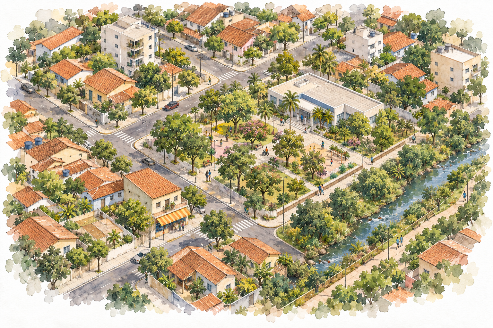

::: {.content-visible when-format="html"}
::: {.book-opening}

::: {.book-edition}
1ª edição · 2026
:::

# [Dados e Indicadores]{.book-title-line} [de Clima e Ambiente]{.book-title-line} [para a Saúde]{.book-title-line} {.unnumbered .book-title}

::: {.book-author}

:::

{.book-cover-art fig-alt="Vista aérea oblíqua de um bairro brasileiro em aquarela. Casas, pequenos edifícios e comércio se distribuem em quadras com ruas e calçadas conectadas. Uma praça arborizada fica junto a uma unidade de saúde, e um córrego com margens vegetadas acompanha a borda do bairro. Pessoas pequenas ocupam os passeios e a praça."}

[Começar a leitura →](frontmatter/agradecimentos.qmd){.book-start}

:::



:::
